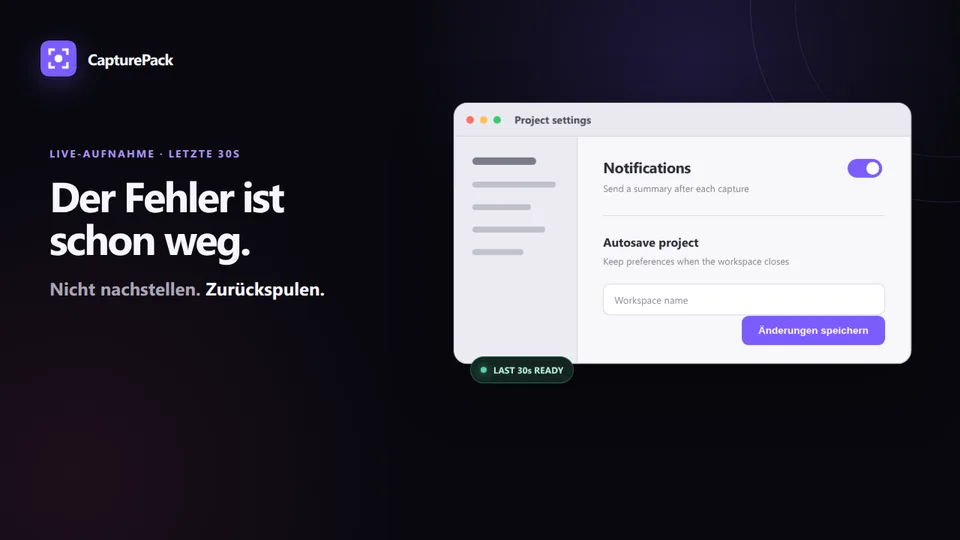
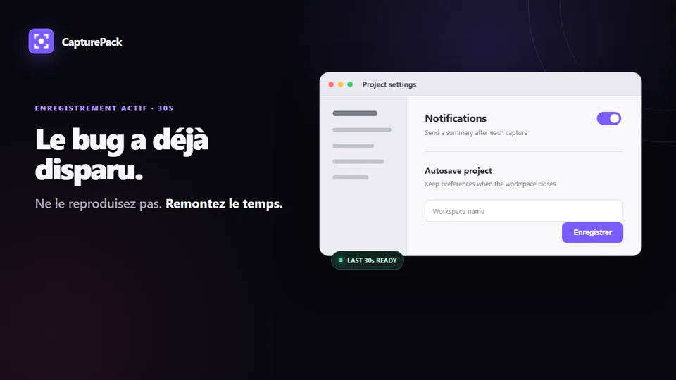
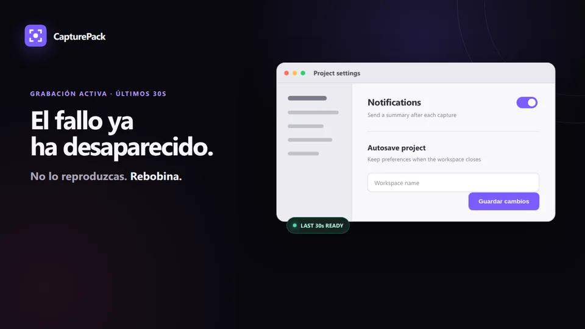
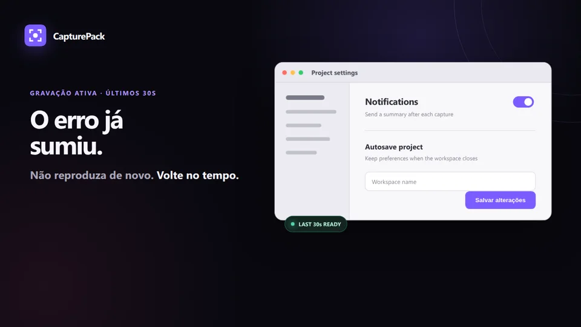
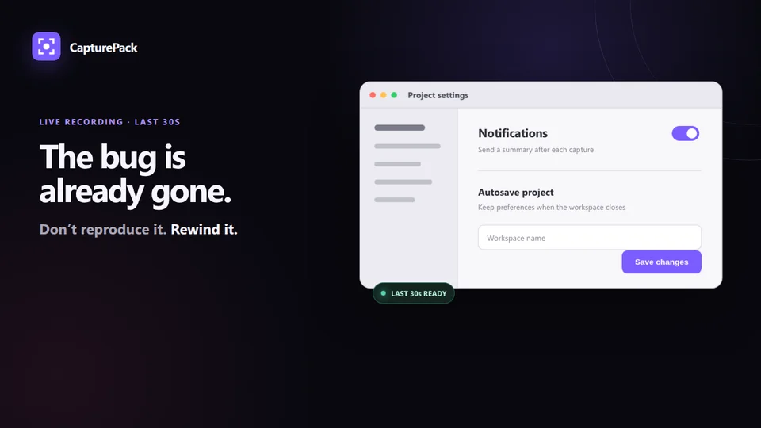
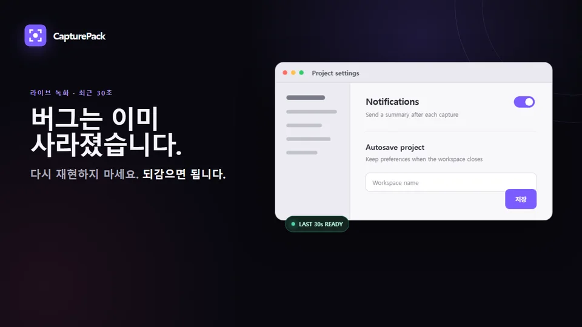
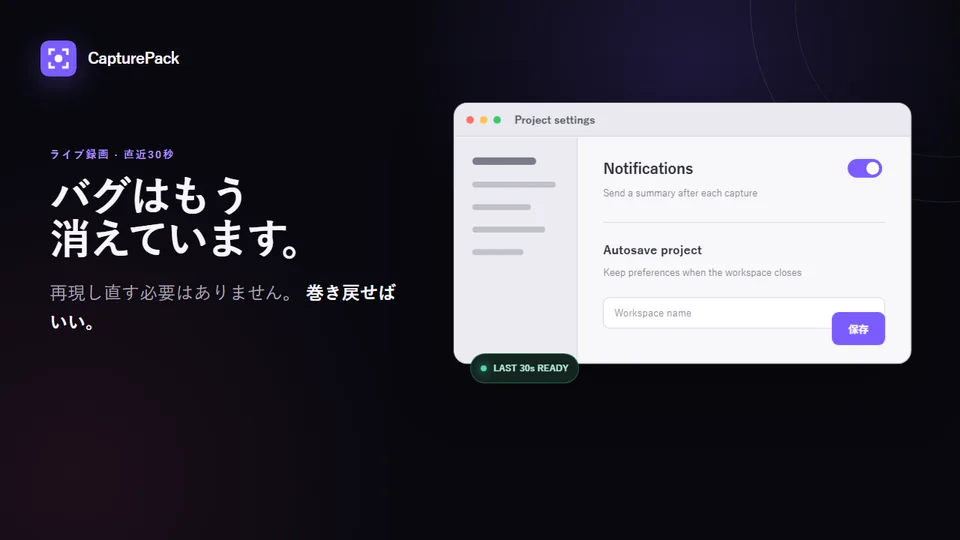
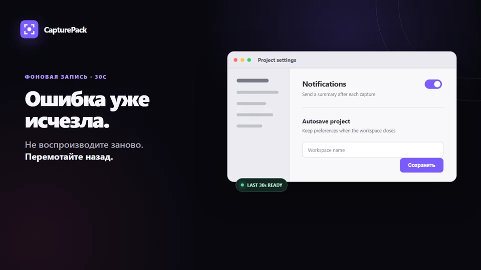
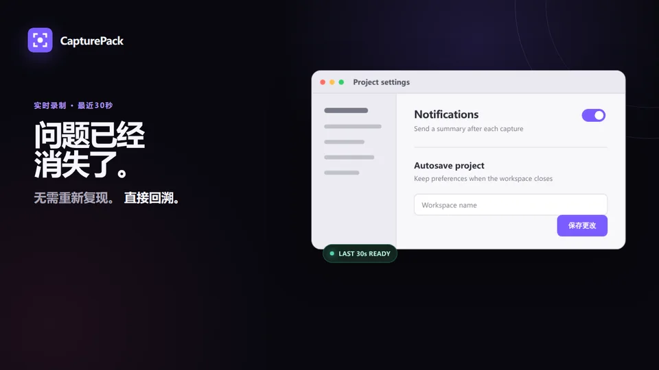

이슈 #328에 KPI 주기 보고를 남겼습니다: [보고 댓글](https://github.com/r2cuerdame/capturepack/issues/328#issuecomment-6653392784).

현재 KPI는 **측정 불가**이며, KPI 선택과 측정 출처 지정은 Luna 판단 대기입니다. 앱에 analytics나 telemetry가 없고 다운로드 수를 검증된 사람 수로 볼 수 없다는 저장소 문서를 근거로 적었습니다. 제공된 handbook SHA는 로컬 checkout과 GitHub 저장소에서 찾지 못해 대조하지 못했습니다. 이슈는 아직 열려 있습니다.
Reading prompt from stdin...
OpenAI Codex v0.164.0
--------
workdir: C:\_Project\LoopOffice2\.data\checkouts\r2cuerdame__CapturePack
model: gpt-6-luna
provider: openai
approval: never
sandbox: danger-full-access
reasoning effort: low
reasoning summaries: none
session id: 01a1aad3-d51a-7f80-8e75-d9370c482dbc
--------
user
이슈 #328
[Growth KPI] capturepack / 20753

<!-- loopoffice-effect:["effect","[\"create_issue\",\"[\\\"report_only\\\",\\\"growth_kpi\\\",\\\"capturepack\\\",20753]\"]",14] -->
성장 KPI 주기 보고: capturepack
KPI: 미선택 / 미선택
현재: 측정 불가; 관측: unknown
출처: unknown ; 읽는 방법: 루나가 지정해야 함
다음 한 걸음: 루나 판단 대기: KPI 선택 또는 측정 출처 복구
열린 제안 정리 책임: Luna; 상한: 미도달 또는 관측 불가
수익 추정·복합 점수 없음. 설치 수는 검증된 사람 수가 아님. 추가 비용·인증 권한 없음.

## 수용 기준
[Growth KPI] capturepack / 20753 을 끝낸다.

handbook 6f38c58f7e57993d379a7c18e00093f4fd341f52

warning: Codex is ignoring 4 unrecognized configuration settings. Check for typos or deprecated settings.
  user (C:\Users\recue\.codex\config.toml): `computer_use.windows.always_allowed_app_ids` is ignored.
  user (C:\Users\recue\.codex\config.toml): `projects.C:\Users\recue.approval_policy` is ignored.
  user (C:\Users\recue\.codex\config.toml): `projects.C:\Users\recue.full_auto` is ignored.
  ... and 1 more ignored settings.
warning: Ignoring malformed agent role definition: agent role `defaults` must define a description
warning: Codex is ignoring 4 unrecognized configuration settings. Check for typos or deprecated settings.
  user (C:\Users\recue\.codex\config.toml): `computer_use.windows.always_allowed_app_ids` is ignored.
  user (C:\Users\recue\.codex\config.toml): `projects.C:\Users\recue.approval_policy` is ignored.
  user (C:\Users\recue\.codex\config.toml): `projects.C:\Users\recue.full_auto` is ignored.
  ... and 1 more ignored settings.
warning: Ignoring malformed agent role definition: agent role `defaults` must define a description
warning: loading hooks from both C:\Users\recue\.codex\hooks.json and C:\Users\recue\.codex\config.toml; prefer a single representation for this layer
codex
이슈 본문과 handbook 커밋을 기준으로 현재 GitHub 상태와 저장소 규칙을 확인하겠습니다. 이 이슈는 보고 전용으로 보이므로, 측정 근거와 승인 경계에 맞춰 결론을 정리하겠습니다.
exec
"C:\\Users\\recue\\AppData\\Local\\Microsoft\\WindowsApps\\pwsh.exe" -Command "Get-ChildItem -Force | Select-Object -First 30; git status --short --branch; git log -1 --oneline; rg -n \"20753|Growth KPI|growth_kpi|capturepack\" . -g '"'!node_modules'"' -g '"'!dist'"' -g '"'!build'"'" in C:\_Project\LoopOffice2\.data\checkouts\r2cuerdame__CapturePack
 succeeded in 658ms:

    디렉터리: C:\_Project\LoopOffice2\.data\checkouts\r2cuerdame__CapturePack

Mode                 LastWriteTime         Length Name
----                 -------------         ------ ----
d--h-        2026-11-05  오후 5:29                .git
d----        2026-11-04  오후 6:48                .github
d----        2026-11-05  오전 1:32                .loop
d----        2026-11-05 오후 12:41                .loop-run
d----        2026-11-04  오후 6:48                .serena
d----        2026-11-04  오후 6:48                core
d----        2026-11-04  오후 6:48                docs
d----        2026-11-04  오후 6:48                examples
d----        2026-11-04  오후 6:48                extensions
d----        2026-11-04  오후 6:48                shared
d----        2026-11-04  오후 6:48                site
d----        2026-11-04  오후 6:48                tools
-a---        2026-11-04  오후 6:48           1226 .gitignore
-a---        2026-11-04  오후 6:48          32808 ARCHITECTURE.md
-a---        2026-11-04  오후 6:48          68127 CHANGELOG.md
-a---        2026-11-04  오후 6:48             17 CNAME
-a---        2026-11-04  오후 6:48           6747 CONTRIBUTING.md
-a---        2026-11-04  오후 6:48         180898 GOAL.md
-a---        2026-11-04  오후 6:48           1117 LICENSE
-a---        2026-11-04  오후 6:48          22800 README.de.md
-a---        2026-11-04  오후 6:48          23383 README.es.md
-a---        2026-11-04  오후 6:48          24005 README.fr.md
-a---        2026-11-04  오후 6:48          26739 README.ja.md
-a---        2026-11-04  오후 6:48          24564 README.ko.md
-a---        2026-11-04  오후 6:48          21122 README.md
-a---        2026-11-04  오후 6:48          22691 README.pt.md
-a---        2026-11-04  오후 6:48          35960 README.ru.md
-a---        2026-11-04  오후 6:48          19668 README.zh.md
-a---        2026-11-04  오후 6:48           5750 result.md
-a---        2026-11-05 오전 12:10          27568 ROADMAP.md
## loop/328-1
875e4f4 Merge pull request #351 from r2cuerdame/loop/345-4
.\ARCHITECTURE.md:7:1. **The format architecture** — permanent. The `.capturepack` format defined in
.\ARCHITECTURE.md:10:   is one writer of the format: the fastest path from `Ctrl+Alt+C` to a `.capturepack` file.
.\ARCHITECTURE.md:26:  ([#80](https://github.com/r2cuerdame/capturepack/issues/80), closing
.\ARCHITECTURE.md:27:  [#78](https://github.com/r2cuerdame/capturepack/issues/78)). They were reasoned
.\ARCHITECTURE.md:145:  The `capturepack-share` package uses a `reviewed-stills-only` profile with a
.\ARCHITECTURE.md:286:                    2026-07-27-1403-title.capturepack
.\ARCHITECTURE.md:384:A main-process module that turns the editor's result into a `.capturepack`, exactly per SPEC:
.\ARCHITECTURE.md:401:   named `YYYY-MM-DD-HHMM-title-slug.capturepack` in the configured output folder. Optionally
.\ARCHITECTURE.md:487:writes will still be a plain, valid `.capturepack`.
.\CHANGELOG.md:20:  ([#157](https://github.com/r2cuerdame/capturepack/issues/157)).
.\CHANGELOG.md:23:  ([#165](https://github.com/r2cuerdame/capturepack/issues/165)).
.\CHANGELOG.md:32:  ([#157](https://github.com/r2cuerdame/capturepack/issues/157)).
.\CHANGELOG.md:36:  ([#169](https://github.com/r2cuerdame/capturepack/issues/169),
.\CHANGELOG.md:37:  [#170](https://github.com/r2cuerdame/capturepack/issues/170)).
.\CHANGELOG.md:81:  ([#68](https://github.com/r2cuerdame/capturepack/issues/68)).
.\CHANGELOG.md:97:  ([#69](https://github.com/r2cuerdame/capturepack/issues/69)).
.\CHANGELOG.md:124:  ([#147](https://github.com/r2cuerdame/capturepack/issues/147)).
.\CHANGELOG.md:140:  ([#148](https://github.com/r2cuerdame/capturepack/issues/148)).
.\CHANGELOG.md:150:  supported locales ([#137](https://github.com/r2cuerdame/capturepack/issues/137)).
.\CHANGELOG.md:172:  `capturepack-share` `.share.zip` with the `reviewed-stills-only` profile. Its
.\CHANGELOG.md:177:  ([#140](https://github.com/r2cuerdame/capturepack/issues/140),
.\CHANGELOG.md:178:  [#141](https://github.com/r2cuerdame/capturepack/pull/141)).
.\CHANGELOG.md:222:  0.4%. This is the regression [#58](https://github.com/r2cuerdame/capturepack/issues/58)
.\CHANGELOG.md:234:  ([#134](https://github.com/r2cuerdame/capturepack/issues/134)).
.\CHANGELOG.md:308:  wrong ([#136](https://github.com/r2cuerdame/capturepack/issues/136)).
.\CHANGELOG.md:317:  ([#134](https://github.com/r2cuerdame/capturepack/issues/134)).
.\CHANGELOG.md:321:  ([#135](https://github.com/r2cuerdame/capturepack/issues/135)).
.\CHANGELOG.md:326:  them ([#76](https://github.com/r2cuerdame/capturepack/issues/76) — the real
.\CHANGELOG.md:340:  ([#75](https://github.com/r2cuerdame/capturepack/issues/75)).
.\CHANGELOG.md:359:  ([#12](https://github.com/r2cuerdame/capturepack/issues/12)).
.\CHANGELOG.md:392:  value ([#80](https://github.com/r2cuerdame/capturepack/issues/80),
.\CHANGELOG.md:393:  [#78](https://github.com/r2cuerdame/capturepack/issues/78)).
.\CHANGELOG.md:402:  are actually CapturePacks ([#47](https://github.com/r2cuerdame/capturepack/issues/47)).
.\CHANGELOG.md:409:  ([#48](https://github.com/r2cuerdame/capturepack/issues/48)).
.\CHANGELOG.md:417:  ([#63](https://github.com/r2cuerdame/capturepack/issues/63)).
.\CHANGELOG.md:429:  ([#51](https://github.com/r2cuerdame/capturepack/issues/51)).
.\CHANGELOG.md:443:  ([#133](https://github.com/r2cuerdame/capturepack/issues/133)).
.\CHANGELOG.md:459:  ([#132](https://github.com/r2cuerdame/capturepack/issues/132)).
.\CHANGELOG.md:471:  ([#116](https://github.com/r2cuerdame/capturepack/issues/116)).
.\CHANGELOG.md:480:  ([#116](https://github.com/r2cuerdame/capturepack/issues/116)). Two things to
.\CHANGELOG.md:501:  ([#117](https://github.com/r2cuerdame/capturepack/issues/117)).
.\CHANGELOG.md:507:  ([#116](https://github.com/r2cuerdame/capturepack/issues/116)).
.\CHANGELOG.md:518:  ([#115](https://github.com/r2cuerdame/capturepack/issues/115)).
.\CHANGELOG.md:522:  visible change ([#104](https://github.com/r2cuerdame/capturepack/issues/104)).
.\CHANGELOG.md:530:  failure ([#103](https://github.com/r2cuerdame/capturepack/issues/103)). A real
.\CHANGELOG.md:556:  ([#116](https://github.com/r2cuerdame/capturepack/issues/116)). They are
.\CHANGELOG.md:568:  0.6.0 ([#115](https://github.com/r2cuerdame/capturepack/issues/115)). This is
.\CHANGELOG.md:569:  the number [#89](https://github.com/r2cuerdame/capturepack/issues/89) needs:
.\CHANGELOG.md:591:  ([#89](https://github.com/r2cuerdame/capturepack/issues/89)).
.\CHANGELOG.md:604:  ([#114](https://github.com/r2cuerdame/capturepack/issues/114)).
.\CHANGELOG.md:610:  ([#113](https://github.com/r2cuerdame/capturepack/issues/113)).
.\CHANGELOG.md:616:  ([#112](https://github.com/r2cuerdame/capturepack/issues/112)).
.\CHANGELOG.md:623:  ([#110](https://github.com/r2cuerdame/capturepack/issues/110)).
.\CHANGELOG.md:626:  broken updater ([#111](https://github.com/r2cuerdame/capturepack/issues/111)).
.\CHANGELOG.md:633:  ([#109](https://github.com/r2cuerdame/capturepack/issues/109)).
.\CHANGELOG.md:641:  many controls it could afford ([#108](https://github.com/r2cuerdame/capturepack/issues/108)).
.\CHANGELOG.md:648:  ([#107](https://github.com/r2cuerdame/capturepack/issues/107)). This now only
.\CHANGELOG.md:656:  ([#106](https://github.com/r2cuerdame/capturepack/issues/106)).
.\CHANGELOG.md:677:  without it ([#89](https://github.com/r2cuerdame/capturepack/issues/89)). At the
.\CHANGELOG.md:728:- [#89](https://github.com/r2cuerdame/capturepack/issues/89): when startup
.\CNAME:1:capturepack.dev
.\CONTRIBUTING.md:1:# Contributing to capturepack
.\CONTRIBUTING.md:9:5 seconds, export a `.capturepack` file that any human or LLM can understand. Everything follows
.\CONTRIBUTING.md:31:capturepack/
.\CONTRIBUTING.md:40:├── tools/           # standalone CLI tools — validate-capturepack.mjs checks a pack against SPEC.md
.\CONTRIBUTING.md:41:└── site/            # landing page and guide (capturepack.dev)
.\CONTRIBUTING.md:140:[#1](https://github.com/r2cuerdame/capturepack/issues/1); the practice itself is described in
.\CONTRIBUTING.md:145:capturepack is [MIT licensed](LICENSE). By contributing, you agree that your contributions are
.\docs\CODE_SIGNING.md:56:[github.com/r2cuerdame/capturepack/releases](https://github.com/r2cuerdame/capturepack/releases)
.\docs\CODE_SIGNING.md:57:and the download button on [capturepack.dev](https://capturepack.dev), which links to it.
.\docs\CODE_SIGNING.md:68:  (`https://github.com/r2cuerdame/capturepack`), which can be disabled in
.\docs\CODE_SIGNING.md:96:[github.com/r2cuerdame/capturepack/issues](https://github.com/r2cuerdame/capturepack/issues).
.\core\package-lock.json:2:  "name": "capturepack",
.\core\package-lock.json:8:      "name": "capturepack",
.\GOAL.md:96:([#89](https://github.com/r2cuerdame/capturepack/issues/89)); no fixed timing
.\GOAL.md:112:window moved quickly leaves its box ahead of the picture ([#89](https://github.com/r2cuerdame/capturepack/issues/89)).
.\GOAL.md:124:**What 0.3.4 changes** ([#104](https://github.com/r2cuerdame/capturepack/issues/104)):
.\GOAL.md:333:[#116](https://github.com/r2cuerdame/capturepack/issues/116). Keep it whatever
.\GOAL.md:368:excluding ([#117](https://github.com/r2cuerdame/capturepack/issues/117)). That
.\GOAL.md:587:- Domain: **https://capturepack.dev** — the one and only official domain; every document,
.\GOAL.md:588:  README link, and download link uses it. A one-line `CNAME` file (exactly `capturepack.dev`)
.\GOAL.md:639:- **Landing page** — capturepack.dev stays truthful about the current product and download state.
.\GOAL.md:979:- MCP `capturepack_frame(time)` returns the nearest rendered keyframe (removing the v0
.\GOAL.md:1759:    reload guidance and `capturepack_latest` request. Older/specific records use
.\GOAL.md:1760:    `capturepack_history` followed by `capturepack_open`.
.\GOAL.md:2068:CapturePack is not only a program that creates `.capturepack` folders — it
.\GOAL.md:2101:fallback. `capturepack_latest`, `capturepack_history` and `capturepack_open`
.\GOAL.md:2108:| `capturepack_latest` | Summarize and pin the most recent saved pack |
.\GOAL.md:2109:| `capturepack_history` | Browse/search saved image and video packs without changing the current pack |
.\GOAL.md:2110:| `capturepack_list` | Compatibility alias of `capturepack_history` |
.\GOAL.md:2111:| `capturepack_open` | Open and pin a pack by history id or absolute folder/ZIP path |
.\GOAL.md:2112:| `capturepack_summary` | App, capture kind, time, media, annotations and plugin counts |
.\GOAL.md:2113:| `capturepack_manifest` / `capturepack_report` | Raw manifest.json / report.md |
.\GOAL.md:2114:| `capturepack_timeline` | Video timeline or a time slice; image packs explain that none applies |
.\GOAL.md:2115:| `capturepack_annotations` / `capturepack_find_annotations` | Annotation list / keyword search |
.\GOAL.md:2116:| `capturepack_frame` | Nearest declared annotated keyframe, otherwise snapshot.png |
.\GOAL.md:2117:| `capturepack_replay` | Replay metadata only; never raw video bytes |
.\GOAL.md:2118:| `capturepack_dom` / `capturepack_find_dom` | Generic plugin JSON and selector/text search |
.\GOAL.md:2119:| `capturepack_windows` | Window/focus events plus window-related plugin metadata |
.\GOAL.md:2120:| `capturepack_search` | Search report, annotations, video timeline, manifest and plugin data |
.\GOAL.md:2121:| `capturepack_export_markdown` | Return a Markdown summary as text; write no files |
.\GOAL.md:2151:`capturepack_history`, then `capturepack_open`, and uses the appropriate
.\GOAL.md:2457:included still before sending." A Share Copy is a separate `capturepack-share` ZIP,
.\GOAL.md:3177:  the actual endpoint, setup command, and `capturepack_latest` request.
.\GOAL.md:3269:capturepack/
.\GOAL.md:3332:GitHub 저장소 이름은 `CapturePack`보다 `capturepack`으로 하고, 확장자도 `.capturepack`으로 통일한다. 저장소 이름, 파일 포맷, 프로젝트 이름이 모두 일치하면 사용자가 기억하기 쉽고, 장기적으로 하나의 포맷으로 자리 잡기에도 유리하다.
.\core\electron-builder.yml:1:appId: io.github.r2cuerdame.capturepack
.\core\electron-builder.yml:39:  repo: capturepack
.\core\test\temporal\check.mjs:47:const outfile = path.join(tmpdir(), `capturepack-temporal-${process.pid}.mjs`)
.\core\test\temporal\check.mjs:124:  const baselineOut = path.join(tmpdir(), `capturepack-baseline-${process.pid}.mjs`)
.\README.de.md:1:# capturepack
.\README.de.md:5:
.\README.de.md:6:
.\README.de.md:35:🌐 **[capturepack.dev](https://capturepack.dev)** · [Herunterladen](https://github.com/r2cuerdame/capturepack/releases/latest)
.\README.de.md:45:  <a href="https://capturepack.dev/">
.\README.de.md:46:    
.\README.de.md:179:- [capturepack.dev](https://capturepack.dev) erkennt die Browsersprache ebenfalls automatisch.
.\README.de.md:263:Eine KI kann `capturepack_history` aufrufen, um Bild- und Videoaufzeichnungen zu
.\README.de.md:264:durchsuchen, und dann `capturepack_open` mit der gewählten id;
.\README.de.md:265:`capturepack_latest` bleibt die Abkürzung zum neuesten Pack.
.\README.de.md:268:claude mcp add --transport http capturepack http://127.0.0.1:39393/mcp
.\README.de.md:286:Lade den aktuellen Installer von den [GitHub Releases](https://github.com/r2cuerdame/capturepack/releases/latest) herunter:
.\README.de.md:304:git clone https://github.com/r2cuerdame/capturepack.git
.\README.de.md:305:cd capturepack/core
.\README.de.md:325:wird in [Issue #89](https://github.com/r2cuerdame/capturepack/issues/89) weiter
.\docs\DEPENDENCY-AUDIT-0.3.1.md:11:cd C:\_Project\capturepack\core
.\extensions\chrome\background.js:10:const HOST = 'com.capturepack.host'
.\extensions\chrome\background.js:26:const UPDATE_ATTEMPT_KEY = 'capturepackUpdateAttempt'
.\extensions\chrome\background.js:105:const RECONNECT_ALARM = 'capturepack-reconnect'
.\extensions\chrome\background.js:219:      app: 'capturepack-extension',
.\extensions\chrome\background.js:452:      document: window.__capturepackDocumentSnapshot ? window.__capturepackDocumentSnapshot() : null,
.\extensions\chrome\background.js:639:            const api = window.__capturepackFullPage
.\extensions\chrome\background.js:706:    const { createFullPageCapturer, bundleMessages } = self.__capturepackFullPageCapture
.\extensions\chrome\background.js:759:const PICK_MENU_ID = 'capturepack-pick-element'
.\README.fr.md:1:# capturepack
.\README.fr.md:5:
.\README.fr.md:6:
.\README.fr.md:35:🌐 **[capturepack.dev](https://capturepack.dev)** · [Télécharger](https://github.com/r2cuerdame/capturepack/releases/latest)
.\README.fr.md:45:  <a href="https://capturepack.dev/">
.\README.fr.md:46:    
.\README.fr.md:178:- [capturepack.dev](https://capturepack.dev) détecte lui aussi la langue de votre navigateur.
.\README.fr.md:262:Une IA peut appeler `capturepack_history` pour parcourir ou rechercher les
.\README.fr.md:263:enregistrements image et vidéo, puis `capturepack_open` avec l’identifiant retenu ;
.\README.fr.md:264:`capturepack_latest` reste le raccourci vers le pack le plus récent.
.\README.fr.md:267:claude mcp add --transport http capturepack http://127.0.0.1:39393/mcp
.\README.fr.md:284:Téléchargez le dernier installateur sur [GitHub Releases](https://github.com/r2cuerdame/capturepack/releases/latest) :
.\README.fr.md:302:git clone https://github.com/r2cuerdame/capturepack.git
.\README.fr.md:303:cd capturepack/core
.\README.fr.md:323:mesure dans l’[issue #89](https://github.com/r2cuerdame/capturepack/issues/89).
.\core\src\shared\types.ts:2:// These types describe data written into a .capturepack; keep them in sync with the spec.
.\core\src\shared\types.ts:19:export const FORMAT_NAME = 'capturepack'
.\docs\DXGI_REPLAY_RING.md:3:Issue [#138](https://github.com/r2cuerdame/capturepack/issues/138) replaces the
.\core\src\shared\prompt.ts:27:    'server is connected, call capturepack_latest instead.'
.\core\src\shared\prompt.ts:38:    'Analyze the latest CapturePack. Call capturepack_latest on the CapturePack MCP ' +
.\README.es.md:1:# capturepack
.\README.es.md:5:
.\README.es.md:6:
.\README.es.md:36:🌐 **[capturepack.dev](https://capturepack.dev)** · [Descargar](https://github.com/r2cuerdame/capturepack/releases/latest)
.\README.es.md:45:  <a href="https://capturepack.dev/">
.\README.es.md:46:    
.\README.es.md:181:- [capturepack.dev](https://capturepack.dev) también detecta el idioma de tu navegador.
.\README.es.md:263:Una IA puede llamar a `capturepack_history` para explorar o buscar registros de
.\README.es.md:264:imagen y de vídeo, y después a `capturepack_open` con el id elegido;
.\README.es.md:265:`capturepack_latest` sigue siendo el atajo para el pack más reciente.
.\README.es.md:268:claude mcp add --transport http capturepack http://127.0.0.1:39393/mcp
.\README.es.md:286:Descarga el instalador más reciente desde [GitHub Releases](https://github.com/r2cuerdame/capturepack/releases/latest):
.\README.es.md:304:git clone https://github.com/r2cuerdame/capturepack.git
.\README.es.md:305:cd capturepack/core
.\README.es.md:325:sigue en medición en la [incidencia #89](https://github.com/r2cuerdame/capturepack/issues/89).
.\core\src\shared\ipc.ts:1734:  // Absolute path of the pack folder ('dir') or .capturepack file ('zip').
.\docs\HANDOFF-v0.2.0.md:18:- **Verify your worktree is a real separate path before you start.** An orca worktree once pointed at the same directory as `main` and an agent began editing the primary checkout. `git rev-parse --show-toplevel` and confirm it is not `C:/_Project/capturepack`.
.\docs\HANDOFF-v0.2.0.md:35:7. **Verify with**: `cd core && npm run typecheck && npm run build && npx electron . --smoke`, and from the repo root `node tools/validate-capturepack.mjs examples/minimal`.
.\docs\HANDOFF-v0.2.0.md:105:**2 — format, and do it in ONE version bump.** #75 (`media.displays` becomes REQUIRED and always present, so one monitor is the special case rather than several; the annotation reference frame moves per display), #76 (multi-monitor as the normal case; acceptance is a three-display capture with one portrait, one scaled, focus on the third), #12 (`input.*` events). Doing this before Chrome means the DOM provider is written against the final contract rather than the old one. Not done until SPEC.md, `docs/schemas/`, `tools/validate-capturepack.mjs`, the MCP tool descriptions and `docs/MCP.md` all agree.
.\README.pt.md:1:# capturepack
.\README.pt.md:5:
.\README.pt.md:6:
.\README.pt.md:36:🌐 **[capturepack.dev](https://capturepack.dev)** · [Baixar](https://github.com/r2cuerdame/capturepack/releases/latest)
.\README.pt.md:45:  <a href="https://capturepack.dev/">
.\README.pt.md:46:    
.\README.pt.md:178:- O [capturepack.dev](https://capturepack.dev) também detecta o idioma do navegador automaticamente.
.\README.pt.md:260:Uma IA pode chamar `capturepack_history` para navegar/pesquisar registros de
.\README.pt.md:261:imagem e vídeo e depois `capturepack_open` com o id escolhido;
.\README.pt.md:262:`capturepack_latest` continua sendo o atalho para o pack mais recente.
.\README.pt.md:265:claude mcp add --transport http capturepack http://127.0.0.1:39393/mcp
.\README.pt.md:282:Baixe o instalador mais recente pelo [GitHub Releases](https://github.com/r2cuerdame/capturepack/releases/latest):
.\README.pt.md:300:git clone https://github.com/r2cuerdame/capturepack.git
.\README.pt.md:301:cd capturepack/core
.\README.pt.md:322:[issue #89](https://github.com/r2cuerdame/capturepack/issues/89). O CapturePack
.\extensions\chrome\content-script.js:35:  if (window.__capturepackPickerActive && typeof window.__capturepackPickerCleanup === 'function') {
.\extensions\chrome\content-script.js:37:      window.__capturepackPickerCleanup()
.\extensions\chrome\content-script.js:42:  window.__capturepackPickerActive = true
.\extensions\chrome\content-script.js:173:    window.__capturepackPickerActive = false
.\extensions\chrome\content-script.js:174:    window.__capturepackPickerCleanup = null
.\extensions\chrome\content-script.js:185:  window.__capturepackPickerCleanup = cleanup
.\extensions\chrome\content-script.js:190:      postDown({ __capturepack: 'disarm' })
.\extensions\chrome\content-script.js:195:      window.top.postMessage({ __capturepack: 'disarm' }, '*')
.\extensions\chrome\content-script.js:219:    const geometry = window.__capturepackFrameGeometry
.\extensions\chrome\content-script.js:318:      window.parent.postMessage({ __capturepack: 'pick', payload }, '*')
.\extensions\chrome\content-script.js:328:    if (data.__capturepack === 'disarm') {
.\extensions\chrome\content-script.js:334:      postDown({ __capturepack: 'disarm' })
.\extensions\chrome\content-script.js:335:      if (window.__capturepackPickerActive) cleanup()
.\extensions\chrome\content-script.js:338:    if (data.__capturepack !== 'pick') return
.\extensions\chrome\content-script.js:342:    if (!window.__capturepackPickerActive) return
.\extensions\chrome\content-script.js:388:      document: IS_TOP && window.__capturepackDocumentSnapshot
.\extensions\chrome\content-script.js:389:        ? window.__capturepackDocumentSnapshot()
.\examples\minimal\manifest.json:2:  "format": "capturepack",
.\examples\minimal\manifest.json:6:  "generator": { "name": "capturepack-examples", "version": "0.1.0" },
.\docs\HANDOFF-PROMPT.md:3:You are taking over CapturePack at `C:\_Project\capturepack`.
.\docs\HANDOFF-PROMPT.md:75:can create a `capturepack-share` `.share.zip` whose only media are the declared
.\docs\HANDOFF-PROMPT.md:90:- **[#76](https://github.com/r2cuerdame/capturepack/issues/76) — three real
.\docs\HANDOFF-PROMPT.md:99:- **[#137](https://github.com/r2cuerdame/capturepack/issues/137) — display loss
.\docs\HANDOFF-PROMPT.md:104:- **[#138](https://github.com/r2cuerdame/capturepack/issues/138) — replace the
.\docs\HANDOFF-PROMPT.md:110:- **[#139](https://github.com/r2cuerdame/capturepack/issues/139) — maintain a
.\docs\HANDOFF-PROMPT.md:115:- **[#69](https://github.com/r2cuerdame/capturepack/issues/69)** and
.\docs\HANDOFF-PROMPT.md:116:  **[#68](https://github.com/r2cuerdame/capturepack/issues/68)** — the plugin
.\docs\HANDOFF-PROMPT.md:118:- **[#21](https://github.com/r2cuerdame/capturepack/issues/21)** — code signing.
.\docs\HANDOFF-PROMPT.md:119:- **[#1](https://github.com/r2cuerdame/capturepack/issues/1)** — the usage
.\docs\HANDOFF-PROMPT.md:128:[#89](https://github.com/r2cuerdame/capturepack/issues/89) — overlays leading
.\docs\HANDOFF-PROMPT.md:159:cd C:\_Project\capturepack\core
.\README.md:1:# capturepack
.\README.md:5:
.\README.md:6:
.\README.md:34:🌐 **[capturepack.dev](https://capturepack.dev)** · [Download](https://github.com/r2cuerdame/capturepack/releases/latest)
.\README.md:42:  <a href="https://capturepack.dev/">
.\README.md:43:    
.\README.md:173:- [capturepack.dev](https://capturepack.dev) auto-detects your browser language too.
.\README.md:255:An AI can call `capturepack_history` to browse/search image and video records,
.\README.md:256:then `capturepack_open` with the selected id; `capturepack_latest` remains the
.\README.md:260:claude mcp add --transport http capturepack http://127.0.0.1:39393/mcp
.\README.md:276:Download the latest installer from [GitHub Releases](https://github.com/r2cuerdame/capturepack/releases/latest):
.\README.md:294:git clone https://github.com/r2cuerdame/capturepack.git
.\README.md:295:cd capturepack/core
.\README.md:315:measurement in [issue #89](https://github.com/r2cuerdame/capturepack/issues/89).
.\docs\MCP.md:17:`capturepack_history`, select one with `capturepack_open`, or use
.\docs\MCP.md:18:`capturepack_latest` as the newest-pack shortcut. The user does not have to
.\docs\MCP.md:56:restart/reload guidance, and the instruction to call `capturepack_latest`. To choose
.\docs\MCP.md:57:an older or specific pack, use `capturepack_history` followed by
.\docs\MCP.md:58:`capturepack_open`. The forms below are the same ones those buttons produce.
.\docs\MCP.md:63:claude mcp add --transport http capturepack http://127.0.0.1:39393/mcp
.\docs\MCP.md:73:    "capturepack": { "url": "http://127.0.0.1:39393/mcp" }
.\docs\MCP.md:85:    "capturepack": { "type": "http", "url": "http://127.0.0.1:39393/mcp" }
.\docs\MCP.md:98:    "capturepack": {
.\docs\MCP.md:119:    "capturepack": { "serverUrl": "http://127.0.0.1:39393/mcp" }
.\docs\MCP.md:129:[mcp_servers.capturepack]
.\docs\MCP.md:141:    "capturepack": { "httpUrl": "http://127.0.0.1:39393/mcp" }
.\docs\MCP.md:153:    "capturepack": { "url": "http://127.0.0.1:39393/mcp", "type": "streamableHttp" }
.\docs\MCP.md:165:    "capturepack": {
.\docs\MCP.md:194:- `capturepack_open` pins a specific pack as the current one for the rest of the app session.
.\docs\MCP.md:195:- `capturepack_latest` re-pins the current pack to the newest one.
.\docs\MCP.md:197:To select an older record, call `capturepack_history` with an optional text query or
.\docs\MCP.md:198:image/video filter, then pass the returned id to `capturepack_open`. For the newest record,
.\docs\MCP.md:199:`capturepack_latest` remains the one-call shortcut.
.\docs\MCP.md:204:folder, as shown by `capturepack_history` / `capturepack_list` — e.g. `CapturePack_2026-07-27_140309`; the plain base
.\docs\MCP.md:206:`.capturepack` file or an extracted pack directory. Optional `id` defaults to the current
.\docs\MCP.md:211:| `capturepack_latest` | — | Summary of the newest pack; re-pins it as the current pack |
.\docs\MCP.md:212:| `capturepack_history` | `limit?`, `query?`, `kind?` (`image`/`video`) | Searchable saved-record history, newest first: stable id/path/captured_at, capture kind, storage kind, title, note, focused app and situational counts |
.\docs\MCP.md:213:| `capturepack_list` | `limit?`, `query?`, `kind?` | Compatibility alias of `capturepack_history` |
.\docs\MCP.md:214:| `capturepack_open` | `id` — pack id or absolute path (folder and ZIP both supported) | The pack's summary; pins it as the current pack for subsequent calls |
.\docs\MCP.md:215:| `capturepack_summary` | `id?` | Title, note, captured_at, environment (os/screens/app), explicit/inferred `capture_kind`, image scope/crop provenance, annotation/plugin counts; video packs also report replay, timeline and frame-time details |
.\docs\MCP.md:216:| `capturepack_manifest` | `id?` | Raw `manifest.json` |
.\docs\MCP.md:217:| `capturepack_report` | `id?` | Raw `report.md` |
.\docs\MCP.md:218:| `capturepack_timeline` | `id?`, `from_ms?`, `to_ms?` | Video timeline or a slice; image packs and video packs omitting `timeline.json` return a non-error explanation that no timeline applies. Includes the `input.*` events described below |
.\docs\MCP.md:219:| `capturepack_annotations` | `id?` | The annotation list — including each box's optional `target` (the real UI object it was placed on, e.g. `{source:"uia", name:"Save", control_type:"Button"}`) and, on a multi-display capture, **which screen it is on** (`display_index` + `display_snapshot`, see below). Packs omitting `annotations.json` return an empty list with `available: false` |
.\docs\MCP.md:220:| `capturepack_find_annotations` | `keyword`, `id?` | Annotations matching the keyword |
.\docs\MCP.md:221:| `capturepack_frame` | `display?`, `time_s?`, `id?` | An image of the selected 1-based display (focused by default): the **nearest annotated keyframe** to `time_s` when that display has them, else its snapshot — **see below** |
.\docs\MCP.md:222:| `capturepack_replay` | `id?` | Replay **metadata** only: filename, duration_ms, size_bytes — never raw video bytes |
.\docs\MCP.md:223:| `capturepack_dom` | `id?` | Generic plugin metadata under `plugins/*/` — on Windows usually `windows-uia` (the capture-instant window list + the control trees the dump reached); DOM-ish data lives under a chrome plugin dir when present |
.\docs\MCP.md:224:| `capturepack_find_dom` | `selector`, `id?` | Plugin/DOM entries matching the selector — e.g. an `automation_id` or a control name in the `windows-uia` dump |
.\docs\MCP.md:225:| `capturepack_windows` | `id?` | Window/focus timeline events — including the observed `input.window.*` ones — plus window-related plugin metadata (the `windows-uia` window list), when present |
.\docs\MCP.md:226:| `capturepack_search` | `keyword`, `id?` | Case-insensitive substring search across `report.md`, annotation texts, video timeline when present, plugin JSON, and manifest title/note — hits grouped by source |
.\docs\MCP.md:227:| `capturepack_export_markdown` | `id?` | One Markdown document: `report.md` + annotations table + plugin inventory, plus the timeline only for video packs. The timeline section lists at most 100 events and then states how many were omitted — use `capturepack_timeline` for the full log. Returned as text; **writes no files** |
.\docs\MCP.md:282:role, text, URL and viewport placement). `capturepack_dom` exposes plugin JSON
.\docs\MCP.md:283:generically, `capturepack_find_dom` searches it, and `capturepack_windows`
.\docs\MCP.md:321:([SPEC §8.7](../SPEC.md)) in `capturepack_annotations`:
.\docs\MCP.md:367:Because the stored form is sparse, `capturepack_annotations` and `capturepack_find_annotations`
.\docs\MCP.md:387:### `capturepack_frame` — annotated keyframes
.\docs\MCP.md:389:`capturepack_frame` always answers with MCP image content (base64 PNG) plus a text note.
.\docs\MCP.md:395:  drawn into the pixels. `capturepack_frame(display, time_s)` returns the **nearest** one, and the note
.\docs\MCP.md:411:top-level `timeline.json`; `capturepack_timeline` reports that shape without
.\docs\MCP.md:413:`capturepack_replay` returns `null` for every image pack. MCP analyzes only
.\docs\MCP.md:417:images is what MCP serves. `capturepack_summary` (and `capturepack_latest`) announce the
.\docs\MCP.md:427:- write export output to disk (`capturepack_export_markdown` returns text)
.\docs\MCP.md:428:- return raw replay video bytes (`capturepack_replay` returns metadata only)
.\docs\MCP.md:435:- **What counts as a pack:** `*.capturepack` files (standard ZIPs) and pack **directories**
.\docs\MCP.md:439:  (and pre-release date folders). A pack directory and a same-stem sibling `.capturepack`
.\docs\MCP.md:445:  folder, without the `.capturepack` extension (e.g. `CapturePack_2026-07-27_140309`). The
.\docs\MCP.md:451:  index, and `capturepack_latest` prefers the newest **readable** pack over a malformed one.
.\docs\MCP.md:488:without a `manifest.json`, is not indexed. A pack directory whose sibling `.capturepack`
.\extensions\chrome\document-snapshot.js:250:  window.__capturepackDocumentSnapshot = (options) => {
.\extensions\chrome\full-page-content.js:20:  const STATE_KEY = '__capturepackFullPageState'
.\extensions\chrome\full-page-content.js:159:    const walk = window.__capturepackDocumentSnapshot
.\extensions\chrome\full-page-content.js:185:  window.__capturepackFullPage = api
.\extensions\chrome\full-page-capture.js:30:  const plan = globalThis.__capturepackFullPagePlan
.\extensions\chrome\full-page-capture.js:286:  if (typeof globalThis !== 'undefined') globalThis.__capturepackFullPageCapture = api
.\extensions\chrome\full-page-capture.js:287:  if (typeof self !== 'undefined') self.__capturepackFullPageCapture = api
.\extensions\chrome\frame-geometry.js:65:  if (typeof window !== 'undefined') window.__capturepackFrameGeometry = api
.\extensions\chrome\frame-geometry.js:66:  if (typeof globalThis !== 'undefined') globalThis.__capturepackFrameGeometry = api
.\extensions\chrome\full-page-plan.js:14:// vm sandbox; both find it on `globalThis.__capturepackFullPagePlan`.
.\extensions\chrome\full-page-plan.js:214:  if (typeof globalThis !== 'undefined') globalThis.__capturepackFullPagePlan = api
.\extensions\chrome\full-page-plan.js:215:  if (typeof self !== 'undefined') self.__capturepackFullPagePlan = api
.\extensions\chrome\native-host\README.md:16:2. Generates the manifest from [`com.capturepack.host.json`](com.capturepack.host.json)
.\extensions\chrome\native-host\README.md:19:   `HKCU\Software\Google\Chrome\NativeMessagingHosts\com.capturepack.host`.
.\extensions\chrome\native-host\com.capturepack.host.json:2:  "name": "com.capturepack.host",
.\extensions\chrome\native-host\com.capturepack.host.json:4:  "path": "REPLACED_BY_INSTALLER\\capturepack-host.exe",
.\core\src\renderer\settings\settings.ts:1302:    snippet: (url) => `claude mcp add --transport http capturepack ${url}`,
.\core\src\renderer\settings\settings.ts:1306:    snippet: (url) => jsonBlock({ mcpServers: { capturepack: { url } } }),
.\core\src\renderer\settings\settings.ts:1310:    snippet: (url) => jsonBlock({ servers: { capturepack: { type: 'http', url } } }),
.\core\src\renderer\settings\settings.ts:1314:    snippet: (url) => jsonBlock({ mcpServers: { capturepack: { serverUrl: url } } }),
.\core\src\renderer\settings\settings.ts:1318:    snippet: (url) => jsonBlock({ mcpServers: { capturepack: { httpUrl: url } } }),
.\core\src\renderer\settings\settings.ts:1325:        mcpServers: { capturepack: { command: 'npx', args: ['-y', 'mcp-remote', url] } },
.\core\src\renderer\settings\settings.ts:1331:      `[mcp_servers.capturepack]\ncommand = "npx"\nargs = ["-y", "mcp-remote", "${url}"]`,
.\core\src\renderer\settings\settings.ts:1670:  url.placeholder = 'https://example.internal/capturepack'
.\core\src\renderer\settings\settings.html:370:           exact setup form and the capturepack_latest instruction. It greys out
.\core\src\renderer\render\render.ts:81:    console.error('capturepack: keyframe capture failed:', err)
.\core\src\renderer\history\history.ts:659:  // Enabled for zip packs too: main reveals the .capturepack in Explorer
.\core\scripts\winget-manifest.mjs:41:export const GITHUB_REPOSITORY = 'r2cuerdame/capturepack'
.\core\scripts\winget-manifest.mjs:233:    "  DefaultInstallLocation: '%LOCALAPPDATA%\\Programs\\capturepack'",
.\core\scripts\winget-manifest.mjs:267:    'Moniker: capturepack',
.\core\src\renderer\editor\editor.ts:2758:          `capturepack: requesting display(s) ${displays.join(', ')} context frame failed:`,
.\core\src\renderer\editor\editor.ts:2785:      console.error('capturepack: composing display context frames failed:', err)
.\core\src\renderer\editor\editor.ts:3562:    `capturepack: click did nothing (${reason})`
.\core\src\renderer\editor\editor.ts:4682:        console.error(`capturepack: decoding display ${d.index} failed:`, err)
.\core\src\renderer\editor\editor.ts:4864:      console.error('capturepack: editor initialization failed:', err)
.\core\scripts\winget-manifest-check.mjs:84:// for appId io.github.r2cuerdame.capturepack (electron-builder namespace).
.\core\scripts\winget-manifest-check.mjs:86:  productCodeForAppId('io.github.r2cuerdame.capturepack') === 'e2882de7-4701-50c8-9b29-3229ccb6fbcc',
.\core\scripts\winget-manifest-check.mjs:90:  /^appId:\s*io\.github\.r2cuerdame\.capturepack\s*$/mu.test(electronBuilderConfig),
.\core\scripts\winget-manifest-check.mjs:109:  installer.includes(`InstallerUrl: https://github.com/r2cuerdame/capturepack/releases/download/v${version}/${installerName}`),
.\core\scripts\winget-manifest-check.mjs:121:check(locale.includes(`LicenseUrl: https://github.com/r2cuerdame/capturepack/blob/v${version}/LICENSE`), 'LicenseUrl pins the tag')
.\core\scripts\winget-manifest-check.mjs:123:check(locale.includes(`ReleaseNotesUrl: https://github.com/r2cuerdame/capturepack/releases/tag/v${version}`), 'ReleaseNotesUrl pins the tag')
.\core\scripts\winget-manifest-check.mjs:172:const probe = mkdtempSync(path.join(tmpdir(), 'capturepack-winget-'))
.\core\src\main\welcomeWindow.ts:172:      'capturepack: could not persist welcomeShown:',
.\core\src\main\updateInstall.ts:305:export const GUARDIAN_READY = 'capturepack-update-guardian-ready'
.\core\src\main\updateInstall.ts:307:const GUARDIAN_PID = 'capturepack-update-guardian-pid '
.\core\src\main\uia.ts:327:          `capturepack: uia: the dump resolved in ${elapsedMs} ms, past its ${UIA_BUDGET_MS} ms budget ` +
.\core\src\main\uia.ts:1192:  console.warn(`capturepack: ${message}`)
.\core\src\main\telemetry.ts:6:export const PURPLEPULSE_PROJECT_ID = 'pp_capturepack_6bede657'
.\core\src\main\storage.ts:268:          logError('capturepack: could not trash share copy:', err)
.\core\src\main\storage.ts:278:          logError('capturepack: could not trash zip twin:', err)
.\README.ko.md:1:# capturepack
.\README.ko.md:5:
.\README.ko.md:6:
.\README.ko.md:33:🌐 **[capturepack.dev](https://capturepack.dev)** · [다운로드](https://github.com/r2cuerdame/capturepack/releases/latest)
.\README.ko.md:41:  <a href="https://capturepack.dev/">
.\README.ko.md:42:    
.\README.ko.md:164:- [capturepack.dev](https://capturepack.dev)도 브라우저 언어를 자동으로 감지합니다.
.\README.ko.md:245:AI는 `capturepack_history`로 이미지·영상 기록을 훑거나 검색한 뒤 고른 id로
.\README.ko.md:246:`capturepack_open`을 호출할 수 있습니다. `capturepack_latest`는 여전히 가장 최근
.\README.ko.md:250:claude mcp add --transport http capturepack http://127.0.0.1:39393/mcp
.\README.ko.md:266:[GitHub Releases](https://github.com/r2cuerdame/capturepack/releases/latest)에서 최신 설치 프로그램을 다운로드하세요:
.\README.ko.md:284:git clone https://github.com/r2cuerdame/capturepack.git
.\README.ko.md:285:cd capturepack/core
.\README.ko.md:303:알려진 한계: 디스플레이별 영상/맥락 PTS 정렬은 [이슈 #89](https://github.com/r2cuerdame/capturepack/issues/89)에서
.\core\src\main\shareBundle.ts:7:// has its own tiny `capturepack-share` inventory and contains only explicitly
.\core\src\main\shareBundle.ts:29:export const SHARE_FORMAT = 'capturepack-share'
.\core\src\main\shareBundle.ts:466:            'capturepack-manifest',
.\core\src\main\shareBundle.ts:629:    if (!isRecord(parsed) || parsed['format'] !== 'capturepack' || !isRecord(parsed['media'])) {
.\core\src\main\settingsWindow.ts:64:const GUIDE_URL = 'https://capturepack.dev/guide'
.\core\src\main\settingsWindow.ts:311:      console.error('capturepack: settings write failed:', errorMessage(err))
.\core\src\main\settingsWindow.ts:426:        logError('capturepack: installing the native messaging host failed:', err)
.\core\src\main\settingsWindow.ts:456:        logError('capturepack: registering the detected extension failed:', err)
.\core\src\main\settingsWindow.ts:561:        'capturepack: could not open the guide:',
.\core\src\main\session.ts:1793:    if (!message.startsWith('capturepack:')) return
.\core\src\main\session.ts:2425:    logError('capturepack: save-first failed:', err)
.\core\src\main\session.ts:2436:      logError('capturepack: mapping the UI Automation dump failed:', err)
.\core\src\main\session.ts:2455:      logError(`capturepack: writing plugins/${UIA_PLUGIN_NAME} failed:`, err)
.\core\src\main\session.ts:2486:      logError('capturepack: declaring plugins/chrome-dom failed:', err)
.\core\src\main\session.ts:2494:    logError('capturepack: saving plugins/chrome-dom failed:', err)
.\core\src\main\session.ts:2507:    if (!message.startsWith('capturepack:')) return
.\core\src\main\session.ts:2598:          'capturepack: object picking: the UI Automation dump produced nothing usable for this capture',
.\core\src\main\session.ts:2656:                'capturepack: object picking: the UI Automation dump produced nothing usable for this capture',
.\core\src\main\session.ts:2672:            logError('capturepack: pushing object data to the editor failed:', err)
.\core\src\main\session.ts:2746:          logError('capturepack: cancelled capture finalization failed:', err),
.\core\src\main\session.ts:2985:        logError('capturepack: derived annotated render failed after source save:', err)
.\core\src\main\session.ts:3066:      logError(`capturepack: exact replay cut failed for display ${display.index}:`, err)
.\core\src\main\session.ts:3286:  logError('capturepack: exact replay cut failed; saving screenshot-only:', err)
.\core\src\main\session.ts:3319:    logError('capturepack: screenshot-only trim fallback failed:', fallbackErr)
.\core\src\main\session.ts:3348:    logError('capturepack: cancelled capture exact cut failed; keeping it screenshot-only:', err)
.\core\src\main\session.ts:3569:  // `capturepack:` line emitted while the editor was open went nowhere. A report
.\core\src\main\session.ts:3573:    if (!message.startsWith('capturepack:')) return
.\core\src\main\session.ts:3682:            logError('capturepack: building the delayed re-edit context frame failed:', err)
.\core\src\main\session.ts:3690:      logError('capturepack: opening the re-edit editor failed — closing the hidden editor:', err)
.\core\src\main\session.ts:4533:      logError('capturepack: saving the editor window mode failed:', err)
.\core\src\main\session.ts:4635:      logError('capturepack: saving the tutorial state failed:', err)
.\core\src\main\session.ts:4646:      logError('capturepack: saving the shortcut overlay state failed:', err)
.\core\src\main\session.ts:4670:      `capturepack: editor did not become visible within ${EDITOR_STARTUP_TIMEOUT_MS} ms — closing the hidden editor`,
.\core\src\main\session.ts:4683:    logError(`capturepack: editor renderer exited (${details.reason})`)
.\core\src\main\session.ts:4690:      logError('capturepack: loading the editor failed:', err)
.\core\src\main\saveNow.ts:25: * would be reported as a capture that failed. scripts/assert-capturepack.mjs
.\examples\minimal\report.md:5:- **Generator:** capturepack-examples 0.1.0
.\core\src\main\packdocs.ts:743:  lines.push('bug — to humans and to LLMs. It is a plain folder (optionally zipped as `.capturepack`, a')
.\core\src\main\packdocs.ts:745:  lines.push(`https://github.com/r2cuerdame/capturepack (SPEC.md, format ${manifest.format_version}).`)
.\core\src\main\packdocs.ts:774:    lines.push('If a CapturePack MCP server is connected, call `capturepack_history` to browse saved packs,')
.\core\src\main\packdocs.ts:775:    lines.push('then `capturepack_open` with the selected id.')
.\core\src\main\packdocs.ts:828:  lines.push('`capturepack_history` to browse saved packs, then `capturepack_open` for a specific one.')
.\core\src\main\packArchive.ts:7:// that meant `.zip` in one file and `.capturepack` in the other; a third copy
.\core\src\main\packArchive.ts:20: * told to rename anything. `.capturepack` is still read because packs made by
.\core\src\main\packArchive.ts:25:export const PACK_ARCHIVE_EXTS: readonly string[] = ['.zip', '.capturepack']
.\core\src\main\packArchive.ts:99:      (parsed as Record<string, unknown>)['format'] === 'capturepack-share'
.\README.ja.md:1:# capturepack
.\README.ja.md:5:
.\README.ja.md:6:
.\README.ja.md:33:🌐 **[capturepack.dev](https://capturepack.dev)** · [ダウンロード](https://github.com/r2cuerdame/capturepack/releases/latest)
.\README.ja.md:42:  <a href="https://capturepack.dev/">
.\README.ja.md:43:    
.\README.ja.md:165:- [capturepack.dev](https://capturepack.dev)もブラウザーの言語を自動判定します。
.\README.ja.md:247:AIは`capturepack_history`を呼んで画像・動画の記録を一覧・検索し、選んだidを
.\README.ja.md:248:`capturepack_open`に渡せます。`capturepack_latest`は最新のパックへの近道として
.\README.ja.md:252:claude mcp add --transport http capturepack http://127.0.0.1:39393/mcp
.\README.ja.md:268:[GitHub Releases](https://github.com/r2cuerdame/capturepack/releases/latest)から最新のインストーラーをダウンロードしてください:
.\README.ja.md:286:git clone https://github.com/r2cuerdame/capturepack.git
.\README.ja.md:287:cd capturepack/core
.\README.ja.md:307:[issue #89](https://github.com/r2cuerdame/capturepack/issues/89)で測定を続けています。
.\core\src\main\mcp\tools.ts:2:// in a text block (capturepack_frame adds an image block); descriptions are
.\core\src\main\mcp\tools.ts:30:// capturepack_dom inlines JSON into the response and must stay small. Search parses
.\core\src\main\mcp\tools.ts:37:// reader's context before it reaches the plugin section. capturepack_timeline
.\core\src\main\mcp\tools.ts:51:        'Which pack to read: a pack id from capturepack_history / capturepack_list, or an absolute path to a ' +
.\core\src\main\mcp\tools.ts:52:          '.capturepack file or extracted pack folder. Omit to use the current default pack ' +
.\core\src\main\mcp\tools.ts:53:          '(the one pinned by capturepack_open / capturepack_latest, otherwise the most recent ' +
.\core\src\main\mcp\tools.ts:147:      next: 'Pass a pack id to capturepack_open, or as id to any capturepack_* reader.',
.\core\src\main\mcp\tools.ts:156:    if (options.logRequests) console.log(`capturepack: mcp ${name}(${JSON.stringify(args)})`)
.\core\src\main\mcp\tools.ts:168:    'capturepack_latest',
.\core\src\main\mcp\tools.ts:173:        'pack for all other capturepack_* tools. Use capturepack_history when the requested pack ' +
.\core\src\main\mcp\tools.ts:178:    (args) => run('capturepack_latest', args, () => jsonResult(summarize(store.latest()))),
.\core\src\main\mcp\tools.ts:182:    'capturepack_history',
.\core\src\main\mcp\tools.ts:188:        'Filter by text or capture kind, then pass an id to capturepack_open or any other tool.',
.\core\src\main\mcp\tools.ts:191:    (args) => run('capturepack_history', args, () => historyResult(args)),
.\core\src\main\mcp\tools.ts:195:    'capturepack_list',
.\core\src\main\mcp\tools.ts:199:        'Alias of capturepack_history for compatibility. Lists saved packs newest first with ' +
.\core\src\main\mcp\tools.ts:200:        'search/kind filters, notes and counts; use capturepack_open on the selected id.',
.\core\src\main\mcp\tools.ts:203:    (args) => run('capturepack_list', args, () => historyResult(args)),
.\core\src\main\mcp\tools.ts:207:    'capturepack_open',
.\core\src\main\mcp\tools.ts:211:        'Open a specific CapturePack by id (from capturepack_history / capturepack_list) or absolute path (.capturepack ' +
.\core\src\main\mcp\tools.ts:213:        'capturepack_* calls in this session, and return its summary.',
.\core\src\main\mcp\tools.ts:218:          .describe('Pack id from capturepack_history / capturepack_list, or an absolute path to a .capturepack file or pack folder.'),
.\core\src\main\mcp\tools.ts:221:    (args) => run('capturepack_open', args, () => jsonResult(summarize(store.open(args.id)))),
.\core\src\main\mcp\tools.ts:225:    'capturepack_summary',
.\core\src\main\mcp\tools.ts:235:    (args) => run('capturepack_summary', args, () => jsonResult(summarize(store.resolve(args.id)))),
.\core\src\main\mcp\tools.ts:239:    'capturepack_manifest',
.\core\src\main\mcp\tools.ts:248:      run('capturepack_manifest', args, () => {
.\core\src\main\mcp\tools.ts:257:    'capturepack_report',
.\core\src\main\mcp\tools.ts:267:      run('capturepack_report', args, () => {
.\core\src\main\mcp\tools.ts:282:    'capturepack_timeline',
.\core\src\main\mcp\tools.ts:297:      run('capturepack_timeline', args, () => {
.\core\src\main\mcp\tools.ts:334:    'capturepack_annotations',
.\core\src\main\mcp\tools.ts:360:      run('capturepack_annotations', args, () => {
.\core\src\main\mcp\tools.ts:390:    'capturepack_find_annotations',
.\core\src\main\mcp\tools.ts:402:      run('capturepack_find_annotations', args, () => {
.\core\src\main\mcp\tools.ts:420:    'capturepack_frame',
.\core\src\main\mcp\tools.ts:444:      run('capturepack_frame', args, () => {
.\core\src\main\mcp\tools.ts:519:    'capturepack_replay',
.\core\src\main\mcp\tools.ts:537:      run('capturepack_replay', args, () => {
.\core\src\main\mcp\tools.ts:576:    'capturepack_dom',
.\core\src\main\mcp\tools.ts:601:      run('capturepack_dom', args, () => {
.\core\src\main\mcp\tools.ts:619:    'capturepack_find_dom',
.\core\src\main\mcp\tools.ts:632:      run('capturepack_find_dom', args, () => {
.\core\src\main\mcp\tools.ts:639:            : 'No matches. This pack may have no DOM/plugin metadata — check capturepack_dom.'
.\core\src\main\mcp\tools.ts:654:    'capturepack_windows',
.\core\src\main\mcp\tools.ts:672:      run('capturepack_windows', args, () => {
.\core\src\main\mcp\tools.ts:689:    'capturepack_search',
.\core\src\main\mcp\tools.ts:701:    (args) => run('capturepack_search', args, () => jsonResult(searchPack(store.resolve(args.id), args.keyword))),
.\core\src\main\mcp\tools.ts:705:    'capturepack_export_markdown',
.\core\src\main\mcp\tools.ts:713:        'capturepack_timeline for the full, time-filterable event log. Returns the Markdown as ' +
.\core\src\main\mcp\tools.ts:717:    (args) => run('capturepack_export_markdown', args, () => textResult(exportMarkdown(store.resolve(args.id)))),
.\core\src\main\mcp\tools.ts:810:  // can fetch them with capturepack_frame(display, time_s).
.\core\src\main\mcp\tools.ts:826:        'capturepack_frame(display, time_s) returns the nearest one for that display.',
.\core\src\main\mcp\tools.ts:1215:          '(use capturepack_timeline to inspect full event log or filter by time range).',
.\core\src\main\mcp\store.ts:1:// MCP pack store: indexes settings.outputDir (*.capturepack zips and extracted
.\core\src\main\mcp\store.ts:117: * place. Holding one PackStore forever leaves capturepack_latest pinned to the
.\core\src\main\mcp\store.ts:206:        console.error('capturepack: pack store change listener failed:', errorMessage(err))
.\core\src\main\mcp\store.ts:237:    // CapturePack_X.capturepack is an on-demand distribution copy created by
.\core\src\main\mcp\store.ts:258:          // A `.zip` is only a pack if it CONTAINS one. `.capturepack` could be
.\core\src\main\mcp\store.ts:265:          // `.capturepack` is NO LONGER taken on its name either: an archive
.\core\src\main\mcp\store.ts:373:      `No pack matches "${ref}". Call capturepack_list for known ids, or pass an absolute path to a .capturepack file or extracted pack folder.`,
.\core\test\fixtures\temporal\evidence.json:1:{"packs":[{"pack":"CapturePack_2026-07-28_191502","created_at":"2026-07-28T19:15:02+09:00","generator":"0.1.6","t0_ms":1785233682908,"capture_instant_ms":1785233702931,"replay_duration_ms":20023,"snapshot_t_ms":null,"displays":[{"index":1,"focused":false,"width":1200,"height":1920},{"index":2,"focused":true,"width":3840,"height":2160}],"uia":{"captured_at":"2026-07-28T19:15:02+09:00","truncated":false,"windows":[{"title":"Shell_TrayWnd","process":"explorer","class_name":"Shell_TrayWnd","bounds":{"x":0,"y":2088,"width":3840,"height":72},"focused":false,"z":0,"tree":"collected","element_count":46},{"title":"Shell_SecondaryTrayWnd","process":"explorer","class_name":"Shell_SecondaryTrayWnd","bounds":{"x":0,"y":1872,"width":1200,"height":48},"focused":false,"z":1,"tree":"collected","element_count":30,"display":1},{"title":"r2cuerdame/capturepack: Capture context, not screenshots. Better input. Better answers. An open context capture format and toolkit for humans and AI. - Chrome","process":"chrome","class_name":"Chrome_WidgetWin_1","bounds":{"x":-8,"y":-8,"width":1216,"height":1888},"focused":true,"z":2,"tree":"collected","element_count":94,"display":1},{"title":"Images - Docker Desktop","process":"Docker Desktop","class_name":"Chrome_WidgetWin_1","bounds":{"x":1833,"y":696,"width":1974,"height":1218},"focused":false,"z":3,"tree":"collected","element_count":3},{"title":"Orca","process":"Orca","class_name":"Chrome_WidgetWin_1","bounds":{"x":0,"y":0,"width":1932,"height":2091},"focused":false,"z":4,"tree":"collected","element_count":109},{"title":"InputSiteWindowClass","process":"M365Copilot","class_name":"InputSiteWindowClass","bounds":{"x":0,"y":0,"width":198,"height":56},"focused":false,"z":5,"tree":"collected","element_count":1},{"title":"친구 - Discord","process":"Discord","class_name":"Chrome_WidgetWin_1","bounds":{"x":1910,"y":0,"width":1942,"height":2099},"focused":false,"z":6,"tree":"collected","element_count":58},{"title":"qBittorrent v5.1.4","process":"qbittorrent","class_name":"MainWindow","bounds":{"x":152,"y":1117,"width":914,"height":563},"focused":false,"z":7,"tree":"collected","element_count":106,"display":1},{"title":"Program Manager","process":"explorer","class_name":"Progman","bounds":{"x":-1200,"y":0,"width":5040,"height":2160},"focused":false,"z":8,"tree":"skipped","element_count":0}],"elements":[{"name":"r2cuerdame/capturepack: Capture context, not screenshots. Better input. Better answers. An open context capture format and toolkit for humans and AI. - Chrome","control_type":"Window","automation_id":"","class_name":"Chrome_WidgetWin_1","bounds":{"x":-8,"y":-8,"width":1216,"height":1888},"depth":0,"window":2,"display":1},{"name":"","control_type":"Pane","automation_id":"","class_name":"Intermediate D3D Window","bounds":{"x":0,"y":0,"width":1200,"height":1872},"depth":1,"window":2,"display":1},{"name":"r2cuerdame/capturepack: Capture context, not screenshots. Better input. Better answers. An open context capture format and toolkit for humans and AI. - Chrome - 의종","control_type":"Pane","automation_id":"","class_name":"BrowserRootView","bounds":{"x":0,"y":0,"width":1200,"height":1872},"depth":1,"window":2,"display":1},{"name":"","control_type":"Pane","automation_id":"","class_name":"NonClientView","bounds":{"x":0,"y":0,"width":1200,"height":1872},"depth":2,"window":2,"display":1},{"name":"","control_type":"Pane","automation_id":"","class_name":"BrowserFrameViewWin","bounds":{"x":0,"y":0,"width":1200,"height":1872},"depth":3,"window":2,"display":1},{"name":"","control_type":"Pane","automation_id":"","class_name":"BrowserCaptionButtonContainer","bounds":{"x":1063,"y":0,"width":137,"height":40},"depth":4,"window":2,"display":1},{"name":"최소화","control_type":"Button","automation_id":"view_1","class_name":"WindowsCaptionButton","bounds":{"x":1063,"y":0,"width":45,"height":40},"depth":5,"window":2,"display":1},{"name":"복구","control_type":"Button","automation_id":"view_3","class_name":"WindowsCaptionButton","bounds":{"x":1108,"y":0,"width":46,"height":40},"depth":5,"window":2,"display":1},{"name":"닫기","control_type":"Button","automation_id":"view_4","class_name":"WindowsCaptionButton","bounds":{"x":1154,"y":0,"width":46,"height":40},"depth":5,"window":2,"display":1},{"name":"","control_type":"Pane","automation_id":"","class_name":"BrowserView","bounds":{"x":0,"y":0,"width":1200,"height":1872},"depth":4,"window":2,"display":1},{"name":"","control_type":"Pane","automation_id":"","class_name":"TopContainerView","bounds":{"x":0,"y":40,"width":1200,"height":80},"depth":5,"window":2,"display":1},{"name":"","control_type":"ToolBar","automation_id":"view_1000","class_name":"ToolbarView","bounds":{"x":0,"y":40,"width":1200,"height":46},"depth":6,"window":2,"display":1},{"name":"뒤로","control_type":"Button","automation_id":"view_1001","class_name":"BackForwardButton","bounds":{"x":0,"y":46,"width":40,"height":34},"depth":7,"window":2,"display":1},{"name":"앞으로","control_type":"Button","automation_id":"view_1002","class_name":"BackForwardButton","bounds":{"x":42,"y":46,"width":34,"height":34},"depth":7,"window":2,"display":1},{"name":"새로고침","control_type":"Button","automation_id":"view_1003","class_name":"ReloadButton","bounds":{"x":78,"y":46,"width":34,"height":34},"depth":7,"window":2,"display":1},{"name":"","control_type":"Group","automation_id":"","class_name":"LocationBarView","bounds":{"x":121,"y":46,"width":796,"height":34},"depth":7,"window":2,"display":1},{"name":"사이트 정보 보기","control_type":"Button","automation_id":"view_1011","class_name":"LocationIconView","bounds":{"x":126,"y":51,"width":24,"height":24},"depth":8,"window":2,"display":1},{"name":"주소창 및 검색창","control_type":"Edit","automation_id":"view_1012","class_name":"OmniboxViewViews","bounds":{"x":158,"y":51,"width":490,"height":24},"depth":8,"window":2,"display":1},{"name":"","control_type":"Pane","automation_id":"","class_name":"PageActionContainerView","bounds":{"x":656,"y":51,"width":249,"height":24},"depth":8,"window":2,"display":1},{"name":"Google에 물어보기","control_type":"Button","automation_id":"","class_name":"PageActionView","bounds":{"x":656,"y":51,"width":153,"height":24},"depth":9,"window":2,"display":1},{"name":"번역","control_type":"Button","automation_id":"","class_name":"PageActionView","bounds":{"x":817,"y":51,"width":24,"height":24},"depth":9,"window":2,"display":1},{"name":"GitHub 설치","control_type":"Button","automation_id":"","class_name":"PageActionView","bounds":{"x":849,"y":51,"width":24,"height":24},"depth":9,"window":2,"display":1},{"name":"현재 탭을 북마크에 추가","control_type":"Button","automation_id":"","class_name":"PageActionView","bounds":{"x":881,"y":51,"width":24,"height":24},"depth":9,"window":2,"display":1},{"name":"","control_type":"Pane","automation_id":"","class_name":"ExtensionsToolbarDesktop","bounds":{"x":926,"y":46,"width":178,"height":34},"depth":7,"window":2,"display":1},{"name":"Ghostery\n이 사이트의 액세스 권한이 있습니다.","control_type":"Button","automation_id":"view_1009","class_name":"ToolbarActionView","bounds":{"x":926,"y":46,"width":34,"height":34},"depth":8,"window":2,"display":1},{"name":"iCloud 암호\n이 사이트의 액세스 권한이 있습니다.","control_type":"Button","automation_id":"view_1009","class_name":"ToolbarActionView","bounds":{"x":962,"y":46,"width":34,"height":34},"depth":8,"window":2,"display":1},{"name":"Open Claude\n이 사이트의 액세스 권한이 있습니다.","control_type":"Button","automation_id":"view_1009","class_name":"ToolbarActionView","bounds":{"x":998,"y":46,"width":34,"height":34},"depth":8,"window":2,"display":1},{"name":"Use the new ChatGPT side chat feature. Open the ChatGPT extension to continue.\n이 사이트의 액세스 권한이 있습니다.","control_type":"Button","automation_id":"view_1009","class_name":"ToolbarActionView","bounds":{"x":1034,"y":46,"width":34,"height":34},"depth":8,"window":2,"display":1},{"name":"확장 프로그램","control_type":"Button","automation_id":"view_1006","class_name":"ExtensionsToolbarButton","bounds":{"x":1070,"y":46,"width":34,"height":34},"depth":8,"window":2,"display":1},{"name":"","control_type":"Pane","automation_id":"","class_name":"ToolbarDivider","bounds":{"x":1113,"y":55,"width":2,"height":16},"depth":7,"window":2,"display":1},{"name":"의종","control_type":"Button","automation_id":"view_1018","class_name":"AvatarToolbarButton","bounds":{"x":1124,"y":46,"width":34,"height":34},"depth":7,"window":2,"display":1},{"name":"Chrome","control_type":"Button","automation_id":"view_1007","class_name":"BrowserAppMenuButton","bounds":{"x":1160,"y":46,"width":40,"height":34},"depth":7,"window":2,"display":1},{"name":"북마크","control_type":"ToolBar","automation_id":"view_1025","class_name":"BookmarkBarView","bounds":{"x":0,"y":86,"width":1200,"height":34},"depth":6,"window":2,"display":1},{"name":"저장된 탭 그룹","control_type":"ToolBar","automation_id":"","class_name":"SavedTabGroupBar","bounds":{"x":6,"y":86,"width":36,"height":28},"depth":7,"window":2,"display":1},{"name":"탭 그룹","control_type":"Button","automation_id":"","class_name":"SavedTabGroupOverflowButton","bounds":{"x":6,"y":86,"width":28,"height":28},"depth":8,"window":2,"display":1},{"name":"구분자","control_type":"Separator","automation_id":"","class_name":"BookmarkBarView::ButtonSeparatorView","bounds":{"x":42,"y":92,"width":10,"height":16},"depth":7,"window":2,"display":1},{"name":"Purpleship","control_type":"Button","automation_id":"view_1028","class_name":"BookmarkButton","bounds":{"x":52,"y":86,"width":91,"height":28},"depth":7,"window":2,"display":1},{"name":"file:///C:/_Project/leadingstock/output/index.html에 관한 이름 없는 북마크","control_type":"Button","automation_id":"view_1028","class_name":"BookmarkButton","bounds":{"x":147,"y":86,"width":28,"height":28},"depth":7,"window":2,"display":1},{"name":"ChatGPT","control_type":"Button","automation_id":"view_1028","class_name":"BookmarkButton","bounds":{"x":179,"y":86,"width":81,"height":28},"depth":7,"window":2,"display":1},{"name":"홈","control_type":"Button","automation_id":"view_1028","class_name":"BookmarkButton","bounds":{"x":264,"y":86,"width":46,"height":28},"depth":7,"window":2,"display":1},{"name":"AA","control_type":"Button","automation_id":"view_1028","class_name":"BookmarkButton","bounds":{"x":314,"y":86,"width":50,"height":28},"depth":7,"window":2,"display":1},{"name":"purpleship","control_type":"Button","automation_id":"view_1028","class_name":"BookmarkFolderButton","bounds":{"x":368,"y":86,"width":96,"height":28},"depth":7,"window":2,"display":1},{"name":"공부","control_type":"Button","automation_id":"view_1028","class_name":"BookmarkFolderButton","bounds":{"x":468,"y":86,"width":62,"height":28},"depth":7,"window":2,"display":1},{"name":"회사","control_type":"Button","automation_id":"view_1028","class_name":"BookmarkFolderButton","bounds":{"x":534,"y":86,"width":62,"height":28},"depth":7,"window":2,"display":1},{"name":"토렌트","control_type":"Button","automation_id":"view_1028","class_name":"BookmarkFolderButton","bounds":{"x":600,"y":86,"width":74,"height":28},"depth":7,"window":2,"display":1},{"name":"자료","control_type":"Button","automation_id":"view_1028","class_name":"BookmarkFolderButton","bounds":{"x":678,"y":86,"width":62,"height":28},"depth":7,"window":2,"display":1},{"name":"검색","control_type":"Button","automation_id":"view_1028","class_name":"BookmarkFolderButton","bounds":{"x":744,"y":86,"width":62,"height":28},"depth":7,"window":2,"display":1},{"name":"개인","control_type":"Button","automation_id":"view_1028","class_name":"BookmarkFolderButton","bounds":{"x":810,"y":86,"width":62,"height":28},"depth":7,"window":2,"display":1},{"name":"영어","control_type":"Button","automation_id":"view_1028","class_name":"BookmarkFolderButton","bounds":{"x":876,"y":86,"width":62,"height":28},"depth":7,"window":2,"display":1},{"name":"쇼핑","control_type":"Button","automation_id":"view_1028","class_name":"BookmarkFolderButton","bounds":{"x":942,"y":86,"width":62,"height":28},"depth":7,"window":2,"display":1},{"name":"숨은 북마크를 포함하는 메뉴","control_type":"Button","automation_id":"","class_name":"BookmarkMenuButtonBase","bounds":{"x":1043,"y":86,"width":28,"height":28},"depth":7,"window":2,"display":1},{"name":"모든 북마크","control_type":"Button","automation_id":"view_1026","class_name":"BookmarkFolderButton","bounds":{"x":1089,"y":86,"width":103,"height":28},"depth":7,"window":2,"display":1},{"name":"구분자","control_type":"Separator","automation_id":"","class_name":"BookmarkBarView::ButtonSeparatorView","bounds":{"x":1071,"y":92,"width":18,"height":16},"depth":7,"window":2,"display":1},{"name":"","control_type":"Pane","automation_id":"","class_name":"View","bounds":{"x":0,"y":120,"width":1200,"height":1752},"depth":5,"window":2,"display":1},{"name":"","control_type":"Pane","automation_id":"","class_name":"MultiContentsView","bounds":{"x":0,"y":120,"width":1200,"height":1752},"depth":6,"window":2,"display":1},{"name":"","control_type":"Pane","automation_id":"","class_name":"Chrome_WidgetWin_1","bounds":{"x":0,"y":121,"width":1200,"height":1751},"depth":7,"window":2,"display":1},{"name":"r2cuerdame/capturepack: Capture context, not screenshots. Better input. Better answers. An open context capture format and toolkit for humans and AI.","control_type":"Document","automation_id":"RootWebArea","class_name":"","bounds":{"x":0,"y":121,"width":1200,"height":1751},"depth":8,"window":2,"display":1},{"name":"Skip to content","control_type":"Hyperlink","automation_id":"","class_name":"tmp-p-3 color-bg-accent-emphasis color-fg-on-emphasis show-on-focus js-skip-to-content","bounds":{"x":0,"y":121,"width":1,"height":1},"depth":9,"window":2,"display":1},{"name":"","control_type":"Group","automation_id":"","class_name":"","bounds":{"x":0,"y":121,"width":1185,"height":100},"depth":9,"window":2,"display":1},{"name":"Global navigation menu","control_type":"Group","automation_id":"","class_name":"GlobalNav styles-module__appHeader__YzYWk prc-Stack-Stack-UQ9k6","bounds":{"x":0,"y":121,"width":1185,"height":100},"depth":10,"window":2,"display":1},{"name":"Open menu","control_type":"Button","automation_id":"","class_name":"prc-Button-ButtonBase-9n-Xk styles-module__appHeaderButton__axedQ prc-Button-IconButton-fyge7","bounds":{"x":16,"y":137,"width":32,"height":32},"depth":11,"window":2,"display":1},{"name":"Homepage ( g then d )","control_type":"Hyperlink","automation_id":"","class_name":"prc-Button-ButtonBase-9n-Xk styles-module__appHeaderHome__nkA_U prc-Button-IconButton-fyge7","bounds":{"x":60,"y":137,"width":32,"height":32},"depth":11,"window":2,"display":1},{"name":"Breadcrumbs","control_type":"Group","automation_id":"","class_name":"styles-module__contextRegion__VbSp2 prc-Breadcrumbs-BreadcrumbsBase-3Gb-B","bounds":{"x":100,"y":137,"width":533,"height":32},"depth":11,"window":2,"display":1},{"name":"","control_type":"List","automation_id":"","class_name":"prc-Breadcrumbs-BreadcrumbsList-BKjpe","bounds":{"x":100,"y":137,"width":207,"height":32},"depth":12,"window":2,"display":1},{"name":"Search or jump to…","control_type":"Button","automation_id":"","class_name":"prc-Button-ButtonBase-9n-Xk styles-module__appHeaderButton__axedQ Search-module__searchButton__aiE0a","bounds":{"x":641,"y":137,"width":191,"height":32},"depth":11,"window":2,"display":1},{"name":"Chat with Copilot","control_type":"Hyperlink","automation_id":"","class_name":"prc-Button-ButtonBase-9n-Xk styles-module__appHeaderButton__axedQ prc-Button-IconButton-fyge7","bounds":{"x":838,"y":137,"width":32,"height":32},"depth":11,"window":2,"display":1},{"name":"Open Copilot…","control_type":"Button","automation_id":"_R_2iif5_","class_name":"prc-Button-ButtonBase-9n-Xk styles-module__appHeaderButton__axedQ CopilotItems-module__CopilotMenu__DVdfE","bounds":{"x":869,"y":137,"width":26,"height":32},"depth":11,"window":2,"display":1},{"name":"Create new...","control_type":"Button","automation_id":"_R_mf5_","class_name":"prc-Button-ButtonBase-9n-Xk GlobalCreateMenu-module__actionMenuButton__Hj_iB GlobalCreateMenu-module__responsiveCreateMenu__zTmSP hide-sm","bounds":{"x":919,"y":137,"width":50,"height":32},"depth":11,"window":2,"display":1},{"name":"All issues","control_type":"Hyperlink","automation_id":"","class_name":"prc-Button-ButtonBase-9n-Xk styles-module__appHeaderButton__axedQ prc-Button-IconButton-fyge7","bounds":{"x":977,"y":137,"width":32,"height":32},"depth":11,"window":2,"display":1},{"name":"All pull requests","control_type":"Hyperlink","automation_id":"","class_name":"prc-Button-ButtonBase-9n-Xk styles-module__appHeaderButton__axedQ prc-Button-IconButton-fyge7","bounds":{"x":1017,"y":137,"width":32,"height":32},"depth":11,"window":2,"display":1},{"name":"All repositories","control_type":"Hyperlink","automation_id":"","class_name":"prc-Button-ButtonBase-9n-Xk styles-module__appHeaderButton__axedQ prc-Button-IconButton-fyge7","bounds":{"x":1057,"y":137,"width":32,"height":32},"depth":11,"window":2,"display":1},{"name":"You have unread notifications ( g then n )","control_type":"Hyperlink","automation_id":"","class_name":"prc-Button-ButtonBase-9n-Xk styles-module__appHeaderButton__axedQ styles-module__notificationIndicator__D_jL0 prc-Button-IconButton-fyge7","bounds":{"x":1097,"y":137,"width":32,"height":32},"depth":11,"window":2,"display":1},{"name":"Open user navigation menu","control_type":"Button","automation_id":"","class_name":"prc-Button-ButtonBase-9n-Xk GlobalNavUserMenu-module__anchor__Dcej6 prc-Button-IconButton-fyge7","bounds":{"x":1137,"y":137,"width":32,"height":32},"depth":11,"window":2,"display":1},{"name":"User avatar","control_type":"Image","automation_id":"","class_name":"prc-Avatar-Avatar-0xaUi","bounds":{"x":1137,"y":137,"width":32,"height":32},"depth":12,"window":2,"display":1},{"name":"Repository","control_type":"Group","automation_id":"","class_name":"prc-components-UnderlineWrapper-eT-Yj prc-UnderlineNav-UnderlineWrapper-GWONT LocalNavigation-module__LocalNavigation__b0Xc0","bounds":{"x":0,"y":173,"width":1185,"height":48},"depth":11,"window":2,"display":1},{"name":"","control_type":"List","automation_id":"","class_name":"prc-UnderlineNav-ItemsList-oj8gN prc-components-UnderlineItemList-xKlKC","bounds":{"x":16,"y":181,"width":1153,"height":40},"depth":12,"window":2,"display":1},{"name":"","control_type":"Group","automation_id":"js-repo-pjax-container","class_name":"","bounds":{"x":0,"y":221,"width":1185,"height":4792},"depth":9,"window":2,"display":1},{"name":"","control_type":"Group","automation_id":"repo-content-turbo-frame","class_name":"","bounds":{"x":0,"y":221,"width":1185,"height":4792},"depth":10,"window":2,"display":1},{"name":"","control_type":"Group","automation_id":"","class_name":"","bounds":{"x":0,"y":221,"width":1185,"height":4792},"depth":11,"window":2,"display":1},{"name":"","control_type":"Group","automation_id":"repos-split-pane-content","class_name":"SharedPageLayout-module__content__IwGAp","bounds":{"x":0,"y":221,"width":1185,"height":4792},"depth":12,"window":2,"display":1},{"name":"","control_type":"Pane","automation_id":"","class_name":"ContentsSeparator","bounds":{"x":0,"y":120,"width":1200,"height":1},"depth":7,"window":2,"display":1},{"name":"","control_type":"Pane","automation_id":"","class_name":"HorizontalTabStripRegionView","bounds":{"x":0,"y":0,"width":1063,"height":41},"depth":5,"window":2,"display":1},{"name":"","control_type":"Pane","automation_id":"","class_name":"TabStripComboButton","bounds":{"x":6,"y":0,"width":28,"height":41},"depth":6,"window":2,"display":1},{"name":"탭 검색","control_type":"Button","automation_id":"","class_name":"TabStripFlatEdgeButton","bounds":{"x":6,"y":6,"width":28,"height":28},"depth":7,"window":2,"display":1},{"name":"","control_type":"Pane","automation_id":"view_21","class_name":"TabStrip","bounds":{"x":28,"y":0,"width":256,"height":41},"depth":6,"window":2,"display":1},{"name":"","control_type":"Tab","automation_id":"","class_name":"TabContainerImpl","bounds":{"x":28,"y":0,"width":256,"height":41},"depth":7,"window":2,"display":1},{"name":"r2cuerdame/capturepack: Capture context, not screenshots. Better input. Better answers. An open context capture format and toolkit for humans and AI. - 메모리 사용량 - 209MB","control_type":"TabItem","automation_id":"view_20","class_name":"Tab","bounds":{"x":28,"y":0,"width":256,"height":41},"depth":8,"window":2,"display":1},{"name":"닫기","control_type":"Button","automation_id":"","class_name":"TabCloseButton","bounds":{"x":242,"y":6,"width":28,"height":28},"depth":9,"window":2,"display":1},{"name":"","control_type":"Pane","automation_id":"","class_name":"TabStrip::TabDragContextImpl","bounds":{"x":28,"y":0,"width":256,"height":41},"depth":7,"window":2,"display":1},{"name":"새 탭","control_type":"Button","automation_id":"","class_name":"TabStripControlButton","bounds":{"x":278,"y":0,"width":28,"height":41},"depth":6,"window":2,"display":1},{"name":"","control_type":"Pane","automation_id":"","class_name":"FrameGrabHandle","bounds":{"x":318,"y":0,"width":555,"height":41},"depth":6,"window":2,"display":1},{"name":"","control_type":"Pane","automation_id":"","class_name":"TabStripActionContainer","bounds":{"x":873,"y":0,"width":190,"height":40},"depth":6,"window":2,"display":1},{"name":"Chrome의 Gemini 열기","control_type":"Button","automation_id":"","class_name":"TabStripGlicButton","bounds":{"x":873,"y":0,"width":178,"height":40},"depth":7,"window":2,"display":1},{"name":"","control_type":"Pane","automation_id":"","class_name":"Separator","bounds":{"x":1053,"y":12,"width":2,"height":16},"depth":7,"window":2,"display":1},{"name":"","control_type":"Pane","automation_id":"","class_name":"Shell_TrayWnd","bounds":{"x":0,"y":2088,"width":3840,"height":72},"depth":0,"window":0},{"name":"","control_type":"Pane","automation_id":"","class_name":"TrayNotifyWnd","bounds":{"x":3429,"y":2088,"width":411,"height":72},"depth":1,"window":0},{"name":"","control_type":"Pane","automation_id":"40965","class_name":"ReBarWindow32","bounds":{"x":686,"y":2088,"width":1612,"height":72},"depth":1,"window":0},{"name":"실행 중인 응용 프로그램","control_type":"Pane","automation_id":"","class_name":"MSTaskSwWClass","bounds":{"x":686,"y":2088,"width":1612,"height":72},"depth":2,"window":0},{"name":"","control_type":"Pane","automation_id":"","class_name":"Windows.UI.Input.InputSite.WindowClass","bounds":{"x":0,"y":2088,"width":2560,"height":48},"depth":1,"window":0},{"name":"","control_type":"Pane","automation_id":"TaskbarFrame","class_name":"Taskbar.TaskbarFrameAutomationPeer","bounds":{"x":0,"y":2088,"width":3840,"height":72},"depth":2,"window":0},{"name":"위젯 뉴스 속보","control_type":"Button","automation_id":"WidgetsButton","class_name":"ToggleButton","bounds":{"x":9,"y":2088,"width":228,"height":72},"depth":3,"window":0},{"name":"","control_type":"Image","automation_id":"BadgeAnchorLargeTicker","class_name":"Image","bounds":{"x":28,"y":2105,"width":36,"height":36},"depth":4,"window":0},{"name":"뉴스 속보","control_type":"Text","automation_id":"","class_name":"TextBlock","bounds":{"x":77,"y":2099,"width":77,"height":24},"depth":4,"window":0},{"name":"日규슈 규모 7.1 지진…부-울서도 \"건물 흔들려 뛰쳐나갔다\"","control_type":"Text","automation_id":"","class_name":"TextBlock","bounds":{"x":77,"y":2123,"width":147,"height":24},"depth":4,"window":0},{"name":"","control_type":"Image","automation_id":"BadgeAnchorLargeTicker","class_name":"Image","bounds":{"x":28,"y":2105,"width":36,"height":36},"depth":4,"window":0},{"name":"뉴스 속보","control_type":"Text","automation_id":"","class_name":"TextBlock","bounds":{"x":77,"y":2099,"width":77,"height":24},"depth":4,"window":0},{"name":"[속보] 코스피 장중 6000 붕괴… '검은 화요일' 쇼크","control_type":"Text","automation_id":"","class_name":"TextBlock","bounds":{"x":77,"y":2123,"width":147,"height":24},"depth":4,"window":0},{"name":"1","control_type":"Text","automation_id":"WidgetsBadgeText","class_name":"TextBlock","bounds":{"x":55,"y":2097,"width":5,"height":22},"depth":4,"window":0},{"name":"시작","control_type":"Button","automation_id":"StartButton","class_name":"ToggleButton","bounds":{"x":686,"y":2088,"width":68,"height":72},"depth":3,"window":0},{"name":"검색","control_type":"Button","automation_id":"SearchButton","class_name":"ToggleButton","bounds":{"x":757,"y":2100,"width":330,"height":48},"depth":3,"window":0},{"name":"검색","control_type":"Text","automation_id":"SearchBoxTextBlock","class_name":"TextBlock","bounds":{"x":813,"y":2109,"width":42,"height":27},"depth":4,"window":0},{"name":"검색 - 미국의 채널 제도 국립공원","control_type":"Button","automation_id":"SearchGleamButton","class_name":"Button","bounds":{"x":1002,"y":2100,"width":84,"height":48},"depth":4,"window":0},{"name":"","control_type":"Image","automation_id":"DynamicSearchBoxGleamImage","class_name":"Image","bounds":{"x":1005,"y":2105,"width":78,"height":39},"depth":4,"window":0},{"name":"작업 보기","control_type":"Button","automation_id":"TaskViewButton","class_name":"ToggleButton","bounds":{"x":1090,"y":2088,"width":66,"height":72},"depth":3,"window":0},{"name":"파일 탐색기 고정됨","control_type":"Button","automation_id":"Appid: Microsoft.Windows.Explorer","class_name":"Taskbar.TaskListButtonAutomationPeer","bounds":{"x":1156,"y":2088,"width":66,"height":72},"depth":3,"window":0},{"name":"r2cuerdame/capturepack: Capture context, not screenshots. Better input. Better answers. An open context capture format and toolkit for humans and AI. - Chrome - 1개의 실행 중인 창","control_type":"Button","automation_id":"Window: 0xcd0b9e","class_name":"Taskbar.TaskListButtonAutomationPeer","bounds":{"x":1222,"y":2088,"width":270,"height":72},"depth":3,"window":0},{"name":"명령 프롬프트 고정됨","control_type":"Button","automation_id":"Appid: {1AC14E77-02E7-4E5D-B744-2EB1AE5198B7}\\cmd.exe","class_name":"Taskbar.TaskListButtonAutomationPeer","bounds":{"x":1492,"y":2088,"width":66,"height":72},"depth":3,"window":0},{"name":"Windows PowerShell 고정됨","control_type":"Button","automation_id":"Appid: {1AC14E77-02E7-4E5D-B744-2EB1AE5198B7}\\WindowsPowerShell\\v1.0\\powershell.exe","class_name":"Taskbar.TaskListButtonAutomationPeer","bounds":{"x":1558,"y":2088,"width":66,"height":72},"depth":3,"window":0},{"name":"친구 - Discord - 1개의 실행 중인 창","control_type":"Button","automation_id":"Window: 0x10740","class_name":"Taskbar.TaskListButtonAutomationPeer","bounds":{"x":1624,"y":2088,"width":195,"height":72},"depth":3,"window":0},{"name":"Obsidian 고정됨","control_type":"Button","automation_id":"Appid: md.obsidian","class_name":"Taskbar.TaskListButtonAutomationPeer","bounds":{"x":1819,"y":2088,"width":66,"height":72},"depth":3,"window":0},{"name":"반디캠 고정됨","control_type":"Button","automation_id":"Appid: {6D809377-6AF0-444B-8957-A3773F02200E}\\Bandicam\\bdcam.exe","class_name":"Taskbar.TaskListButtonAutomationPeer","bounds":{"x":1885,"y":2088,"width":66,"height":72},"depth":3,"window":0},{"name":"qBittorrent v5.1.4 - 1개의 실행 중인 창","control_type":"Button","automation_id":"Window: 0x107ea","class_name":"Taskbar.TaskListButtonAutomationPeer","bounds":{"x":1951,"y":2088,"width":216,"height":72},"depth":3,"window":0},{"name":"Claude 고정됨","control_type":"Button","automation_id":"Appid: Claude_pzs8sxrjxfjjc!Claude","class_name":"Taskbar.TaskListButtonAutomationPeer","bounds":{"x":2167,"y":2088,"width":66,"height":72},"depth":3,"window":0},{"name":"Codex 고정됨","control_type":"Button","automation_id":"Appid: OpenAI.Codex_2p2nqsd0c76g0!App","class_name":"Taskbar.TaskListButtonAutomationPeer","bounds":{"x":2233,"y":2088,"width":66,"height":72},"depth":3,"window":0},{"name":"Antigravity 고정됨","control_type":"Button","automation_id":"Appid: com.google.antigravity","class_name":"Taskbar.TaskListButtonAutomationPeer","bounds":{"x":2299,"y":2088,"width":66,"height":72},"depth":3,"window":0},{"name":"Orca - 1개의 실행 중인 창","control_type":"Button","automation_id":"Window: 0x305ca","class_name":"Taskbar.TaskListButtonAutomationPeer","bounds":{"x":2365,"y":2088,"width":117,"height":72},"depth":3,"window":0},{"name":"Opera 브라우저 고정됨","control_type":"Button","automation_id":"Appid: OperaSoftware.OperaWebBrowser.1784277201","class_name":"Taskbar.TaskListButtonAutomationPeer","bounds":{"x":2482,"y":2088,"width":66,"height":72},"depth":3,"window":0},{"name":"goodbyedpi - 바로 가기 고정됨","control_type":"Button","automation_id":"Appid: C:\\Users\\recue\\OneDrive\\Desktop\\goodbyedpi-0.2.3rc3-2\\goodbyedpi-0.2.3rc3-2\\x86_64\\goodbyedpi.exe","class_name":"Taskbar.TaskListButtonAutomationPeer","bounds":{"x":2548,"y":2088,"width":66,"height":72},"depth":3,"window":0},{"name":"C:\\WINDOWS\\System32\\WindowsPowerShell\\v1.0\\powershell.exe - 1개의 실행 중인 창","control_type":"Button","automation_id":"Window: 0x1014e","class_name":"Taskbar.TaskListButtonAutomationPeer","bounds":{"x":2614,"y":2088,"width":270,"height":72},"depth":3,"window":0},{"name":"Images - Docker Desktop - 1개의 실행 중인 창","control_type":"Button","automation_id":"Window: 0x108d0","class_name":"Taskbar.TaskListButtonAutomationPeer","bounds":{"x":2884,"y":2088,"width":269,"height":72},"depth":3,"window":0},{"name":"숨겨진 아이콘 표시","control_type":"Button","automation_id":"SystemTrayIcon","class_name":"SystemTray.NormalButton","bounds":{"x":3428,"y":2088,"width":48,"height":72},"depth":2,"window":0},{"name":"장치에 중요한 업데이트가 적용되어 있지 않습니다. \n자세한 정보를 보려면 이 아이콘을 선택하세요.","control_type":"Button","automation_id":"NotifyItemIcon","class_name":"SystemTray.NormalButton","bounds":{"x":3476,"y":2088,"width":48,"height":72},"depth":2,"window":0},{"name":"","control_type":"Image","automation_id":"","class_name":"Image","bounds":{"x":3488,"y":2112,"width":24,"height":24},"depth":3,"window":0},{"name":" OneDrive - 개인\r\n변경 내용을 찾는 중...","control_type":"Button","automation_id":"NotifyItemIcon","class_name":"SystemTray.NormalButton","bounds":{"x":3524,"y":2088,"width":48,"height":72},"depth":2,"window":0},{"name":"","control_type":"Image","automation_id":"","class_name":"Image","bounds":{"x":3536,"y":2112,"width":24,"height":24},"depth":3,"window":0},{"name":"트레이 입력 표시기 IME를 사용하지 않습니다.","control_type":"Button","automation_id":"SystemTrayIcon","class_name":"SystemTray.NormalButton","bounds":{"x":3572,"y":2088,"width":48,"height":72},"depth":2,"window":0},{"name":"네트워크 네트워크\n인터넷 액세스\n\nTailscale\n인터넷 액세스 없음","control_type":"Button","automation_id":"SystemTrayIcon","class_name":"SystemTray.AccentButton","bounds":{"x":3620,"y":2088,"width":42,"height":72},"depth":2,"window":0},{"name":"볼륨 스피커(Komplete Audio 6): 100%","control_type":"Button","automation_id":"SystemTrayIcon","class_name":"SystemTray.OmniButtonRight","bounds":{"x":3662,"y":2088,"width":42,"height":72},"depth":2,"window":0},{"name":"시계 오후 7:15\n‎2026-‎07-‎28","control_type":"Button","automation_id":"SystemTrayIcon","class_name":"SystemTray.OmniButton","bounds":{"x":3704,"y":2088,"width":118,"height":72},"depth":2,"window":0},{"name":"바탕 화면 보기","control_type":"Button","automation_id":"SystemTrayIcon","class_name":"SystemTray.ShowDesktopButton","bounds":{"x":3822,"y":2088,"width":18,"height":72},"depth":2,"window":0},{"name":"","control_type":"Pane","automation_id":"","class_name":"Shell_SecondaryTrayWnd","bounds":{"x":0,"y":1872,"width":1200,"height":48},"depth":0,"window":1,"display":1},{"name":"","control_type":"Pane","automation_id":"","class_name":"WorkerW","bounds":{"x":181,"y":1872,"width":573,"height":48},"depth":1,"window":1,"display":1},{"name":"","control_type":"Pane","automation_id":"","class_name":"MSTaskListWClass","bounds":{"x":181,"y":1872,"width":573,"height":48},"depth":2,"window":1,"display":1},{"name":"","control_type":"Pane","automation_id":"","class_name":"Windows.UI.Input.InputSite.WindowClass","bounds":{"x":0,"y":1872,"width":1200,"height":48},"depth":1,"window":1,"display":1},{"name":"","control_type":"Pane","automation_id":"TaskbarFrame","class_name":"Taskbar.TaskbarFrameAutomationPeer","bounds":{"x":0,"y":1872,"width":1200,"height":48},"depth":2,"window":1,"display":1},{"name":"위젯 뉴스 속보","control_type":"Button","automation_id":"WidgetsButton","class_name":"ToggleButton","bounds":{"x":10,"y":1872,"width":44,"height":48},"depth":3,"window":1,"display":1},{"name":"","control_type":"Image","automation_id":"BadgeAnchorSmallTicker","class_name":"Image","bounds":{"x":20,"y":1884,"width":23,"height":24},"depth":4,"window":1,"display":1},{"name":"","control_type":"Image","automation_id":"BadgeAnchorSmallTicker","class_name":"Image","bounds":{"x":20,"y":1884,"width":23,"height":24},"depth":4,"window":1,"display":1},{"name":"1","control_type":"Text","automation_id":"WidgetsBadgeText","class_name":"TextBlock","bounds":{"x":37,"y":1879,"width":3,"height":15},"depth":4,"window":1,"display":1},{"name":"시작","control_type":"Button","automation_id":"StartButton","class_name":"ToggleButton","bounds":{"x":182,"y":1872,"width":45,"height":48},"depth":3,"window":1,"display":1},{"name":"검색","control_type":"Button","automation_id":"SearchButton","class_name":"ToggleButton","bounds":{"x":227,"y":1872,"width":44,"height":48},"depth":3,"window":1,"display":1},{"name":"","control_type":"Image","automation_id":"Icon","class_name":"Microsoft.UI.Xaml.Controls.AnimatedVisualPlayer","bounds":{"x":237,"y":1884,"width":24,"height":24},"depth":4,"window":1,"display":1},{"name":"작업 보기","control_type":"Button","automation_id":"TaskViewButton","class_name":"ToggleButton","bounds":{"x":271,"y":1872,"width":44,"height":48},"depth":3,"window":1,"display":1},{"name":"파일 탐색기 고정됨","control_type":"Button","automation_id":"Appid: Microsoft.Windows.Explorer","class_name":"Taskbar.TaskListButtonAutomationPeer","bounds":{"x":315,"y":1872,"width":44,"height":48},"depth":3,"window":1,"display":1},{"name":"Google Chrome - 1개의 실행 중인 창 고정됨","control_type":"Button","automation_id":"Appid: Chrome","class_name":"Taskbar.TaskListButtonAutomationPeer","bounds":{"x":359,"y":1872,"width":44,"height":48},"depth":3,"window":1,"display":1},{"name":"명령 프롬프트 고정됨","control_type":"Button","automation_id":"Appid: {1AC14E77-02E7-4E5D-B744-2EB1AE5198B7}\\cmd.exe","class_name":"Taskbar.TaskListButtonAutomationPeer","bounds":{"x":403,"y":1872,"width":44,"height":48},"depth":3,"window":1,"display":1},{"name":"Windows PowerShell 고정됨","control_type":"Button","automation_id":"Appid: {1AC14E77-02E7-4E5D-B744-2EB1AE5198B7}\\WindowsPowerShell\\v1.0\\powershell.exe","class_name":"Taskbar.TaskListButtonAutomationPeer","bounds":{"x":447,"y":1872,"width":44,"height":48},"depth":3,"window":1,"display":1},{"name":"Discord - 1개의 실행 중인 창 고정됨","control_type":"Button","automation_id":"Appid: com.squirrel.Discord.Discord","class_name":"Taskbar.TaskListButtonAutomationPeer","bounds":{"x":491,"y":1872,"width":44,"height":48},"depth":3,"window":1,"display":1},{"name":"Obsidian 고정됨","control_type":"Button","automation_id":"Appid: md.obsidian","class_name":"Taskbar.TaskListButtonAutomationPeer","bounds":{"x":535,"y":1872,"width":44,"height":48},"depth":3,"window":1,"display":1},{"name":"반디캠 고정됨","control_type":"Button","automation_id":"Appid: {6D809377-6AF0-444B-8957-A3773F02200E}\\Bandicam\\bdcam.exe","class_name":"Taskbar.TaskListButtonAutomationPeer","bounds":{"x":579,"y":1872,"width":44,"height":48},"depth":3,"window":1,"display":1},{"name":"qBittorrent - 1개의 실행 중인 창 고정됨","control_type":"Button","automation_id":"Appid: {6D809377-6AF0-444B-8957-A3773F02200E}\\qBittorrent\\qbittorrent.exe","class_name":"Taskbar.TaskListButtonAutomationPeer","bounds":{"x":623,"y":1872,"width":44,"height":48},"depth":3,"window":1,"display":1},{"name":"Claude 고정됨","control_type":"Button","automation_id":"Appid: Claude_pzs8sxrjxfjjc!Claude","class_name":"Taskbar.TaskListButtonAutomationPeer","bounds":{"x":667,"y":1872,"width":44,"height":48},"depth":3,"window":1,"display":1},{"name":"Codex 고정됨","control_type":"Button","automation_id":"Appid: OpenAI.Codex_2p2nqsd0c76g0!App","class_name":"Taskbar.TaskListButtonAutomationPeer","bounds":{"x":711,"y":1872,"width":44,"height":48},"depth":3,"window":1,"display":1},{"name":"Antigravity 고정됨","control_type":"Button","automation_id":"Appid: com.google.antigravity","class_name":"Taskbar.TaskListButtonAutomationPeer","bounds":{"x":755,"y":1872,"width":44,"height":48},"depth":3,"window":1,"display":1},{"name":"Orca - 1개의 실행 중인 창 고정됨","control_type":"Button","automation_id":"Appid: com.stablyai.orca","class_name":"Taskbar.TaskListButtonAutomationPeer","bounds":{"x":799,"y":1872,"width":44,"height":48},"depth":3,"window":1,"display":1},{"name":"Opera 브라우저 고정됨","control_type":"Button","automation_id":"Appid: OperaSoftware.OperaWebBrowser.1784277201","class_name":"Taskbar.TaskListButtonAutomationPeer","bounds":{"x":843,"y":1872,"width":44,"height":48},"depth":3,"window":1,"display":1},{"name":"goodbyedpi - 바로 가기 고정됨","control_type":"Button","automation_id":"Appid: C:\\Users\\recue\\OneDrive\\Desktop\\goodbyedpi-0.2.3rc3-2\\goodbyedpi-0.2.3rc3-2\\x86_64\\goodbyedpi.exe","class_name":"Taskbar.TaskListButtonAutomationPeer","bounds":{"x":887,"y":1872,"width":44,"height":48},"depth":3,"window":1,"display":1},{"name":"터미널 - 1개의 실행 중인 창","control_type":"Button","automation_id":"Appid: Microsoft.WindowsTerminal_8wekyb3d8bbwe!App","class_name":"Taskbar.TaskListButtonAutomationPeer","bounds":{"x":931,"y":1872,"width":44,"height":48},"depth":3,"window":1,"display":1},{"name":"Docker Desktop - 1개의 실행 중인 창","control_type":"Button","automation_id":"Appid: Docker.DockerForWindows.Settings","class_name":"Taskbar.TaskListButtonAutomationPeer","bounds":{"x":975,"y":1872,"width":44,"height":48},"depth":3,"window":1,"display":1},{"name":"시계 오후 7:15\n‎2026-‎07-‎28","control_type":"Button","automation_id":"SystemTrayIcon","class_name":"SystemTray.OmniButton","bounds":{"x":1110,"y":1872,"width":78,"height":48},"depth":2,"window":1,"display":1},{"name":"Images - Docker Desktop","control_type":"Window","automation_id":"","class_name":"Chrome_WidgetWin_1","bounds":{"x":1833,"y":696,"width":1974,"height":1218},"depth":0,"window":3},{"name":"Chrome Legacy Window","control_type":"Pane","automation_id":"631376","class_name":"Chrome_RenderWidgetHostHWND","bounds":{"x":1833,"y":696,"width":1974,"height":1218},"depth":1,"window":3},{"name":"","control_type":"Pane","automation_id":"","class_name":"Intermediate D3D Window","bounds":{"x":1833,"y":696,"width":1974,"height":1218},"depth":1,"window":3},{"name":"Orca","control_type":"Window","automation_id":"","class_name":"Chrome_WidgetWin_1","bounds":{"x":0,"y":0,"width":1932,"height":2091},"depth":0,"window":4},{"name":"","control_type":"Pane","automation_id":"","class_name":"Intermediate D3D Window","bounds":{"x":11,"y":0,"width":1910,"height":2080},"depth":1,"window":4},{"name":"Orca","control_type":"Pane","automation_id":"","class_name":"RootView","bounds":{"x":11,"y":0,"width":1912,"height":2081},"depth":1,"window":4},{"name":"","control_type":"Pane","automation_id":"","class_name":"NonClientView","bounds":{"x":11,"y":0,"width":1912,"height":2081},"depth":2,"window":4},{"name":"","control_type":"Pane","automation_id":"","class_name":"WinFrameView","bounds":{"x":11,"y":0,"width":1912,"height":2081},"depth":3,"window":4},{"name":"","control_type":"Pane","automation_id":"","class_name":"ClientView","bounds":{"x":11,"y":0,"width":1912,"height":2081},"depth":4,"window":4},{"name":"","control_type":"Pane","automation_id":"","class_name":"View","bounds":{"x":11,"y":0,"width":1912,"height":2081},"depth":5,"window":4},{"name":"","control_type":"Pane","automation_id":"","class_name":"View","bounds":{"x":11,"y":0,"width":1912,"height":2081},"depth":6,"window":4},{"name":"","control_type":"Pane","automation_id":"","class_name":"View","bounds":{"x":11,"y":0,"width":1912,"height":2081},"depth":7,"window":4},{"name":"Orca","control_type":"Document","automation_id":"RootWebArea","class_name":"","bounds":{"x":11,"y":0,"width":1911,"height":2081},"depth":8,"window":4},{"name":"","control_type":"Group","automation_id":"","class_name":"","bounds":{"x":11,"y":0,"width":1911,"height":2081},"depth":9,"window":4},{"name":"","control_type":"Group","automation_id":"root","class_name":"","bounds":{"x":11,"y":0,"width":1911,"height":2081},"depth":10,"window":4},{"name":"애플리케이션 메뉴","control_type":"Button","automation_id":"","class_name":"titlebar-icon-button","bounds":{"x":69,"y":10,"width":34,"height":34},"depth":11,"window":4},{"name":"사이드바 표시/숨기기","control_type":"Button","automation_id":"","class_name":"sidebar-toggle","bounds":{"x":114,"y":9,"width":49,"height":36},"depth":11,"window":4},{"name":"돌아가기","control_type":"Button","automation_id":"","class_name":"sidebar-toggle sidebar-toggle-compact","bounds":{"x":353,"y":12,"width":33,"height":30},"depth":11,"window":4},{"name":"앞으로","control_type":"Button","automation_id":"","class_name":"sidebar-toggle sidebar-toggle-compact","bounds":{"x":386,"y":12,"width":33,"height":30},"depth":11,"window":4},{"name":"작업","control_type":"Button","automation_id":"","class_name":"group flex w-full items-center gap-2 rounded-md px-2 py-1.5 text-left text-[13px] font-medium tracking-tight transition-colors text-worktree-sidebar-foreground/60 hover:bg-worktree-sidebar-foreground/8","bounds":{"x":23,"y":66,"width":402,"height":48},"depth":11,"window":4},{"name":"자동화","control_type":"Button","automation_id":"","class_name":"flex w-full items-center gap-2 rounded-md px-2 py-1.5 text-left text-[13px] font-medium tracking-tight transition-colors text-worktree-sidebar-foreground/60 hover:bg-worktree-sidebar-foreground/8","bounds":{"x":23,"y":116,"width":402,"height":48},"depth":11,"window":4},{"name":"Orca 모바일","control_type":"Button","automation_id":"","class_name":"flex min-w-0 flex-1 items-center gap-2 rounded-md px-2 py-1.5 text-left","bounds":{"x":23,"y":166,"width":360,"height":48},"depth":11,"window":4},{"name":"사이드바에서 숨기기","control_type":"Button","automation_id":"","class_name":"inline-flex shrink-0 items-center justify-center gap-2 cursor-pointer text-sm font-medium whitespace-nowrap transition-all outline-none focus-visible:border-ring focus-visible:ring-[3px] focus-visible:ring-ring/50 disabled:pointer-events-none disabled:opacity-50 aria-invalid:border-destructive aria-invalid:ring-destructive/20 dark:aria-invalid:ring-destructive/40 [&_svg]:pointer-events-none [&_svg]:shrink-0 dark:hover:bg-accent/50 size-6 rounded-md [&_svg:not([class*='size-'])]:size-3 mr-1 text-worktree-sidebar-foreground/55 hover:bg-worktree-sidebar-foreground/10 hover:text-worktree-sidebar-foreground","bounds":{"x":383,"y":172,"width":36,"height":37},"depth":11,"window":4},{"name":"작업 트리 및 브라우저 탭 검색","control_type":"Button","automation_id":"","class_name":"group relative flex h-7 w-full items-center rounded-md border border-worktree-sidebar-border/70 bg-worktree-sidebar-foreground/5 pl-7 pr-1.5 text-left text-[12px] font-medium tracking-tight text-worktree-sidebar-foreground/45 transition-colors hover:border-worktree-sidebar-border hover:bg-worktree-sidebar-foreground/8 hover:text-worktree-sidebar-foreground/60 focus-visible:outline-none focus-visible:ring-[3px] focus-visible:ring-worktree-sidebar-ring/50","bounds":{"x":23,"y":216,"width":402,"height":43},"depth":11,"window":4},{"name":"Projects","control_type":"Text","automation_id":"","class_name":"","bounds":{"x":35,"y":288,"width":74,"height":24},"depth":11,"window":4},{"name":"워크스페이스 옵션","control_type":"Button","automation_id":"radix-_r_4_","class_name":"inline-flex shrink-0 items-center justify-center gap-2 cursor-pointer text-sm font-medium whitespace-nowrap transition-all outline-none focus-visible:border-ring focus-visible:ring-[3px] focus-visible:ring-ring/50 disabled:pointer-events-none disabled:opacity-50 aria-invalid:border-destructive aria-invalid:ring-destructive/20 dark:aria-invalid:ring-destructive/40 [&_svg]:pointer-events-none [&_svg]:shrink-0 hover:bg-accent hover:text-accent-foreground dark:hover:bg-accent/50 size-6 rounded-md [&_svg:not([class*='size-'])]:size-3 relative text-muted-foreground","bounds":{"x":299,"y":282,"width":36,"height":37},"depth":11,"window":4},{"name":"프로젝트 추가","control_type":"Button","automation_id":"","class_name":"inline-flex shrink-0 items-center justify-center gap-2 cursor-pointer text-sm font-medium whitespace-nowrap transition-all outline-none focus-visible:border-ring focus-visible:ring-[3px] focus-visible:ring-ring/50 disabled:pointer-events-none disabled:opacity-50 aria-invalid:border-destructive aria-invalid:ring-destructive/20 dark:aria-invalid:ring-destructive/40 [&_svg]:pointer-events-none [&_svg]:shrink-0 hover:bg-accent hover:text-accent-foreground dark:hover:bg-accent/50 size-6 rounded-md [&_svg:not([class*='size-'])]:size-3 text-muted-foreground","bounds":{"x":344,"y":282,"width":36,"height":37},"depth":11,"window":4},{"name":"새로운 워크스페이스","control_type":"Button","automation_id":"","class_name":"inline-flex shrink-0 items-center justify-center gap-2 cursor-pointer text-sm font-medium whitespace-nowrap transition-all outline-none focus-visible:border-ring focus-visible:ring-[3px] focus-visible:ring-ring/50 disabled:pointer-events-none disabled:opacity-50 aria-invalid:border-destructive aria-invalid:ring-destructive/20 dark:aria-invalid:ring-destructive/40 [&_svg]:pointer-events-none [&_svg]:shrink-0 hover:bg-accent hover:text-accent-foreground dark:hover:bg-accent/50 size-6 rounded-md [&_svg:not([class*='size-'])]:size-3","bounds":{"x":389,"y":282,"width":36,"height":37},"depth":11,"window":4},{"name":"워크트리","control_type":"List","automation_id":"","class_name":"worktree-sidebar-scrollbar h-full overflow-y-auto overflow-x-hidden pl-1 scrollbar-sleek outline-none focus-visible:ring-1 focus-visible:ring-ring focus-visible:ring-inset pt-px","bounds":{"x":11,"y":324,"width":426,"height":1666},"depth":11,"window":4},{"name":"gugustock gugustock에 대한 프로젝트 작업 gugustock에 대한 새 작업 트리 만들기","control_type":"Button","automation_id":"worktree-list-option-project%3Agithub%3Ar2cuerdame%2Fgugustock","class_name":"group relative flex h-7 w-full items-center gap-1.5 pr-2 text-left transition-all cursor-grab active:cursor-grabbing overflow-hidden","bounds":{"x":17,"y":326,"width":414,"height":43},"depth":12,"window":4},{"name":"","control_type":"ListItem","automation_id":"worktree-list-option-project%3Agithub%3Ar2cuerdame%2Fgugustock%3Afe7ec0a9-be8e-4a9b-a334-570620958127%3A%3AC%3A%2F_Project%2Fgugustock","class_name":"relative transition-[opacity,filter] duration-150 ease-out","bounds":{"x":17,"y":377,"width":414,"height":88},"depth":12,"window":4},{"name":"loopoffice loopoffice에 대한 프로젝트 작업 loopoffice에 대한 새 작업 트리 만들기","control_type":"Button","automation_id":"worktree-list-option-project%3Agithub%3Ar2cuerdame%2Floopoffice","class_name":"group relative flex h-7 w-full items-center gap-1.5 pr-2 text-left transition-all cursor-grab active:cursor-grabbing overflow-hidden","bounds":{"x":17,"y":479,"width":414,"height":43},"depth":12,"window":4},{"name":"","control_type":"ListItem","automation_id":"worktree-list-option-project%3Agithub%3Ar2cuerdame%2Floopoffice%3A502eeecf-8f9d-47b4-af31-5cabe496c715%3A%3AC%3A%2F_Project%2Floopoffice","class_name":"relative transition-[opacity,filter] duration-150 ease-out","bounds":{"x":17,"y":530,"width":414,"height":88},"depth":12,"window":4},{"name":"readingstock readingstock에 대한 프로젝트 작업 readingstock에 대한 새 작업 트리 만들기","control_type":"Button","automation_id":"worktree-list-option-project%3Agithub%3Ar2cuerdame%2Freadingstock","class_name":"group relative flex h-7 w-full items-center gap-1.5 pr-2 text-left transition-all cursor-grab active:cursor-grabbing overflow-hidden","bounds":{"x":17,"y":632,"width":414,"height":43},"depth":12,"window":4},{"name":"","control_type":"ListItem","automation_id":"worktree-list-option-project%3Agithub%3Ar2cuerdame%2Freadingstock%3A1e7121f1-0acb-4999-974e-170ad27ca16d%3A%3AC%3A%2F_Project%2Freadingstock%2Freadingstock","class_name":"relative transition-[opacity,filter] duration-150 ease-out","bounds":{"x":17,"y":683,"width":414,"height":88},"depth":12,"window":4},{"name":"LiveDrawn LiveDrawn에 대한 프로젝트 작업 LiveDrawn에 대한 워크스페이스 만들기","control_type":"Button","automation_id":"worktree-list-option-project%3Arepo%3Ae4a55069-9dca-4165-985a-53410842846f","class_name":"group relative flex h-7 w-full items-center gap-1.5 pr-2 text-left transition-all cursor-grab active:cursor-grabbing overflow-hidden","bounds":{"x":17,"y":785,"width":414,"height":43},"depth":12,"window":4},{"name":"","control_type":"ListItem","automation_id":"worktree-list-option-project%3Arepo%3Ae4a55069-9dca-4165-985a-53410842846f%3Ae4a55069-9dca-4165-985a-53410842846f%3A%3AC%3A%5C_Project%5CLiveDrawn","class_name":"relative transition-[opacity,filter] duration-150 ease-out","bounds":{"x":17,"y":836,"width":414,"height":88},"depth":12,"window":4},{"name":"capturepack capturepack에 대한 프로젝트 작업 capturepack에 대한 워크스페이스 만들기","control_type":"Button","automation_id":"worktree-list-option-project%3Arepo%3A349a9b49-7558-4e6d-bae2-81e04100b759","class_name":"group relative flex h-7 w-full items-center gap-1.5 pr-2 text-left transition-all cursor-grab active:cursor-grabbing overflow-hidden","bounds":{"x":17,"y":938,"width":414,"height":43},"depth":12,"window":4},{"name":"","control_type":"ListItem","automation_id":"worktree-list-option-project%3Arepo%3A349a9b49-7558-4e6d-bae2-81e04100b759%3A349a9b49-7558-4e6d-bae2-81e04100b759%3A%3AC%3A%5C_Project%5Ccapturepack","class_name":"relative transition-[opacity,filter] duration-150 ease-out","bounds":{"x":17,"y":989,"width":414,"height":88},"depth":12,"window":4},{"name":"capturepack-capture-perf capturepack-capture-perf에 대한 프로젝트 작업 capturepack-capture-perf에 대한 새 작업 트리 만들기","control_type":"Button","automation_id":"worktree-list-option-project%3Agithub%3Ar2cuerdame%2Fcapturepack%3A%3Asetup%3A09f3819e-cfe1-4baa-b45c-7ca07da5c80b","class_name":"group relative flex h-7 w-full items-center gap-1.5 pr-2 text-left transition-all cursor-grab active:cursor-grabbing overflow-hidden","bounds":{"x":17,"y":1091,"width":414,"height":43},"depth":12,"window":4},{"name":"capturepack-startup capturepack-startup에 대한 프로젝트 작업 capturepack-startup에 대한 새 작업 트리 만들기","control_type":"Button","automation_id":"worktree-list-option-project%3Agithub%3Ar2cuerdame%2Fcapturepack%3A%3Asetup%3A474f2599-39c6-4e77-b087-68d3f64e0288","class_name":"group relative flex h-7 w-full items-center gap-1.5 pr-2 text-left transition-all cursor-grab active:cursor-grabbing overflow-hidden","bounds":{"x":17,"y":1148,"width":414,"height":43},"depth":12,"window":4},{"name":"capturepack-tutorial capturepack-tutorial에 대한 프로젝트 작업 capturepack-tutorial에 대한 새 작업 트리 만들기","control_type":"Button","automation_id":"worktree-list-option-project%3Agithub%3Ar2cuerdame%2Fcapturepack%3A%3Asetup%3A68a0f858-adc3-4f56-a93c-414770c29b34","class_name":"group relative flex h-7 w-full items-center gap-1.5 pr-2 text-left transition-all cursor-grab active:cursor-grabbing overflow-hidden","bounds":{"x":17,"y":1205,"width":414,"height":43},"depth":12,"window":4},{"name":"capturepack-input capturepack-input에 대한 프로젝트 작업 capturepack-input에 대한 새 작업 트리 만들기","control_type":"Button","automation_id":"worktree-list-option-project%3Agithub%3Ar2cuerdame%2Fcapturepack%3A%3Asetup%3A50081231-bd02-4d41-8d28-27c7474e48bd","class_name":"group relative flex h-7 w-full items-center gap-1.5 pr-2 text-left transition-all cursor-grab active:cursor-grabbing overflow-hidden","bounds":{"x":17,"y":1262,"width":414,"height":43},"depth":12,"window":4},{"name":"설정","control_type":"Button","automation_id":"","class_name":"inline-flex shrink-0 items-center justify-center gap-2 cursor-pointer text-sm font-medium whitespace-nowrap transition-all outline-none focus-visible:border-ring focus-visible:ring-[3px] focus-visible:ring-ring/50 disabled:pointer-events-none disabled:opacity-50 aria-invalid:border-destructive aria-invalid:ring-destructive/20 dark:aria-invalid:ring-destructive/40 [&_svg]:pointer-events-none [&_svg]:shrink-0 hover:bg-accent hover:text-accent-foreground dark:hover:bg-accent/50 size-6 rounded-md [&_svg:not([class*='size-'])]:size-3 text-muted-foreground","bounds":{"x":23,"y":2000,"width":36,"height":36},"depth":11,"window":4},{"name":"도움말","control_type":"Button","automation_id":"radix-_r_a_","class_name":"inline-flex shrink-0 items-center justify-center gap-2 cursor-pointer text-sm font-medium whitespace-nowrap transition-all outline-none focus-visible:border-ring focus-visible:ring-[3px] focus-visible:ring-ring/50 disabled:pointer-events-none disabled:opacity-50 aria-invalid:border-destructive aria-invalid:ring-destructive/20 dark:aria-invalid:ring-destructive/40 [&_svg]:pointer-events-none [&_svg]:shrink-0 hover:bg-accent hover:text-accent-foreground dark:hover:bg-accent/50 size-6 rounded-md [&_svg:not([class*='size-'])]:size-3 text-muted-foreground","bounds":{"x":65,"y":2000,"width":36,"height":36},"depth":11,"window":4},{"name":"Reveal active workspace","control_type":"Button","automation_id":"","class_name":"inline-flex shrink-0 items-center justify-center gap-2 cursor-pointer text-sm font-medium whitespace-nowrap transition-all outline-none focus-visible:border-ring focus-visible:ring-[3px] focus-visible:ring-ring/50 disabled:pointer-events-none disabled:opacity-50 aria-invalid:border-destructive aria-invalid:ring-destructive/20 dark:aria-invalid:ring-destructive/40 [&_svg]:pointer-events-none [&_svg]:shrink-0 hover:bg-accent hover:text-accent-foreground dark:hover:bg-accent/50 size-6 rounded-md [&_svg:not([class*='size-'])]:size-3 text-muted-foreground","bounds":{"x":347,"y":2000,"width":36,"height":36},"depth":11,"window":4},{"name":"Workspace board","control_type":"Button","automation_id":"","class_name":"inline-flex shrink-0 items-center justify-center gap-2 cursor-pointer text-sm font-medium whitespace-nowrap transition-all outline-none focus-visible:border-ring focus-visible:ring-[3px] focus-visible:ring-ring/50 disabled:pointer-events-none disabled:opacity-50 aria-invalid:border-destructive aria-invalid:ring-destructive/20 dark:aria-invalid:ring-destructive/40 [&_svg]:pointer-events-none [&_svg]:shrink-0 hover:bg-accent hover:text-accent-foreground dark:hover:bg-accent/50 size-6 rounded-md [&_svg:not([class*='size-'])]:size-3 text-muted-foreground","bounds":{"x":389,"y":2000,"width":36,"height":36},"depth":11,"window":4},{"name":"","control_type":"Group","automation_id":"","class_name":"absolute inset-0 flex","bounds":{"x":437,"y":0,"width":1127,"height":2045},"depth":11,"window":4},{"name":"읽지 않은 에이전트 완료 마크다운으로 변환 및 저장 탭 닫기 ✳ 마크다운으로 변환 및 저장","control_type":"Button","automation_id":"","class_name":"group relative flex items-center h-full px-1.5 text-xs cursor-pointer select-none outline-none focus:outline-none focus-visible:outline-none border-t border-border  bg-[color-mix(in_srgb,var(--foreground)_6%,var(--card))] text-foreground","bounds":{"x":438,"y":6,"width":296,"height":47},"depth":12,"window":4},{"name":"새 탭","control_type":"Button","automation_id":"radix-_r_8k_","class_name":"ml-2 my-auto flex h-7 w-7 shrink-0 items-center justify-center rounded-md text-muted-foreground hover:bg-accent/50 hover:text-foreground","bounds":{"x":746,"y":8,"width":43,"height":43},"depth":12,"window":4},{"name":"빠른 명령 추가","control_type":"Button","automation_id":"","class_name":"my-auto flex h-7 shrink-0 items-center gap-1 rounded-md px-1.5 text-muted-foreground hover:bg-accent/50 hover:text-foreground focus-visible:outline-none focus-visible:ring-2 focus-visible:ring-accent","bounds":{"x":1475,"y":8,"width":80,"height":43},"depth":12,"window":4},{"name":"","control_type":"Group","automation_id":"","class_name":"pane","bounds":{"x":438,"y":54,"width":1126,"height":1991},"depth":12,"window":4},{"name":"새 세션에서 계속…","control_type":"Button","automation_id":"","class_name":"inline-flex shrink-0 items-center justify-center gap-2 cursor-pointer text-sm font-medium whitespace-nowrap transition-all outline-none focus-visible:border-ring focus-visible:ring-[3px] focus-visible:ring-ring/50 disabled:pointer-events-none disabled:opacity-50 aria-invalid:border-destructive aria-invalid:ring-destructive/20 dark:aria-invalid:ring-destructive/40 [&_svg]:pointer-events-none [&_svg]:shrink-0 hover:bg-accent hover:text-accent-foreground dark:hover:bg-accent/50 size-6 rounded-md [&_svg:not([class*='size-'])]:size-3 pane-title-split-trigger","bounds":{"x":1506,"y":54,"width":28,"height":36},"depth":12,"window":4},{"name":"Terminal 오른쪽 분할","control_type":"Button","automation_id":"","class_name":"inline-flex shrink-0 items-center justify-center gap-2 cursor-pointer text-sm font-medium whitespace-nowrap transition-all outline-none focus-visible:border-ring focus-visible:ring-[3px] focus-visible:ring-ring/50 disabled:pointer-events-none disabled:opacity-50 aria-invalid:border-destructive aria-invalid:ring-destructive/20 dark:aria-invalid:ring-destructive/40 [&_svg]:pointer-events-none [&_svg]:shrink-0 hover:bg-accent hover:text-accent-foreground dark:hover:bg-accent/50 size-6 rounded-md [&_svg:not([class*='size-'])]:size-3 pane-title-split-trigger","bounds":{"x":1533,"y":54,"width":28,"height":36},"depth":12,"window":4},{"name":"오른쪽 사이드바 표시/숨기기","control_type":"Button","automation_id":"","class_name":"sidebar-toggle mr-1","bounds":{"x":1655,"y":8,"width":48,"height":37},"depth":11,"window":4},{"name":"Explorer (Ctrl+Shift+E)","control_type":"Button","automation_id":"","class_name":"relative flex shrink-0 items-center justify-center transition-colors right-sidebar-header-no-drag h-[36px] w-9 text-foreground","bounds":{"x":1576,"y":56,"width":55,"height":55},"depth":11,"window":4},{"name":"Agents","control_type":"Button","automation_id":"","class_name":"relative flex shrink-0 items-center justify-center transition-colors right-sidebar-header-no-drag h-[36px] w-9 text-muted-foreground/60 hover:text-muted-foreground","bounds":{"x":1630,"y":56,"width":55,"height":55},"depth":11,"window":4},{"name":"capturepack","control_type":"Text","automation_id":"","class_name":"","bounds":{"x":1576,"y":125,"width":111,"height":24},"depth":11,"window":4},{"name":"모두 축소","control_type":"Button","automation_id":"","class_name":"inline-flex shrink-0 items-center justify-center gap-2 text-sm font-medium whitespace-nowrap transition-all outline-none focus-visible:border-ring focus-visible:ring-[3px] focus-visible:ring-ring/50 disabled:pointer-events-none disabled:opacity-50 aria-invalid:border-destructive aria-invalid:ring-destructive/20 dark:aria-invalid:ring-destructive/40 [&_svg]:pointer-events-none [&_svg]:shrink-0 hover:bg-accent dark:hover:bg-accent/50 size-6 rounded-md [&_svg:not([class*='size-'])]:size-3 text-muted-foreground hover:text-foreground cursor-not-allowed opacity-50","bounds":{"x":1778,"y":119,"width":36,"height":37},"depth":11,"window":4},{"name":"탐색기 새로 고침","control_type":"Button","automation_id":"","class_name":"inline-flex shrink-0 items-center justify-center gap-2 cursor-pointer text-sm font-medium whitespace-nowrap transition-all outline-none focus-visible:border-ring focus-visible:ring-[3px] focus-visible:ring-ring/50 disabled:pointer-events-none disabled:opacity-50 aria-invalid:border-destructive aria-invalid:ring-destructive/20 dark:aria-invalid:ring-destructive/40 [&_svg]:pointer-events-none [&_svg]:shrink-0 hover:bg-accent dark:hover:bg-accent/50 size-6 rounded-md [&_svg:not([class*='size-'])]:size-3 text-muted-foreground hover:text-foreground","bounds":{"x":1826,"y":119,"width":36,"height":37},"depth":11,"window":4},{"name":"추가 탐색기 작업","control_type":"Button","automation_id":"radix-_r_6q_","class_name":"inline-flex shrink-0 items-center justify-center gap-2 cursor-pointer text-sm font-medium whitespace-nowrap transition-all outline-none focus-visible:border-ring focus-visible:ring-[3px] focus-visible:ring-ring/50 disabled:pointer-events-none disabled:opacity-50 aria-invalid:border-destructive aria-invalid:ring-destructive/20 dark:aria-invalid:ring-destructive/40 [&_svg]:pointer-events-none [&_svg]:shrink-0 hover:bg-accent dark:hover:bg-accent/50 size-6 rounded-md [&_svg:not([class*='size-'])]:size-3 text-muted-foreground hover:text-foreground","bounds":{"x":1874,"y":119,"width":36,"height":37},"depth":11,"window":4},{"name":"파일 찾기","control_type":"Edit","automation_id":"","class_name":"min-w-0 flex-1 bg-transparent py-1 text-xs text-foreground outline-none placeholder:text-muted-foreground/50","bounds":{"x":1613,"y":174,"width":287,"height":36},"depth":11,"window":4},{"name":"탐색기 검색 모드","control_type":"Group","automation_id":"","class_name":"group/toggle-group data-[spacing=default]:data-[variant=outline]:shadow-xs flex h-7 w-full items-center gap-0.5 rounded-md bg-input/40 p-0.5","bounds":{"x":1576,"y":219,"width":334,"height":42},"depth":11,"window":4},{"name":"이름으로 파일 필터링","control_type":"RadioButton","automation_id":"","class_name":"inline-flex items-center justify-center gap-2 whitespace-nowrap outline-none focus-visible:border-ring disabled:pointer-events-none disabled:opacity-50 aria-invalid:border-destructive aria-invalid:ring-destructive/20 dark:aria-invalid:ring-destructive/40 [&_svg]:pointer-events-none [&_svg]:shrink-0 [&_svg:not([class*='size-'])]:size-4 bg-transparent w-auto focus:z-10 focus-visible:z-10 data-[spacing=0]:rounded-none data-[spacing=0]:shadow-none data-[spacing=0]:first:rounded-l-md data-[spacing=0]:last:rounded-r-md data-[spacing=0]:data-[variant=outline]:border-l-0 data-[spacing=0]:data-[variant=outline]:first:border-l h-full min-w-0 flex-1 shrink rounded-sm px-2 text-[11px] font-normal text-muted-foreground transition-[color,background-color,box-shadow] hover:bg-background/40 hover:text-foreground focus-visible:ring-1 focus-visible:ring-ring data-[state=on]:bg-background data-[state=on]:font-medium data-[state=on]:text-foreground data-[state=on]:shadow-xs data-[state=on]:hover:bg-background data-[state=on]:hover:text-foreground","bounds":{"x":1579,"y":222,"width":163,"height":36},"depth":12,"window":4},{"name":"파일 내용 검색","control_type":"RadioButton","automation_id":"","class_name":"inline-flex items-center justify-center gap-2 whitespace-nowrap outline-none focus-visible:border-ring disabled:pointer-events-none disabled:opacity-50 aria-invalid:border-destructive aria-invalid:ring-destructive/20 dark:aria-invalid:ring-destructive/40 [&_svg]:pointer-events-none [&_svg]:shrink-0 [&_svg:not([class*='size-'])]:size-4 bg-transparent w-auto focus:z-10 focus-visible:z-10 data-[spacing=0]:rounded-none data-[spacing=0]:shadow-none data-[spacing=0]:first:rounded-l-md data-[spacing=0]:last:rounded-r-md data-[spacing=0]:data-[variant=outline]:border-l-0 data-[spacing=0]:data-[variant=outline]:first:border-l h-full min-w-0 flex-1 shrink rounded-sm px-2 text-[11px] font-normal text-muted-foreground transition-[color,background-color,box-shadow] hover:bg-background/40 hover:text-foreground focus-visible:ring-1 focus-visible:ring-ring data-[state=on]:bg-background data-[state=on]:font-medium data-[state=on]:text-foreground data-[state=on]:shadow-xs data-[state=on]:hover:bg-background data-[state=on]:hover:text-foreground","bounds":{"x":1744,"y":222,"width":163,"height":36},"depth":12,"window":4},{"name":"","control_type":"Group","automation_id":"","class_name":"size-full rounded-[inherit] transition-[color,box-shadow] outline-none focus-visible:ring-[3px] focus-visible:ring-ring/50 focus-visible:outline-1 h-full min-h-0 py-2","bounds":{"x":1564,"y":271,"width":358,"height":1774},"depth":11,"window":4},{"name":".claude","control_type":"Button","automation_id":"","class_name":"flex w-full items-center gap-1 rounded-sm px-2 py-1 text-left text-xs transition-colors hover:bg-accent hover:text-foreground","bounds":{"x":1564,"y":283,"width":358,"height":36},"depth":12,"window":4},{"name":".github","control_type":"Button","automation_id":"","class_name":"flex w-full items-center gap-1 rounded-sm px-2 py-1 text-left text-xs transition-colors hover:bg-accent hover:text-foreground","bounds":{"x":1564,"y":319,"width":358,"height":36},"depth":12,"window":4},{"name":"core","control_type":"Button","automation_id":"","class_name":"flex w-full items-center gap-1 rounded-sm px-2 py-1 text-left text-xs transition-colors hover:bg-accent hover:text-foreground","bounds":{"x":1564,"y":355,"width":358,"height":36},"depth":12,"window":4},{"name":"docs","control_type":"Button","automation_id":"","class_name":"flex w-full items-center gap-1 rounded-sm px-2 py-1 text-left text-xs transition-colors hover:bg-accent hover:text-foreground","bounds":{"x":1564,"y":391,"width":358,"height":36},"depth":12,"window":4},{"name":"examples","control_type":"Button","automation_id":"","class_name":"flex w-full items-center gap-1 rounded-sm px-2 py-1 text-left text-xs transition-colors hover:bg-accent hover:text-foreground","bounds":{"x":1564,"y":427,"width":358,"height":36},"depth":12,"window":4},{"name":"extensions","control_type":"Button","automation_id":"","class_name":"flex w-full items-center gap-1 rounded-sm px-2 py-1 text-left text-xs transition-colors hover:bg-accent hover:text-foreground","bounds":{"x":1564,"y":463,"width":358,"height":36},"depth":12,"window":4},{"name":"shared","control_type":"Button","automation_id":"","class_name":"flex w-full items-center gap-1 rounded-sm px-2 py-1 text-left text-xs transition-colors hover:bg-accent hover:text-foreground","bounds":{"x":1564,"y":499,"width":358,"height":36},"depth":12,"window":4},{"name":"site","control_type":"Button","automation_id":"","class_name":"flex w-full items-center gap-1 rounded-sm px-2 py-1 text-left text-xs transition-colors hover:bg-accent hover:text-foreground","bounds":{"x":1564,"y":535,"width":358,"height":36},"depth":12,"window":4},{"name":"tools","control_type":"Button","automation_id":"","class_name":"flex w-full items-center gap-1 rounded-sm px-2 py-1 text-left text-xs transition-colors hover:bg-accent hover:text-foreground","bounds":{"x":1564,"y":571,"width":358,"height":36},"depth":12,"window":4},{"name":".gitignore","control_type":"Button","automation_id":"","class_name":"flex w-full items-center gap-1 rounded-sm px-2 py-1 text-left text-xs transition-colors hover:bg-accent hover:text-foreground","bounds":{"x":1564,"y":607,"width":358,"height":36},"depth":12,"window":4},{"name":"ARCHITECTURE.md","control_type":"Button","automation_id":"","class_name":"flex w-full items-center gap-1 rounded-sm px-2 py-1 text-left text-xs transition-colors hover:bg-accent hover:text-foreground","bounds":{"x":1564,"y":643,"width":358,"height":36},"depth":12,"window":4},{"name":"CNAME","control_type":"Button","automation_id":"","class_name":"flex w-full items-center gap-1 rounded-sm px-2 py-1 text-left text-xs transition-colors hover:bg-accent hover:text-foreground","bounds":{"x":1564,"y":679,"width":358,"height":36},"depth":12,"window":4},{"name":"CONTRIBUTING.md","control_type":"Button","automation_id":"","class_name":"flex w-full items-center gap-1 rounded-sm px-2 py-1 text-left text-xs transition-colors hover:bg-accent hover:text-foreground","bounds":{"x":1564,"y":715,"width":358,"height":36},"depth":12,"window":4},{"name":"GOAL.md","control_type":"Button","automation_id":"","class_name":"flex w-full items-center gap-1 rounded-sm px-2 py-1 text-left text-xs transition-colors hover:bg-accent hover:text-foreground","bounds":{"x":1564,"y":751,"width":358,"height":36},"depth":12,"window":4},{"name":"LICENSE","control_type":"Button","automation_id":"","class_name":"flex w-full items-center gap-1 rounded-sm px-2 py-1 text-left text-xs transition-colors hover:bg-accent hover:text-foreground","bounds":{"x":1564,"y":787,"width":358,"height":36},"depth":12,"window":4},{"name":"README.de.md","control_type":"Button","automation_id":"","class_name":"flex w-full items-center gap-1 rounded-sm px-2 py-1 text-left text-xs transition-colors hover:bg-accent hover:text-foreground","bounds":{"x":1564,"y":823,"width":358,"height":36},"depth":12,"window":4},{"name":"README.es.md","control_type":"Button","automation_id":"","class_name":"flex w-full items-center gap-1 rounded-sm px-2 py-1 text-left text-xs transition-colors hover:bg-accent hover:text-foreground","bounds":{"x":1564,"y":859,"width":358,"height":36},"depth":12,"window":4},{"name":"README.fr.md","control_type":"Button","automation_id":"","class_name":"flex w-full items-center gap-1 rounded-sm px-2 py-1 text-left text-xs transition-colors hover:bg-accent hover:text-foreground","bounds":{"x":1564,"y":895,"width":358,"height":36},"depth":12,"window":4},{"name":"README.ja.md","control_type":"Button","automation_id":"","class_name":"flex w-full items-center gap-1 rounded-sm px-2 py-1 text-left text-xs transition-colors hover:bg-accent hover:text-foreground","bounds":{"x":1564,"y":931,"width":358,"height":36},"depth":12,"window":4},{"name":"README.ko.md","control_type":"Button","automation_id":"","class_name":"flex w-full items-center gap-1 rounded-sm px-2 py-1 text-left text-xs transition-colors hover:bg-accent hover:text-foreground","bounds":{"x":1564,"y":967,"width":358,"height":36},"depth":12,"window":4},{"name":"README.md","control_type":"Button","automation_id":"","class_name":"flex w-full items-center gap-1 rounded-sm px-2 py-1 text-left text-xs transition-colors hover:bg-accent hover:text-foreground","bounds":{"x":1564,"y":1003,"width":358,"height":36},"depth":12,"window":4},{"name":"README.pt.md","control_type":"Button","automation_id":"","class_name":"flex w-full items-center gap-1 rounded-sm px-2 py-1 text-left text-xs transition-colors hover:bg-accent hover:text-foreground","bounds":{"x":1564,"y":1039,"width":358,"height":36},"depth":12,"window":4},{"name":"README.ru.md","control_type":"Button","automation_id":"","class_name":"flex w-full items-center gap-1 rounded-sm px-2 py-1 text-left text-xs transition-colors hover:bg-accent hover:text-foreground","bounds":{"x":1564,"y":1075,"width":358,"height":36},"depth":12,"window":4},{"name":"README.zh.md","control_type":"Button","automation_id":"","class_name":"flex w-full items-center gap-1 rounded-sm px-2 py-1 text-left text-xs transition-colors hover:bg-accent hover:text-foreground","bounds":{"x":1564,"y":1111,"width":358,"height":36},"depth":12,"window":4},{"name":"ROADMAP.md","control_type":"Button","automation_id":"","class_name":"flex w-full items-center gap-1 rounded-sm px-2 py-1 text-left text-xs transition-colors hover:bg-accent hover:text-foreground","bounds":{"x":1564,"y":1147,"width":358,"height":36},"depth":12,"window":4},{"name":"SPEC.md","control_type":"Button","automation_id":"","class_name":"flex w-full items-center gap-1 rounded-sm px-2 py-1 text-left text-xs transition-colors hover:bg-accent hover:text-foreground","bounds":{"x":1564,"y":1183,"width":358,"height":36},"depth":12,"window":4},{"name":"Usage","control_type":"Button","automation_id":"radix-_r_83_","class_name":"inline-flex items-center gap-3 rounded px-1 py-0.5 hover:bg-accent/70","bounds":{"x":29,"y":2048,"width":821,"height":31},"depth":11,"window":4},{"name":"","control_type":"Image","automation_id":"","class_name":"","bounds":{"x":35,"y":2053,"width":20,"height":21},"depth":12,"window":4},{"name":"8% 사용","control_type":"Text","automation_id":"","class_name":"","bounds":{"x":144,"y":2051,"width":65,"height":24},"depth":12,"window":4},{"name":" 3h 52m","control_type":"Text","automation_id":"","class_name":"","bounds":{"x":208,"y":2051,"width":70,"height":24},"depth":12,"window":4},{"name":"·","control_type":"Text","automation_id":"","class_name":"","bounds":{"x":286,"y":2051,"width":5,"height":24},"depth":12,"window":4},{"name":"74% 사용","control_type":"Text","automation_id":"","class_name":"","bounds":{"x":299,"y":2051,"width":76,"height":24},"depth":12,"window":4},{"name":" 1d 17h","control_type":"Text","automation_id":"","class_name":"","bounds":{"x":374,"y":2051,"width":66,"height":24},"depth":12,"window":4},{"name":"·","control_type":"Text","automation_id":"","class_name":"","bounds":{"x":448,"y":2051,"width":4,"height":24},"depth":12,"window":4},{"name":"86% 사용","control_type":"Text","automation_id":"","class_name":"","bounds":{"x":460,"y":2051,"width":77,"height":24},"depth":12,"window":4},{"name":" Fable","control_type":"Text","automation_id":"","class_name":"","bounds":{"x":536,"y":2051,"width":52,"height":24},"depth":12,"window":4},{"name":"","control_type":"Image","automation_id":"","class_name":"","bounds":{"x":605,"y":2053,"width":20,"height":21},"depth":12,"window":4},{"name":"0% 사용","control_type":"Text","automation_id":"","class_name":"","bounds":{"x":714,"y":2051,"width":66,"height":24},"depth":12,"window":4},{"name":" 6d 17h","control_type":"Text","automation_id":"","class_name":"","bounds":{"x":779,"y":2051,"width":65,"height":24},"depth":12,"window":4},{"name":"사용 한도 새로고침","control_type":"Button","automation_id":"","class_name":"p-0.5 rounded hover:bg-accent text-muted-foreground hover:text-foreground transition-colors disabled:opacity-40","bounds":{"x":867,"y":2052,"width":23,"height":23},"depth":11,"window":4},{"name":"Resource Manager, 5 terminal sessions","control_type":"Button","automation_id":"","class_name":"relative inline-flex items-center gap-1.5 cursor-pointer rounded px-1 py-0.5 hover:bg-accent/70","bounds":{"x":1723,"y":2048,"width":114,"height":31},"depth":11,"window":4},{"name":"포트, 0 워크스페이스 ports","control_type":"Button","automation_id":"","class_name":"inline-flex cursor-pointer items-center gap-1.5 rounded px-1 py-0.5 hover:bg-accent/70","bounds":{"x":1854,"y":2049,"width":50,"height":29},"depth":11,"window":4},{"name":"최소화","control_type":"Button","automation_id":"","class_name":"window-controls-btn","bounds":{"x":1715,"y":0,"width":69,"height":54},"depth":11,"window":4},{"name":"최대화","control_type":"Button","automation_id":"","class_name":"window-controls-btn","bounds":{"x":1784,"y":0,"width":69,"height":54},"depth":11,"window":4},{"name":"닫기","control_type":"Button","automation_id":"","class_name":"window-controls-btn window-controls-close","bounds":{"x":1853,"y":0,"width":69,"height":54},"depth":11,"window":4},{"name":"","control_type":"Pane","automation_id":"","class_name":"View","bounds":{"x":11,"y":0,"width":1912,"height":2081},"depth":7,"window":4},{"name":"","control_type":"Window","automation_id":"","class_name":"InputSiteWindowClass","bounds":{"x":0,"y":0,"width":198,"height":56},"depth":0,"window":5},{"name":"친구 - Discord","control_type":"Window","automation_id":"","class_name":"Chrome_WidgetWin_1","bounds":{"x":1910,"y":0,"width":1942,"height":2099},"depth":0,"window":6},{"name":"","control_type":"Pane","automation_id":"","class_name":"Intermediate D3D Window","bounds":{"x":1921,"y":0,"width":1920,"height":2088},"depth":1,"window":6},{"name":"친구 - Discord","control_type":"Pane","automation_id":"","class_name":"RootView","bounds":{"x":1922,"y":0,"width":1921,"height":2088},"depth":1,"window":6},{"name":"","control_type":"Pane","automation_id":"","class_name":"NonClientView","bounds":{"x":1922,"y":0,"width":1921,"height":2088},"depth":2,"window":6},{"name":"","control_type":"Pane","automation_id":"","class_name":"WinFrameView","bounds":{"x":1922,"y":0,"width":1921,"height":2088},"depth":3,"window":6},{"name":"","control_type":"Pane","automation_id":"","class_name":"ClientView","bounds":{"x":1922,"y":0,"width":1921,"height":2088},"depth":4,"window":6},{"name":"","control_type":"Pane","automation_id":"","class_name":"View","bounds":{"x":1922,"y":0,"width":1921,"height":2088},"depth":5,"window":6},{"name":"","control_type":"Pane","automation_id":"","class_name":"View","bounds":{"x":1922,"y":0,"width":1921,"height":2088},"depth":6,"window":6},{"name":"친구","control_type":"Document","automation_id":"RootWebArea","class_name":"","bounds":{"x":1922,"y":0,"width":1920,"height":2088},"depth":7,"window":6},{"name":"","control_type":"Group","automation_id":"app-mount","class_name":"appMount__51fd7","bounds":{"x":1922,"y":0,"width":1920,"height":2088},"depth":8,"window":6},{"name":"","control_type":"Group","automation_id":"","class_name":"layer__960e4 baseLayer__960e4","bounds":{"x":1922,"y":-33,"width":1920,"height":2121},"depth":9,"window":6},{"name":"뒤로 가기","control_type":"Button","automation_id":"","class_name":"button__63abb back__63abb disabled__63abb","bounds":{"x":1935,"y":6,"width":40,"height":36},"depth":10,"window":6},{"name":"앞으로 가기","control_type":"Button","automation_id":"","class_name":"button__63abb forward__63abb disabled__63abb","bounds":{"x":1977,"y":6,"width":40,"height":36},"depth":10,"window":6},{"name":"친구","control_type":"Text","automation_id":"","class_name":"","bounds":{"x":2880,"y":9,"width":43,"height":29},"depth":10,"window":6},{"name":"받은 편지함","control_type":"Button","automation_id":"","class_name":"clickable__81391","bounds":{"x":3559,"y":6,"width":36,"height":36},"depth":10,"window":6},{"name":"도움말","control_type":"Hyperlink","automation_id":"","class_name":"anchor_edefb8 anchorUnderlineOnHover_edefb8","bounds":{"x":3613,"y":6,"width":36,"height":36},"depth":10,"window":6},{"name":"도움말","control_type":"Button","automation_id":"","class_name":"clickable__81391","bounds":{"x":3613,"y":6,"width":36,"height":36},"depth":11,"window":6},{"name":"최소화","control_type":"Button","automation_id":"","class_name":"winButton_c38106 winButtonMinMax_c38106","bounds":{"x":3686,"y":0,"width":48,"height":48},"depth":10,"window":6},{"name":"최대화","control_type":"Button","automation_id":"","class_name":"winButton_c38106 winButtonMinMax_c38106","bounds":{"x":3740,"y":0,"width":48,"height":48},"depth":10,"window":6},{"name":"닫기","control_type":"Button","automation_id":"","class_name":"winButton_c38106 winButtonClose_c38106 winButton_c38106","bounds":{"x":3794,"y":0,"width":48,"height":48},"depth":10,"window":6},{"name":"서버 사이드바","control_type":"Group","automation_id":"","class_name":"wrapper_ef3116 guilds__5e434 theme-dark theme-darker images-dark","bounds":{"x":1922,"y":48,"width":108,"height":1967},"depth":10,"window":6},{"name":"","control_type":"Tree","automation_id":"","class_name":"tree_ef3116","bounds":{"x":1922,"y":48,"width":108,"height":1967},"depth":11,"window":6},{"name":"","control_type":"Group","automation_id":"","class_name":"","bounds":{"x":1946,"y":54,"width":60,"height":60},"depth":12,"window":6},{"name":"서버","control_type":"Group","automation_id":"","class_name":"stack_dbd263","bounds":{"x":1922,"y":139,"width":108,"height":349},"depth":12,"window":6},{"name":"","control_type":"Group","automation_id":"","class_name":"","bounds":{"x":1946,"y":499,"width":60,"height":61},"depth":12,"window":6},{"name":"","control_type":"Group","automation_id":"","class_name":"","bounds":{"x":1946,"y":571,"width":60,"height":61},"depth":12,"window":6},{"name":"비공개 채널","control_type":"Group","automation_id":"","class_name":"privateChannels_e6b769","bounds":{"x":2031,"y":49,"width":467,"height":2039},"depth":10,"window":6},{"name":"대화 찾기 또는 시작하기","control_type":"Button","automation_id":"","class_name":"button_a22cb0 sm_a22cb0 secondary_a22cb0 hasText_a22cb0 fullWidth_a22cb0","bounds":{"x":2043,"y":61,"width":443,"height":47},"depth":11,"window":6},{"name":"","control_type":"Group","automation_id":"","class_name":"scroller__99e7c thin_d125d2 scrollerBase_d125d2 fade_d125d2","bounds":{"x":2031,"y":121,"width":467,"height":1894},"depth":11,"window":6},{"name":"다이렉트 메시지","control_type":"List","automation_id":"","class_name":"content_d125d2","bounds":{"x":2031,"y":121,"width":455,"height":1394},"depth":12,"window":6},{"name":"Resize Sidebar","control_type":"Thumb","automation_id":"","class_name":"sidebarResizeHandle__5e434","bounds":{"x":2491,"y":48,"width":7,"height":2040},"depth":10,"window":6},{"name":"사용자 상태 및 설정","control_type":"Group","automation_id":"","class_name":"panels__5e434","bounds":{"x":1934,"y":1990,"width":552,"height":86},"depth":10,"window":6},{"name":"","control_type":"Group","automation_id":"","class_name":"accountPopoutButtonWrapper__37e49","bounds":{"x":1945,"y":2001,"width":291,"height":64},"depth":11,"window":6},{"name":"바밤바","control_type":"Text","automation_id":"","class_name":"","bounds":{"x":2011,"y":2004,"width":73,"height":33},"depth":12,"window":6},{"name":"온라인","control_type":"Text","automation_id":"","class_name":"","bounds":{"x":2011,"y":2034,"width":55,"height":25},"depth":12,"window":6},{"name":"음소거","control_type":"Button","automation_id":"","class_name":"button__67645 audioButtonWithMenu__5e764 enabled__67645 button__201d5 lookBlank__201d5 colorBrand__201d5 grow__201d5 button__67645 audioButtonWithMenu__5e764","bounds":{"x":2247,"y":2009,"width":49,"height":48},"depth":11,"window":6},{"name":"","control_type":"Image","automation_id":"","class_name":"","bounds":{"x":2256,"y":2018,"width":31,"height":30},"depth":12,"window":6},{"name":"입력 옵션","control_type":"Button","automation_id":"","class_name":"button__67645 buttonChevron__5e764 enabled__67645 button__201d5 lookBlank__201d5 colorBrand__201d5 grow__201d5 button__67645 buttonChevron__5e764","bounds":{"x":2297,"y":2009,"width":24,"height":48},"depth":11,"window":6},{"name":"헤드셋 음소거","control_type":"Button","automation_id":"","class_name":"button__67645 audioButtonWithMenu__5e764 enabled__67645 button__201d5 lookBlank__201d5 colorBrand__201d5 grow__201d5 button__67645 audioButtonWithMenu__5e764","bounds":{"x":2333,"y":2009,"width":48,"height":48},"depth":11,"window":6},{"name":"","control_type":"Image","automation_id":"","class_name":"","bounds":{"x":2342,"y":2018,"width":30,"height":30},"depth":12,"window":6},{"name":"출력 옵션","control_type":"Button","automation_id":"","class_name":"button__67645 buttonChevron__5e764 enabled__67645 button__201d5 lookBlank__201d5 colorBrand__201d5 grow__201d5 button__67645 buttonChevron__5e764","bounds":{"x":2382,"y":2009,"width":25,"height":48},"depth":11,"window":6},{"name":"사용자 설정","control_type":"Button","automation_id":"","class_name":"button__67645 enabled__67645 button__201d5 lookBlank__201d5 colorBrand__201d5 grow__201d5 button__67645","bounds":{"x":2418,"y":2009,"width":49,"height":48},"depth":11,"window":6},{"name":"","control_type":"Image","automation_id":"","class_name":"","bounds":{"x":2427,"y":2018,"width":31,"height":30},"depth":12,"window":6},{"name":"친구","control_type":"Group","automation_id":"","class_name":"container__133bf","bounds":{"x":2497,"y":48,"width":1345,"height":2040},"depth":10,"window":6},{"name":"친구","control_type":"Group","automation_id":"","class_name":"theme-dark theme-darker images-dark container__9293f themed__9293f","bounds":{"x":2497,"y":49,"width":1345,"height":72},"depth":11,"window":6},{"name":"친구","control_type":"Text","automation_id":"uid_18","class_name":"defaultColor__4bd52 text-md/medium_cf4812 defaultColor__5345c title__9293f","bounds":{"x":2569,"y":69,"width":49,"height":31},"depth":12,"window":6},{"name":"친구","control_type":"Tab","automation_id":"","class_name":"tabBar__133bf topPill_aa8da2","bounds":{"x":2647,"y":60,"width":318,"height":49},"depth":12,"window":6},{"name":"새로운 그룹 메시지","control_type":"Button","automation_id":"","class_name":"iconWrapper__9293f clickable__9293f","bounds":{"x":3770,"y":60,"width":48,"height":49},"depth":12,"window":6},{"name":"","control_type":"Pane","automation_id":"online-tab","class_name":"peopleColumn__133bf","bounds":{"x":2497,"y":121,"width":805,"height":1967},"depth":11,"window":6},{"name":"지금은 온라인 상태인 친구가 없어요. 나중에 다시 확인하세요!","control_type":"Text","automation_id":"","class_name":"","bounds":{"x":2575,"y":1094,"width":649,"height":33},"depth":12,"window":6},{"name":"현재 활동 중","control_type":"Group","automation_id":"","class_name":"container__7d20c refresh-active-now","bounds":{"x":3302,"y":121,"width":540,"height":1967},"depth":11,"window":6},{"name":"현재 활동 중","control_type":"Text","automation_id":"uid_20","class_name":"defaultColor__4bd52 heading-lg/semibold_cf4812 defaultColor__5345c header__7d20c","bounds":{"x":3327,"y":142,"width":491,"height":36},"depth":12,"window":6},{"name":"지금은 조용하네요...","control_type":"Text","automation_id":"","class_name":"defaultColor__4bd52 heading-md/semibold_cf4812 defaultColor__5345c emptyHeader__7e549","bounds":{"x":3464,"y":215,"width":217,"height":31},"depth":12,"window":6},{"name":"친구가 게임이나 음성 채팅과 같은 활동을 시작하면 여기에 표시돼요!","control_type":"Text","automation_id":"","class_name":"","bounds":{"x":3359,"y":250,"width":427,"height":56},"depth":12,"window":6},{"name":"","control_type":"Group","automation_id":"","class_name":"layerContainer__59d0d","bounds":{"x":1922,"y":0,"width":1920,"height":2088},"depth":9,"window":6},{"name":"","control_type":"Group","automation_id":"","class_name":"layerContainer__59d0d","bounds":{"x":1922,"y":0,"width":1920,"height":2088},"depth":9,"window":6},{"name":"","control_type":"Group","automation_id":"","class_name":"layerContainer__59d0d","bounds":{"x":1922,"y":0,"width":1920,"height":2088},"depth":9,"window":6},{"name":"","control_type":"Image","automation_id":"","class_name":"canvas_eb6eba","bounds":{"x":1922,"y":0,"width":1920,"height":2088},"depth":9,"window":6},{"name":"qBittorrent v5.1.4","control_type":"Window","automation_id":"Application.MainWindow","class_name":"MainWindow","bounds":{"x":152,"y":1117,"width":914,"height":563},"depth":0,"window":7,"display":1},{"name":"qBittorrent 업데이트 사용 가능","control_type":"Window","automation_id":"Application.QMessageBox","class_name":"QMessageBox","bounds":{"x":461,"y":1328,"width":276,"height":122},"depth":1,"window":7,"display":1},{"name":"","control_type":"Image","automation_id":"Application.QMessageBox.qt_msgboxex_icon_label","class_name":"QLabel","bounds":{"x":472,"y":1339,"width":48,"height":48},"depth":2,"window":7,"display":1},{"name":"신규 버전을 사용할 수 있습니다.\n5.2.3을(를) 다운로드하시겠습니까?\n\n변경 내역 열기…","control_type":"Text","automation_id":"Application.QMessageBox.qt_msgbox_label","class_name":"QLabel","bounds":{"x":539,"y":1339,"width":187,"height":64},"depth":2,"window":7,"display":1},{"name":"","control_type":"Group","automation_id":"Application.QMessageBox.qt_msgbox_buttonbox","class_name":"QDialogButtonBox","bounds":{"x":472,"y":1415,"width":254,"height":24},"depth":2,"window":7,"display":1},{"name":"예(Y)","control_type":"Button","automation_id":"Application.QMessageBox.qt_msgbox_buttonbox.QPushButton","class_name":"QPushButton","bounds":{"x":560,"y":1415,"width":80,"height":24},"depth":3,"window":7,"display":1},{"name":"아니요(N)","control_type":"Button","automation_id":"Application.QMessageBox.qt_msgbox_buttonbox.QPushButton","class_name":"QPushButton","bounds":{"x":646,"y":1415,"width":80,"height":24},"depth":3,"window":7,"display":1},{"name":"","control_type":"Group","automation_id":"Application.MainWindow.centralWidget","class_name":"QWidget","bounds":{"x":152,"y":1177,"width":914,"height":480},"depth":1,"window":7,"display":1},{"name":"","control_type":"Group","automation_id":"Application.MainWindow.centralWidget.QTabWidget","class_name":"QTabWidget","bounds":{"x":159,"y":1180,"width":902,"height":477},"depth":2,"window":7,"display":1},{"name":"","control_type":"Custom","automation_id":"Application.MainWindow.centralWidget.QTabWidget.qt_tabwidget_stackedwidget","class_name":"QStackedWidget","bounds":{"x":161,"y":1182,"width":898,"height":473},"depth":3,"window":7,"display":1},{"name":"","control_type":"Custom","automation_id":"Application.MainWindow.centralWidget.QTabWidget.qt_tabwidget_stackedwidget.QSplitter","class_name":"QSplitter","bounds":{"x":161,"y":1182,"width":898,"height":473},"depth":4,"window":7,"display":1},{"name":"","control_type":"Group","automation_id":"Application.MainWindow.centralWidget.QTabWidget.qt_tabwidget_stackedwidget.QSplitter.TransferListFiltersWidget","class_name":"TransferListFiltersWidget","bounds":{"x":161,"y":1182,"width":95,"height":473},"depth":5,"window":7,"display":1},{"name":"","control_type":"Group","automation_id":"Application.MainWindow.centralWidget.QTabWidget.qt_tabwidget_stackedwidget.QSplitter.TransferListFiltersWidget.QScrollArea","class_name":"QScrollArea","bounds":{"x":161,"y":1182,"width":95,"height":473},"depth":6,"window":7,"display":1},{"name":"","control_type":"Group","automation_id":"Application.MainWindow.centralWidget.QTabWidget.qt_tabwidget_stackedwidget.QSplitter.TransferListFiltersWidget.QScrollArea.qt_scrollarea_viewport","class_name":"QWidget","bounds":{"x":161,"y":1182,"width":81,"height":473},"depth":7,"window":7,"display":1},{"name":"","control_type":"Group","automation_id":"Application.MainWindow.centralWidget.QTabWidget.qt_tabwidget_stackedwidget.QSplitter.TransferListFiltersWidget.QScrollArea.qt_scrollarea_viewport.QWidget","class_name":"QWidget","bounds":{"x":161,"y":1182,"width":81,"height":550},"depth":8,"window":7,"display":1},{"name":"상태","control_type":"CheckBox","automation_id":"Application.MainWindow.centralWidget.QTabWidget.qt_tabwidget_stackedwidget.QSplitter.TransferListFiltersWidget.QScrollArea.qt_scrollarea_viewport.QWidget.QCheckBox","class_name":"QCheckBox","bounds":{"x":161,"y":1184,"width":46,"height":21},"depth":9,"window":7,"display":1},{"name":"","control_type":"List","automation_id":"Application.MainWindow.centralWidget.QTabWidget.qt_tabwidget_stackedwidget.QSplitter.TransferListFiltersWidget.QScrollArea.qt_scrollarea_viewport.QWidget.StatusFilterWidget","class_name":"StatusFilterWidget","bounds":{"x":161,"y":1207,"width":81,"height":261},"depth":9,"window":7,"display":1},{"name":"전체 (0)","control_type":"ListItem","automation_id":"Application.MainWindow.centralWidget.QTabWidget.qt_tabwidget_stackedwidget.QSplitter.TransferListFiltersWidget.QScrollArea.qt_scrollarea_viewport.QWidget.StatusFilterWidget","class_name":"","bounds":{"x":161,"y":1207,"width":99,"height":18},"depth":10,"window":7,"display":1},{"name":"다운로드 중 (0)","control_type":"ListItem","automation_id":"Application.MainWindow.centralWidget.QTabWidget.qt_tabwidget_stackedwidget.QSplitter.TransferListFiltersWidget.QScrollArea.qt_scrollarea_viewport.QWidget.StatusFilterWidget","class_name":"","bounds":{"x":161,"y":1225,"width":99,"height":18},"depth":10,"window":7,"display":1},{"name":"시드 중 (0)","control_type":"ListItem","automation_id":"Application.MainWindow.centralWidget.QTabWidget.qt_tabwidget_stackedwidget.QSplitter.TransferListFiltersWidget.QScrollArea.qt_scrollarea_viewport.QWidget.StatusFilterWidget","class_name":"","bounds":{"x":161,"y":1243,"width":99,"height":18},"depth":10,"window":7,"display":1},{"name":"완료됨 (0)","control_type":"ListItem","automation_id":"Application.MainWindow.centralWidget.QTabWidget.qt_tabwidget_stackedwidget.QSplitter.TransferListFiltersWidget.QScrollArea.qt_scrollarea_viewport.QWidget.StatusFilterWidget","class_name":"","bounds":{"x":161,"y":1261,"width":99,"height":18},"depth":10,"window":7,"display":1},{"name":"실행 중 (0)","control_type":"ListItem","automation_id":"Application.MainWindow.centralWidget.QTabWidget.qt_tabwidget_stackedwidget.QSplitter.TransferListFiltersWidget.QScrollArea.qt_scrollarea_viewport.QWidget.StatusFilterWidget","class_name":"","bounds":{"x":161,"y":1279,"width":99,"height":18},"depth":10,"window":7,"display":1},{"name":"정지됨 (0)","control_type":"ListItem","automation_id":"Application.MainWindow.centralWidget.QTabWidget.qt_tabwidget_stackedwidget.QSplitter.TransferListFiltersWidget.QScrollArea.qt_scrollarea_viewport.QWidget.StatusFilterWidget","class_name":"","bounds":{"x":161,"y":1297,"width":99,"height":18},"depth":10,"window":7,"display":1},{"name":"활성 (0)","control_type":"ListItem","automation_id":"Application.MainWindow.centralWidget.QTabWidget.qt_tabwidget_stackedwidget.QSplitter.TransferListFiltersWidget.QScrollArea.qt_scrollarea_viewport.QWidget.StatusFilterWidget","class_name":"","bounds":{"x":161,"y":1315,"width":99,"height":18},"depth":10,"window":7,"display":1},{"name":"비활성 (0)","control_type":"ListItem","automation_id":"Application.MainWindow.centralWidget.QTabWidget.qt_tabwidget_stackedwidget.QSplitter.TransferListFiltersWidget.QScrollArea.qt_scrollarea_viewport.QWidget.StatusFilterWidget","class_name":"","bounds":{"x":161,"y":1333,"width":99,"height":18},"depth":10,"window":7,"display":1},{"name":"중지됨 (0)","control_type":"ListItem","automation_id":"Application.MainWindow.centralWidget.QTabWidget.qt_tabwidget_stackedwidget.QSplitter.TransferListFiltersWidget.QScrollArea.qt_scrollarea_viewport.QWidget.StatusFilterWidget","class_name":"","bounds":{"x":161,"y":1351,"width":99,"height":18},"depth":10,"window":7,"display":1},{"name":"중지된 업로드 (0)","control_type":"ListItem","automation_id":"Application.MainWindow.centralWidget.QTabWidget.qt_tabwidget_stackedwidget.QSplitter.TransferListFiltersWidget.QScrollArea.qt_scrollarea_viewport.QWidget.StatusFilterWidget","class_name":"","bounds":{"x":161,"y":1369,"width":99,"height":18},"depth":10,"window":7,"display":1},{"name":"중지된 다운로드 (0)","control_type":"ListItem","automation_id":"Application.MainWindow.centralWidget.QTabWidget.qt_tabwidget_stackedwidget.QSplitter.TransferListFiltersWidget.QScrollArea.qt_scrollarea_viewport.QWidget.StatusFilterWidget","class_name":"","bounds":{"x":161,"y":1387,"width":99,"height":18},"depth":10,"window":7,"display":1},{"name":"확인 중 (0)","control_type":"ListItem","automation_id":"Application.MainWindow.centralWidget.QTabWidget.qt_tabwidget_stackedwidget.QSplitter.TransferListFiltersWidget.QScrollArea.qt_scrollarea_viewport.QWidget.StatusFilterWidget","class_name":"","bounds":{"x":161,"y":1405,"width":99,"height":18},"depth":10,"window":7,"display":1},{"name":"이동 중 (0)","control_type":"ListItem","automation_id":"Application.MainWindow.centralWidget.QTabWidget.qt_tabwidget_stackedwidget.QSplitter.TransferListFiltersWidget.QScrollArea.qt_scrollarea_viewport.QWidget.StatusFilterWidget","class_name":"","bounds":{"x":161,"y":1423,"width":99,"height":18},"depth":10,"window":7,"display":1},{"name":"오류 상태 (0)","control_type":"ListItem","automation_id":"Application.MainWindow.centralWidget.QTabWidget.qt_tabwidget_stackedwidget.QSplitter.TransferListFiltersWidget.QScrollArea.qt_scrollarea_viewport.QWidget.StatusFilterWidget","class_name":"","bounds":{"x":161,"y":1441,"width":99,"height":18},"depth":10,"window":7,"display":1},{"name":"범주","control_type":"CheckBox","automation_id":"Application.MainWindow.centralWidget.QTabWidget.qt_tabwidget_stackedwidget.QSplitter.TransferListFiltersWidget.QScrollArea.qt_scrollarea_viewport.QWidget.QCheckBox","class_name":"QCheckBox","bounds":{"x":161,"y":1470,"width":46,"height":21},"depth":9,"window":7,"display":1},{"name":"","control_type":"Tree","automation_id":"Application.MainWindow.centralWidget.QTabWidget.qt_tabwidget_stackedwidget.QSplitter.TransferListFiltersWidget.QScrollArea.qt_scrollarea_viewport.QWidget.CategoryFilterWidget","class_name":"CategoryFilterWidget","bounds":{"x":161,"y":1493,"width":81,"height":45},"depth":9,"window":7,"display":1},{"name":"전체 (0)","control_type":"TreeItem","automation_id":"Application.MainWindow.centralWidget.QTabWidget.qt_tabwidget_stackedwidget.QSplitter.TransferListFiltersWidget.QScrollArea.qt_scrollarea_viewport.QWidget.CategoryFilterWidget","class_name":"","bounds":{"x":161,"y":1493,"width":100,"height":18},"depth":10,"window":7,"display":1},{"name":"범주 없음 (0)","control_type":"TreeItem","automation_id":"Application.MainWindow.centralWidget.QTabWidget.qt_tabwidget_stackedwidget.QSplitter.TransferListFiltersWidget.QScrollArea.qt_scrollarea_viewport.QWidget.CategoryFilterWidget","class_name":"","bounds":{"x":161,"y":1511,"width":100,"height":18},"depth":10,"window":7,"display":1},{"name":"태그","control_type":"CheckBox","automation_id":"Application.MainWindow.centralWidget.QTabWidget.qt_tabwidget_stackedwidget.QSplitter.TransferListFiltersWidget.QScrollArea.qt_scrollarea_viewport.QWidget.QCheckBox","class_name":"QCheckBox","bounds":{"x":161,"y":1540,"width":46,"height":21},"depth":9,"window":7,"display":1},{"name":"","control_type":"Tree","automation_id":"Application.MainWindow.centralWidget.QTabWidget.qt_tabwidget_stackedwidget.QSplitter.TransferListFiltersWidget.QScrollArea.qt_scrollarea_viewport.QWidget.TagFilterWidget","class_name":"TagFilterWidget","bounds":{"x":161,"y":1563,"width":81,"height":45},"depth":9,"window":7,"display":1},{"name":"전체 (0)","control_type":"TreeItem","automation_id":"Application.MainWindow.centralWidget.QTabWidget.qt_tabwidget_stackedwidget.QSplitter.TransferListFiltersWidget.QScrollArea.qt_scrollarea_viewport.QWidget.TagFilterWidget","class_name":"","bounds":{"x":161,"y":1563,"width":100,"height":18},"depth":10,"window":7,"display":1},{"name":"태그 없음 (0)","control_type":"TreeItem","automation_id":"Application.MainWindow.centralWidget.QTabWidget.qt_tabwidget_stackedwidget.QSplitter.TransferListFiltersWidget.QScrollArea.qt_scrollarea_viewport.QWidget.TagFilterWidget","class_name":"","bounds":{"x":161,"y":1581,"width":100,"height":18},"depth":10,"window":7,"display":1},{"name":"트래커","control_type":"CheckBox","automation_id":"Application.MainWindow.centralWidget.QTabWidget.qt_tabwidget_stackedwidget.QSplitter.TransferListFiltersWidget.QScrollArea.qt_scrollarea_viewport.QWidget.QCheckBox","class_name":"QCheckBox","bounds":{"x":161,"y":1610,"width":58,"height":21},"depth":9,"window":7,"display":1},{"name":"","control_type":"List","automation_id":"Application.MainWindow.centralWidget.QTabWidget.qt_tabwidget_stackedwidget.QSplitter.TransferListFiltersWidget.QScrollArea.qt_scrollarea_viewport.QWidget.TrackersFilterWidget","class_name":"TrackersFilterWidget","bounds":{"x":161,"y":1633,"width":81,"height":99},"depth":9,"window":7,"display":1},{"name":"전체 (0)","control_type":"ListItem","automation_id":"Application.MainWindow.centralWidget.QTabWidget.qt_tabwidget_stackedwidget.QSplitter.TransferListFiltersWidget.QScrollArea.qt_scrollarea_viewport.QWidget.TrackersFilterWidget","class_name":"","bounds":{"x":161,"y":1633,"width":81,"height":18},"depth":10,"window":7,"display":1},{"name":"트래커 없음 (0)","control_type":"ListItem","automation_id":"Application.MainWindow.centralWidget.QTabWidget.qt_tabwidget_stackedwidget.QSplitter.TransferListFiltersWidget.QScrollArea.qt_scrollarea_viewport.QWidget.TrackersFilterWidget","class_name":"","bounds":{"x":161,"y":1651,"width":81,"height":18},"depth":10,"window":7,"display":1},{"name":"트래커 오류(0)","control_type":"ListItem","automation_id":"Application.MainWindow.centralWidget.QTabWidget.qt_tabwidget_stackedwidget.QSplitter.TransferListFiltersWidget.QScrollArea.qt_scrollarea_viewport.QWidget.TrackersFilterWidget","class_name":"","bounds":{"x":161,"y":1669,"width":81,"height":18},"depth":10,"window":7,"display":1},{"name":"기타 오류(0)","control_type":"ListItem","automation_id":"Application.MainWindow.centralWidget.QTabWidget.qt_tabwidget_stackedwidget.QSplitter.TransferListFiltersWidget.QScrollArea.qt_scrollarea_viewport.QWidget.TrackersFilterWidget","class_name":"","bounds":{"x":161,"y":1687,"width":81,"height":18},"depth":10,"window":7,"display":1},{"name":"경고 (0)","control_type":"ListItem","automation_id":"Application.MainWindow.centralWidget.QTabWidget.qt_tabwidget_stackedwidget.QSplitter.TransferListFiltersWidget.QScrollArea.qt_scrollarea_viewport.QWidget.TrackersFilterWidget","class_name":"","bounds":{"x":161,"y":1705,"width":81,"height":18},"depth":10,"window":7,"display":1},{"name":"","control_type":"Group","automation_id":"Application.MainWindow.centralWidget.QTabWidget.qt_tabwidget_stackedwidget.QSplitter.TransferListFiltersWidget.QScrollArea.qt_scrollarea_vcontainer","class_name":"QWidget","bounds":{"x":242,"y":1182,"width":14,"height":473},"depth":7,"window":7,"display":1},{"name":"","control_type":"ScrollBar","automation_id":"Application.MainWindow.centralWidget.QTabWidget.qt_tabwidget_stackedwidget.QSplitter.TransferListFiltersWidget.QScrollArea.qt_scrollarea_vcontainer.QScrollBar","class_name":"QScrollBar","bounds":{"x":242,"y":1182,"width":14,"height":473},"depth":8,"window":7,"display":1},{"name":"","control_type":"Custom","automation_id":"Application.MainWindow.centralWidget.QTabWidget.qt_tabwidget_stackedwidget.QSplitter.QSplitter","class_name":"QSplitter","bounds":{"x":260,"y":1182,"width":799,"height":473},"depth":5,"window":7,"display":1},{"name":"","control_type":"Tree","automation_id":"Application.MainWindow.centralWidget.QTabWidget.qt_tabwidget_stackedwidget.QSplitter.QSplitter.TransferListWidget","class_name":"TransferListWidget","bounds":{"x":260,"y":1182,"width":799,"height":439},"depth":6,"window":7,"display":1},{"name":"이름","control_type":"Header","automation_id":"Application.MainWindow.centralWidget.QTabWidget.qt_tabwidget_stackedwidget.QSplitter.QSplitter.TransferListWidget","class_name":"","bounds":{"x":261,"y":1183,"width":254,"height":20},"depth":7,"window":7,"display":1},{"name":"크기","control_type":"Header","automation_id":"Application.MainWindow.centralWidget.QTabWidget.qt_tabwidget_stackedwidget.QSplitter.QSplitter.TransferListWidget","class_name":"","bounds":{"x":515,"y":1183,"width":100,"height":20},"depth":7,"window":7,"display":1},{"name":"진행률","control_type":"Header","automation_id":"Application.MainWindow.centralWidget.QTabWidget.qt_tabwidget_stackedwidget.QSplitter.QSplitter.TransferListWidget","class_name":"","bounds":{"x":615,"y":1183,"width":100,"height":20},"depth":7,"window":7,"display":1},{"name":"상태","control_type":"Header","automation_id":"Application.MainWindow.centralWidget.QTabWidget.qt_tabwidget_stackedwidget.QSplitter.QSplitter.TransferListWidget","class_name":"","bounds":{"x":715,"y":1183,"width":100,"height":20},"depth":7,"window":7,"display":1},{"name":"시드","control_type":"Header","automation_id":"Application.MainWindow.centralWidget.QTabWidget.qt_tabwidget_stackedwidget.QSplitter.QSplitter.TransferListWidget","class_name":"","bounds":{"x":815,"y":1183,"width":100,"height":20},"depth":7,"window":7,"display":1},{"name":"피어","control_type":"Header","automation_id":"Application.MainWindow.centralWidget.QTabWidget.qt_tabwidget_stackedwidget.QSplitter.QSplitter.TransferListWidget","class_name":"","bounds":{"x":915,"y":1183,"width":100,"height":20},"depth":7,"window":7,"display":1},{"name":"받기 속도","control_type":"Header","automation_id":"Application.MainWindow.centralWidget.QTabWidget.qt_tabwidget_stackedwidget.QSplitter.QSplitter.TransferListWidget","class_name":"","bounds":{"x":1015,"y":1183,"width":100,"height":20},"depth":7,"window":7,"display":1},{"name":"업로드 속도","control_type":"Header","automation_id":"Application.MainWindow.centralWidget.QTabWidget.qt_tabwidget_stackedwidget.QSplitter.QSplitter.TransferListWidget","class_name":"","bounds":{"x":1115,"y":1183,"width":100,"height":20},"depth":7,"window":7,"display":1},{"name":"남은 시간","control_type":"Header","automation_id":"Application.MainWindow.centralWidget.QTabWidget.qt_tabwidget_stackedwidget.QSplitter.QSplitter.TransferListWidget","class_name":"","bounds":{"x":1210,"y":789,"width":67,"height":13},"depth":7,"window":7,"display":1},{"name":"비율","control_type":"Header","automation_id":"Application.MainWindow.centralWidget.QTabWidget.qt_tabwidget_stackedwidget.QSplitter.QSplitter.TransferListWidget","class_name":"","bounds":{"x":1277,"y":789,"width":67,"height":13},"depth":7,"window":7,"display":1},{"name":"범주","control_type":"Header","automation_id":"Application.MainWindow.centralWidget.QTabWidget.qt_tabwidget_stackedwidget.QSplitter.QSplitter.TransferListWidget","class_name":"","bounds":{"x":1343,"y":789,"width":67,"height":13},"depth":7,"window":7,"display":1},{"name":"태그","control_type":"Header","automation_id":"Application.MainWindow.centralWidget.QTabWidget.qt_tabwidget_stackedwidget.QSplitter.QSplitter.TransferListWidget","class_name":"","bounds":{"x":1410,"y":789,"width":67,"height":13},"depth":7,"window":7,"display":1},{"name":"가용도","control_type":"Header","automation_id":"Application.MainWindow.centralWidget.QTabWidget.qt_tabwidget_stackedwidget.QSplitter.QSplitter.TransferListWidget","class_name":"","bounds":{"x":1477,"y":789,"width":67,"height":13},"depth":7,"window":7,"display":1},{"name":"","control_type":"Group","automation_id":"Application.MainWindow.centralWidget.QTabWidget.qt_tabwidget_stackedwidget.QSplitter.QSplitter.PropertiesWidget","class_name":"PropertiesWidget","bounds":{"x":260,"y":1621,"width":799,"height":34},"depth":6,"window":7,"display":1},{"name":"일반","control_type":"Button","automation_id":"Application.MainWindow.centralWidget.QTabWidget.qt_tabwidget_stackedwidget.QSplitter.QSplitter.PropertiesWidget.QPushButton","class_name":"QPushButton","bounds":{"x":260,"y":1626,"width":80,"height":24},"depth":7,"window":7,"display":1},{"name":"트래커","control_type":"Button","automation_id":"Application.MainWindow.centralWidget.QTabWidget.qt_tabwidget_stackedwidget.QSplitter.QSplitter.PropertiesWidget.QPushButton","class_name":"QPushButton","bounds":{"x":343,"y":1626,"width":80,"height":24},"depth":7,"window":7,"display":1},{"name":"피어","control_type":"Button","automation_id":"Application.MainWindow.centralWidget.QTabWidget.qt_tabwidget_stackedwidget.QSplitter.QSplitter.PropertiesWidget.QPushButton","class_name":"QPushButton","bounds":{"x":426,"y":1626,"width":80,"height":24},"depth":7,"window":7,"display":1},{"name":"HTTP 소스","control_type":"Button","automation_id":"Application.MainWindow.centralWidget.QTabWidget.qt_tabwidget_stackedwidget.QSplitter.QSplitter.PropertiesWidget.QPushButton","class_name":"QPushButton","bounds":{"x":509,"y":1626,"width":91,"height":24},"depth":7,"window":7,"display":1},{"name":"내용","control_type":"Button","automation_id":"Application.MainWindow.centralWidget.QTabWidget.qt_tabwidget_stackedwidget.QSplitter.QSplitter.PropertiesWidget.QPushButton","class_name":"QPushButton","bounds":{"x":603,"y":1626,"width":80,"height":24},"depth":7,"window":7,"display":1},{"name":"속도","control_type":"Button","automation_id":"Application.MainWindow.centralWidget.QTabWidget.qt_tabwidget_stackedwidget.QSplitter.QSplitter.PropertiesWidget.QPushButton","class_name":"QPushButton","bounds":{"x":979,"y":1626,"width":80,"height":24},"depth":7,"window":7,"display":1},{"name":"","control_type":"Thumb","automation_id":"Application.MainWindow.centralWidget.QTabWidget.qt_tabwidget_stackedwidget.QSplitter.QSplitter.qt_splithandle_","class_name":"QSplitterHandle","bounds":{"x":260,"y":1619,"width":799,"height":4},"depth":6,"window":7,"display":1},{"name":"","control_type":"Thumb","automation_id":"Application.MainWindow.centralWidget.QTabWidget.qt_tabwidget_stackedwidget.QSplitter.qt_splithandle_","class_name":"QSplitterHandle","bounds":{"x":256,"y":1182,"width":4,"height":473},"depth":5,"window":7,"display":1},{"name":"","control_type":"MenuBar","automation_id":"Application.MainWindow.menubar","class_name":"QMenuBar","bounds":{"x":152,"y":1117,"width":914,"height":21},"depth":1,"window":7,"display":1},{"name":"파일(F)","control_type":"MenuItem","automation_id":"Application.MainWindow.menubar.QAction","class_name":"QAction","bounds":{"x":158,"y":1117,"width":46,"height":21},"depth":2,"window":7,"display":1},{"name":"편집(E)","control_type":"MenuItem","automation_id":"Application.MainWindow.menubar.QAction","class_name":"QAction","bounds":{"x":210,"y":1117,"width":46,"height":21},"depth":2,"window":7,"display":1},{"name":"보기(V)","control_type":"MenuItem","automation_id":"Application.MainWindow.menubar.QAction","class_name":"QAction","bounds":{"x":262,"y":1117,"width":47,"height":21},"depth":2,"window":7,"display":1},{"name":"도구(T)","control_type":"MenuItem","automation_id":"Application.MainWindow.menubar.QAction","class_name":"QAction","bounds":{"x":315,"y":1117,"width":46,"height":21},"depth":2,"window":7,"display":1},{"name":"도움말(H)","control_type":"MenuItem","automation_id":"Application.MainWindow.menubar.QAction","class_name":"QAction","bounds":{"x":367,"y":1117,"width":60,"height":21},"depth":2,"window":7,"display":1},{"name":"","control_type":"ToolBar","automation_id":"Application.MainWindow.toolBar","class_name":"QToolBar","bounds":{"x":152,"y":1138,"width":914,"height":39},"depth":1,"window":7,"display":1},{"name":"URL 열기","control_type":"Button","automation_id":"Application.MainWindow.toolBar.QToolButton","class_name":"QToolButton","bounds":{"x":156,"y":1142,"width":32,"height":31},"depth":2,"window":7,"display":1},{"name":"열기","control_type":"Button","automation_id":"Application.MainWindow.toolBar.QToolButton","class_name":"QToolButton","bounds":{"x":189,"y":1142,"width":32,"height":31},"depth":2,"window":7,"display":1},{"name":"제거(R)","control_type":"Button","automation_id":"Application.MainWindow.toolBar.QToolButton","class_name":"QToolButton","bounds":{"x":222,"y":1142,"width":32,"height":31},"depth":2,"window":7,"display":1},{"name":"","control_type":"Group","automation_id":"Application.MainWindow.toolBar.QToolBarSeparator","class_name":"QToolBarSeparator","bounds":{"x":255,"y":1142,"width":6,"height":31},"depth":2,"window":7,"display":1},{"name":"시작(R)","control_type":"Button","automation_id":"Application.MainWindow.toolBar.QToolButton","class_name":"QToolButton","bounds":{"x":262,"y":1142,"width":32,"height":31},"depth":2,"window":7,"display":1},{"name":"정지(P)","control_type":"Button","automation_id":"Application.MainWindow.toolBar.QToolButton","class_name":"QToolButton","bounds":{"x":295,"y":1142,"width":32,"height":31},"depth":2,"window":7,"display":1},{"name":"","control_type":"Group","automation_id":"Application.MainWindow.toolBar.QToolBarSeparator","class_name":"QToolBarSeparator","bounds":{"x":328,"y":1142,"width":6,"height":31},"depth":2,"window":7,"display":1},{"name":"옵션(O)…","control_type":"Button","automation_id":"Application.MainWindow.toolBar.QToolButton","class_name":"QToolButton","bounds":{"x":335,"y":1142,"width":32,"height":31},"depth":2,"window":7,"display":1},{"name":"잠금","control_type":"Button","automation_id":"Application.MainWindow.toolBar.QToolButton","class_name":"QToolButton","bounds":{"x":1030,"y":1142,"width":32,"height":31},"depth":2,"window":7,"display":1},{"name":"","control_type":"Group","automation_id":"Application.MainWindow.toolBar.QWidget","class_name":"QWidget","bounds":{"x":663,"y":1142,"width":366,"height":31},"depth":2,"window":7,"display":1},{"name":"","control_type":"Edit","automation_id":"Application.MainWindow.toolBar.QWidget.LineEdit","class_name":"LineEdit","bounds":{"x":669,"y":1145,"width":200,"height":24},"depth":3,"window":7,"display":1},{"name":"","control_type":"Button","automation_id":"Application.MainWindow.toolBar.QWidget.LineEdit.QLineEditIconButton","class_name":"QLineEditIconButton","bounds":{"x":673,"y":1148,"width":22,"height":18},"depth":4,"window":7,"display":1},{"name":"필터링 기준:","control_type":"Text","automation_id":"Application.MainWindow.toolBar.QWidget.QLabel","class_name":"QLabel","bounds":{"x":875,"y":1142,"width":67,"height":31},"depth":3,"window":7,"display":1},{"name":"","control_type":"ComboBox","automation_id":"Application.MainWindow.toolBar.QWidget.QComboBox","class_name":"QComboBox","bounds":{"x":948,"y":1145,"width":81,"height":24},"depth":3,"window":7,"display":1},{"name":"","control_type":"StatusBar","automation_id":"Application.MainWindow.StatusBar","class_name":"StatusBar","bounds":{"x":152,"y":1657,"width":914,"height":23},"depth":1,"window":7,"display":1},{"name":"","control_type":"Thumb","automation_id":"Application.MainWindow.StatusBar.QSizeGrip","class_name":"QSizeGrip","bounds":{"x":1049,"y":1663,"width":17,"height":17},"depth":2,"window":7,"display":1},{"name":"","control_type":"Group","automation_id":"Application.MainWindow.StatusBar.QWidget","class_name":"QWidget","bounds":{"x":442,"y":1660,"width":600,"height":18},"depth":2,"window":7,"display":1},{"name":"","control_type":"Custom","automation_id":"Application.MainWindow.StatusBar.QWidget.QFrame","class_name":"QFrame","bounds":{"x":442,"y":1660,"width":3,"height":18},"depth":3,"window":7,"display":1},{"name":"DHT: 370 노드","control_type":"Text","automation_id":"Application.MainWindow.StatusBar.QWidget.QLabel","class_name":"QLabel","bounds":{"x":451,"y":1660,"width":79,"height":18},"depth":3,"window":7,"display":1},{"name":"","control_type":"Custom","automation_id":"Application.MainWindow.StatusBar.QWidget.QFrame","class_name":"QFrame","bounds":{"x":536,"y":1660,"width":3,"height":18},"depth":3,"window":7,"display":1},{"name":"","control_type":"Button","automation_id":"Application.MainWindow.StatusBar.QWidget.QPushButton","class_name":"QPushButton","bounds":{"x":545,"y":1660,"width":22,"height":18},"depth":3,"window":7,"display":1},{"name":"","control_type":"Custom","automation_id":"Application.MainWindow.StatusBar.QWidget.QFrame","class_name":"QFrame","bounds":{"x":573,"y":1660,"width":3,"height":18},"depth":3,"window":7,"display":1},{"name":"","control_type":"Button","automation_id":"Application.MainWindow.StatusBar.QWidget.QPushButton","class_name":"QPushButton","bounds":{"x":582,"y":1660,"width":30,"height":18},"depth":3,"window":7,"display":1},{"name":"","control_type":"Custom","automation_id":"Application.MainWindow.StatusBar.QWidget.QFrame","class_name":"QFrame","bounds":{"x":618,"y":1660,"width":3,"height":18},"depth":3,"window":7,"display":1},{"name":"0 B/s (0 B)","control_type":"Button","automation_id":"Application.MainWindow.StatusBar.QWidget.QPushButton","class_name":"QPushButton","bounds":{"x":627,"y":1660,"width":200,"height":18},"depth":3,"window":7,"display":1},{"name":"","control_type":"Custom","automation_id":"Application.MainWindow.StatusBar.QWidget.QFrame","class_name":"QFrame","bounds":{"x":833,"y":1660,"width":3,"height":18},"depth":3,"window":7,"display":1},{"name":"0 B/s [864.0 KiB/s] (0 B)","control_type":"Button","automation_id":"Application.MainWindow.StatusBar.QWidget.QPushButton","class_name":"QPushButton","bounds":{"x":842,"y":1660,"width":200,"height":18},"depth":3,"window":7,"display":1}]}},{"pack":"CapturePack_2026-07-28_191530","created_at":"2026-07-28T19:15:30+09:00","generator":"0.1.6","t0_ms":1785233702951,"capture_instant_ms":1785233730137,"replay_duration_ms":27186,"snapshot_t_ms":null,"displays":[{"index":1,"focused":false,"width":1200,"height":1920},{"index":2,"focused":true,"width":3840,"height":2160}],"uia":{"captured_at":"2026-07-28T19:15:30+09:00","truncated":false,"windows":[{"title":"Shell_TrayWnd","process":"explorer","class_name":"Shell_TrayWnd","bounds":{"x":0,"y":2088,"width":3840,"height":72},"focused":false,"z":0,"tree":"collected","element_count":47},{"title":"Shell_SecondaryTrayWnd","process":"explorer","class_name":"Shell_SecondaryTrayWnd","bounds":{"x":0,"y":1872,"width":1200,"height":48},"focused":false,"z":1,"tree":"collected","element_count":31,"display":1},{"title":"r2cuerdame/capturepack: Capture context, not screenshots. Better input. Better answers. An open context capture format and toolkit for humans and AI. - Chrome","process":"chrome","class_name":"Chrome_WidgetWin_1","bounds":{"x":-8,"y":-8,"width":1216,"height":1888},"focused":true,"z":2,"tree":"collected","element_count":94,"display":1},{"title":"Images - Docker Desktop","process":"Docker Desktop","class_name":"Chrome_WidgetWin_1","bounds":{"x":1833,"y":696,"width":1974,"height":1218},"focused":false,"z":3,"tree":"collected","element_count":3},{"title":"Orca","process":"Orca","class_name":"Chrome_WidgetWin_1","bounds":{"x":0,"y":0,"width":1932,"height":2091},"focused":false,"z":4,"tree":"collected","element_count":109},{"title":"InputSiteWindowClass","process":"M365Copilot","class_name":"InputSiteWindowClass","bounds":{"x":0,"y":0,"width":198,"height":56},"focused":false,"z":5,"tree":"collected","element_count":1},{"title":"친구 - Discord","process":"Discord","class_name":"Chrome_WidgetWin_1","bounds":{"x":1910,"y":0,"width":1942,"height":2099},"focused":false,"z":6,"tree":"collected","element_count":58},{"title":"qBittorrent v5.1.4","process":"qbittorrent","class_name":"MainWindow","bounds":{"x":152,"y":1117,"width":914,"height":563},"focused":false,"z":7,"tree":"collected","element_count":106,"display":1},{"title":"Program Manager","process":"explorer","class_name":"Progman","bounds":{"x":-1200,"y":0,"width":5040,"height":2160},"focused":false,"z":8,"tree":"skipped","element_count":0}],"elements":[{"name":"r2cuerdame/capturepack: Capture context, not screenshots. Better input. Better answers. An open context capture format and toolkit for humans and AI. - Chrome","control_type":"Window","automation_id":"","class_name":"Chrome_WidgetWin_1","bounds":{"x":-8,"y":-8,"width":1216,"height":1888},"depth":0,"window":2,"display":1},{"name":"","control_type":"Pane","automation_id":"","class_name":"Intermediate D3D Window","bounds":{"x":0,"y":0,"width":1200,"height":1872},"depth":1,"window":2,"display":1},{"name":"r2cuerdame/capturepack: Capture context, not screenshots. Better input. Better answers. An open context capture format and toolkit for humans and AI. - Chrome - 의종","control_type":"Pane","automation_id":"","class_name":"BrowserRootView","bounds":{"x":0,"y":0,"width":1200,"height":1872},"depth":1,"window":2,"display":1},{"name":"","control_type":"Pane","automation_id":"","class_name":"NonClientView","bounds":{"x":0,"y":0,"width":1200,"height":1872},"depth":2,"window":2,"display":1},{"name":"","control_type":"Pane","automation_id":"","class_name":"BrowserFrameViewWin","bounds":{"x":0,"y":0,"width":1200,"height":1872},"depth":3,"window":2,"display":1},{"name":"","control_type":"Pane","automation_id":"","class_name":"BrowserCaptionButtonContainer","bounds":{"x":1063,"y":0,"width":137,"height":40},"depth":4,"window":2,"display":1},{"name":"최소화","control_type":"Button","automation_id":"view_1","class_name":"WindowsCaptionButton","bounds":{"x":1063,"y":0,"width":45,"height":40},"depth":5,"window":2,"display":1},{"name":"복구","control_type":"Button","automation_id":"view_3","class_name":"WindowsCaptionButton","bounds":{"x":1108,"y":0,"width":46,"height":40},"depth":5,"window":2,"display":1},{"name":"닫기","control_type":"Button","automation_id":"view_4","class_name":"WindowsCaptionButton","bounds":{"x":1154,"y":0,"width":46,"height":40},"depth":5,"window":2,"display":1},{"name":"","control_type":"Pane","automation_id":"","class_name":"BrowserView","bounds":{"x":0,"y":0,"width":1200,"height":1872},"depth":4,"window":2,"display":1},{"name":"","control_type":"Pane","automation_id":"","class_name":"TopContainerView","bounds":{"x":0,"y":40,"width":1200,"height":80},"depth":5,"window":2,"display":1},{"name":"","control_type":"ToolBar","automation_id":"view_1000","class_name":"ToolbarView","bounds":{"x":0,"y":40,"width":1200,"height":46},"depth":6,"window":2,"display":1},{"name":"뒤로","control_type":"Button","automation_id":"view_1001","class_name":"BackForwardButton","bounds":{"x":0,"y":46,"width":40,"height":34},"depth":7,"window":2,"display":1},{"name":"앞으로","control_type":"Button","automation_id":"view_1002","class_name":"BackForwardButton","bounds":{"x":42,"y":46,"width":34,"height":34},"depth":7,"window":2,"display":1},{"name":"새로고침","control_type":"Button","automation_id":"view_1003","class_name":"ReloadButton","bounds":{"x":78,"y":46,"width":34,"height":34},"depth":7,"window":2,"display":1},{"name":"","control_type":"Group","automation_id":"","class_name":"LocationBarView","bounds":{"x":121,"y":46,"width":796,"height":34},"depth":7,"window":2,"display":1},{"name":"사이트 정보 보기","control_type":"Button","automation_id":"view_1011","class_name":"LocationIconView","bounds":{"x":126,"y":51,"width":24,"height":24},"depth":8,"window":2,"display":1},{"name":"주소창 및 검색창","control_type":"Edit","automation_id":"view_1012","class_name":"OmniboxViewViews","bounds":{"x":158,"y":51,"width":490,"height":24},"depth":8,"window":2,"display":1},{"name":"","control_type":"Pane","automation_id":"","class_name":"PageActionContainerView","bounds":{"x":656,"y":51,"width":249,"height":24},"depth":8,"window":2,"display":1},{"name":"Google에 물어보기","control_type":"Button","automation_id":"","class_name":"PageActionView","bounds":{"x":656,"y":51,"width":153,"height":24},"depth":9,"window":2,"display":1},{"name":"번역","control_type":"Button","automation_id":"","class_name":"PageActionView","bounds":{"x":817,"y":51,"width":24,"height":24},"depth":9,"window":2,"display":1},{"name":"GitHub 설치","control_type":"Button","automation_id":"","class_name":"PageActionView","bounds":{"x":849,"y":51,"width":24,"height":24},"depth":9,"window":2,"display":1},{"name":"현재 탭을 북마크에 추가","control_type":"Button","automation_id":"","class_name":"PageActionView","bounds":{"x":881,"y":51,"width":24,"height":24},"depth":9,"window":2,"display":1},{"name":"","control_type":"Pane","automation_id":"","class_name":"ExtensionsToolbarDesktop","bounds":{"x":926,"y":46,"width":178,"height":34},"depth":7,"window":2,"display":1},{"name":"Ghostery\n이 사이트의 액세스 권한이 있습니다.","control_type":"Button","automation_id":"view_1009","class_name":"ToolbarActionView","bounds":{"x":926,"y":46,"width":34,"height":34},"depth":8,"window":2,"display":1},{"name":"iCloud 암호\n이 사이트의 액세스 권한이 있습니다.","control_type":"Button","automation_id":"view_1009","class_name":"ToolbarActionView","bounds":{"x":962,"y":46,"width":34,"height":34},"depth":8,"window":2,"display":1},{"name":"Open Claude\n이 사이트의 액세스 권한이 있습니다.","control_type":"Button","automation_id":"view_1009","class_name":"ToolbarActionView","bounds":{"x":998,"y":46,"width":34,"height":34},"depth":8,"window":2,"display":1},{"name":"Use the new ChatGPT side chat feature. Open the ChatGPT extension to continue.\n이 사이트의 액세스 권한이 있습니다.","control_type":"Button","automation_id":"view_1009","class_name":"ToolbarActionView","bounds":{"x":1034,"y":46,"width":34,"height":34},"depth":8,"window":2,"display":1},{"name":"확장 프로그램","control_type":"Button","automation_id":"view_1006","class_name":"ExtensionsToolbarButton","bounds":{"x":1070,"y":46,"width":34,"height":34},"depth":8,"window":2,"display":1},{"name":"","control_type":"Pane","automation_id":"","class_name":"ToolbarDivider","bounds":{"x":1113,"y":55,"width":2,"height":16},"depth":7,"window":2,"display":1},{"name":"의종","control_type":"Button","automation_id":"view_1018","class_name":"AvatarToolbarButton","bounds":{"x":1124,"y":46,"width":34,"height":34},"depth":7,"window":2,"display":1},{"name":"Chrome","control_type":"Button","automation_id":"view_1007","class_name":"BrowserAppMenuButton","bounds":{"x":1160,"y":46,"width":40,"height":34},"depth":7,"window":2,"display":1},{"name":"북마크","control_type":"ToolBar","automation_id":"view_1025","class_name":"BookmarkBarView","bounds":{"x":0,"y":86,"width":1200,"height":34},"depth":6,"window":2,"display":1},{"name":"저장된 탭 그룹","control_type":"ToolBar","automation_id":"","class_name":"SavedTabGroupBar","bounds":{"x":6,"y":86,"width":36,"height":28},"depth":7,"window":2,"display":1},{"name":"탭 그룹","control_type":"Button","automation_id":"","class_name":"SavedTabGroupOverflowButton","bounds":{"x":6,"y":86,"width":28,"height":28},"depth":8,"window":2,"display":1},{"name":"구분자","control_type":"Separator","automation_id":"","class_name":"BookmarkBarView::ButtonSeparatorView","bounds":{"x":42,"y":92,"width":10,"height":16},"depth":7,"window":2,"display":1},{"name":"Purpleship","control_type":"Button","automation_id":"view_1028","class_name":"BookmarkButton","bounds":{"x":52,"y":86,"width":91,"height":28},"depth":7,"window":2,"display":1},{"name":"file:///C:/_Project/leadingstock/output/index.html에 관한 이름 없는 북마크","control_type":"Button","automation_id":"view_1028","class_name":"BookmarkButton","bounds":{"x":147,"y":86,"width":28,"height":28},"depth":7,"window":2,"display":1},{"name":"ChatGPT","control_type":"Button","automation_id":"view_1028","class_name":"BookmarkButton","bounds":{"x":179,"y":86,"width":81,"height":28},"depth":7,"window":2,"display":1},{"name":"홈","control_type":"Button","automation_id":"view_1028","class_name":"BookmarkButton","bounds":{"x":264,"y":86,"width":46,"height":28},"depth":7,"window":2,"display":1},{"name":"AA","control_type":"Button","automation_id":"view_1028","class_name":"BookmarkButton","bounds":{"x":314,"y":86,"width":50,"height":28},"depth":7,"window":2,"display":1},{"name":"purpleship","control_type":"Button","automation_id":"view_1028","class_name":"BookmarkFolderButton","bounds":{"x":368,"y":86,"width":96,"height":28},"depth":7,"window":2,"display":1},{"name":"공부","control_type":"Button","automation_id":"view_1028","class_name":"BookmarkFolderButton","bounds":{"x":468,"y":86,"width":62,"height":28},"depth":7,"window":2,"display":1},{"name":"회사","control_type":"Button","automation_id":"view_1028","class_name":"BookmarkFolderButton","bounds":{"x":534,"y":86,"width":62,"height":28},"depth":7,"window":2,"display":1},{"name":"토렌트","control_type":"Button","automation_id":"view_1028","class_name":"BookmarkFolderButton","bounds":{"x":600,"y":86,"width":74,"height":28},"depth":7,"window":2,"display":1},{"name":"자료","control_type":"Button","automation_id":"view_1028","class_name":"BookmarkFolderButton","bounds":{"x":678,"y":86,"width":62,"height":28},"depth":7,"window":2,"display":1},{"name":"검색","control_type":"Button","automation_id":"view_1028","class_name":"BookmarkFolderButton","bounds":{"x":744,"y":86,"width":62,"height":28},"depth":7,"window":2,"display":1},{"name":"개인","control_type":"Button","automation_id":"view_1028","class_name":"BookmarkFolderButton","bounds":{"x":810,"y":86,"width":62,"height":28},"depth":7,"window":2,"display":1},{"name":"영어","control_type":"Button","automation_id":"view_1028","class_name":"BookmarkFolderButton","bounds":{"x":876,"y":86,"width":62,"height":28},"depth":7,"window":2,"display":1},{"name":"쇼핑","control_type":"Button","automation_id":"view_1028","class_name":"BookmarkFolderButton","bounds":{"x":942,"y":86,"width":62,"height":28},"depth":7,"window":2,"display":1},{"name":"숨은 북마크를 포함하는 메뉴","control_type":"Button","automation_id":"","class_name":"BookmarkMenuButtonBase","bounds":{"x":1043,"y":86,"width":28,"height":28},"depth":7,"window":2,"display":1},{"name":"모든 북마크","control_type":"Button","automation_id":"view_1026","class_name":"BookmarkFolderButton","bounds":{"x":1089,"y":86,"width":103,"height":28},"depth":7,"window":2,"display":1},{"name":"구분자","control_type":"Separator","automation_id":"","class_name":"BookmarkBarView::ButtonSeparatorView","bounds":{"x":1071,"y":92,"width":18,"height":16},"depth":7,"window":2,"display":1},{"name":"","control_type":"Pane","automation_id":"","class_name":"View","bounds":{"x":0,"y":120,"width":1200,"height":1752},"depth":5,"window":2,"display":1},{"name":"","control_type":"Pane","automation_id":"","class_name":"MultiContentsView","bounds":{"x":0,"y":120,"width":1200,"height":1752},"depth":6,"window":2,"display":1},{"name":"","control_type":"Pane","automation_id":"","class_name":"Chrome_WidgetWin_1","bounds":{"x":0,"y":121,"width":1200,"height":1751},"depth":7,"window":2,"display":1},{"name":"r2cuerdame/capturepack: Capture context, not screenshots. Better input. Better answers. An open context capture format and toolkit for humans and AI.","control_type":"Document","automation_id":"RootWebArea","class_name":"","bounds":{"x":0,"y":121,"width":1200,"height":1751},"depth":8,"window":2,"display":1},{"name":"Skip to content","control_type":"Hyperlink","automation_id":"","class_name":"tmp-p-3 color-bg-accent-emphasis color-fg-on-emphasis show-on-focus js-skip-to-content","bounds":{"x":0,"y":121,"width":1,"height":1},"depth":9,"window":2,"display":1},{"name":"","control_type":"Group","automation_id":"","class_name":"","bounds":{"x":0,"y":121,"width":1185,"height":100},"depth":9,"window":2,"display":1},{"name":"Global navigation menu","control_type":"Group","automation_id":"","class_name":"GlobalNav styles-module__appHeader__YzYWk prc-Stack-Stack-UQ9k6","bounds":{"x":0,"y":121,"width":1185,"height":100},"depth":10,"window":2,"display":1},{"name":"Open menu","control_type":"Button","automation_id":"","class_name":"prc-Button-ButtonBase-9n-Xk styles-module__appHeaderButton__axedQ prc-Button-IconButton-fyge7","bounds":{"x":16,"y":137,"width":32,"height":32},"depth":11,"window":2,"display":1},{"name":"Homepage ( g then d )","control_type":"Hyperlink","automation_id":"","class_name":"prc-Button-ButtonBase-9n-Xk styles-module__appHeaderHome__nkA_U prc-Button-IconButton-fyge7","bounds":{"x":60,"y":137,"width":32,"height":32},"depth":11,"window":2,"display":1},{"name":"Breadcrumbs","control_type":"Group","automation_id":"","class_name":"styles-module__contextRegion__VbSp2 prc-Breadcrumbs-BreadcrumbsBase-3Gb-B","bounds":{"x":100,"y":137,"width":533,"height":32},"depth":11,"window":2,"display":1},{"name":"","control_type":"List","automation_id":"","class_name":"prc-Breadcrumbs-BreadcrumbsList-BKjpe","bounds":{"x":100,"y":137,"width":207,"height":32},"depth":12,"window":2,"display":1},{"name":"Search or jump to…","control_type":"Button","automation_id":"","class_name":"prc-Button-ButtonBase-9n-Xk styles-module__appHeaderButton__axedQ Search-module__searchButton__aiE0a","bounds":{"x":641,"y":137,"width":191,"height":32},"depth":11,"window":2,"display":1},{"name":"Chat with Copilot","control_type":"Hyperlink","automation_id":"","class_name":"prc-Button-ButtonBase-9n-Xk styles-module__appHeaderButton__axedQ prc-Button-IconButton-fyge7","bounds":{"x":838,"y":137,"width":32,"height":32},"depth":11,"window":2,"display":1},{"name":"Open Copilot…","control_type":"Button","automation_id":"_R_2iif5_","class_name":"prc-Button-ButtonBase-9n-Xk styles-module__appHeaderButton__axedQ CopilotItems-module__CopilotMenu__DVdfE","bounds":{"x":869,"y":137,"width":26,"height":32},"depth":11,"window":2,"display":1},{"name":"Create new...","control_type":"Button","automation_id":"_R_mf5_","class_name":"prc-Button-ButtonBase-9n-Xk GlobalCreateMenu-module__actionMenuButton__Hj_iB GlobalCreateMenu-module__responsiveCreateMenu__zTmSP hide-sm","bounds":{"x":919,"y":137,"width":50,"height":32},"depth":11,"window":2,"display":1},{"name":"All issues","control_type":"Hyperlink","automation_id":"","class_name":"prc-Button-ButtonBase-9n-Xk styles-module__appHeaderButton__axedQ prc-Button-IconButton-fyge7","bounds":{"x":977,"y":137,"width":32,"height":32},"depth":11,"window":2,"display":1},{"name":"All pull requests","control_type":"Hyperlink","automation_id":"","class_name":"prc-Button-ButtonBase-9n-Xk styles-module__appHeaderButton__axedQ prc-Button-IconButton-fyge7","bounds":{"x":1017,"y":137,"width":32,"height":32},"depth":11,"window":2,"display":1},{"name":"All repositories","control_type":"Hyperlink","automation_id":"","class_name":"prc-Button-ButtonBase-9n-Xk styles-module__appHeaderButton__axedQ prc-Button-IconButton-fyge7","bounds":{"x":1057,"y":137,"width":32,"height":32},"depth":11,"window":2,"display":1},{"name":"You have unread notifications ( g then n )","control_type":"Hyperlink","automation_id":"","class_name":"prc-Button-ButtonBase-9n-Xk styles-module__appHeaderButton__axedQ styles-module__notificationIndicator__D_jL0 prc-Button-IconButton-fyge7","bounds":{"x":1097,"y":137,"width":32,"height":32},"depth":11,"window":2,"display":1},{"name":"Open user navigation menu","control_type":"Button","automation_id":"","class_name":"prc-Button-ButtonBase-9n-Xk GlobalNavUserMenu-module__anchor__Dcej6 prc-Button-IconButton-fyge7","bounds":{"x":1137,"y":137,"width":32,"height":32},"depth":11,"window":2,"display":1},{"name":"User avatar","control_type":"Image","automation_id":"","class_name":"prc-Avatar-Avatar-0xaUi","bounds":{"x":1137,"y":137,"width":32,"height":32},"depth":12,"window":2,"display":1},{"name":"Repository","control_type":"Group","automation_id":"","class_name":"prc-components-UnderlineWrapper-eT-Yj prc-UnderlineNav-UnderlineWrapper-GWONT LocalNavigation-module__LocalNavigation__b0Xc0","bounds":{"x":0,"y":173,"width":1185,"height":48},"depth":11,"window":2,"display":1},{"name":"","control_type":"List","automation_id":"","class_name":"prc-UnderlineNav-ItemsList-oj8gN prc-components-UnderlineItemList-xKlKC","bounds":{"x":16,"y":181,"width":1153,"height":40},"depth":12,"window":2,"display":1},{"name":"","control_type":"Group","automation_id":"js-repo-pjax-container","class_name":"","bounds":{"x":0,"y":221,"width":1185,"height":4792},"depth":9,"window":2,"display":1},{"name":"","control_type":"Group","automation_id":"repo-content-turbo-frame","class_name":"","bounds":{"x":0,"y":221,"width":1185,"height":4792},"depth":10,"window":2,"display":1},{"name":"","control_type":"Group","automation_id":"","class_name":"","bounds":{"x":0,"y":221,"width":1185,"height":4792},"depth":11,"window":2,"display":1},{"name":"","control_type":"Group","automation_id":"repos-split-pane-content","class_name":"SharedPageLayout-module__content__IwGAp","bounds":{"x":0,"y":221,"width":1185,"height":4792},"depth":12,"window":2,"display":1},{"name":"","control_type":"Pane","automation_id":"","class_name":"ContentsSeparator","bounds":{"x":0,"y":120,"width":1200,"height":1},"depth":7,"window":2,"display":1},{"name":"","control_type":"Pane","automation_id":"","class_name":"HorizontalTabStripRegionView","bounds":{"x":0,"y":0,"width":1063,"height":41},"depth":5,"window":2,"display":1},{"name":"","control_type":"Pane","automation_id":"","class_name":"TabStripComboButton","bounds":{"x":6,"y":0,"width":28,"height":41},"depth":6,"window":2,"display":1},{"name":"탭 검색","control_type":"Button","automation_id":"","class_name":"TabStripFlatEdgeButton","bounds":{"x":6,"y":6,"width":28,"height":28},"depth":7,"window":2,"display":1},{"name":"","control_type":"Pane","automation_id":"view_21","class_name":"TabStrip","bounds":{"x":28,"y":0,"width":256,"height":41},"depth":6,"window":2,"display":1},{"name":"","control_type":"Tab","automation_id":"","class_name":"TabContainerImpl","bounds":{"x":28,"y":0,"width":256,"height":41},"depth":7,"window":2,"display":1},{"name":"r2cuerdame/capturepack: Capture context, not screenshots. Better input. Better answers. An open context capture format and toolkit for humans and AI. - 메모리 사용량 - 209MB","control_type":"TabItem","automation_id":"view_20","class_name":"Tab","bounds":{"x":28,"y":0,"width":256,"height":41},"depth":8,"window":2,"display":1},{"name":"닫기","control_type":"Button","automation_id":"","class_name":"TabCloseButton","bounds":{"x":242,"y":6,"width":28,"height":28},"depth":9,"window":2,"display":1},{"name":"","control_type":"Pane","automation_id":"","class_name":"TabStrip::TabDragContextImpl","bounds":{"x":28,"y":0,"width":256,"height":41},"depth":7,"window":2,"display":1},{"name":"새 탭","control_type":"Button","automation_id":"","class_name":"TabStripControlButton","bounds":{"x":278,"y":0,"width":28,"height":41},"depth":6,"window":2,"display":1},{"name":"","control_type":"Pane","automation_id":"","class_name":"FrameGrabHandle","bounds":{"x":318,"y":0,"width":555,"height":41},"depth":6,"window":2,"display":1},{"name":"","control_type":"Pane","automation_id":"","class_name":"TabStripActionContainer","bounds":{"x":873,"y":0,"width":190,"height":40},"depth":6,"window":2,"display":1},{"name":"Chrome의 Gemini 열기","control_type":"Button","automation_id":"","class_name":"TabStripGlicButton","bounds":{"x":873,"y":0,"width":178,"height":40},"depth":7,"window":2,"display":1},{"name":"","control_type":"Pane","automation_id":"","class_name":"Separator","bounds":{"x":1053,"y":12,"width":2,"height":16},"depth":7,"window":2,"display":1},{"name":"","control_type":"Pane","automation_id":"","class_name":"Shell_TrayWnd","bounds":{"x":0,"y":2088,"width":3840,"height":72},"depth":0,"window":0},{"name":"","control_type":"Pane","automation_id":"","class_name":"TrayNotifyWnd","bounds":{"x":3429,"y":2088,"width":411,"height":72},"depth":1,"window":0},{"name":"","control_type":"Pane","automation_id":"40965","class_name":"ReBarWindow32","bounds":{"x":686,"y":2088,"width":1612,"height":72},"depth":1,"window":0},{"name":"실행 중인 응용 프로그램","control_type":"Pane","automation_id":"","class_name":"MSTaskSwWClass","bounds":{"x":686,"y":2088,"width":1612,"height":72},"depth":2,"window":0},{"name":"","control_type":"Pane","automation_id":"","class_name":"Windows.UI.Input.InputSite.WindowClass","bounds":{"x":0,"y":2088,"width":2560,"height":48},"depth":1,"window":0},{"name":"","control_type":"Pane","automation_id":"TaskbarFrame","class_name":"Taskbar.TaskbarFrameAutomationPeer","bounds":{"x":0,"y":2088,"width":3840,"height":72},"depth":2,"window":0},{"name":"위젯 30°C 부분적으로 맑음","control_type":"Button","automation_id":"WidgetsButton","class_name":"ToggleButton","bounds":{"x":9,"y":2088,"width":228,"height":72},"depth":3,"window":0},{"name":"","control_type":"Image","automation_id":"BadgeAnchorLargeTicker","class_name":"Image","bounds":{"x":28,"y":2088,"width":36,"height":30},"depth":4,"window":0},{"name":"뉴스 속보","control_type":"Text","automation_id":"","class_name":"TextBlock","bounds":{"x":77,"y":2088,"width":77,"height":12},"depth":4,"window":0},{"name":"[속보] 코스피 장중 6000 붕괴… '검은 화요일' 쇼크","control_type":"Text","automation_id":"","class_name":"TextBlock","bounds":{"x":77,"y":2100,"width":147,"height":24},"depth":4,"window":0},{"name":"1","control_type":"Text","automation_id":"WidgetsBadgeText","class_name":"TextBlock","bounds":{"x":55,"y":2088,"width":5,"height":9},"depth":4,"window":0},{"name":"","control_type":"Image","automation_id":"BadgeAnchorLargeTicker","class_name":"Microsoft.UI.Xaml.Controls.AnimatedVisualPlayer","bounds":{"x":28,"y":2105,"width":36,"height":36},"depth":4,"window":0},{"name":"30°C","control_type":"Text","automation_id":"","class_name":"TextBlock","bounds":{"x":77,"y":2099,"width":37,"height":24},"depth":4,"window":0},{"name":"부분적으로 맑음","control_type":"Text","automation_id":"","class_name":"TextBlock","bounds":{"x":77,"y":2123,"width":131,"height":24},"depth":4,"window":0},{"name":"2","control_type":"Text","automation_id":"WidgetsBadgeText","class_name":"TextBlock","bounds":{"x":53,"y":2097,"width":8,"height":22},"depth":4,"window":0},{"name":"시작","control_type":"Button","automation_id":"StartButton","class_name":"ToggleButton","bounds":{"x":686,"y":2088,"width":68,"height":72},"depth":3,"window":0},{"name":"검색","control_type":"Button","automation_id":"SearchButton","class_name":"ToggleButton","bounds":{"x":757,"y":2100,"width":330,"height":48},"depth":3,"window":0},{"name":"검색","control_type":"Text","automation_id":"SearchBoxTextBlock","class_name":"TextBlock","bounds":{"x":813,"y":2109,"width":42,"height":27},"depth":4,"window":0},{"name":"검색 - 미국의 채널 제도 국립공원","control_type":"Button","automation_id":"SearchGleamButton","class_name":"Button","bounds":{"x":1002,"y":2100,"width":84,"height":48},"depth":4,"window":0},{"name":"","control_type":"Image","automation_id":"DynamicSearchBoxGleamImage","class_name":"Image","bounds":{"x":1005,"y":2105,"width":78,"height":39},"depth":4,"window":0},{"name":"작업 보기","control_type":"Button","automation_id":"TaskViewButton","class_name":"ToggleButton","bounds":{"x":1090,"y":2088,"width":66,"height":72},"depth":3,"window":0},{"name":"파일 탐색기 고정됨","control_type":"Button","automation_id":"Appid: Microsoft.Windows.Explorer","class_name":"Taskbar.TaskListButtonAutomationPeer","bounds":{"x":1156,"y":2088,"width":66,"height":72},"depth":3,"window":0},{"name":"r2cuerdame/capturepack: Capture context, not screenshots. Better input. Better answers. An open context capture format and toolkit for humans and AI. - Chrome - 1개의 실행 중인 창","control_type":"Button","automation_id":"Window: 0xcd0b9e","class_name":"Taskbar.TaskListButtonAutomationPeer","bounds":{"x":1222,"y":2088,"width":270,"height":72},"depth":3,"window":0},{"name":"명령 프롬프트 고정됨","control_type":"Button","automation_id":"Appid: {1AC14E77-02E7-4E5D-B744-2EB1AE5198B7}\\cmd.exe","class_name":"Taskbar.TaskListButtonAutomationPeer","bounds":{"x":1492,"y":2088,"width":66,"height":72},"depth":3,"window":0},{"name":"Windows PowerShell 고정됨","control_type":"Button","automation_id":"Appid: {1AC14E77-02E7-4E5D-B744-2EB1AE5198B7}\\WindowsPowerShell\\v1.0\\powershell.exe","class_name":"Taskbar.TaskListButtonAutomationPeer","bounds":{"x":1558,"y":2088,"width":66,"height":72},"depth":3,"window":0},{"name":"친구 - Discord - 1개의 실행 중인 창","control_type":"Button","automation_id":"Window: 0x10740","class_name":"Taskbar.TaskListButtonAutomationPeer","bounds":{"x":1624,"y":2088,"width":195,"height":72},"depth":3,"window":0},{"name":"Obsidian 고정됨","control_type":"Button","automation_id":"Appid: md.obsidian","class_name":"Taskbar.TaskListButtonAutomationPeer","bounds":{"x":1819,"y":2088,"width":66,"height":72},"depth":3,"window":0},{"name":"반디캠 고정됨","control_type":"Button","automation_id":"Appid: {6D809377-6AF0-444B-8957-A3773F02200E}\\Bandicam\\bdcam.exe","class_name":"Taskbar.TaskListButtonAutomationPeer","bounds":{"x":1885,"y":2088,"width":66,"height":72},"depth":3,"window":0},{"name":"qBittorrent v5.1.4 - 1개의 실행 중인 창","control_type":"Button","automation_id":"Window: 0x107ea","class_name":"Taskbar.TaskListButtonAutomationPeer","bounds":{"x":1951,"y":2088,"width":216,"height":72},"depth":3,"window":0},{"name":"Claude 고정됨","control_type":"Button","automation_id":"Appid: Claude_pzs8sxrjxfjjc!Claude","class_name":"Taskbar.TaskListButtonAutomationPeer","bounds":{"x":2167,"y":2088,"width":66,"height":72},"depth":3,"window":0},{"name":"Codex 고정됨","control_type":"Button","automation_id":"Appid: OpenAI.Codex_2p2nqsd0c76g0!App","class_name":"Taskbar.TaskListButtonAutomationPeer","bounds":{"x":2233,"y":2088,"width":66,"height":72},"depth":3,"window":0},{"name":"Antigravity 고정됨","control_type":"Button","automation_id":"Appid: com.google.antigravity","class_name":"Taskbar.TaskListButtonAutomationPeer","bounds":{"x":2299,"y":2088,"width":66,"height":72},"depth":3,"window":0},{"name":"Orca - 1개의 실행 중인 창","control_type":"Button","automation_id":"Window: 0x305ca","class_name":"Taskbar.TaskListButtonAutomationPeer","bounds":{"x":2365,"y":2088,"width":117,"height":72},"depth":3,"window":0},{"name":"Opera 브라우저 고정됨","control_type":"Button","automation_id":"Appid: OperaSoftware.OperaWebBrowser.1784277201","class_name":"Taskbar.TaskListButtonAutomationPeer","bounds":{"x":2482,"y":2088,"width":66,"height":72},"depth":3,"window":0},{"name":"goodbyedpi - 바로 가기 고정됨","control_type":"Button","automation_id":"Appid: C:\\Users\\recue\\OneDrive\\Desktop\\goodbyedpi-0.2.3rc3-2\\goodbyedpi-0.2.3rc3-2\\x86_64\\goodbyedpi.exe","class_name":"Taskbar.TaskListButtonAutomationPeer","bounds":{"x":2548,"y":2088,"width":66,"height":72},"depth":3,"window":0},{"name":"C:\\WINDOWS\\System32\\WindowsPowerShell\\v1.0\\powershell.exe - 1개의 실행 중인 창","control_type":"Button","automation_id":"Window: 0x1014e","class_name":"Taskbar.TaskListButtonAutomationPeer","bounds":{"x":2614,"y":2088,"width":270,"height":72},"depth":3,"window":0},{"name":"Images - Docker Desktop - 1개의 실행 중인 창","control_type":"Button","automation_id":"Window: 0x108d0","class_name":"Taskbar.TaskListButtonAutomationPeer","bounds":{"x":2884,"y":2088,"width":269,"height":72},"depth":3,"window":0},{"name":"숨겨진 아이콘 표시","control_type":"Button","automation_id":"SystemTrayIcon","class_name":"SystemTray.NormalButton","bounds":{"x":3428,"y":2088,"width":48,"height":72},"depth":2,"window":0},{"name":"장치에 중요한 업데이트가 적용되어 있지 않습니다. \n자세한 정보를 보려면 이 아이콘을 선택하세요.","control_type":"Button","automation_id":"NotifyItemIcon","class_name":"SystemTray.NormalButton","bounds":{"x":3476,"y":2088,"width":48,"height":72},"depth":2,"window":0},{"name":"","control_type":"Image","automation_id":"","class_name":"Image","bounds":{"x":3488,"y":2112,"width":24,"height":24},"depth":3,"window":0},{"name":" OneDrive - 개인\r\n변경 내용을 찾는 중...","control_type":"Button","automation_id":"NotifyItemIcon","class_name":"SystemTray.NormalButton","bounds":{"x":3524,"y":2088,"width":48,"height":72},"depth":2,"window":0},{"name":"","control_type":"Image","automation_id":"","class_name":"Image","bounds":{"x":3536,"y":2112,"width":24,"height":24},"depth":3,"window":0},{"name":"트레이 입력 표시기 IME를 사용하지 않습니다.","control_type":"Button","automation_id":"SystemTrayIcon","class_name":"SystemTray.NormalButton","bounds":{"x":3572,"y":2088,"width":48,"height":72},"depth":2,"window":0},{"name":"네트워크 네트워크\n인터넷 액세스\n\nTailscale\n인터넷 액세스 없음","control_type":"Button","automation_id":"SystemTrayIcon","class_name":"SystemTray.AccentButton","bounds":{"x":3620,"y":2088,"width":42,"height":72},"depth":2,"window":0},{"name":"볼륨 스피커(Komplete Audio 6): 100%","control_type":"Button","automation_id":"SystemTrayIcon","class_name":"SystemTray.OmniButtonRight","bounds":{"x":3662,"y":2088,"width":42,"height":72},"depth":2,"window":0},{"name":"시계 오후 7:15\n‎2026-‎07-‎28","control_type":"Button","automation_id":"SystemTrayIcon","class_name":"SystemTray.OmniButton","bounds":{"x":3704,"y":2088,"width":118,"height":72},"depth":2,"window":0},{"name":"바탕 화면 보기","control_type":"Button","automation_id":"SystemTrayIcon","class_name":"SystemTray.ShowDesktopButton","bounds":{"x":3822,"y":2088,"width":18,"height":72},"depth":2,"window":0},{"name":"","control_type":"Pane","automation_id":"","class_name":"Shell_SecondaryTrayWnd","bounds":{"x":0,"y":1872,"width":1200,"height":48},"depth":0,"window":1,"display":1},{"name":"","control_type":"Pane","automation_id":"","class_name":"WorkerW","bounds":{"x":181,"y":1872,"width":573,"height":48},"depth":1,"window":1,"display":1},{"name":"","control_type":"Pane","automation_id":"","class_name":"MSTaskListWClass","bounds":{"x":181,"y":1872,"width":573,"height":48},"depth":2,"window":1,"display":1},{"name":"","control_type":"Pane","automation_id":"","class_name":"Windows.UI.Input.InputSite.WindowClass","bounds":{"x":0,"y":1872,"width":1200,"height":48},"depth":1,"window":1,"display":1},{"name":"","control_type":"Pane","automation_id":"TaskbarFrame","class_name":"Taskbar.TaskbarFrameAutomationPeer","bounds":{"x":0,"y":1872,"width":1200,"height":48},"depth":2,"window":1,"display":1},{"name":"위젯 30°C 부분적으로 맑음","control_type":"Button","automation_id":"WidgetsButton","class_name":"ToggleButton","bounds":{"x":10,"y":1872,"width":44,"height":48},"depth":3,"window":1,"display":1},{"name":"","control_type":"Image","automation_id":"BadgeAnchorSmallTicker","class_name":"Image","bounds":{"x":20,"y":1872,"width":23,"height":21},"depth":4,"window":1,"display":1},{"name":"1","control_type":"Text","automation_id":"WidgetsBadgeText","class_name":"TextBlock","bounds":{"x":37,"y":1872,"width":3,"height":7},"depth":4,"window":1,"display":1},{"name":"","control_type":"Image","automation_id":"BadgeAnchorSmallTicker","class_name":"Microsoft.UI.Xaml.Controls.AnimatedVisualPlayer","bounds":{"x":20,"y":1884,"width":24,"height":24},"depth":4,"window":1,"display":1},{"name":"2","control_type":"Text","automation_id":"WidgetsBadgeText","class_name":"TextBlock","bounds":{"x":37,"y":1879,"width":5,"height":15},"depth":4,"window":1,"display":1},{"name":"시작","control_type":"Button","automation_id":"StartButton","class_name":"ToggleButton","bounds":{"x":182,"y":1872,"width":45,"height":48},"depth":3,"window":1,"display":1},{"name":"검색","control_type":"Button","automation_id":"SearchButton","class_name":"ToggleButton","bounds":{"x":227,"y":1872,"width":44,"height":48},"depth":3,"window":1,"display":1},{"name":"","control_type":"Image","automation_id":"Icon","class_name":"Microsoft.UI.Xaml.Controls.AnimatedVisualPlayer","bounds":{"x":237,"y":1884,"width":24,"height":24},"depth":4,"window":1,"display":1},{"name":"작업 보기","control_type":"Button","automation_id":"TaskViewButton","class_name":"ToggleButton","bounds":{"x":271,"y":1872,"width":44,"height":48},"depth":3,"window":1,"display":1},{"name":"파일 탐색기 고정됨","control_type":"Button","automation_id":"Appid: Microsoft.Windows.Explorer","class_name":"Taskbar.TaskListButtonAutomationPeer","bounds":{"x":315,"y":1872,"width":44,"height":48},"depth":3,"window":1,"display":1},{"name":"Google Chrome - 1개의 실행 중인 창 고정됨","control_type":"Button","automation_id":"Appid: Chrome","class_name":"Taskbar.TaskListButtonAutomationPeer","bounds":{"x":359,"y":1872,"width":44,"height":48},"depth":3,"window":1,"display":1},{"name":"명령 프롬프트 고정됨","control_type":"Button","automation_id":"Appid: {1AC14E77-02E7-4E5D-B744-2EB1AE5198B7}\\cmd.exe","class_name":"Taskbar.TaskListButtonAutomationPeer","bounds":{"x":403,"y":1872,"width":44,"height":48},"depth":3,"window":1,"display":1},{"name":"Windows PowerShell 고정됨","control_type":"Button","automation_id":"Appid: {1AC14E77-02E7-4E5D-B744-2EB1AE5198B7}\\WindowsPowerShell\\v1.0\\powershell.exe","class_name":"Taskbar.TaskListButtonAutomationPeer","bounds":{"x":447,"y":1872,"width":44,"height":48},"depth":3,"window":1,"display":1},{"name":"Discord - 1개의 실행 중인 창 고정됨","control_type":"Button","automation_id":"Appid: com.squirrel.Discord.Discord","class_name":"Taskbar.TaskListButtonAutomationPeer","bounds":{"x":491,"y":1872,"width":44,"height":48},"depth":3,"window":1,"display":1},{"name":"Obsidian 고정됨","control_type":"Button","automation_id":"Appid: md.obsidian","class_name":"Taskbar.TaskListButtonAutomationPeer","bounds":{"x":535,"y":1872,"width":44,"height":48},"depth":3,"window":1,"display":1},{"name":"반디캠 고정됨","control_type":"Button","automation_id":"Appid: {6D809377-6AF0-444B-8957-A3773F02200E}\\Bandicam\\bdcam.exe","class_name":"Taskbar.TaskListButtonAutomationPeer","bounds":{"x":579,"y":1872,"width":44,"height":48},"depth":3,"window":1,"display":1},{"name":"qBittorrent - 1개의 실행 중인 창 고정됨","control_type":"Button","automation_id":"Appid: {6D809377-6AF0-444B-8957-A3773F02200E}\\qBittorrent\\qbittorrent.exe","class_name":"Taskbar.TaskListButtonAutomationPeer","bounds":{"x":623,"y":1872,"width":44,"height":48},"depth":3,"window":1,"display":1},{"name":"Claude 고정됨","control_type":"Button","automation_id":"Appid: Claude_pzs8sxrjxfjjc!Claude","class_name":"Taskbar.TaskListButtonAutomationPeer","bounds":{"x":667,"y":1872,"width":44,"height":48},"depth":3,"window":1,"display":1},{"name":"Codex 고정됨","control_type":"Button","automation_id":"Appid: OpenAI.Codex_2p2nqsd0c76g0!App","class_name":"Taskbar.TaskListButtonAutomationPeer","bounds":{"x":711,"y":1872,"width":44,"height":48},"depth":3,"window":1,"display":1},{"name":"Antigravity 고정됨","control_type":"Button","automation_id":"Appid: com.google.antigravity","class_name":"Taskbar.TaskListButtonAutomationPeer","bounds":{"x":755,"y":1872,"width":44,"height":48},"depth":3,"window":1,"display":1},{"name":"Orca - 1개의 실행 중인 창 고정됨","control_type":"Button","automation_id":"Appid: com.stablyai.orca","class_name":"Taskbar.TaskListButtonAutomationPeer","bounds":{"x":799,"y":1872,"width":44,"height":48},"depth":3,"window":1,"display":1},{"name":"Opera 브라우저 고정됨","control_type":"Button","automation_id":"Appid: OperaSoftware.OperaWebBrowser.1784277201","class_name":"Taskbar.TaskListButtonAutomationPeer","bounds":{"x":843,"y":1872,"width":44,"height":48},"depth":3,"window":1,"display":1},{"name":"goodbyedpi - 바로 가기 고정됨","control_type":"Button","automation_id":"Appid: C:\\Users\\recue\\OneDrive\\Desktop\\goodbyedpi-0.2.3rc3-2\\goodbyedpi-0.2.3rc3-2\\x86_64\\goodbyedpi.exe","class_name":"Taskbar.TaskListButtonAutomationPeer","bounds":{"x":887,"y":1872,"width":44,"height":48},"depth":3,"window":1,"display":1},{"name":"터미널 - 1개의 실행 중인 창","control_type":"Button","automation_id":"Appid: Microsoft.WindowsTerminal_8wekyb3d8bbwe!App","class_name":"Taskbar.TaskListButtonAutomationPeer","bounds":{"x":931,"y":1872,"width":44,"height":48},"depth":3,"window":1,"display":1},{"name":"Docker Desktop - 1개의 실행 중인 창","control_type":"Button","automation_id":"Appid: Docker.DockerForWindows.Settings","class_name":"Taskbar.TaskListButtonAutomationPeer","bounds":{"x":975,"y":1872,"width":44,"height":48},"depth":3,"window":1,"display":1},{"name":"시계 오후 7:15\n‎2026-‎07-‎28","control_type":"Button","automation_id":"SystemTrayIcon","class_name":"SystemTray.OmniButton","bounds":{"x":1110,"y":1872,"width":78,"height":48},"depth":2,"window":1,"display":1},{"name":"Images - Docker Desktop","control_type":"Window","automation_id":"","class_name":"Chrome_WidgetWin_1","bounds":{"x":1833,"y":696,"width":1974,"height":1218},"depth":0,"window":3},{"name":"Chrome Legacy Window","control_type":"Pane","automation_id":"631376","class_name":"Chrome_RenderWidgetHostHWND","bounds":{"x":1833,"y":696,"width":1974,"height":1218},"depth":1,"window":3},{"name":"","control_type":"Pane","automation_id":"","class_name":"Intermediate D3D Window","bounds":{"x":1833,"y":696,"width":1974,"height":1218},"depth":1,"window":3},{"name":"Orca","control_type":"Window","automation_id":"","class_name":"Chrome_WidgetWin_1","bounds":{"x":0,"y":0,"width":1932,"height":2091},"depth":0,"window":4},{"name":"","control_type":"Pane","automation_id":"","class_name":"Intermediate D3D Window","bounds":{"x":11,"y":0,"width":1910,"height":2080},"depth":1,"window":4},{"name":"Orca","control_type":"Pane","automation_id":"","class_name":"RootView","bounds":{"x":11,"y":0,"width":1912,"height":2081},"depth":1,"window":4},{"name":"","control_type":"Pane","automation_id":"","class_name":"NonClientView","bounds":{"x":11,"y":0,"width":1912,"height":2081},"depth":2,"window":4},{"name":"","control_type":"Pane","automation_id":"","class_name":"WinFrameView","bounds":{"x":11,"y":0,"width":1912,"height":2081},"depth":3,"window":4},{"name":"","control_type":"Pane","automation_id":"","class_name":"ClientView","bounds":{"x":11,"y":0,"width":1912,"height":2081},"depth":4,"window":4},{"name":"","control_type":"Pane","automation_id":"","class_name":"View","bounds":{"x":11,"y":0,"width":1912,"height":2081},"depth":5,"window":4},{"name":"","control_type":"Pane","automation_id":"","class_name":"View","bounds":{"x":11,"y":0,"width":1912,"height":2081},"depth":6,"window":4},{"name":"","control_type":"Pane","automation_id":"","class_name":"View","bounds":{"x":11,"y":0,"width":1912,"height":2081},"depth":7,"window":4},{"name":"Orca","control_type":"Document","automation_id":"RootWebArea","class_name":"","bounds":{"x":11,"y":0,"width":1911,"height":2081},"depth":8,"window":4},{"name":"","control_type":"Group","automation_id":"","class_name":"","bounds":{"x":11,"y":0,"width":1911,"height":2081},"depth":9,"window":4},{"name":"","control_type":"Group","automation_id":"root","class_name":"","bounds":{"x":11,"y":0,"width":1911,"height":2081},"depth":10,"window":4},{"name":"애플리케이션 메뉴","control_type":"Button","automation_id":"","class_name":"titlebar-icon-button","bounds":{"x":69,"y":10,"width":34,"height":34},"depth":11,"window":4},{"name":"사이드바 표시/숨기기","control_type":"Button","automation_id":"","class_name":"sidebar-toggle","bounds":{"x":114,"y":9,"width":49,"height":36},"depth":11,"window":4},{"name":"돌아가기","control_type":"Button","automation_id":"","class_name":"sidebar-toggle sidebar-toggle-compact","bounds":{"x":353,"y":12,"width":33,"height":30},"depth":11,"window":4},{"name":"앞으로","control_type":"Button","automation_id":"","class_name":"sidebar-toggle sidebar-toggle-compact","bounds":{"x":386,"y":12,"width":33,"height":30},"depth":11,"window":4},{"name":"작업","control_type":"Button","automation_id":"","class_name":"group flex w-full items-center gap-2 rounded-md px-2 py-1.5 text-left text-[13px] font-medium tracking-tight transition-colors text-worktree-sidebar-foreground/60 hover:bg-worktree-sidebar-foreground/8","bounds":{"x":23,"y":66,"width":402,"height":48},"depth":11,"window":4},{"name":"자동화","control_type":"Button","automation_id":"","class_name":"flex w-full items-center gap-2 rounded-md px-2 py-1.5 text-left text-[13px] font-medium tracking-tight transition-colors text-worktree-sidebar-foreground/60 hover:bg-worktree-sidebar-foreground/8","bounds":{"x":23,"y":116,"width":402,"height":48},"depth":11,"window":4},{"name":"Orca 모바일","control_type":"Button","automation_id":"","class_name":"flex min-w-0 flex-1 items-center gap-2 rounded-md px-2 py-1.5 text-left","bounds":{"x":23,"y":166,"width":360,"height":48},"depth":11,"window":4},{"name":"사이드바에서 숨기기","control_type":"Button","automation_id":"","class_name":"inline-flex shrink-0 items-center justify-center gap-2 cursor-pointer text-sm font-medium whitespace-nowrap transition-all outline-none focus-visible:border-ring focus-visible:ring-[3px] focus-visible:ring-ring/50 disabled:pointer-events-none disabled:opacity-50 aria-invalid:border-destructive aria-invalid:ring-destructive/20 dark:aria-invalid:ring-destructive/40 [&_svg]:pointer-events-none [&_svg]:shrink-0 dark:hover:bg-accent/50 size-6 rounded-md [&_svg:not([class*='size-'])]:size-3 mr-1 text-worktree-sidebar-foreground/55 hover:bg-worktree-sidebar-foreground/10 hover:text-worktree-sidebar-foreground","bounds":{"x":383,"y":172,"width":36,"height":37},"depth":11,"window":4},{"name":"작업 트리 및 브라우저 탭 검색","control_type":"Button","automation_id":"","class_name":"group relative flex h-7 w-full items-center rounded-md border border-worktree-sidebar-border/70 bg-worktree-sidebar-foreground/5 pl-7 pr-1.5 text-left text-[12px] font-medium tracking-tight text-worktree-sidebar-foreground/45 transition-colors hover:border-worktree-sidebar-border hover:bg-worktree-sidebar-foreground/8 hover:text-worktree-sidebar-foreground/60 focus-visible:outline-none focus-visible:ring-[3px] focus-visible:ring-worktree-sidebar-ring/50","bounds":{"x":23,"y":216,"width":402,"height":43},"depth":11,"window":4},{"name":"Projects","control_type":"Text","automation_id":"","class_name":"","bounds":{"x":35,"y":288,"width":74,"height":24},"depth":11,"window":4},{"name":"워크스페이스 옵션","control_type":"Button","automation_id":"radix-_r_4_","class_name":"inline-flex shrink-0 items-center justify-center gap-2 cursor-pointer text-sm font-medium whitespace-nowrap transition-all outline-none focus-visible:border-ring focus-visible:ring-[3px] focus-visible:ring-ring/50 disabled:pointer-events-none disabled:opacity-50 aria-invalid:border-destructive aria-invalid:ring-destructive/20 dark:aria-invalid:ring-destructive/40 [&_svg]:pointer-events-none [&_svg]:shrink-0 hover:bg-accent hover:text-accent-foreground dark:hover:bg-accent/50 size-6 rounded-md [&_svg:not([class*='size-'])]:size-3 relative text-muted-foreground","bounds":{"x":299,"y":282,"width":36,"height":37},"depth":11,"window":4},{"name":"프로젝트 추가","control_type":"Button","automation_id":"","class_name":"inline-flex shrink-0 items-center justify-center gap-2 cursor-pointer text-sm font-medium whitespace-nowrap transition-all outline-none focus-visible:border-ring focus-visible:ring-[3px] focus-visible:ring-ring/50 disabled:pointer-events-none disabled:opacity-50 aria-invalid:border-destructive aria-invalid:ring-destructive/20 dark:aria-invalid:ring-destructive/40 [&_svg]:pointer-events-none [&_svg]:shrink-0 hover:bg-accent hover:text-accent-foreground dark:hover:bg-accent/50 size-6 rounded-md [&_svg:not([class*='size-'])]:size-3 text-muted-foreground","bounds":{"x":344,"y":282,"width":36,"height":37},"depth":11,"window":4},{"name":"새로운 워크스페이스","control_type":"Button","automation_id":"","class_name":"inline-flex shrink-0 items-center justify-center gap-2 cursor-pointer text-sm font-medium whitespace-nowrap transition-all outline-none focus-visible:border-ring focus-visible:ring-[3px] focus-visible:ring-ring/50 disabled:pointer-events-none disabled:opacity-50 aria-invalid:border-destructive aria-invalid:ring-destructive/20 dark:aria-invalid:ring-destructive/40 [&_svg]:pointer-events-none [&_svg]:shrink-0 hover:bg-accent hover:text-accent-foreground dark:hover:bg-accent/50 size-6 rounded-md [&_svg:not([class*='size-'])]:size-3","bounds":{"x":389,"y":282,"width":36,"height":37},"depth":11,"window":4},{"name":"워크트리","control_type":"List","automation_id":"","class_name":"worktree-sidebar-scrollbar h-full overflow-y-auto overflow-x-hidden pl-1 scrollbar-sleek outline-none focus-visible:ring-1 focus-visible:ring-ring focus-visible:ring-inset pt-px","bounds":{"x":11,"y":324,"width":426,"height":1666},"depth":11,"window":4},{"name":"gugustock gugustock에 대한 프로젝트 작업 gugustock에 대한 새 작업 트리 만들기","control_type":"Button","automation_id":"worktree-list-option-project%3Agithub%3Ar2cuerdame%2Fgugustock","class_name":"group relative flex h-7 w-full items-center gap-1.5 pr-2 text-left transition-all cursor-grab active:cursor-grabbing overflow-hidden","bounds":{"x":17,"y":326,"width":414,"height":43},"depth":12,"window":4},{"name":"","control_type":"ListItem","automation_id":"worktree-list-option-project%3Agithub%3Ar2cuerdame%2Fgugustock%3Afe7ec0a9-be8e-4a9b-a334-570620958127%3A%3AC%3A%2F_Project%2Fgugustock","class_name":"relative transition-[opacity,filter] duration-150 ease-out","bounds":{"x":17,"y":377,"width":414,"height":88},"depth":12,"window":4},{"name":"loopoffice loopoffice에 대한 프로젝트 작업 loopoffice에 대한 새 작업 트리 만들기","control_type":"Button","automation_id":"worktree-list-option-project%3Agithub%3Ar2cuerdame%2Floopoffice","class_name":"group relative flex h-7 w-full items-center gap-1.5 pr-2 text-left transition-all cursor-grab active:cursor-grabbing overflow-hidden","bounds":{"x":17,"y":479,"width":414,"height":43},"depth":12,"window":4},{"name":"","control_type":"ListItem","automation_id":"worktree-list-option-project%3Agithub%3Ar2cuerdame%2Floopoffice%3A502eeecf-8f9d-47b4-af31-5cabe496c715%3A%3AC%3A%2F_Project%2Floopoffice","class_name":"relative transition-[opacity,filter] duration-150 ease-out","bounds":{"x":17,"y":530,"width":414,"height":88},"depth":12,"window":4},{"name":"readingstock readingstock에 대한 프로젝트 작업 readingstock에 대한 새 작업 트리 만들기","control_type":"Button","automation_id":"worktree-list-option-project%3Agithub%3Ar2cuerdame%2Freadingstock","class_name":"group relative flex h-7 w-full items-center gap-1.5 pr-2 text-left transition-all cursor-grab active:cursor-grabbing overflow-hidden","bounds":{"x":17,"y":632,"width":414,"height":43},"depth":12,"window":4},{"name":"","control_type":"ListItem","automation_id":"worktree-list-option-project%3Agithub%3Ar2cuerdame%2Freadingstock%3A1e7121f1-0acb-4999-974e-170ad27ca16d%3A%3AC%3A%2F_Project%2Freadingstock%2Freadingstock","class_name":"relative transition-[opacity,filter] duration-150 ease-out","bounds":{"x":17,"y":683,"width":414,"height":88},"depth":12,"window":4},{"name":"LiveDrawn LiveDrawn에 대한 프로젝트 작업 LiveDrawn에 대한 워크스페이스 만들기","control_type":"Button","automation_id":"worktree-list-option-project%3Arepo%3Ae4a55069-9dca-4165-985a-53410842846f","class_name":"group relative flex h-7 w-full items-center gap-1.5 pr-2 text-left transition-all cursor-grab active:cursor-grabbing overflow-hidden","bounds":{"x":17,"y":785,"width":414,"height":43},"depth":12,"window":4},{"name":"","control_type":"ListItem","automation_id":"worktree-list-option-project%3Arepo%3Ae4a55069-9dca-4165-985a-53410842846f%3Ae4a55069-9dca-4165-985a-53410842846f%3A%3AC%3A%5C_Project%5CLiveDrawn","class_name":"relative transition-[opacity,filter] duration-150 ease-out","bounds":{"x":17,"y":836,"width":414,"height":88},"depth":12,"window":4},{"name":"capturepack capturepack에 대한 프로젝트 작업 capturepack에 대한 워크스페이스 만들기","control_type":"Button","automation_id":"worktree-list-option-project%3Arepo%3A349a9b49-7558-4e6d-bae2-81e04100b759","class_name":"group relative flex h-7 w-full items-center gap-1.5 pr-2 text-left transition-all cursor-grab active:cursor-grabbing overflow-hidden","bounds":{"x":17,"y":938,"width":414,"height":43},"depth":12,"window":4},{"name":"","control_type":"ListItem","automation_id":"worktree-list-option-project%3Arepo%3A349a9b49-7558-4e6d-bae2-81e04100b759%3A349a9b49-7558-4e6d-bae2-81e04100b759%3A%3AC%3A%5C_Project%5Ccapturepack","class_name":"relative transition-[opacity,filter] duration-150 ease-out","bounds":{"x":17,"y":989,"width":414,"height":88},"depth":12,"window":4},{"name":"capturepack-capture-perf capturepack-capture-perf에 대한 프로젝트 작업 capturepack-capture-perf에 대한 새 작업 트리 만들기","control_type":"Button","automation_id":"worktree-list-option-project%3Agithub%3Ar2cuerdame%2Fcapturepack%3A%3Asetup%3A09f3819e-cfe1-4baa-b45c-7ca07da5c80b","class_name":"group relative flex h-7 w-full items-center gap-1.5 pr-2 text-left transition-all cursor-grab active:cursor-grabbing overflow-hidden","bounds":{"x":17,"y":1091,"width":414,"height":43},"depth":12,"window":4},{"name":"capturepack-startup capturepack-startup에 대한 프로젝트 작업 capturepack-startup에 대한 새 작업 트리 만들기","control_type":"Button","automation_id":"worktree-list-option-project%3Agithub%3Ar2cuerdame%2Fcapturepack%3A%3Asetup%3A474f2599-39c6-4e77-b087-68d3f64e0288","class_name":"group relative flex h-7 w-full items-center gap-1.5 pr-2 text-left transition-all cursor-grab active:cursor-grabbing overflow-hidden","bounds":{"x":17,"y":1148,"width":414,"height":43},"depth":12,"window":4},{"name":"capturepack-tutorial capturepack-tutorial에 대한 프로젝트 작업 capturepack-tutorial에 대한 새 작업 트리 만들기","control_type":"Button","automation_id":"worktree-list-option-project%3Agithub%3Ar2cuerdame%2Fcapturepack%3A%3Asetup%3A68a0f858-adc3-4f56-a93c-414770c29b34","class_name":"group relative flex h-7 w-full items-center gap-1.5 pr-2 text-left transition-all cursor-grab active:cursor-grabbing overflow-hidden","bounds":{"x":17,"y":1205,"width":414,"height":43},"depth":12,"window":4},{"name":"capturepack-input capturepack-input에 대한 프로젝트 작업 capturepack-input에 대한 새 작업 트리 만들기","control_type":"Button","automation_id":"worktree-list-option-project%3Agithub%3Ar2cuerdame%2Fcapturepack%3A%3Asetup%3A50081231-bd02-4d41-8d28-27c7474e48bd","class_name":"group relative flex h-7 w-full items-center gap-1.5 pr-2 text-left transition-all cursor-grab active:cursor-grabbing overflow-hidden","bounds":{"x":17,"y":1262,"width":414,"height":43},"depth":12,"window":4},{"name":"설정","control_type":"Button","automation_id":"","class_name":"inline-flex shrink-0 items-center justify-center gap-2 cursor-pointer text-sm font-medium whitespace-nowrap transition-all outline-none focus-visible:border-ring focus-visible:ring-[3px] focus-visible:ring-ring/50 disabled:pointer-events-none disabled:opacity-50 aria-invalid:border-destructive aria-invalid:ring-destructive/20 dark:aria-invalid:ring-destructive/40 [&_svg]:pointer-events-none [&_svg]:shrink-0 hover:bg-accent hover:text-accent-foreground dark:hover:bg-accent/50 size-6 rounded-md [&_svg:not([class*='size-'])]:size-3 text-muted-foreground","bounds":{"x":23,"y":2000,"width":36,"height":36},"depth":11,"window":4},{"name":"도움말","control_type":"Button","automation_id":"radix-_r_a_","class_name":"inline-flex shrink-0 items-center justify-center gap-2 cursor-pointer text-sm font-medium whitespace-nowrap transition-all outline-none focus-visible:border-ring focus-visible:ring-[3px] focus-visible:ring-ring/50 disabled:pointer-events-none disabled:opacity-50 aria-invalid:border-destructive aria-invalid:ring-destructive/20 dark:aria-invalid:ring-destructive/40 [&_svg]:pointer-events-none [&_svg]:shrink-0 hover:bg-accent hover:text-accent-foreground dark:hover:bg-accent/50 size-6 rounded-md [&_svg:not([class*='size-'])]:size-3 text-muted-foreground","bounds":{"x":65,"y":2000,"width":36,"height":36},"depth":11,"window":4},{"name":"Reveal active workspace","control_type":"Button","automation_id":"","class_name":"inline-flex shrink-0 items-center justify-center gap-2 cursor-pointer text-sm font-medium whitespace-nowrap transition-all outline-none focus-visible:border-ring focus-visible:ring-[3px] focus-visible:ring-ring/50 disabled:pointer-events-none disabled:opacity-50 aria-invalid:border-destructive aria-invalid:ring-destructive/20 dark:aria-invalid:ring-destructive/40 [&_svg]:pointer-events-none [&_svg]:shrink-0 hover:bg-accent hover:text-accent-foreground dark:hover:bg-accent/50 size-6 rounded-md [&_svg:not([class*='size-'])]:size-3 text-muted-foreground","bounds":{"x":347,"y":2000,"width":36,"height":36},"depth":11,"window":4},{"name":"Workspace board","control_type":"Button","automation_id":"","class_name":"inline-flex shrink-0 items-center justify-center gap-2 cursor-pointer text-sm font-medium whitespace-nowrap transition-all outline-none focus-visible:border-ring focus-visible:ring-[3px] focus-visible:ring-ring/50 disabled:pointer-events-none disabled:opacity-50 aria-invalid:border-destructive aria-invalid:ring-destructive/20 dark:aria-invalid:ring-destructive/40 [&_svg]:pointer-events-none [&_svg]:shrink-0 hover:bg-accent hover:text-accent-foreground dark:hover:bg-accent/50 size-6 rounded-md [&_svg:not([class*='size-'])]:size-3 text-muted-foreground","bounds":{"x":389,"y":2000,"width":36,"height":36},"depth":11,"window":4},{"name":"","control_type":"Group","automation_id":"","class_name":"absolute inset-0 flex","bounds":{"x":437,"y":0,"width":1127,"height":2045},"depth":11,"window":4},{"name":"읽지 않은 에이전트 완료 마크다운으로 변환 및 저장 탭 닫기 ✳ 마크다운으로 변환 및 저장","control_type":"Button","automation_id":"","class_name":"group relative flex items-center h-full px-1.5 text-xs cursor-pointer select-none outline-none focus:outline-none focus-visible:outline-none border-t border-border  bg-[color-mix(in_srgb,var(--foreground)_6%,var(--card))] text-foreground","bounds":{"x":438,"y":6,"width":296,"height":47},"depth":12,"window":4},{"name":"새 탭","control_type":"Button","automation_id":"radix-_r_8k_","class_name":"ml-2 my-auto flex h-7 w-7 shrink-0 items-center justify-center rounded-md text-muted-foreground hover:bg-accent/50 hover:text-foreground","bounds":{"x":746,"y":8,"width":43,"height":43},"depth":12,"window":4},{"name":"빠른 명령 추가","control_type":"Button","automation_id":"","class_name":"my-auto flex h-7 shrink-0 items-center gap-1 rounded-md px-1.5 text-muted-foreground hover:bg-accent/50 hover:text-foreground focus-visible:outline-none focus-visible:ring-2 focus-visible:ring-accent","bounds":{"x":1475,"y":8,"width":80,"height":43},"depth":12,"window":4},{"name":"","control_type":"Group","automation_id":"","class_name":"pane","bounds":{"x":438,"y":54,"width":1126,"height":1991},"depth":12,"window":4},{"name":"새 세션에서 계속…","control_type":"Button","automation_id":"","class_name":"inline-flex shrink-0 items-center justify-center gap-2 cursor-pointer text-sm font-medium whitespace-nowrap transition-all outline-none focus-visible:border-ring focus-visible:ring-[3px] focus-visible:ring-ring/50 disabled:pointer-events-none disabled:opacity-50 aria-invalid:border-destructive aria-invalid:ring-destructive/20 dark:aria-invalid:ring-destructive/40 [&_svg]:pointer-events-none [&_svg]:shrink-0 hover:bg-accent hover:text-accent-foreground dark:hover:bg-accent/50 size-6 rounded-md [&_svg:not([class*='size-'])]:size-3 pane-title-split-trigger","bounds":{"x":1506,"y":54,"width":28,"height":36},"depth":12,"window":4},{"name":"Terminal 오른쪽 분할","control_type":"Button","automation_id":"","class_name":"inline-flex shrink-0 items-center justify-center gap-2 cursor-pointer text-sm font-medium whitespace-nowrap transition-all outline-none focus-visible:border-ring focus-visible:ring-[3px] focus-visible:ring-ring/50 disabled:pointer-events-none disabled:opacity-50 aria-invalid:border-destructive aria-invalid:ring-destructive/20 dark:aria-invalid:ring-destructive/40 [&_svg]:pointer-events-none [&_svg]:shrink-0 hover:bg-accent hover:text-accent-foreground dark:hover:bg-accent/50 size-6 rounded-md [&_svg:not([class*='size-'])]:size-3 pane-title-split-trigger","bounds":{"x":1533,"y":54,"width":28,"height":36},"depth":12,"window":4},{"name":"오른쪽 사이드바 표시/숨기기","control_type":"Button","automation_id":"","class_name":"sidebar-toggle mr-1","bounds":{"x":1655,"y":8,"width":48,"height":37},"depth":11,"window":4},{"name":"Explorer (Ctrl+Shift+E)","control_type":"Button","automation_id":"","class_name":"relative flex shrink-0 items-center justify-center transition-colors right-sidebar-header-no-drag h-[36px] w-9 text-foreground","bounds":{"x":1576,"y":56,"width":55,"height":55},"depth":11,"window":4},{"name":"Agents","control_type":"Button","automation_id":"","class_name":"relative flex shrink-0 items-center justify-center transition-colors right-sidebar-header-no-drag h-[36px] w-9 text-muted-foreground/60 hover:text-muted-foreground","bounds":{"x":1630,"y":56,"width":55,"height":55},"depth":11,"window":4},{"name":"capturepack","control_type":"Text","automation_id":"","class_name":"","bounds":{"x":1576,"y":125,"width":111,"height":24},"depth":11,"window":4},{"name":"모두 축소","control_type":"Button","automation_id":"","class_name":"inline-flex shrink-0 items-center justify-center gap-2 text-sm font-medium whitespace-nowrap transition-all outline-none focus-visible:border-ring focus-visible:ring-[3px] focus-visible:ring-ring/50 disabled:pointer-events-none disabled:opacity-50 aria-invalid:border-destructive aria-invalid:ring-destructive/20 dark:aria-invalid:ring-destructive/40 [&_svg]:pointer-events-none [&_svg]:shrink-0 hover:bg-accent dark:hover:bg-accent/50 size-6 rounded-md [&_svg:not([class*='size-'])]:size-3 text-muted-foreground hover:text-foreground cursor-not-allowed opacity-50","bounds":{"x":1778,"y":119,"width":36,"height":37},"depth":11,"window":4},{"name":"탐색기 새로 고침","control_type":"Button","automation_id":"","class_name":"inline-flex shrink-0 items-center justify-center gap-2 cursor-pointer text-sm font-medium whitespace-nowrap transition-all outline-none focus-visible:border-ring focus-visible:ring-[3px] focus-visible:ring-ring/50 disabled:pointer-events-none disabled:opacity-50 aria-invalid:border-destructive aria-invalid:ring-destructive/20 dark:aria-invalid:ring-destructive/40 [&_svg]:pointer-events-none [&_svg]:shrink-0 hover:bg-accent dark:hover:bg-accent/50 size-6 rounded-md [&_svg:not([class*='size-'])]:size-3 text-muted-foreground hover:text-foreground","bounds":{"x":1826,"y":119,"width":36,"height":37},"depth":11,"window":4},{"name":"추가 탐색기 작업","control_type":"Button","automation_id":"radix-_r_6q_","class_name":"inline-flex shrink-0 items-center justify-center gap-2 cursor-pointer text-sm font-medium whitespace-nowrap transition-all outline-none focus-visible:border-ring focus-visible:ring-[3px] focus-visible:ring-ring/50 disabled:pointer-events-none disabled:opacity-50 aria-invalid:border-destructive aria-invalid:ring-destructive/20 dark:aria-invalid:ring-destructive/40 [&_svg]:pointer-events-none [&_svg]:shrink-0 hover:bg-accent dark:hover:bg-accent/50 size-6 rounded-md [&_svg:not([class*='size-'])]:size-3 text-muted-foreground hover:text-foreground","bounds":{"x":1874,"y":119,"width":36,"height":37},"depth":11,"window":4},{"name":"파일 찾기","control_type":"Edit","automation_id":"","class_name":"min-w-0 flex-1 bg-transparent py-1 text-xs text-foreground outline-none placeholder:text-muted-foreground/50","bounds":{"x":1613,"y":174,"width":287,"height":36},"depth":11,"window":4},{"name":"탐색기 검색 모드","control_type":"Group","automation_id":"","class_name":"group/toggle-group data-[spacing=default]:data-[variant=outline]:shadow-xs flex h-7 w-full items-center gap-0.5 rounded-md bg-input/40 p-0.5","bounds":{"x":1576,"y":219,"width":334,"height":42},"depth":11,"window":4},{"name":"이름으로 파일 필터링","control_type":"RadioButton","automation_id":"","class_name":"inline-flex items-center justify-center gap-2 whitespace-nowrap outline-none focus-visible:border-ring disabled:pointer-events-none disabled:opacity-50 aria-invalid:border-destructive aria-invalid:ring-destructive/20 dark:aria-invalid:ring-destructive/40 [&_svg]:pointer-events-none [&_svg]:shrink-0 [&_svg:not([class*='size-'])]:size-4 bg-transparent w-auto focus:z-10 focus-visible:z-10 data-[spacing=0]:rounded-none data-[spacing=0]:shadow-none data-[spacing=0]:first:rounded-l-md data-[spacing=0]:last:rounded-r-md data-[spacing=0]:data-[variant=outline]:border-l-0 data-[spacing=0]:data-[variant=outline]:first:border-l h-full min-w-0 flex-1 shrink rounded-sm px-2 text-[11px] font-normal text-muted-foreground transition-[color,background-color,box-shadow] hover:bg-background/40 hover:text-foreground focus-visible:ring-1 focus-visible:ring-ring data-[state=on]:bg-background data-[state=on]:font-medium data-[state=on]:text-foreground data-[state=on]:shadow-xs data-[state=on]:hover:bg-background data-[state=on]:hover:text-foreground","bounds":{"x":1579,"y":222,"width":163,"height":36},"depth":12,"window":4},{"name":"파일 내용 검색","control_type":"RadioButton","automation_id":"","class_name":"inline-flex items-center justify-center gap-2 whitespace-nowrap outline-none focus-visible:border-ring disabled:pointer-events-none disabled:opacity-50 aria-invalid:border-destructive aria-invalid:ring-destructive/20 dark:aria-invalid:ring-destructive/40 [&_svg]:pointer-events-none [&_svg]:shrink-0 [&_svg:not([class*='size-'])]:size-4 bg-transparent w-auto focus:z-10 focus-visible:z-10 data-[spacing=0]:rounded-none data-[spacing=0]:shadow-none data-[spacing=0]:first:rounded-l-md data-[spacing=0]:last:rounded-r-md data-[spacing=0]:data-[variant=outline]:border-l-0 data-[spacing=0]:data-[variant=outline]:first:border-l h-full min-w-0 flex-1 shrink rounded-sm px-2 text-[11px] font-normal text-muted-foreground transition-[color,background-color,box-shadow] hover:bg-background/40 hover:text-foreground focus-visible:ring-1 focus-visible:ring-ring data-[state=on]:bg-background data-[state=on]:font-medium data-[state=on]:text-foreground data-[state=on]:shadow-xs data-[state=on]:hover:bg-background data-[state=on]:hover:text-foreground","bounds":{"x":1744,"y":222,"width":163,"height":36},"depth":12,"window":4},{"name":"","control_type":"Group","automation_id":"","class_name":"size-full rounded-[inherit] transition-[color,box-shadow] outline-none focus-visible:ring-[3px] focus-visible:ring-ring/50 focus-visible:outline-1 h-full min-h-0 py-2","bounds":{"x":1564,"y":271,"width":358,"height":1774},"depth":11,"window":4},{"name":".claude","control_type":"Button","automation_id":"","class_name":"flex w-full items-center gap-1 rounded-sm px-2 py-1 text-left text-xs transition-colors hover:bg-accent hover:text-foreground","bounds":{"x":1564,"y":283,"width":358,"height":36},"depth":12,"window":4},{"name":".github","control_type":"Button","automation_id":"","class_name":"flex w-full items-center gap-1 rounded-sm px-2 py-1 text-left text-xs transition-colors hover:bg-accent hover:text-foreground","bounds":{"x":1564,"y":319,"width":358,"height":36},"depth":12,"window":4},{"name":"core","control_type":"Button","automation_id":"","class_name":"flex w-full items-center gap-1 rounded-sm px-2 py-1 text-left text-xs transition-colors hover:bg-accent hover:text-foreground","bounds":{"x":1564,"y":355,"width":358,"height":36},"depth":12,"window":4},{"name":"docs","control_type":"Button","automation_id":"","class_name":"flex w-full items-center gap-1 rounded-sm px-2 py-1 text-left text-xs transition-colors hover:bg-accent hover:text-foreground","bounds":{"x":1564,"y":391,"width":358,"height":36},"depth":12,"window":4},{"name":"examples","control_type":"Button","automation_id":"","class_name":"flex w-full items-center gap-1 rounded-sm px-2 py-1 text-left text-xs transition-colors hover:bg-accent hover:text-foreground","bounds":{"x":1564,"y":427,"width":358,"height":36},"depth":12,"window":4},{"name":"extensions","control_type":"Button","automation_id":"","class_name":"flex w-full items-center gap-1 rounded-sm px-2 py-1 text-left text-xs transition-colors hover:bg-accent hover:text-foreground","bounds":{"x":1564,"y":463,"width":358,"height":36},"depth":12,"window":4},{"name":"shared","control_type":"Button","automation_id":"","class_name":"flex w-full items-center gap-1 rounded-sm px-2 py-1 text-left text-xs transition-colors hover:bg-accent hover:text-foreground","bounds":{"x":1564,"y":499,"width":358,"height":36},"depth":12,"window":4},{"name":"site","control_type":"Button","automation_id":"","class_name":"flex w-full items-center gap-1 rounded-sm px-2 py-1 text-left text-xs transition-colors hover:bg-accent hover:text-foreground","bounds":{"x":1564,"y":535,"width":358,"height":36},"depth":12,"window":4},{"name":"tools","control_type":"Button","automation_id":"","class_name":"flex w-full items-center gap-1 rounded-sm px-2 py-1 text-left text-xs transition-colors hover:bg-accent hover:text-foreground","bounds":{"x":1564,"y":571,"width":358,"height":36},"depth":12,"window":4},{"name":".gitignore","control_type":"Button","automation_id":"","class_name":"flex w-full items-center gap-1 rounded-sm px-2 py-1 text-left text-xs transition-colors hover:bg-accent hover:text-foreground","bounds":{"x":1564,"y":607,"width":358,"height":36},"depth":12,"window":4},{"name":"ARCHITECTURE.md","control_type":"Button","automation_id":"","class_name":"flex w-full items-center gap-1 rounded-sm px-2 py-1 text-left text-xs transition-colors hover:bg-accent hover:text-foreground","bounds":{"x":1564,"y":643,"width":358,"height":36},"depth":12,"window":4},{"name":"CNAME","control_type":"Button","automation_id":"","class_name":"flex w-full items-center gap-1 rounded-sm px-2 py-1 text-left text-xs transition-colors hover:bg-accent hover:text-foreground","bounds":{"x":1564,"y":679,"width":358,"height":36},"depth":12,"window":4},{"name":"CONTRIBUTING.md","control_type":"Button","automation_id":"","class_name":"flex w-full items-center gap-1 rounded-sm px-2 py-1 text-left text-xs transition-colors hover:bg-accent hover:text-foreground","bounds":{"x":1564,"y":715,"width":358,"height":36},"depth":12,"window":4},{"name":"GOAL.md","control_type":"Button","automation_id":"","class_name":"flex w-full items-center gap-1 rounded-sm px-2 py-1 text-left text-xs transition-colors hover:bg-accent hover:text-foreground","bounds":{"x":1564,"y":751,"width":358,"height":36},"depth":12,"window":4},{"name":"LICENSE","control_type":"Button","automation_id":"","class_name":"flex w-full items-center gap-1 rounded-sm px-2 py-1 text-left text-xs transition-colors hover:bg-accent hover:text-foreground","bounds":{"x":1564,"y":787,"width":358,"height":36},"depth":12,"window":4},{"name":"README.de.md","control_type":"Button","automation_id":"","class_name":"flex w-full items-center gap-1 rounded-sm px-2 py-1 text-left text-xs transition-colors hover:bg-accent hover:text-foreground","bounds":{"x":1564,"y":823,"width":358,"height":36},"depth":12,"window":4},{"name":"README.es.md","control_type":"Button","automation_id":"","class_name":"flex w-full items-center gap-1 rounded-sm px-2 py-1 text-left text-xs transition-colors hover:bg-accent hover:text-foreground","bounds":{"x":1564,"y":859,"width":358,"height":36},"depth":12,"window":4},{"name":"README.fr.md","control_type":"Button","automation_id":"","class_name":"flex w-full items-center gap-1 rounded-sm px-2 py-1 text-left text-xs transition-colors hover:bg-accent hover:text-foreground","bounds":{"x":1564,"y":895,"width":358,"height":36},"depth":12,"window":4},{"name":"README.ja.md","control_type":"Button","automation_id":"","class_name":"flex w-full items-center gap-1 rounded-sm px-2 py-1 text-left text-xs transition-colors hover:bg-accent hover:text-foreground","bounds":{"x":1564,"y":931,"width":358,"height":36},"depth":12,"window":4},{"name":"README.ko.md","control_type":"Button","automation_id":"","class_name":"flex w-full items-center gap-1 rounded-sm px-2 py-1 text-left text-xs transition-colors hover:bg-accent hover:text-foreground","bounds":{"x":1564,"y":967,"width":358,"height":36},"depth":12,"window":4},{"name":"README.md","control_type":"Button","automation_id":"","class_name":"flex w-full items-center gap-1 rounded-sm px-2 py-1 text-left text-xs transition-colors hover:bg-accent hover:text-foreground","bounds":{"x":1564,"y":1003,"width":358,"height":36},"depth":12,"window":4},{"name":"README.pt.md","control_type":"Button","automation_id":"","class_name":"flex w-full items-center gap-1 rounded-sm px-2 py-1 text-left text-xs transition-colors hover:bg-accent hover:text-foreground","bounds":{"x":1564,"y":1039,"width":358,"height":36},"depth":12,"window":4},{"name":"README.ru.md","control_type":"Button","automation_id":"","class_name":"flex w-full items-center gap-1 rounded-sm px-2 py-1 text-left text-xs transition-colors hover:bg-accent hover:text-foreground","bounds":{"x":1564,"y":1075,"width":358,"height":36},"depth":12,"window":4},{"name":"README.zh.md","control_type":"Button","automation_id":"","class_name":"flex w-full items-center gap-1 rounded-sm px-2 py-1 text-left text-xs transition-colors hover:bg-accent hover:text-foreground","bounds":{"x":1564,"y":1111,"width":358,"height":36},"depth":12,"window":4},{"name":"ROADMAP.md","control_type":"Button","automation_id":"","class_name":"flex w-full items-center gap-1 rounded-sm px-2 py-1 text-left text-xs transition-colors hover:bg-accent hover:text-foreground","bounds":{"x":1564,"y":1147,"width":358,"height":36},"depth":12,"window":4},{"name":"SPEC.md","control_type":"Button","automation_id":"","class_name":"flex w-full items-center gap-1 rounded-sm px-2 py-1 text-left text-xs transition-colors hover:bg-accent hover:text-foreground","bounds":{"x":1564,"y":1183,"width":358,"height":36},"depth":12,"window":4},{"name":"Usage","control_type":"Button","automation_id":"radix-_r_83_","class_name":"inline-flex items-center gap-3 rounded px-1 py-0.5 hover:bg-accent/70","bounds":{"x":29,"y":2048,"width":821,"height":31},"depth":11,"window":4},{"name":"","control_type":"Image","automation_id":"","class_name":"","bounds":{"x":35,"y":2053,"width":20,"height":21},"depth":12,"window":4},{"name":"8% 사용","control_type":"Text","automation_id":"","class_name":"","bounds":{"x":144,"y":2051,"width":65,"height":24},"depth":12,"window":4},{"name":" 3h 52m","control_type":"Text","automation_id":"","class_name":"","bounds":{"x":208,"y":2051,"width":70,"height":24},"depth":12,"window":4},{"name":"·","control_type":"Text","automation_id":"","class_name":"","bounds":{"x":286,"y":2051,"width":5,"height":24},"depth":12,"window":4},{"name":"74% 사용","control_type":"Text","automation_id":"","class_name":"","bounds":{"x":299,"y":2051,"width":76,"height":24},"depth":12,"window":4},{"name":" 1d 17h","control_type":"Text","automation_id":"","class_name":"","bounds":{"x":374,"y":2051,"width":66,"height":24},"depth":12,"window":4},{"name":"·","control_type":"Text","automation_id":"","class_name":"","bounds":{"x":448,"y":2051,"width":4,"height":24},"depth":12,"window":4},{"name":"86% 사용","control_type":"Text","automation_id":"","class_name":"","bounds":{"x":460,"y":2051,"width":77,"height":24},"depth":12,"window":4},{"name":" Fable","control_type":"Text","automation_id":"","class_name":"","bounds":{"x":536,"y":2051,"width":52,"height":24},"depth":12,"window":4},{"name":"","control_type":"Image","automation_id":"","class_name":"","bounds":{"x":605,"y":2053,"width":20,"height":21},"depth":12,"window":4},{"name":"0% 사용","control_type":"Text","automation_id":"","class_name":"","bounds":{"x":714,"y":2051,"width":66,"height":24},"depth":12,"window":4},{"name":" 6d 17h","control_type":"Text","automation_id":"","class_name":"","bounds":{"x":779,"y":2051,"width":65,"height":24},"depth":12,"window":4},{"name":"사용 한도 새로고침","control_type":"Button","automation_id":"","class_name":"p-0.5 rounded hover:bg-accent text-muted-foreground hover:text-foreground transition-colors disabled:opacity-40","bounds":{"x":867,"y":2052,"width":23,"height":23},"depth":11,"window":4},{"name":"Resource Manager, 5 terminal sessions","control_type":"Button","automation_id":"","class_name":"relative inline-flex items-center gap-1.5 cursor-pointer rounded px-1 py-0.5 hover:bg-accent/70","bounds":{"x":1723,"y":2048,"width":114,"height":31},"depth":11,"window":4},{"name":"포트, 0 워크스페이스 ports","control_type":"Button","automation_id":"","class_name":"inline-flex cursor-pointer items-center gap-1.5 rounded px-1 py-0.5 hover:bg-accent/70","bounds":{"x":1854,"y":2049,"width":50,"height":29},"depth":11,"window":4},{"name":"최소화","control_type":"Button","automation_id":"","class_name":"window-controls-btn","bounds":{"x":1715,"y":0,"width":69,"height":54},"depth":11,"window":4},{"name":"최대화","control_type":"Button","automation_id":"","class_name":"window-controls-btn","bounds":{"x":1784,"y":0,"width":69,"height":54},"depth":11,"window":4},{"name":"닫기","control_type":"Button","automation_id":"","class_name":"window-controls-btn window-controls-close","bounds":{"x":1853,"y":0,"width":69,"height":54},"depth":11,"window":4},{"name":"","control_type":"Pane","automation_id":"","class_name":"View","bounds":{"x":11,"y":0,"width":1912,"height":2081},"depth":7,"window":4},{"name":"","control_type":"Window","automation_id":"","class_name":"InputSiteWindowClass","bounds":{"x":0,"y":0,"width":198,"height":56},"depth":0,"window":5},{"name":"친구 - Discord","control_type":"Window","automation_id":"","class_name":"Chrome_WidgetWin_1","bounds":{"x":1910,"y":0,"width":1942,"height":2099},"depth":0,"window":6},{"name":"","control_type":"Pane","automation_id":"","class_name":"Intermediate D3D Window","bounds":{"x":1921,"y":0,"width":1920,"height":2088},"depth":1,"window":6},{"name":"친구 - Discord","control_type":"Pane","automation_id":"","class_name":"RootView","bounds":{"x":1922,"y":0,"width":1921,"height":2088},"depth":1,"window":6},{"name":"","control_type":"Pane","automation_id":"","class_name":"NonClientView","bounds":{"x":1922,"y":0,"width":1921,"height":2088},"depth":2,"window":6},{"name":"","control_type":"Pane","automation_id":"","class_name":"WinFrameView","bounds":{"x":1922,"y":0,"width":1921,"height":2088},"depth":3,"window":6},{"name":"","control_type":"Pane","automation_id":"","class_name":"ClientView","bounds":{"x":1922,"y":0,"width":1921,"height":2088},"depth":4,"window":6},{"name":"","control_type":"Pane","automation_id":"","class_name":"View","bounds":{"x":1922,"y":0,"width":1921,"height":2088},"depth":5,"window":6},{"name":"","control_type":"Pane","automation_id":"","class_name":"View","bounds":{"x":1922,"y":0,"width":1921,"height":2088},"depth":6,"window":6},{"name":"친구","control_type":"Document","automation_id":"RootWebArea","class_name":"","bounds":{"x":1922,"y":0,"width":1920,"height":2088},"depth":7,"window":6},{"name":"","control_type":"Group","automation_id":"app-mount","class_name":"appMount__51fd7","bounds":{"x":1922,"y":0,"width":1920,"height":2088},"depth":8,"window":6},{"name":"","control_type":"Group","automation_id":"","class_name":"layer__960e4 baseLayer__960e4","bounds":{"x":1922,"y":-33,"width":1920,"height":2121},"depth":9,"window":6},{"name":"뒤로 가기","control_type":"Button","automation_id":"","class_name":"button__63abb back__63abb disabled__63abb","bounds":{"x":1935,"y":6,"width":40,"height":36},"depth":10,"window":6},{"name":"앞으로 가기","control_type":"Button","automation_id":"","class_name":"button__63abb forward__63abb disabled__63abb","bounds":{"x":1977,"y":6,"width":40,"height":36},"depth":10,"window":6},{"name":"친구","control_type":"Text","automation_id":"","class_name":"","bounds":{"x":2880,"y":9,"width":43,"height":29},"depth":10,"window":6},{"name":"받은 편지함","control_type":"Button","automation_id":"","class_name":"clickable__81391","bounds":{"x":3559,"y":6,"width":36,"height":36},"depth":10,"window":6},{"name":"도움말","control_type":"Hyperlink","automation_id":"","class_name":"anchor_edefb8 anchorUnderlineOnHover_edefb8","bounds":{"x":3613,"y":6,"width":36,"height":36},"depth":10,"window":6},{"name":"도움말","control_type":"Button","automation_id":"","class_name":"clickable__81391","bounds":{"x":3613,"y":6,"width":36,"height":36},"depth":11,"window":6},{"name":"최소화","control_type":"Button","automation_id":"","class_name":"winButton_c38106 winButtonMinMax_c38106","bounds":{"x":3686,"y":0,"width":48,"height":48},"depth":10,"window":6},{"name":"최대화","control_type":"Button","automation_id":"","class_name":"winButton_c38106 winButtonMinMax_c38106","bounds":{"x":3740,"y":0,"width":48,"height":48},"depth":10,"window":6},{"name":"닫기","control_type":"Button","automation_id":"","class_name":"winButton_c38106 winButtonClose_c38106 winButton_c38106","bounds":{"x":3794,"y":0,"width":48,"height":48},"depth":10,"window":6},{"name":"서버 사이드바","control_type":"Group","automation_id":"","class_name":"wrapper_ef3116 guilds__5e434 theme-dark theme-darker images-dark","bounds":{"x":1922,"y":48,"width":108,"height":1967},"depth":10,"window":6},{"name":"","control_type":"Tree","automation_id":"","class_name":"tree_ef3116","bounds":{"x":1922,"y":48,"width":108,"height":1967},"depth":11,"window":6},{"name":"","control_type":"Group","automation_id":"","class_name":"","bounds":{"x":1946,"y":54,"width":60,"height":60},"depth":12,"window":6},{"name":"서버","control_type":"Group","automation_id":"","class_name":"stack_dbd263","bounds":{"x":1922,"y":139,"width":108,"height":349},"depth":12,"window":6},{"name":"","control_type":"Group","automation_id":"","class_name":"","bounds":{"x":1946,"y":499,"width":60,"height":61},"depth":12,"window":6},{"name":"","control_type":"Group","automation_id":"","class_name":"","bounds":{"x":1946,"y":571,"width":60,"height":61},"depth":12,"window":6},{"name":"비공개 채널","control_type":"Group","automation_id":"","class_name":"privateChannels_e6b769","bounds":{"x":2031,"y":49,"width":467,"height":2039},"depth":10,"window":6},{"name":"대화 찾기 또는 시작하기","control_type":"Button","automation_id":"","class_name":"button_a22cb0 sm_a22cb0 secondary_a22cb0 hasText_a22cb0 fullWidth_a22cb0","bounds":{"x":2043,"y":61,"width":443,"height":47},"depth":11,"window":6},{"name":"","control_type":"Group","automation_id":"","class_name":"scroller__99e7c thin_d125d2 scrollerBase_d125d2 fade_d125d2","bounds":{"x":2031,"y":121,"width":467,"height":1894},"depth":11,"window":6},{"name":"다이렉트 메시지","control_type":"List","automation_id":"","class_name":"content_d125d2","bounds":{"x":2031,"y":121,"width":455,"height":1394},"depth":12,"window":6},{"name":"Resize Sidebar","control_type":"Thumb","automation_id":"","class_name":"sidebarResizeHandle__5e434","bounds":{"x":2491,"y":48,"width":7,"height":2040},"depth":10,"window":6},{"name":"사용자 상태 및 설정","control_type":"Group","automation_id":"","class_name":"panels__5e434","bounds":{"x":1934,"y":1990,"width":552,"height":86},"depth":10,"window":6},{"name":"","control_type":"Group","automation_id":"","class_name":"accountPopoutButtonWrapper__37e49","bounds":{"x":1945,"y":2001,"width":291,"height":64},"depth":11,"window":6},{"name":"바밤바","control_type":"Text","automation_id":"","class_name":"","bounds":{"x":2011,"y":2004,"width":73,"height":33},"depth":12,"window":6},{"name":"온라인","control_type":"Text","automation_id":"","class_name":"","bounds":{"x":2011,"y":2034,"width":55,"height":25},"depth":12,"window":6},{"name":"음소거","control_type":"Button","automation_id":"","class_name":"button__67645 audioButtonWithMenu__5e764 enabled__67645 button__201d5 lookBlank__201d5 colorBrand__201d5 grow__201d5 button__67645 audioButtonWithMenu__5e764","bounds":{"x":2247,"y":2009,"width":49,"height":48},"depth":11,"window":6},{"name":"","control_type":"Image","automation_id":"","class_name":"","bounds":{"x":2256,"y":2018,"width":31,"height":30},"depth":12,"window":6},{"name":"입력 옵션","control_type":"Button","automation_id":"","class_name":"button__67645 buttonChevron__5e764 enabled__67645 button__201d5 lookBlank__201d5 colorBrand__201d5 grow__201d5 button__67645 buttonChevron__5e764","bounds":{"x":2297,"y":2009,"width":24,"height":48},"depth":11,"window":6},{"name":"헤드셋 음소거","control_type":"Button","automation_id":"","class_name":"button__67645 audioButtonWithMenu__5e764 enabled__67645 button__201d5 lookBlank__201d5 colorBrand__201d5 grow__201d5 button__67645 audioButtonWithMenu__5e764","bounds":{"x":2333,"y":2009,"width":48,"height":48},"depth":11,"window":6},{"name":"","control_type":"Image","automation_id":"","class_name":"","bounds":{"x":2342,"y":2018,"width":30,"height":30},"depth":12,"window":6},{"name":"출력 옵션","control_type":"Button","automation_id":"","class_name":"button__67645 buttonChevron__5e764 enabled__67645 button__201d5 lookBlank__201d5 colorBrand__201d5 grow__201d5 button__67645 buttonChevron__5e764","bounds":{"x":2382,"y":2009,"width":25,"height":48},"depth":11,"window":6},{"name":"사용자 설정","control_type":"Button","automation_id":"","class_name":"button__67645 enabled__67645 button__201d5 lookBlank__201d5 colorBrand__201d5 grow__201d5 button__67645","bounds":{"x":2418,"y":2009,"width":49,"height":48},"depth":11,"window":6},{"name":"","control_type":"Image","automation_id":"","class_name":"","bounds":{"x":2427,"y":2018,"width":31,"height":30},"depth":12,"window":6},{"name":"친구","control_type":"Group","automation_id":"","class_name":"container__133bf","bounds":{"x":2497,"y":48,"width":1345,"height":2040},"depth":10,"window":6},{"name":"친구","control_type":"Group","automation_id":"","class_name":"theme-dark theme-darker images-dark container__9293f themed__9293f","bounds":{"x":2497,"y":49,"width":1345,"height":72},"depth":11,"window":6},{"name":"친구","control_type":"Text","automation_id":"uid_18","class_name":"defaultColor__4bd52 text-md/medium_cf4812 defaultColor__5345c title__9293f","bounds":{"x":2569,"y":69,"width":49,"height":31},"depth":12,"window":6},{"name":"친구","control_type":"Tab","automation_id":"","class_name":"tabBar__133bf topPill_aa8da2","bounds":{"x":2647,"y":60,"width":318,"height":49},"depth":12,"window":6},{"name":"새로운 그룹 메시지","control_type":"Button","automation_id":"","class_name":"iconWrapper__9293f clickable__9293f","bounds":{"x":3770,"y":60,"width":48,"height":49},"depth":12,"window":6},{"name":"","control_type":"Pane","automation_id":"online-tab","class_name":"peopleColumn__133bf","bounds":{"x":2497,"y":121,"width":805,"height":1967},"depth":11,"window":6},{"name":"지금은 온라인 상태인 친구가 없어요. 나중에 다시 확인하세요!","control_type":"Text","automation_id":"","class_name":"","bounds":{"x":2575,"y":1094,"width":649,"height":33},"depth":12,"window":6},{"name":"현재 활동 중","control_type":"Group","automation_id":"","class_name":"container__7d20c refresh-active-now","bounds":{"x":3302,"y":121,"width":540,"height":1967},"depth":11,"window":6},{"name":"현재 활동 중","control_type":"Text","automation_id":"uid_20","class_name":"defaultColor__4bd52 heading-lg/semibold_cf4812 defaultColor__5345c header__7d20c","bounds":{"x":3327,"y":142,"width":491,"height":36},"depth":12,"window":6},{"name":"지금은 조용하네요...","control_type":"Text","automation_id":"","class_name":"defaultColor__4bd52 heading-md/semibold_cf4812 defaultColor__5345c emptyHeader__7e549","bounds":{"x":3464,"y":215,"width":217,"height":31},"depth":12,"window":6},{"name":"친구가 게임이나 음성 채팅과 같은 활동을 시작하면 여기에 표시돼요!","control_type":"Text","automation_id":"","class_name":"","bounds":{"x":3359,"y":250,"width":427,"height":56},"depth":12,"window":6},{"name":"","control_type":"Group","automation_id":"","class_name":"layerContainer__59d0d","bounds":{"x":1922,"y":0,"width":1920,"height":2088},"depth":9,"window":6},{"name":"","control_type":"Group","automation_id":"","class_name":"layerContainer__59d0d","bounds":{"x":1922,"y":0,"width":1920,"height":2088},"depth":9,"window":6},{"name":"","control_type":"Group","automation_id":"","class_name":"layerContainer__59d0d","bounds":{"x":1922,"y":0,"width":1920,"height":2088},"depth":9,"window":6},{"name":"","control_type":"Image","automation_id":"","class_name":"canvas_eb6eba","bounds":{"x":1922,"y":0,"width":1920,"height":2088},"depth":9,"window":6},{"name":"qBittorrent v5.1.4","control_type":"Window","automation_id":"Application.MainWindow","class_name":"MainWindow","bounds":{"x":152,"y":1117,"width":914,"height":563},"depth":0,"window":7,"display":1},{"name":"qBittorrent 업데이트 사용 가능","control_type":"Window","automation_id":"Application.QMessageBox","class_name":"QMessageBox","bounds":{"x":461,"y":1328,"width":276,"height":122},"depth":1,"window":7,"display":1},{"name":"","control_type":"Image","automation_id":"Application.QMessageBox.qt_msgboxex_icon_label","class_name":"QLabel","bounds":{"x":472,"y":1339,"width":48,"height":48},"depth":2,"window":7,"display":1},{"name":"신규 버전을 사용할 수 있습니다.\n5.2.3을(를) 다운로드하시겠습니까?\n\n변경 내역 열기…","control_type":"Text","automation_id":"Application.QMessageBox.qt_msgbox_label","class_name":"QLabel","bounds":{"x":539,"y":1339,"width":187,"height":64},"depth":2,"window":7,"display":1},{"name":"","control_type":"Group","automation_id":"Application.QMessageBox.qt_msgbox_buttonbox","class_name":"QDialogButtonBox","bounds":{"x":472,"y":1415,"width":254,"height":24},"depth":2,"window":7,"display":1},{"name":"예(Y)","control_type":"Button","automation_id":"Application.QMessageBox.qt_msgbox_buttonbox.QPushButton","class_name":"QPushButton","bounds":{"x":560,"y":1415,"width":80,"height":24},"depth":3,"window":7,"display":1},{"name":"아니요(N)","control_type":"Button","automation_id":"Application.QMessageBox.qt_msgbox_buttonbox.QPushButton","class_name":"QPushButton","bounds":{"x":646,"y":1415,"width":80,"height":24},"depth":3,"window":7,"display":1},{"name":"","control_type":"Group","automation_id":"Application.MainWindow.centralWidget","class_name":"QWidget","bounds":{"x":152,"y":1177,"width":914,"height":480},"depth":1,"window":7,"display":1},{"name":"","control_type":"Group","automation_id":"Application.MainWindow.centralWidget.QTabWidget","class_name":"QTabWidget","bounds":{"x":159,"y":1180,"width":902,"height":477},"depth":2,"window":7,"display":1},{"name":"","control_type":"Custom","automation_id":"Application.MainWindow.centralWidget.QTabWidget.qt_tabwidget_stackedwidget","class_name":"QStackedWidget","bounds":{"x":161,"y":1182,"width":898,"height":473},"depth":3,"window":7,"display":1},{"name":"","control_type":"Custom","automation_id":"Application.MainWindow.centralWidget.QTabWidget.qt_tabwidget_stackedwidget.QSplitter","class_name":"QSplitter","bounds":{"x":161,"y":1182,"width":898,"height":473},"depth":4,"window":7,"display":1},{"name":"","control_type":"Group","automation_id":"Application.MainWindow.centralWidget.QTabWidget.qt_tabwidget_stackedwidget.QSplitter.TransferListFiltersWidget","class_name":"TransferListFiltersWidget","bounds":{"x":161,"y":1182,"width":95,"height":473},"depth":5,"window":7,"display":1},{"name":"","control_type":"Group","automation_id":"Application.MainWindow.centralWidget.QTabWidget.qt_tabwidget_stackedwidget.QSplitter.TransferListFiltersWidget.QScrollArea","class_name":"QScrollArea","bounds":{"x":161,"y":1182,"width":95,"height":473},"depth":6,"window":7,"display":1},{"name":"","control_type":"Group","automation_id":"Application.MainWindow.centralWidget.QTabWidget.qt_tabwidget_stackedwidget.QSplitter.TransferListFiltersWidget.QScrollArea.qt_scrollarea_viewport","class_name":"QWidget","bounds":{"x":161,"y":1182,"width":81,"height":473},"depth":7,"window":7,"display":1},{"name":"","control_type":"Group","automation_id":"Application.MainWindow.centralWidget.QTabWidget.qt_tabwidget_stackedwidget.QSplitter.TransferListFiltersWidget.QScrollArea.qt_scrollarea_viewport.QWidget","class_name":"QWidget","bounds":{"x":161,"y":1182,"width":81,"height":550},"depth":8,"window":7,"display":1},{"name":"상태","control_type":"CheckBox","automation_id":"Application.MainWindow.centralWidget.QTabWidget.qt_tabwidget_stackedwidget.QSplitter.TransferListFiltersWidget.QScrollArea.qt_scrollarea_viewport.QWidget.QCheckBox","class_name":"QCheckBox","bounds":{"x":161,"y":1184,"width":46,"height":21},"depth":9,"window":7,"display":1},{"name":"","control_type":"List","automation_id":"Application.MainWindow.centralWidget.QTabWidget.qt_tabwidget_stackedwidget.QSplitter.TransferListFiltersWidget.QScrollArea.qt_scrollarea_viewport.QWidget.StatusFilterWidget","class_name":"StatusFilterWidget","bounds":{"x":161,"y":1207,"width":81,"height":261},"depth":9,"window":7,"display":1},{"name":"전체 (0)","control_type":"ListItem","automation_id":"Application.MainWindow.centralWidget.QTabWidget.qt_tabwidget_stackedwidget.QSplitter.TransferListFiltersWidget.QScrollArea.qt_scrollarea_viewport.QWidget.StatusFilterWidget","class_name":"","bounds":{"x":161,"y":1207,"width":99,"height":18},"depth":10,"window":7,"display":1},{"name":"다운로드 중 (0)","control_type":"ListItem","automation_id":"Application.MainWindow.centralWidget.QTabWidget.qt_tabwidget_stackedwidget.QSplitter.TransferListFiltersWidget.QScrollArea.qt_scrollarea_viewport.QWidget.StatusFilterWidget","class_name":"","bounds":{"x":161,"y":1225,"width":99,"height":18},"depth":10,"window":7,"display":1},{"name":"시드 중 (0)","control_type":"ListItem","automation_id":"Application.MainWindow.centralWidget.QTabWidget.qt_tabwidget_stackedwidget.QSplitter.TransferListFiltersWidget.QScrollArea.qt_scrollarea_viewport.QWidget.StatusFilterWidget","class_name":"","bounds":{"x":161,"y":1243,"width":99,"height":18},"depth":10,"window":7,"display":1},{"name":"완료됨 (0)","control_type":"ListItem","automation_id":"Application.MainWindow.centralWidget.QTabWidget.qt_tabwidget_stackedwidget.QSplitter.TransferListFiltersWidget.QScrollArea.qt_scrollarea_viewport.QWidget.StatusFilterWidget","class_name":"","bounds":{"x":161,"y":1261,"width":99,"height":18},"depth":10,"window":7,"display":1},{"name":"실행 중 (0)","control_type":"ListItem","automation_id":"Application.MainWindow.centralWidget.QTabWidget.qt_tabwidget_stackedwidget.QSplitter.TransferListFiltersWidget.QScrollArea.qt_scrollarea_viewport.QWidget.StatusFilterWidget","class_name":"","bounds":{"x":161,"y":1279,"width":99,"height":18},"depth":10,"window":7,"display":1},{"name":"정지됨 (0)","control_type":"ListItem","automation_id":"Application.MainWindow.centralWidget.QTabWidget.qt_tabwidget_stackedwidget.QSplitter.TransferListFiltersWidget.QScrollArea.qt_scrollarea_viewport.QWidget.StatusFilterWidget","class_name":"","bounds":{"x":161,"y":1297,"width":99,"height":18},"depth":10,"window":7,"display":1},{"name":"활성 (0)","control_type":"ListItem","automation_id":"Application.MainWindow.centralWidget.QTabWidget.qt_tabwidget_stackedwidget.QSplitter.TransferListFiltersWidget.QScrollArea.qt_scrollarea_viewport.QWidget.StatusFilterWidget","class_name":"","bounds":{"x":161,"y":1315,"width":99,"height":18},"depth":10,"window":7,"display":1},{"name":"비활성 (0)","control_type":"ListItem","automation_id":"Application.MainWindow.centralWidget.QTabWidget.qt_tabwidget_stackedwidget.QSplitter.TransferListFiltersWidget.QScrollArea.qt_scrollarea_viewport.QWidget.StatusFilterWidget","class_name":"","bounds":{"x":161,"y":1333,"width":99,"height":18},"depth":10,"window":7,"display":1},{"name":"중지됨 (0)","control_type":"ListItem","automation_id":"Application.MainWindow.centralWidget.QTabWidget.qt_tabwidget_stackedwidget.QSplitter.TransferListFiltersWidget.QScrollArea.qt_scrollarea_viewport.QWidget.StatusFilterWidget","class_name":"","bounds":{"x":161,"y":1351,"width":99,"height":18},"depth":10,"window":7,"display":1},{"name":"중지된 업로드 (0)","control_type":"ListItem","automation_id":"Application.MainWindow.centralWidget.QTabWidget.qt_tabwidget_stackedwidget.QSplitter.TransferListFiltersWidget.QScrollArea.qt_scrollarea_viewport.QWidget.StatusFilterWidget","class_name":"","bounds":{"x":161,"y":1369,"width":99,"height":18},"depth":10,"window":7,"display":1},{"name":"중지된 다운로드 (0)","control_type":"ListItem","automation_id":"Application.MainWindow.centralWidget.QTabWidget.qt_tabwidget_stackedwidget.QSplitter.TransferListFiltersWidget.QScrollArea.qt_scrollarea_viewport.QWidget.StatusFilterWidget","class_name":"","bounds":{"x":161,"y":1387,"width":99,"height":18},"depth":10,"window":7,"display":1},{"name":"확인 중 (0)","control_type":"ListItem","automation_id":"Application.MainWindow.centralWidget.QTabWidget.qt_tabwidget_stackedwidget.QSplitter.TransferListFiltersWidget.QScrollArea.qt_scrollarea_viewport.QWidget.StatusFilterWidget","class_name":"","bounds":{"x":161,"y":1405,"width":99,"height":18},"depth":10,"window":7,"display":1},{"name":"이동 중 (0)","control_type":"ListItem","automation_id":"Application.MainWindow.centralWidget.QTabWidget.qt_tabwidget_stackedwidget.QSplitter.TransferListFiltersWidget.QScrollArea.qt_scrollarea_viewport.QWidget.StatusFilterWidget","class_name":"","bounds":{"x":161,"y":1423,"width":99,"height":18},"depth":10,"window":7,"display":1},{"name":"오류 상태 (0)","control_type":"ListItem","automation_id":"Application.MainWindow.centralWidget.QTabWidget.qt_tabwidget_stackedwidget.QSplitter.TransferListFiltersWidget.QScrollArea.qt_scrollarea_viewport.QWidget.StatusFilterWidget","class_name":"","bounds":{"x":161,"y":1441,"width":99,"height":18},"depth":10,"window":7,"display":1},{"name":"범주","control_type":"CheckBox","automation_id":"Application.MainWindow.centralWidget.QTabWidget.qt_tabwidget_stackedwidget.QSplitter.TransferListFiltersWidget.QScrollArea.qt_scrollarea_viewport.QWidget.QCheckBox","class_name":"QCheckBox","bounds":{"x":161,"y":1470,"width":46,"height":21},"depth":9,"window":7,"display":1},{"name":"","control_type":"Tree","automation_id":"Application.MainWindow.centralWidget.QTabWidget.qt_tabwidget_stackedwidget.QSplitter.TransferListFiltersWidget.QScrollArea.qt_scrollarea_viewport.QWidget.CategoryFilterWidget","class_name":"CategoryFilterWidget","bounds":{"x":161,"y":1493,"width":81,"height":45},"depth":9,"window":7,"display":1},{"name":"전체 (0)","control_type":"TreeItem","automation_id":"Application.MainWindow.centralWidget.QTabWidget.qt_tabwidget_stackedwidget.QSplitter.TransferListFiltersWidget.QScrollArea.qt_scrollarea_viewport.QWidget.CategoryFilterWidget","class_name":"","bounds":{"x":161,"y":1493,"width":100,"height":18},"depth":10,"window":7,"display":1},{"name":"범주 없음 (0)","control_type":"TreeItem","automation_id":"Application.MainWindow.centralWidget.QTabWidget.qt_tabwidget_stackedwidget.QSplitter.TransferListFiltersWidget.QScrollArea.qt_scrollarea_viewport.QWidget.CategoryFilterWidget","class_name":"","bounds":{"x":161,"y":1511,"width":100,"height":18},"depth":10,"window":7,"display":1},{"name":"태그","control_type":"CheckBox","automation_id":"Application.MainWindow.centralWidget.QTabWidget.qt_tabwidget_stackedwidget.QSplitter.TransferListFiltersWidget.QScrollArea.qt_scrollarea_viewport.QWidget.QCheckBox","class_name":"QCheckBox","bounds":{"x":161,"y":1540,"width":46,"height":21},"depth":9,"window":7,"display":1},{"name":"","control_type":"Tree","automation_id":"Application.MainWindow.centralWidget.QTabWidget.qt_tabwidget_stackedwidget.QSplitter.TransferListFiltersWidget.QScrollArea.qt_scrollarea_viewport.QWidget.TagFilterWidget","class_name":"TagFilterWidget","bounds":{"x":161,"y":1563,"width":81,"height":45},"depth":9,"window":7,"display":1},{"name":"전체 (0)","control_type":"TreeItem","automation_id":"Application.MainWindow.centralWidget.QTabWidget.qt_tabwidget_stackedwidget.QSplitter.TransferListFiltersWidget.QScrollArea.qt_scrollarea_viewport.QWidget.TagFilterWidget","class_name":"","bounds":{"x":161,"y":1563,"width":100,"height":18},"depth":10,"window":7,"display":1},{"name":"태그 없음 (0)","control_type":"TreeItem","automation_id":"Application.MainWindow.centralWidget.QTabWidget.qt_tabwidget_stackedwidget.QSplitter.TransferListFiltersWidget.QScrollArea.qt_scrollarea_viewport.QWidget.TagFilterWidget","class_name":"","bounds":{"x":161,"y":1581,"width":100,"height":18},"depth":10,"window":7,"display":1},{"name":"트래커","control_type":"CheckBox","automation_id":"Application.MainWindow.centralWidget.QTabWidget.qt_tabwidget_stackedwidget.QSplitter.TransferListFiltersWidget.QScrollArea.qt_scrollarea_viewport.QWidget.QCheckBox","class_name":"QCheckBox","bounds":{"x":161,"y":1610,"width":58,"height":21},"depth":9,"window":7,"display":1},{"name":"","control_type":"List","automation_id":"Application.MainWindow.centralWidget.QTabWidget.qt_tabwidget_stackedwidget.QSplitter.TransferListFiltersWidget.QScrollArea.qt_scrollarea_viewport.QWidget.TrackersFilterWidget","class_name":"TrackersFilterWidget","bounds":{"x":161,"y":1633,"width":81,"height":99},"depth":9,"window":7,"display":1},{"name":"전체 (0)","control_type":"ListItem","automation_id":"Application.MainWindow.centralWidget.QTabWidget.qt_tabwidget_stackedwidget.QSplitter.TransferListFiltersWidget.QScrollArea.qt_scrollarea_viewport.QWidget.TrackersFilterWidget","class_name":"","bounds":{"x":161,"y":1633,"width":81,"height":18},"depth":10,"window":7,"display":1},{"name":"트래커 없음 (0)","control_type":"ListItem","automation_id":"Application.MainWindow.centralWidget.QTabWidget.qt_tabwidget_stackedwidget.QSplitter.TransferListFiltersWidget.QScrollArea.qt_scrollarea_viewport.QWidget.TrackersFilterWidget","class_name":"","bounds":{"x":161,"y":1651,"width":81,"height":18},"depth":10,"window":7,"display":1},{"name":"트래커 오류(0)","control_type":"ListItem","automation_id":"Application.MainWindow.centralWidget.QTabWidget.qt_tabwidget_stackedwidget.QSplitter.TransferListFiltersWidget.QScrollArea.qt_scrollarea_viewport.QWidget.TrackersFilterWidget","class_name":"","bounds":{"x":161,"y":1669,"width":81,"height":18},"depth":10,"window":7,"display":1},{"name":"기타 오류(0)","control_type":"ListItem","automation_id":"Application.MainWindow.centralWidget.QTabWidget.qt_tabwidget_stackedwidget.QSplitter.TransferListFiltersWidget.QScrollArea.qt_scrollarea_viewport.QWidget.TrackersFilterWidget","class_name":"","bounds":{"x":161,"y":1687,"width":81,"height":18},"depth":10,"window":7,"display":1},{"name":"경고 (0)","control_type":"ListItem","automation_id":"Application.MainWindow.centralWidget.QTabWidget.qt_tabwidget_stackedwidget.QSplitter.TransferListFiltersWidget.QScrollArea.qt_scrollarea_viewport.QWidget.TrackersFilterWidget","class_name":"","bounds":{"x":161,"y":1705,"width":81,"height":18},"depth":10,"window":7,"display":1},{"name":"","control_type":"Group","automation_id":"Application.MainWindow.centralWidget.QTabWidget.qt_tabwidget_stackedwidget.QSplitter.TransferListFiltersWidget.QScrollArea.qt_scrollarea_vcontainer","class_name":"QWidget","bounds":{"x":242,"y":1182,"width":14,"height":473},"depth":7,"window":7,"display":1},{"name":"","control_type":"ScrollBar","automation_id":"Application.MainWindow.centralWidget.QTabWidget.qt_tabwidget_stackedwidget.QSplitter.TransferListFiltersWidget.QScrollArea.qt_scrollarea_vcontainer.QScrollBar","class_name":"QScrollBar","bounds":{"x":242,"y":1182,"width":14,"height":473},"depth":8,"window":7,"display":1},{"name":"","control_type":"Custom","automation_id":"Application.MainWindow.centralWidget.QTabWidget.qt_tabwidget_stackedwidget.QSplitter.QSplitter","class_name":"QSplitter","bounds":{"x":260,"y":1182,"width":799,"height":473},"depth":5,"window":7,"display":1},{"name":"","control_type":"Tree","automation_id":"Application.MainWindow.centralWidget.QTabWidget.qt_tabwidget_stackedwidget.QSplitter.QSplitter.TransferListWidget","class_name":"TransferListWidget","bounds":{"x":260,"y":1182,"width":799,"height":439},"depth":6,"window":7,"display":1},{"name":"이름","control_type":"Header","automation_id":"Application.MainWindow.centralWidget.QTabWidget.qt_tabwidget_stackedwidget.QSplitter.QSplitter.TransferListWidget","class_name":"","bounds":{"x":261,"y":1183,"width":254,"height":20},"depth":7,"window":7,"display":1},{"name":"크기","control_type":"Header","automation_id":"Application.MainWindow.centralWidget.QTabWidget.qt_tabwidget_stackedwidget.QSplitter.QSplitter.TransferListWidget","class_name":"","bounds":{"x":515,"y":1183,"width":100,"height":20},"depth":7,"window":7,"display":1},{"name":"진행률","control_type":"Header","automation_id":"Application.MainWindow.centralWidget.QTabWidget.qt_tabwidget_stackedwidget.QSplitter.QSplitter.TransferListWidget","class_name":"","bounds":{"x":615,"y":1183,"width":100,"height":20},"depth":7,"window":7,"display":1},{"name":"상태","control_type":"Header","automation_id":"Application.MainWindow.centralWidget.QTabWidget.qt_tabwidget_stackedwidget.QSplitter.QSplitter.TransferListWidget","class_name":"","bounds":{"x":715,"y":1183,"width":100,"height":20},"depth":7,"window":7,"display":1},{"name":"시드","control_type":"Header","automation_id":"Application.MainWindow.centralWidget.QTabWidget.qt_tabwidget_stackedwidget.QSplitter.QSplitter.TransferListWidget","class_name":"","bounds":{"x":815,"y":1183,"width":100,"height":20},"depth":7,"window":7,"display":1},{"name":"피어","control_type":"Header","automation_id":"Application.MainWindow.centralWidget.QTabWidget.qt_tabwidget_stackedwidget.QSplitter.QSplitter.TransferListWidget","class_name":"","bounds":{"x":915,"y":1183,"width":100,"height":20},"depth":7,"window":7,"display":1},{"name":"받기 속도","control_type":"Header","automation_id":"Application.MainWindow.centralWidget.QTabWidget.qt_tabwidget_stackedwidget.QSplitter.QSplitter.TransferListWidget","class_name":"","bounds":{"x":1015,"y":1183,"width":100,"height":20},"depth":7,"window":7,"display":1},{"name":"업로드 속도","control_type":"Header","automation_id":"Application.MainWindow.centralWidget.QTabWidget.qt_tabwidget_stackedwidget.QSplitter.QSplitter.TransferListWidget","class_name":"","bounds":{"x":1115,"y":1183,"width":100,"height":20},"depth":7,"window":7,"display":1},{"name":"남은 시간","control_type":"Header","automation_id":"Application.MainWindow.centralWidget.QTabWidget.qt_tabwidget_stackedwidget.QSplitter.QSplitter.TransferListWidget","class_name":"","bounds":{"x":1210,"y":789,"width":67,"height":13},"depth":7,"window":7,"display":1},{"name":"비율","control_type":"Header","automation_id":"Application.MainWindow.centralWidget.QTabWidget.qt_tabwidget_stackedwidget.QSplitter.QSplitter.TransferListWidget","class_name":"","bounds":{"x":1277,"y":789,"width":67,"height":13},"depth":7,"window":7,"display":1},{"name":"범주","control_type":"Header","automation_id":"Application.MainWindow.centralWidget.QTabWidget.qt_tabwidget_stackedwidget.QSplitter.QSplitter.TransferListWidget","class_name":"","bounds":{"x":1343,"y":789,"width":67,"height":13},"depth":7,"window":7,"display":1},{"name":"태그","control_type":"Header","automation_id":"Application.MainWindow.centralWidget.QTabWidget.qt_tabwidget_stackedwidget.QSplitter.QSplitter.TransferListWidget","class_name":"","bounds":{"x":1410,"y":789,"width":67,"height":13},"depth":7,"window":7,"display":1},{"name":"가용도","control_type":"Header","automation_id":"Application.MainWindow.centralWidget.QTabWidget.qt_tabwidget_stackedwidget.QSplitter.QSplitter.TransferListWidget","class_name":"","bounds":{"x":1477,"y":789,"width":67,"height":13},"depth":7,"window":7,"display":1},{"name":"","control_type":"Group","automation_id":"Application.MainWindow.centralWidget.QTabWidget.qt_tabwidget_stackedwidget.QSplitter.QSplitter.PropertiesWidget","class_name":"PropertiesWidget","bounds":{"x":260,"y":1621,"width":799,"height":34},"depth":6,"window":7,"display":1},{"name":"일반","control_type":"Button","automation_id":"Application.MainWindow.centralWidget.QTabWidget.qt_tabwidget_stackedwidget.QSplitter.QSplitter.PropertiesWidget.QPushButton","class_name":"QPushButton","bounds":{"x":260,"y":1626,"width":80,"height":24},"depth":7,"window":7,"display":1},{"name":"트래커","control_type":"Button","automation_id":"Application.MainWindow.centralWidget.QTabWidget.qt_tabwidget_stackedwidget.QSplitter.QSplitter.PropertiesWidget.QPushButton","class_name":"QPushButton","bounds":{"x":343,"y":1626,"width":80,"height":24},"depth":7,"window":7,"display":1},{"name":"피어","control_type":"Button","automation_id":"Application.MainWindow.centralWidget.QTabWidget.qt_tabwidget_stackedwidget.QSplitter.QSplitter.PropertiesWidget.QPushButton","class_name":"QPushButton","bounds":{"x":426,"y":1626,"width":80,"height":24},"depth":7,"window":7,"display":1},{"name":"HTTP 소스","control_type":"Button","automation_id":"Application.MainWindow.centralWidget.QTabWidget.qt_tabwidget_stackedwidget.QSplitter.QSplitter.PropertiesWidget.QPushButton","class_name":"QPushButton","bounds":{"x":509,"y":1626,"width":91,"height":24},"depth":7,"window":7,"display":1},{"name":"내용","control_type":"Button","automation_id":"Application.MainWindow.centralWidget.QTabWidget.qt_tabwidget_stackedwidget.QSplitter.QSplitter.PropertiesWidget.QPushButton","class_name":"QPushButton","bounds":{"x":603,"y":1626,"width":80,"height":24},"depth":7,"window":7,"display":1},{"name":"속도","control_type":"Button","automation_id":"Application.MainWindow.centralWidget.QTabWidget.qt_tabwidget_stackedwidget.QSplitter.QSplitter.PropertiesWidget.QPushButton","class_name":"QPushButton","bounds":{"x":979,"y":1626,"width":80,"height":24},"depth":7,"window":7,"display":1},{"name":"","control_type":"Thumb","automation_id":"Application.MainWindow.centralWidget.QTabWidget.qt_tabwidget_stackedwidget.QSplitter.QSplitter.qt_splithandle_","class_name":"QSplitterHandle","bounds":{"x":260,"y":1619,"width":799,"height":4},"depth":6,"window":7,"display":1},{"name":"","control_type":"Thumb","automation_id":"Application.MainWindow.centralWidget.QTabWidget.qt_tabwidget_stackedwidget.QSplitter.qt_splithandle_","class_name":"QSplitterHandle","bounds":{"x":256,"y":1182,"width":4,"height":473},"depth":5,"window":7,"display":1},{"name":"","control_type":"MenuBar","automation_id":"Application.MainWindow.menubar","class_name":"QMenuBar","bounds":{"x":152,"y":1117,"width":914,"height":21},"depth":1,"window":7,"display":1},{"name":"파일(F)","control_type":"MenuItem","automation_id":"Application.MainWindow.menubar.QAction","class_name":"QAction","bounds":{"x":158,"y":1117,"width":46,"height":21},"depth":2,"window":7,"display":1},{"name":"편집(E)","control_type":"MenuItem","automation_id":"Application.MainWindow.menubar.QAction","class_name":"QAction","bounds":{"x":210,"y":1117,"width":46,"height":21},"depth":2,"window":7,"display":1},{"name":"보기(V)","control_type":"MenuItem","automation_id":"Application.MainWindow.menubar.QAction","class_name":"QAction","bounds":{"x":262,"y":1117,"width":47,"height":21},"depth":2,"window":7,"display":1},{"name":"도구(T)","control_type":"MenuItem","automation_id":"Application.MainWindow.menubar.QAction","class_name":"QAction","bounds":{"x":315,"y":1117,"width":46,"height":21},"depth":2,"window":7,"display":1},{"name":"도움말(H)","control_type":"MenuItem","automation_id":"Application.MainWindow.menubar.QAction","class_name":"QAction","bounds":{"x":367,"y":1117,"width":60,"height":21},"depth":2,"window":7,"display":1},{"name":"","control_type":"ToolBar","automation_id":"Application.MainWindow.toolBar","class_name":"QToolBar","bounds":{"x":152,"y":1138,"width":914,"height":39},"depth":1,"window":7,"display":1},{"name":"URL 열기","control_type":"Button","automation_id":"Application.MainWindow.toolBar.QToolButton","class_name":"QToolButton","bounds":{"x":156,"y":1142,"width":32,"height":31},"depth":2,"window":7,"display":1},{"name":"열기","control_type":"Button","automation_id":"Application.MainWindow.toolBar.QToolButton","class_name":"QToolButton","bounds":{"x":189,"y":1142,"width":32,"height":31},"depth":2,"window":7,"display":1},{"name":"제거(R)","control_type":"Button","automation_id":"Application.MainWindow.toolBar.QToolButton","class_name":"QToolButton","bounds":{"x":222,"y":1142,"width":32,"height":31},"depth":2,"window":7,"display":1},{"name":"","control_type":"Group","automation_id":"Application.MainWindow.toolBar.QToolBarSeparator","class_name":"QToolBarSeparator","bounds":{"x":255,"y":1142,"width":6,"height":31},"depth":2,"window":7,"display":1},{"name":"시작(R)","control_type":"Button","automation_id":"Application.MainWindow.toolBar.QToolButton","class_name":"QToolButton","bounds":{"x":262,"y":1142,"width":32,"height":31},"depth":2,"window":7,"display":1},{"name":"정지(P)","control_type":"Button","automation_id":"Application.MainWindow.toolBar.QToolButton","class_name":"QToolButton","bounds":{"x":295,"y":1142,"width":32,"height":31},"depth":2,"window":7,"display":1},{"name":"","control_type":"Group","automation_id":"Application.MainWindow.toolBar.QToolBarSeparator","class_name":"QToolBarSeparator","bounds":{"x":328,"y":1142,"width":6,"height":31},"depth":2,"window":7,"display":1},{"name":"옵션(O)…","control_type":"Button","automation_id":"Application.MainWindow.toolBar.QToolButton","class_name":"QToolButton","bounds":{"x":335,"y":1142,"width":32,"height":31},"depth":2,"window":7,"display":1},{"name":"잠금","control_type":"Button","automation_id":"Application.MainWindow.toolBar.QToolButton","class_name":"QToolButton","bounds":{"x":1030,"y":1142,"width":32,"height":31},"depth":2,"window":7,"display":1},{"name":"","control_type":"Group","automation_id":"Application.MainWindow.toolBar.QWidget","class_name":"QWidget","bounds":{"x":663,"y":1142,"width":366,"height":31},"depth":2,"window":7,"display":1},{"name":"","control_type":"Edit","automation_id":"Application.MainWindow.toolBar.QWidget.LineEdit","class_name":"LineEdit","bounds":{"x":669,"y":1145,"width":200,"height":24},"depth":3,"window":7,"display":1},{"name":"","control_type":"Button","automation_id":"Application.MainWindow.toolBar.QWidget.LineEdit.QLineEditIconButton","class_name":"QLineEditIconButton","bounds":{"x":673,"y":1148,"width":22,"height":18},"depth":4,"window":7,"display":1},{"name":"필터링 기준:","control_type":"Text","automation_id":"Application.MainWindow.toolBar.QWidget.QLabel","class_name":"QLabel","bounds":{"x":875,"y":1142,"width":67,"height":31},"depth":3,"window":7,"display":1},{"name":"","control_type":"ComboBox","automation_id":"Application.MainWindow.toolBar.QWidget.QComboBox","class_name":"QComboBox","bounds":{"x":948,"y":1145,"width":81,"height":24},"depth":3,"window":7,"display":1},{"name":"","control_type":"StatusBar","automation_id":"Application.MainWindow.StatusBar","class_name":"StatusBar","bounds":{"x":152,"y":1657,"width":914,"height":23},"depth":1,"window":7,"display":1},{"name":"","control_type":"Thumb","automation_id":"Application.MainWindow.StatusBar.QSizeGrip","class_name":"QSizeGrip","bounds":{"x":1049,"y":1663,"width":17,"height":17},"depth":2,"window":7,"display":1},{"name":"","control_type":"Group","automation_id":"Application.MainWindow.StatusBar.QWidget","class_name":"QWidget","bounds":{"x":442,"y":1660,"width":600,"height":18},"depth":2,"window":7,"display":1},{"name":"","control_type":"Custom","automation_id":"Application.MainWindow.StatusBar.QWidget.QFrame","class_name":"QFrame","bounds":{"x":442,"y":1660,"width":3,"height":18},"depth":3,"window":7,"display":1},{"name":"DHT: 370 노드","control_type":"Text","automation_id":"Application.MainWindow.StatusBar.QWidget.QLabel","class_name":"QLabel","bounds":{"x":451,"y":1660,"width":79,"height":18},"depth":3,"window":7,"display":1},{"name":"","control_type":"Custom","automation_id":"Application.MainWindow.StatusBar.QWidget.QFrame","class_name":"QFrame","bounds":{"x":536,"y":1660,"width":3,"height":18},"depth":3,"window":7,"display":1},{"name":"","control_type":"Button","automation_id":"Application.MainWindow.StatusBar.QWidget.QPushButton","class_name":"QPushButton","bounds":{"x":545,"y":1660,"width":22,"height":18},"depth":3,"window":7,"display":1},{"name":"","control_type":"Custom","automation_id":"Application.MainWindow.StatusBar.QWidget.QFrame","class_name":"QFrame","bounds":{"x":573,"y":1660,"width":3,"height":18},"depth":3,"window":7,"display":1},{"name":"","control_type":"Button","automation_id":"Application.MainWindow.StatusBar.QWidget.QPushButton","class_name":"QPushButton","bounds":{"x":582,"y":1660,"width":30,"height":18},"depth":3,"window":7,"display":1},{"name":"","control_type":"Custom","automation_id":"Application.MainWindow.StatusBar.QWidget.QFrame","class_name":"QFrame","bounds":{"x":618,"y":1660,"width":3,"height":18},"depth":3,"window":7,"display":1},{"name":"0 B/s (0 B)","control_type":"Button","automation_id":"Application.MainWindow.StatusBar.QWidget.QPushButton","class_name":"QPushButton","bounds":{"x":627,"y":1660,"width":200,"height":18},"depth":3,"window":7,"display":1},{"name":"","control_type":"Custom","automation_id":"Application.MainWindow.StatusBar.QWidget.QFrame","class_name":"QFrame","bounds":{"x":833,"y":1660,"width":3,"height":18},"depth":3,"window":7,"display":1},{"name":"0 B/s [864.0 KiB/s] (0 B)","control_type":"Button","automation_id":"Application.MainWindow.StatusBar.QWidget.QPushButton","class_name":"QPushButton","bounds":{"x":842,"y":1660,"width":200,"height":18},"depth":3,"window":7,"display":1}]}},{"pack":"CapturePack_2026-07-28_191558","created_at":"2026-07-28T19:15:58+09:00","generator":"0.1.6","t0_ms":1785233730118,"capture_instant_ms":1785233758333,"replay_duration_ms":28215,"snapshot_t_ms":null,"displays":[{"index":1,"focused":false,"width":1200,"height":1920},{"index":2,"focused":true,"width":3840,"height":2160}],"uia":{"captured_at":"2026-07-28T19:15:58+09:00","truncated":false,"windows":[{"title":"Shell_TrayWnd","process":"explorer","class_name":"Shell_TrayWnd","bounds":{"x":0,"y":2088,"width":3840,"height":72},"focused":false,"z":0,"tree":"collected","element_count":48},{"title":"Shell_SecondaryTrayWnd","process":"explorer","class_name":"Shell_SecondaryTrayWnd","bounds":{"x":0,"y":1872,"width":1200,"height":48},"focused":false,"z":1,"tree":"collected","element_count":31,"display":1},{"title":"Orca","process":"Orca","class_name":"Chrome_WidgetWin_1","bounds":{"x":0,"y":0,"width":1932,"height":2091},"focused":true,"z":2,"tree":"collected","element_count":109},{"title":"r2cuerdame/capturepack: Capture context, not screenshots. Better input. Better answers. An open context capture format and toolkit for humans and AI. - Chrome","process":"chrome","class_name":"Chrome_WidgetWin_1","bounds":{"x":-8,"y":-8,"width":1216,"height":1888},"focused":false,"z":3,"tree":"collected","element_count":94,"display":1},{"title":"Images - Docker Desktop","process":"Docker Desktop","class_name":"Chrome_WidgetWin_1","bounds":{"x":1833,"y":696,"width":1974,"height":1218},"focused":false,"z":4,"tree":"collected","element_count":3},{"title":"InputSiteWindowClass","process":"M365Copilot","class_name":"InputSiteWindowClass","bounds":{"x":0,"y":0,"width":198,"height":56},"focused":false,"z":5,"tree":"collected","element_count":1},{"title":"친구 - Discord","process":"Discord","class_name":"Chrome_WidgetWin_1","bounds":{"x":1910,"y":0,"width":1942,"height":2099},"focused":false,"z":6,"tree":"collected","element_count":58},{"title":"qBittorrent v5.1.4","process":"qbittorrent","class_name":"MainWindow","bounds":{"x":152,"y":1117,"width":914,"height":563},"focused":false,"z":7,"tree":"collected","element_count":106,"display":1},{"title":"Program Manager","process":"explorer","class_name":"Progman","bounds":{"x":-1200,"y":0,"width":5040,"height":2160},"focused":false,"z":8,"tree":"skipped","element_count":0}],"elements":[{"name":"Orca","control_type":"Window","automation_id":"","class_name":"Chrome_WidgetWin_1","bounds":{"x":0,"y":0,"width":1932,"height":2091},"depth":0,"window":2},{"name":"","control_type":"Pane","automation_id":"","class_name":"Intermediate D3D Window","bounds":{"x":11,"y":0,"width":1910,"height":2080},"depth":1,"window":2},{"name":"Orca","control_type":"Pane","automation_id":"","class_name":"RootView","bounds":{"x":11,"y":0,"width":1912,"height":2081},"depth":1,"window":2},{"name":"","control_type":"Pane","automation_id":"","class_name":"NonClientView","bounds":{"x":11,"y":0,"width":1912,"height":2081},"depth":2,"window":2},{"name":"","control_type":"Pane","automation_id":"","class_name":"WinFrameView","bounds":{"x":11,"y":0,"width":1912,"height":2081},"depth":3,"window":2},{"name":"","control_type":"Pane","automation_id":"","class_name":"ClientView","bounds":{"x":11,"y":0,"width":1912,"height":2081},"depth":4,"window":2},{"name":"","control_type":"Pane","automation_id":"","class_name":"View","bounds":{"x":11,"y":0,"width":1912,"height":2081},"depth":5,"window":2},{"name":"","control_type":"Pane","automation_id":"","class_name":"View","bounds":{"x":11,"y":0,"width":1912,"height":2081},"depth":6,"window":2},{"name":"","control_type":"Pane","automation_id":"","class_name":"View","bounds":{"x":11,"y":0,"width":1912,"height":2081},"depth":7,"window":2},{"name":"Orca","control_type":"Document","automation_id":"RootWebArea","class_name":"","bounds":{"x":11,"y":0,"width":1911,"height":2081},"depth":8,"window":2},{"name":"","control_type":"Group","automation_id":"","class_name":"","bounds":{"x":11,"y":0,"width":1911,"height":2081},"depth":9,"window":2},{"name":"","control_type":"Group","automation_id":"root","class_name":"","bounds":{"x":11,"y":0,"width":1911,"height":2081},"depth":10,"window":2},{"name":"애플리케이션 메뉴","control_type":"Button","automation_id":"","class_name":"titlebar-icon-button","bounds":{"x":69,"y":10,"width":34,"height":34},"depth":11,"window":2},{"name":"사이드바 표시/숨기기","control_type":"Button","automation_id":"","class_name":"sidebar-toggle","bounds":{"x":114,"y":9,"width":49,"height":36},"depth":11,"window":2},{"name":"돌아가기","control_type":"Button","automation_id":"","class_name":"sidebar-toggle sidebar-toggle-compact","bounds":{"x":353,"y":12,"width":33,"height":30},"depth":11,"window":2},{"name":"앞으로","control_type":"Button","automation_id":"","class_name":"sidebar-toggle sidebar-toggle-compact","bounds":{"x":386,"y":12,"width":33,"height":30},"depth":11,"window":2},{"name":"작업","control_type":"Button","automation_id":"","class_name":"group flex w-full items-center gap-2 rounded-md px-2 py-1.5 text-left text-[13px] font-medium tracking-tight transition-colors text-worktree-sidebar-foreground/60 hover:bg-worktree-sidebar-foreground/8","bounds":{"x":23,"y":66,"width":402,"height":48},"depth":11,"window":2},{"name":"자동화","control_type":"Button","automation_id":"","class_name":"flex w-full items-center gap-2 rounded-md px-2 py-1.5 text-left text-[13px] font-medium tracking-tight transition-colors text-worktree-sidebar-foreground/60 hover:bg-worktree-sidebar-foreground/8","bounds":{"x":23,"y":116,"width":402,"height":48},"depth":11,"window":2},{"name":"Orca 모바일","control_type":"Button","automation_id":"","class_name":"flex min-w-0 flex-1 items-center gap-2 rounded-md px-2 py-1.5 text-left","bounds":{"x":23,"y":166,"width":360,"height":48},"depth":11,"window":2},{"name":"사이드바에서 숨기기","control_type":"Button","automation_id":"","class_name":"inline-flex shrink-0 items-center justify-center gap-2 cursor-pointer text-sm font-medium whitespace-nowrap transition-all outline-none focus-visible:border-ring focus-visible:ring-[3px] focus-visible:ring-ring/50 disabled:pointer-events-none disabled:opacity-50 aria-invalid:border-destructive aria-invalid:ring-destructive/20 dark:aria-invalid:ring-destructive/40 [&_svg]:pointer-events-none [&_svg]:shrink-0 dark:hover:bg-accent/50 size-6 rounded-md [&_svg:not([class*='size-'])]:size-3 mr-1 text-worktree-sidebar-foreground/55 hover:bg-worktree-sidebar-foreground/10 hover:text-worktree-sidebar-foreground","bounds":{"x":383,"y":172,"width":36,"height":37},"depth":11,"window":2},{"name":"작업 트리 및 브라우저 탭 검색","control_type":"Button","automation_id":"","class_name":"group relative flex h-7 w-full items-center rounded-md border border-worktree-sidebar-border/70 bg-worktree-sidebar-foreground/5 pl-7 pr-1.5 text-left text-[12px] font-medium tracking-tight text-worktree-sidebar-foreground/45 transition-colors hover:border-worktree-sidebar-border hover:bg-worktree-sidebar-foreground/8 hover:text-worktree-sidebar-foreground/60 focus-visible:outline-none focus-visible:ring-[3px] focus-visible:ring-worktree-sidebar-ring/50","bounds":{"x":23,"y":216,"width":402,"height":43},"depth":11,"window":2},{"name":"Projects","control_type":"Text","automation_id":"","class_name":"","bounds":{"x":35,"y":288,"width":74,"height":24},"depth":11,"window":2},{"name":"워크스페이스 옵션","control_type":"Button","automation_id":"radix-_r_4_","class_name":"inline-flex shrink-0 items-center justify-center gap-2 cursor-pointer text-sm font-medium whitespace-nowrap transition-all outline-none focus-visible:border-ring focus-visible:ring-[3px] focus-visible:ring-ring/50 disabled:pointer-events-none disabled:opacity-50 aria-invalid:border-destructive aria-invalid:ring-destructive/20 dark:aria-invalid:ring-destructive/40 [&_svg]:pointer-events-none [&_svg]:shrink-0 hover:bg-accent hover:text-accent-foreground dark:hover:bg-accent/50 size-6 rounded-md [&_svg:not([class*='size-'])]:size-3 relative text-muted-foreground","bounds":{"x":299,"y":282,"width":36,"height":37},"depth":11,"window":2},{"name":"프로젝트 추가","control_type":"Button","automation_id":"","class_name":"inline-flex shrink-0 items-center justify-center gap-2 cursor-pointer text-sm font-medium whitespace-nowrap transition-all outline-none focus-visible:border-ring focus-visible:ring-[3px] focus-visible:ring-ring/50 disabled:pointer-events-none disabled:opacity-50 aria-invalid:border-destructive aria-invalid:ring-destructive/20 dark:aria-invalid:ring-destructive/40 [&_svg]:pointer-events-none [&_svg]:shrink-0 hover:bg-accent hover:text-accent-foreground dark:hover:bg-accent/50 size-6 rounded-md [&_svg:not([class*='size-'])]:size-3 text-muted-foreground","bounds":{"x":344,"y":282,"width":36,"height":37},"depth":11,"window":2},{"name":"새로운 워크스페이스","control_type":"Button","automation_id":"","class_name":"inline-flex shrink-0 items-center justify-center gap-2 cursor-pointer text-sm font-medium whitespace-nowrap transition-all outline-none focus-visible:border-ring focus-visible:ring-[3px] focus-visible:ring-ring/50 disabled:pointer-events-none disabled:opacity-50 aria-invalid:border-destructive aria-invalid:ring-destructive/20 dark:aria-invalid:ring-destructive/40 [&_svg]:pointer-events-none [&_svg]:shrink-0 hover:bg-accent hover:text-accent-foreground dark:hover:bg-accent/50 size-6 rounded-md [&_svg:not([class*='size-'])]:size-3","bounds":{"x":389,"y":282,"width":36,"height":37},"depth":11,"window":2},{"name":"워크트리","control_type":"List","automation_id":"","class_name":"worktree-sidebar-scrollbar h-full overflow-y-auto overflow-x-hidden pl-1 scrollbar-sleek outline-none focus-visible:ring-1 focus-visible:ring-ring focus-visible:ring-inset pt-px","bounds":{"x":11,"y":324,"width":426,"height":1666},"depth":11,"window":2},{"name":"gugustock gugustock에 대한 프로젝트 작업 gugustock에 대한 새 작업 트리 만들기","control_type":"Button","automation_id":"worktree-list-option-project%3Agithub%3Ar2cuerdame%2Fgugustock","class_name":"group relative flex h-7 w-full items-center gap-1.5 pr-2 text-left transition-all cursor-grab active:cursor-grabbing overflow-hidden","bounds":{"x":17,"y":326,"width":414,"height":43},"depth":12,"window":2},{"name":"","control_type":"ListItem","automation_id":"worktree-list-option-project%3Agithub%3Ar2cuerdame%2Fgugustock%3Afe7ec0a9-be8e-4a9b-a334-570620958127%3A%3AC%3A%2F_Project%2Fgugustock","class_name":"relative transition-[opacity,filter] duration-150 ease-out","bounds":{"x":17,"y":377,"width":414,"height":88},"depth":12,"window":2},{"name":"loopoffice loopoffice에 대한 프로젝트 작업 loopoffice에 대한 새 작업 트리 만들기","control_type":"Button","automation_id":"worktree-list-option-project%3Agithub%3Ar2cuerdame%2Floopoffice","class_name":"group relative flex h-7 w-full items-center gap-1.5 pr-2 text-left transition-all cursor-grab active:cursor-grabbing overflow-hidden","bounds":{"x":17,"y":479,"width":414,"height":43},"depth":12,"window":2},{"name":"","control_type":"ListItem","automation_id":"worktree-list-option-project%3Agithub%3Ar2cuerdame%2Floopoffice%3A502eeecf-8f9d-47b4-af31-5cabe496c715%3A%3AC%3A%2F_Project%2Floopoffice","class_name":"relative transition-[opacity,filter] duration-150 ease-out","bounds":{"x":17,"y":530,"width":414,"height":88},"depth":12,"window":2},{"name":"readingstock readingstock에 대한 프로젝트 작업 readingstock에 대한 새 작업 트리 만들기","control_type":"Button","automation_id":"worktree-list-option-project%3Agithub%3Ar2cuerdame%2Freadingstock","class_name":"group relative flex h-7 w-full items-center gap-1.5 pr-2 text-left transition-all cursor-grab active:cursor-grabbing overflow-hidden","bounds":{"x":17,"y":632,"width":414,"height":43},"depth":12,"window":2},{"name":"","control_type":"ListItem","automation_id":"worktree-list-option-project%3Agithub%3Ar2cuerdame%2Freadingstock%3A1e7121f1-0acb-4999-974e-170ad27ca16d%3A%3AC%3A%2F_Project%2Freadingstock%2Freadingstock","class_name":"relative transition-[opacity,filter] duration-150 ease-out","bounds":{"x":17,"y":683,"width":414,"height":88},"depth":12,"window":2},{"name":"LiveDrawn LiveDrawn에 대한 프로젝트 작업 LiveDrawn에 대한 워크스페이스 만들기","control_type":"Button","automation_id":"worktree-list-option-project%3Arepo%3Ae4a55069-9dca-4165-985a-53410842846f","class_name":"group relative flex h-7 w-full items-center gap-1.5 pr-2 text-left transition-all cursor-grab active:cursor-grabbing overflow-hidden","bounds":{"x":17,"y":785,"width":414,"height":43},"depth":12,"window":2},{"name":"","control_type":"ListItem","automation_id":"worktree-list-option-project%3Arepo%3Ae4a55069-9dca-4165-985a-53410842846f%3Ae4a55069-9dca-4165-985a-53410842846f%3A%3AC%3A%5C_Project%5CLiveDrawn","class_name":"relative transition-[opacity,filter] duration-150 ease-out","bounds":{"x":17,"y":836,"width":414,"height":88},"depth":12,"window":2},{"name":"capturepack capturepack에 대한 프로젝트 작업 capturepack에 대한 워크스페이스 만들기","control_type":"Button","automation_id":"worktree-list-option-project%3Arepo%3A349a9b49-7558-4e6d-bae2-81e04100b759","class_name":"group relative flex h-7 w-full items-center gap-1.5 pr-2 text-left transition-all cursor-grab active:cursor-grabbing overflow-hidden","bounds":{"x":17,"y":938,"width":414,"height":43},"depth":12,"window":2},{"name":"","control_type":"ListItem","automation_id":"worktree-list-option-project%3Arepo%3A349a9b49-7558-4e6d-bae2-81e04100b759%3A349a9b49-7558-4e6d-bae2-81e04100b759%3A%3AC%3A%5C_Project%5Ccapturepack","class_name":"relative transition-[opacity,filter] duration-150 ease-out","bounds":{"x":17,"y":989,"width":414,"height":88},"depth":12,"window":2},{"name":"capturepack-capture-perf capturepack-capture-perf에 대한 프로젝트 작업 capturepack-capture-perf에 대한 새 작업 트리 만들기","control_type":"Button","automation_id":"worktree-list-option-project%3Agithub%3Ar2cuerdame%2Fcapturepack%3A%3Asetup%3A09f3819e-cfe1-4baa-b45c-7ca07da5c80b","class_name":"group relative flex h-7 w-full items-center gap-1.5 pr-2 text-left transition-all cursor-grab active:cursor-grabbing overflow-hidden","bounds":{"x":17,"y":1091,"width":414,"height":43},"depth":12,"window":2},{"name":"capturepack-startup capturepack-startup에 대한 프로젝트 작업 capturepack-startup에 대한 새 작업 트리 만들기","control_type":"Button","automation_id":"worktree-list-option-project%3Agithub%3Ar2cuerdame%2Fcapturepack%3A%3Asetup%3A474f2599-39c6-4e77-b087-68d3f64e0288","class_name":"group relative flex h-7 w-full items-center gap-1.5 pr-2 text-left transition-all cursor-grab active:cursor-grabbing overflow-hidden","bounds":{"x":17,"y":1148,"width":414,"height":43},"depth":12,"window":2},{"name":"capturepack-tutorial capturepack-tutorial에 대한 프로젝트 작업 capturepack-tutorial에 대한 새 작업 트리 만들기","control_type":"Button","automation_id":"worktree-list-option-project%3Agithub%3Ar2cuerdame%2Fcapturepack%3A%3Asetup%3A68a0f858-adc3-4f56-a93c-414770c29b34","class_name":"group relative flex h-7 w-full items-center gap-1.5 pr-2 text-left transition-all cursor-grab active:cursor-grabbing overflow-hidden","bounds":{"x":17,"y":1205,"width":414,"height":43},"depth":12,"window":2},{"name":"capturepack-input capturepack-input에 대한 프로젝트 작업 capturepack-input에 대한 새 작업 트리 만들기","control_type":"Button","automation_id":"worktree-list-option-project%3Agithub%3Ar2cuerdame%2Fcapturepack%3A%3Asetup%3A50081231-bd02-4d41-8d28-27c7474e48bd","class_name":"group relative flex h-7 w-full items-center gap-1.5 pr-2 text-left transition-all cursor-grab active:cursor-grabbing overflow-hidden","bounds":{"x":17,"y":1262,"width":414,"height":43},"depth":12,"window":2},{"name":"설정","control_type":"Button","automation_id":"","class_name":"inline-flex shrink-0 items-center justify-center gap-2 cursor-pointer text-sm font-medium whitespace-nowrap transition-all outline-none focus-visible:border-ring focus-visible:ring-[3px] focus-visible:ring-ring/50 disabled:pointer-events-none disabled:opacity-50 aria-invalid:border-destructive aria-invalid:ring-destructive/20 dark:aria-invalid:ring-destructive/40 [&_svg]:pointer-events-none [&_svg]:shrink-0 hover:bg-accent hover:text-accent-foreground dark:hover:bg-accent/50 size-6 rounded-md [&_svg:not([class*='size-'])]:size-3 text-muted-foreground","bounds":{"x":23,"y":2000,"width":36,"height":36},"depth":11,"window":2},{"name":"도움말","control_type":"Button","automation_id":"radix-_r_a_","class_name":"inline-flex shrink-0 items-center justify-center gap-2 cursor-pointer text-sm font-medium whitespace-nowrap transition-all outline-none focus-visible:border-ring focus-visible:ring-[3px] focus-visible:ring-ring/50 disabled:pointer-events-none disabled:opacity-50 aria-invalid:border-destructive aria-invalid:ring-destructive/20 dark:aria-invalid:ring-destructive/40 [&_svg]:pointer-events-none [&_svg]:shrink-0 hover:bg-accent hover:text-accent-foreground dark:hover:bg-accent/50 size-6 rounded-md [&_svg:not([class*='size-'])]:size-3 text-muted-foreground","bounds":{"x":65,"y":2000,"width":36,"height":36},"depth":11,"window":2},{"name":"Reveal active workspace","control_type":"Button","automation_id":"","class_name":"inline-flex shrink-0 items-center justify-center gap-2 cursor-pointer text-sm font-medium whitespace-nowrap transition-all outline-none focus-visible:border-ring focus-visible:ring-[3px] focus-visible:ring-ring/50 disabled:pointer-events-none disabled:opacity-50 aria-invalid:border-destructive aria-invalid:ring-destructive/20 dark:aria-invalid:ring-destructive/40 [&_svg]:pointer-events-none [&_svg]:shrink-0 hover:bg-accent hover:text-accent-foreground dark:hover:bg-accent/50 size-6 rounded-md [&_svg:not([class*='size-'])]:size-3 text-muted-foreground","bounds":{"x":347,"y":2000,"width":36,"height":36},"depth":11,"window":2},{"name":"Workspace board","control_type":"Button","automation_id":"","class_name":"inline-flex shrink-0 items-center justify-center gap-2 cursor-pointer text-sm font-medium whitespace-nowrap transition-all outline-none focus-visible:border-ring focus-visible:ring-[3px] focus-visible:ring-ring/50 disabled:pointer-events-none disabled:opacity-50 aria-invalid:border-destructive aria-invalid:ring-destructive/20 dark:aria-invalid:ring-destructive/40 [&_svg]:pointer-events-none [&_svg]:shrink-0 hover:bg-accent hover:text-accent-foreground dark:hover:bg-accent/50 size-6 rounded-md [&_svg:not([class*='size-'])]:size-3 text-muted-foreground","bounds":{"x":389,"y":2000,"width":36,"height":36},"depth":11,"window":2},{"name":"","control_type":"Group","automation_id":"","class_name":"absolute inset-0 flex","bounds":{"x":437,"y":0,"width":1127,"height":2045},"depth":11,"window":2},{"name":"Working 마크다운으로 변환 및 저장 탭 닫기 ⠐ 마크다운으로 변환 및 저장","control_type":"Button","automation_id":"","class_name":"group relative flex items-center h-full px-1.5 text-xs cursor-pointer select-none outline-none focus:outline-none focus-visible:outline-none border-t border-border  bg-[color-mix(in_srgb,var(--foreground)_6%,var(--card))] text-foreground","bounds":{"x":438,"y":6,"width":296,"height":47},"depth":12,"window":2},{"name":"새 탭","control_type":"Button","automation_id":"radix-_r_8k_","class_name":"ml-2 my-auto flex h-7 w-7 shrink-0 items-center justify-center rounded-md text-muted-foreground hover:bg-accent/50 hover:text-foreground","bounds":{"x":746,"y":8,"width":43,"height":43},"depth":12,"window":2},{"name":"빠른 명령 추가","control_type":"Button","automation_id":"","class_name":"my-auto flex h-7 shrink-0 items-center gap-1 rounded-md px-1.5 text-muted-foreground hover:bg-accent/50 hover:text-foreground focus-visible:outline-none focus-visible:ring-2 focus-visible:ring-accent","bounds":{"x":1475,"y":8,"width":80,"height":43},"depth":12,"window":2},{"name":"","control_type":"Group","automation_id":"","class_name":"pane","bounds":{"x":438,"y":54,"width":1126,"height":1991},"depth":12,"window":2},{"name":"새 세션에서 계속…","control_type":"Button","automation_id":"","class_name":"inline-flex shrink-0 items-center justify-center gap-2 cursor-pointer text-sm font-medium whitespace-nowrap transition-all outline-none focus-visible:border-ring focus-visible:ring-[3px] focus-visible:ring-ring/50 disabled:pointer-events-none disabled:opacity-50 aria-invalid:border-destructive aria-invalid:ring-destructive/20 dark:aria-invalid:ring-destructive/40 [&_svg]:pointer-events-none [&_svg]:shrink-0 hover:bg-accent hover:text-accent-foreground dark:hover:bg-accent/50 size-6 rounded-md [&_svg:not([class*='size-'])]:size-3 pane-title-split-trigger","bounds":{"x":1506,"y":54,"width":28,"height":36},"depth":12,"window":2},{"name":"Terminal 오른쪽 분할","control_type":"Button","automation_id":"","class_name":"inline-flex shrink-0 items-center justify-center gap-2 cursor-pointer text-sm font-medium whitespace-nowrap transition-all outline-none focus-visible:border-ring focus-visible:ring-[3px] focus-visible:ring-ring/50 disabled:pointer-events-none disabled:opacity-50 aria-invalid:border-destructive aria-invalid:ring-destructive/20 dark:aria-invalid:ring-destructive/40 [&_svg]:pointer-events-none [&_svg]:shrink-0 hover:bg-accent hover:text-accent-foreground dark:hover:bg-accent/50 size-6 rounded-md [&_svg:not([class*='size-'])]:size-3 pane-title-split-trigger","bounds":{"x":1533,"y":54,"width":28,"height":36},"depth":12,"window":2},{"name":"오른쪽 사이드바 표시/숨기기","control_type":"Button","automation_id":"","class_name":"sidebar-toggle mr-1","bounds":{"x":1655,"y":8,"width":48,"height":37},"depth":11,"window":2},{"name":"Explorer (Ctrl+Shift+E)","control_type":"Button","automation_id":"","class_name":"relative flex shrink-0 items-center justify-center transition-colors right-sidebar-header-no-drag h-[36px] w-9 text-foreground","bounds":{"x":1576,"y":56,"width":55,"height":55},"depth":11,"window":2},{"name":"Agents","control_type":"Button","automation_id":"","class_name":"relative flex shrink-0 items-center justify-center transition-colors right-sidebar-header-no-drag h-[36px] w-9 text-muted-foreground/60 hover:text-muted-foreground","bounds":{"x":1630,"y":56,"width":55,"height":55},"depth":11,"window":2},{"name":"capturepack","control_type":"Text","automation_id":"","class_name":"","bounds":{"x":1576,"y":125,"width":111,"height":24},"depth":11,"window":2},{"name":"모두 축소","control_type":"Button","automation_id":"","class_name":"inline-flex shrink-0 items-center justify-center gap-2 text-sm font-medium whitespace-nowrap transition-all outline-none focus-visible:border-ring focus-visible:ring-[3px] focus-visible:ring-ring/50 disabled:pointer-events-none disabled:opacity-50 aria-invalid:border-destructive aria-invalid:ring-destructive/20 dark:aria-invalid:ring-destructive/40 [&_svg]:pointer-events-none [&_svg]:shrink-0 hover:bg-accent dark:hover:bg-accent/50 size-6 rounded-md [&_svg:not([class*='size-'])]:size-3 text-muted-foreground hover:text-foreground cursor-not-allowed opacity-50","bounds":{"x":1778,"y":119,"width":36,"height":37},"depth":11,"window":2},{"name":"탐색기 새로 고침","control_type":"Button","automation_id":"","class_name":"inline-flex shrink-0 items-center justify-center gap-2 cursor-pointer text-sm font-medium whitespace-nowrap transition-all outline-none focus-visible:border-ring focus-visible:ring-[3px] focus-visible:ring-ring/50 disabled:pointer-events-none disabled:opacity-50 aria-invalid:border-destructive aria-invalid:ring-destructive/20 dark:aria-invalid:ring-destructive/40 [&_svg]:pointer-events-none [&_svg]:shrink-0 hover:bg-accent dark:hover:bg-accent/50 size-6 rounded-md [&_svg:not([class*='size-'])]:size-3 text-muted-foreground hover:text-foreground","bounds":{"x":1826,"y":119,"width":36,"height":37},"depth":11,"window":2},{"name":"추가 탐색기 작업","control_type":"Button","automation_id":"radix-_r_6q_","class_name":"inline-flex shrink-0 items-center justify-center gap-2 cursor-pointer text-sm font-medium whitespace-nowrap transition-all outline-none focus-visible:border-ring focus-visible:ring-[3px] focus-visible:ring-ring/50 disabled:pointer-events-none disabled:opacity-50 aria-invalid:border-destructive aria-invalid:ring-destructive/20 dark:aria-invalid:ring-destructive/40 [&_svg]:pointer-events-none [&_svg]:shrink-0 hover:bg-accent dark:hover:bg-accent/50 size-6 rounded-md [&_svg:not([class*='size-'])]:size-3 text-muted-foreground hover:text-foreground","bounds":{"x":1874,"y":119,"width":36,"height":37},"depth":11,"window":2},{"name":"파일 찾기","control_type":"Edit","automation_id":"","class_name":"min-w-0 flex-1 bg-transparent py-1 text-xs text-foreground outline-none placeholder:text-muted-foreground/50","bounds":{"x":1613,"y":174,"width":287,"height":36},"depth":11,"window":2},{"name":"탐색기 검색 모드","control_type":"Group","automation_id":"","class_name":"group/toggle-group data-[spacing=default]:data-[variant=outline]:shadow-xs flex h-7 w-full items-center gap-0.5 rounded-md bg-input/40 p-0.5","bounds":{"x":1576,"y":219,"width":334,"height":42},"depth":11,"window":2},{"name":"이름으로 파일 필터링","control_type":"RadioButton","automation_id":"","class_name":"inline-flex items-center justify-center gap-2 whitespace-nowrap outline-none focus-visible:border-ring disabled:pointer-events-none disabled:opacity-50 aria-invalid:border-destructive aria-invalid:ring-destructive/20 dark:aria-invalid:ring-destructive/40 [&_svg]:pointer-events-none [&_svg]:shrink-0 [&_svg:not([class*='size-'])]:size-4 bg-transparent w-auto focus:z-10 focus-visible:z-10 data-[spacing=0]:rounded-none data-[spacing=0]:shadow-none data-[spacing=0]:first:rounded-l-md data-[spacing=0]:last:rounded-r-md data-[spacing=0]:data-[variant=outline]:border-l-0 data-[spacing=0]:data-[variant=outline]:first:border-l h-full min-w-0 flex-1 shrink rounded-sm px-2 text-[11px] font-normal text-muted-foreground transition-[color,background-color,box-shadow] hover:bg-background/40 hover:text-foreground focus-visible:ring-1 focus-visible:ring-ring data-[state=on]:bg-background data-[state=on]:font-medium data-[state=on]:text-foreground data-[state=on]:shadow-xs data-[state=on]:hover:bg-background data-[state=on]:hover:text-foreground","bounds":{"x":1579,"y":222,"width":163,"height":36},"depth":12,"window":2},{"name":"파일 내용 검색","control_type":"RadioButton","automation_id":"","class_name":"inline-flex items-center justify-center gap-2 whitespace-nowrap outline-none focus-visible:border-ring disabled:pointer-events-none disabled:opacity-50 aria-invalid:border-destructive aria-invalid:ring-destructive/20 dark:aria-invalid:ring-destructive/40 [&_svg]:pointer-events-none [&_svg]:shrink-0 [&_svg:not([class*='size-'])]:size-4 bg-transparent w-auto focus:z-10 focus-visible:z-10 data-[spacing=0]:rounded-none data-[spacing=0]:shadow-none data-[spacing=0]:first:rounded-l-md data-[spacing=0]:last:rounded-r-md data-[spacing=0]:data-[variant=outline]:border-l-0 data-[spacing=0]:data-[variant=outline]:first:border-l h-full min-w-0 flex-1 shrink rounded-sm px-2 text-[11px] font-normal text-muted-foreground transition-[color,background-color,box-shadow] hover:bg-background/40 hover:text-foreground focus-visible:ring-1 focus-visible:ring-ring data-[state=on]:bg-background data-[state=on]:font-medium data-[state=on]:text-foreground data-[state=on]:shadow-xs data-[state=on]:hover:bg-background data-[state=on]:hover:text-foreground","bounds":{"x":1744,"y":222,"width":163,"height":36},"depth":12,"window":2},{"name":"","control_type":"Group","automation_id":"","class_name":"size-full rounded-[inherit] transition-[color,box-shadow] outline-none focus-visible:ring-[3px] focus-visible:ring-ring/50 focus-visible:outline-1 h-full min-h-0 py-2","bounds":{"x":1564,"y":271,"width":358,"height":1774},"depth":11,"window":2},{"name":".claude","control_type":"Button","automation_id":"","class_name":"flex w-full items-center gap-1 rounded-sm px-2 py-1 text-left text-xs transition-colors hover:bg-accent hover:text-foreground","bounds":{"x":1564,"y":283,"width":358,"height":36},"depth":12,"window":2},{"name":".github","control_type":"Button","automation_id":"","class_name":"flex w-full items-center gap-1 rounded-sm px-2 py-1 text-left text-xs transition-colors hover:bg-accent hover:text-foreground","bounds":{"x":1564,"y":319,"width":358,"height":36},"depth":12,"window":2},{"name":"core","control_type":"Button","automation_id":"","class_name":"flex w-full items-center gap-1 rounded-sm px-2 py-1 text-left text-xs transition-colors hover:bg-accent hover:text-foreground","bounds":{"x":1564,"y":355,"width":358,"height":36},"depth":12,"window":2},{"name":"docs","control_type":"Button","automation_id":"","class_name":"flex w-full items-center gap-1 rounded-sm px-2 py-1 text-left text-xs transition-colors hover:bg-accent hover:text-foreground","bounds":{"x":1564,"y":391,"width":358,"height":36},"depth":12,"window":2},{"name":"examples","control_type":"Button","automation_id":"","class_name":"flex w-full items-center gap-1 rounded-sm px-2 py-1 text-left text-xs transition-colors hover:bg-accent hover:text-foreground","bounds":{"x":1564,"y":427,"width":358,"height":36},"depth":12,"window":2},{"name":"extensions","control_type":"Button","automation_id":"","class_name":"flex w-full items-center gap-1 rounded-sm px-2 py-1 text-left text-xs transition-colors hover:bg-accent hover:text-foreground","bounds":{"x":1564,"y":463,"width":358,"height":36},"depth":12,"window":2},{"name":"shared","control_type":"Button","automation_id":"","class_name":"flex w-full items-center gap-1 rounded-sm px-2 py-1 text-left text-xs transition-colors hover:bg-accent hover:text-foreground","bounds":{"x":1564,"y":499,"width":358,"height":36},"depth":12,"window":2},{"name":"site","control_type":"Button","automation_id":"","class_name":"flex w-full items-center gap-1 rounded-sm px-2 py-1 text-left text-xs transition-colors hover:bg-accent hover:text-foreground","bounds":{"x":1564,"y":535,"width":358,"height":36},"depth":12,"window":2},{"name":"tools","control_type":"Button","automation_id":"","class_name":"flex w-full items-center gap-1 rounded-sm px-2 py-1 text-left text-xs transition-colors hover:bg-accent hover:text-foreground","bounds":{"x":1564,"y":571,"width":358,"height":36},"depth":12,"window":2},{"name":".gitignore","control_type":"Button","automation_id":"","class_name":"flex w-full items-center gap-1 rounded-sm px-2 py-1 text-left text-xs transition-colors hover:bg-accent hover:text-foreground","bounds":{"x":1564,"y":607,"width":358,"height":36},"depth":12,"window":2},{"name":"ARCHITECTURE.md","control_type":"Button","automation_id":"","class_name":"flex w-full items-center gap-1 rounded-sm px-2 py-1 text-left text-xs transition-colors hover:bg-accent hover:text-foreground","bounds":{"x":1564,"y":643,"width":358,"height":36},"depth":12,"window":2},{"name":"CNAME","control_type":"Button","automation_id":"","class_name":"flex w-full items-center gap-1 rounded-sm px-2 py-1 text-left text-xs transition-colors hover:bg-accent hover:text-foreground","bounds":{"x":1564,"y":679,"width":358,"height":36},"depth":12,"window":2},{"name":"CONTRIBUTING.md","control_type":"Button","automation_id":"","class_name":"flex w-full items-center gap-1 rounded-sm px-2 py-1 text-left text-xs transition-colors hover:bg-accent hover:text-foreground","bounds":{"x":1564,"y":715,"width":358,"height":36},"depth":12,"window":2},{"name":"GOAL.md","control_type":"Button","automation_id":"","class_name":"flex w-full items-center gap-1 rounded-sm px-2 py-1 text-left text-xs transition-colors hover:bg-accent hover:text-foreground","bounds":{"x":1564,"y":751,"width":358,"height":36},"depth":12,"window":2},{"name":"LICENSE","control_type":"Button","automation_id":"","class_name":"flex w-full items-center gap-1 rounded-sm px-2 py-1 text-left text-xs transition-colors hover:bg-accent hover:text-foreground","bounds":{"x":1564,"y":787,"width":358,"height":36},"depth":12,"window":2},{"name":"README.de.md","control_type":"Button","automation_id":"","class_name":"flex w-full items-center gap-1 rounded-sm px-2 py-1 text-left text-xs transition-colors hover:bg-accent hover:text-foreground","bounds":{"x":1564,"y":823,"width":358,"height":36},"depth":12,"window":2},{"name":"README.es.md","control_type":"Button","automation_id":"","class_name":"flex w-full items-center gap-1 rounded-sm px-2 py-1 text-left text-xs transition-colors hover:bg-accent hover:text-foreground","bounds":{"x":1564,"y":859,"width":358,"height":36},"depth":12,"window":2},{"name":"README.fr.md","control_type":"Button","automation_id":"","class_name":"flex w-full items-center gap-1 rounded-sm px-2 py-1 text-left text-xs transition-colors hover:bg-accent hover:text-foreground","bounds":{"x":1564,"y":895,"width":358,"height":36},"depth":12,"window":2},{"name":"README.ja.md","control_type":"Button","automation_id":"","class_name":"flex w-full items-center gap-1 rounded-sm px-2 py-1 text-left text-xs transition-colors hover:bg-accent hover:text-foreground","bounds":{"x":1564,"y":931,"width":358,"height":36},"depth":12,"window":2},{"name":"README.ko.md","control_type":"Button","automation_id":"","class_name":"flex w-full items-center gap-1 rounded-sm px-2 py-1 text-left text-xs transition-colors hover:bg-accent hover:text-foreground","bounds":{"x":1564,"y":967,"width":358,"height":36},"depth":12,"window":2},{"name":"README.md","control_type":"Button","automation_id":"","class_name":"flex w-full items-center gap-1 rounded-sm px-2 py-1 text-left text-xs transition-colors hover:bg-accent hover:text-foreground","bounds":{"x":1564,"y":1003,"width":358,"height":36},"depth":12,"window":2},{"name":"README.pt.md","control_type":"Button","automation_id":"","class_name":"flex w-full items-center gap-1 rounded-sm px-2 py-1 text-left text-xs transition-colors hover:bg-accent hover:text-foreground","bounds":{"x":1564,"y":1039,"width":358,"height":36},"depth":12,"window":2},{"name":"README.ru.md","control_type":"Button","automation_id":"","class_name":"flex w-full items-center gap-1 rounded-sm px-2 py-1 text-left text-xs transition-colors hover:bg-accent hover:text-foreground","bounds":{"x":1564,"y":1075,"width":358,"height":36},"depth":12,"window":2},{"name":"README.zh.md","control_type":"Button","automation_id":"","class_name":"flex w-full items-center gap-1 rounded-sm px-2 py-1 text-left text-xs transition-colors hover:bg-accent hover:text-foreground","bounds":{"x":1564,"y":1111,"width":358,"height":36},"depth":12,"window":2},{"name":"ROADMAP.md","control_type":"Button","automation_id":"","class_name":"flex w-full items-center gap-1 rounded-sm px-2 py-1 text-left text-xs transition-colors hover:bg-accent hover:text-foreground","bounds":{"x":1564,"y":1147,"width":358,"height":36},"depth":12,"window":2},{"name":"SPEC.md","control_type":"Button","automation_id":"","class_name":"flex w-full items-center gap-1 rounded-sm px-2 py-1 text-left text-xs transition-colors hover:bg-accent hover:text-foreground","bounds":{"x":1564,"y":1183,"width":358,"height":36},"depth":12,"window":2},{"name":"Usage","control_type":"Button","automation_id":"radix-_r_83_","class_name":"inline-flex items-center gap-3 rounded px-1 py-0.5 hover:bg-accent/70","bounds":{"x":29,"y":2048,"width":821,"height":31},"depth":11,"window":2},{"name":"","control_type":"Image","automation_id":"","class_name":"","bounds":{"x":35,"y":2053,"width":20,"height":21},"depth":12,"window":2},{"name":"8% 사용","control_type":"Text","automation_id":"","class_name":"","bounds":{"x":144,"y":2051,"width":65,"height":24},"depth":12,"window":2},{"name":" 3h 44m","control_type":"Text","automation_id":"","class_name":"","bounds":{"x":208,"y":2051,"width":70,"height":24},"depth":12,"window":2},{"name":"·","control_type":"Text","automation_id":"","class_name":"","bounds":{"x":286,"y":2051,"width":5,"height":24},"depth":12,"window":2},{"name":"74% 사용","control_type":"Text","automation_id":"","class_name":"","bounds":{"x":299,"y":2051,"width":76,"height":24},"depth":12,"window":2},{"name":" 1d 17h","control_type":"Text","automation_id":"","class_name":"","bounds":{"x":374,"y":2051,"width":66,"height":24},"depth":12,"window":2},{"name":"·","control_type":"Text","automation_id":"","class_name":"","bounds":{"x":448,"y":2051,"width":4,"height":24},"depth":12,"window":2},{"name":"86% 사용","control_type":"Text","automation_id":"","class_name":"","bounds":{"x":460,"y":2051,"width":77,"height":24},"depth":12,"window":2},{"name":" Fable","control_type":"Text","automation_id":"","class_name":"","bounds":{"x":536,"y":2051,"width":52,"height":24},"depth":12,"window":2},{"name":"","control_type":"Image","automation_id":"","class_name":"","bounds":{"x":605,"y":2053,"width":20,"height":21},"depth":12,"window":2},{"name":"0% 사용","control_type":"Text","automation_id":"","class_name":"","bounds":{"x":714,"y":2051,"width":66,"height":24},"depth":12,"window":2},{"name":" 6d 17h","control_type":"Text","automation_id":"","class_name":"","bounds":{"x":779,"y":2051,"width":65,"height":24},"depth":12,"window":2},{"name":"사용 한도 새로고침","control_type":"Button","automation_id":"","class_name":"p-0.5 rounded hover:bg-accent text-muted-foreground hover:text-foreground transition-colors disabled:opacity-40","bounds":{"x":867,"y":2052,"width":23,"height":23},"depth":11,"window":2},{"name":"Resource Manager, 5 terminal sessions","control_type":"Button","automation_id":"","class_name":"relative inline-flex items-center gap-1.5 cursor-pointer rounded px-1 py-0.5 hover:bg-accent/70","bounds":{"x":1723,"y":2048,"width":114,"height":31},"depth":11,"window":2},{"name":"포트, 0 워크스페이스 ports","control_type":"Button","automation_id":"","class_name":"inline-flex cursor-pointer items-center gap-1.5 rounded px-1 py-0.5 hover:bg-accent/70","bounds":{"x":1854,"y":2049,"width":50,"height":29},"depth":11,"window":2},{"name":"최소화","control_type":"Button","automation_id":"","class_name":"window-controls-btn","bounds":{"x":1715,"y":0,"width":69,"height":54},"depth":11,"window":2},{"name":"최대화","control_type":"Button","automation_id":"","class_name":"window-controls-btn","bounds":{"x":1784,"y":0,"width":69,"height":54},"depth":11,"window":2},{"name":"닫기","control_type":"Button","automation_id":"","class_name":"window-controls-btn window-controls-close","bounds":{"x":1853,"y":0,"width":69,"height":54},"depth":11,"window":2},{"name":"","control_type":"Pane","automation_id":"","class_name":"View","bounds":{"x":11,"y":0,"width":1912,"height":2081},"depth":7,"window":2},{"name":"","control_type":"Pane","automation_id":"","class_name":"Shell_TrayWnd","bounds":{"x":0,"y":2088,"width":3840,"height":72},"depth":0,"window":0},{"name":"","control_type":"Pane","automation_id":"","class_name":"TrayNotifyWnd","bounds":{"x":3429,"y":2088,"width":411,"height":72},"depth":1,"window":0},{"name":"","control_type":"Pane","automation_id":"40965","class_name":"ReBarWindow32","bounds":{"x":686,"y":2088,"width":1612,"height":72},"depth":1,"window":0},{"name":"실행 중인 응용 프로그램","control_type":"Pane","automation_id":"","class_name":"MSTaskSwWClass","bounds":{"x":686,"y":2088,"width":1612,"height":72},"depth":2,"window":0},{"name":"","control_type":"Pane","automation_id":"","class_name":"Windows.UI.Input.InputSite.WindowClass","bounds":{"x":0,"y":2088,"width":2560,"height":48},"depth":1,"window":0},{"name":"","control_type":"Pane","automation_id":"TaskbarFrame","class_name":"Taskbar.TaskbarFrameAutomationPeer","bounds":{"x":0,"y":2088,"width":3840,"height":72},"depth":2,"window":0},{"name":"위젯 30°C 부분적으로 맑음","control_type":"Button","automation_id":"WidgetsButton","class_name":"ToggleButton","bounds":{"x":9,"y":2088,"width":228,"height":72},"depth":3,"window":0},{"name":"","control_type":"Image","automation_id":"BadgeAnchorLargeTicker","class_name":"Image","bounds":{"x":28,"y":2088,"width":36,"height":30},"depth":4,"window":0},{"name":"뉴스 속보","control_type":"Text","automation_id":"","class_name":"TextBlock","bounds":{"x":77,"y":2088,"width":77,"height":12},"depth":4,"window":0},{"name":"[속보] 코스피 장중 6000 붕괴… '검은 화요일' 쇼크","control_type":"Text","automation_id":"","class_name":"TextBlock","bounds":{"x":77,"y":2100,"width":147,"height":24},"depth":4,"window":0},{"name":"1","control_type":"Text","automation_id":"WidgetsBadgeText","class_name":"TextBlock","bounds":{"x":55,"y":2088,"width":5,"height":9},"depth":4,"window":0},{"name":"","control_type":"Image","automation_id":"BadgeAnchorLargeTicker","class_name":"Microsoft.UI.Xaml.Controls.AnimatedVisualPlayer","bounds":{"x":28,"y":2105,"width":36,"height":36},"depth":4,"window":0},{"name":"30°C","control_type":"Text","automation_id":"","class_name":"TextBlock","bounds":{"x":77,"y":2099,"width":37,"height":24},"depth":4,"window":0},{"name":"부분적으로 맑음","control_type":"Text","automation_id":"","class_name":"TextBlock","bounds":{"x":77,"y":2123,"width":131,"height":24},"depth":4,"window":0},{"name":"2","control_type":"Text","automation_id":"WidgetsBadgeText","class_name":"TextBlock","bounds":{"x":53,"y":2097,"width":8,"height":22},"depth":4,"window":0},{"name":"시작","control_type":"Button","automation_id":"StartButton","class_name":"ToggleButton","bounds":{"x":686,"y":2088,"width":68,"height":72},"depth":3,"window":0},{"name":"검색","control_type":"Button","automation_id":"SearchButton","class_name":"ToggleButton","bounds":{"x":757,"y":2100,"width":330,"height":48},"depth":3,"window":0},{"name":"검색","control_type":"Text","automation_id":"SearchBoxTextBlock","class_name":"TextBlock","bounds":{"x":813,"y":2109,"width":42,"height":27},"depth":4,"window":0},{"name":"검색 - 미국의 채널 제도 국립공원","control_type":"Button","automation_id":"SearchGleamButton","class_name":"Button","bounds":{"x":1002,"y":2100,"width":84,"height":48},"depth":4,"window":0},{"name":"","control_type":"Image","automation_id":"DynamicSearchBoxGleamImage","class_name":"Image","bounds":{"x":1005,"y":2105,"width":78,"height":39},"depth":4,"window":0},{"name":"작업 보기","control_type":"Button","automation_id":"TaskViewButton","class_name":"ToggleButton","bounds":{"x":1090,"y":2088,"width":66,"height":72},"depth":3,"window":0},{"name":"파일 탐색기 고정됨","control_type":"Button","automation_id":"Appid: Microsoft.Windows.Explorer","class_name":"Taskbar.TaskListButtonAutomationPeer","bounds":{"x":1156,"y":2088,"width":66,"height":72},"depth":3,"window":0},{"name":"r2cuerdame/capturepack: Capture context, not screenshots. Better input. Better answers. An open context capture format and toolkit for humans and AI. - Chrome - 1개의 실행 중인 창","control_type":"Button","automation_id":"Window: 0xcd0b9e","class_name":"Taskbar.TaskListButtonAutomationPeer","bounds":{"x":1222,"y":2088,"width":270,"height":72},"depth":3,"window":0},{"name":"명령 프롬프트 고정됨","control_type":"Button","automation_id":"Appid: {1AC14E77-02E7-4E5D-B744-2EB1AE5198B7}\\cmd.exe","class_name":"Taskbar.TaskListButtonAutomationPeer","bounds":{"x":1492,"y":2088,"width":66,"height":72},"depth":3,"window":0},{"name":"Windows PowerShell 고정됨","control_type":"Button","automation_id":"Appid: {1AC14E77-02E7-4E5D-B744-2EB1AE5198B7}\\WindowsPowerShell\\v1.0\\powershell.exe","class_name":"Taskbar.TaskListButtonAutomationPeer","bounds":{"x":1558,"y":2088,"width":66,"height":72},"depth":3,"window":0},{"name":"친구 - Discord - 1개의 실행 중인 창","control_type":"Button","automation_id":"Window: 0x10740","class_name":"Taskbar.TaskListButtonAutomationPeer","bounds":{"x":1624,"y":2088,"width":195,"height":72},"depth":3,"window":0},{"name":"Obsidian 고정됨","control_type":"Button","automation_id":"Appid: md.obsidian","class_name":"Taskbar.TaskListButtonAutomationPeer","bounds":{"x":1819,"y":2088,"width":66,"height":72},"depth":3,"window":0},{"name":"반디캠 고정됨","control_type":"Button","automation_id":"Appid: {6D809377-6AF0-444B-8957-A3773F02200E}\\Bandicam\\bdcam.exe","class_name":"Taskbar.TaskListButtonAutomationPeer","bounds":{"x":1885,"y":2088,"width":66,"height":72},"depth":3,"window":0},{"name":"qBittorrent v5.1.4 - 1개의 실행 중인 창","control_type":"Button","automation_id":"Window: 0x107ea","class_name":"Taskbar.TaskListButtonAutomationPeer","bounds":{"x":1951,"y":2088,"width":216,"height":72},"depth":3,"window":0},{"name":"Claude 고정됨","control_type":"Button","automation_id":"Appid: Claude_pzs8sxrjxfjjc!Claude","class_name":"Taskbar.TaskListButtonAutomationPeer","bounds":{"x":2167,"y":2088,"width":66,"height":72},"depth":3,"window":0},{"name":"Codex 고정됨","control_type":"Button","automation_id":"Appid: OpenAI.Codex_2p2nqsd0c76g0!App","class_name":"Taskbar.TaskListButtonAutomationPeer","bounds":{"x":2233,"y":2088,"width":66,"height":72},"depth":3,"window":0},{"name":"Antigravity 고정됨","control_type":"Button","automation_id":"Appid: com.google.antigravity","class_name":"Taskbar.TaskListButtonAutomationPeer","bounds":{"x":2299,"y":2088,"width":66,"height":72},"depth":3,"window":0},{"name":"Orca - 1개의 실행 중인 창","control_type":"Button","automation_id":"Window: 0x305ca","class_name":"Taskbar.TaskListButtonAutomationPeer","bounds":{"x":2365,"y":2088,"width":117,"height":72},"depth":3,"window":0},{"name":"Opera 브라우저 고정됨","control_type":"Button","automation_id":"Appid: OperaSoftware.OperaWebBrowser.1784277201","class_name":"Taskbar.TaskListButtonAutomationPeer","bounds":{"x":2482,"y":2088,"width":66,"height":72},"depth":3,"window":0},{"name":"goodbyedpi - 바로 가기 고정됨","control_type":"Button","automation_id":"Appid: C:\\Users\\recue\\OneDrive\\Desktop\\goodbyedpi-0.2.3rc3-2\\goodbyedpi-0.2.3rc3-2\\x86_64\\goodbyedpi.exe","class_name":"Taskbar.TaskListButtonAutomationPeer","bounds":{"x":2548,"y":2088,"width":66,"height":72},"depth":3,"window":0},{"name":"C:\\WINDOWS\\System32\\WindowsPowerShell\\v1.0\\powershell.exe - 1개의 실행 중인 창","control_type":"Button","automation_id":"Window: 0x1014e","class_name":"Taskbar.TaskListButtonAutomationPeer","bounds":{"x":2614,"y":2088,"width":270,"height":72},"depth":3,"window":0},{"name":"Images - Docker Desktop - 1개의 실행 중인 창","control_type":"Button","automation_id":"Window: 0x108d0","class_name":"Taskbar.TaskListButtonAutomationPeer","bounds":{"x":2884,"y":2088,"width":269,"height":72},"depth":3,"window":0},{"name":"숨겨진 아이콘 표시","control_type":"Button","automation_id":"SystemTrayIcon","class_name":"SystemTray.NormalButton","bounds":{"x":3428,"y":2088,"width":48,"height":72},"depth":2,"window":0},{"name":"장치에 중요한 업데이트가 적용되어 있지 않습니다. \n자세한 정보를 보려면 이 아이콘을 선택하세요.","control_type":"Button","automation_id":"NotifyItemIcon","class_name":"SystemTray.NormalButton","bounds":{"x":3476,"y":2088,"width":48,"height":72},"depth":2,"window":0},{"name":"","control_type":"Image","automation_id":"","class_name":"Image","bounds":{"x":3488,"y":2112,"width":24,"height":24},"depth":3,"window":0},{"name":" OneDrive - 개인\r\n파일 업로드 중(36%)","control_type":"Button","automation_id":"NotifyItemIcon","class_name":"SystemTray.NormalButton","bounds":{"x":3524,"y":2088,"width":48,"height":72},"depth":2,"window":0},{"name":"","control_type":"Image","automation_id":"","class_name":"Image","bounds":{"x":3536,"y":2112,"width":24,"height":24},"depth":3,"window":0},{"name":"트레이 입력 표시기 한/영 전환","control_type":"Button","automation_id":"SystemTrayIcon","class_name":"SystemTray.NormalButton","bounds":{"x":3572,"y":2088,"width":48,"height":72},"depth":2,"window":0},{"name":"","control_type":"Image","automation_id":"","class_name":"Image","bounds":{"x":3584,"y":2112,"width":24,"height":24},"depth":3,"window":0},{"name":"네트워크 네트워크\n인터넷 액세스\n\nTailscale\n인터넷 액세스 없음","control_type":"Button","automation_id":"SystemTrayIcon","class_name":"SystemTray.AccentButton","bounds":{"x":3620,"y":2088,"width":42,"height":72},"depth":2,"window":0},{"name":"볼륨 스피커(Komplete Audio 6): 100%","control_type":"Button","automation_id":"SystemTrayIcon","class_name":"SystemTray.OmniButtonRight","bounds":{"x":3662,"y":2088,"width":42,"height":72},"depth":2,"window":0},{"name":"시계 오후 7:15\n‎2026-‎07-‎28","control_type":"Button","automation_id":"SystemTrayIcon","class_name":"SystemTray.OmniButton","bounds":{"x":3704,"y":2088,"width":118,"height":72},"depth":2,"window":0},{"name":"바탕 화면 보기","control_type":"Button","automation_id":"SystemTrayIcon","class_name":"SystemTray.ShowDesktopButton","bounds":{"x":3822,"y":2088,"width":18,"height":72},"depth":2,"window":0},{"name":"","control_type":"Pane","automation_id":"","class_name":"Shell_SecondaryTrayWnd","bounds":{"x":0,"y":1872,"width":1200,"height":48},"depth":0,"window":1,"display":1},{"name":"","control_type":"Pane","automation_id":"","class_name":"WorkerW","bounds":{"x":181,"y":1872,"width":573,"height":48},"depth":1,"window":1,"display":1},{"name":"","control_type":"Pane","automation_id":"","class_name":"MSTaskListWClass","bounds":{"x":181,"y":1872,"width":573,"height":48},"depth":2,"window":1,"display":1},{"name":"","control_type":"Pane","automation_id":"","class_name":"Windows.UI.Input.InputSite.WindowClass","bounds":{"x":0,"y":1872,"width":1200,"height":48},"depth":1,"window":1,"display":1},{"name":"","control_type":"Pane","automation_id":"TaskbarFrame","class_name":"Taskbar.TaskbarFrameAutomationPeer","bounds":{"x":0,"y":1872,"width":1200,"height":48},"depth":2,"window":1,"display":1},{"name":"위젯 30°C 부분적으로 맑음","control_type":"Button","automation_id":"WidgetsButton","class_name":"ToggleButton","bounds":{"x":10,"y":1872,"width":44,"height":48},"depth":3,"window":1,"display":1},{"name":"","control_type":"Image","automation_id":"BadgeAnchorSmallTicker","class_name":"Image","bounds":{"x":20,"y":1872,"width":23,"height":21},"depth":4,"window":1,"display":1},{"name":"1","control_type":"Text","automation_id":"WidgetsBadgeText","class_name":"TextBlock","bounds":{"x":37,"y":1872,"width":3,"height":7},"depth":4,"window":1,"display":1},{"name":"","control_type":"Image","automation_id":"BadgeAnchorSmallTicker","class_name":"Microsoft.UI.Xaml.Controls.AnimatedVisualPlayer","bounds":{"x":20,"y":1884,"width":24,"height":24},"depth":4,"window":1,"display":1},{"name":"2","control_type":"Text","automation_id":"WidgetsBadgeText","class_name":"TextBlock","bounds":{"x":37,"y":1879,"width":5,"height":15},"depth":4,"window":1,"display":1},{"name":"시작","control_type":"Button","automation_id":"StartButton","class_name":"ToggleButton","bounds":{"x":182,"y":1872,"width":45,"height":48},"depth":3,"window":1,"display":1},{"name":"검색","control_type":"Button","automation_id":"SearchButton","class_name":"ToggleButton","bounds":{"x":227,"y":1872,"width":44,"height":48},"depth":3,"window":1,"display":1},{"name":"","control_type":"Image","automation_id":"Icon","class_name":"Microsoft.UI.Xaml.Controls.AnimatedVisualPlayer","bounds":{"x":237,"y":1884,"width":24,"height":24},"depth":4,"window":1,"display":1},{"name":"작업 보기","control_type":"Button","automation_id":"TaskViewButton","class_name":"ToggleButton","bounds":{"x":271,"y":1872,"width":44,"height":48},"depth":3,"window":1,"display":1},{"name":"파일 탐색기 고정됨","control_type":"Button","automation_id":"Appid: Microsoft.Windows.Explorer","class_name":"Taskbar.TaskListButtonAutomationPeer","bounds":{"x":315,"y":1872,"width":44,"height":48},"depth":3,"window":1,"display":1},{"name":"Google Chrome - 1개의 실행 중인 창 고정됨","control_type":"Button","automation_id":"Appid: Chrome","class_name":"Taskbar.TaskListButtonAutomationPeer","bounds":{"x":359,"y":1872,"width":44,"height":48},"depth":3,"window":1,"display":1},{"name":"명령 프롬프트 고정됨","control_type":"Button","automation_id":"Appid: {1AC14E77-02E7-4E5D-B744-2EB1AE5198B7}\\cmd.exe","class_name":"Taskbar.TaskListButtonAutomationPeer","bounds":{"x":403,"y":1872,"width":44,"height":48},"depth":3,"window":1,"display":1},{"name":"Windows PowerShell 고정됨","control_type":"Button","automation_id":"Appid: {1AC14E77-02E7-4E5D-B744-2EB1AE5198B7}\\WindowsPowerShell\\v1.0\\powershell.exe","class_name":"Taskbar.TaskListButtonAutomationPeer","bounds":{"x":447,"y":1872,"width":44,"height":48},"depth":3,"window":1,"display":1},{"name":"Discord - 1개의 실행 중인 창 고정됨","control_type":"Button","automation_id":"Appid: com.squirrel.Discord.Discord","class_name":"Taskbar.TaskListButtonAutomationPeer","bounds":{"x":491,"y":1872,"width":44,"height":48},"depth":3,"window":1,"display":1},{"name":"Obsidian 고정됨","control_type":"Button","automation_id":"Appid: md.obsidian","class_name":"Taskbar.TaskListButtonAutomationPeer","bounds":{"x":535,"y":1872,"width":44,"height":48},"depth":3,"window":1,"display":1},{"name":"반디캠 고정됨","control_type":"Button","automation_id":"Appid: {6D809377-6AF0-444B-8957-A3773F02200E}\\Bandicam\\bdcam.exe","class_name":"Taskbar.TaskListButtonAutomationPeer","bounds":{"x":579,"y":1872,"width":44,"height":48},"depth":3,"window":1,"display":1},{"name":"qBittorrent - 1개의 실행 중인 창 고정됨","control_type":"Button","automation_id":"Appid: {6D809377-6AF0-444B-8957-A3773F02200E}\\qBittorrent\\qbittorrent.exe","class_name":"Taskbar.TaskListButtonAutomationPeer","bounds":{"x":623,"y":1872,"width":44,"height":48},"depth":3,"window":1,"display":1},{"name":"Claude 고정됨","control_type":"Button","automation_id":"Appid: Claude_pzs8sxrjxfjjc!Claude","class_name":"Taskbar.TaskListButtonAutomationPeer","bounds":{"x":667,"y":1872,"width":44,"height":48},"depth":3,"window":1,"display":1},{"name":"Codex 고정됨","control_type":"Button","automation_id":"Appid: OpenAI.Codex_2p2nqsd0c76g0!App","class_name":"Taskbar.TaskListButtonAutomationPeer","bounds":{"x":711,"y":1872,"width":44,"height":48},"depth":3,"window":1,"display":1},{"name":"Antigravity 고정됨","control_type":"Button","automation_id":"Appid: com.google.antigravity","class_name":"Taskbar.TaskListButtonAutomationPeer","bounds":{"x":755,"y":1872,"width":44,"height":48},"depth":3,"window":1,"display":1},{"name":"Orca - 1개의 실행 중인 창 고정됨","control_type":"Button","automation_id":"Appid: com.stablyai.orca","class_name":"Taskbar.TaskListButtonAutomationPeer","bounds":{"x":799,"y":1872,"width":44,"height":48},"depth":3,"window":1,"display":1},{"name":"Opera 브라우저 고정됨","control_type":"Button","automation_id":"Appid: OperaSoftware.OperaWebBrowser.1784277201","class_name":"Taskbar.TaskListButtonAutomationPeer","bounds":{"x":843,"y":1872,"width":44,"height":48},"depth":3,"window":1,"display":1},{"name":"goodbyedpi - 바로 가기 고정됨","control_type":"Button","automation_id":"Appid: C:\\Users\\recue\\OneDrive\\Desktop\\goodbyedpi-0.2.3rc3-2\\goodbyedpi-0.2.3rc3-2\\x86_64\\goodbyedpi.exe","class_name":"Taskbar.TaskListButtonAutomationPeer","bounds":{"x":887,"y":1872,"width":44,"height":48},"depth":3,"window":1,"display":1},{"name":"터미널 - 1개의 실행 중인 창","control_type":"Button","automation_id":"Appid: Microsoft.WindowsTerminal_8wekyb3d8bbwe!App","class_name":"Taskbar.TaskListButtonAutomationPeer","bounds":{"x":931,"y":1872,"width":44,"height":48},"depth":3,"window":1,"display":1},{"name":"Docker Desktop - 1개의 실행 중인 창","control_type":"Button","automation_id":"Appid: Docker.DockerForWindows.Settings","class_name":"Taskbar.TaskListButtonAutomationPeer","bounds":{"x":975,"y":1872,"width":44,"height":48},"depth":3,"window":1,"display":1},{"name":"시계 오후 7:15\n‎2026-‎07-‎28","control_type":"Button","automation_id":"SystemTrayIcon","class_name":"SystemTray.OmniButton","bounds":{"x":1110,"y":1872,"width":78,"height":48},"depth":2,"window":1,"display":1},{"name":"r2cuerdame/capturepack: Capture context, not screenshots. Better input. Better answers. An open context capture format and toolkit for humans and AI. - Chrome","control_type":"Window","automation_id":"","class_name":"Chrome_WidgetWin_1","bounds":{"x":-8,"y":-8,"width":1216,"height":1888},"depth":0,"window":3,"display":1},{"name":"","control_type":"Pane","automation_id":"","class_name":"Intermediate D3D Window","bounds":{"x":0,"y":0,"width":1200,"height":1872},"depth":1,"window":3,"display":1},{"name":"r2cuerdame/capturepack: Capture context, not screenshots. Better input. Better answers. An open context capture format and toolkit for humans and AI. - Chrome - 의종","control_type":"Pane","automation_id":"","class_name":"BrowserRootView","bounds":{"x":0,"y":0,"width":1200,"height":1872},"depth":1,"window":3,"display":1},{"name":"","control_type":"Pane","automation_id":"","class_name":"NonClientView","bounds":{"x":0,"y":0,"width":1200,"height":1872},"depth":2,"window":3,"display":1},{"name":"","control_type":"Pane","automation_id":"","class_name":"BrowserFrameViewWin","bounds":{"x":0,"y":0,"width":1200,"height":1872},"depth":3,"window":3,"display":1},{"name":"","control_type":"Pane","automation_id":"","class_name":"BrowserCaptionButtonContainer","bounds":{"x":1063,"y":0,"width":137,"height":40},"depth":4,"window":3,"display":1},{"name":"최소화","control_type":"Button","automation_id":"view_1","class_name":"WindowsCaptionButton","bounds":{"x":1063,"y":0,"width":45,"height":40},"depth":5,"window":3,"display":1},{"name":"복구","control_type":"Button","automation_id":"view_3","class_name":"WindowsCaptionButton","bounds":{"x":1108,"y":0,"width":46,"height":40},"depth":5,"window":3,"display":1},{"name":"닫기","control_type":"Button","automation_id":"view_4","class_name":"WindowsCaptionButton","bounds":{"x":1154,"y":0,"width":46,"height":40},"depth":5,"window":3,"display":1},{"name":"","control_type":"Pane","automation_id":"","class_name":"BrowserView","bounds":{"x":0,"y":0,"width":1200,"height":1872},"depth":4,"window":3,"display":1},{"name":"","control_type":"Pane","automation_id":"","class_name":"TopContainerView","bounds":{"x":0,"y":40,"width":1200,"height":80},"depth":5,"window":3,"display":1},{"name":"","control_type":"ToolBar","automation_id":"view_1000","class_name":"ToolbarView","bounds":{"x":0,"y":40,"width":1200,"height":46},"depth":6,"window":3,"display":1},{"name":"뒤로","control_type":"Button","automation_id":"view_1001","class_name":"BackForwardButton","bounds":{"x":0,"y":46,"width":40,"height":34},"depth":7,"window":3,"display":1},{"name":"앞으로","control_type":"Button","automation_id":"view_1002","class_name":"BackForwardButton","bounds":{"x":42,"y":46,"width":34,"height":34},"depth":7,"window":3,"display":1},{"name":"새로고침","control_type":"Button","automation_id":"view_1003","class_name":"ReloadButton","bounds":{"x":78,"y":46,"width":34,"height":34},"depth":7,"window":3,"display":1},{"name":"","control_type":"Group","automation_id":"","class_name":"LocationBarView","bounds":{"x":121,"y":46,"width":796,"height":34},"depth":7,"window":3,"display":1},{"name":"사이트 정보 보기","control_type":"Button","automation_id":"view_1011","class_name":"LocationIconView","bounds":{"x":126,"y":51,"width":24,"height":24},"depth":8,"window":3,"display":1},{"name":"주소창 및 검색창","control_type":"Edit","automation_id":"view_1012","class_name":"OmniboxViewViews","bounds":{"x":158,"y":51,"width":490,"height":24},"depth":8,"window":3,"display":1},{"name":"","control_type":"Pane","automation_id":"","class_name":"PageActionContainerView","bounds":{"x":656,"y":51,"width":249,"height":24},"depth":8,"window":3,"display":1},{"name":"Google에 물어보기","control_type":"Button","automation_id":"","class_name":"PageActionView","bounds":{"x":656,"y":51,"width":153,"height":24},"depth":9,"window":3,"display":1},{"name":"번역","control_type":"Button","automation_id":"","class_name":"PageActionView","bounds":{"x":817,"y":51,"width":24,"height":24},"depth":9,"window":3,"display":1},{"name":"GitHub 설치","control_type":"Button","automation_id":"","class_name":"PageActionView","bounds":{"x":849,"y":51,"width":24,"height":24},"depth":9,"window":3,"display":1},{"name":"현재 탭을 북마크에 추가","control_type":"Button","automation_id":"","class_name":"PageActionView","bounds":{"x":881,"y":51,"width":24,"height":24},"depth":9,"window":3,"display":1},{"name":"","control_type":"Pane","automation_id":"","class_name":"ExtensionsToolbarDesktop","bounds":{"x":926,"y":46,"width":178,"height":34},"depth":7,"window":3,"display":1},{"name":"Ghostery\n이 사이트의 액세스 권한이 있습니다.","control_type":"Button","automation_id":"view_1009","class_name":"ToolbarActionView","bounds":{"x":926,"y":46,"width":34,"height":34},"depth":8,"window":3,"display":1},{"name":"iCloud 암호\n이 사이트의 액세스 권한이 있습니다.","control_type":"Button","automation_id":"view_1009","class_name":"ToolbarActionView","bounds":{"x":962,"y":46,"width":34,"height":34},"depth":8,"window":3,"display":1},{"name":"Open Claude\n이 사이트의 액세스 권한이 있습니다.","control_type":"Button","automation_id":"view_1009","class_name":"ToolbarActionView","bounds":{"x":998,"y":46,"width":34,"height":34},"depth":8,"window":3,"display":1},{"name":"Use the new ChatGPT side chat feature. Open the ChatGPT extension to continue.\n이 사이트의 액세스 권한이 있습니다.","control_type":"Button","automation_id":"view_1009","class_name":"ToolbarActionView","bounds":{"x":1034,"y":46,"width":34,"height":34},"depth":8,"window":3,"display":1},{"name":"확장 프로그램","control_type":"Button","automation_id":"view_1006","class_name":"ExtensionsToolbarButton","bounds":{"x":1070,"y":46,"width":34,"height":34},"depth":8,"window":3,"display":1},{"name":"","control_type":"Pane","automation_id":"","class_name":"ToolbarDivider","bounds":{"x":1113,"y":55,"width":2,"height":16},"depth":7,"window":3,"display":1},{"name":"의종","control_type":"Button","automation_id":"view_1018","class_name":"AvatarToolbarButton","bounds":{"x":1124,"y":46,"width":34,"height":34},"depth":7,"window":3,"display":1},{"name":"Chrome","control_type":"Button","automation_id":"view_1007","class_name":"BrowserAppMenuButton","bounds":{"x":1160,"y":46,"width":40,"height":34},"depth":7,"window":3,"display":1},{"name":"북마크","control_type":"ToolBar","automation_id":"view_1025","class_name":"BookmarkBarView","bounds":{"x":0,"y":86,"width":1200,"height":34},"depth":6,"window":3,"display":1},{"name":"저장된 탭 그룹","control_type":"ToolBar","automation_id":"","class_name":"SavedTabGroupBar","bounds":{"x":6,"y":86,"width":36,"height":28},"depth":7,"window":3,"display":1},{"name":"탭 그룹","control_type":"Button","automation_id":"","class_name":"SavedTabGroupOverflowButton","bounds":{"x":6,"y":86,"width":28,"height":28},"depth":8,"window":3,"display":1},{"name":"구분자","control_type":"Separator","automation_id":"","class_name":"BookmarkBarView::ButtonSeparatorView","bounds":{"x":42,"y":92,"width":10,"height":16},"depth":7,"window":3,"display":1},{"name":"Purpleship","control_type":"Button","automation_id":"view_1028","class_name":"BookmarkButton","bounds":{"x":52,"y":86,"width":91,"height":28},"depth":7,"window":3,"display":1},{"name":"file:///C:/_Project/leadingstock/output/index.html에 관한 이름 없는 북마크","control_type":"Button","automation_id":"view_1028","class_name":"BookmarkButton","bounds":{"x":147,"y":86,"width":28,"height":28},"depth":7,"window":3,"display":1},{"name":"ChatGPT","control_type":"Button","automation_id":"view_1028","class_name":"BookmarkButton","bounds":{"x":179,"y":86,"width":81,"height":28},"depth":7,"window":3,"display":1},{"name":"홈","control_type":"Button","automation_id":"view_1028","class_name":"BookmarkButton","bounds":{"x":264,"y":86,"width":46,"height":28},"depth":7,"window":3,"display":1},{"name":"AA","control_type":"Button","automation_id":"view_1028","class_name":"BookmarkButton","bounds":{"x":314,"y":86,"width":50,"height":28},"depth":7,"window":3,"display":1},{"name":"purpleship","control_type":"Button","automation_id":"view_1028","class_name":"BookmarkFolderButton","bounds":{"x":368,"y":86,"width":96,"height":28},"depth":7,"window":3,"display":1},{"name":"공부","control_type":"Button","automation_id":"view_1028","class_name":"BookmarkFolderButton","bounds":{"x":468,"y":86,"width":62,"height":28},"depth":7,"window":3,"display":1},{"name":"회사","control_type":"Button","automation_id":"view_1028","class_name":"BookmarkFolderButton","bounds":{"x":534,"y":86,"width":62,"height":28},"depth":7,"window":3,"display":1},{"name":"토렌트","control_type":"Button","automation_id":"view_1028","class_name":"BookmarkFolderButton","bounds":{"x":600,"y":86,"width":74,"height":28},"depth":7,"window":3,"display":1},{"name":"자료","control_type":"Button","automation_id":"view_1028","class_name":"BookmarkFolderButton","bounds":{"x":678,"y":86,"width":62,"height":28},"depth":7,"window":3,"display":1},{"name":"검색","control_type":"Button","automation_id":"view_1028","class_name":"BookmarkFolderButton","bounds":{"x":744,"y":86,"width":62,"height":28},"depth":7,"window":3,"display":1},{"name":"개인","control_type":"Button","automation_id":"view_1028","class_name":"BookmarkFolderButton","bounds":{"x":810,"y":86,"width":62,"height":28},"depth":7,"window":3,"display":1},{"name":"영어","control_type":"Button","automation_id":"view_1028","class_name":"BookmarkFolderButton","bounds":{"x":876,"y":86,"width":62,"height":28},"depth":7,"window":3,"display":1},{"name":"쇼핑","control_type":"Button","automation_id":"view_1028","class_name":"BookmarkFolderButton","bounds":{"x":942,"y":86,"width":62,"height":28},"depth":7,"window":3,"display":1},{"name":"숨은 북마크를 포함하는 메뉴","control_type":"Button","automation_id":"","class_name":"BookmarkMenuButtonBase","bounds":{"x":1043,"y":86,"width":28,"height":28},"depth":7,"window":3,"display":1},{"name":"모든 북마크","control_type":"Button","automation_id":"view_1026","class_name":"BookmarkFolderButton","bounds":{"x":1089,"y":86,"width":103,"height":28},"depth":7,"window":3,"display":1},{"name":"구분자","control_type":"Separator","automation_id":"","class_name":"BookmarkBarView::ButtonSeparatorView","bounds":{"x":1071,"y":92,"width":18,"height":16},"depth":7,"window":3,"display":1},{"name":"","control_type":"Pane","automation_id":"","class_name":"View","bounds":{"x":0,"y":120,"width":1200,"height":1752},"depth":5,"window":3,"display":1},{"name":"","control_type":"Pane","automation_id":"","class_name":"MultiContentsView","bounds":{"x":0,"y":120,"width":1200,"height":1752},"depth":6,"window":3,"display":1},{"name":"","control_type":"Pane","automation_id":"","class_name":"Chrome_WidgetWin_1","bounds":{"x":0,"y":121,"width":1200,"height":1751},"depth":7,"window":3,"display":1},{"name":"r2cuerdame/capturepack: Capture context, not screenshots. Better input. Better answers. An open context capture format and toolkit for humans and AI.","control_type":"Document","automation_id":"RootWebArea","class_name":"","bounds":{"x":0,"y":121,"width":1200,"height":1751},"depth":8,"window":3,"display":1},{"name":"Skip to content","control_type":"Hyperlink","automation_id":"","class_name":"tmp-p-3 color-bg-accent-emphasis color-fg-on-emphasis show-on-focus js-skip-to-content","bounds":{"x":0,"y":121,"width":1,"height":1},"depth":9,"window":3,"display":1},{"name":"","control_type":"Group","automation_id":"","class_name":"","bounds":{"x":0,"y":121,"width":1185,"height":100},"depth":9,"window":3,"display":1},{"name":"Global navigation menu","control_type":"Group","automation_id":"","class_name":"GlobalNav styles-module__appHeader__YzYWk prc-Stack-Stack-UQ9k6","bounds":{"x":0,"y":121,"width":1185,"height":100},"depth":10,"window":3,"display":1},{"name":"Open menu","control_type":"Button","automation_id":"","class_name":"prc-Button-ButtonBase-9n-Xk styles-module__appHeaderButton__axedQ prc-Button-IconButton-fyge7","bounds":{"x":16,"y":137,"width":32,"height":32},"depth":11,"window":3,"display":1},{"name":"Homepage ( g then d )","control_type":"Hyperlink","automation_id":"","class_name":"prc-Button-ButtonBase-9n-Xk styles-module__appHeaderHome__nkA_U prc-Button-IconButton-fyge7","bounds":{"x":60,"y":137,"width":32,"height":32},"depth":11,"window":3,"display":1},{"name":"Breadcrumbs","control_type":"Group","automation_id":"","class_name":"styles-module__contextRegion__VbSp2 prc-Breadcrumbs-BreadcrumbsBase-3Gb-B","bounds":{"x":100,"y":137,"width":533,"height":32},"depth":11,"window":3,"display":1},{"name":"","control_type":"List","automation_id":"","class_name":"prc-Breadcrumbs-BreadcrumbsList-BKjpe","bounds":{"x":100,"y":137,"width":207,"height":32},"depth":12,"window":3,"display":1},{"name":"Search or jump to…","control_type":"Button","automation_id":"","class_name":"prc-Button-ButtonBase-9n-Xk styles-module__appHeaderButton__axedQ Search-module__searchButton__aiE0a","bounds":{"x":641,"y":137,"width":191,"height":32},"depth":11,"window":3,"display":1},{"name":"Chat with Copilot","control_type":"Hyperlink","automation_id":"","class_name":"prc-Button-ButtonBase-9n-Xk styles-module__appHeaderButton__axedQ prc-Button-IconButton-fyge7","bounds":{"x":838,"y":137,"width":32,"height":32},"depth":11,"window":3,"display":1},{"name":"Open Copilot…","control_type":"Button","automation_id":"_R_2iif5_","class_name":"prc-Button-ButtonBase-9n-Xk styles-module__appHeaderButton__axedQ CopilotItems-module__CopilotMenu__DVdfE","bounds":{"x":869,"y":137,"width":26,"height":32},"depth":11,"window":3,"display":1},{"name":"Create new...","control_type":"Button","automation_id":"_R_mf5_","class_name":"prc-Button-ButtonBase-9n-Xk GlobalCreateMenu-module__actionMenuButton__Hj_iB GlobalCreateMenu-module__responsiveCreateMenu__zTmSP hide-sm","bounds":{"x":919,"y":137,"width":50,"height":32},"depth":11,"window":3,"display":1},{"name":"All issues","control_type":"Hyperlink","automation_id":"","class_name":"prc-Button-ButtonBase-9n-Xk styles-module__appHeaderButton__axedQ prc-Button-IconButton-fyge7","bounds":{"x":977,"y":137,"width":32,"height":32},"depth":11,"window":3,"display":1},{"name":"All pull requests","control_type":"Hyperlink","automation_id":"","class_name":"prc-Button-ButtonBase-9n-Xk styles-module__appHeaderButton__axedQ prc-Button-IconButton-fyge7","bounds":{"x":1017,"y":137,"width":32,"height":32},"depth":11,"window":3,"display":1},{"name":"All repositories","control_type":"Hyperlink","automation_id":"","class_name":"prc-Button-ButtonBase-9n-Xk styles-module__appHeaderButton__axedQ prc-Button-IconButton-fyge7","bounds":{"x":1057,"y":137,"width":32,"height":32},"depth":11,"window":3,"display":1},{"name":"You have unread notifications ( g then n )","control_type":"Hyperlink","automation_id":"","class_name":"prc-Button-ButtonBase-9n-Xk styles-module__appHeaderButton__axedQ styles-module__notificationIndicator__D_jL0 prc-Button-IconButton-fyge7","bounds":{"x":1097,"y":137,"width":32,"height":32},"depth":11,"window":3,"display":1},{"name":"Open user navigation menu","control_type":"Button","automation_id":"","class_name":"prc-Button-ButtonBase-9n-Xk GlobalNavUserMenu-module__anchor__Dcej6 prc-Button-IconButton-fyge7","bounds":{"x":1137,"y":137,"width":32,"height":32},"depth":11,"window":3,"display":1},{"name":"User avatar","control_type":"Image","automation_id":"","class_name":"prc-Avatar-Avatar-0xaUi","bounds":{"x":1137,"y":137,"width":32,"height":32},"depth":12,"window":3,"display":1},{"name":"Repository","control_type":"Group","automation_id":"","class_name":"prc-components-UnderlineWrapper-eT-Yj prc-UnderlineNav-UnderlineWrapper-GWONT LocalNavigation-module__LocalNavigation__b0Xc0","bounds":{"x":0,"y":173,"width":1185,"height":48},"depth":11,"window":3,"display":1},{"name":"","control_type":"List","automation_id":"","class_name":"prc-UnderlineNav-ItemsList-oj8gN prc-components-UnderlineItemList-xKlKC","bounds":{"x":16,"y":181,"width":1153,"height":40},"depth":12,"window":3,"display":1},{"name":"","control_type":"Group","automation_id":"js-repo-pjax-container","class_name":"","bounds":{"x":0,"y":221,"width":1185,"height":4792},"depth":9,"window":3,"display":1},{"name":"","control_type":"Group","automation_id":"repo-content-turbo-frame","class_name":"","bounds":{"x":0,"y":221,"width":1185,"height":4792},"depth":10,"window":3,"display":1},{"name":"","control_type":"Group","automation_id":"","class_name":"","bounds":{"x":0,"y":221,"width":1185,"height":4792},"depth":11,"window":3,"display":1},{"name":"","control_type":"Group","automation_id":"repos-split-pane-content","class_name":"SharedPageLayout-module__content__IwGAp","bounds":{"x":0,"y":221,"width":1185,"height":4792},"depth":12,"window":3,"display":1},{"name":"","control_type":"Pane","automation_id":"","class_name":"ContentsSeparator","bounds":{"x":0,"y":120,"width":1200,"height":1},"depth":7,"window":3,"display":1},{"name":"","control_type":"Pane","automation_id":"","class_name":"HorizontalTabStripRegionView","bounds":{"x":0,"y":0,"width":1063,"height":41},"depth":5,"window":3,"display":1},{"name":"","control_type":"Pane","automation_id":"","class_name":"TabStripComboButton","bounds":{"x":6,"y":0,"width":28,"height":41},"depth":6,"window":3,"display":1},{"name":"탭 검색","control_type":"Button","automation_id":"","class_name":"TabStripFlatEdgeButton","bounds":{"x":6,"y":6,"width":28,"height":28},"depth":7,"window":3,"display":1},{"name":"","control_type":"Pane","automation_id":"view_21","class_name":"TabStrip","bounds":{"x":28,"y":0,"width":256,"height":41},"depth":6,"window":3,"display":1},{"name":"","control_type":"Tab","automation_id":"","class_name":"TabContainerImpl","bounds":{"x":28,"y":0,"width":256,"height":41},"depth":7,"window":3,"display":1},{"name":"r2cuerdame/capturepack: Capture context, not screenshots. Better input. Better answers. An open context capture format and toolkit for humans and AI. - 메모리 사용량 - 209MB","control_type":"TabItem","automation_id":"view_20","class_name":"Tab","bounds":{"x":28,"y":0,"width":256,"height":41},"depth":8,"window":3,"display":1},{"name":"닫기","control_type":"Button","automation_id":"","class_name":"TabCloseButton","bounds":{"x":242,"y":6,"width":28,"height":28},"depth":9,"window":3,"display":1},{"name":"","control_type":"Pane","automation_id":"","class_name":"TabStrip::TabDragContextImpl","bounds":{"x":28,"y":0,"width":256,"height":41},"depth":7,"window":3,"display":1},{"name":"새 탭","control_type":"Button","automation_id":"","class_name":"TabStripControlButton","bounds":{"x":278,"y":0,"width":28,"height":41},"depth":6,"window":3,"display":1},{"name":"","control_type":"Pane","automation_id":"","class_name":"FrameGrabHandle","bounds":{"x":318,"y":0,"width":555,"height":41},"depth":6,"window":3,"display":1},{"name":"","control_type":"Pane","automation_id":"","class_name":"TabStripActionContainer","bounds":{"x":873,"y":0,"width":190,"height":40},"depth":6,"window":3,"display":1},{"name":"Chrome의 Gemini 열기","control_type":"Button","automation_id":"","class_name":"TabStripGlicButton","bounds":{"x":873,"y":0,"width":178,"height":40},"depth":7,"window":3,"display":1},{"name":"","control_type":"Pane","automation_id":"","class_name":"Separator","bounds":{"x":1053,"y":12,"width":2,"height":16},"depth":7,"window":3,"display":1},{"name":"Images - Docker Desktop","control_type":"Window","automation_id":"","class_name":"Chrome_WidgetWin_1","bounds":{"x":1833,"y":696,"width":1974,"height":1218},"depth":0,"window":4},{"name":"Chrome Legacy Window","control_type":"Pane","automation_id":"631376","class_name":"Chrome_RenderWidgetHostHWND","bounds":{"x":1833,"y":696,"width":1974,"height":1218},"depth":1,"window":4},{"name":"","control_type":"Pane","automation_id":"","class_name":"Intermediate D3D Window","bounds":{"x":1833,"y":696,"width":1974,"height":1218},"depth":1,"window":4},{"name":"","control_type":"Window","automation_id":"","class_name":"InputSiteWindowClass","bounds":{"x":0,"y":0,"width":198,"height":56},"depth":0,"window":5},{"name":"친구 - Discord","control_type":"Window","automation_id":"","class_name":"Chrome_WidgetWin_1","bounds":{"x":1910,"y":0,"width":1942,"height":2099},"depth":0,"window":6},{"name":"","control_type":"Pane","automation_id":"","class_name":"Intermediate D3D Window","bounds":{"x":1921,"y":0,"width":1920,"height":2088},"depth":1,"window":6},{"name":"친구 - Discord","control_type":"Pane","automation_id":"","class_name":"RootView","bounds":{"x":1922,"y":0,"width":1921,"height":2088},"depth":1,"window":6},{"name":"","control_type":"Pane","automation_id":"","class_name":"NonClientView","bounds":{"x":1922,"y":0,"width":1921,"height":2088},"depth":2,"window":6},{"name":"","control_type":"Pane","automation_id":"","class_name":"WinFrameView","bounds":{"x":1922,"y":0,"width":1921,"height":2088},"depth":3,"window":6},{"name":"","control_type":"Pane","automation_id":"","class_name":"ClientView","bounds":{"x":1922,"y":0,"width":1921,"height":2088},"depth":4,"window":6},{"name":"","control_type":"Pane","automation_id":"","class_name":"View","bounds":{"x":1922,"y":0,"width":1921,"height":2088},"depth":5,"window":6},{"name":"","control_type":"Pane","automation_id":"","class_name":"View","bounds":{"x":1922,"y":0,"width":1921,"height":2088},"depth":6,"window":6},{"name":"친구","control_type":"Document","automation_id":"RootWebArea","class_name":"","bounds":{"x":1922,"y":0,"width":1920,"height":2088},"depth":7,"window":6},{"name":"","control_type":"Group","automation_id":"app-mount","class_name":"appMount__51fd7","bounds":{"x":1922,"y":0,"width":1920,"height":2088},"depth":8,"window":6},{"name":"","control_type":"Group","automation_id":"","class_name":"layer__960e4 baseLayer__960e4","bounds":{"x":1922,"y":-33,"width":1920,"height":2121},"depth":9,"window":6},{"name":"뒤로 가기","control_type":"Button","automation_id":"","class_name":"button__63abb back__63abb disabled__63abb","bounds":{"x":1935,"y":6,"width":40,"height":36},"depth":10,"window":6},{"name":"앞으로 가기","control_type":"Button","automation_id":"","class_name":"button__63abb forward__63abb disabled__63abb","bounds":{"x":1977,"y":6,"width":40,"height":36},"depth":10,"window":6},{"name":"친구","control_type":"Text","automation_id":"","class_name":"","bounds":{"x":2880,"y":9,"width":43,"height":29},"depth":10,"window":6},{"name":"받은 편지함","control_type":"Button","automation_id":"","class_name":"clickable__81391","bounds":{"x":3559,"y":6,"width":36,"height":36},"depth":10,"window":6},{"name":"도움말","control_type":"Hyperlink","automation_id":"","class_name":"anchor_edefb8 anchorUnderlineOnHover_edefb8","bounds":{"x":3613,"y":6,"width":36,"height":36},"depth":10,"window":6},{"name":"도움말","control_type":"Button","automation_id":"","class_name":"clickable__81391","bounds":{"x":3613,"y":6,"width":36,"height":36},"depth":11,"window":6},{"name":"최소화","control_type":"Button","automation_id":"","class_name":"winButton_c38106 winButtonMinMax_c38106","bounds":{"x":3686,"y":0,"width":48,"height":48},"depth":10,"window":6},{"name":"최대화","control_type":"Button","automation_id":"","class_name":"winButton_c38106 winButtonMinMax_c38106","bounds":{"x":3740,"y":0,"width":48,"height":48},"depth":10,"window":6},{"name":"닫기","control_type":"Button","automation_id":"","class_name":"winButton_c38106 winButtonClose_c38106 winButton_c38106","bounds":{"x":3794,"y":0,"width":48,"height":48},"depth":10,"window":6},{"name":"서버 사이드바","control_type":"Group","automation_id":"","class_name":"wrapper_ef3116 guilds__5e434 theme-dark theme-darker images-dark","bounds":{"x":1922,"y":48,"width":108,"height":1967},"depth":10,"window":6},{"name":"","control_type":"Tree","automation_id":"","class_name":"tree_ef3116","bounds":{"x":1922,"y":48,"width":108,"height":1967},"depth":11,"window":6},{"name":"","control_type":"Group","automation_id":"","class_name":"","bounds":{"x":1946,"y":54,"width":60,"height":60},"depth":12,"window":6},{"name":"서버","control_type":"Group","automation_id":"","class_name":"stack_dbd263","bounds":{"x":1922,"y":139,"width":108,"height":349},"depth":12,"window":6},{"name":"","control_type":"Group","automation_id":"","class_name":"","bounds":{"x":1946,"y":499,"width":60,"height":61},"depth":12,"window":6},{"name":"","control_type":"Group","automation_id":"","class_name":"","bounds":{"x":1946,"y":571,"width":60,"height":61},"depth":12,"window":6},{"name":"비공개 채널","control_type":"Group","automation_id":"","class_name":"privateChannels_e6b769","bounds":{"x":2031,"y":49,"width":467,"height":2039},"depth":10,"window":6},{"name":"대화 찾기 또는 시작하기","control_type":"Button","automation_id":"","class_name":"button_a22cb0 sm_a22cb0 secondary_a22cb0 hasText_a22cb0 fullWidth_a22cb0","bounds":{"x":2043,"y":61,"width":443,"height":47},"depth":11,"window":6},{"name":"","control_type":"Group","automation_id":"","class_name":"scroller__99e7c thin_d125d2 scrollerBase_d125d2 fade_d125d2","bounds":{"x":2031,"y":121,"width":467,"height":1894},"depth":11,"window":6},{"name":"다이렉트 메시지","control_type":"List","automation_id":"","class_name":"content_d125d2","bounds":{"x":2031,"y":121,"width":455,"height":1394},"depth":12,"window":6},{"name":"Resize Sidebar","control_type":"Thumb","automation_id":"","class_name":"sidebarResizeHandle__5e434","bounds":{"x":2491,"y":48,"width":7,"height":2040},"depth":10,"window":6},{"name":"사용자 상태 및 설정","control_type":"Group","automation_id":"","class_name":"panels__5e434","bounds":{"x":1934,"y":1990,"width":552,"height":86},"depth":10,"window":6},{"name":"","control_type":"Group","automation_id":"","class_name":"accountPopoutButtonWrapper__37e49","bounds":{"x":1945,"y":2001,"width":291,"height":64},"depth":11,"window":6},{"name":"바밤바","control_type":"Text","automation_id":"","class_name":"","bounds":{"x":2011,"y":2004,"width":73,"height":33},"depth":12,"window":6},{"name":"온라인","control_type":"Text","automation_id":"","class_name":"","bounds":{"x":2011,"y":2034,"width":55,"height":25},"depth":12,"window":6},{"name":"음소거","control_type":"Button","automation_id":"","class_name":"button__67645 audioButtonWithMenu__5e764 enabled__67645 button__201d5 lookBlank__201d5 colorBrand__201d5 grow__201d5 button__67645 audioButtonWithMenu__5e764","bounds":{"x":2247,"y":2009,"width":49,"height":48},"depth":11,"window":6},{"name":"","control_type":"Image","automation_id":"","class_name":"","bounds":{"x":2256,"y":2018,"width":31,"height":30},"depth":12,"window":6},{"name":"입력 옵션","control_type":"Button","automation_id":"","class_name":"button__67645 buttonChevron__5e764 enabled__67645 button__201d5 lookBlank__201d5 colorBrand__201d5 grow__201d5 button__67645 buttonChevron__5e764","bounds":{"x":2297,"y":2009,"width":24,"height":48},"depth":11,"window":6},{"name":"헤드셋 음소거","control_type":"Button","automation_id":"","class_name":"button__67645 audioButtonWithMenu__5e764 enabled__67645 button__201d5 lookBlank__201d5 colorBrand__201d5 grow__201d5 button__67645 audioButtonWithMenu__5e764","bounds":{"x":2333,"y":2009,"width":48,"height":48},"depth":11,"window":6},{"name":"","control_type":"Image","automation_id":"","class_name":"","bounds":{"x":2342,"y":2018,"width":30,"height":30},"depth":12,"window":6},{"name":"출력 옵션","control_type":"Button","automation_id":"","class_name":"button__67645 buttonChevron__5e764 enabled__67645 button__201d5 lookBlank__201d5 colorBrand__201d5 grow__201d5 button__67645 buttonChevron__5e764","bounds":{"x":2382,"y":2009,"width":25,"height":48},"depth":11,"window":6},{"name":"사용자 설정","control_type":"Button","automation_id":"","class_name":"button__67645 enabled__67645 button__201d5 lookBlank__201d5 colorBrand__201d5 grow__201d5 button__67645","bounds":{"x":2418,"y":2009,"width":49,"height":48},"depth":11,"window":6},{"name":"","control_type":"Image","automation_id":"","class_name":"","bounds":{"x":2427,"y":2018,"width":31,"height":30},"depth":12,"window":6},{"name":"친구","control_type":"Group","automation_id":"","class_name":"container__133bf","bounds":{"x":2497,"y":48,"width":1345,"height":2040},"depth":10,"window":6},{"name":"친구","control_type":"Group","automation_id":"","class_name":"theme-dark theme-darker images-dark container__9293f themed__9293f","bounds":{"x":2497,"y":49,"width":1345,"height":72},"depth":11,"window":6},{"name":"친구","control_type":"Text","automation_id":"uid_18","class_name":"defaultColor__4bd52 text-md/medium_cf4812 defaultColor__5345c title__9293f","bounds":{"x":2569,"y":69,"width":49,"height":31},"depth":12,"window":6},{"name":"친구","control_type":"Tab","automation_id":"","class_name":"tabBar__133bf topPill_aa8da2","bounds":{"x":2647,"y":60,"width":318,"height":49},"depth":12,"window":6},{"name":"새로운 그룹 메시지","control_type":"Button","automation_id":"","class_name":"iconWrapper__9293f clickable__9293f","bounds":{"x":3770,"y":60,"width":48,"height":49},"depth":12,"window":6},{"name":"","control_type":"Pane","automation_id":"online-tab","class_name":"peopleColumn__133bf","bounds":{"x":2497,"y":121,"width":805,"height":1967},"depth":11,"window":6},{"name":"지금은 온라인 상태인 친구가 없어요. 나중에 다시 확인하세요!","control_type":"Text","automation_id":"","class_name":"","bounds":{"x":2575,"y":1094,"width":649,"height":33},"depth":12,"window":6},{"name":"현재 활동 중","control_type":"Group","automation_id":"","class_name":"container__7d20c refresh-active-now","bounds":{"x":3302,"y":121,"width":540,"height":1967},"depth":11,"window":6},{"name":"현재 활동 중","control_type":"Text","automation_id":"uid_20","class_name":"defaultColor__4bd52 heading-lg/semibold_cf4812 defaultColor__5345c header__7d20c","bounds":{"x":3327,"y":142,"width":491,"height":36},"depth":12,"window":6},{"name":"지금은 조용하네요...","control_type":"Text","automation_id":"","class_name":"defaultColor__4bd52 heading-md/semibold_cf4812 defaultColor__5345c emptyHeader__7e549","bounds":{"x":3464,"y":215,"width":217,"height":31},"depth":12,"window":6},{"name":"친구가 게임이나 음성 채팅과 같은 활동을 시작하면 여기에 표시돼요!","control_type":"Text","automation_id":"","class_name":"","bounds":{"x":3359,"y":250,"width":427,"height":56},"depth":12,"window":6},{"name":"","control_type":"Group","automation_id":"","class_name":"layerContainer__59d0d","bounds":{"x":1922,"y":0,"width":1920,"height":2088},"depth":9,"window":6},{"name":"","control_type":"Group","automation_id":"","class_name":"layerContainer__59d0d","bounds":{"x":1922,"y":0,"width":1920,"height":2088},"depth":9,"window":6},{"name":"","control_type":"Group","automation_id":"","class_name":"layerContainer__59d0d","bounds":{"x":1922,"y":0,"width":1920,"height":2088},"depth":9,"window":6},{"name":"","control_type":"Image","automation_id":"","class_name":"canvas_eb6eba","bounds":{"x":1922,"y":0,"width":1920,"height":2088},"depth":9,"window":6},{"name":"qBittorrent v5.1.4","control_type":"Window","automation_id":"Application.MainWindow","class_name":"MainWindow","bounds":{"x":152,"y":1117,"width":914,"height":563},"depth":0,"window":7,"display":1},{"name":"qBittorrent 업데이트 사용 가능","control_type":"Window","automation_id":"Application.QMessageBox","class_name":"QMessageBox","bounds":{"x":461,"y":1328,"width":276,"height":122},"depth":1,"window":7,"display":1},{"name":"","control_type":"Image","automation_id":"Application.QMessageBox.qt_msgboxex_icon_label","class_name":"QLabel","bounds":{"x":472,"y":1339,"width":48,"height":48},"depth":2,"window":7,"display":1},{"name":"신규 버전을 사용할 수 있습니다.\n5.2.3을(를) 다운로드하시겠습니까?\n\n변경 내역 열기…","control_type":"Text","automation_id":"Application.QMessageBox.qt_msgbox_label","class_name":"QLabel","bounds":{"x":539,"y":1339,"width":187,"height":64},"depth":2,"window":7,"display":1},{"name":"","control_type":"Group","automation_id":"Application.QMessageBox.qt_msgbox_buttonbox","class_name":"QDialogButtonBox","bounds":{"x":472,"y":1415,"width":254,"height":24},"depth":2,"window":7,"display":1},{"name":"예(Y)","control_type":"Button","automation_id":"Application.QMessageBox.qt_msgbox_buttonbox.QPushButton","class_name":"QPushButton","bounds":{"x":560,"y":1415,"width":80,"height":24},"depth":3,"window":7,"display":1},{"name":"아니요(N)","control_type":"Button","automation_id":"Application.QMessageBox.qt_msgbox_buttonbox.QPushButton","class_name":"QPushButton","bounds":{"x":646,"y":1415,"width":80,"height":24},"depth":3,"window":7,"display":1},{"name":"","control_type":"Group","automation_id":"Application.MainWindow.centralWidget","class_name":"QWidget","bounds":{"x":152,"y":1177,"width":914,"height":480},"depth":1,"window":7,"display":1},{"name":"","control_type":"Group","automation_id":"Application.MainWindow.centralWidget.QTabWidget","class_name":"QTabWidget","bounds":{"x":159,"y":1180,"width":902,"height":477},"depth":2,"window":7,"display":1},{"name":"","control_type":"Custom","automation_id":"Application.MainWindow.centralWidget.QTabWidget.qt_tabwidget_stackedwidget","class_name":"QStackedWidget","bounds":{"x":161,"y":1182,"width":898,"height":473},"depth":3,"window":7,"display":1},{"name":"","control_type":"Custom","automation_id":"Application.MainWindow.centralWidget.QTabWidget.qt_tabwidget_stackedwidget.QSplitter","class_name":"QSplitter","bounds":{"x":161,"y":1182,"width":898,"height":473},"depth":4,"window":7,"display":1},{"name":"","control_type":"Group","automation_id":"Application.MainWindow.centralWidget.QTabWidget.qt_tabwidget_stackedwidget.QSplitter.TransferListFiltersWidget","class_name":"TransferListFiltersWidget","bounds":{"x":161,"y":1182,"width":95,"height":473},"depth":5,"window":7,"display":1},{"name":"","control_type":"Group","automation_id":"Application.MainWindow.centralWidget.QTabWidget.qt_tabwidget_stackedwidget.QSplitter.TransferListFiltersWidget.QScrollArea","class_name":"QScrollArea","bounds":{"x":161,"y":1182,"width":95,"height":473},"depth":6,"window":7,"display":1},{"name":"","control_type":"Group","automation_id":"Application.MainWindow.centralWidget.QTabWidget.qt_tabwidget_stackedwidget.QSplitter.TransferListFiltersWidget.QScrollArea.qt_scrollarea_viewport","class_name":"QWidget","bounds":{"x":161,"y":1182,"width":81,"height":473},"depth":7,"window":7,"display":1},{"name":"","control_type":"Group","automation_id":"Application.MainWindow.centralWidget.QTabWidget.qt_tabwidget_stackedwidget.QSplitter.TransferListFiltersWidget.QScrollArea.qt_scrollarea_viewport.QWidget","class_name":"QWidget","bounds":{"x":161,"y":1182,"width":81,"height":550},"depth":8,"window":7,"display":1},{"name":"상태","control_type":"CheckBox","automation_id":"Application.MainWindow.centralWidget.QTabWidget.qt_tabwidget_stackedwidget.QSplitter.TransferListFiltersWidget.QScrollArea.qt_scrollarea_viewport.QWidget.QCheckBox","class_name":"QCheckBox","bounds":{"x":161,"y":1184,"width":46,"height":21},"depth":9,"window":7,"display":1},{"name":"","control_type":"List","automation_id":"Application.MainWindow.centralWidget.QTabWidget.qt_tabwidget_stackedwidget.QSplitter.TransferListFiltersWidget.QScrollArea.qt_scrollarea_viewport.QWidget.StatusFilterWidget","class_name":"StatusFilterWidget","bounds":{"x":161,"y":1207,"width":81,"height":261},"depth":9,"window":7,"display":1},{"name":"전체 (0)","control_type":"ListItem","automation_id":"Application.MainWindow.centralWidget.QTabWidget.qt_tabwidget_stackedwidget.QSplitter.TransferListFiltersWidget.QScrollArea.qt_scrollarea_viewport.QWidget.StatusFilterWidget","class_name":"","bounds":{"x":161,"y":1207,"width":99,"height":18},"depth":10,"window":7,"display":1},{"name":"다운로드 중 (0)","control_type":"ListItem","automation_id":"Application.MainWindow.centralWidget.QTabWidget.qt_tabwidget_stackedwidget.QSplitter.TransferListFiltersWidget.QScrollArea.qt_scrollarea_viewport.QWidget.StatusFilterWidget","class_name":"","bounds":{"x":161,"y":1225,"width":99,"height":18},"depth":10,"window":7,"display":1},{"name":"시드 중 (0)","control_type":"ListItem","automation_id":"Application.MainWindow.centralWidget.QTabWidget.qt_tabwidget_stackedwidget.QSplitter.TransferListFiltersWidget.QScrollArea.qt_scrollarea_viewport.QWidget.StatusFilterWidget","class_name":"","bounds":{"x":161,"y":1243,"width":99,"height":18},"depth":10,"window":7,"display":1},{"name":"완료됨 (0)","control_type":"ListItem","automation_id":"Application.MainWindow.centralWidget.QTabWidget.qt_tabwidget_stackedwidget.QSplitter.TransferListFiltersWidget.QScrollArea.qt_scrollarea_viewport.QWidget.StatusFilterWidget","class_name":"","bounds":{"x":161,"y":1261,"width":99,"height":18},"depth":10,"window":7,"display":1},{"name":"실행 중 (0)","control_type":"ListItem","automation_id":"Application.MainWindow.centralWidget.QTabWidget.qt_tabwidget_stackedwidget.QSplitter.TransferListFiltersWidget.QScrollArea.qt_scrollarea_viewport.QWidget.StatusFilterWidget","class_name":"","bounds":{"x":161,"y":1279,"width":99,"height":18},"depth":10,"window":7,"display":1},{"name":"정지됨 (0)","control_type":"ListItem","automation_id":"Application.MainWindow.centralWidget.QTabWidget.qt_tabwidget_stackedwidget.QSplitter.TransferListFiltersWidget.QScrollArea.qt_scrollarea_viewport.QWidget.StatusFilterWidget","class_name":"","bounds":{"x":161,"y":1297,"width":99,"height":18},"depth":10,"window":7,"display":1},{"name":"활성 (0)","control_type":"ListItem","automation_id":"Application.MainWindow.centralWidget.QTabWidget.qt_tabwidget_stackedwidget.QSplitter.TransferListFiltersWidget.QScrollArea.qt_scrollarea_viewport.QWidget.StatusFilterWidget","class_name":"","bounds":{"x":161,"y":1315,"width":99,"height":18},"depth":10,"window":7,"display":1},{"name":"비활성 (0)","control_type":"ListItem","automation_id":"Application.MainWindow.centralWidget.QTabWidget.qt_tabwidget_stackedwidget.QSplitter.TransferListFiltersWidget.QScrollArea.qt_scrollarea_viewport.QWidget.StatusFilterWidget","class_name":"","bounds":{"x":161,"y":1333,"width":99,"height":18},"depth":10,"window":7,"display":1},{"name":"중지됨 (0)","control_type":"ListItem","automation_id":"Application.MainWindow.centralWidget.QTabWidget.qt_tabwidget_stackedwidget.QSplitter.TransferListFiltersWidget.QScrollArea.qt_scrollarea_viewport.QWidget.StatusFilterWidget","class_name":"","bounds":{"x":161,"y":1351,"width":99,"height":18},"depth":10,"window":7,"display":1},{"name":"중지된 업로드 (0)","control_type":"ListItem","automation_id":"Application.MainWindow.centralWidget.QTabWidget.qt_tabwidget_stackedwidget.QSplitter.TransferListFiltersWidget.QScrollArea.qt_scrollarea_viewport.QWidget.StatusFilterWidget","class_name":"","bounds":{"x":161,"y":1369,"width":99,"height":18},"depth":10,"window":7,"display":1},{"name":"중지된 다운로드 (0)","control_type":"ListItem","automation_id":"Application.MainWindow.centralWidget.QTabWidget.qt_tabwidget_stackedwidget.QSplitter.TransferListFiltersWidget.QScrollArea.qt_scrollarea_viewport.QWidget.StatusFilterWidget","class_name":"","bounds":{"x":161,"y":1387,"width":99,"height":18},"depth":10,"window":7,"display":1},{"name":"확인 중 (0)","control_type":"ListItem","automation_id":"Application.MainWindow.centralWidget.QTabWidget.qt_tabwidget_stackedwidget.QSplitter.TransferListFiltersWidget.QScrollArea.qt_scrollarea_viewport.QWidget.StatusFilterWidget","class_name":"","bounds":{"x":161,"y":1405,"width":99,"height":18},"depth":10,"window":7,"display":1},{"name":"이동 중 (0)","control_type":"ListItem","automation_id":"Application.MainWindow.centralWidget.QTabWidget.qt_tabwidget_stackedwidget.QSplitter.TransferListFiltersWidget.QScrollArea.qt_scrollarea_viewport.QWidget.StatusFilterWidget","class_name":"","bounds":{"x":161,"y":1423,"width":99,"height":18},"depth":10,"window":7,"display":1},{"name":"오류 상태 (0)","control_type":"ListItem","automation_id":"Application.MainWindow.centralWidget.QTabWidget.qt_tabwidget_stackedwidget.QSplitter.TransferListFiltersWidget.QScrollArea.qt_scrollarea_viewport.QWidget.StatusFilterWidget","class_name":"","bounds":{"x":161,"y":1441,"width":99,"height":18},"depth":10,"window":7,"display":1},{"name":"범주","control_type":"CheckBox","automation_id":"Application.MainWindow.centralWidget.QTabWidget.qt_tabwidget_stackedwidget.QSplitter.TransferListFiltersWidget.QScrollArea.qt_scrollarea_viewport.QWidget.QCheckBox","class_name":"QCheckBox","bounds":{"x":161,"y":1470,"width":46,"height":21},"depth":9,"window":7,"display":1},{"name":"","control_type":"Tree","automation_id":"Application.MainWindow.centralWidget.QTabWidget.qt_tabwidget_stackedwidget.QSplitter.TransferListFiltersWidget.QScrollArea.qt_scrollarea_viewport.QWidget.CategoryFilterWidget","class_name":"CategoryFilterWidget","bounds":{"x":161,"y":1493,"width":81,"height":45},"depth":9,"window":7,"display":1},{"name":"전체 (0)","control_type":"TreeItem","automation_id":"Application.MainWindow.centralWidget.QTabWidget.qt_tabwidget_stackedwidget.QSplitter.TransferListFiltersWidget.QScrollArea.qt_scrollarea_viewport.QWidget.CategoryFilterWidget","class_name":"","bounds":{"x":161,"y":1493,"width":100,"height":18},"depth":10,"window":7,"display":1},{"name":"범주 없음 (0)","control_type":"TreeItem","automation_id":"Application.MainWindow.centralWidget.QTabWidget.qt_tabwidget_stackedwidget.QSplitter.TransferListFiltersWidget.QScrollArea.qt_scrollarea_viewport.QWidget.CategoryFilterWidget","class_name":"","bounds":{"x":161,"y":1511,"width":100,"height":18},"depth":10,"window":7,"display":1},{"name":"태그","control_type":"CheckBox","automation_id":"Application.MainWindow.centralWidget.QTabWidget.qt_tabwidget_stackedwidget.QSplitter.TransferListFiltersWidget.QScrollArea.qt_scrollarea_viewport.QWidget.QCheckBox","class_name":"QCheckBox","bounds":{"x":161,"y":1540,"width":46,"height":21},"depth":9,"window":7,"display":1},{"name":"","control_type":"Tree","automation_id":"Application.MainWindow.centralWidget.QTabWidget.qt_tabwidget_stackedwidget.QSplitter.TransferListFiltersWidget.QScrollArea.qt_scrollarea_viewport.QWidget.TagFilterWidget","class_name":"TagFilterWidget","bounds":{"x":161,"y":1563,"width":81,"height":45},"depth":9,"window":7,"display":1},{"name":"전체 (0)","control_type":"TreeItem","automation_id":"Application.MainWindow.centralWidget.QTabWidget.qt_tabwidget_stackedwidget.QSplitter.TransferListFiltersWidget.QScrollArea.qt_scrollarea_viewport.QWidget.TagFilterWidget","class_name":"","bounds":{"x":161,"y":1563,"width":100,"height":18},"depth":10,"window":7,"display":1},{"name":"태그 없음 (0)","control_type":"TreeItem","automation_id":"Application.MainWindow.centralWidget.QTabWidget.qt_tabwidget_stackedwidget.QSplitter.TransferListFiltersWidget.QScrollArea.qt_scrollarea_viewport.QWidget.TagFilterWidget","class_name":"","bounds":{"x":161,"y":1581,"width":100,"height":18},"depth":10,"window":7,"display":1},{"name":"트래커","control_type":"CheckBox","automation_id":"Application.MainWindow.centralWidget.QTabWidget.qt_tabwidget_stackedwidget.QSplitter.TransferListFiltersWidget.QScrollArea.qt_scrollarea_viewport.QWidget.QCheckBox","class_name":"QCheckBox","bounds":{"x":161,"y":1610,"width":58,"height":21},"depth":9,"window":7,"display":1},{"name":"","control_type":"List","automation_id":"Application.MainWindow.centralWidget.QTabWidget.qt_tabwidget_stackedwidget.QSplitter.TransferListFiltersWidget.QScrollArea.qt_scrollarea_viewport.QWidget.TrackersFilterWidget","class_name":"TrackersFilterWidget","bounds":{"x":161,"y":1633,"width":81,"height":99},"depth":9,"window":7,"display":1},{"name":"전체 (0)","control_type":"ListItem","automation_id":"Application.MainWindow.centralWidget.QTabWidget.qt_tabwidget_stackedwidget.QSplitter.TransferListFiltersWidget.QScrollArea.qt_scrollarea_viewport.QWidget.TrackersFilterWidget","class_name":"","bounds":{"x":161,"y":1633,"width":81,"height":18},"depth":10,"window":7,"display":1},{"name":"트래커 없음 (0)","control_type":"ListItem","automation_id":"Application.MainWindow.centralWidget.QTabWidget.qt_tabwidget_stackedwidget.QSplitter.TransferListFiltersWidget.QScrollArea.qt_scrollarea_viewport.QWidget.TrackersFilterWidget","class_name":"","bounds":{"x":161,"y":1651,"width":81,"height":18},"depth":10,"window":7,"display":1},{"name":"트래커 오류(0)","control_type":"ListItem","automation_id":"Application.MainWindow.centralWidget.QTabWidget.qt_tabwidget_stackedwidget.QSplitter.TransferListFiltersWidget.QScrollArea.qt_scrollarea_viewport.QWidget.TrackersFilterWidget","class_name":"","bounds":{"x":161,"y":1669,"width":81,"height":18},"depth":10,"window":7,"display":1},{"name":"기타 오류(0)","control_type":"ListItem","automation_id":"Application.MainWindow.centralWidget.QTabWidget.qt_tabwidget_stackedwidget.QSplitter.TransferListFiltersWidget.QScrollArea.qt_scrollarea_viewport.QWidget.TrackersFilterWidget","class_name":"","bounds":{"x":161,"y":1687,"width":81,"height":18},"depth":10,"window":7,"display":1},{"name":"경고 (0)","control_type":"ListItem","automation_id":"Application.MainWindow.centralWidget.QTabWidget.qt_tabwidget_stackedwidget.QSplitter.TransferListFiltersWidget.QScrollArea.qt_scrollarea_viewport.QWidget.TrackersFilterWidget","class_name":"","bounds":{"x":161,"y":1705,"width":81,"height":18},"depth":10,"window":7,"display":1},{"name":"","control_type":"Group","automation_id":"Application.MainWindow.centralWidget.QTabWidget.qt_tabwidget_stackedwidget.QSplitter.TransferListFiltersWidget.QScrollArea.qt_scrollarea_vcontainer","class_name":"QWidget","bounds":{"x":242,"y":1182,"width":14,"height":473},"depth":7,"window":7,"display":1},{"name":"","control_type":"ScrollBar","automation_id":"Application.MainWindow.centralWidget.QTabWidget.qt_tabwidget_stackedwidget.QSplitter.TransferListFiltersWidget.QScrollArea.qt_scrollarea_vcontainer.QScrollBar","class_name":"QScrollBar","bounds":{"x":242,"y":1182,"width":14,"height":473},"depth":8,"window":7,"display":1},{"name":"","control_type":"Custom","automation_id":"Application.MainWindow.centralWidget.QTabWidget.qt_tabwidget_stackedwidget.QSplitter.QSplitter","class_name":"QSplitter","bounds":{"x":260,"y":1182,"width":799,"height":473},"depth":5,"window":7,"display":1},{"name":"","control_type":"Tree","automation_id":"Application.MainWindow.centralWidget.QTabWidget.qt_tabwidget_stackedwidget.QSplitter.QSplitter.TransferListWidget","class_name":"TransferListWidget","bounds":{"x":260,"y":1182,"width":799,"height":439},"depth":6,"window":7,"display":1},{"name":"이름","control_type":"Header","automation_id":"Application.MainWindow.centralWidget.QTabWidget.qt_tabwidget_stackedwidget.QSplitter.QSplitter.TransferListWidget","class_name":"","bounds":{"x":261,"y":1183,"width":254,"height":20},"depth":7,"window":7,"display":1},{"name":"크기","control_type":"Header","automation_id":"Application.MainWindow.centralWidget.QTabWidget.qt_tabwidget_stackedwidget.QSplitter.QSplitter.TransferListWidget","class_name":"","bounds":{"x":515,"y":1183,"width":100,"height":20},"depth":7,"window":7,"display":1},{"name":"진행률","control_type":"Header","automation_id":"Application.MainWindow.centralWidget.QTabWidget.qt_tabwidget_stackedwidget.QSplitter.QSplitter.TransferListWidget","class_name":"","bounds":{"x":615,"y":1183,"width":100,"height":20},"depth":7,"window":7,"display":1},{"name":"상태","control_type":"Header","automation_id":"Application.MainWindow.centralWidget.QTabWidget.qt_tabwidget_stackedwidget.QSplitter.QSplitter.TransferListWidget","class_name":"","bounds":{"x":715,"y":1183,"width":100,"height":20},"depth":7,"window":7,"display":1},{"name":"시드","control_type":"Header","automation_id":"Application.MainWindow.centralWidget.QTabWidget.qt_tabwidget_stackedwidget.QSplitter.QSplitter.TransferListWidget","class_name":"","bounds":{"x":815,"y":1183,"width":100,"height":20},"depth":7,"window":7,"display":1},{"name":"피어","control_type":"Header","automation_id":"Application.MainWindow.centralWidget.QTabWidget.qt_tabwidget_stackedwidget.QSplitter.QSplitter.TransferListWidget","class_name":"","bounds":{"x":915,"y":1183,"width":100,"height":20},"depth":7,"window":7,"display":1},{"name":"받기 속도","control_type":"Header","automation_id":"Application.MainWindow.centralWidget.QTabWidget.qt_tabwidget_stackedwidget.QSplitter.QSplitter.TransferListWidget","class_name":"","bounds":{"x":1015,"y":1183,"width":100,"height":20},"depth":7,"window":7,"display":1},{"name":"업로드 속도","control_type":"Header","automation_id":"Application.MainWindow.centralWidget.QTabWidget.qt_tabwidget_stackedwidget.QSplitter.QSplitter.TransferListWidget","class_name":"","bounds":{"x":1115,"y":1183,"width":100,"height":20},"depth":7,"window":7,"display":1},{"name":"남은 시간","control_type":"Header","automation_id":"Application.MainWindow.centralWidget.QTabWidget.qt_tabwidget_stackedwidget.QSplitter.QSplitter.TransferListWidget","class_name":"","bounds":{"x":1210,"y":789,"width":67,"height":13},"depth":7,"window":7,"display":1},{"name":"비율","control_type":"Header","automation_id":"Application.MainWindow.centralWidget.QTabWidget.qt_tabwidget_stackedwidget.QSplitter.QSplitter.TransferListWidget","class_name":"","bounds":{"x":1277,"y":789,"width":67,"height":13},"depth":7,"window":7,"display":1},{"name":"범주","control_type":"Header","automation_id":"Application.MainWindow.centralWidget.QTabWidget.qt_tabwidget_stackedwidget.QSplitter.QSplitter.TransferListWidget","class_name":"","bounds":{"x":1343,"y":789,"width":67,"height":13},"depth":7,"window":7,"display":1},{"name":"태그","control_type":"Header","automation_id":"Application.MainWindow.centralWidget.QTabWidget.qt_tabwidget_stackedwidget.QSplitter.QSplitter.TransferListWidget","class_name":"","bounds":{"x":1410,"y":789,"width":67,"height":13},"depth":7,"window":7,"display":1},{"name":"가용도","control_type":"Header","automation_id":"Application.MainWindow.centralWidget.QTabWidget.qt_tabwidget_stackedwidget.QSplitter.QSplitter.TransferListWidget","class_name":"","bounds":{"x":1477,"y":789,"width":67,"height":13},"depth":7,"window":7,"display":1},{"name":"","control_type":"Group","automation_id":"Application.MainWindow.centralWidget.QTabWidget.qt_tabwidget_stackedwidget.QSplitter.QSplitter.PropertiesWidget","class_name":"PropertiesWidget","bounds":{"x":260,"y":1621,"width":799,"height":34},"depth":6,"window":7,"display":1},{"name":"일반","control_type":"Button","automation_id":"Application.MainWindow.centralWidget.QTabWidget.qt_tabwidget_stackedwidget.QSplitter.QSplitter.PropertiesWidget.QPushButton","class_name":"QPushButton","bounds":{"x":260,"y":1626,"width":80,"height":24},"depth":7,"window":7,"display":1},{"name":"트래커","control_type":"Button","automation_id":"Application.MainWindow.centralWidget.QTabWidget.qt_tabwidget_stackedwidget.QSplitter.QSplitter.PropertiesWidget.QPushButton","class_name":"QPushButton","bounds":{"x":343,"y":1626,"width":80,"height":24},"depth":7,"window":7,"display":1},{"name":"피어","control_type":"Button","automation_id":"Application.MainWindow.centralWidget.QTabWidget.qt_tabwidget_stackedwidget.QSplitter.QSplitter.PropertiesWidget.QPushButton","class_name":"QPushButton","bounds":{"x":426,"y":1626,"width":80,"height":24},"depth":7,"window":7,"display":1},{"name":"HTTP 소스","control_type":"Button","automation_id":"Application.MainWindow.centralWidget.QTabWidget.qt_tabwidget_stackedwidget.QSplitter.QSplitter.PropertiesWidget.QPushButton","class_name":"QPushButton","bounds":{"x":509,"y":1626,"width":91,"height":24},"depth":7,"window":7,"display":1},{"name":"내용","control_type":"Button","automation_id":"Application.MainWindow.centralWidget.QTabWidget.qt_tabwidget_stackedwidget.QSplitter.QSplitter.PropertiesWidget.QPushButton","class_name":"QPushButton","bounds":{"x":603,"y":1626,"width":80,"height":24},"depth":7,"window":7,"display":1},{"name":"속도","control_type":"Button","automation_id":"Application.MainWindow.centralWidget.QTabWidget.qt_tabwidget_stackedwidget.QSplitter.QSplitter.PropertiesWidget.QPushButton","class_name":"QPushButton","bounds":{"x":979,"y":1626,"width":80,"height":24},"depth":7,"window":7,"display":1},{"name":"","control_type":"Thumb","automation_id":"Application.MainWindow.centralWidget.QTabWidget.qt_tabwidget_stackedwidget.QSplitter.QSplitter.qt_splithandle_","class_name":"QSplitterHandle","bounds":{"x":260,"y":1619,"width":799,"height":4},"depth":6,"window":7,"display":1},{"name":"","control_type":"Thumb","automation_id":"Application.MainWindow.centralWidget.QTabWidget.qt_tabwidget_stackedwidget.QSplitter.qt_splithandle_","class_name":"QSplitterHandle","bounds":{"x":256,"y":1182,"width":4,"height":473},"depth":5,"window":7,"display":1},{"name":"","control_type":"MenuBar","automation_id":"Application.MainWindow.menubar","class_name":"QMenuBar","bounds":{"x":152,"y":1117,"width":914,"height":21},"depth":1,"window":7,"display":1},{"name":"파일(F)","control_type":"MenuItem","automation_id":"Application.MainWindow.menubar.QAction","class_name":"QAction","bounds":{"x":158,"y":1117,"width":46,"height":21},"depth":2,"window":7,"display":1},{"name":"편집(E)","control_type":"MenuItem","automation_id":"Application.MainWindow.menubar.QAction","class_name":"QAction","bounds":{"x":210,"y":1117,"width":46,"height":21},"depth":2,"window":7,"display":1},{"name":"보기(V)","control_type":"MenuItem","automation_id":"Application.MainWindow.menubar.QAction","class_name":"QAction","bounds":{"x":262,"y":1117,"width":47,"height":21},"depth":2,"window":7,"display":1},{"name":"도구(T)","control_type":"MenuItem","automation_id":"Application.MainWindow.menubar.QAction","class_name":"QAction","bounds":{"x":315,"y":1117,"width":46,"height":21},"depth":2,"window":7,"display":1},{"name":"도움말(H)","control_type":"MenuItem","automation_id":"Application.MainWindow.menubar.QAction","class_name":"QAction","bounds":{"x":367,"y":1117,"width":60,"height":21},"depth":2,"window":7,"display":1},{"name":"","control_type":"ToolBar","automation_id":"Application.MainWindow.toolBar","class_name":"QToolBar","bounds":{"x":152,"y":1138,"width":914,"height":39},"depth":1,"window":7,"display":1},{"name":"URL 열기","control_type":"Button","automation_id":"Application.MainWindow.toolBar.QToolButton","class_name":"QToolButton","bounds":{"x":156,"y":1142,"width":32,"height":31},"depth":2,"window":7,"display":1},{"name":"열기","control_type":"Button","automation_id":"Application.MainWindow.toolBar.QToolButton","class_name":"QToolButton","bounds":{"x":189,"y":1142,"width":32,"height":31},"depth":2,"window":7,"display":1},{"name":"제거(R)","control_type":"Button","automation_id":"Application.MainWindow.toolBar.QToolButton","class_name":"QToolButton","bounds":{"x":222,"y":1142,"width":32,"height":31},"depth":2,"window":7,"display":1},{"name":"","control_type":"Group","automation_id":"Application.MainWindow.toolBar.QToolBarSeparator","class_name":"QToolBarSeparator","bounds":{"x":255,"y":1142,"width":6,"height":31},"depth":2,"window":7,"display":1},{"name":"시작(R)","control_type":"Button","automation_id":"Application.MainWindow.toolBar.QToolButton","class_name":"QToolButton","bounds":{"x":262,"y":1142,"width":32,"height":31},"depth":2,"window":7,"display":1},{"name":"정지(P)","control_type":"Button","automation_id":"Application.MainWindow.toolBar.QToolButton","class_name":"QToolButton","bounds":{"x":295,"y":1142,"width":32,"height":31},"depth":2,"window":7,"display":1},{"name":"","control_type":"Group","automation_id":"Application.MainWindow.toolBar.QToolBarSeparator","class_name":"QToolBarSeparator","bounds":{"x":328,"y":1142,"width":6,"height":31},"depth":2,"window":7,"display":1},{"name":"옵션(O)…","control_type":"Button","automation_id":"Application.MainWindow.toolBar.QToolButton","class_name":"QToolButton","bounds":{"x":335,"y":1142,"width":32,"height":31},"depth":2,"window":7,"display":1},{"name":"잠금","control_type":"Button","automation_id":"Application.MainWindow.toolBar.QToolButton","class_name":"QToolButton","bounds":{"x":1030,"y":1142,"width":32,"height":31},"depth":2,"window":7,"display":1},{"name":"","control_type":"Group","automation_id":"Application.MainWindow.toolBar.QWidget","class_name":"QWidget","bounds":{"x":663,"y":1142,"width":366,"height":31},"depth":2,"window":7,"display":1},{"name":"","control_type":"Edit","automation_id":"Application.MainWindow.toolBar.QWidget.LineEdit","class_name":"LineEdit","bounds":{"x":669,"y":1145,"width":200,"height":24},"depth":3,"window":7,"display":1},{"name":"","control_type":"Button","automation_id":"Application.MainWindow.toolBar.QWidget.LineEdit.QLineEditIconButton","class_name":"QLineEditIconButton","bounds":{"x":673,"y":1148,"width":22,"height":18},"depth":4,"window":7,"display":1},{"name":"필터링 기준:","control_type":"Text","automation_id":"Application.MainWindow.toolBar.QWidget.QLabel","class_name":"QLabel","bounds":{"x":875,"y":1142,"width":67,"height":31},"depth":3,"window":7,"display":1},{"name":"","control_type":"ComboBox","automation_id":"Application.MainWindow.toolBar.QWidget.QComboBox","class_name":"QComboBox","bounds":{"x":948,"y":1145,"width":81,"height":24},"depth":3,"window":7,"display":1},{"name":"","control_type":"StatusBar","automation_id":"Application.MainWindow.StatusBar","class_name":"StatusBar","bounds":{"x":152,"y":1657,"width":914,"height":23},"depth":1,"window":7,"display":1},{"name":"","control_type":"Thumb","automation_id":"Application.MainWindow.StatusBar.QSizeGrip","class_name":"QSizeGrip","bounds":{"x":1049,"y":1663,"width":17,"height":17},"depth":2,"window":7,"display":1},{"name":"","control_type":"Group","automation_id":"Application.MainWindow.StatusBar.QWidget","class_name":"QWidget","bounds":{"x":442,"y":1660,"width":600,"height":18},"depth":2,"window":7,"display":1},{"name":"","control_type":"Custom","automation_id":"Application.MainWindow.StatusBar.QWidget.QFrame","class_name":"QFrame","bounds":{"x":442,"y":1660,"width":3,"height":18},"depth":3,"window":7,"display":1},{"name":"DHT: 370 노드","control_type":"Text","automation_id":"Application.MainWindow.StatusBar.QWidget.QLabel","class_name":"QLabel","bounds":{"x":451,"y":1660,"width":79,"height":18},"depth":3,"window":7,"display":1},{"name":"","control_type":"Custom","automation_id":"Application.MainWindow.StatusBar.QWidget.QFrame","class_name":"QFrame","bounds":{"x":536,"y":1660,"width":3,"height":18},"depth":3,"window":7,"display":1},{"name":"","control_type":"Button","automation_id":"Application.MainWindow.StatusBar.QWidget.QPushButton","class_name":"QPushButton","bounds":{"x":545,"y":1660,"width":22,"height":18},"depth":3,"window":7,"display":1},{"name":"","control_type":"Custom","automation_id":"Application.MainWindow.StatusBar.QWidget.QFrame","class_name":"QFrame","bounds":{"x":573,"y":1660,"width":3,"height":18},"depth":3,"window":7,"display":1},{"name":"","control_type":"Button","automation_id":"Application.MainWindow.StatusBar.QWidget.QPushButton","class_name":"QPushButton","bounds":{"x":582,"y":1660,"width":30,"height":18},"depth":3,"window":7,"display":1},{"name":"","control_type":"Custom","automation_id":"Application.MainWindow.StatusBar.QWidget.QFrame","class_name":"QFrame","bounds":{"x":618,"y":1660,"width":3,"height":18},"depth":3,"window":7,"display":1},{"name":"0 B/s (0 B)","control_type":"Button","automation_id":"Application.MainWindow.StatusBar.QWidget.QPushButton","class_name":"QPushButton","bounds":{"x":627,"y":1660,"width":200,"height":18},"depth":3,"window":7,"display":1},{"name":"","control_type":"Custom","automation_id":"Application.MainWindow.StatusBar.QWidget.QFrame","class_name":"QFrame","bounds":{"x":833,"y":1660,"width":3,"height":18},"depth":3,"window":7,"display":1},{"name":"0 B/s [864.0 KiB/s] (0 B)","control_type":"Button","automation_id":"Application.MainWindow.StatusBar.QWidget.QPushButton","class_name":"QPushButton","bounds":{"x":842,"y":1660,"width":200,"height":18},"depth":3,"window":7,"display":1}]}},{"pack":"CapturePack_2026-07-28_191714","created_at":"2026-07-28T19:17:14+09:00","generator":"0.1.6","t0_ms":1785233804965,"capture_instant_ms":1785233834965,"replay_duration_ms":30000,"snapshot_t_ms":4515,"displays":[{"index":1,"focused":false,"width":1200,"height":1920},{"index":2,"focused":true,"width":3840,"height":2160}],"uia":{"captured_at":"2026-07-28T19:17:14+09:00","truncated":false,"windows":[{"title":"Shell_TrayWnd","process":"explorer","class_name":"Shell_TrayWnd","bounds":{"x":0,"y":2088,"width":3840,"height":72},"focused":false,"z":0,"tree":"collected","element_count":48},{"title":"Shell_SecondaryTrayWnd","process":"explorer","class_name":"Shell_SecondaryTrayWnd","bounds":{"x":0,"y":1872,"width":1200,"height":48},"focused":false,"z":1,"tree":"collected","element_count":31,"display":1},{"title":"Orca","process":"Orca","class_name":"Chrome_WidgetWin_1","bounds":{"x":0,"y":0,"width":1932,"height":2091},"focused":true,"z":2,"tree":"collected","element_count":109},{"title":"NarratorHelperWindow","process":"svchost","class_name":"NarratorHelperWindow","bounds":{"x":-48000,"y":-48000,"width":24,"height":24},"focused":false,"z":3,"tree":"collected","element_count":1},{"title":"r2cuerdame/capturepack: Capture context, not screenshots. Better input. Better answers. An open context capture format and toolkit for humans and AI. - Chrome","process":"chrome","class_name":"Chrome_WidgetWin_1","bounds":{"x":-8,"y":-8,"width":1216,"height":1888},"focused":false,"z":4,"tree":"collected","element_count":94,"display":1},{"title":"Images - Docker Desktop","process":"Docker Desktop","class_name":"Chrome_WidgetWin_1","bounds":{"x":1833,"y":696,"width":1974,"height":1218},"focused":false,"z":5,"tree":"collected","element_count":3},{"title":"InputSiteWindowClass","process":"M365Copilot","class_name":"InputSiteWindowClass","bounds":{"x":0,"y":0,"width":198,"height":56},"focused":false,"z":6,"tree":"collected","element_count":1},{"title":"친구 - Discord","process":"Discord","class_name":"Chrome_WidgetWin_1","bounds":{"x":1910,"y":0,"width":1942,"height":2099},"focused":false,"z":7,"tree":"collected","element_count":58},{"title":"qBittorrent v5.1.4","process":"qbittorrent","class_name":"MainWindow","bounds":{"x":152,"y":1117,"width":914,"height":563},"focused":false,"z":8,"tree":"collected","element_count":106,"display":1},{"title":"Program Manager","process":"explorer","class_name":"Progman","bounds":{"x":-1200,"y":0,"width":5040,"height":2160},"focused":false,"z":9,"tree":"skipped","element_count":0}],"elements":[{"name":"Orca","control_type":"Window","automation_id":"","class_name":"Chrome_WidgetWin_1","bounds":{"x":0,"y":0,"width":1932,"height":2091},"depth":0,"window":2},{"name":"","control_type":"Pane","automation_id":"","class_name":"Intermediate D3D Window","bounds":{"x":11,"y":0,"width":1910,"height":2080},"depth":1,"window":2},{"name":"Orca","control_type":"Pane","automation_id":"","class_name":"RootView","bounds":{"x":11,"y":0,"width":1912,"height":2081},"depth":1,"window":2},{"name":"","control_type":"Pane","automation_id":"","class_name":"NonClientView","bounds":{"x":11,"y":0,"width":1912,"height":2081},"depth":2,"window":2},{"name":"","control_type":"Pane","automation_id":"","class_name":"WinFrameView","bounds":{"x":11,"y":0,"width":1912,"height":2081},"depth":3,"window":2},{"name":"","control_type":"Pane","automation_id":"","class_name":"ClientView","bounds":{"x":11,"y":0,"width":1912,"height":2081},"depth":4,"window":2},{"name":"","control_type":"Pane","automation_id":"","class_name":"View","bounds":{"x":11,"y":0,"width":1912,"height":2081},"depth":5,"window":2},{"name":"","control_type":"Pane","automation_id":"","class_name":"View","bounds":{"x":11,"y":0,"width":1912,"height":2081},"depth":6,"window":2},{"name":"","control_type":"Pane","automation_id":"","class_name":"View","bounds":{"x":11,"y":0,"width":1912,"height":2081},"depth":7,"window":2},{"name":"Orca","control_type":"Document","automation_id":"RootWebArea","class_name":"","bounds":{"x":11,"y":0,"width":1911,"height":2081},"depth":8,"window":2},{"name":"","control_type":"Group","automation_id":"","class_name":"","bounds":{"x":11,"y":0,"width":1911,"height":2081},"depth":9,"window":2},{"name":"","control_type":"Group","automation_id":"root","class_name":"","bounds":{"x":11,"y":0,"width":1911,"height":2081},"depth":10,"window":2},{"name":"애플리케이션 메뉴","control_type":"Button","automation_id":"","class_name":"titlebar-icon-button","bounds":{"x":69,"y":10,"width":34,"height":34},"depth":11,"window":2},{"name":"사이드바 표시/숨기기","control_type":"Button","automation_id":"","class_name":"sidebar-toggle","bounds":{"x":114,"y":9,"width":49,"height":36},"depth":11,"window":2},{"name":"돌아가기","control_type":"Button","automation_id":"","class_name":"sidebar-toggle sidebar-toggle-compact","bounds":{"x":353,"y":12,"width":33,"height":30},"depth":11,"window":2},{"name":"앞으로","control_type":"Button","automation_id":"","class_name":"sidebar-toggle sidebar-toggle-compact","bounds":{"x":386,"y":12,"width":33,"height":30},"depth":11,"window":2},{"name":"작업","control_type":"Button","automation_id":"","class_name":"group flex w-full items-center gap-2 rounded-md px-2 py-1.5 text-left text-[13px] font-medium tracking-tight transition-colors text-worktree-sidebar-foreground/60 hover:bg-worktree-sidebar-foreground/8","bounds":{"x":23,"y":66,"width":402,"height":48},"depth":11,"window":2},{"name":"자동화","control_type":"Button","automation_id":"","class_name":"flex w-full items-center gap-2 rounded-md px-2 py-1.5 text-left text-[13px] font-medium tracking-tight transition-colors text-worktree-sidebar-foreground/60 hover:bg-worktree-sidebar-foreground/8","bounds":{"x":23,"y":116,"width":402,"height":48},"depth":11,"window":2},{"name":"Orca 모바일","control_type":"Button","automation_id":"","class_name":"flex min-w-0 flex-1 items-center gap-2 rounded-md px-2 py-1.5 text-left","bounds":{"x":23,"y":166,"width":360,"height":48},"depth":11,"window":2},{"name":"사이드바에서 숨기기","control_type":"Button","automation_id":"","class_name":"inline-flex shrink-0 items-center justify-center gap-2 cursor-pointer text-sm font-medium whitespace-nowrap transition-all outline-none focus-visible:border-ring focus-visible:ring-[3px] focus-visible:ring-ring/50 disabled:pointer-events-none disabled:opacity-50 aria-invalid:border-destructive aria-invalid:ring-destructive/20 dark:aria-invalid:ring-destructive/40 [&_svg]:pointer-events-none [&_svg]:shrink-0 dark:hover:bg-accent/50 size-6 rounded-md [&_svg:not([class*='size-'])]:size-3 mr-1 text-worktree-sidebar-foreground/55 hover:bg-worktree-sidebar-foreground/10 hover:text-worktree-sidebar-foreground","bounds":{"x":383,"y":172,"width":36,"height":37},"depth":11,"window":2},{"name":"작업 트리 및 브라우저 탭 검색","control_type":"Button","automation_id":"","class_name":"group relative flex h-7 w-full items-center rounded-md border border-worktree-sidebar-border/70 bg-worktree-sidebar-foreground/5 pl-7 pr-1.5 text-left text-[12px] font-medium tracking-tight text-worktree-sidebar-foreground/45 transition-colors hover:border-worktree-sidebar-border hover:bg-worktree-sidebar-foreground/8 hover:text-worktree-sidebar-foreground/60 focus-visible:outline-none focus-visible:ring-[3px] focus-visible:ring-worktree-sidebar-ring/50","bounds":{"x":23,"y":216,"width":402,"height":43},"depth":11,"window":2},{"name":"Projects","control_type":"Text","automation_id":"","class_name":"","bounds":{"x":35,"y":288,"width":74,"height":24},"depth":11,"window":2},{"name":"워크스페이스 옵션","control_type":"Button","automation_id":"radix-_r_4_","class_name":"inline-flex shrink-0 items-center justify-center gap-2 cursor-pointer text-sm font-medium whitespace-nowrap transition-all outline-none focus-visible:border-ring focus-visible:ring-[3px] focus-visible:ring-ring/50 disabled:pointer-events-none disabled:opacity-50 aria-invalid:border-destructive aria-invalid:ring-destructive/20 dark:aria-invalid:ring-destructive/40 [&_svg]:pointer-events-none [&_svg]:shrink-0 hover:bg-accent hover:text-accent-foreground dark:hover:bg-accent/50 size-6 rounded-md [&_svg:not([class*='size-'])]:size-3 relative text-muted-foreground","bounds":{"x":299,"y":282,"width":36,"height":37},"depth":11,"window":2},{"name":"프로젝트 추가","control_type":"Button","automation_id":"","class_name":"inline-flex shrink-0 items-center justify-center gap-2 cursor-pointer text-sm font-medium whitespace-nowrap transition-all outline-none focus-visible:border-ring focus-visible:ring-[3px] focus-visible:ring-ring/50 disabled:pointer-events-none disabled:opacity-50 aria-invalid:border-destructive aria-invalid:ring-destructive/20 dark:aria-invalid:ring-destructive/40 [&_svg]:pointer-events-none [&_svg]:shrink-0 hover:bg-accent hover:text-accent-foreground dark:hover:bg-accent/50 size-6 rounded-md [&_svg:not([class*='size-'])]:size-3 text-muted-foreground","bounds":{"x":344,"y":282,"width":36,"height":37},"depth":11,"window":2},{"name":"새로운 워크스페이스","control_type":"Button","automation_id":"","class_name":"inline-flex shrink-0 items-center justify-center gap-2 cursor-pointer text-sm font-medium whitespace-nowrap transition-all outline-none focus-visible:border-ring focus-visible:ring-[3px] focus-visible:ring-ring/50 disabled:pointer-events-none disabled:opacity-50 aria-invalid:border-destructive aria-invalid:ring-destructive/20 dark:aria-invalid:ring-destructive/40 [&_svg]:pointer-events-none [&_svg]:shrink-0 hover:bg-accent hover:text-accent-foreground dark:hover:bg-accent/50 size-6 rounded-md [&_svg:not([class*='size-'])]:size-3","bounds":{"x":389,"y":282,"width":36,"height":37},"depth":11,"window":2},{"name":"워크트리","control_type":"List","automation_id":"","class_name":"worktree-sidebar-scrollbar h-full overflow-y-auto overflow-x-hidden pl-1 scrollbar-sleek outline-none focus-visible:ring-1 focus-visible:ring-ring focus-visible:ring-inset pt-px","bounds":{"x":11,"y":324,"width":426,"height":1666},"depth":11,"window":2},{"name":"gugustock gugustock에 대한 프로젝트 작업 gugustock에 대한 새 작업 트리 만들기","control_type":"Button","automation_id":"worktree-list-option-project%3Agithub%3Ar2cuerdame%2Fgugustock","class_name":"group relative flex h-7 w-full items-center gap-1.5 pr-2 text-left transition-all cursor-grab active:cursor-grabbing overflow-hidden","bounds":{"x":17,"y":326,"width":414,"height":43},"depth":12,"window":2},{"name":"","control_type":"ListItem","automation_id":"worktree-list-option-project%3Agithub%3Ar2cuerdame%2Fgugustock%3Afe7ec0a9-be8e-4a9b-a334-570620958127%3A%3AC%3A%2F_Project%2Fgugustock","class_name":"relative transition-[opacity,filter] duration-150 ease-out","bounds":{"x":17,"y":377,"width":414,"height":88},"depth":12,"window":2},{"name":"loopoffice loopoffice에 대한 프로젝트 작업 loopoffice에 대한 새 작업 트리 만들기","control_type":"Button","automation_id":"worktree-list-option-project%3Agithub%3Ar2cuerdame%2Floopoffice","class_name":"group relative flex h-7 w-full items-center gap-1.5 pr-2 text-left transition-all cursor-grab active:cursor-grabbing overflow-hidden","bounds":{"x":17,"y":479,"width":414,"height":43},"depth":12,"window":2},{"name":"","control_type":"ListItem","automation_id":"worktree-list-option-project%3Agithub%3Ar2cuerdame%2Floopoffice%3A502eeecf-8f9d-47b4-af31-5cabe496c715%3A%3AC%3A%2F_Project%2Floopoffice","class_name":"relative transition-[opacity,filter] duration-150 ease-out","bounds":{"x":17,"y":530,"width":414,"height":88},"depth":12,"window":2},{"name":"readingstock readingstock에 대한 프로젝트 작업 readingstock에 대한 새 작업 트리 만들기","control_type":"Button","automation_id":"worktree-list-option-project%3Agithub%3Ar2cuerdame%2Freadingstock","class_name":"group relative flex h-7 w-full items-center gap-1.5 pr-2 text-left transition-all cursor-grab active:cursor-grabbing overflow-hidden","bounds":{"x":17,"y":632,"width":414,"height":43},"depth":12,"window":2},{"name":"","control_type":"ListItem","automation_id":"worktree-list-option-project%3Agithub%3Ar2cuerdame%2Freadingstock%3A1e7121f1-0acb-4999-974e-170ad27ca16d%3A%3AC%3A%2F_Project%2Freadingstock%2Freadingstock","class_name":"relative transition-[opacity,filter] duration-150 ease-out","bounds":{"x":17,"y":683,"width":414,"height":88},"depth":12,"window":2},{"name":"LiveDrawn LiveDrawn에 대한 프로젝트 작업 LiveDrawn에 대한 워크스페이스 만들기","control_type":"Button","automation_id":"worktree-list-option-project%3Arepo%3Ae4a55069-9dca-4165-985a-53410842846f","class_name":"group relative flex h-7 w-full items-center gap-1.5 pr-2 text-left transition-all cursor-grab active:cursor-grabbing overflow-hidden","bounds":{"x":17,"y":785,"width":414,"height":43},"depth":12,"window":2},{"name":"","control_type":"ListItem","automation_id":"worktree-list-option-project%3Arepo%3Ae4a55069-9dca-4165-985a-53410842846f%3Ae4a55069-9dca-4165-985a-53410842846f%3A%3AC%3A%5C_Project%5CLiveDrawn","class_name":"relative transition-[opacity,filter] duration-150 ease-out","bounds":{"x":17,"y":836,"width":414,"height":88},"depth":12,"window":2},{"name":"capturepack capturepack에 대한 프로젝트 작업 capturepack에 대한 워크스페이스 만들기","control_type":"Button","automation_id":"worktree-list-option-project%3Arepo%3A349a9b49-7558-4e6d-bae2-81e04100b759","class_name":"group relative flex h-7 w-full items-center gap-1.5 pr-2 text-left transition-all cursor-grab active:cursor-grabbing overflow-hidden","bounds":{"x":17,"y":938,"width":414,"height":43},"depth":12,"window":2},{"name":"","control_type":"ListItem","automation_id":"worktree-list-option-project%3Arepo%3A349a9b49-7558-4e6d-bae2-81e04100b759%3A349a9b49-7558-4e6d-bae2-81e04100b759%3A%3AC%3A%5C_Project%5Ccapturepack","class_name":"relative transition-[opacity,filter] duration-150 ease-out","bounds":{"x":17,"y":989,"width":414,"height":88},"depth":12,"window":2},{"name":"capturepack-capture-perf capturepack-capture-perf에 대한 프로젝트 작업 capturepack-capture-perf에 대한 새 작업 트리 만들기","control_type":"Button","automation_id":"worktree-list-option-project%3Agithub%3Ar2cuerdame%2Fcapturepack%3A%3Asetup%3A09f3819e-cfe1-4baa-b45c-7ca07da5c80b","class_name":"group relative flex h-7 w-full items-center gap-1.5 pr-2 text-left transition-all cursor-grab active:cursor-grabbing overflow-hidden","bounds":{"x":17,"y":1091,"width":414,"height":43},"depth":12,"window":2},{"name":"capturepack-startup capturepack-startup에 대한 프로젝트 작업 capturepack-startup에 대한 새 작업 트리 만들기","control_type":"Button","automation_id":"worktree-list-option-project%3Agithub%3Ar2cuerdame%2Fcapturepack%3A%3Asetup%3A474f2599-39c6-4e77-b087-68d3f64e0288","class_name":"group relative flex h-7 w-full items-center gap-1.5 pr-2 text-left transition-all cursor-grab active:cursor-grabbing overflow-hidden","bounds":{"x":17,"y":1148,"width":414,"height":43},"depth":12,"window":2},{"name":"capturepack-tutorial capturepack-tutorial에 대한 프로젝트 작업 capturepack-tutorial에 대한 새 작업 트리 만들기","control_type":"Button","automation_id":"worktree-list-option-project%3Agithub%3Ar2cuerdame%2Fcapturepack%3A%3Asetup%3A68a0f858-adc3-4f56-a93c-414770c29b34","class_name":"group relative flex h-7 w-full items-center gap-1.5 pr-2 text-left transition-all cursor-grab active:cursor-grabbing overflow-hidden","bounds":{"x":17,"y":1205,"width":414,"height":43},"depth":12,"window":2},{"name":"capturepack-input capturepack-input에 대한 프로젝트 작업 capturepack-input에 대한 새 작업 트리 만들기","control_type":"Button","automation_id":"worktree-list-option-project%3Agithub%3Ar2cuerdame%2Fcapturepack%3A%3Asetup%3A50081231-bd02-4d41-8d28-27c7474e48bd","class_name":"group relative flex h-7 w-full items-center gap-1.5 pr-2 text-left transition-all cursor-grab active:cursor-grabbing overflow-hidden","bounds":{"x":17,"y":1262,"width":414,"height":43},"depth":12,"window":2},{"name":"설정","control_type":"Button","automation_id":"","class_name":"inline-flex shrink-0 items-center justify-center gap-2 cursor-pointer text-sm font-medium whitespace-nowrap transition-all outline-none focus-visible:border-ring focus-visible:ring-[3px] focus-visible:ring-ring/50 disabled:pointer-events-none disabled:opacity-50 aria-invalid:border-destructive aria-invalid:ring-destructive/20 dark:aria-invalid:ring-destructive/40 [&_svg]:pointer-events-none [&_svg]:shrink-0 hover:bg-accent hover:text-accent-foreground dark:hover:bg-accent/50 size-6 rounded-md [&_svg:not([class*='size-'])]:size-3 text-muted-foreground","bounds":{"x":23,"y":2000,"width":36,"height":36},"depth":11,"window":2},{"name":"도움말","control_type":"Button","automation_id":"radix-_r_a_","class_name":"inline-flex shrink-0 items-center justify-center gap-2 cursor-pointer text-sm font-medium whitespace-nowrap transition-all outline-none focus-visible:border-ring focus-visible:ring-[3px] focus-visible:ring-ring/50 disabled:pointer-events-none disabled:opacity-50 aria-invalid:border-destructive aria-invalid:ring-destructive/20 dark:aria-invalid:ring-destructive/40 [&_svg]:pointer-events-none [&_svg]:shrink-0 hover:bg-accent hover:text-accent-foreground dark:hover:bg-accent/50 size-6 rounded-md [&_svg:not([class*='size-'])]:size-3 text-muted-foreground","bounds":{"x":65,"y":2000,"width":36,"height":36},"depth":11,"window":2},{"name":"Reveal active workspace","control_type":"Button","automation_id":"","class_name":"inline-flex shrink-0 items-center justify-center gap-2 cursor-pointer text-sm font-medium whitespace-nowrap transition-all outline-none focus-visible:border-ring focus-visible:ring-[3px] focus-visible:ring-ring/50 disabled:pointer-events-none disabled:opacity-50 aria-invalid:border-destructive aria-invalid:ring-destructive/20 dark:aria-invalid:ring-destructive/40 [&_svg]:pointer-events-none [&_svg]:shrink-0 hover:bg-accent hover:text-accent-foreground dark:hover:bg-accent/50 size-6 rounded-md [&_svg:not([class*='size-'])]:size-3 text-muted-foreground","bounds":{"x":347,"y":2000,"width":36,"height":36},"depth":11,"window":2},{"name":"Workspace board","control_type":"Button","automation_id":"","class_name":"inline-flex shrink-0 items-center justify-center gap-2 cursor-pointer text-sm font-medium whitespace-nowrap transition-all outline-none focus-visible:border-ring focus-visible:ring-[3px] focus-visible:ring-ring/50 disabled:pointer-events-none disabled:opacity-50 aria-invalid:border-destructive aria-invalid:ring-destructive/20 dark:aria-invalid:ring-destructive/40 [&_svg]:pointer-events-none [&_svg]:shrink-0 hover:bg-accent hover:text-accent-foreground dark:hover:bg-accent/50 size-6 rounded-md [&_svg:not([class*='size-'])]:size-3 text-muted-foreground","bounds":{"x":389,"y":2000,"width":36,"height":36},"depth":11,"window":2},{"name":"","control_type":"Group","automation_id":"","class_name":"absolute inset-0 flex","bounds":{"x":437,"y":0,"width":1127,"height":2045},"depth":11,"window":2},{"name":"Working 마크다운으로 변환 및 저장 탭 닫기 ⠐ 마크다운으로 변환 및 저장","control_type":"Button","automation_id":"","class_name":"group relative flex items-center h-full px-1.5 text-xs cursor-pointer select-none outline-none focus:outline-none focus-visible:outline-none border-t border-border  bg-[color-mix(in_srgb,var(--foreground)_6%,var(--card))] text-foreground","bounds":{"x":438,"y":6,"width":296,"height":47},"depth":12,"window":2},{"name":"새 탭","control_type":"Button","automation_id":"radix-_r_8k_","class_name":"ml-2 my-auto flex h-7 w-7 shrink-0 items-center justify-center rounded-md text-muted-foreground hover:bg-accent/50 hover:text-foreground","bounds":{"x":746,"y":8,"width":43,"height":43},"depth":12,"window":2},{"name":"빠른 명령 추가","control_type":"Button","automation_id":"","class_name":"my-auto flex h-7 shrink-0 items-center gap-1 rounded-md px-1.5 text-muted-foreground hover:bg-accent/50 hover:text-foreground focus-visible:outline-none focus-visible:ring-2 focus-visible:ring-accent","bounds":{"x":1475,"y":8,"width":80,"height":43},"depth":12,"window":2},{"name":"","control_type":"Group","automation_id":"","class_name":"pane","bounds":{"x":438,"y":54,"width":1126,"height":1991},"depth":12,"window":2},{"name":"새 세션에서 계속…","control_type":"Button","automation_id":"","class_name":"inline-flex shrink-0 items-center justify-center gap-2 cursor-pointer text-sm font-medium whitespace-nowrap transition-all outline-none focus-visible:border-ring focus-visible:ring-[3px] focus-visible:ring-ring/50 disabled:pointer-events-none disabled:opacity-50 aria-invalid:border-destructive aria-invalid:ring-destructive/20 dark:aria-invalid:ring-destructive/40 [&_svg]:pointer-events-none [&_svg]:shrink-0 hover:bg-accent hover:text-accent-foreground dark:hover:bg-accent/50 size-6 rounded-md [&_svg:not([class*='size-'])]:size-3 pane-title-split-trigger","bounds":{"x":1506,"y":54,"width":28,"height":36},"depth":12,"window":2},{"name":"Terminal 오른쪽 분할","control_type":"Button","automation_id":"","class_name":"inline-flex shrink-0 items-center justify-center gap-2 cursor-pointer text-sm font-medium whitespace-nowrap transition-all outline-none focus-visible:border-ring focus-visible:ring-[3px] focus-visible:ring-ring/50 disabled:pointer-events-none disabled:opacity-50 aria-invalid:border-destructive aria-invalid:ring-destructive/20 dark:aria-invalid:ring-destructive/40 [&_svg]:pointer-events-none [&_svg]:shrink-0 hover:bg-accent hover:text-accent-foreground dark:hover:bg-accent/50 size-6 rounded-md [&_svg:not([class*='size-'])]:size-3 pane-title-split-trigger","bounds":{"x":1533,"y":54,"width":28,"height":36},"depth":12,"window":2},{"name":"오른쪽 사이드바 표시/숨기기","control_type":"Button","automation_id":"","class_name":"sidebar-toggle mr-1","bounds":{"x":1655,"y":8,"width":48,"height":37},"depth":11,"window":2},{"name":"Explorer (Ctrl+Shift+E)","control_type":"Button","automation_id":"","class_name":"relative flex shrink-0 items-center justify-center transition-colors right-sidebar-header-no-drag h-[36px] w-9 text-foreground","bounds":{"x":1576,"y":56,"width":55,"height":55},"depth":11,"window":2},{"name":"Agents","control_type":"Button","automation_id":"","class_name":"relative flex shrink-0 items-center justify-center transition-colors right-sidebar-header-no-drag h-[36px] w-9 text-muted-foreground/60 hover:text-muted-foreground","bounds":{"x":1630,"y":56,"width":55,"height":55},"depth":11,"window":2},{"name":"capturepack","control_type":"Text","automation_id":"","class_name":"","bounds":{"x":1576,"y":125,"width":111,"height":24},"depth":11,"window":2},{"name":"모두 축소","control_type":"Button","automation_id":"","class_name":"inline-flex shrink-0 items-center justify-center gap-2 text-sm font-medium whitespace-nowrap transition-all outline-none focus-visible:border-ring focus-visible:ring-[3px] focus-visible:ring-ring/50 disabled:pointer-events-none disabled:opacity-50 aria-invalid:border-destructive aria-invalid:ring-destructive/20 dark:aria-invalid:ring-destructive/40 [&_svg]:pointer-events-none [&_svg]:shrink-0 hover:bg-accent dark:hover:bg-accent/50 size-6 rounded-md [&_svg:not([class*='size-'])]:size-3 text-muted-foreground hover:text-foreground cursor-not-allowed opacity-50","bounds":{"x":1778,"y":119,"width":36,"height":37},"depth":11,"window":2},{"name":"탐색기 새로 고침","control_type":"Button","automation_id":"","class_name":"inline-flex shrink-0 items-center justify-center gap-2 cursor-pointer text-sm font-medium whitespace-nowrap transition-all outline-none focus-visible:border-ring focus-visible:ring-[3px] focus-visible:ring-ring/50 disabled:pointer-events-none disabled:opacity-50 aria-invalid:border-destructive aria-invalid:ring-destructive/20 dark:aria-invalid:ring-destructive/40 [&_svg]:pointer-events-none [&_svg]:shrink-0 hover:bg-accent dark:hover:bg-accent/50 size-6 rounded-md [&_svg:not([class*='size-'])]:size-3 text-muted-foreground hover:text-foreground","bounds":{"x":1826,"y":119,"width":36,"height":37},"depth":11,"window":2},{"name":"추가 탐색기 작업","control_type":"Button","automation_id":"radix-_r_6q_","class_name":"inline-flex shrink-0 items-center justify-center gap-2 cursor-pointer text-sm font-medium whitespace-nowrap transition-all outline-none focus-visible:border-ring focus-visible:ring-[3px] focus-visible:ring-ring/50 disabled:pointer-events-none disabled:opacity-50 aria-invalid:border-destructive aria-invalid:ring-destructive/20 dark:aria-invalid:ring-destructive/40 [&_svg]:pointer-events-none [&_svg]:shrink-0 hover:bg-accent dark:hover:bg-accent/50 size-6 rounded-md [&_svg:not([class*='size-'])]:size-3 text-muted-foreground hover:text-foreground","bounds":{"x":1874,"y":119,"width":36,"height":37},"depth":11,"window":2},{"name":"파일 찾기","control_type":"Edit","automation_id":"","class_name":"min-w-0 flex-1 bg-transparent py-1 text-xs text-foreground outline-none placeholder:text-muted-foreground/50","bounds":{"x":1613,"y":174,"width":287,"height":36},"depth":11,"window":2},{"name":"탐색기 검색 모드","control_type":"Group","automation_id":"","class_name":"group/toggle-group data-[spacing=default]:data-[variant=outline]:shadow-xs flex h-7 w-full items-center gap-0.5 rounded-md bg-input/40 p-0.5","bounds":{"x":1576,"y":219,"width":334,"height":42},"depth":11,"window":2},{"name":"이름으로 파일 필터링","control_type":"RadioButton","automation_id":"","class_name":"inline-flex items-center justify-center gap-2 whitespace-nowrap outline-none focus-visible:border-ring disabled:pointer-events-none disabled:opacity-50 aria-invalid:border-destructive aria-invalid:ring-destructive/20 dark:aria-invalid:ring-destructive/40 [&_svg]:pointer-events-none [&_svg]:shrink-0 [&_svg:not([class*='size-'])]:size-4 bg-transparent w-auto focus:z-10 focus-visible:z-10 data-[spacing=0]:rounded-none data-[spacing=0]:shadow-none data-[spacing=0]:first:rounded-l-md data-[spacing=0]:last:rounded-r-md data-[spacing=0]:data-[variant=outline]:border-l-0 data-[spacing=0]:data-[variant=outline]:first:border-l h-full min-w-0 flex-1 shrink rounded-sm px-2 text-[11px] font-normal text-muted-foreground transition-[color,background-color,box-shadow] hover:bg-background/40 hover:text-foreground focus-visible:ring-1 focus-visible:ring-ring data-[state=on]:bg-background data-[state=on]:font-medium data-[state=on]:text-foreground data-[state=on]:shadow-xs data-[state=on]:hover:bg-background data-[state=on]:hover:text-foreground","bounds":{"x":1579,"y":222,"width":163,"height":36},"depth":12,"window":2},{"name":"파일 내용 검색","control_type":"RadioButton","automation_id":"","class_name":"inline-flex items-center justify-center gap-2 whitespace-nowrap outline-none focus-visible:border-ring disabled:pointer-events-none disabled:opacity-50 aria-invalid:border-destructive aria-invalid:ring-destructive/20 dark:aria-invalid:ring-destructive/40 [&_svg]:pointer-events-none [&_svg]:shrink-0 [&_svg:not([class*='size-'])]:size-4 bg-transparent w-auto focus:z-10 focus-visible:z-10 data-[spacing=0]:rounded-none data-[spacing=0]:shadow-none data-[spacing=0]:first:rounded-l-md data-[spacing=0]:last:rounded-r-md data-[spacing=0]:data-[variant=outline]:border-l-0 data-[spacing=0]:data-[variant=outline]:first:border-l h-full min-w-0 flex-1 shrink rounded-sm px-2 text-[11px] font-normal text-muted-foreground transition-[color,background-color,box-shadow] hover:bg-background/40 hover:text-foreground focus-visible:ring-1 focus-visible:ring-ring data-[state=on]:bg-background data-[state=on]:font-medium data-[state=on]:text-foreground data-[state=on]:shadow-xs data-[state=on]:hover:bg-background data-[state=on]:hover:text-foreground","bounds":{"x":1744,"y":222,"width":163,"height":36},"depth":12,"window":2},{"name":"","control_type":"Group","automation_id":"","class_name":"size-full rounded-[inherit] transition-[color,box-shadow] outline-none focus-visible:ring-[3px] focus-visible:ring-ring/50 focus-visible:outline-1 h-full min-h-0 py-2","bounds":{"x":1564,"y":271,"width":358,"height":1774},"depth":11,"window":2},{"name":".claude","control_type":"Button","automation_id":"","class_name":"flex w-full items-center gap-1 rounded-sm px-2 py-1 text-left text-xs transition-colors hover:bg-accent hover:text-foreground","bounds":{"x":1564,"y":283,"width":358,"height":36},"depth":12,"window":2},{"name":".github","control_type":"Button","automation_id":"","class_name":"flex w-full items-center gap-1 rounded-sm px-2 py-1 text-left text-xs transition-colors hover:bg-accent hover:text-foreground","bounds":{"x":1564,"y":319,"width":358,"height":36},"depth":12,"window":2},{"name":"core","control_type":"Button","automation_id":"","class_name":"flex w-full items-center gap-1 rounded-sm px-2 py-1 text-left text-xs transition-colors hover:bg-accent hover:text-foreground","bounds":{"x":1564,"y":355,"width":358,"height":36},"depth":12,"window":2},{"name":"docs","control_type":"Button","automation_id":"","class_name":"flex w-full items-center gap-1 rounded-sm px-2 py-1 text-left text-xs transition-colors hover:bg-accent hover:text-foreground","bounds":{"x":1564,"y":391,"width":358,"height":36},"depth":12,"window":2},{"name":"examples","control_type":"Button","automation_id":"","class_name":"flex w-full items-center gap-1 rounded-sm px-2 py-1 text-left text-xs transition-colors hover:bg-accent hover:text-foreground","bounds":{"x":1564,"y":427,"width":358,"height":36},"depth":12,"window":2},{"name":"extensions","control_type":"Button","automation_id":"","class_name":"flex w-full items-center gap-1 rounded-sm px-2 py-1 text-left text-xs transition-colors hover:bg-accent hover:text-foreground","bounds":{"x":1564,"y":463,"width":358,"height":36},"depth":12,"window":2},{"name":"shared","control_type":"Button","automation_id":"","class_name":"flex w-full items-center gap-1 rounded-sm px-2 py-1 text-left text-xs transition-colors hover:bg-accent hover:text-foreground","bounds":{"x":1564,"y":499,"width":358,"height":36},"depth":12,"window":2},{"name":"site","control_type":"Button","automation_id":"","class_name":"flex w-full items-center gap-1 rounded-sm px-2 py-1 text-left text-xs transition-colors hover:bg-accent hover:text-foreground","bounds":{"x":1564,"y":535,"width":358,"height":36},"depth":12,"window":2},{"name":"tools","control_type":"Button","automation_id":"","class_name":"flex w-full items-center gap-1 rounded-sm px-2 py-1 text-left text-xs transition-colors hover:bg-accent hover:text-foreground","bounds":{"x":1564,"y":571,"width":358,"height":36},"depth":12,"window":2},{"name":".gitignore","control_type":"Button","automation_id":"","class_name":"flex w-full items-center gap-1 rounded-sm px-2 py-1 text-left text-xs transition-colors hover:bg-accent hover:text-foreground","bounds":{"x":1564,"y":607,"width":358,"height":36},"depth":12,"window":2},{"name":"ARCHITECTURE.md","control_type":"Button","automation_id":"","class_name":"flex w-full items-center gap-1 rounded-sm px-2 py-1 text-left text-xs transition-colors hover:bg-accent hover:text-foreground","bounds":{"x":1564,"y":643,"width":358,"height":36},"depth":12,"window":2},{"name":"CNAME","control_type":"Button","automation_id":"","class_name":"flex w-full items-center gap-1 rounded-sm px-2 py-1 text-left text-xs transition-colors hover:bg-accent hover:text-foreground","bounds":{"x":1564,"y":679,"width":358,"height":36},"depth":12,"window":2},{"name":"CONTRIBUTING.md","control_type":"Button","automation_id":"","class_name":"flex w-full items-center gap-1 rounded-sm px-2 py-1 text-left text-xs transition-colors hover:bg-accent hover:text-foreground","bounds":{"x":1564,"y":715,"width":358,"height":36},"depth":12,"window":2},{"name":"GOAL.md","control_type":"Button","automation_id":"","class_name":"flex w-full items-center gap-1 rounded-sm px-2 py-1 text-left text-xs transition-colors hover:bg-accent hover:text-foreground","bounds":{"x":1564,"y":751,"width":358,"height":36},"depth":12,"window":2},{"name":"LICENSE","control_type":"Button","automation_id":"","class_name":"flex w-full items-center gap-1 rounded-sm px-2 py-1 text-left text-xs transition-colors hover:bg-accent hover:text-foreground","bounds":{"x":1564,"y":787,"width":358,"height":36},"depth":12,"window":2},{"name":"README.de.md","control_type":"Button","automation_id":"","class_name":"flex w-full items-center gap-1 rounded-sm px-2 py-1 text-left text-xs transition-colors hover:bg-accent hover:text-foreground","bounds":{"x":1564,"y":823,"width":358,"height":36},"depth":12,"window":2},{"name":"README.es.md","control_type":"Button","automation_id":"","class_name":"flex w-full items-center gap-1 rounded-sm px-2 py-1 text-left text-xs transition-colors hover:bg-accent hover:text-foreground","bounds":{"x":1564,"y":859,"width":358,"height":36},"depth":12,"window":2},{"name":"README.fr.md","control_type":"Button","automation_id":"","class_name":"flex w-full items-center gap-1 rounded-sm px-2 py-1 text-left text-xs transition-colors hover:bg-accent hover:text-foreground","bounds":{"x":1564,"y":895,"width":358,"height":36},"depth":12,"window":2},{"name":"README.ja.md","control_type":"Button","automation_id":"","class_name":"flex w-full items-center gap-1 rounded-sm px-2 py-1 text-left text-xs transition-colors hover:bg-accent hover:text-foreground","bounds":{"x":1564,"y":931,"width":358,"height":36},"depth":12,"window":2},{"name":"README.ko.md","control_type":"Button","automation_id":"","class_name":"flex w-full items-center gap-1 rounded-sm px-2 py-1 text-left text-xs transition-colors hover:bg-accent hover:text-foreground","bounds":{"x":1564,"y":967,"width":358,"height":36},"depth":12,"window":2},{"name":"README.md","control_type":"Button","automation_id":"","class_name":"flex w-full items-center gap-1 rounded-sm px-2 py-1 text-left text-xs transition-colors hover:bg-accent hover:text-foreground","bounds":{"x":1564,"y":1003,"width":358,"height":36},"depth":12,"window":2},{"name":"README.pt.md","control_type":"Button","automation_id":"","class_name":"flex w-full items-center gap-1 rounded-sm px-2 py-1 text-left text-xs transition-colors hover:bg-accent hover:text-foreground","bounds":{"x":1564,"y":1039,"width":358,"height":36},"depth":12,"window":2},{"name":"README.ru.md","control_type":"Button","automation_id":"","class_name":"flex w-full items-center gap-1 rounded-sm px-2 py-1 text-left text-xs transition-colors hover:bg-accent hover:text-foreground","bounds":{"x":1564,"y":1075,"width":358,"height":36},"depth":12,"window":2},{"name":"README.zh.md","control_type":"Button","automation_id":"","class_name":"flex w-full items-center gap-1 rounded-sm px-2 py-1 text-left text-xs transition-colors hover:bg-accent hover:text-foreground","bounds":{"x":1564,"y":1111,"width":358,"height":36},"depth":12,"window":2},{"name":"ROADMAP.md","control_type":"Button","automation_id":"","class_name":"flex w-full items-center gap-1 rounded-sm px-2 py-1 text-left text-xs transition-colors hover:bg-accent hover:text-foreground","bounds":{"x":1564,"y":1147,"width":358,"height":36},"depth":12,"window":2},{"name":"SPEC.md","control_type":"Button","automation_id":"","class_name":"flex w-full items-center gap-1 rounded-sm px-2 py-1 text-left text-xs transition-colors hover:bg-accent hover:text-foreground","bounds":{"x":1564,"y":1183,"width":358,"height":36},"depth":12,"window":2},{"name":"Usage","control_type":"Button","automation_id":"radix-_r_83_","class_name":"inline-flex items-center gap-3 rounded px-1 py-0.5 hover:bg-accent/70","bounds":{"x":29,"y":2048,"width":821,"height":31},"depth":11,"window":2},{"name":"","control_type":"Image","automation_id":"","class_name":"","bounds":{"x":35,"y":2053,"width":20,"height":21},"depth":12,"window":2},{"name":"8% 사용","control_type":"Text","automation_id":"","class_name":"","bounds":{"x":144,"y":2051,"width":65,"height":24},"depth":12,"window":2},{"name":" 3h 44m","control_type":"Text","automation_id":"","class_name":"","bounds":{"x":208,"y":2051,"width":70,"height":24},"depth":12,"window":2},{"name":"·","control_type":"Text","automation_id":"","class_name":"","bounds":{"x":286,"y":2051,"width":5,"height":24},"depth":12,"window":2},{"name":"74% 사용","control_type":"Text","automation_id":"","class_name":"","bounds":{"x":299,"y":2051,"width":76,"height":24},"depth":12,"window":2},{"name":" 1d 17h","control_type":"Text","automation_id":"","class_name":"","bounds":{"x":374,"y":2051,"width":66,"height":24},"depth":12,"window":2},{"name":"·","control_type":"Text","automation_id":"","class_name":"","bounds":{"x":448,"y":2051,"width":4,"height":24},"depth":12,"window":2},{"name":"86% 사용","control_type":"Text","automation_id":"","class_name":"","bounds":{"x":460,"y":2051,"width":77,"height":24},"depth":12,"window":2},{"name":" Fable","control_type":"Text","automation_id":"","class_name":"","bounds":{"x":536,"y":2051,"width":52,"height":24},"depth":12,"window":2},{"name":"","control_type":"Image","automation_id":"","class_name":"","bounds":{"x":605,"y":2053,"width":20,"height":21},"depth":12,"window":2},{"name":"0% 사용","control_type":"Text","automation_id":"","class_name":"","bounds":{"x":714,"y":2051,"width":66,"height":24},"depth":12,"window":2},{"name":" 6d 17h","control_type":"Text","automation_id":"","class_name":"","bounds":{"x":779,"y":2051,"width":65,"height":24},"depth":12,"window":2},{"name":"사용 한도 새로고침","control_type":"Button","automation_id":"","class_name":"p-0.5 rounded hover:bg-accent text-muted-foreground hover:text-foreground transition-colors disabled:opacity-40","bounds":{"x":867,"y":2052,"width":23,"height":23},"depth":11,"window":2},{"name":"Resource Manager, 5 terminal sessions","control_type":"Button","automation_id":"","class_name":"relative inline-flex items-center gap-1.5 cursor-pointer rounded px-1 py-0.5 hover:bg-accent/70","bounds":{"x":1723,"y":2048,"width":114,"height":31},"depth":11,"window":2},{"name":"포트, 0 워크스페이스 ports","control_type":"Button","automation_id":"","class_name":"inline-flex cursor-pointer items-center gap-1.5 rounded px-1 py-0.5 hover:bg-accent/70","bounds":{"x":1854,"y":2049,"width":50,"height":29},"depth":11,"window":2},{"name":"최소화","control_type":"Button","automation_id":"","class_name":"window-controls-btn","bounds":{"x":1715,"y":0,"width":69,"height":54},"depth":11,"window":2},{"name":"최대화","control_type":"Button","automation_id":"","class_name":"window-controls-btn","bounds":{"x":1784,"y":0,"width":69,"height":54},"depth":11,"window":2},{"name":"닫기","control_type":"Button","automation_id":"","class_name":"window-controls-btn window-controls-close","bounds":{"x":1853,"y":0,"width":69,"height":54},"depth":11,"window":2},{"name":"","control_type":"Pane","automation_id":"","class_name":"View","bounds":{"x":11,"y":0,"width":1912,"height":2081},"depth":7,"window":2},{"name":"","control_type":"Pane","automation_id":"","class_name":"Shell_TrayWnd","bounds":{"x":0,"y":2088,"width":3840,"height":72},"depth":0,"window":0},{"name":"","control_type":"Pane","automation_id":"","class_name":"TrayNotifyWnd","bounds":{"x":3429,"y":2088,"width":411,"height":72},"depth":1,"window":0},{"name":"","control_type":"Pane","automation_id":"40965","class_name":"ReBarWindow32","bounds":{"x":686,"y":2088,"width":1612,"height":72},"depth":1,"window":0},{"name":"실행 중인 응용 프로그램","control_type":"Pane","automation_id":"","class_name":"MSTaskSwWClass","bounds":{"x":686,"y":2088,"width":1612,"height":72},"depth":2,"window":0},{"name":"","control_type":"Pane","automation_id":"","class_name":"Windows.UI.Input.InputSite.WindowClass","bounds":{"x":0,"y":2088,"width":2560,"height":48},"depth":1,"window":0},{"name":"","control_type":"Pane","automation_id":"TaskbarFrame","class_name":"Taskbar.TaskbarFrameAutomationPeer","bounds":{"x":0,"y":2088,"width":3840,"height":72},"depth":2,"window":0},{"name":"위젯 30°C 부분적으로 맑음","control_type":"Button","automation_id":"WidgetsButton","class_name":"ToggleButton","bounds":{"x":9,"y":2088,"width":228,"height":72},"depth":3,"window":0},{"name":"","control_type":"Image","automation_id":"BadgeAnchorLargeTicker","class_name":"Microsoft.UI.Xaml.Controls.AnimatedVisualPlayer","bounds":{"x":28,"y":2088,"width":36,"height":30},"depth":4,"window":0},{"name":"30°C","control_type":"Text","automation_id":"","class_name":"TextBlock","bounds":{"x":77,"y":2088,"width":37,"height":12},"depth":4,"window":0},{"name":"부분적으로 맑음","control_type":"Text","automation_id":"","class_name":"TextBlock","bounds":{"x":77,"y":2100,"width":131,"height":24},"depth":4,"window":0},{"name":"2","control_type":"Text","automation_id":"WidgetsBadgeText","class_name":"TextBlock","bounds":{"x":53,"y":2088,"width":8,"height":9},"depth":4,"window":0},{"name":"","control_type":"Image","automation_id":"BadgeAnchorLargeTicker","class_name":"Microsoft.UI.Xaml.Controls.AnimatedVisualPlayer","bounds":{"x":28,"y":2105,"width":36,"height":36},"depth":4,"window":0},{"name":"30°C","control_type":"Text","automation_id":"","class_name":"TextBlock","bounds":{"x":77,"y":2099,"width":37,"height":24},"depth":4,"window":0},{"name":"부분적으로 맑음","control_type":"Text","automation_id":"","class_name":"TextBlock","bounds":{"x":77,"y":2123,"width":131,"height":24},"depth":4,"window":0},{"name":"2","control_type":"Text","automation_id":"WidgetsBadgeText","class_name":"TextBlock","bounds":{"x":53,"y":2097,"width":8,"height":22},"depth":4,"window":0},{"name":"시작","control_type":"Button","automation_id":"StartButton","class_name":"ToggleButton","bounds":{"x":686,"y":2088,"width":68,"height":72},"depth":3,"window":0},{"name":"검색","control_type":"Button","automation_id":"SearchButton","class_name":"ToggleButton","bounds":{"x":757,"y":2100,"width":330,"height":48},"depth":3,"window":0},{"name":"검색","control_type":"Text","automation_id":"SearchBoxTextBlock","class_name":"TextBlock","bounds":{"x":813,"y":2109,"width":42,"height":27},"depth":4,"window":0},{"name":"검색 - 미국의 채널 제도 국립공원","control_type":"Button","automation_id":"SearchGleamButton","class_name":"Button","bounds":{"x":1002,"y":2100,"width":84,"height":48},"depth":4,"window":0},{"name":"","control_type":"Image","automation_id":"DynamicSearchBoxGleamImage","class_name":"Image","bounds":{"x":1005,"y":2105,"width":78,"height":39},"depth":4,"window":0},{"name":"작업 보기","control_type":"Button","automation_id":"TaskViewButton","class_name":"ToggleButton","bounds":{"x":1090,"y":2088,"width":66,"height":72},"depth":3,"window":0},{"name":"파일 탐색기 고정됨","control_type":"Button","automation_id":"Appid: Microsoft.Windows.Explorer","class_name":"Taskbar.TaskListButtonAutomationPeer","bounds":{"x":1156,"y":2088,"width":66,"height":72},"depth":3,"window":0},{"name":"r2cuerdame/capturepack: Capture context, not screenshots. Better input. Better answers. An open context capture format and toolkit for humans and AI. - Chrome - 1개의 실행 중인 창","control_type":"Button","automation_id":"Window: 0xcd0b9e","class_name":"Taskbar.TaskListButtonAutomationPeer","bounds":{"x":1222,"y":2088,"width":270,"height":72},"depth":3,"window":0},{"name":"명령 프롬프트 고정됨","control_type":"Button","automation_id":"Appid: {1AC14E77-02E7-4E5D-B744-2EB1AE5198B7}\\cmd.exe","class_name":"Taskbar.TaskListButtonAutomationPeer","bounds":{"x":1492,"y":2088,"width":66,"height":72},"depth":3,"window":0},{"name":"Windows PowerShell 고정됨","control_type":"Button","automation_id":"Appid: {1AC14E77-02E7-4E5D-B744-2EB1AE5198B7}\\WindowsPowerShell\\v1.0\\powershell.exe","class_name":"Taskbar.TaskListButtonAutomationPeer","bounds":{"x":1558,"y":2088,"width":66,"height":72},"depth":3,"window":0},{"name":"친구 - Discord - 1개의 실행 중인 창","control_type":"Button","automation_id":"Window: 0x10740","class_name":"Taskbar.TaskListButtonAutomationPeer","bounds":{"x":1624,"y":2088,"width":195,"height":72},"depth":3,"window":0},{"name":"Obsidian 고정됨","control_type":"Button","automation_id":"Appid: md.obsidian","class_name":"Taskbar.TaskListButtonAutomationPeer","bounds":{"x":1819,"y":2088,"width":66,"height":72},"depth":3,"window":0},{"name":"반디캠 고정됨","control_type":"Button","automation_id":"Appid: {6D809377-6AF0-444B-8957-A3773F02200E}\\Bandicam\\bdcam.exe","class_name":"Taskbar.TaskListButtonAutomationPeer","bounds":{"x":1885,"y":2088,"width":66,"height":72},"depth":3,"window":0},{"name":"qBittorrent v5.1.4 - 1개의 실행 중인 창","control_type":"Button","automation_id":"Window: 0x107ea","class_name":"Taskbar.TaskListButtonAutomationPeer","bounds":{"x":1951,"y":2088,"width":216,"height":72},"depth":3,"window":0},{"name":"Claude 고정됨","control_type":"Button","automation_id":"Appid: Claude_pzs8sxrjxfjjc!Claude","class_name":"Taskbar.TaskListButtonAutomationPeer","bounds":{"x":2167,"y":2088,"width":66,"height":72},"depth":3,"window":0},{"name":"Codex 고정됨","control_type":"Button","automation_id":"Appid: OpenAI.Codex_2p2nqsd0c76g0!App","class_name":"Taskbar.TaskListButtonAutomationPeer","bounds":{"x":2233,"y":2088,"width":66,"height":72},"depth":3,"window":0},{"name":"Antigravity 고정됨","control_type":"Button","automation_id":"Appid: com.google.antigravity","class_name":"Taskbar.TaskListButtonAutomationPeer","bounds":{"x":2299,"y":2088,"width":66,"height":72},"depth":3,"window":0},{"name":"Orca - 1개의 실행 중인 창","control_type":"Button","automation_id":"Window: 0x305ca","class_name":"Taskbar.TaskListButtonAutomationPeer","bounds":{"x":2365,"y":2088,"width":117,"height":72},"depth":3,"window":0},{"name":"Opera 브라우저 고정됨","control_type":"Button","automation_id":"Appid: OperaSoftware.OperaWebBrowser.1784277201","class_name":"Taskbar.TaskListButtonAutomationPeer","bounds":{"x":2482,"y":2088,"width":66,"height":72},"depth":3,"window":0},{"name":"goodbyedpi - 바로 가기 고정됨","control_type":"Button","automation_id":"Appid: C:\\Users\\recue\\OneDrive\\Desktop\\goodbyedpi-0.2.3rc3-2\\goodbyedpi-0.2.3rc3-2\\x86_64\\goodbyedpi.exe","class_name":"Taskbar.TaskListButtonAutomationPeer","bounds":{"x":2548,"y":2088,"width":66,"height":72},"depth":3,"window":0},{"name":"C:\\WINDOWS\\System32\\WindowsPowerShell\\v1.0\\powershell.exe - 1개의 실행 중인 창","control_type":"Button","automation_id":"Window: 0x1014e","class_name":"Taskbar.TaskListButtonAutomationPeer","bounds":{"x":2614,"y":2088,"width":270,"height":72},"depth":3,"window":0},{"name":"Images - Docker Desktop - 1개의 실행 중인 창","control_type":"Button","automation_id":"Window: 0x108d0","class_name":"Taskbar.TaskListButtonAutomationPeer","bounds":{"x":2884,"y":2088,"width":269,"height":72},"depth":3,"window":0},{"name":"숨겨진 아이콘 표시","control_type":"Button","automation_id":"SystemTrayIcon","class_name":"SystemTray.NormalButton","bounds":{"x":3428,"y":2088,"width":48,"height":72},"depth":2,"window":0},{"name":"장치에 중요한 업데이트가 적용되어 있지 않습니다. \n자세한 정보를 보려면 이 아이콘을 선택하세요.","control_type":"Button","automation_id":"NotifyItemIcon","class_name":"SystemTray.NormalButton","bounds":{"x":3476,"y":2088,"width":48,"height":72},"depth":2,"window":0},{"name":"","control_type":"Image","automation_id":"","class_name":"Image","bounds":{"x":3488,"y":2112,"width":24,"height":24},"depth":3,"window":0},{"name":" OneDrive - 개인\r\n변경 내용을 찾는 중...","control_type":"Button","automation_id":"NotifyItemIcon","class_name":"SystemTray.NormalButton","bounds":{"x":3524,"y":2088,"width":48,"height":72},"depth":2,"window":0},{"name":"","control_type":"Image","automation_id":"","class_name":"Image","bounds":{"x":3536,"y":2112,"width":24,"height":24},"depth":3,"window":0},{"name":"트레이 입력 표시기 한/영 전환","control_type":"Button","automation_id":"SystemTrayIcon","class_name":"SystemTray.NormalButton","bounds":{"x":3572,"y":2088,"width":48,"height":72},"depth":2,"window":0},{"name":"","control_type":"Image","automation_id":"","class_name":"Image","bounds":{"x":3584,"y":2112,"width":24,"height":24},"depth":3,"window":0},{"name":"네트워크 네트워크\n인터넷 액세스\n\nTailscale\n인터넷 액세스 없음","control_type":"Button","automation_id":"SystemTrayIcon","class_name":"SystemTray.AccentButton","bounds":{"x":3620,"y":2088,"width":42,"height":72},"depth":2,"window":0},{"name":"볼륨 스피커(Komplete Audio 6): 100%","control_type":"Button","automation_id":"SystemTrayIcon","class_name":"SystemTray.OmniButtonRight","bounds":{"x":3662,"y":2088,"width":42,"height":72},"depth":2,"window":0},{"name":"시계 오후 7:17\n‎2026-‎07-‎28","control_type":"Button","automation_id":"SystemTrayIcon","class_name":"SystemTray.OmniButton","bounds":{"x":3704,"y":2088,"width":118,"height":72},"depth":2,"window":0},{"name":"바탕 화면 보기","control_type":"Button","automation_id":"SystemTrayIcon","class_name":"SystemTray.ShowDesktopButton","bounds":{"x":3822,"y":2088,"width":18,"height":72},"depth":2,"window":0},{"name":"","control_type":"Pane","automation_id":"","class_name":"Shell_SecondaryTrayWnd","bounds":{"x":0,"y":1872,"width":1200,"height":48},"depth":0,"window":1,"display":1},{"name":"","control_type":"Pane","automation_id":"","class_name":"WorkerW","bounds":{"x":181,"y":1872,"width":573,"height":48},"depth":1,"window":1,"display":1},{"name":"","control_type":"Pane","automation_id":"","class_name":"MSTaskListWClass","bounds":{"x":181,"y":1872,"width":573,"height":48},"depth":2,"window":1,"display":1},{"name":"","control_type":"Pane","automation_id":"","class_name":"Windows.UI.Input.InputSite.WindowClass","bounds":{"x":0,"y":1872,"width":1200,"height":48},"depth":1,"window":1,"display":1},{"name":"","control_type":"Pane","automation_id":"TaskbarFrame","class_name":"Taskbar.TaskbarFrameAutomationPeer","bounds":{"x":0,"y":1872,"width":1200,"height":48},"depth":2,"window":1,"display":1},{"name":"위젯 30°C 부분적으로 맑음","control_type":"Button","automation_id":"WidgetsButton","class_name":"ToggleButton","bounds":{"x":10,"y":1872,"width":44,"height":48},"depth":3,"window":1,"display":1},{"name":"","control_type":"Image","automation_id":"BadgeAnchorSmallTicker","class_name":"Microsoft.UI.Xaml.Controls.AnimatedVisualPlayer","bounds":{"x":20,"y":1872,"width":24,"height":21},"depth":4,"window":1,"display":1},{"name":"2","control_type":"Text","automation_id":"WidgetsBadgeText","class_name":"TextBlock","bounds":{"x":37,"y":1872,"width":5,"height":7},"depth":4,"window":1,"display":1},{"name":"","control_type":"Image","automation_id":"BadgeAnchorSmallTicker","class_name":"Microsoft.UI.Xaml.Controls.AnimatedVisualPlayer","bounds":{"x":20,"y":1884,"width":24,"height":24},"depth":4,"window":1,"display":1},{"name":"2","control_type":"Text","automation_id":"WidgetsBadgeText","class_name":"TextBlock","bounds":{"x":37,"y":1879,"width":5,"height":15},"depth":4,"window":1,"display":1},{"name":"시작","control_type":"Button","automation_id":"StartButton","class_name":"ToggleButton","bounds":{"x":182,"y":1872,"width":45,"height":48},"depth":3,"window":1,"display":1},{"name":"검색","control_type":"Button","automation_id":"SearchButton","class_name":"ToggleButton","bounds":{"x":227,"y":1872,"width":44,"height":48},"depth":3,"window":1,"display":1},{"name":"","control_type":"Image","automation_id":"Icon","class_name":"Microsoft.UI.Xaml.Controls.AnimatedVisualPlayer","bounds":{"x":237,"y":1884,"width":24,"height":24},"depth":4,"window":1,"display":1},{"name":"작업 보기","control_type":"Button","automation_id":"TaskViewButton","class_name":"ToggleButton","bounds":{"x":271,"y":1872,"width":44,"height":48},"depth":3,"window":1,"display":1},{"name":"파일 탐색기 고정됨","control_type":"Button","automation_id":"Appid: Microsoft.Windows.Explorer","class_name":"Taskbar.TaskListButtonAutomationPeer","bounds":{"x":315,"y":1872,"width":44,"height":48},"depth":3,"window":1,"display":1},{"name":"Google Chrome - 1개의 실행 중인 창 고정됨","control_type":"Button","automation_id":"Appid: Chrome","class_name":"Taskbar.TaskListButtonAutomationPeer","bounds":{"x":359,"y":1872,"width":44,"height":48},"depth":3,"window":1,"display":1},{"name":"명령 프롬프트 고정됨","control_type":"Button","automation_id":"Appid: {1AC14E77-02E7-4E5D-B744-2EB1AE5198B7}\\cmd.exe","class_name":"Taskbar.TaskListButtonAutomationPeer","bounds":{"x":403,"y":1872,"width":44,"height":48},"depth":3,"window":1,"display":1},{"name":"Windows PowerShell 고정됨","control_type":"Button","automation_id":"Appid: {1AC14E77-02E7-4E5D-B744-2EB1AE5198B7}\\WindowsPowerShell\\v1.0\\powershell.exe","class_name":"Taskbar.TaskListButtonAutomationPeer","bounds":{"x":447,"y":1872,"width":44,"height":48},"depth":3,"window":1,"display":1},{"name":"Discord - 1개의 실행 중인 창 고정됨","control_type":"Button","automation_id":"Appid: com.squirrel.Discord.Discord","class_name":"Taskbar.TaskListButtonAutomationPeer","bounds":{"x":491,"y":1872,"width":44,"height":48},"depth":3,"window":1,"display":1},{"name":"Obsidian 고정됨","control_type":"Button","automation_id":"Appid: md.obsidian","class_name":"Taskbar.TaskListButtonAutomationPeer","bounds":{"x":535,"y":1872,"width":44,"height":48},"depth":3,"window":1,"display":1},{"name":"반디캠 고정됨","control_type":"Button","automation_id":"Appid: {6D809377-6AF0-444B-8957-A3773F02200E}\\Bandicam\\bdcam.exe","class_name":"Taskbar.TaskListButtonAutomationPeer","bounds":{"x":579,"y":1872,"width":44,"height":48},"depth":3,"window":1,"display":1},{"name":"qBittorrent - 1개의 실행 중인 창 고정됨","control_type":"Button","automation_id":"Appid: {6D809377-6AF0-444B-8957-A3773F02200E}\\qBittorrent\\qbittorrent.exe","class_name":"Taskbar.TaskListButtonAutomationPeer","bounds":{"x":623,"y":1872,"width":44,"height":48},"depth":3,"window":1,"display":1},{"name":"Claude 고정됨","control_type":"Button","automation_id":"Appid: Claude_pzs8sxrjxfjjc!Claude","class_name":"Taskbar.TaskListButtonAutomationPeer","bounds":{"x":667,"y":1872,"width":44,"height":48},"depth":3,"window":1,"display":1},{"name":"Codex 고정됨","control_type":"Button","automation_id":"Appid: OpenAI.Codex_2p2nqsd0c76g0!App","class_name":"Taskbar.TaskListButtonAutomationPeer","bounds":{"x":711,"y":1872,"width":44,"height":48},"depth":3,"window":1,"display":1},{"name":"Antigravity 고정됨","control_type":"Button","automation_id":"Appid: com.google.antigravity","class_name":"Taskbar.TaskListButtonAutomationPeer","bounds":{"x":755,"y":1872,"width":44,"height":48},"depth":3,"window":1,"display":1},{"name":"Orca - 1개의 실행 중인 창 고정됨","control_type":"Button","automation_id":"Appid: com.stablyai.orca","class_name":"Taskbar.TaskListButtonAutomationPeer","bounds":{"x":799,"y":1872,"width":44,"height":48},"depth":3,"window":1,"display":1},{"name":"Opera 브라우저 고정됨","control_type":"Button","automation_id":"Appid: OperaSoftware.OperaWebBrowser.1784277201","class_name":"Taskbar.TaskListButtonAutomationPeer","bounds":{"x":843,"y":1872,"width":44,"height":48},"depth":3,"window":1,"display":1},{"name":"goodbyedpi - 바로 가기 고정됨","control_type":"Button","automation_id":"Appid: C:\\Users\\recue\\OneDrive\\Desktop\\goodbyedpi-0.2.3rc3-2\\goodbyedpi-0.2.3rc3-2\\x86_64\\goodbyedpi.exe","class_name":"Taskbar.TaskListButtonAutomationPeer","bounds":{"x":887,"y":1872,"width":44,"height":48},"depth":3,"window":1,"display":1},{"name":"터미널 - 1개의 실행 중인 창","control_type":"Button","automation_id":"Appid: Microsoft.WindowsTerminal_8wekyb3d8bbwe!App","class_name":"Taskbar.TaskListButtonAutomationPeer","bounds":{"x":931,"y":1872,"width":44,"height":48},"depth":3,"window":1,"display":1},{"name":"Docker Desktop - 1개의 실행 중인 창","control_type":"Button","automation_id":"Appid: Docker.DockerForWindows.Settings","class_name":"Taskbar.TaskListButtonAutomationPeer","bounds":{"x":975,"y":1872,"width":44,"height":48},"depth":3,"window":1,"display":1},{"name":"시계 오후 7:17\n‎2026-‎07-‎28","control_type":"Button","automation_id":"SystemTrayIcon","class_name":"SystemTray.OmniButton","bounds":{"x":1110,"y":1872,"width":78,"height":48},"depth":2,"window":1,"display":1},{"name":"","control_type":"Window","automation_id":"","class_name":"NarratorHelperWindow","bounds":{"x":-48000,"y":-48000,"width":24,"height":24},"depth":0,"window":3},{"name":"r2cuerdame/capturepack: Capture context, not screenshots. Better input. Better answers. An open context capture format and toolkit for humans and AI. - Chrome","control_type":"Window","automation_id":"","class_name":"Chrome_WidgetWin_1","bounds":{"x":-8,"y":-8,"width":1216,"height":1888},"depth":0,"window":4,"display":1},{"name":"","control_type":"Pane","automation_id":"","class_name":"Intermediate D3D Window","bounds":{"x":0,"y":0,"width":1200,"height":1872},"depth":1,"window":4,"display":1},{"name":"r2cuerdame/capturepack: Capture context, not screenshots. Better input. Better answers. An open context capture format and toolkit for humans and AI. - Chrome - 의종","control_type":"Pane","automation_id":"","class_name":"BrowserRootView","bounds":{"x":0,"y":0,"width":1200,"height":1872},"depth":1,"window":4,"display":1},{"name":"","control_type":"Pane","automation_id":"","class_name":"NonClientView","bounds":{"x":0,"y":0,"width":1200,"height":1872},"depth":2,"window":4,"display":1},{"name":"","control_type":"Pane","automation_id":"","class_name":"BrowserFrameViewWin","bounds":{"x":0,"y":0,"width":1200,"height":1872},"depth":3,"window":4,"display":1},{"name":"","control_type":"Pane","automation_id":"","class_name":"BrowserCaptionButtonContainer","bounds":{"x":1063,"y":0,"width":137,"height":40},"depth":4,"window":4,"display":1},{"name":"최소화","control_type":"Button","automation_id":"view_1","class_name":"WindowsCaptionButton","bounds":{"x":1063,"y":0,"width":45,"height":40},"depth":5,"window":4,"display":1},{"name":"복구","control_type":"Button","automation_id":"view_3","class_name":"WindowsCaptionButton","bounds":{"x":1108,"y":0,"width":46,"height":40},"depth":5,"window":4,"display":1},{"name":"닫기","control_type":"Button","automation_id":"view_4","class_name":"WindowsCaptionButton","bounds":{"x":1154,"y":0,"width":46,"height":40},"depth":5,"window":4,"display":1},{"name":"","control_type":"Pane","automation_id":"","class_name":"BrowserView","bounds":{"x":0,"y":0,"width":1200,"height":1872},"depth":4,"window":4,"display":1},{"name":"","control_type":"Pane","automation_id":"","class_name":"TopContainerView","bounds":{"x":0,"y":40,"width":1200,"height":80},"depth":5,"window":4,"display":1},{"name":"","control_type":"ToolBar","automation_id":"view_1000","class_name":"ToolbarView","bounds":{"x":0,"y":40,"width":1200,"height":46},"depth":6,"window":4,"display":1},{"name":"뒤로","control_type":"Button","automation_id":"view_1001","class_name":"BackForwardButton","bounds":{"x":0,"y":46,"width":40,"height":34},"depth":7,"window":4,"display":1},{"name":"앞으로","control_type":"Button","automation_id":"view_1002","class_name":"BackForwardButton","bounds":{"x":42,"y":46,"width":34,"height":34},"depth":7,"window":4,"display":1},{"name":"새로고침","control_type":"Button","automation_id":"view_1003","class_name":"ReloadButton","bounds":{"x":78,"y":46,"width":34,"height":34},"depth":7,"window":4,"display":1},{"name":"","control_type":"Group","automation_id":"","class_name":"LocationBarView","bounds":{"x":121,"y":46,"width":796,"height":34},"depth":7,"window":4,"display":1},{"name":"사이트 정보 보기","control_type":"Button","automation_id":"view_1011","class_name":"LocationIconView","bounds":{"x":126,"y":51,"width":24,"height":24},"depth":8,"window":4,"display":1},{"name":"주소창 및 검색창","control_type":"Edit","automation_id":"view_1012","class_name":"OmniboxViewViews","bounds":{"x":158,"y":51,"width":490,"height":24},"depth":8,"window":4,"display":1},{"name":"","control_type":"Pane","automation_id":"","class_name":"PageActionContainerView","bounds":{"x":656,"y":51,"width":249,"height":24},"depth":8,"window":4,"display":1},{"name":"Google에 물어보기","control_type":"Button","automation_id":"","class_name":"PageActionView","bounds":{"x":656,"y":51,"width":153,"height":24},"depth":9,"window":4,"display":1},{"name":"번역","control_type":"Button","automation_id":"","class_name":"PageActionView","bounds":{"x":817,"y":51,"width":24,"height":24},"depth":9,"window":4,"display":1},{"name":"GitHub 설치","control_type":"Button","automation_id":"","class_name":"PageActionView","bounds":{"x":849,"y":51,"width":24,"height":24},"depth":9,"window":4,"display":1},{"name":"현재 탭을 북마크에 추가","control_type":"Button","automation_id":"","class_name":"PageActionView","bounds":{"x":881,"y":51,"width":24,"height":24},"depth":9,"window":4,"display":1},{"name":"","control_type":"Pane","automation_id":"","class_name":"ExtensionsToolbarDesktop","bounds":{"x":926,"y":46,"width":178,"height":34},"depth":7,"window":4,"display":1},{"name":"Ghostery\n이 사이트의 액세스 권한이 있습니다.","control_type":"Button","automation_id":"view_1009","class_name":"ToolbarActionView","bounds":{"x":926,"y":46,"width":34,"height":34},"depth":8,"window":4,"display":1},{"name":"iCloud 암호\n이 사이트의 액세스 권한이 있습니다.","control_type":"Button","automation_id":"view_1009","class_name":"ToolbarActionView","bounds":{"x":962,"y":46,"width":34,"height":34},"depth":8,"window":4,"display":1},{"name":"Open Claude\n이 사이트의 액세스 권한이 있습니다.","control_type":"Button","automation_id":"view_1009","class_name":"ToolbarActionView","bounds":{"x":998,"y":46,"width":34,"height":34},"depth":8,"window":4,"display":1},{"name":"Use the new ChatGPT side chat feature. Open the ChatGPT extension to continue.\n이 사이트의 액세스 권한이 있습니다.","control_type":"Button","automation_id":"view_1009","class_name":"ToolbarActionView","bounds":{"x":1034,"y":46,"width":34,"height":34},"depth":8,"window":4,"display":1},{"name":"확장 프로그램","control_type":"Button","automation_id":"view_1006","class_name":"ExtensionsToolbarButton","bounds":{"x":1070,"y":46,"width":34,"height":34},"depth":8,"window":4,"display":1},{"name":"","control_type":"Pane","automation_id":"","class_name":"ToolbarDivider","bounds":{"x":1113,"y":55,"width":2,"height":16},"depth":7,"window":4,"display":1},{"name":"의종","control_type":"Button","automation_id":"view_1018","class_name":"AvatarToolbarButton","bounds":{"x":1124,"y":46,"width":34,"height":34},"depth":7,"window":4,"display":1},{"name":"Chrome","control_type":"Button","automation_id":"view_1007","class_name":"BrowserAppMenuButton","bounds":{"x":1160,"y":46,"width":40,"height":34},"depth":7,"window":4,"display":1},{"name":"북마크","control_type":"ToolBar","automation_id":"view_1025","class_name":"BookmarkBarView","bounds":{"x":0,"y":86,"width":1200,"height":34},"depth":6,"window":4,"display":1},{"name":"저장된 탭 그룹","control_type":"ToolBar","automation_id":"","class_name":"SavedTabGroupBar","bounds":{"x":6,"y":86,"width":36,"height":28},"depth":7,"window":4,"display":1},{"name":"탭 그룹","control_type":"Button","automation_id":"","class_name":"SavedTabGroupOverflowButton","bounds":{"x":6,"y":86,"width":28,"height":28},"depth":8,"window":4,"display":1},{"name":"구분자","control_type":"Separator","automation_id":"","class_name":"BookmarkBarView::ButtonSeparatorView","bounds":{"x":42,"y":92,"width":10,"height":16},"depth":7,"window":4,"display":1},{"name":"Purpleship","control_type":"Button","automation_id":"view_1028","class_name":"BookmarkButton","bounds":{"x":52,"y":86,"width":91,"height":28},"depth":7,"window":4,"display":1},{"name":"file:///C:/_Project/leadingstock/output/index.html에 관한 이름 없는 북마크","control_type":"Button","automation_id":"view_1028","class_name":"BookmarkButton","bounds":{"x":147,"y":86,"width":28,"height":28},"depth":7,"window":4,"display":1},{"name":"ChatGPT","control_type":"Button","automation_id":"view_1028","class_name":"BookmarkButton","bounds":{"x":179,"y":86,"width":81,"height":28},"depth":7,"window":4,"display":1},{"name":"홈","control_type":"Button","automation_id":"view_1028","class_name":"BookmarkButton","bounds":{"x":264,"y":86,"width":46,"height":28},"depth":7,"window":4,"display":1},{"name":"AA","control_type":"Button","automation_id":"view_1028","class_name":"BookmarkButton","bounds":{"x":314,"y":86,"width":50,"height":28},"depth":7,"window":4,"display":1},{"name":"purpleship","control_type":"Button","automation_id":"view_1028","class_name":"BookmarkFolderButton","bounds":{"x":368,"y":86,"width":96,"height":28},"depth":7,"window":4,"display":1},{"name":"공부","control_type":"Button","automation_id":"view_1028","class_name":"BookmarkFolderButton","bounds":{"x":468,"y":86,"width":62,"height":28},"depth":7,"window":4,"display":1},{"name":"회사","control_type":"Button","automation_id":"view_1028","class_name":"BookmarkFolderButton","bounds":{"x":534,"y":86,"width":62,"height":28},"depth":7,"window":4,"display":1},{"name":"토렌트","control_type":"Button","automation_id":"view_1028","class_name":"BookmarkFolderButton","bounds":{"x":600,"y":86,"width":74,"height":28},"depth":7,"window":4,"display":1},{"name":"자료","control_type":"Button","automation_id":"view_1028","class_name":"BookmarkFolderButton","bounds":{"x":678,"y":86,"width":62,"height":28},"depth":7,"window":4,"display":1},{"name":"검색","control_type":"Button","automation_id":"view_1028","class_name":"BookmarkFolderButton","bounds":{"x":744,"y":86,"width":62,"height":28},"depth":7,"window":4,"display":1},{"name":"개인","control_type":"Button","automation_id":"view_1028","class_name":"BookmarkFolderButton","bounds":{"x":810,"y":86,"width":62,"height":28},"depth":7,"window":4,"display":1},{"name":"영어","control_type":"Button","automation_id":"view_1028","class_name":"BookmarkFolderButton","bounds":{"x":876,"y":86,"width":62,"height":28},"depth":7,"window":4,"display":1},{"name":"쇼핑","control_type":"Button","automation_id":"view_1028","class_name":"BookmarkFolderButton","bounds":{"x":942,"y":86,"width":62,"height":28},"depth":7,"window":4,"display":1},{"name":"숨은 북마크를 포함하는 메뉴","control_type":"Button","automation_id":"","class_name":"BookmarkMenuButtonBase","bounds":{"x":1043,"y":86,"width":28,"height":28},"depth":7,"window":4,"display":1},{"name":"모든 북마크","control_type":"Button","automation_id":"view_1026","class_name":"BookmarkFolderButton","bounds":{"x":1089,"y":86,"width":103,"height":28},"depth":7,"window":4,"display":1},{"name":"구분자","control_type":"Separator","automation_id":"","class_name":"BookmarkBarView::ButtonSeparatorView","bounds":{"x":1071,"y":92,"width":18,"height":16},"depth":7,"window":4,"display":1},{"name":"","control_type":"Pane","automation_id":"","class_name":"View","bounds":{"x":0,"y":120,"width":1200,"height":1752},"depth":5,"window":4,"display":1},{"name":"","control_type":"Pane","automation_id":"","class_name":"MultiContentsView","bounds":{"x":0,"y":120,"width":1200,"height":1752},"depth":6,"window":4,"display":1},{"name":"","control_type":"Pane","automation_id":"","class_name":"Chrome_WidgetWin_1","bounds":{"x":0,"y":121,"width":1200,"height":1751},"depth":7,"window":4,"display":1},{"name":"r2cuerdame/capturepack: Capture context, not screenshots. Better input. Better answers. An open context capture format and toolkit for humans and AI.","control_type":"Document","automation_id":"RootWebArea","class_name":"","bounds":{"x":0,"y":121,"width":1200,"height":1751},"depth":8,"window":4,"display":1},{"name":"Skip to content","control_type":"Hyperlink","automation_id":"","class_name":"tmp-p-3 color-bg-accent-emphasis color-fg-on-emphasis show-on-focus js-skip-to-content","bounds":{"x":0,"y":121,"width":1,"height":1},"depth":9,"window":4,"display":1},{"name":"","control_type":"Group","automation_id":"","class_name":"","bounds":{"x":0,"y":121,"width":1185,"height":100},"depth":9,"window":4,"display":1},{"name":"Global navigation menu","control_type":"Group","automation_id":"","class_name":"GlobalNav styles-module__appHeader__YzYWk prc-Stack-Stack-UQ9k6","bounds":{"x":0,"y":121,"width":1185,"height":100},"depth":10,"window":4,"display":1},{"name":"Open menu","control_type":"Button","automation_id":"","class_name":"prc-Button-ButtonBase-9n-Xk styles-module__appHeaderButton__axedQ prc-Button-IconButton-fyge7","bounds":{"x":16,"y":137,"width":32,"height":32},"depth":11,"window":4,"display":1},{"name":"Homepage ( g then d )","control_type":"Hyperlink","automation_id":"","class_name":"prc-Button-ButtonBase-9n-Xk styles-module__appHeaderHome__nkA_U prc-Button-IconButton-fyge7","bounds":{"x":60,"y":137,"width":32,"height":32},"depth":11,"window":4,"display":1},{"name":"Breadcrumbs","control_type":"Group","automation_id":"","class_name":"styles-module__contextRegion__VbSp2 prc-Breadcrumbs-BreadcrumbsBase-3Gb-B","bounds":{"x":100,"y":137,"width":533,"height":32},"depth":11,"window":4,"display":1},{"name":"","control_type":"List","automation_id":"","class_name":"prc-Breadcrumbs-BreadcrumbsList-BKjpe","bounds":{"x":100,"y":137,"width":207,"height":32},"depth":12,"window":4,"display":1},{"name":"Search or jump to…","control_type":"Button","automation_id":"","class_name":"prc-Button-ButtonBase-9n-Xk styles-module__appHeaderButton__axedQ Search-module__searchButton__aiE0a","bounds":{"x":641,"y":137,"width":191,"height":32},"depth":11,"window":4,"display":1},{"name":"Chat with Copilot","control_type":"Hyperlink","automation_id":"","class_name":"prc-Button-ButtonBase-9n-Xk styles-module__appHeaderButton__axedQ prc-Button-IconButton-fyge7","bounds":{"x":838,"y":137,"width":32,"height":32},"depth":11,"window":4,"display":1},{"name":"Open Copilot…","control_type":"Button","automation_id":"_R_2iif5_","class_name":"prc-Button-ButtonBase-9n-Xk styles-module__appHeaderButton__axedQ CopilotItems-module__CopilotMenu__DVdfE","bounds":{"x":869,"y":137,"width":26,"height":32},"depth":11,"window":4,"display":1},{"name":"Create new...","control_type":"Button","automation_id":"_R_mf5_","class_name":"prc-Button-ButtonBase-9n-Xk GlobalCreateMenu-module__actionMenuButton__Hj_iB GlobalCreateMenu-module__responsiveCreateMenu__zTmSP hide-sm","bounds":{"x":919,"y":137,"width":50,"height":32},"depth":11,"window":4,"display":1},{"name":"All issues","control_type":"Hyperlink","automation_id":"","class_name":"prc-Button-ButtonBase-9n-Xk styles-module__appHeaderButton__axedQ prc-Button-IconButton-fyge7","bounds":{"x":977,"y":137,"width":32,"height":32},"depth":11,"window":4,"display":1},{"name":"All pull requests","control_type":"Hyperlink","automation_id":"","class_name":"prc-Button-ButtonBase-9n-Xk styles-module__appHeaderButton__axedQ prc-Button-IconButton-fyge7","bounds":{"x":1017,"y":137,"width":32,"height":32},"depth":11,"window":4,"display":1},{"name":"All repositories","control_type":"Hyperlink","automation_id":"","class_name":"prc-Button-ButtonBase-9n-Xk styles-module__appHeaderButton__axedQ prc-Button-IconButton-fyge7","bounds":{"x":1057,"y":137,"width":32,"height":32},"depth":11,"window":4,"display":1},{"name":"You have unread notifications ( g then n )","control_type":"Hyperlink","automation_id":"","class_name":"prc-Button-ButtonBase-9n-Xk styles-module__appHeaderButton__axedQ styles-module__notificationIndicator__D_jL0 prc-Button-IconButton-fyge7","bounds":{"x":1097,"y":137,"width":32,"height":32},"depth":11,"window":4,"display":1},{"name":"Open user navigation menu","control_type":"Button","automation_id":"","class_name":"prc-Button-ButtonBase-9n-Xk GlobalNavUserMenu-module__anchor__Dcej6 prc-Button-IconButton-fyge7","bounds":{"x":1137,"y":137,"width":32,"height":32},"depth":11,"window":4,"display":1},{"name":"User avatar","control_type":"Image","automation_id":"","class_name":"prc-Avatar-Avatar-0xaUi","bounds":{"x":1137,"y":137,"width":32,"height":32},"depth":12,"window":4,"display":1},{"name":"Repository","control_type":"Group","automation_id":"","class_name":"prc-components-UnderlineWrapper-eT-Yj prc-UnderlineNav-UnderlineWrapper-GWONT LocalNavigation-module__LocalNavigation__b0Xc0","bounds":{"x":0,"y":173,"width":1185,"height":48},"depth":11,"window":4,"display":1},{"name":"","control_type":"List","automation_id":"","class_name":"prc-UnderlineNav-ItemsList-oj8gN prc-components-UnderlineItemList-xKlKC","bounds":{"x":16,"y":181,"width":1153,"height":40},"depth":12,"window":4,"display":1},{"name":"","control_type":"Group","automation_id":"js-repo-pjax-container","class_name":"","bounds":{"x":0,"y":221,"width":1185,"height":4792},"depth":9,"window":4,"display":1},{"name":"","control_type":"Group","automation_id":"repo-content-turbo-frame","class_name":"","bounds":{"x":0,"y":221,"width":1185,"height":4792},"depth":10,"window":4,"display":1},{"name":"","control_type":"Group","automation_id":"","class_name":"","bounds":{"x":0,"y":221,"width":1185,"height":4792},"depth":11,"window":4,"display":1},{"name":"","control_type":"Group","automation_id":"repos-split-pane-content","class_name":"SharedPageLayout-module__content__IwGAp","bounds":{"x":0,"y":221,"width":1185,"height":4792},"depth":12,"window":4,"display":1},{"name":"","control_type":"Pane","automation_id":"","class_name":"ContentsSeparator","bounds":{"x":0,"y":120,"width":1200,"height":1},"depth":7,"window":4,"display":1},{"name":"","control_type":"Pane","automation_id":"","class_name":"HorizontalTabStripRegionView","bounds":{"x":0,"y":0,"width":1063,"height":41},"depth":5,"window":4,"display":1},{"name":"","control_type":"Pane","automation_id":"","class_name":"TabStripComboButton","bounds":{"x":6,"y":0,"width":28,"height":41},"depth":6,"window":4,"display":1},{"name":"탭 검색","control_type":"Button","automation_id":"","class_name":"TabStripFlatEdgeButton","bounds":{"x":6,"y":6,"width":28,"height":28},"depth":7,"window":4,"display":1},{"name":"","control_type":"Pane","automation_id":"view_21","class_name":"TabStrip","bounds":{"x":28,"y":0,"width":256,"height":41},"depth":6,"window":4,"display":1},{"name":"","control_type":"Tab","automation_id":"","class_name":"TabContainerImpl","bounds":{"x":28,"y":0,"width":256,"height":41},"depth":7,"window":4,"display":1},{"name":"r2cuerdame/capturepack: Capture context, not screenshots. Better input. Better answers. An open context capture format and toolkit for humans and AI. - 메모리 사용량 - 209MB","control_type":"TabItem","automation_id":"view_20","class_name":"Tab","bounds":{"x":28,"y":0,"width":256,"height":41},"depth":8,"window":4,"display":1},{"name":"닫기","control_type":"Button","automation_id":"","class_name":"TabCloseButton","bounds":{"x":242,"y":6,"width":28,"height":28},"depth":9,"window":4,"display":1},{"name":"","control_type":"Pane","automation_id":"","class_name":"TabStrip::TabDragContextImpl","bounds":{"x":28,"y":0,"width":256,"height":41},"depth":7,"window":4,"display":1},{"name":"새 탭","control_type":"Button","automation_id":"","class_name":"TabStripControlButton","bounds":{"x":278,"y":0,"width":28,"height":41},"depth":6,"window":4,"display":1},{"name":"","control_type":"Pane","automation_id":"","class_name":"FrameGrabHandle","bounds":{"x":318,"y":0,"width":555,"height":41},"depth":6,"window":4,"display":1},{"name":"","control_type":"Pane","automation_id":"","class_name":"TabStripActionContainer","bounds":{"x":873,"y":0,"width":190,"height":40},"depth":6,"window":4,"display":1},{"name":"Chrome의 Gemini 열기","control_type":"Button","automation_id":"","class_name":"TabStripGlicButton","bounds":{"x":873,"y":0,"width":178,"height":40},"depth":7,"window":4,"display":1},{"name":"","control_type":"Pane","automation_id":"","class_name":"Separator","bounds":{"x":1053,"y":12,"width":2,"height":16},"depth":7,"window":4,"display":1},{"name":"Images - Docker Desktop","control_type":"Window","automation_id":"","class_name":"Chrome_WidgetWin_1","bounds":{"x":1833,"y":696,"width":1974,"height":1218},"depth":0,"window":5},{"name":"Chrome Legacy Window","control_type":"Pane","automation_id":"631376","class_name":"Chrome_RenderWidgetHostHWND","bounds":{"x":1833,"y":696,"width":1974,"height":1218},"depth":1,"window":5},{"name":"","control_type":"Pane","automation_id":"","class_name":"Intermediate D3D Window","bounds":{"x":1833,"y":696,"width":1974,"height":1218},"depth":1,"window":5},{"name":"","control_type":"Window","automation_id":"","class_name":"InputSiteWindowClass","bounds":{"x":0,"y":0,"width":198,"height":56},"depth":0,"window":6},{"name":"친구 - Discord","control_type":"Window","automation_id":"","class_name":"Chrome_WidgetWin_1","bounds":{"x":1910,"y":0,"width":1942,"height":2099},"depth":0,"window":7},{"name":"","control_type":"Pane","automation_id":"","class_name":"Intermediate D3D Window","bounds":{"x":1921,"y":0,"width":1920,"height":2088},"depth":1,"window":7},{"name":"친구 - Discord","control_type":"Pane","automation_id":"","class_name":"RootView","bounds":{"x":1922,"y":0,"width":1921,"height":2088},"depth":1,"window":7},{"name":"","control_type":"Pane","automation_id":"","class_name":"NonClientView","bounds":{"x":1922,"y":0,"width":1921,"height":2088},"depth":2,"window":7},{"name":"","control_type":"Pane","automation_id":"","class_name":"WinFrameView","bounds":{"x":1922,"y":0,"width":1921,"height":2088},"depth":3,"window":7},{"name":"","control_type":"Pane","automation_id":"","class_name":"ClientView","bounds":{"x":1922,"y":0,"width":1921,"height":2088},"depth":4,"window":7},{"name":"","control_type":"Pane","automation_id":"","class_name":"View","bounds":{"x":1922,"y":0,"width":1921,"height":2088},"depth":5,"window":7},{"name":"","control_type":"Pane","automation_id":"","class_name":"View","bounds":{"x":1922,"y":0,"width":1921,"height":2088},"depth":6,"window":7},{"name":"친구","control_type":"Document","automation_id":"RootWebArea","class_name":"","bounds":{"x":1922,"y":0,"width":1920,"height":2088},"depth":7,"window":7},{"name":"","control_type":"Group","automation_id":"app-mount","class_name":"appMount__51fd7","bounds":{"x":1922,"y":0,"width":1920,"height":2088},"depth":8,"window":7},{"name":"","control_type":"Group","automation_id":"","class_name":"layer__960e4 baseLayer__960e4","bounds":{"x":1922,"y":-33,"width":1920,"height":2121},"depth":9,"window":7},{"name":"뒤로 가기","control_type":"Button","automation_id":"","class_name":"button__63abb back__63abb disabled__63abb","bounds":{"x":1935,"y":6,"width":40,"height":36},"depth":10,"window":7},{"name":"앞으로 가기","control_type":"Button","automation_id":"","class_name":"button__63abb forward__63abb disabled__63abb","bounds":{"x":1977,"y":6,"width":40,"height":36},"depth":10,"window":7},{"name":"친구","control_type":"Text","automation_id":"","class_name":"","bounds":{"x":2880,"y":9,"width":43,"height":29},"depth":10,"window":7},{"name":"받은 편지함","control_type":"Button","automation_id":"","class_name":"clickable__81391","bounds":{"x":3559,"y":6,"width":36,"height":36},"depth":10,"window":7},{"name":"도움말","control_type":"Hyperlink","automation_id":"","class_name":"anchor_edefb8 anchorUnderlineOnHover_edefb8","bounds":{"x":3613,"y":6,"width":36,"height":36},"depth":10,"window":7},{"name":"도움말","control_type":"Button","automation_id":"","class_name":"clickable__81391","bounds":{"x":3613,"y":6,"width":36,"height":36},"depth":11,"window":7},{"name":"최소화","control_type":"Button","automation_id":"","class_name":"winButton_c38106 winButtonMinMax_c38106","bounds":{"x":3686,"y":0,"width":48,"height":48},"depth":10,"window":7},{"name":"최대화","control_type":"Button","automation_id":"","class_name":"winButton_c38106 winButtonMinMax_c38106","bounds":{"x":3740,"y":0,"width":48,"height":48},"depth":10,"window":7},{"name":"닫기","control_type":"Button","automation_id":"","class_name":"winButton_c38106 winButtonClose_c38106 winButton_c38106","bounds":{"x":3794,"y":0,"width":48,"height":48},"depth":10,"window":7},{"name":"서버 사이드바","control_type":"Group","automation_id":"","class_name":"wrapper_ef3116 guilds__5e434 theme-dark theme-darker images-dark","bounds":{"x":1922,"y":48,"width":108,"height":1967},"depth":10,"window":7},{"name":"","control_type":"Tree","automation_id":"","class_name":"tree_ef3116","bounds":{"x":1922,"y":48,"width":108,"height":1967},"depth":11,"window":7},{"name":"","control_type":"Group","automation_id":"","class_name":"","bounds":{"x":1946,"y":54,"width":60,"height":60},"depth":12,"window":7},{"name":"서버","control_type":"Group","automation_id":"","class_name":"stack_dbd263","bounds":{"x":1922,"y":139,"width":108,"height":349},"depth":12,"window":7},{"name":"","control_type":"Group","automation_id":"","class_name":"","bounds":{"x":1946,"y":499,"width":60,"height":61},"depth":12,"window":7},{"name":"","control_type":"Group","automation_id":"","class_name":"","bounds":{"x":1946,"y":571,"width":60,"height":61},"depth":12,"window":7},{"name":"비공개 채널","control_type":"Group","automation_id":"","class_name":"privateChannels_e6b769","bounds":{"x":2031,"y":49,"width":467,"height":2039},"depth":10,"window":7},{"name":"대화 찾기 또는 시작하기","control_type":"Button","automation_id":"","class_name":"button_a22cb0 sm_a22cb0 secondary_a22cb0 hasText_a22cb0 fullWidth_a22cb0","bounds":{"x":2043,"y":61,"width":443,"height":47},"depth":11,"window":7},{"name":"","control_type":"Group","automation_id":"","class_name":"scroller__99e7c thin_d125d2 scrollerBase_d125d2 fade_d125d2","bounds":{"x":2031,"y":121,"width":467,"height":1894},"depth":11,"window":7},{"name":"다이렉트 메시지","control_type":"List","automation_id":"","class_name":"content_d125d2","bounds":{"x":2031,"y":121,"width":455,"height":1394},"depth":12,"window":7},{"name":"Resize Sidebar","control_type":"Thumb","automation_id":"","class_name":"sidebarResizeHandle__5e434","bounds":{"x":2491,"y":48,"width":7,"height":2040},"depth":10,"window":7},{"name":"사용자 상태 및 설정","control_type":"Group","automation_id":"","class_name":"panels__5e434","bounds":{"x":1934,"y":1990,"width":552,"height":86},"depth":10,"window":7},{"name":"","control_type":"Group","automation_id":"","class_name":"accountPopoutButtonWrapper__37e49","bounds":{"x":1945,"y":2001,"width":291,"height":64},"depth":11,"window":7},{"name":"바밤바","control_type":"Text","automation_id":"","class_name":"","bounds":{"x":2011,"y":2004,"width":73,"height":33},"depth":12,"window":7},{"name":"온라인","control_type":"Text","automation_id":"","class_name":"","bounds":{"x":2011,"y":2034,"width":55,"height":25},"depth":12,"window":7},{"name":"음소거","control_type":"Button","automation_id":"","class_name":"button__67645 audioButtonWithMenu__5e764 enabled__67645 button__201d5 lookBlank__201d5 colorBrand__201d5 grow__201d5 button__67645 audioButtonWithMenu__5e764","bounds":{"x":2247,"y":2009,"width":49,"height":48},"depth":11,"window":7},{"name":"","control_type":"Image","automation_id":"","class_name":"","bounds":{"x":2256,"y":2018,"width":31,"height":30},"depth":12,"window":7},{"name":"입력 옵션","control_type":"Button","automation_id":"","class_name":"button__67645 buttonChevron__5e764 enabled__67645 button__201d5 lookBlank__201d5 colorBrand__201d5 grow__201d5 button__67645 buttonChevron__5e764","bounds":{"x":2297,"y":2009,"width":24,"height":48},"depth":11,"window":7},{"name":"헤드셋 음소거","control_type":"Button","automation_id":"","class_name":"button__67645 audioButtonWithMenu__5e764 enabled__67645 button__201d5 lookBlank__201d5 colorBrand__201d5 grow__201d5 button__67645 audioButtonWithMenu__5e764","bounds":{"x":2333,"y":2009,"width":48,"height":48},"depth":11,"window":7},{"name":"","control_type":"Image","automation_id":"","class_name":"","bounds":{"x":2342,"y":2018,"width":30,"height":30},"depth":12,"window":7},{"name":"출력 옵션","control_type":"Button","automation_id":"","class_name":"button__67645 buttonChevron__5e764 enabled__67645 button__201d5 lookBlank__201d5 colorBrand__201d5 grow__201d5 button__67645 buttonChevron__5e764","bounds":{"x":2382,"y":2009,"width":25,"height":48},"depth":11,"window":7},{"name":"사용자 설정","control_type":"Button","automation_id":"","class_name":"button__67645 enabled__67645 button__201d5 lookBlank__201d5 colorBrand__201d5 grow__201d5 button__67645","bounds":{"x":2418,"y":2009,"width":49,"height":48},"depth":11,"window":7},{"name":"","control_type":"Image","automation_id":"","class_name":"","bounds":{"x":2427,"y":2018,"width":31,"height":30},"depth":12,"window":7},{"name":"친구","control_type":"Group","automation_id":"","class_name":"container__133bf","bounds":{"x":2497,"y":48,"width":1345,"height":2040},"depth":10,"window":7},{"name":"친구","control_type":"Group","automation_id":"","class_name":"theme-dark theme-darker images-dark container__9293f themed__9293f","bounds":{"x":2497,"y":49,"width":1345,"height":72},"depth":11,"window":7},{"name":"친구","control_type":"Text","automation_id":"uid_18","class_name":"defaultColor__4bd52 text-md/medium_cf4812 defaultColor__5345c title__9293f","bounds":{"x":2569,"y":69,"width":49,"height":31},"depth":12,"window":7},{"name":"친구","control_type":"Tab","automation_id":"","class_name":"tabBar__133bf topPill_aa8da2","bounds":{"x":2647,"y":60,"width":318,"height":49},"depth":12,"window":7},{"name":"새로운 그룹 메시지","control_type":"Button","automation_id":"","class_name":"iconWrapper__9293f clickable__9293f","bounds":{"x":3770,"y":60,"width":48,"height":49},"depth":12,"window":7},{"name":"","control_type":"Pane","automation_id":"online-tab","class_name":"peopleColumn__133bf","bounds":{"x":2497,"y":121,"width":805,"height":1967},"depth":11,"window":7},{"name":"지금은 온라인 상태인 친구가 없어요. 나중에 다시 확인하세요!","control_type":"Text","automation_id":"","class_name":"","bounds":{"x":2575,"y":1094,"width":649,"height":33},"depth":12,"window":7},{"name":"현재 활동 중","control_type":"Group","automation_id":"","class_name":"container__7d20c refresh-active-now","bounds":{"x":3302,"y":121,"width":540,"height":1967},"depth":11,"window":7},{"name":"현재 활동 중","control_type":"Text","automation_id":"uid_20","class_name":"defaultColor__4bd52 heading-lg/semibold_cf4812 defaultColor__5345c header__7d20c","bounds":{"x":3327,"y":142,"width":491,"height":36},"depth":12,"window":7},{"name":"지금은 조용하네요...","control_type":"Text","automation_id":"","class_name":"defaultColor__4bd52 heading-md/semibold_cf4812 defaultColor__5345c emptyHeader__7e549","bounds":{"x":3464,"y":215,"width":217,"height":31},"depth":12,"window":7},{"name":"친구가 게임이나 음성 채팅과 같은 활동을 시작하면 여기에 표시돼요!","control_type":"Text","automation_id":"","class_name":"","bounds":{"x":3359,"y":250,"width":427,"height":56},"depth":12,"window":7},{"name":"","control_type":"Group","automation_id":"","class_name":"layerContainer__59d0d","bounds":{"x":1922,"y":0,"width":1920,"height":2088},"depth":9,"window":7},{"name":"","control_type":"Group","automation_id":"","class_name":"layerContainer__59d0d","bounds":{"x":1922,"y":0,"width":1920,"height":2088},"depth":9,"window":7},{"name":"","control_type":"Group","automation_id":"","class_name":"layerContainer__59d0d","bounds":{"x":1922,"y":0,"width":1920,"height":2088},"depth":9,"window":7},{"name":"","control_type":"Image","automation_id":"","class_name":"canvas_eb6eba","bounds":{"x":1922,"y":0,"width":1920,"height":2088},"depth":9,"window":7},{"name":"qBittorrent v5.1.4","control_type":"Window","automation_id":"Application.MainWindow","class_name":"MainWindow","bounds":{"x":152,"y":1117,"width":914,"height":563},"depth":0,"window":8,"display":1},{"name":"qBittorrent 업데이트 사용 가능","control_type":"Window","automation_id":"Application.QMessageBox","class_name":"QMessageBox","bounds":{"x":461,"y":1328,"width":276,"height":122},"depth":1,"window":8,"display":1},{"name":"","control_type":"Image","automation_id":"Application.QMessageBox.qt_msgboxex_icon_label","class_name":"QLabel","bounds":{"x":472,"y":1339,"width":48,"height":48},"depth":2,"window":8,"display":1},{"name":"신규 버전을 사용할 수 있습니다.\n5.2.3을(를) 다운로드하시겠습니까?\n\n변경 내역 열기…","control_type":"Text","automation_id":"Application.QMessageBox.qt_msgbox_label","class_name":"QLabel","bounds":{"x":539,"y":1339,"width":187,"height":64},"depth":2,"window":8,"display":1},{"name":"","control_type":"Group","automation_id":"Application.QMessageBox.qt_msgbox_buttonbox","class_name":"QDialogButtonBox","bounds":{"x":472,"y":1415,"width":254,"height":24},"depth":2,"window":8,"display":1},{"name":"예(Y)","control_type":"Button","automation_id":"Application.QMessageBox.qt_msgbox_buttonbox.QPushButton","class_name":"QPushButton","bounds":{"x":560,"y":1415,"width":80,"height":24},"depth":3,"window":8,"display":1},{"name":"아니요(N)","control_type":"Button","automation_id":"Application.QMessageBox.qt_msgbox_buttonbox.QPushButton","class_name":"QPushButton","bounds":{"x":646,"y":1415,"width":80,"height":24},"depth":3,"window":8,"display":1},{"name":"","control_type":"Group","automation_id":"Application.MainWindow.centralWidget","class_name":"QWidget","bounds":{"x":152,"y":1177,"width":914,"height":480},"depth":1,"window":8,"display":1},{"name":"","control_type":"Group","automation_id":"Application.MainWindow.centralWidget.QTabWidget","class_name":"QTabWidget","bounds":{"x":159,"y":1180,"width":902,"height":477},"depth":2,"window":8,"display":1},{"name":"","control_type":"Custom","automation_id":"Application.MainWindow.centralWidget.QTabWidget.qt_tabwidget_stackedwidget","class_name":"QStackedWidget","bounds":{"x":161,"y":1182,"width":898,"height":473},"depth":3,"window":8,"display":1},{"name":"","control_type":"Custom","automation_id":"Application.MainWindow.centralWidget.QTabWidget.qt_tabwidget_stackedwidget.QSplitter","class_name":"QSplitter","bounds":{"x":161,"y":1182,"width":898,"height":473},"depth":4,"window":8,"display":1},{"name":"","control_type":"Group","automation_id":"Application.MainWindow.centralWidget.QTabWidget.qt_tabwidget_stackedwidget.QSplitter.TransferListFiltersWidget","class_name":"TransferListFiltersWidget","bounds":{"x":161,"y":1182,"width":95,"height":473},"depth":5,"window":8,"display":1},{"name":"","control_type":"Group","automation_id":"Application.MainWindow.centralWidget.QTabWidget.qt_tabwidget_stackedwidget.QSplitter.TransferListFiltersWidget.QScrollArea","class_name":"QScrollArea","bounds":{"x":161,"y":1182,"width":95,"height":473},"depth":6,"window":8,"display":1},{"name":"","control_type":"Group","automation_id":"Application.MainWindow.centralWidget.QTabWidget.qt_tabwidget_stackedwidget.QSplitter.TransferListFiltersWidget.QScrollArea.qt_scrollarea_viewport","class_name":"QWidget","bounds":{"x":161,"y":1182,"width":81,"height":473},"depth":7,"window":8,"display":1},{"name":"","control_type":"Group","automation_id":"Application.MainWindow.centralWidget.QTabWidget.qt_tabwidget_stackedwidget.QSplitter.TransferListFiltersWidget.QScrollArea.qt_scrollarea_viewport.QWidget","class_name":"QWidget","bounds":{"x":161,"y":1182,"width":81,"height":550},"depth":8,"window":8,"display":1},{"name":"상태","control_type":"CheckBox","automation_id":"Application.MainWindow.centralWidget.QTabWidget.qt_tabwidget_stackedwidget.QSplitter.TransferListFiltersWidget.QScrollArea.qt_scrollarea_viewport.QWidget.QCheckBox","class_name":"QCheckBox","bounds":{"x":161,"y":1184,"width":46,"height":21},"depth":9,"window":8,"display":1},{"name":"","control_type":"List","automation_id":"Application.MainWindow.centralWidget.QTabWidget.qt_tabwidget_stackedwidget.QSplitter.TransferListFiltersWidget.QScrollArea.qt_scrollarea_viewport.QWidget.StatusFilterWidget","class_name":"StatusFilterWidget","bounds":{"x":161,"y":1207,"width":81,"height":261},"depth":9,"window":8,"display":1},{"name":"전체 (0)","control_type":"ListItem","automation_id":"Application.MainWindow.centralWidget.QTabWidget.qt_tabwidget_stackedwidget.QSplitter.TransferListFiltersWidget.QScrollArea.qt_scrollarea_viewport.QWidget.StatusFilterWidget","class_name":"","bounds":{"x":161,"y":1207,"width":99,"height":18},"depth":10,"window":8,"display":1},{"name":"다운로드 중 (0)","control_type":"ListItem","automation_id":"Application.MainWindow.centralWidget.QTabWidget.qt_tabwidget_stackedwidget.QSplitter.TransferListFiltersWidget.QScrollArea.qt_scrollarea_viewport.QWidget.StatusFilterWidget","class_name":"","bounds":{"x":161,"y":1225,"width":99,"height":18},"depth":10,"window":8,"display":1},{"name":"시드 중 (0)","control_type":"ListItem","automation_id":"Application.MainWindow.centralWidget.QTabWidget.qt_tabwidget_stackedwidget.QSplitter.TransferListFiltersWidget.QScrollArea.qt_scrollarea_viewport.QWidget.StatusFilterWidget","class_name":"","bounds":{"x":161,"y":1243,"width":99,"height":18},"depth":10,"window":8,"display":1},{"name":"완료됨 (0)","control_type":"ListItem","automation_id":"Application.MainWindow.centralWidget.QTabWidget.qt_tabwidget_stackedwidget.QSplitter.TransferListFiltersWidget.QScrollArea.qt_scrollarea_viewport.QWidget.StatusFilterWidget","class_name":"","bounds":{"x":161,"y":1261,"width":99,"height":18},"depth":10,"window":8,"display":1},{"name":"실행 중 (0)","control_type":"ListItem","automation_id":"Application.MainWindow.centralWidget.QTabWidget.qt_tabwidget_stackedwidget.QSplitter.TransferListFiltersWidget.QScrollArea.qt_scrollarea_viewport.QWidget.StatusFilterWidget","class_name":"","bounds":{"x":161,"y":1279,"width":99,"height":18},"depth":10,"window":8,"display":1},{"name":"정지됨 (0)","control_type":"ListItem","automation_id":"Application.MainWindow.centralWidget.QTabWidget.qt_tabwidget_stackedwidget.QSplitter.TransferListFiltersWidget.QScrollArea.qt_scrollarea_viewport.QWidget.StatusFilterWidget","class_name":"","bounds":{"x":161,"y":1297,"width":99,"height":18},"depth":10,"window":8,"display":1},{"name":"활성 (0)","control_type":"ListItem","automation_id":"Application.MainWindow.centralWidget.QTabWidget.qt_tabwidget_stackedwidget.QSplitter.TransferListFiltersWidget.QScrollArea.qt_scrollarea_viewport.QWidget.StatusFilterWidget","class_name":"","bounds":{"x":161,"y":1315,"width":99,"height":18},"depth":10,"window":8,"display":1},{"name":"비활성 (0)","control_type":"ListItem","automation_id":"Application.MainWindow.centralWidget.QTabWidget.qt_tabwidget_stackedwidget.QSplitter.TransferListFiltersWidget.QScrollArea.qt_scrollarea_viewport.QWidget.StatusFilterWidget","class_name":"","bounds":{"x":161,"y":1333,"width":99,"height":18},"depth":10,"window":8,"display":1},{"name":"중지됨 (0)","control_type":"ListItem","automation_id":"Application.MainWindow.centralWidget.QTabWidget.qt_tabwidget_stackedwidget.QSplitter.TransferListFiltersWidget.QScrollArea.qt_scrollarea_viewport.QWidget.StatusFilterWidget","class_name":"","bounds":{"x":161,"y":1351,"width":99,"height":18},"depth":10,"window":8,"display":1},{"name":"중지된 업로드 (0)","control_type":"ListItem","automation_id":"Application.MainWindow.centralWidget.QTabWidget.qt_tabwidget_stackedwidget.QSplitter.TransferListFiltersWidget.QScrollArea.qt_scrollarea_viewport.QWidget.StatusFilterWidget","class_name":"","bounds":{"x":161,"y":1369,"width":99,"height":18},"depth":10,"window":8,"display":1},{"name":"중지된 다운로드 (0)","control_type":"ListItem","automation_id":"Application.MainWindow.centralWidget.QTabWidget.qt_tabwidget_stackedwidget.QSplitter.TransferListFiltersWidget.QScrollArea.qt_scrollarea_viewport.QWidget.StatusFilterWidget","class_name":"","bounds":{"x":161,"y":1387,"width":99,"height":18},"depth":10,"window":8,"display":1},{"name":"확인 중 (0)","control_type":"ListItem","automation_id":"Application.MainWindow.centralWidget.QTabWidget.qt_tabwidget_stackedwidget.QSplitter.TransferListFiltersWidget.QScrollArea.qt_scrollarea_viewport.QWidget.StatusFilterWidget","class_name":"","bounds":{"x":161,"y":1405,"width":99,"height":18},"depth":10,"window":8,"display":1},{"name":"이동 중 (0)","control_type":"ListItem","automation_id":"Application.MainWindow.centralWidget.QTabWidget.qt_tabwidget_stackedwidget.QSplitter.TransferListFiltersWidget.QScrollArea.qt_scrollarea_viewport.QWidget.StatusFilterWidget","class_name":"","bounds":{"x":161,"y":1423,"width":99,"height":18},"depth":10,"window":8,"display":1},{"name":"오류 상태 (0)","control_type":"ListItem","automation_id":"Application.MainWindow.centralWidget.QTabWidget.qt_tabwidget_stackedwidget.QSplitter.TransferListFiltersWidget.QScrollArea.qt_scrollarea_viewport.QWidget.StatusFilterWidget","class_name":"","bounds":{"x":161,"y":1441,"width":99,"height":18},"depth":10,"window":8,"display":1},{"name":"범주","control_type":"CheckBox","automation_id":"Application.MainWindow.centralWidget.QTabWidget.qt_tabwidget_stackedwidget.QSplitter.TransferListFiltersWidget.QScrollArea.qt_scrollarea_viewport.QWidget.QCheckBox","class_name":"QCheckBox","bounds":{"x":161,"y":1470,"width":46,"height":21},"depth":9,"window":8,"display":1},{"name":"","control_type":"Tree","automation_id":"Application.MainWindow.centralWidget.QTabWidget.qt_tabwidget_stackedwidget.QSplitter.TransferListFiltersWidget.QScrollArea.qt_scrollarea_viewport.QWidget.CategoryFilterWidget","class_name":"CategoryFilterWidget","bounds":{"x":161,"y":1493,"width":81,"height":45},"depth":9,"window":8,"display":1},{"name":"전체 (0)","control_type":"TreeItem","automation_id":"Application.MainWindow.centralWidget.QTabWidget.qt_tabwidget_stackedwidget.QSplitter.TransferListFiltersWidget.QScrollArea.qt_scrollarea_viewport.QWidget.CategoryFilterWidget","class_name":"","bounds":{"x":161,"y":1493,"width":100,"height":18},"depth":10,"window":8,"display":1},{"name":"범주 없음 (0)","control_type":"TreeItem","automation_id":"Application.MainWindow.centralWidget.QTabWidget.qt_tabwidget_stackedwidget.QSplitter.TransferListFiltersWidget.QScrollArea.qt_scrollarea_viewport.QWidget.CategoryFilterWidget","class_name":"","bounds":{"x":161,"y":1511,"width":100,"height":18},"depth":10,"window":8,"display":1},{"name":"태그","control_type":"CheckBox","automation_id":"Application.MainWindow.centralWidget.QTabWidget.qt_tabwidget_stackedwidget.QSplitter.TransferListFiltersWidget.QScrollArea.qt_scrollarea_viewport.QWidget.QCheckBox","class_name":"QCheckBox","bounds":{"x":161,"y":1540,"width":46,"height":21},"depth":9,"window":8,"display":1},{"name":"","control_type":"Tree","automation_id":"Application.MainWindow.centralWidget.QTabWidget.qt_tabwidget_stackedwidget.QSplitter.TransferListFiltersWidget.QScrollArea.qt_scrollarea_viewport.QWidget.TagFilterWidget","class_name":"TagFilterWidget","bounds":{"x":161,"y":1563,"width":81,"height":45},"depth":9,"window":8,"display":1},{"name":"전체 (0)","control_type":"TreeItem","automation_id":"Application.MainWindow.centralWidget.QTabWidget.qt_tabwidget_stackedwidget.QSplitter.TransferListFiltersWidget.QScrollArea.qt_scrollarea_viewport.QWidget.TagFilterWidget","class_name":"","bounds":{"x":161,"y":1563,"width":100,"height":18},"depth":10,"window":8,"display":1},{"name":"태그 없음 (0)","control_type":"TreeItem","automation_id":"Application.MainWindow.centralWidget.QTabWidget.qt_tabwidget_stackedwidget.QSplitter.TransferListFiltersWidget.QScrollArea.qt_scrollarea_viewport.QWidget.TagFilterWidget","class_name":"","bounds":{"x":161,"y":1581,"width":100,"height":18},"depth":10,"window":8,"display":1},{"name":"트래커","control_type":"CheckBox","automation_id":"Application.MainWindow.centralWidget.QTabWidget.qt_tabwidget_stackedwidget.QSplitter.TransferListFiltersWidget.QScrollArea.qt_scrollarea_viewport.QWidget.QCheckBox","class_name":"QCheckBox","bounds":{"x":161,"y":1610,"width":58,"height":21},"depth":9,"window":8,"display":1},{"name":"","control_type":"List","automation_id":"Application.MainWindow.centralWidget.QTabWidget.qt_tabwidget_stackedwidget.QSplitter.TransferListFiltersWidget.QScrollArea.qt_scrollarea_viewport.QWidget.TrackersFilterWidget","class_name":"TrackersFilterWidget","bounds":{"x":161,"y":1633,"width":81,"height":99},"depth":9,"window":8,"display":1},{"name":"전체 (0)","control_type":"ListItem","automation_id":"Application.MainWindow.centralWidget.QTabWidget.qt_tabwidget_stackedwidget.QSplitter.TransferListFiltersWidget.QScrollArea.qt_scrollarea_viewport.QWidget.TrackersFilterWidget","class_name":"","bounds":{"x":161,"y":1633,"width":81,"height":18},"depth":10,"window":8,"display":1},{"name":"트래커 없음 (0)","control_type":"ListItem","automation_id":"Application.MainWindow.centralWidget.QTabWidget.qt_tabwidget_stackedwidget.QSplitter.TransferListFiltersWidget.QScrollArea.qt_scrollarea_viewport.QWidget.TrackersFilterWidget","class_name":"","bounds":{"x":161,"y":1651,"width":81,"height":18},"depth":10,"window":8,"display":1},{"name":"트래커 오류(0)","control_type":"ListItem","automation_id":"Application.MainWindow.centralWidget.QTabWidget.qt_tabwidget_stackedwidget.QSplitter.TransferListFiltersWidget.QScrollArea.qt_scrollarea_viewport.QWidget.TrackersFilterWidget","class_name":"","bounds":{"x":161,"y":1669,"width":81,"height":18},"depth":10,"window":8,"display":1},{"name":"기타 오류(0)","control_type":"ListItem","automation_id":"Application.MainWindow.centralWidget.QTabWidget.qt_tabwidget_stackedwidget.QSplitter.TransferListFiltersWidget.QScrollArea.qt_scrollarea_viewport.QWidget.TrackersFilterWidget","class_name":"","bounds":{"x":161,"y":1687,"width":81,"height":18},"depth":10,"window":8,"display":1},{"name":"경고 (0)","control_type":"ListItem","automation_id":"Application.MainWindow.centralWidget.QTabWidget.qt_tabwidget_stackedwidget.QSplitter.TransferListFiltersWidget.QScrollArea.qt_scrollarea_viewport.QWidget.TrackersFilterWidget","class_name":"","bounds":{"x":161,"y":1705,"width":81,"height":18},"depth":10,"window":8,"display":1},{"name":"","control_type":"Group","automation_id":"Application.MainWindow.centralWidget.QTabWidget.qt_tabwidget_stackedwidget.QSplitter.TransferListFiltersWidget.QScrollArea.qt_scrollarea_vcontainer","class_name":"QWidget","bounds":{"x":242,"y":1182,"width":14,"height":473},"depth":7,"window":8,"display":1},{"name":"","control_type":"ScrollBar","automation_id":"Application.MainWindow.centralWidget.QTabWidget.qt_tabwidget_stackedwidget.QSplitter.TransferListFiltersWidget.QScrollArea.qt_scrollarea_vcontainer.QScrollBar","class_name":"QScrollBar","bounds":{"x":242,"y":1182,"width":14,"height":473},"depth":8,"window":8,"display":1},{"name":"","control_type":"Custom","automation_id":"Application.MainWindow.centralWidget.QTabWidget.qt_tabwidget_stackedwidget.QSplitter.QSplitter","class_name":"QSplitter","bounds":{"x":260,"y":1182,"width":799,"height":473},"depth":5,"window":8,"display":1},{"name":"","control_type":"Tree","automation_id":"Application.MainWindow.centralWidget.QTabWidget.qt_tabwidget_stackedwidget.QSplitter.QSplitter.TransferListWidget","class_name":"TransferListWidget","bounds":{"x":260,"y":1182,"width":799,"height":439},"depth":6,"window":8,"display":1},{"name":"이름","control_type":"Header","automation_id":"Application.MainWindow.centralWidget.QTabWidget.qt_tabwidget_stackedwidget.QSplitter.QSplitter.TransferListWidget","class_name":"","bounds":{"x":261,"y":1183,"width":254,"height":20},"depth":7,"window":8,"display":1},{"name":"크기","control_type":"Header","automation_id":"Application.MainWindow.centralWidget.QTabWidget.qt_tabwidget_stackedwidget.QSplitter.QSplitter.TransferListWidget","class_name":"","bounds":{"x":515,"y":1183,"width":100,"height":20},"depth":7,"window":8,"display":1},{"name":"진행률","control_type":"Header","automation_id":"Application.MainWindow.centralWidget.QTabWidget.qt_tabwidget_stackedwidget.QSplitter.QSplitter.TransferListWidget","class_name":"","bounds":{"x":615,"y":1183,"width":100,"height":20},"depth":7,"window":8,"display":1},{"name":"상태","control_type":"Header","automation_id":"Application.MainWindow.centralWidget.QTabWidget.qt_tabwidget_stackedwidget.QSplitter.QSplitter.TransferListWidget","class_name":"","bounds":{"x":715,"y":1183,"width":100,"height":20},"depth":7,"window":8,"display":1},{"name":"시드","control_type":"Header","automation_id":"Application.MainWindow.centralWidget.QTabWidget.qt_tabwidget_stackedwidget.QSplitter.QSplitter.TransferListWidget","class_name":"","bounds":{"x":815,"y":1183,"width":100,"height":20},"depth":7,"window":8,"display":1},{"name":"피어","control_type":"Header","automation_id":"Application.MainWindow.centralWidget.QTabWidget.qt_tabwidget_stackedwidget.QSplitter.QSplitter.TransferListWidget","class_name":"","bounds":{"x":915,"y":1183,"width":100,"height":20},"depth":7,"window":8,"display":1},{"name":"받기 속도","control_type":"Header","automation_id":"Application.MainWindow.centralWidget.QTabWidget.qt_tabwidget_stackedwidget.QSplitter.QSplitter.TransferListWidget","class_name":"","bounds":{"x":1015,"y":1183,"width":100,"height":20},"depth":7,"window":8,"display":1},{"name":"업로드 속도","control_type":"Header","automation_id":"Application.MainWindow.centralWidget.QTabWidget.qt_tabwidget_stackedwidget.QSplitter.QSplitter.TransferListWidget","class_name":"","bounds":{"x":1115,"y":1183,"width":100,"height":20},"depth":7,"window":8,"display":1},{"name":"남은 시간","control_type":"Header","automation_id":"Application.MainWindow.centralWidget.QTabWidget.qt_tabwidget_stackedwidget.QSplitter.QSplitter.TransferListWidget","class_name":"","bounds":{"x":1210,"y":789,"width":67,"height":13},"depth":7,"window":8,"display":1},{"name":"비율","control_type":"Header","automation_id":"Application.MainWindow.centralWidget.QTabWidget.qt_tabwidget_stackedwidget.QSplitter.QSplitter.TransferListWidget","class_name":"","bounds":{"x":1277,"y":789,"width":67,"height":13},"depth":7,"window":8,"display":1},{"name":"범주","control_type":"Header","automation_id":"Application.MainWindow.centralWidget.QTabWidget.qt_tabwidget_stackedwidget.QSplitter.QSplitter.TransferListWidget","class_name":"","bounds":{"x":1343,"y":789,"width":67,"height":13},"depth":7,"window":8,"display":1},{"name":"태그","control_type":"Header","automation_id":"Application.MainWindow.centralWidget.QTabWidget.qt_tabwidget_stackedwidget.QSplitter.QSplitter.TransferListWidget","class_name":"","bounds":{"x":1410,"y":789,"width":67,"height":13},"depth":7,"window":8,"display":1},{"name":"가용도","control_type":"Header","automation_id":"Application.MainWindow.centralWidget.QTabWidget.qt_tabwidget_stackedwidget.QSplitter.QSplitter.TransferListWidget","class_name":"","bounds":{"x":1477,"y":789,"width":67,"height":13},"depth":7,"window":8,"display":1},{"name":"","control_type":"Group","automation_id":"Application.MainWindow.centralWidget.QTabWidget.qt_tabwidget_stackedwidget.QSplitter.QSplitter.PropertiesWidget","class_name":"PropertiesWidget","bounds":{"x":260,"y":1621,"width":799,"height":34},"depth":6,"window":8,"display":1},{"name":"일반","control_type":"Button","automation_id":"Application.MainWindow.centralWidget.QTabWidget.qt_tabwidget_stackedwidget.QSplitter.QSplitter.PropertiesWidget.QPushButton","class_name":"QPushButton","bounds":{"x":260,"y":1626,"width":80,"height":24},"depth":7,"window":8,"display":1},{"name":"트래커","control_type":"Button","automation_id":"Application.MainWindow.centralWidget.QTabWidget.qt_tabwidget_stackedwidget.QSplitter.QSplitter.PropertiesWidget.QPushButton","class_name":"QPushButton","bounds":{"x":343,"y":1626,"width":80,"height":24},"depth":7,"window":8,"display":1},{"name":"피어","control_type":"Button","automation_id":"Application.MainWindow.centralWidget.QTabWidget.qt_tabwidget_stackedwidget.QSplitter.QSplitter.PropertiesWidget.QPushButton","class_name":"QPushButton","bounds":{"x":426,"y":1626,"width":80,"height":24},"depth":7,"window":8,"display":1},{"name":"HTTP 소스","control_type":"Button","automation_id":"Application.MainWindow.centralWidget.QTabWidget.qt_tabwidget_stackedwidget.QSplitter.QSplitter.PropertiesWidget.QPushButton","class_name":"QPushButton","bounds":{"x":509,"y":1626,"width":91,"height":24},"depth":7,"window":8,"display":1},{"name":"내용","control_type":"Button","automation_id":"Application.MainWindow.centralWidget.QTabWidget.qt_tabwidget_stackedwidget.QSplitter.QSplitter.PropertiesWidget.QPushButton","class_name":"QPushButton","bounds":{"x":603,"y":1626,"width":80,"height":24},"depth":7,"window":8,"display":1},{"name":"속도","control_type":"Button","automation_id":"Application.MainWindow.centralWidget.QTabWidget.qt_tabwidget_stackedwidget.QSplitter.QSplitter.PropertiesWidget.QPushButton","class_name":"QPushButton","bounds":{"x":979,"y":1626,"width":80,"height":24},"depth":7,"window":8,"display":1},{"name":"","control_type":"Thumb","automation_id":"Application.MainWindow.centralWidget.QTabWidget.qt_tabwidget_stackedwidget.QSplitter.QSplitter.qt_splithandle_","class_name":"QSplitterHandle","bounds":{"x":260,"y":1619,"width":799,"height":4},"depth":6,"window":8,"display":1},{"name":"","control_type":"Thumb","automation_id":"Application.MainWindow.centralWidget.QTabWidget.qt_tabwidget_stackedwidget.QSplitter.qt_splithandle_","class_name":"QSplitterHandle","bounds":{"x":256,"y":1182,"width":4,"height":473},"depth":5,"window":8,"display":1},{"name":"","control_type":"MenuBar","automation_id":"Application.MainWindow.menubar","class_name":"QMenuBar","bounds":{"x":152,"y":1117,"width":914,"height":21},"depth":1,"window":8,"display":1},{"name":"파일(F)","control_type":"MenuItem","automation_id":"Application.MainWindow.menubar.QAction","class_name":"QAction","bounds":{"x":158,"y":1117,"width":46,"height":21},"depth":2,"window":8,"display":1},{"name":"편집(E)","control_type":"MenuItem","automation_id":"Application.MainWindow.menubar.QAction","class_name":"QAction","bounds":{"x":210,"y":1117,"width":46,"height":21},"depth":2,"window":8,"display":1},{"name":"보기(V)","control_type":"MenuItem","automation_id":"Application.MainWindow.menubar.QAction","class_name":"QAction","bounds":{"x":262,"y":1117,"width":47,"height":21},"depth":2,"window":8,"display":1},{"name":"도구(T)","control_type":"MenuItem","automation_id":"Application.MainWindow.menubar.QAction","class_name":"QAction","bounds":{"x":315,"y":1117,"width":46,"height":21},"depth":2,"window":8,"display":1},{"name":"도움말(H)","control_type":"MenuItem","automation_id":"Application.MainWindow.menubar.QAction","class_name":"QAction","bounds":{"x":367,"y":1117,"width":60,"height":21},"depth":2,"window":8,"display":1},{"name":"","control_type":"ToolBar","automation_id":"Application.MainWindow.toolBar","class_name":"QToolBar","bounds":{"x":152,"y":1138,"width":914,"height":39},"depth":1,"window":8,"display":1},{"name":"URL 열기","control_type":"Button","automation_id":"Application.MainWindow.toolBar.QToolButton","class_name":"QToolButton","bounds":{"x":156,"y":1142,"width":32,"height":31},"depth":2,"window":8,"display":1},{"name":"열기","control_type":"Button","automation_id":"Application.MainWindow.toolBar.QToolButton","class_name":"QToolButton","bounds":{"x":189,"y":1142,"width":32,"height":31},"depth":2,"window":8,"display":1},{"name":"제거(R)","control_type":"Button","automation_id":"Application.MainWindow.toolBar.QToolButton","class_name":"QToolButton","bounds":{"x":222,"y":1142,"width":32,"height":31},"depth":2,"window":8,"display":1},{"name":"","control_type":"Group","automation_id":"Application.MainWindow.toolBar.QToolBarSeparator","class_name":"QToolBarSeparator","bounds":{"x":255,"y":1142,"width":6,"height":31},"depth":2,"window":8,"display":1},{"name":"시작(R)","control_type":"Button","automation_id":"Application.MainWindow.toolBar.QToolButton","class_name":"QToolButton","bounds":{"x":262,"y":1142,"width":32,"height":31},"depth":2,"window":8,"display":1},{"name":"정지(P)","control_type":"Button","automation_id":"Application.MainWindow.toolBar.QToolButton","class_name":"QToolButton","bounds":{"x":295,"y":1142,"width":32,"height":31},"depth":2,"window":8,"display":1},{"name":"","control_type":"Group","automation_id":"Application.MainWindow.toolBar.QToolBarSeparator","class_name":"QToolBarSeparator","bounds":{"x":328,"y":1142,"width":6,"height":31},"depth":2,"window":8,"display":1},{"name":"옵션(O)…","control_type":"Button","automation_id":"Application.MainWindow.toolBar.QToolButton","class_name":"QToolButton","bounds":{"x":335,"y":1142,"width":32,"height":31},"depth":2,"window":8,"display":1},{"name":"잠금","control_type":"Button","automation_id":"Application.MainWindow.toolBar.QToolButton","class_name":"QToolButton","bounds":{"x":1030,"y":1142,"width":32,"height":31},"depth":2,"window":8,"display":1},{"name":"","control_type":"Group","automation_id":"Application.MainWindow.toolBar.QWidget","class_name":"QWidget","bounds":{"x":663,"y":1142,"width":366,"height":31},"depth":2,"window":8,"display":1},{"name":"","control_type":"Edit","automation_id":"Application.MainWindow.toolBar.QWidget.LineEdit","class_name":"LineEdit","bounds":{"x":669,"y":1145,"width":200,"height":24},"depth":3,"window":8,"display":1},{"name":"","control_type":"Button","automation_id":"Application.MainWindow.toolBar.QWidget.LineEdit.QLineEditIconButton","class_name":"QLineEditIconButton","bounds":{"x":673,"y":1148,"width":22,"height":18},"depth":4,"window":8,"display":1},{"name":"필터링 기준:","control_type":"Text","automation_id":"Application.MainWindow.toolBar.QWidget.QLabel","class_name":"QLabel","bounds":{"x":875,"y":1142,"width":67,"height":31},"depth":3,"window":8,"display":1},{"name":"","control_type":"ComboBox","automation_id":"Application.MainWindow.toolBar.QWidget.QComboBox","class_name":"QComboBox","bounds":{"x":948,"y":1145,"width":81,"height":24},"depth":3,"window":8,"display":1},{"name":"","control_type":"StatusBar","automation_id":"Application.MainWindow.StatusBar","class_name":"StatusBar","bounds":{"x":152,"y":1657,"width":914,"height":23},"depth":1,"window":8,"display":1},{"name":"","control_type":"Thumb","automation_id":"Application.MainWindow.StatusBar.QSizeGrip","class_name":"QSizeGrip","bounds":{"x":1049,"y":1663,"width":17,"height":17},"depth":2,"window":8,"display":1},{"name":"","control_type":"Group","automation_id":"Application.MainWindow.StatusBar.QWidget","class_name":"QWidget","bounds":{"x":442,"y":1660,"width":600,"height":18},"depth":2,"window":8,"display":1},{"name":"","control_type":"Custom","automation_id":"Application.MainWindow.StatusBar.QWidget.QFrame","class_name":"QFrame","bounds":{"x":442,"y":1660,"width":3,"height":18},"depth":3,"window":8,"display":1},{"name":"DHT: 372 노드","control_type":"Text","automation_id":"Application.MainWindow.StatusBar.QWidget.QLabel","class_name":"QLabel","bounds":{"x":451,"y":1660,"width":79,"height":18},"depth":3,"window":8,"display":1},{"name":"","control_type":"Custom","automation_id":"Application.MainWindow.StatusBar.QWidget.QFrame","class_name":"QFrame","bounds":{"x":536,"y":1660,"width":3,"height":18},"depth":3,"window":8,"display":1},{"name":"","control_type":"Button","automation_id":"Application.MainWindow.StatusBar.QWidget.QPushButton","class_name":"QPushButton","bounds":{"x":545,"y":1660,"width":22,"height":18},"depth":3,"window":8,"display":1},{"name":"","control_type":"Custom","automation_id":"Application.MainWindow.StatusBar.QWidget.QFrame","class_name":"QFrame","bounds":{"x":573,"y":1660,"width":3,"height":18},"depth":3,"window":8,"display":1},{"name":"","control_type":"Button","automation_id":"Application.MainWindow.StatusBar.QWidget.QPushButton","class_name":"QPushButton","bounds":{"x":582,"y":1660,"width":30,"height":18},"depth":3,"window":8,"display":1},{"name":"","control_type":"Custom","automation_id":"Application.MainWindow.StatusBar.QWidget.QFrame","class_name":"QFrame","bounds":{"x":618,"y":1660,"width":3,"height":18},"depth":3,"window":8,"display":1},{"name":"0 B/s (0 B)","control_type":"Button","automation_id":"Application.MainWindow.StatusBar.QWidget.QPushButton","class_name":"QPushButton","bounds":{"x":627,"y":1660,"width":200,"height":18},"depth":3,"window":8,"display":1},{"name":"","control_type":"Custom","automation_id":"Application.MainWindow.StatusBar.QWidget.QFrame","class_name":"QFrame","bounds":{"x":833,"y":1660,"width":3,"height":18},"depth":3,"window":8,"display":1},{"name":"0 B/s [864.0 KiB/s] (0 B)","control_type":"Button","automation_id":"Application.MainWindow.StatusBar.QWidget.QPushButton","class_name":"QPushButton","bounds":{"x":842,"y":1660,"width":200,"height":18},"depth":3,"window":8,"display":1}]}}]}
.\docs\temporal-provider-api.md:290:} from 'capturepack/context'
.\core\src\main\mcp\service.ts:150:      'capturepack: stopping the MCP server failed:',
.\examples\minimal\skills\project.md:4:bug — to humans and to LLMs. It is a plain folder (optionally zipped as `.capturepack`, a
.\examples\minimal\skills\project.md:6:https://github.com/r2cuerdame/capturepack (SPEC.md, format 0.1.0).
.\core\src\main\mcp\server.ts:56:    logWarn('capturepack: mcpReadOnly=false is ignored — this version of the MCP server is always read-only.')
.\core\src\main\mcp\server.ts:117:      const server = new McpServer({ name: 'capturepack', version: app.getVersion() })
.\core\src\main\mcp\server.ts:130:      logError('capturepack: mcp request failed:', err)
.\shared\protocol\README.md:102:First message in both directions; carries `{ "app": "capturepack", "version": "0.1.0" }`
.\shared\protocol\README.md:107:The toolbar click, from extension 0.4.0 ([#157](https://github.com/r2cuerdame/capturepack/issues/157)):
.\shared\protocol\README.md:165:  dropping one is what made [#104](https://github.com/r2cuerdame/capturepack/issues/104)
.\core\scripts\windows-replay-field-check.mjs:196:    schema: 'capturepack.windows-replay-field-status',
.\core\scripts\windows-replay-field-check.mjs:1938:  schema: 'capturepack.windows-replay-field-report',
.\core\scripts\windows-replay-field-check.mjs:2128:  appStdout = createWriteStream(path.join(artifactsDir, 'capturepack-stdout.log'))
.\core\scripts\windows-replay-field-check.mjs:2129:  appStderr = createWriteStream(path.join(artifactsDir, 'capturepack-stderr.log'))
.\result.md:5:- Canonical repository: `r2cuerdame/capturepack`
.\result.md:6:- Existing draft PR: https://github.com/r2cuerdame/capturepack/pull/156
.\ROADMAP.md:11:[GitHub Release](https://github.com/r2cuerdame/capturepack/releases/latest) are
.\ROADMAP.md:55:  ([#104](https://github.com/r2cuerdame/capturepack/issues/104)); a routine
.\ROADMAP.md:57:  ([#103](https://github.com/r2cuerdame/capturepack/issues/103)); a screenshot
.\ROADMAP.md:60:  ([#132](https://github.com/r2cuerdame/capturepack/issues/132)); and a replay
.\ROADMAP.md:62:  ([#116](https://github.com/r2cuerdame/capturepack/issues/116)).
.\ROADMAP.md:64:  ([#119](https://github.com/r2cuerdame/capturepack/issues/119)): control
.\ROADMAP.md:70:- **[#89](https://github.com/r2cuerdame/capturepack/issues/89) is closed, and
.\ROADMAP.md:84:  gone ([#80](https://github.com/r2cuerdame/capturepack/issues/80), closing
.\ROADMAP.md:85:  [#78](https://github.com/r2cuerdame/capturepack/issues/78)) — because a
.\ROADMAP.md:90:  ([#47](https://github.com/r2cuerdame/capturepack/issues/47),
.\ROADMAP.md:91:  [#48](https://github.com/r2cuerdame/capturepack/issues/48)), pin numbers the
.\ROADMAP.md:93:  ([#51](https://github.com/r2cuerdame/capturepack/issues/51)), CI that records
.\ROADMAP.md:95:  ([#63](https://github.com/r2cuerdame/capturepack/issues/63)), and a keyframe
.\ROADMAP.md:97:  ([#133](https://github.com/r2cuerdame/capturepack/issues/133)).
.\ROADMAP.md:103:  ([#75](https://github.com/r2cuerdame/capturepack/issues/75)). The timeline
.\ROADMAP.md:106:  ([#12](https://github.com/r2cuerdame/capturepack/issues/12)). `input.key.*`
.\ROADMAP.md:114:  ([#136](https://github.com/r2cuerdame/capturepack/issues/136)). It also makes
.\ROADMAP.md:117:  measured limit ([#134](https://github.com/r2cuerdame/capturepack/issues/134))
.\ROADMAP.md:119:  ([#135](https://github.com/r2cuerdame/capturepack/issues/135)), and pins four
.\ROADMAP.md:136:  `capturepack-share` `.share.zip` with the `reviewed-stills-only` profile. Its
.\ROADMAP.md:148:  ([#140](https://github.com/r2cuerdame/capturepack/issues/140),
.\ROADMAP.md:149:  [#141](https://github.com/r2cuerdame/capturepack/pull/141)).
.\ROADMAP.md:151:  across nine locales ([#137](https://github.com/r2cuerdame/capturepack/issues/137)),
.\ROADMAP.md:155:  ([#147](https://github.com/r2cuerdame/capturepack/issues/147)): once on download,
.\ROADMAP.md:159:  ([#68](https://github.com/r2cuerdame/capturepack/issues/68),
.\ROADMAP.md:160:  [#69](https://github.com/r2cuerdame/capturepack/issues/69)). An action runs after
.\ROADMAP.md:166:  [#76](https://github.com/r2cuerdame/capturepack/issues/76) stays open until
.\ROADMAP.md:169:  signing ([#21](https://github.com/r2cuerdame/capturepack/issues/21)), continued
.\ROADMAP.md:188:| **V1.7 — Truth** | A recorder that proves frames before claiming them, picking that offers the thing under the cursor, an app that leaves a record and does not stay gone | Shipped in v0.1.6 → v0.1.7. The "does not stay gone" half was a supervisor process; it was removed in 0.3.5 ([#80](https://github.com/r2cuerdame/capturepack/issues/80)) and the record half — crash dump, and a next start that says it stopped unexpectedly — is what carried the intent |
.\ROADMAP.md:234:- [x] A reviewed `capturepack-share` Share Copy packages only declared annotated
.\ROADMAP.md:257:[capturepack.dev](https://capturepack.dev) with Download pointing at the latest Release.
.\ROADMAP.md:279:      `export_markdown` — exposed as `capturepack_*` tool names; every pack-reading tool
.\ROADMAP.md:309:not frozen ([#68](https://github.com/r2cuerdame/capturepack/issues/68),
.\ROADMAP.md:310:[#69](https://github.com/r2cuerdame/capturepack/issues/69)).
.\ROADMAP.md:338:      ([#69](https://github.com/r2cuerdame/capturepack/issues/69),
.\ROADMAP.md:339:      [#68](https://github.com/r2cuerdame/capturepack/issues/68))
.\ROADMAP.md:351:      ([#345](https://github.com/r2cuerdame/capturepack/issues/345))
.\ROADMAP.md:392:- **Open specification adoption** — other tools reading and writing `.capturepack`.
.\tools\validate-capturepack-check.mjs:16:const validator = join(repositoryRoot, 'tools', 'validate-capturepack.mjs')
.\tools\validate-capturepack-check.mjs:17:const temporaryRoot = mkdtempSync(join(tmpdir(), 'capturepack-validator-'))
.\tools\validate-capturepack-check.mjs:18:const pack = join(temporaryRoot, 'chrome-dom.capturepack')
.\tools\validate-capturepack-check.mjs:19:const motionPack = join(temporaryRoot, 'mixed-display-motion.capturepack')
.\tools\validate-capturepack-check.mjs:20:const imagePack = join(temporaryRoot, 'region-image.capturepack')
.\tools\validate-capturepack-check.mjs:21:const viewerPack = join(temporaryRoot, 'offline-viewer.capturepack')
.\tools\validate-capturepack-check.mjs:22:const uiaDisplayPack = join(temporaryRoot, 'uia-display.capturepack')
.\tools\validate-capturepack-check.mjs:165:  check('validate-capturepack recognizes dom.document.captured as known event',
.\core\scripts\windows-context-timeline-check.ts:461:      process: 'capturepack',
.\core\scripts\windows-context-timeline-check.ts:768:  const packRoot = await mkdtemp(path.join(tmpdir(), 'capturepack-windows-context-pack-'))
.\core\scripts\windows-context-timeline-check.ts:825:        schema: 'capturepack.windows-context.timeline',
.\docs\HANDOFF.md:27:| Public release | [v0.6.0](https://github.com/r2cuerdame/capturepack/releases/tag/v0.6.0), stable (`draft=false`, `prerelease=false`) |
.\docs\HANDOFF.md:31:| Website | [capturepack.dev](https://capturepack.dev/), with all nine languages kept on the application version |
.\docs\HANDOFF.md:45:| Public release | [v0.4.1](https://github.com/r2cuerdame/capturepack/releases/tag/v0.4.1), stable (`draft=false`, `prerelease=false`), published 2026-08-02T12:14:11Z |
.\docs\HANDOFF.md:47:| Release workflow | [passed](https://github.com/r2cuerdame/capturepack/actions/runs/30747260000) |
.\docs\HANDOFF.md:48:| Main CI | [passed](https://github.com/r2cuerdame/capturepack/actions/runs/30747137747) — build, spec-validate and `capture-e2e`, the last one asserting on a RENDERED pack for the first time |
.\docs\HANDOFF.md:49:| Website | [capturepack.dev](https://capturepack.dev/), serving 0.4.1 in all nine languages |
.\docs\HANDOFF.md:83:[v0.4.3](https://github.com/r2cuerdame/capturepack/releases/tag/v0.4.3),
.\docs\HANDOFF.md:84:[v0.4.2](https://github.com/r2cuerdame/capturepack/releases/tag/v0.4.2),
.\docs\HANDOFF.md:85:[v0.4.1](https://github.com/r2cuerdame/capturepack/releases/tag/v0.4.1)
.\docs\HANDOFF.md:87:[v0.4.0](https://github.com/r2cuerdame/capturepack/releases/tag/v0.4.0)
.\docs\HANDOFF.md:90:[v0.3.5](https://github.com/r2cuerdame/capturepack/releases/tag/v0.3.5)
.\docs\HANDOFF.md:93:[v0.3.4](https://github.com/r2cuerdame/capturepack/releases/tag/v0.3.4)
.\docs\HANDOFF.md:96:[v0.3.3](https://github.com/r2cuerdame/capturepack/releases/tag/v0.3.3)
.\docs\HANDOFF.md:115:**The second plugin kind exists** ([#68](https://github.com/r2cuerdame/capturepack/issues/68),
.\docs\HANDOFF.md:116:[#69](https://github.com/r2cuerdame/capturepack/issues/69)). Temporal Context
.\docs\HANDOFF.md:151:([#147](https://github.com/r2cuerdame/capturepack/issues/147)). The update-ready
.\docs\HANDOFF.md:175:([#148](https://github.com/r2cuerdame/capturepack/issues/148)). After 0.4.5 shipped,
.\docs\HANDOFF.md:190:([#137](https://github.com/r2cuerdame/capturepack/issues/137)). The payloads were
.\docs\HANDOFF.md:217:([#140](https://github.com/r2cuerdame/capturepack/issues/140),
.\docs\HANDOFF.md:218:[#141](https://github.com/r2cuerdame/capturepack/pull/141)). It is a separate
.\docs\HANDOFF.md:219:`capturepack-share` `.share.zip`, never a reduced CapturePack. Its closed
.\docs\HANDOFF.md:241:**A saved pack's browser page can be read back** ([#136](https://github.com/r2cuerdame/capturepack/issues/136)).
.\docs\HANDOFF.md:264:**What picking offers is measured** ([#134](https://github.com/r2cuerdame/capturepack/issues/134)).
.\docs\HANDOFF.md:279:**CI asserts on a rendered pack** ([#135](https://github.com/r2cuerdame/capturepack/issues/135)).
.\docs\HANDOFF.md:284:**Three screens, synthetically** ([#76](https://github.com/r2cuerdame/capturepack/issues/76)).
.\docs\HANDOFF.md:293:desk. [#137](https://github.com/r2cuerdame/capturepack/issues/137) resolved the
.\docs\HANDOFF.md:303:([#75](https://github.com/r2cuerdame/capturepack/issues/75), pack format
.\docs\HANDOFF.md:320:records what moved ([#12](https://github.com/r2cuerdame/capturepack/issues/12), pack
.\docs\HANDOFF.md:345:supervision could produce ([#80](https://github.com/r2cuerdame/capturepack/issues/80),
.\docs\HANDOFF.md:346:[#78](https://github.com/r2cuerdame/capturepack/issues/78), 1,681 lines removed). That
.\docs\HANDOFF.md:353:([#51](https://github.com/r2cuerdame/capturepack/issues/51)). N numbered boxes get
.\docs\HANDOFF.md:357:display-number implementation inside `tools/validate-capturepack.mjs` that already
.\docs\HANDOFF.md:361:([#133](https://github.com/r2cuerdame/capturepack/issues/133)) and is deliberately
.\docs\HANDOFF.md:373:([#119](https://github.com/r2cuerdame/capturepack/issues/119), pinned by
.\docs\HANDOFF.md:386:([#118](https://github.com/r2cuerdame/capturepack/issues/118) through
.\docs\HANDOFF.md:387:[#122](https://github.com/r2cuerdame/capturepack/issues/122) — four consecutive
.\docs\HANDOFF.md:423:[Issue #89](https://github.com/r2cuerdame/capturepack/issues/89) is **CLOSED**
.\docs\HANDOFF.md:575:  [#62](https://github.com/r2cuerdame/capturepack/issues/62) is closed because
.\docs\HANDOFF.md:586:  [#82](https://github.com/r2cuerdame/capturepack/issues/82) is closed on
.\docs\HANDOFF.md:598:  [#76](https://github.com/r2cuerdame/capturepack/issues/76), and its acceptance
.\docs\HANDOFF.md:601:  [#63](https://github.com/r2cuerdame/capturepack/issues/63) is closed and
.\docs\HANDOFF.md:636:cd C:\_Project\capturepack\core
.\docs\HANDOFF.md:655:will not do that. Reports are written under `%TEMP%\capturepack-qa` unless an
.\docs\HANDOFF.md:683:$work = "$env:TEMP\capturepack-e2e"
.\docs\HANDOFF.md:686:node scripts\assert-capturepack.mjs (Get-ChildItem -Directory "$work\packs")[0].FullName `
.\docs\HANDOFF.md:718:and `capturepack_latest` tools. The default loopback URL is
.\docs\HANDOFF.md:751:  `%LOCALAPPDATA%\Programs\capturepack`.
.\docs\HANDOFF.md:786:1. **[#76](https://github.com/r2cuerdame/capturepack/issues/76) — three real
.\docs\HANDOFF.md:792:2. **[#137](https://github.com/r2cuerdame/capturepack/issues/137) — display loss
.\docs\HANDOFF.md:797:3. **[#138](https://github.com/r2cuerdame/capturepack/issues/138) — replace the
.\docs\HANDOFF.md:802:4. **[#139](https://github.com/r2cuerdame/capturepack/issues/139) — maintain a
.\docs\HANDOFF.md:807:5. **[#69](https://github.com/r2cuerdame/capturepack/issues/69) and
.\docs\HANDOFF.md:808:   [#68](https://github.com/r2cuerdame/capturepack/issues/68) — the plugin
.\docs\HANDOFF.md:812:6. **[#21](https://github.com/r2cuerdame/capturepack/issues/21) — Windows code
.\docs\HANDOFF.md:815:7. **[#1](https://github.com/r2cuerdame/capturepack/issues/1) — the usage
.\core\scripts\control-lane-check.mjs:11:const work = mkdtempSync(path.join(tmpdir(), 'capturepack-sync-'))
.\core\scripts\windows-context-timeline-check.mjs:11:const work = mkdtempSync(path.join(tmpdir(), 'capturepack-windows-context-'))
.\core\src\main\index.ts:166:    app.setAppUserModelId('io.github.r2cuerdame.capturepack')
.\core\src\main\index.ts:327:        logError('capturepack: could not defer welcome window:', err)
.\core\src\main\index.ts:875:    logError('capturepack: startup failed:', err)
.\core\src\main\index.ts:934:    logError('capturepack: could not read login item:', err)
.\core\src\main\index.ts:971:    logError('capturepack: could not update login item:', err)
.\core\src\main\imageRegionSelector.ts:193:          'capturepack: focused image selector changed display bounds ' +
.\core\src\main\imageRegionSelector.ts:269:        'capturepack: image selector did not cover display ' +
.\core\src\main\imageRegionSelector.ts:303:        'capturepack: visible image selector changed display bounds ' +
.\core\src\main\imageRegionSelector.ts:316:      console.error('capturepack: image region selector timed out waiting for a choice')
.\core\src\main\imageRegionSelector.ts:591:    console.error(`capturepack: image selector failed to load (${code}): ${description}`)
.\core\src\main\imageRegionSelector.ts:596:    console.error(`capturepack: image selector renderer exited: ${details.reason}`)
.\core\src\main\imageRegionSelector.ts:601:    console.error('capturepack: image selector renderer became unresponsive')
.\core\src\main\imageRegionSelector.ts:618:        'capturepack: image selector load failed:',
.\core\src\main\imageRegionSelector.ts:641:    console.error('capturepack: image selector received invalid or duplicate display geometry')
.\core\src\main\imageRegionSelector.ts:668:      'capturepack: image selector could not resolve the virtual desktop:',
.\core\src\main\imageRegionSelector.ts:702:        console.error('capturepack: image region selector timed out during startup')
.\core\src\main\imageRegionSelector.ts:708:      'capturepack: image selector could not open:',
.\core\scripts\viewer-check.ts:72:    format: 'capturepack',
.\core\scripts\viewer-check.ts:77:    generator: { name: 'capturepack', version: '0.3.3-rc.1' },
.\core\scripts\viewer-check.ts:709:  const outputDir = mkdtempSync(path.join(tmpdir(), 'capturepack-viewer-check-'))
.\README.ru.md:1:# capturepack
.\README.ru.md:5:
.\README.ru.md:6:
.\README.ru.md:35:🌐 **[capturepack.dev](https://capturepack.dev)** · [Скачать](https://github.com/r2cuerdame/capturepack/releases/latest)
.\README.ru.md:45:  <a href="https://capturepack.dev/">
.\README.ru.md:46:    
.\README.ru.md:179:- [capturepack.dev](https://capturepack.dev) тоже определяет язык браузера автоматически.
.\README.ru.md:265:ИИ может вызвать `capturepack_history`, чтобы просмотреть и найти записи
.\README.ru.md:266:изображений и видео, а затем `capturepack_open` с выбранным id;
.\README.ru.md:267:`capturepack_latest` остаётся быстрым путём к самому свежему пакету.
.\README.ru.md:270:claude mcp add --transport http capturepack http://127.0.0.1:39393/mcp
.\README.ru.md:288:Скачайте последний установщик со страницы [GitHub Releases](https://github.com/r2cuerdame/capturepack/releases/latest):
.\README.ru.md:306:git clone https://github.com/r2cuerdame/capturepack.git
.\README.ru.md:307:cd capturepack/core
.\README.ru.md:327:ещё измеряется в [issue #89](https://github.com/r2cuerdame/capturepack/issues/89).
.\core\scripts\viewer-check.mjs:8:const work = mkdtempSync(path.join(tmpdir(), 'capturepack-viewer-runner-'))
.\tools\README.md:3:## validate-capturepack.mjs
.\tools\README.md:22:node tools/validate-capturepack.mjs examples/minimal
.\tools\README.md:24:# zipped form (.capturepack or .zip)
.\tools\README.md:25:node tools/validate-capturepack.mjs examples/minimal.capturepack
.\tools\README.md:31:capturepack validator (spec 0.1.0)
.\tools\README.md:32:input: examples/minimal.capturepack
.\core\scripts\update-restart-check.mjs:12:const work = mkdtempSync(path.join(tmpdir(), 'capturepack-update-restart-'))
.\core\src\main\historyWindow.ts:93:// when its own suffix is unrecognisable. `.capturepack` is still recognised for
.\core\src\main\historyWindow.ts:287:      console.error('capturepack: history Create ZIP failed:', error)
.\core\src\main\historyWindow.ts:623:      `capturepack: History did not become visible within ${HISTORY_STARTUP_TIMEOUT_MS} ms — closing it`,
.\core\src\main\historyWindow.ts:636:    console.error(`capturepack: History renderer exited (${details.reason})`)
.\core\src\main\historyWindow.ts:642:      console.error('capturepack: loading History failed:', errorMessage(err))
.\core\src\main\historyWindow.ts:1230:    // convert an older `.capturepack` archive into a `.zip`.
.\core\src\main\historyWindow.ts:1279:      `.capturepack-case-rename-${randomUUID()}.tmp`,
.\core\scripts\update-notice-check.mjs:9:const work = mkdtempSync(path.join(tmpdir(), 'capturepack-update-notice-'))
.\core\src\main\exporter.ts:259:          `capturepack: writing display ${display.index} snapshot failed; keeping focused capture:`,
.\core\src\main\exporter.ts:277:          `capturepack: writing display ${display.index} replay failed; declaring snapshot only:`,
.\core\src\main\exporter.ts:391:      'capturepack: writing viewer.html failed; source pack remains valid:',
.\core\src\main\exporter.ts:398:        'capturepack: removing stale viewer.html failed:',
.\core\src\main\exporter.ts:750:      'capturepack: writing plugins/chrome-dom failed:',
.\core\src\main\exporter.ts:997:      'capturepack: writing plugins/windows-uia failed:',
.\core\src\main\exporter.ts:1027:      `capturepack: writing plugins/${WINDOWS_CONTEXT_PLUGIN_NAME} failed:`,
.\core\src\main\exporter.ts:1324:    generator: { name: 'capturepack', version: input.generatorVersion },
.\core\src\main\exporter.ts:1460:  // NO automatic zip: .capturepack is on-demand distribution (createPackZip).
.\core\src\main\exporter.ts:2365: * IT USED TO WRITE `.capturepack`, AND THAT WAS A MISTAKE. The bytes were
.\core\src\main\exporter.ts:2480:        `capturepack: clipboard copy timed out after ${FOLDER_CLIPBOARD_TIMEOUT_MS} ms`,
.\core\src\main\exporter.ts:2488:      console.error('capturepack: clipboard copy failed:', err)
.\core\src\main\exporter.ts:2493:        console.error(`capturepack: clipboard copy exited with code ${String(code)}`)
.\core\scripts\update-install-check.ts:473:    const work = mkdtempSync(path.join(tmpdir(), "capturepack-guardian-O'Brien\u2019s "))
.\core\scripts\update-install-check.mjs:8:const work = mkdtempSync(path.join(tmpdir(), 'capturepack-update-install-'))
.\README.zh.md:1:# capturepack
.\README.zh.md:5:
.\README.zh.md:6:
.\README.zh.md:28:🌐 **[capturepack.dev](https://capturepack.dev)** · [下载](https://github.com/r2cuerdame/capturepack/releases/latest)
.\README.zh.md:36:  <a href="https://capturepack.dev/">
.\README.zh.md:37:    
.\README.zh.md:134:- [capturepack.dev](https://capturepack.dev) 同样会自动识别浏览器语言。
.\README.zh.md:211:AI 可以调用 `capturepack_history` 浏览/搜索图片和视频记录，再用选中的 id 调用
.\README.zh.md:212:`capturepack_open`；`capturepack_latest` 仍然是打开最新包的捷径。
.\README.zh.md:215:claude mcp add --transport http capturepack http://127.0.0.1:39393/mcp
.\README.zh.md:231:从 [GitHub Releases](https://github.com/r2cuerdame/capturepack/releases/latest) 下载最新安装程序：
.\README.zh.md:249:git clone https://github.com/r2cuerdame/capturepack.git
.\README.zh.md:250:cd capturepack/core
.\README.zh.md:269:[issue #89](https://github.com/r2cuerdame/capturepack/issues/89) 中测量中。
.\core\scripts\clipboard-contract-check.mjs:9:const work = mkdtempSync(path.join(tmpdir(), 'capturepack-clipboard-contract-'))
.\core\scripts\chrome-lifecycle-check.ts:35:  const production = domPipePath({ USERNAME: 'capturepack-qa' })
.\core\scripts\chrome-lifecycle-check.ts:37:    USERNAME: 'capturepack-qa',
.\core\scripts\chrome-lifecycle-check.ts:41:    USERNAME: 'capturepack-qa',
.\core\scripts\chrome-lifecycle-check.ts:133:  const missing = resolveNativeHostScript(path.join(os.tmpdir(), 'capturepack-nonexistent-app'))
.\core\scripts\chrome-lifecycle-check.ts:181:  const tempDir = fs.mkdtempSync(path.join(os.tmpdir(), 'capturepack-manifest-check-'))
.\core\scripts\chrome-lifecycle-check.ts:182:  const manifestFile = path.join(tempDir, 'com.capturepack.host.json')
.\core\scripts\chrome-lifecycle-check.ts:213:  const tempDir = fs.mkdtempSync(path.join(os.tmpdir(), 'capturepack-refresh-check-'))
.\core\scripts\chrome-lifecycle-check.ts:214:  const manifestFile = path.join(tempDir, 'com.capturepack.host.json')
.\core\scripts\chrome-lifecycle-check.ts:215:  const initialLauncher = path.join(tempDir, 'capturepack-host.cmd')
.\core\scripts\chrome-lifecycle-check.ts:219:        name: 'com.capturepack.host',
.\core\scripts\chrome-lifecycle-check.ts:246:  const tempDir = fs.mkdtempSync(path.join(os.tmpdir(), 'capturepack-valid-launcher-'))
.\core\scripts\chrome-lifecycle-check.ts:253:  check('launcher is a .cmd file', launcher.endsWith('capturepack-host.cmd'))
.\core\scripts\chrome-lifecycle-check.ts:263:  const manifestFile = path.join(tempDir, 'com.capturepack.host.json')
.\core\src\main\dxgiReplayRuntime.ts:825:      `capturepack-dxgi-${process.pid}-${requestId.toString()}-${randomUUID()}.mp4`,
.\core\scripts\box-motion-check.mjs:11:const work = mkdtempSync(path.join(tmpdir(), 'capturepack-sync-'))
.\core\scripts\chrome-lifecycle-check.mjs:17:const work = mkdtempSync(path.join(tmpdir(), 'capturepack-chrome-lifecycle-'))
.\core\scripts\chrome-lifecycle-check.mjs:289:        .every((browser) => installer.includes(`${browser}\\NativeMessagingHosts\\com.capturepack.host`)),
.\core\scripts\chrome-lifecycle-check.mjs:305:    macro('SnapshotCapturePackIntegration').includes('com.capturepack.host.json') &&
.\core\scripts\chrome-lifecycle-check.mjs:306:      macro('SnapshotCapturePackIntegration').includes('capturepack-host.cmd') &&
.\core\scripts\chrome-lifecycle-check.mjs:308:      macro('SnapshotCapturePackIntegration').includes('capturepack-installer-state.ps1') &&
.\core\scripts\chrome-lifecycle-check.mjs:311:      macro('SnapshotCapturePackIntegration').includes('$PLUGINSDIR\\com.capturepack.host.json') &&
.\core\scripts\chrome-lifecycle-check.mjs:360:    closeGate.indexOf('capturepack_close_abort:') <
.\core\scripts\chrome-lifecycle-check.mjs:526:    const pendingManifest = path.join(pendingAppData, 'com.capturepack.host.json')
.\core\scripts\chrome-lifecycle-check.mjs:527:    const pendingLauncher = path.join(pendingAppData, 'capturepack-host.cmd')
.\core\scripts\chrome-lifecycle-check.mjs:530:    const chromePendingKey = scoped('Software\\Google\\Chrome\\NativeMessagingHosts\\com.capturepack.host')
.\core\scripts\chrome-lifecycle-check.mjs:531:    const edgePendingKey = scoped('Software\\Microsoft\\Edge\\NativeMessagingHosts\\com.capturepack.host')
.\core\scripts\chrome-lifecycle-check.mjs:533:      'Software\\BraveSoftware\\Brave-Browser\\NativeMessagingHosts\\com.capturepack.host',
.\core\scripts\chrome-lifecycle-check.mjs:570:        '"%LOCALAPPDATA%\\Programs\\capturepack\\CapturePack.exe" --openAsHidden',
.\core\scripts\chrome-lifecycle-check.mjs:662:        runQuery.includes('"%LOCALAPPDATA%\\Programs\\capturepack\\CapturePack.exe" --openAsHidden') &&
.\core\scripts\chrome-bridge-check.mjs:279:    snapshot: () => sandbox.__capturepackDocumentSnapshot(),
.\core\scripts\chrome-bridge-check.mjs:381:profile = mkdtempSync(join(tmpdir(), 'capturepack-chrome-'))
.\core\scripts\chrome-bridge-check.mjs:514:      app: 'capturepack-extension',
.\core\scripts\chrome-bridge-check.mjs:733:      [resolve('..', 'tools', 'validate-capturepack.mjs'), pagePack],
.\core\scripts\chrome-bridge-check.mjs:787:packProfile = mkdtempSync(join(tmpdir(), 'capturepack-chrome-pack-'))
.\core\scripts\chrome-bridge-check.mjs:819:  const launcher = join(packProfile, 'capturepack-host.cmd')
.\core\scripts\chrome-bridge-check.mjs:849:    'capturepack-host.cmd exited before its hello reached the app',
.\core\scripts\background-media-queue-check.mjs:8:const work = mkdtempSync(path.join(tmpdir(), 'capturepack-background-media-runner-'))
.\core\scripts\capture-tick-owner-check.mjs:10:const work = mkdtempSync(path.join(tmpdir(), 'capturepack-tick-owner-'))
.\core\scripts\assert-capturepack.mjs:3: * assert-capturepack.mjs — what a produced pack has to be, not merely how it is
.\core\scripts\assert-capturepack.mjs:6: * `tools/validate-capturepack.mjs` answers "is this a legal CapturePack?" and
.\core\scripts\assert-capturepack.mjs:38: *   node scripts/assert-capturepack.mjs <pack-dir> [options]
.\core\scripts\assert-capturepack.mjs:60:const VALIDATOR = path.resolve(HERE, '..', '..', 'tools', 'validate-capturepack.mjs')
.\core\scripts\assert-capturepack.mjs:627:      findings.push({ ok: true, text: 'tools/validate-capturepack.mjs: VALID' })
.\core\scripts\assert-capturepack.mjs:637:        text: `tools/validate-capturepack.mjs rejected the pack${failed === '' ? '' : `\n      ${failed}`}`,
.\core\scripts\assert-capturepack.mjs:741:  if (options.dirPath === null) throw new Error('Usage: node scripts/assert-capturepack.mjs <pack-dir> [options]')
.\core\scripts\capture-latency-check.mjs:8:const work = mkdtempSync(path.join(tmpdir(), 'capturepack-latency-check-'))
.\core\scripts\annotation-placement-check.mjs:9:const work = mkdtempSync(path.join(tmpdir(), 'capturepack-annotation-placement-'))
.\core\scripts\capture-cadence-check.mjs:8:const work = mkdtempSync(path.join(tmpdir(), 'capturepack-cadence-check-'))
.\core\scripts\trim-drag-check.mjs:10:const work = mkdtempSync(path.join(tmpdir(), 'capturepack-trim-'))
.\core\scripts\action-pipeline-check.ts:1106:  const packDir = mkdtempSync(path.join(tmpdir(), 'capturepack-webhook-summary-'))
.\core\scripts\action-pipeline-check.ts:1263:  const packDir = mkdtempSync(path.join(tmpdir(), 'capturepack-webhook-secret-failure-'))
.\core\scripts\action-pipeline-check.ts:1374:  const tempPackDir = mkdtempSync(path.join(tmpdir(), 'capturepack-webhook-redirect-'))
.\core\scripts\action-pipeline-check.ts:1448:      okServerReceivedBody.includes('capturepack.pack.saved') && okServerReceivedBody.includes('e3f1c0de-0000-4000-8000-000000000001'),
.\core\scripts\action-pipeline-check.ts:1571:  const testPackDir = mkdtempSync(path.join(tmpdir(), 'capturepack-action-results-test-'))
.\core\scripts\action-pipeline-check.ts:1633:  const testRerunPackDir = mkdtempSync(path.join(tmpdir(), 'capturepack-action-rerun-test-'))
.\core\scripts\browser-page-check.ts:186:  send({ type: 'host.hello', protocol: 1, timestamp: Date.now(), app: 'capturepack-extension', version: '0.4.0' })
.\core\scripts\browser-page-check.ts:396:  const dir = mkdtempSync(path.join(tmpdir(), 'capturepack-page-'))
.\core\scripts\action-pipeline-check.mjs:13:const work = mkdtempSync(path.join(tmpdir(), 'capturepack-action-pipeline-'))
.\core\scripts\browser-page-check.mjs:11:const work = mkdtempSync(path.join(tmpdir(), 'capturepack-page-check-'))
.\docs\README.md:27:can create a reviewed `capturepack-share` `.share.zip` whose only media are
.\docs\README.md:40:(format `0.7.0`, [#75](https://github.com/r2cuerdame/capturepack/issues/75)). The
.\docs\README.md:43:[#12](https://github.com/r2cuerdame/capturepack/issues/12)). And a saved pack's
.\docs\README.md:45:([#136](https://github.com/r2cuerdame/capturepack/issues/136) — 6,091 element
.\docs\README.md:47:splits Temporal Context Providers from After Save Actions ([#69](https://github.com/r2cuerdame/capturepack/issues/69)),
.\docs\README.md:48:whose pipelines run after save is durable with isolated failures ([#68](https://github.com/r2cuerdame/capturepack/issues/68)).
.\docs\README.md:52:[issues](https://github.com/r2cuerdame/capturepack/issues). One thing the format
.\docs\README.md:54:([#76](https://github.com/r2cuerdame/capturepack/issues/76)).
.\core\package.json:2:  "name": "capturepack",
.\core\package.json:11:  "homepage": "https://capturepack.dev",
.\core\package.json:14:    "url": "https://github.com/r2cuerdame/capturepack.git"
.\core\package.json:118:    "check:validator": "node ../tools/validate-capturepack-check.mjs",
.\core\package.json:119:    "check:spec": "node ../tools/validate-capturepack.mjs ../examples/minimal",
.\core\scripts\temporal-alignment-check.mjs:8:const work = mkdtempSync(path.join(tmpdir(), 'capturepack-temporal-alignment-'))
.\core\scripts\telemetry-check.ts:67:  sent[0]?.project_id === 'pp_capturepack_6bede657' &&
.\core\scripts\telemetry-check.mjs:8:const work = mkdtempSync(path.join(tmpdir(), 'capturepack-telemetry-'))
.\SPEC.md:5:| **Format** | `capturepack` |
.\SPEC.md:71:- **Folder first.** The save unit is a **directory**; a `.capturepack` ZIP is a distribution
.\SPEC.md:104:| **Pack** | A CapturePack: a pack **folder**, or a `.capturepack` ZIP made from one. Both forms are valid; the folder is primary (see [§3](#3-container-format--folder-first)). |
.\SPEC.md:135:  explicit, user- or caller-initiated distribution step ([§3.2](#32-the-capturepack-file-distribution)).
.\SPEC.md:144:### 3.2 The `.capturepack` file (distribution)
.\SPEC.md:146:A `.capturepack` file is a **standard ZIP archive** (PKWARE APPNOTE ZIP) of the pack folder's
.\SPEC.md:150:  `CapturePack_2026-07-27_143052.capturepack`.
.\SPEC.md:160:- The file extension is `.capturepack`. There is no registered media type; `application/zip` is
.\SPEC.md:163:> **Note.** A Privacy-aware Share Copy is a separate `capturepack-share` ZIP, not a reduced
.\SPEC.md:174:`format: "capturepack"`. Readers that index CapturePacks therefore ignore it rather than treating
.\SPEC.md:185:share.json              REQUIRED   capturepack-share inventory
.\SPEC.md:195:  "format": "capturepack-share",
.\SPEC.md:201:  "excluded": ["original-media", "capturepack-manifest", "annotations", "timeline", "plugins",
.\SPEC.md:247:CapturePack_2026-07-27_143052/        — or the same tree zipped as a .capturepack
.\SPEC.md:317:| `format` | string | REQUIRED | MUST be the literal string `"capturepack"`. The first thing a reader checks. |
.\SPEC.md:406:  "format": "capturepack",
.\SPEC.md:411:  "generator": { "name": "capturepack", "version": "0.1.0" },
.\SPEC.md:1942:- **Generator:** capturepack 0.1.0
.\SPEC.md:2180:1. **Identify.** Read `manifest.json`. Check `format == "capturepack"`; if not, this is not a
.\SPEC.md:2230:  "format": "capturepack",
.\core\src\main\context\windowsContextTimeline.ts:23:export const WINDOWS_CONTEXT_TIMELINE_SCHEMA = 'capturepack.windows-context.timeline'
.\core\scripts\surface-sync-check.mjs:11:const work = mkdtempSync(path.join(tmpdir(), 'capturepack-sync-'))
.\docs\QA.md:33:cd C:\_Project\capturepack\core
.\docs\QA.md:38:directory is `%TEMP%\capturepack-qa`, so QA never adds generated files to the
.\docs\QA.md:42:npm run qa:rc -- --artifacts C:\temp\capturepack-qa-rc
.\docs\QA.md:155:| CI reports that it made a pack, and the pack proves nothing | `--save-now`'s argv parsing, its verdicts over a sequence of flow events, and its person-less export payload are pinned — including that main and the capture flow actually call into it, since an unwired flag runs never. Separately, every assertion `assert-capturepack.mjs` makes is exercised against a pack that must pass and a mutant that must not, because an assertion that cannot fail is a green tick over a broken build. | `check:save-now`, `check:pack-assertions` |
.\docs\QA.md:189:GitHub Actions build job in [CI run 35911053175](https://github.com/r2cuerdame/capturepack/actions/runs/35911053175),
.\docs\QA.md:245:   [#76](https://github.com/r2cuerdame/capturepack/issues/76) asks for is one
.\docs\QA.md:257:   name and focused state across all locales ([#137](https://github.com/r2cuerdame/capturepack/issues/137)).
.\docs\QA.md:270:   `capturepack-chrome-*` processes and zero `%TEMP%\capturepack-chrome-*`
.\core\src\main\context\service.ts:41:    onWarn: (message) => logWarn(`capturepack: ${message}`),
.\core\src\main\context\service.ts:42:    onInfo: (message) => logInfo(`capturepack: ${message}`),
.\core\src\main\context\service.ts:67:      logError('capturepack: context: pushing a frame to the editor failed:', err)
.\core\src\main\context\service.ts:88:        logError('capturepack: context: building a frame failed:', err)
.\core\scripts\surface-delta-check.mjs:11:const work = mkdtempSync(path.join(tmpdir(), 'capturepack-sync-'))
.\core\scripts\storage-retention-check.mjs:9:const work = mkdtempSync(path.join(tmpdir(), 'capturepack-storage-retention-'))
.\tools\site-motion\package.json:2:  "name": "capturepack-motion-samples",
.\tools\site-motion\package.json:8:    "render:time": "remotion render src/index.tsx TimeMachine out/capturepack-time-machine.mp4 --codec=h264 --crf=17 --pixel-format=yuv420p",
.\tools\site-motion\package.json:9:    "render:still": "remotion render src/index.tsx StillContext out/capturepack-still-context.mp4 --codec=h264 --crf=17 --pixel-format=yuv420p",
.\core\scripts\still-context-check.mjs:8:const work = mkdtempSync(path.join(tmpdir(), 'capturepack-still-context-'))
.\core\scripts\source-latency-pack-check.mjs:8:const work = mkdtempSync(path.join(tmpdir(), 'capturepack-source-latency-pack-'))
.\core\scripts\source-latency-calibration-check.mjs:8:const work = mkdtempSync(path.join(tmpdir(), 'capturepack-source-latency-calibration-'))
.\core\scripts\source-first-save-check.ts:166:  const outputDir = mkdtempSync(path.join(tmpdir(), 'capturepack-source-first-'))
.\core\scripts\source-first-save-check.mjs:8:const work = mkdtempSync(path.join(tmpdir(), 'capturepack-source-first-runner-'))
.\core\scripts\smoke-check.mjs:8:const profile = mkdtempSync(join(tmpdir(), 'capturepack-smoke-'))
.\core\scripts\share-bundle-check.ts:79:const root = mkdtempSync(path.join(tmpdir(), 'capturepack-share-check-'))
.\core\scripts\share-bundle-check.ts:226:  check('share.json declares capturepack-share rather than capturepack',
.\core\scripts\share-bundle-check.ts:227:    shareJson['format'] === 'capturepack-share' && shareJson['profile'] === 'reviewed-stills-only')
.\core\scripts\share-bundle-check.ts:420:    Buffer.from('{"format":"capturepack","id":"FOREIGN_FULL_ZIP_901d"}\n', 'utf8'),
.\core\scripts\share-bundle-check.ts:984:      history.includes('`.capturepack-case-rename-${randomUUID()}.tmp`') &&
.\core\scripts\share-bundle-check.ts:1074:    format: 'capturepack',
.\core\scripts\share-bundle-check.ts:1079:    generator: { name: 'capturepack', version: 'test' },
.\core\scripts\share-bundle-check.mjs:8:const work = mkdtempSync(path.join(tmpdir(), 'capturepack-share-check-runner-'))
.\core\scripts\settings-limits-check.ts:124:const setup = `claude mcp add --transport http capturepack ${endpoint}`
.\core\scripts\settings-limits-check.ts:129:check('still asks for capturepack_latest', prompt.includes('capturepack_latest'))
.\core\scripts\settings-limits-check.mjs:9:const work = mkdtempSync(path.join(tmpdir(), 'capturepack-settings-limits-'))
.\core\src\main\chrome\nativeHost.ts:11:// host, in a mode: `capturepack.exe --native-host` reads Chrome's frames on
.\core\src\main\chrome\nativeHost.ts:45:    ? `\\\\.\\pipe\\capturepack-dom-${who}${suffix}`
.\core\src\main\chrome\nativeHost.ts:46:    : `/tmp/capturepack-dom-${who}${suffix}.sock`
.\core\scripts\semantic-multidisplay-roundtrip-check.ts:104:  automation_id: 'capturepack-semantic-save',
.\core\scripts\semantic-multidisplay-roundtrip-check.ts:147:  const outputDir = await mkdtemp(path.join(tmpdir(), 'capturepack-semantic-roundtrip-'))
.\core\src\main\chrome\install.ts:21:export const NATIVE_HOST_NAME = 'com.capturepack.host'
.\core\src\main\chrome\install.ts:268:  const launcher = path.join(userDataDir, 'capturepack-host.cmd')
.\core\scripts\semantic-multidisplay-roundtrip-check.mjs:8:const work = mkdtempSync(path.join(tmpdir(), 'capturepack-semantic-roundtrip-runner-'))
.\core\src\main\chrome\domBridge.ts:1367:                app: 'capturepack',
.\core\scripts\save-now-check.mjs:12:const work = mkdtempSync(path.join(tmpdir(), 'capturepack-save-now-'))
.\core\src\main\capture.ts:933:      outputDirectory: path.join(app.getPath('temp'), 'capturepack-dxgi-replay'),
.\core\src\main\annotatedRender.ts:158:      console.error('capturepack: render state listener failed:', errorMessage(err))
.\core\src\main\annotatedRender.ts:179:  console.error(`capturepack: ${kind} did not start:`, error.message)
.\core\src\main\annotatedRender.ts:199:      console.error('capturepack: annotated replay completion callback failed:', errorMessage(err))
.\core\src\main\annotatedRender.ts:211:      console.error('capturepack: annotated replay completion callback failed:', errorMessage(err))
.\core\src\main\annotatedRender.ts:224:      console.error('capturepack: annotated replay render failed:', errorMessage(err))
.\core\src\main\annotatedRender.ts:282:      console.error('capturepack: writing annotated keyframes failed:', errorMessage(err))
.\core\src\main\annotatedRender.ts:310:        `capturepack: annotated replay render for display ${job.display ?? 0} failed:`,
.\core\src\main\annotatedRender.ts:328:    console.error('capturepack: refreshing the pack documents failed:', errorMessage(err))
.\core\src\main\annotatedRender.ts:352:        'capturepack: annotated keyframe failure action failed:',
.\core\src\main\annotatedRender.ts:364:        console.error('capturepack: annotated keyframe post-save action failed:', errorMessage(err))
.\core\src\main\annotatedRender.ts:369:      console.error('capturepack: annotated keyframe render failed:', errorMessage(err))
.\core\src\main\annotatedRender.ts:376:          'capturepack: annotated keyframe failure action failed:',
.\core\src\main\actions\webhook.ts:156:      body: JSON.stringify({ event: 'capturepack.pack.saved', pack: summary }),
.\core\src\main\aboutWindow.ts:26:// The only URLs this app ever opens. GOAL "Landing Page": capturepack.dev is
.\core\src\main\aboutWindow.ts:29:  website: 'https://capturepack.dev',
.\core\src\main\aboutWindow.ts:30:  github: 'https://github.com/r2cuerdame/capturepack',
.\core\src\main\aboutWindow.ts:31:  issues: 'https://github.com/r2cuerdame/capturepack/issues/new',
.\core\src\main\aboutWindow.ts:61:      console.error('capturepack: could not open link:', err instanceof Error ? err.message : err)
.\core\src\main\aboutWindow.ts:233:    console.error('capturepack: could not read app icon:', err instanceof Error ? err.message : err)
.\core\scripts\repo-hygiene-check.mjs:101:  releaseWorkflow.includes('group: capturepack-public-release') &&
.\core\scripts\repo-hygiene-check.mjs:142:const releaseProbe = mkdtempSync(path.join(tmpdir(), 'capturepack-release-contract-'))
.\core\scripts\replay-health-check.mjs:8:const work = mkdtempSync(path.join(tmpdir(), 'capturepack-replay-health-check-'))
.\core\scripts\replay-clock-map-check.mjs:8:const work = mkdtempSync(path.join(tmpdir(), 'capturepack-replay-clock-map-'))
.\core\scripts\renderer-geometry-check.mjs:9:const work = mkdtempSync(path.join(tmpdir(), 'capturepack-renderer-geometry-'))
.\core\scripts\recorder-ring-check.mjs:11:const work = mkdtempSync(path.join(tmpdir(), 'capturepack-recorder-ring-'))
.\core\scripts\recorder-retention-check.mjs:10:const work = mkdtempSync(path.join(tmpdir(), 'capturepack-recorder-retention-'))
.\core\scripts\qa-gate.mjs:104:      : resolve(tmpdir(), 'capturepack-qa'),
.\core\scripts\qa-gate.mjs:282:      `  <testcase classname="capturepack.qa" name="${xmlEscape(check.name)}" `
.\core\scripts\qa-gate.mjs:290:      '  <testcase classname="capturepack.qa" name="pack-forensics" time="0.000">'
.\core\scripts\qa-gate.mjs:302:      `  <testcase classname="capturepack.qa" name="pack-forensics" `
.\core\scripts\qa-gate.mjs:373:      kind: 'capturepack-pack-forensics',
.\core\scripts\qa-gate.mjs:436:    kind: 'capturepack-qa-report',
.\core\scripts\processor-qpc-latency-check.mjs:8:const work = mkdtempSync(path.join(tmpdir(), 'capturepack-processor-qpc-latency-'))
.\core\scripts\process-tree-check.mjs:117:    smoke.includes("mkdtempSync(join(tmpdir(), 'capturepack-smoke-'))") &&
.\core\scripts\plugin-preservation-check.ts:29:const root = mkdtempSync(path.join(tmpdir(), 'capturepack-plugin-preservation-'))
.\core\scripts\plugin-preservation-check.mjs:10:const work = mkdtempSync(path.join(tmpdir(), 'capturepack-plugin-preservation-runner-'))
.\core\scripts\pick-quality-check.ts:3:// `validate-capturepack.mjs` can tell a pack WITH picking data from one
.\core\scripts\pick-quality-check.mjs:16:const work = mkdtempSync(path.join(tmpdir(), 'capturepack-pick-quality-run-'))
.\core\scripts\pack-readback-check.ts:222:    format: 'capturepack',
.\core\scripts\pack-readback-check.ts:227:    generator: { name: 'capturepack', version: '0.0.0-check' },
.\core\scripts\pack-readback-check.ts:252:  const dir = mkdtempSync(path.join(tmpdir(), 'capturepack-pack-readback-'))
.\core\scripts\pack-readback-check.ts:289:  const dir = mkdtempSync(path.join(tmpdir(), 'capturepack-region-readback-'))
.\core\scripts\pack-readback-check.ts:294:      format: 'capturepack',
.\core\scripts\pack-readback-check.ts:299:      generator: { name: 'capturepack', version: '0.4.1' },
.\core\scripts\pack-readback-check.ts:384:  const dir = mkdtempSync(path.join(tmpdir(), 'capturepack-png-header-'))
.\core\scripts\pack-readback-check.mjs:13:const work = mkdtempSync(path.join(tmpdir(), 'capturepack-pack-readback-run-'))
.\core\scripts\pack-identity-check.ts:17:const root = mkdtempSync(path.join(tmpdir(), 'capturepack-identity-'))
.\core\scripts\pack-identity-check.ts:29:  build: () => dir('pack', { 'manifest.json': JSON.stringify({ format: 'capturepack', format_version: '0.2.0' }) }),
.\core\scripts\pack-identity-check.ts:34:  build: () => dir('bom', { 'manifest.json': '\uFEFF' + JSON.stringify({ format: 'capturepack' }) }),
.\core\scripts\pack-identity-check.ts:85:zipCase('real-pack', { 'manifest.json': JSON.stringify({ format: 'capturepack' }) }, true)
.\core\scripts\pack-identity-check.ts:88:zipCase('capturepack-share', {
.\core\scripts\pack-identity-check.ts:89:  'share.json': JSON.stringify({ format: 'capturepack-share', format_version: '0.1.0' }),
.\core\scripts\pack-identity-check.ts:98:    format: 'capturepack',
.\core\scripts\pack-identity-check.ts:107:    format: 'capturepack',
.\core\scripts\pack-identity-check.mjs:11:const work = mkdtempSync(path.join(tmpdir(), 'capturepack-sync-'))
.\core\scripts\pack-geometry-e2e-check.ts:144:  const dir = await mkdtemp(join(tmpdir(), 'capturepack-e2e-'))
.\core\scripts\pack-geometry-e2e-check.ts:329:    const dir2 = await mkdtemp(join(tmpdir(), 'capturepack-e2e2-'))
.\core\scripts\pack-geometry-e2e-check.ts:454:  // The written pack must pass tools/validate-capturepack.mjs.
.\core\scripts\pack-geometry-e2e-check.ts:512:      const cropDir = await mkdtemp(join(tmpdir(), 'capturepack-crop-e2e-'))
.\core\scripts\pack-geometry-e2e-check.ts:515:          format: 'capturepack',
.\core\scripts\pack-geometry-e2e-check.ts:519:          generator: { name: 'capturepack-check', version: '0.5.1' },
.\core\scripts\pack-geometry-e2e-check.ts:557:        const validatorPath = resolve(process.cwd(), '..', 'tools', 'validate-capturepack.mjs')
.\core\scripts\pack-geometry-e2e-check.mjs:9:const work = mkdtempSync(path.join(tmpdir(), 'capturepack-pack-geometry-e2e-'))
.\core\scripts\pack-forensics.mjs:167:      kind: 'capturepack-pack-forensics',
.\core\scripts\pack-forensics.mjs:298:    if (manifest.format !== 'capturepack') {
.\core\scripts\pack-forensics.mjs:299:      add('error', 'schema', 'invalid_pack_identity', 'manifest.format must equal "capturepack"', {
.\core\scripts\pack-forensics.mjs:941:    kind: 'capturepack-pack-forensics',
.\core\scripts\pack-forensics-check.mjs:13:const temporaryRoot = mkdtempSync(join(tmpdir(), 'capturepack-pack-qa-'))
.\core\scripts\pack-forensics-check.mjs:46:    format: 'capturepack',
.\core\scripts\pack-forensics-check.mjs:176:      title: 'Issues · r2cuerdame/capturepack - Chrome',
.\core\scripts\pack-assertions-check.mjs:3:// scripts/assert-capturepack.mjs is the only thing standing between "CI made a
.\core\scripts\pack-assertions-check.mjs:11:// tools/validate-capturepack.mjs. The replay containers are synthesized: what is
.\core\scripts\pack-assertions-check.mjs:19:import { announcementCount, assertPack, probeContainer } from './assert-capturepack.mjs'
.\core\scripts\pack-assertions-check.mjs:156:const work = mkdtempSync(path.join(tmpdir(), 'capturepack-pack-assertions-'))
.\core\scripts\pack-assertions-check.mjs:659:  // only caller of assert-capturepack.mjs that matters, and it is edited by
.\core\scripts\pack-assertions-check.mjs:674:    workflow.includes('assert-capturepack.mjs') &&
.\core\scripts\numbering-check.ts:278:    format: 'capturepack',
.\core\scripts\numbering-check.ts:281:    generator: { name: 'capturepack', version: '0.5.1' },
.\core\scripts\numbering-check.mjs:11:const work = mkdtempSync(path.join(tmpdir(), 'capturepack-sync-'))
.\core\scripts\number-assignment-check.mjs:14:const work = mkdtempSync(path.join(tmpdir(), 'capturepack-numbers-'))
.\core\scripts\native-replay-fallback-e2e.mjs:353:  schema: 'capturepack.native-replay-fallback-e2e',
.\core\scripts\native-replay-fallback-e2e.mjs:432:  const stdout = createWriteStream(path.join(artifactsDir, 'capturepack-stdout.log'))
.\core\scripts\native-replay-fallback-e2e.mjs:433:  const stderr = createWriteStream(path.join(artifactsDir, 'capturepack-stderr.log'))
.\core\scripts\native-replay-fallback-check.mjs:8:const work = mkdtempSync(path.join(tmpdir(), 'capturepack-native-replay-'))
.\docs\schemas\share.schema.json:4:  "description": "Closed, source-data-free inventory for the capturepack-share 0.1.0 reviewed-stills-only distribution (SPEC.md §3.3). This is deliberately not a CapturePack manifest.",
.\docs\schemas\share.schema.json:16:    "format": { "const": "capturepack-share" },
.\docs\schemas\share.schema.json:57:        "capturepack-manifest",
.\tools\site-motion\README.md:52:  capturepack-time-machine.mp4
.\tools\site-motion\README.md:53:  capturepack-time-machine.webm
.\tools\site-motion\README.md:54:  capturepack-time-machine-poster.webp
.\tools\site-motion\README.md:55:  capturepack-still-context.mp4
.\tools\site-motion\README.md:56:  capturepack-still-context.webm
.\tools\site-motion\README.md:57:  capturepack-still-context-poster.webp
.\tools\site-motion\README.md:72:       poster="assets/motion/ko/capturepack-time-machine-poster.webp">
.\tools\site-motion\README.md:73:  <source src="assets/motion/ko/capturepack-time-machine.webm" type="video/webm">
.\tools\site-motion\README.md:74:  <source src="assets/motion/ko/capturepack-time-machine.mp4" type="video/mp4">
.\core\scripts\editor-lifecycle-check.mjs:10:const work = mkdtempSync(path.join(tmpdir(), 'capturepack-editor-lifecycle-'))
.\core\scripts\n-display-format-check.ts:67:const validator = path.join(repositoryRoot, 'tools', 'validate-capturepack.mjs')
.\core\scripts\n-display-format-check.ts:68:const work = mkdtempSync(path.join(tmpdir(), 'capturepack-n-display-'))
.\core\scripts\n-display-format-check.mjs:24:const work = mkdtempSync(path.join(tmpdir(), 'capturepack-n-display-runner-'))
.\core\scripts\n-display-format-check.mjs:31:      `exports.app = Object.assign({}, emitter, { getVersion: () => '0.0.0-check', getName: () => 'capturepack-check', getPath: () => '.', isPackaged: false, whenReady: () => Promise.resolve(), quit: noop, exit: noop, requestSingleInstanceLock: () => true, setLoginItemSettings: noop, getLoginItemSettings: () => ({}), setAppUserModelId: noop });\n` +
.\tools\site-motion\package-lock.json:2:  "name": "capturepack-motion-samples",
.\tools\site-motion\package-lock.json:8:      "name": "capturepack-motion-samples",
.\core\scripts\dom-provider-check.ts:64:    tab: { url: 'https://capturepack.dev/docs', title: 'CapturePack — the docs' },
.\core\scripts\dom-provider-check.mjs:11:const work = mkdtempSync(path.join(tmpdir(), 'capturepack-dom-'))
.\core\scripts\dom-pick-check.ts:82:    tab: { url: 'https://capturepack.dev/docs', title: 'CapturePack — the docs' },
.\core\scripts\dom-pick-check.ts:125:    tab: { url: 'https://capturepack.dev/docs', title: 'CapturePack — the docs' },
.\core\scripts\dom-pick-check.ts:143:      url: 'https://capturepack.dev/docs',
.\core\scripts\dom-pick-check.mjs:12:const work = mkdtempSync(path.join(tmpdir(), 'capturepack-dom-pick-'))
.\core\scripts\document-snapshot-check.mjs:104:  return sandbox.window.__capturepackDocumentSnapshot()
.\site\guide\index.html:14:  <meta property="og:url" content="https://capturepack.dev/guide/">
.\site\guide\index.html:15:  <meta property="og:image" content="https://capturepack.dev/assets/og.png">
.\site\guide\index.html:16:  <link rel="canonical" href="https://capturepack.dev/guide/">
.\site\guide\index.html:162:        <a class="btn primary" href="https://github.com/r2cuerdame/capturepack/issues/new" data-i18n="g_tr_issue">Report an issue</a>
.\site\guide\index.html:163:        <a class="btn" href="https://github.com/r2cuerdame/capturepack/blob/main/SPEC.md" data-i18n="g_tr_spec">Read the format spec</a>
.\site\guide\index.html:171:      <a href="https://github.com/r2cuerdame/capturepack">GitHub</a>
.\site\guide\index.html:172:      <a href="https://github.com/r2cuerdame/capturepack/releases">Releases</a>
.\core\scripts\docs-contract-check.mjs:468:      format: 'capturepack',
.\core\scripts\docs-contract-check.mjs:577:      format: 'capturepack',
.\core\scripts\docs-contract-check.mjs:661:      format: 'capturepack',
.\core\scripts\docs-contract-check.mjs:777:    format: 'capturepack',
.\core\scripts\docs-contract-check.mjs:974:      format: 'capturepack',
.\core\scripts\docs-contract-check.mjs:1063:    format: 'capturepack',
.\core\scripts\docs-contract-check.mjs:1121:    format: 'capturepack',
.\core\scripts\docs-contract-check.mjs:1199:    format: 'capturepack',
.\core\scripts\dxgi-timing-reference-field-check.mjs:13:const work = mkdtempSync(path.join(tmpdir(), 'capturepack-dxgi-timing-field-'))
.\docs\schemas\manifest.schema.json:55:      "description": "Format marker. MUST be the literal string \"capturepack\". The first thing a reader checks to identify the file.",
.\docs\schemas\manifest.schema.json:56:      "const": "capturepack"
.\docs\schemas\manifest.schema.json:84:          "description": "Name of the generating tool, e.g. \"capturepack\".",
.\core\scripts\dxgi-timing-reference-check.mjs:8:const work = mkdtempSync(path.join(tmpdir(), 'capturepack-dxgi-timing-check-'))
.\core\scripts\display-media-policy-check.mjs:10:const work = mkdtempSync(path.join(tmpdir(), 'capturepack-display-media-policy-'))
.\core\scripts\dxgi-replay-runtime-check.mjs:8:const work = mkdtempSync(path.join(tmpdir(), 'capturepack-dxgi-runtime-check-'))
.\docs\RELEASE_0_5_1_STABILITY_GATE.md:3:This document records the formal stability gate audit for CapturePack **0.5.1** pursuant to Issue [#245](https://github.com/r2cuerdame/capturepack/issues/245) and incorporates the findings and rejection reasons from the independent Quality Audit (품질검수실 검수 회차 1, 2026-09-21T02:29:41.844Z).
.\docs\RELEASE_0_5_1_STABILITY_GATE.md:13:  - **#240 (Long-run whole-system slowdown):** **OPEN / REOPENED**. Bounded UIA control retention (PR [#241](https://github.com/r2cuerdame/capturepack/pull/241)) and WebM rotation queue decoupling (PR [#250](https://github.com/r2cuerdame/capturepack/pull/250)) landed in 0.5.1. However, the mandatory installed-build 2-hour steady-state soak on Windows with CPU/RAM/handles/threads bounds and off/on/exit recovery was not executed on the shipped 0.5.1 binary (an accelerated 120-simulated-minute synthetic harness was substituted). Issue #240 remains P0 and has been reopened on GitHub for milestone **v0.5.2**.
.\docs\RELEASE_0_5_1_STABILITY_GATE.md:14:  - **#243 (Recorder renderer STATUS_BREAKPOINT crashes):** **OPEN / REOPENED**. The default continuous capture pipeline in 0.5.1 remains Chromium MediaRecorder, where the 32-bit `OutputPositionTracker::WriteSpan` cumulative overflow (>4 GiB cumulative output lifetime) is unchanged. Deployed v0.5.1 predates PR [#252](https://github.com/r2cuerdame/capturepack/pull/252) (`6f8ad2a` / pointer-plane fix `76edf64`), so the native DXGI helper in shipped 0.5.1 lacks the pointer-plane fix and fails to reach `READY` when Desktop Duplication reports `LastMouseUpdateTime == 0`. Native DXGI is opt-in only (`--dxgi-native-replay`), leaving #243 unmitigated on the default shipping path. Field crashes continue to recur in installed logs. Issue #243 remains P0 and has been reopened on GitHub for milestone **v0.5.2**.
.\docs\RELEASE_0_5_1_STABILITY_GATE.md:15:- **Scope disposition:** All 34 P1 backlog items and 28 P2 backlog items remain formally deferred to v0.5.2+. Draft PR [#246](https://github.com/r2cuerdame/capturepack/pull/246) was closed as superseded by PR #250.
.\docs\RELEASE_0_5_1_STABILITY_GATE.md:23:   - [#240](https://github.com/r2cuerdame/capturepack/issues/240): Long-run system-wide degradation resolving only upon terminating CapturePack.
.\docs\RELEASE_0_5_1_STABILITY_GATE.md:24:   - [#243](https://github.com/r2cuerdame/capturepack/issues/243): Recorder renderer process terminating with exit code `0x80000003` (`STATUS_BREAKPOINT`) after ~38–40h of continuous capture.
.\docs\RELEASE_0_5_1_STABILITY_GATE.md:25:2. **Release 0.5.1 publication (2026-09-15):** PR [#250](https://github.com/r2cuerdame/capturepack/pull/250) merged commit `06bba52b` and published stable `v0.5.1`. Fable's independent release review verdict was `DEFER_DXGI_AND_SHIP`:
.\docs\RELEASE_0_5_1_STABILITY_GATE.md:32:4. **Independent Quality Audit rejection (2026-09-21):** 품질검수실 (수아) audited PR [#254](https://github.com/r2cuerdame/capturepack/pull/254) and the deployed `0.5.1` installer (`CapturePack-Setup-0.5.1.exe`, SHA256 `7f87a5e4...22ce`). The audit issued a formal **REJECT** because:
.\docs\RELEASE_0_5_1_STABILITY_GATE.md:51:  1. *Retired UIA control history:* PR [#241](https://github.com/r2cuerdame/capturepack/pull/241) (`74f96f7`) bounds control history for closed windows, preventing retention of retired HWNDs.
.\docs\RELEASE_0_5_1_STABILITY_GATE.md:52:  2. *WebM rotation queue decoupling:* PR [#250](https://github.com/r2cuerdame/capturepack/pull/250) (`d0f9b4e`) decoupled Blob conversion from the slot lifecycle queue. Stopping and replacing slots completes immediately, converting immutable stopped Blobs outside the queue.
.\docs\RELEASE_0_5_1_STABILITY_GATE.md:53:  3. *Windows performance sampler readiness:* PR [#250](https://github.com/r2cuerdame/capturepack/pull/250) (`68c573a`) implemented an exact-PID 3-sample readiness handshake in the measurement watchdog.
.\docs\RELEASE_0_5_1_STABILITY_GATE.md:68:  2. *Native DXGI exit path was not shipped as default:* The native replay pipeline (Issue [#138](https://github.com/r2cuerdame/capturepack/issues/138)) was not promoted to default in 0.5.1 due to Fable's `DEFER_DXGI_AND_SHIP` review verdict. It is accessible only when explicitly passing `--dxgi-native-replay`.
.\docs\RELEASE_0_5_1_STABILITY_GATE.md:69:  3. *Shipped 0.5.1 native helper is non-functional in field:* Deployed `v0.5.1` was built from commit `06bba52b` (2026-09-15). PR [#252](https://github.com/r2cuerdame/capturepack/pull/252) (`6f8ad2a`, pointer-plane fix `76edf64`) was merged on 2026-09-19, four days *after* 0.5.1 was published.
.\docs\RELEASE_0_5_1_STABILITY_GATE.md:82:   - Cadence and format: [#239](https://github.com/r2cuerdame/capturepack/issues/239), [#232](https://github.com/r2cuerdame/capturepack/issues/232), [#222](https://github.com/r2cuerdame/capturepack/issues/222), [#218](https://github.com/r2cuerdame/capturepack/issues/218), [#217](https://github.com/r2cuerdame/capturepack/issues/217), [#214](https://github.com/r2cuerdame/capturepack/issues/214), [#213](https://github.com/r2cuerdame/capturepack/issues/213), [#208](https://github.com/r2cuerdame/capturepack/issues/208), [#204](https://github.com/r2cuerdame/capturepack/issues/204), [#194](https://github.com/r2cuerdame/capturepack/issues/194), [#179](https://github.com/r2cuerdame/capturepack/issues/179).
.\docs\RELEASE_0_5_1_STABILITY_GATE.md:83:   - Omitted optional properties: [#207](https://github.com/r2cuerdame/capturepack/issues/207), [#202](https://github.com/r2cuerdame/capturepack/issues/202), [#201](https://github.com/r2cuerdame/capturepack/issues/201), [#200](https://github.com/r2cuerdame/capturepack/issues/200), [#199](https://github.com/r2cuerdame/capturepack/issues/199), [#198](https://github.com/r2cuerdame/capturepack/issues/198), [#192](https://github.com/r2cuerdame/capturepack/issues/192), [#187](https://github.com/r2cuerdame/capturepack/issues/187), [#183](https://github.com/r2cuerdame/capturepack/issues/183).
.\docs\RELEASE_0_5_1_STABILITY_GATE.md:84:   - Lifecycle, atomicity, and recovery: [#223](https://github.com/r2cuerdame/capturepack/issues/223), [#216](https://github.com/r2cuerdame/capturepack/issues/216), [#196](https://github.com/r2cuerdame/capturepack/issues/196), [#193](https://github.com/r2cuerdame/capturepack/issues/193), [#191](https://github.com/r2cuerdame/capturepack/issues/191), [#177](https://github.com/r2cuerdame/capturepack/issues/177), [#175](https://github.com/r2cuerdame/capturepack/issues/175).
.\docs\RELEASE_0_5_1_STABILITY_GATE.md:85:   - Plugins and actions: [#170](https://github.com/r2cuerdame/capturepack/issues/170), [#169](https://github.com/r2cuerdame/capturepack/issues/169), [#165](https://github.com/r2cuerdame/capturepack/issues/165), [#160](https://github.com/r2cuerdame/capturepack/issues/160), [#159](https://github.com/r2cuerdame/capturepack/issues/159).
.\docs\RELEASE_0_5_1_STABILITY_GATE.md:86:   - MCP protocol bounds: [#195](https://github.com/r2cuerdame/capturepack/issues/195), [#188](https://github.com/r2cuerdame/capturepack/issues/188).
.\docs\RELEASE_0_5_1_STABILITY_GATE.md:88:   - [#237](https://github.com/r2cuerdame/capturepack/issues/237), [#236](https://github.com/r2cuerdame/capturepack/issues/236), [#235](https://github.com/r2cuerdame/capturepack/issues/235), [#234](https://github.com/r2cuerdame/capturepack/issues/234), [#231](https://github.com/r2cuerdame/capturepack/issues/231), [#230](https://github.com/r2cuerdame/capturepack/issues/230), [#229](https://github.com/r2cuerdame/capturepack/issues/229), [#226](https://github.com/r2cuerdame/capturepack/issues/226), [#225](https://github.com/r2cuerdame/capturepack/issues/225), [#220](https://github.com/r2cuerdame/capturepack/issues/220), [#219](https://github.com/r2cuerdame/capturepack/issues/219), [#215](https://github.com/r2cuerdame/capturepack/issues/215), [#212](https://github.com/r2cuerdame/capturepack/issues/212), [#211](https://github.com/r2cuerdame/capturepack/issues/211), [#210](https://github.com/r2cuerdame/capturepack/issues/210), [#209](https://github.com/r2cuerdame/capturepack/issues/209), [#206](https://github.com/r2cuerdame/capturepack/issues/206), [#205](https://github.com/r2cuerdame/capturepack/issues/205), [#203](https://github.com/r2cuerdame/capturepack/issues/203), [#197](https://github.com/r2cuerdame/capturepack/issues/197), [#190](https://github.com/r2cuerdame/capturepack/issues/190), [#189](https://github.com/r2cuerdame/capturepack/issues/189), [#186](https://github.com/r2cuerdame/capturepack/issues/186), [#185](https://github.com/r2cuerdame/capturepack/issues/185), [#184](https://github.com/r2cuerdame/capturepack/issues/184), [#182](https://github.com/r2cuerdame/capturepack/issues/182), [#181](https://github.com/r2cuerdame/capturepack/issues/181), [#178](https://github.com/r2cuerdame/capturepack/issues/178).
.\docs\RELEASE_0_5_1_STABILITY_GATE.md:90:   - PR [#246](https://github.com/r2cuerdame/capturepack/pull/246) was closed as superseded on 2026-09-21; its commits were merged into `main` via PR #250.
.\docs\RELEASE_0_5_1_STABILITY_GATE.md:134:   - Either promote the native DXGI pipeline (including PR [#252](https://github.com/r2cuerdame/capturepack/pull/252) pointer-plane fix and field verification) to the default capture path so continuous capture is no longer owned by Chromium's MediaRecorder MP4 muxer;
.\core\scripts\mcp-image-pack-check.ts:253:      process: 'capturepack',
.\core\scripts\mcp-image-pack-check.ts:435:  const latest = await callbacks.get('capturepack_latest')?.({})
.\core\scripts\mcp-image-pack-check.ts:436:  check(latest !== undefined, 'capturepack_latest is registered')
.\core\scripts\mcp-image-pack-check.ts:450:  const missingReport = await callbacks.get('capturepack_report')?.({})
.\core\scripts\mcp-image-pack-check.ts:461:  const presentReport = await callbacks.get('capturepack_report')?.({ id: reportPack.id })
.\core\scripts\mcp-image-pack-check.ts:469:  const history = await callbacks.get('capturepack_history')?.({
.\core\scripts\mcp-image-pack-check.ts:474:  check(history !== undefined && history.isError !== true, 'capturepack_history is registered')
.\core\scripts\mcp-image-pack-check.ts:491:  const listAlias = await callbacks.get('capturepack_list')?.({ kind: 'video' })
.\core\scripts\mcp-image-pack-check.ts:494:    'capturepack_list remains a filterable history alias',
.\core\scripts\mcp-image-pack-check.ts:498:  const timeline = await callbacks.get('capturepack_timeline')?.({})
.\core\scripts\mcp-image-pack-check.ts:507:  const videoTimeline = await callbacks.get('capturepack_timeline')?.({ id: videoOmittedTimelinePack.id })
.\core\scripts\mcp-image-pack-check.ts:519:  const legacyTimeline = await callbacks.get('capturepack_timeline')?.({ id: legacyNoTimelinePack.id })
.\core\scripts\mcp-image-pack-check.ts:529:  const malformedTimeline = await callbacks.get('capturepack_timeline')?.({ id: videoMalformedTimelinePack.id })
.\core\scripts\mcp-image-pack-check.ts:536:  const timelineDef = definitions.get('capturepack_timeline')
.\core\scripts\mcp-image-pack-check.ts:548:    'capturepack_timeline schema accepts negative from_ms and to_ms parameters',
.\core\scripts\mcp-image-pack-check.ts:558:  const preT0Slice = await callbacks.get('capturepack_timeline')?.({
.\core\scripts\mcp-image-pack-check.ts:573:    'capturepack_timeline slices with negative bounds (-3000 to 0) returning matching pre-anchor events',
.\core\scripts\mcp-image-pack-check.ts:576:  const preT0NegativeUpperOnly = await callbacks.get('capturepack_timeline')?.({
.\core\scripts\mcp-image-pack-check.ts:587:    'capturepack_timeline filters events with negative to_ms bound',
.\core\scripts\mcp-image-pack-check.ts:590:  const preT0NegativeLowerOnly = await callbacks.get('capturepack_timeline')?.({
.\core\scripts\mcp-image-pack-check.ts:602:    'capturepack_timeline filters events with negative from_ms bound',
.\core\scripts\mcp-image-pack-check.ts:604:  const markdown = await callbacks.get('capturepack_export_markdown')?.({})
.\core\scripts\mcp-image-pack-check.ts:609:  const longExport = await callbacks.get('capturepack_export_markdown')?.({ id: longTimelinePack.id })
.\core\scripts\mcp-image-pack-check.ts:629:      '- … and 400 more timeline events (use capturepack_timeline to inspect full event log or filter by time range).',
.\core\scripts\mcp-image-pack-check.ts:631:    'Markdown export names how many events were omitted and points at capturepack_timeline',
.\core\scripts\mcp-image-pack-check.ts:637:  const shortExport = await callbacks.get('capturepack_export_markdown')?.({ id: shortTimelinePack.id })
.\core\scripts\mcp-image-pack-check.ts:647:  const windowsResult = await callbacks.get('capturepack_windows')?.({ id: windowsPack.id })
.\core\scripts\mcp-image-pack-check.ts:655:      firstWindow?.process === 'capturepack' &&
.\core\scripts\mcp-image-pack-check.ts:662:    'capturepack_windows returns the validated top-level window layout',
.\core\scripts\mcp-image-pack-check.ts:666:    'capturepack_windows retains window and focus timeline events',
.\core\scripts\mcp-image-pack-check.ts:670:    'capturepack_windows omits raw UIA controls and plugin inline-limit errors',
.\core\scripts\mcp-image-pack-check.ts:674:  const findDomResult = await callbacks.get('capturepack_find_dom')?.({
.\core\scripts\mcp-image-pack-check.ts:687:    'capturepack_find_dom searches plugin JSON beyond the 100k inline limit',
.\core\scripts\mcp-image-pack-check.ts:689:  const searchResult = await callbacks.get('capturepack_search')?.({
.\core\scripts\mcp-image-pack-check.ts:701:    'capturepack_search returns plugin hits beyond the 100k inline limit',
.\core\scripts\mcp-image-pack-check.ts:704:    await callbacks.get('capturepack_dom')?.({ id: windowsPack.id }) as ToolResult,
.\core\scripts\mcp-image-pack-check.ts:713:    'capturepack_dom retains the 100k plugin inline limit',
.\core\scripts\mcp-image-pack-check.ts:716:    await callbacks.get('capturepack_find_dom')?.({ id: invalidPluginPack.id, selector: 'save' }) as ToolResult,
.\core\scripts\mcp-image-pack-check.ts:724:    'capturepack_find_dom surfaces plugin parse failures instead of a silent false negative',
.\core\scripts\mcp-image-pack-check.ts:727:    await callbacks.get('capturepack_search')?.({ id: invalidPluginPack.id, keyword: 'save' }) as ToolResult,
.\core\scripts\mcp-image-pack-check.ts:735:    'capturepack_search surfaces plugin parse failures instead of a silent false negative',
.\core\scripts\mcp-image-pack-check.ts:737:  const emptyWindowsResult = await callbacks.get('capturepack_windows')?.({ id: pack.id })
.\core\scripts\mcp-image-pack-check.ts:745:    'capturepack_windows explains when both window metadata and events are absent',
.\core\scripts\mcp-image-pack-check.ts:750:    definitions.get('capturepack_frame')?.inputSchema?.display !== undefined,
.\core\scripts\mcp-image-pack-check.ts:751:    'capturepack_frame schema accepts display',
.\core\scripts\mcp-image-pack-check.ts:753:  const frame = await callbacks.get('capturepack_frame')?.({})
.\core\scripts\mcp-image-pack-check.ts:754:  check(frame !== undefined && frame.isError !== true, 'capturepack_frame returns the selected image')
.\core\scripts\mcp-image-pack-check.ts:765:  const annotatedFrame = await callbacks.get('capturepack_frame')?.({ time_s: 0 })
.\core\scripts\mcp-image-pack-check.ts:777:  await callbacks.get('capturepack_frame')?.({ time_s: 1 })
.\core\scripts\mcp-image-pack-check.ts:784:  const displaySnapshot = await callbacks.get('capturepack_frame')?.({
.\core\scripts\mcp-image-pack-check.ts:798:  const displayKeyframe = await callbacks.get('capturepack_frame')?.({
.\core\scripts\mcp-image-pack-check.ts:814:  await callbacks.get('capturepack_frame')?.({ id: multiFramePack.id })
.\core\scripts\mcp-image-pack-check.ts:820:    await callbacks.get('capturepack_summary')?.({ id: multiFramePack.id }) as ToolResult,
.\core\scripts\mcp-image-pack-check.ts:834:    definitions.get('capturepack_replay')?.inputSchema?.display !== undefined,
.\core\scripts\mcp-image-pack-check.ts:835:    'capturepack_replay schema accepts display',
.\core\scripts\mcp-image-pack-check.ts:837:  const replay = await callbacks.get('capturepack_replay')?.({})
.\core\scripts\mcp-image-pack-check.ts:842:    await callbacks.get('capturepack_replay')?.({ id: multiReplayPack.id }) as ToolResult,
.\core\scripts\mcp-image-pack-check.ts:854:    await callbacks.get('capturepack_replay')?.({ id: multiReplayPack.id, display: 1 }) as ToolResult,
.\core\scripts\mcp-image-pack-check.ts:863:    await callbacks.get('capturepack_replay')?.({ id: multiReplayPack.id, display: 2 }) as ToolResult,
.\core\scripts\mcp-image-pack-check.ts:876:    await callbacks.get('capturepack_replay')?.({ id: multiFramePack.id }) as ToolResult,
.\core\scripts\mcp-image-pack-check.ts:883:    await callbacks.get('capturepack_replay')?.({ id: multiFramePack.id, display: 2 }) as ToolResult,
.\core\scripts\mcp-image-pack-check.ts:892:  const singleResult = await callbacks.get('capturepack_annotations')?.({ id: singlePack.id })
.\core\scripts\mcp-image-pack-check.ts:901:  const multiResult = await callbacks.get('capturepack_annotations')?.({ id: multiPack.id })
.\core\scripts\mcp-image-pack-check.ts:915:  const foundResult = await callbacks.get('capturepack_find_annotations')?.({
.\core\scripts\mcp-image-pack-check.ts:927:  const omittedAnnResult = await callbacks.get('capturepack_annotations')?.({ id: minimalPack.id })
.\core\scripts\mcp-image-pack-check.ts:938:    'capturepack_annotations returns non-error result with available: false when annotations.json is omitted',
.\core\scripts\mcp-image-pack-check.ts:941:  const malformedAnnResult = await callbacks.get('capturepack_annotations')?.({ id: malformedAnnotationsPack.id })
.\core\scripts\mcp-image-pack-check.ts:945:    'capturepack_annotations returns fatal tool error on corrupt annotations.json',
.\core\scripts\display-clock-check.mjs:8:const work = mkdtempSync(path.join(tmpdir(), 'capturepack-display-clock-runner-'))
.\core\scripts\mcp-image-pack-check.mjs:9:const work = mkdtempSync(path.join(tmpdir(), 'capturepack-mcp-image-'))
.\core\scripts\control-pick-check.mjs:11:const work = mkdtempSync(path.join(tmpdir(), 'capturepack-sync-'))
.\core\scripts\lifetime-check.mjs:10:const work = mkdtempSync(path.join(tmpdir(), 'capturepack-lifetime-'))
.\core\scripts\keyframe-check.mjs:11:const work = mkdtempSync(path.join(tmpdir(), 'capturepack-sync-'))
.\core\scripts\input-events-check.mjs:108:console.log('tools/validate-capturepack.mjs')
.\core\scripts\input-events-check.mjs:109:const work = mkdtempSync(path.join(tmpdir(), 'capturepack-input-events-'))
.\core\scripts\input-events-check.mjs:111:  const validator = path.join(repo, 'tools', 'validate-capturepack.mjs')
.\core\scripts\input-events-check.mjs:298:const bundleWork = mkdtempSync(path.join(tmpdir(), 'capturepack-input-bundle-'))
.\core\scripts\image-region-selector-check.mjs:10:const work = mkdtempSync(path.join(tmpdir(), 'capturepack-image-region-'))
.\core\scripts\dxgi-replay-ring-check.ts:312:    helperPath: 'Z:\\capturepack-missing\\dxgi-replay-ring.exe',
.\core\scripts\image-pack-writer-check.ts:198:  const root = mkdtempSync(path.join(tmpdir(), 'capturepack-image-writer-'))
.\core\scripts\image-pack-writer-check.ts:505:      [path.resolve(process.cwd(), '..', 'tools', 'validate-capturepack.mjs'), convertedHandle.dirPath],
.\core\scripts\image-pack-writer-check.mjs:8:const work = mkdtempSync(path.join(tmpdir(), 'capturepack-image-writer-runner-'))
.\core\scripts\dxgi-replay-ring-check.mjs:78:const work = mkdtempSync(path.join(tmpdir(), 'capturepack-dxgi-replay-ring-check-'))
.\core\scripts\image-pack-check.mjs:9:const work = mkdtempSync(path.join(tmpdir(), 'capturepack-image-pack-'))
.\tools\validate-capturepack.mjs:3: * validate-capturepack.mjs — dependency-free CapturePack validator.
.\tools\validate-capturepack.mjs:6: * pack (SPEC §3): an extracted directory, or a `.capturepack` / `.zip` file.
.\tools\validate-capturepack.mjs:10: * Usage:  node tools/validate-capturepack.mjs <pack-dir | pack.capturepack>
.\tools\validate-capturepack.mjs:378:  if (m.format === "capturepack") pass(`manifest.json: format is "capturepack"`);
.\tools\validate-capturepack.mjs:379:  else fail(`manifest.json: format is ${JSON.stringify(m.format)} — MUST be "capturepack" (SPEC §5.1)`);
.\tools\validate-capturepack.mjs:2410:    console.error("Usage: node tools/validate-capturepack.mjs <pack-directory | pack.capturepack | pack.zip>");
.\tools\validate-capturepack.mjs:2459:  console.log(`capturepack validator (spec ${SPEC_VERSION})`);
.\core\scripts\dxgi-replay-ring-field-check.mjs:12:const work = mkdtempSync(path.join(tmpdir(), 'capturepack-dxgi-replay-field-'))
.\core\scripts\full-page-capture-check.mjs:51:    plan: sandbox.__capturepackFullPagePlan,
.\core\scripts\full-page-capture-check.mjs:52:    capture: sandbox.__capturepackFullPageCapture,
.\core\scripts\full-page-capture-check.mjs:228:      const api = page.sandbox.window.__capturepackFullPage
.\core\scripts\dxgi-replay-ring-field-check.ts:71:    schema: 'capturepack.dxgi-replay-run',
.\core\scripts\frame-geometry-check.mjs:39:const geometry = sandbox.window.__capturepackFrameGeometry
.\core\scripts\frame-geometry-check.mjs:149:    contentScript.includes('__capturepackFrameGeometry'))
.\core\scripts\frame-geometry-check.mjs:151:    contentScript.includes("__capturepack: 'pick'") && contentScript.includes('window.parent.postMessage'))
.\core\scripts\frame-geometry-check.mjs:155:    /if \(!window\.__capturepackPickerActive\) return/.test(contentScript))
.\core\scripts\image-desktop-check.mjs:9:const work = mkdtempSync(path.join(tmpdir(), 'capturepack-image-desktop-'))
.\core\scripts\fmp4-sample-timeline-check.mjs:8:const work = mkdtempSync(path.join(tmpdir(), 'capturepack-fmp4-sample-timeline-'))
.\core\scripts\image-context-check.mjs:9:const work = mkdtempSync(path.join(tmpdir(), 'capturepack-image-context-'))
.\core\scripts\hotkey-registry-check.mjs:8:const work = mkdtempSync(path.join(tmpdir(), 'capturepack-hotkey-registry-'))
.\shared\protocol\protocol-v1.schema.json:3:  "$id": "https://github.com/r2cuerdame/capturepack/shared/protocol/protocol-v1.schema.json",
.\core\scripts\history-play-check.ts:85:    format: 'capturepack',
.\core\scripts\history-play-check.mjs:8:const work = mkdtempSync(path.join(tmpdir(), 'capturepack-history-play-'))
.\core\scripts\history-play-check.mjs:58:      `exports.app = Object.assign({}, emitter, { getAppPath: () => '.', getVersion: () => '0.0.0-check', getName: () => 'capturepack-check', getPath: (name) => ${JSON.stringify(work)} + '/' + (name || 'app'), getLocale: () => 'en', getPreferredSystemLanguages: () => ['en'], isPackaged: false, whenReady: () => Promise.resolve(), quit: noop, exit: noop, requestSingleInstanceLock: () => true, setLoginItemSettings: noop, getLoginItemSettings: () => ({}), setAppUserModelId: noop });\n` +
.\core\scripts\editor-lifecycle-check.ts:364:    sessionSource.includes("if (!message.startsWith('capturepack:')) return"),
.\core\scripts\exposure-alignment-check.mjs:10:const work = mkdtempSync(path.join(tmpdir(), 'capturepack-exposure-alignment-'))
.\site\CNAME:1:capturepack.dev
.\core\scripts\fixtures\pickQualityFixture.ts:36:  format: 'capturepack',
.\core\scripts\fixtures\pickQualityFixture.ts:41:  generator: { name: 'capturepack', version: '0.0.0-check' },
.\core\scripts\fixtures\pickQualityFixture.ts:152:  const dir = mkdtempSync(path.join(tmpdir(), 'capturepack-pick-quality-'))
.\core\scripts\fixtures\dxgi-replay-ab.cjs:243:    schema: 'capturepack.dxgi-replay-ab-report',
.\core\scripts\fixtures\windows-replay-field-surface.cjs:144:    schema: 'capturepack.windows-replay-field-layout',
.\core\scripts\exposure-field-check.mjs:13:const work = mkdtempSync(path.join(tmpdir(), 'capturepack-exposure-field-'))
.\core\scripts\fixtures\realPackCorpus.ts:214:    const dirPath = mkdtempSync(path.join(tmpdir(), `capturepack-corpus-${caseDef.id}-`))
.\core\scripts\fixtures\realPackCorpus.ts:220:      format: 'capturepack',
.\core\scripts\fixtures\realPackCorpus.ts:225:      generator: { name: 'capturepack', version: '0.0.0-corpus' },
.\site\validate.mjs:60:const motionStems = ['capturepack-time-machine', 'capturepack-still-context']
.\site\validate.mjs:220:  siteStorage.get('capturepack_purplepulse_install_id') === telemetryInstallId
.\site\validate.mjs:221:    && siteStorage.get('capturepack_purplepulse_day') === '2026-09-14'
.\site\validate.mjs:236:    && sitePayload.project_id === 'pp_capturepack_6bede657'
.\site\validate.mjs:325:  html.includes('data-motion="capturepack-time-machine"')
.\site\validate.mjs:326:    && html.includes('data-motion="capturepack-still-context"')
.\site\validate.mjs:432:  readme.includes('motion/en/capturepack-time-machine-poster.webp')
.\site\validate.mjs:433:    && readme.includes('https://capturepack.dev/')
.\site\validate.mjs:494:    localized.includes(`motion/${lang}/capturepack-time-machine-poster.webp`)
.\site\validate.mjs:636:    && mcpDocs.includes('capturepack_history')
.\site\validate.mjs:637:    && mcpDocs.includes('capturepack_open')
.\core\scripts\dxgi-replay-ring.cpp:4941:      "SNAPSHOT\t7\tC:\\capturepack-recent.mp4", 6);
.\core\scripts\dxgi-replay-ring.cpp:4947:          "SNAPSHOT\t7\tC:\\capturepack-recent.mp4", 7).kind ==
.\core\scripts\dxgi-replay-ring.cpp:4950:          "SNAPSHOT\t8\tC:\\temp\\..\\capturepack-recent.mp4", 7).kind ==
.\docs\releases\0.3.3.md:22:[Issue #89](https://github.com/r2cuerdame/capturepack/issues/89) remains open.
.\site\telemetry.js:6:  var PROJECT_ID = 'pp_capturepack_6bede657'
.\site\telemetry.js:8:  var INSTALL_KEY = 'capturepack_purplepulse_install_id'
.\site\telemetry.js:9:  var DAY_KEY = 'capturepack_purplepulse_day'
.\docs\RELEASING.md:28:   cd C:\_Project\capturepack\core
.\docs\RELEASING.md:95:[GitHub Releases](https://github.com/r2cuerdame/capturepack/releases). Until the
.\docs\RELEASING.md:111:| `Scope` | `user` | `nsis.perMachine: false`; the installer writes `HKCU` and `%LOCALAPPDATA%\Programs\capturepack` and never elevates |
.\docs\RELEASING.md:126:cd C:\_Project\capturepack\core
.\docs\RELEASING.md:127:gh release download vX.Y.Z --pattern latest.yml --pattern SHA256SUMS.txt --dir $env:TEMP\capturepack-winget
.\docs\RELEASING.md:128:npm run winget:manifest -- --latest $env:TEMP\capturepack-winget\latest.yml --sha256sums $env:TEMP\capturepack-winget\SHA256SUMS.txt --out $env:TEMP\capturepack-winget
.\docs\RELEASING.md:129:winget validate --manifest $env:TEMP\capturepack-winget\manifests\r\r2cuerdame\CapturePack\X.Y.Z
.\docs\RELEASING.md:138:branch `capturepack-X.Y.Z` from upstream `master`, add the three files under
.\docs\RELEASING.md:152:  (issue [#153](https://github.com/r2cuerdame/capturepack/issues/153)).
.\docs\evidence\issue138\before-after.json:2:  "schema": "capturepack.issue138-before-after",
.\site\index.html:14:  <meta property="og:url" content="https://capturepack.dev/">
.\site\index.html:15:  <meta property="og:image" content="https://capturepack.dev/assets/og.png">
.\site\index.html:21:  <meta name="twitter:image" content="https://capturepack.dev/assets/og.png">
.\site\index.html:22:  <link rel="canonical" href="https://capturepack.dev/">
.\site\index.html:34:    "url": "https://capturepack.dev/",
.\site\index.html:35:    "downloadUrl": "https://github.com/r2cuerdame/capturepack/releases/latest",
.\site\index.html:66:        <a class="btn primary" id="download-btn" href="https://github.com/r2cuerdame/capturepack/releases/latest">
.\site\index.html:69:        <a class="btn" href="https://github.com/r2cuerdame/capturepack">GitHub</a>
.\site\index.html:85:        <video class="motion-video" data-motion="capturepack-time-machine"
.\site\index.html:87:          poster="assets/motion/en/capturepack-time-machine-poster.webp"
.\site\index.html:90:            src="assets/motion/en/capturepack-time-machine.webm" type="video/webm">
.\site\index.html:92:            src="assets/motion/en/capturepack-time-machine.mp4" type="video/mp4">
.\site\index.html:158:      <video class="motion-video still-motion" data-motion="capturepack-still-context"
.\site\index.html:160:        poster="assets/motion/en/capturepack-still-context-poster.webp"
.\site\index.html:163:          src="assets/motion/en/capturepack-still-context.webm" type="video/webm">
.\site\index.html:165:          src="assets/motion/en/capturepack-still-context.mp4" type="video/mp4">
.\site\index.html:213:      <a href="https://github.com/r2cuerdame/capturepack">GitHub</a>
.\site\index.html:214:      <a href="https://github.com/r2cuerdame/capturepack/blob/main/SPEC.md">Spec</a>
.\site\index.html:215:      <a href="https://github.com/r2cuerdame/capturepack/blob/main/docs/MCP.md">MCP</a>
.\site\index.html:217:      <a href="https://github.com/r2cuerdame/capturepack/releases" data-i18n="ft_releases">Releases</a>
.\site\index.html:228:    fetch('https://api.github.com/repos/r2cuerdame/capturepack/releases/latest')
.\site\sitemap.xml:4:    <loc>https://capturepack.dev/</loc>
.\site\sitemap.xml:8:  <url><loc>https://capturepack.dev/guide/</loc><changefreq>monthly</changefreq><priority>0.8</priority></url>
.\tools\site-motion\scripts\render-locales.mjs:26:  {id: 'TimeMachine', file: 'capturepack-time-machine', posterFrame: 22},
.\tools\site-motion\scripts\render-locales.mjs:27:  {id: 'StillContext', file: 'capturepack-still-context', posterFrame: 100},
.\site\robots.txt:4:Sitemap: https://capturepack.dev/sitemap.xml
.\docs\evidence\issue138\native-trial-summary.json:2:  "schema": "capturepack.issue138-field-trial-summary",
.\docs\evidence\issue138\shipping-trial-summary.json:2:  "schema": "capturepack.issue138-field-trial-summary",
.\docs\evidence\pr156-stabilization\non-field\build-required.log.txt:2:> capturepack@0.5.0 build
.\docs\evidence\pr156-stabilization\field\ab-report.json:2:  "schema": "capturepack.dxgi-replay-ab-report",
.\site\assets\motion\README.md:23:       poster="assets/motion/ko/capturepack-time-machine-poster.webp">
.\site\assets\motion\README.md:24:  <source src="assets/motion/ko/capturepack-time-machine.webm" type="video/webm">
.\site\assets\motion\README.md:25:  <source src="assets/motion/ko/capturepack-time-machine.mp4" type="video/mp4">
.\site\assets\motion\README.md:40:- `capturepack-time-machine` — "No re-run. Rewind. Pick. Explain." 되감아서 그
.\site\assets\motion\README.md:42:- `capturepack-still-context` — "Original pixels. Editable context." 이쪽은
.\site\assets\motion\manifest.json:16:      "basename": "capturepack-time-machine",
.\site\assets\motion\manifest.json:24:      "basename": "capturepack-still-context",
.\docs\evidence\pr156-stabilization\non-field\check-docs.log.txt:2:> capturepack@0.5.0 check:docs
.\docs\evidence\pr156-stabilization\non-field\check-dxgi-replay-ab.log.txt:2:> capturepack@0.5.0 check:dxgi-replay-ab
.\docs\evidence\pr156-stabilization\field\artifact-manifest.json:263:    "file": "artifacts/native-1/capturepack-stderr.log",
.\docs\evidence\pr156-stabilization\field\artifact-manifest.json:268:    "file": "artifacts/native-1/capturepack-stdout.log",
.\docs\evidence\pr156-stabilization\field\artifact-manifest.json:678:    "file": "artifacts/native-2/capturepack-stderr.log",
.\docs\evidence\pr156-stabilization\field\artifact-manifest.json:683:    "file": "artifacts/native-2/capturepack-stdout.log",
.\docs\evidence\pr156-stabilization\field\artifact-manifest.json:1093:    "file": "artifacts/native-3/capturepack-stderr.log",
.\docs\evidence\pr156-stabilization\field\artifact-manifest.json:1098:    "file": "artifacts/native-3/capturepack-stdout.log",
.\docs\evidence\pr156-stabilization\field\artifact-manifest.json:1498:    "file": "artifacts/shipping-1/capturepack-stderr.log",
.\docs\evidence\pr156-stabilization\field\artifact-manifest.json:1503:    "file": "artifacts/shipping-1/capturepack-stdout.log",
.\docs\evidence\pr156-stabilization\field\artifact-manifest.json:1908:    "file": "artifacts/shipping-2/capturepack-stderr.log",
.\docs\evidence\pr156-stabilization\field\artifact-manifest.json:1913:    "file": "artifacts/shipping-2/capturepack-stdout.log",
.\docs\evidence\pr156-stabilization\field\artifact-manifest.json:2318:    "file": "artifacts/shipping-3/capturepack-stderr.log",
.\docs\evidence\pr156-stabilization\field\artifact-manifest.json:2323:    "file": "artifacts/shipping-3/capturepack-stdout.log",
.\docs\evidence\pr156-stabilization\non-field\check-dxgi-replay-ring.log.txt:2:> capturepack@0.5.0 check:dxgi-replay-ring
.\docs\evidence\pr156-stabilization\non-field\check-dxgi-replay-ring.log.txt:5:DXGI helper built: ..\..\..\..\AppData\Local\Temp\capturepack-dxgi-replay-ring-check-8JlPfY\dxgi-replay-ring.exe
.\docs\evidence\pr156-stabilization\non-field\check-dxgi-replay-ring.log.txt:62:  ...ta\Local\Temp\capturepack-dxgi-replay-ring-check-8JlPfY\check.cjs  25.8kb
.\docs\evidence\pr156-stabilization\field\native-1\status.json:2:  "schema": "capturepack.windows-replay-field-status",
.\docs\evidence\pr156-stabilization\field\native-3\capturepack-stderr.log.txt:12:capturepack: uia: helper exceeded its 3000 ms budget; continuing without object data
.\docs\evidence\pr156-stabilization\field\native-3\capturepack-stderr.log.txt:13:capturepack: object picking: the UI Automation dump produced nothing usable for this capture
.\docs\evidence\pr156-stabilization\field\independent-cleanup.json:405:                         "commandLine":  "\"C:\\_WorktreeArchive\\Herder-2026-09-12\\worktrees\\job_01M21Z4M10PGMW2N12MNTC3EN3\\core\\node_modules\\electron\\dist\\electron.exe\" --type=renderer --user-data-dir=\"C:\\_WorktreeArchive\\Herder-2026-09-12\\worktrees\\job_01M21Z4M10PGMW2N12MNTC3EN3\\.review-archive\\medium-field-20260912-1\\artifacts\\native-3\\app-data\" --app-user-model-id=io.github.r2cuerdame.capturepack --app-path=\"C:\\_WorktreeArchive\\Herder-2026-09-12\\worktrees\\job_01M21Z4M10PGMW2N12MNTC3EN3\\core\" --enable-sandbox --video-capture-use-gpu-memory-buffer --lang=ko --device-scale-factor=1.5 --num-raster-threads=4 --enable-main-frame-before-activation --renderer-client-id=4 --time-ticks-at-unix-epoch=-1789045078432926 --launch-time-ticks=175128283416 --field-trial-handle=1928,i,5412547219661376331,12609555368396639633,262144 --enable-features=PdfUseShowSaveFilePicker --disable-features=CalculateNativeWinOcclusion,DropInputEventsWhilePaintHolding,LocalNetworkAccessChecks,NetworkServiceSandbox,ScreenAIOCREnabled,SpareRendererForSitePerProcess,TraceSiteInstanceGetProcessCreation --variations-seed-version --pseudonymization-salt-handle=1936,i,18293342707787877556,11777698455955259779,4 --trace-process-track-uuid=3190708990060038890 --mojo-platform-channel-handle=2648 /prefetch:1",
.\docs\evidence\pr156-stabilization\field\independent-cleanup.json:469:                         "commandLine":  "\"C:\\_WorktreeArchive\\Herder-2026-09-12\\worktrees\\job_01M21Z4M10PGMW2N12MNTC3EN3\\core\\node_modules\\electron\\dist\\electron.exe\" --type=renderer --user-data-dir=\"C:\\_WorktreeArchive\\Herder-2026-09-12\\worktrees\\job_01M21Z4M10PGMW2N12MNTC3EN3\\.review-archive\\medium-field-20260912-1\\artifacts\\native-2\\app-data\" --app-user-model-id=io.github.r2cuerdame.capturepack --app-path=\"C:\\_WorktreeArchive\\Herder-2026-09-12\\worktrees\\job_01M21Z4M10PGMW2N12MNTC3EN3\\core\" --enable-sandbox --video-capture-use-gpu-memory-buffer --lang=ko --device-scale-factor=1.5 --num-raster-threads=4 --enable-main-frame-before-activation --renderer-client-id=4 --time-ticks-at-unix-epoch=-1789045078432928 --launch-time-ticks=174971558844 --field-trial-handle=1924,i,3753502568943494268,12499539586554959201,262144 --enable-features=PdfUseShowSaveFilePicker --disable-features=CalculateNativeWinOcclusion,DropInputEventsWhilePaintHolding,LocalNetworkAccessChecks,NetworkServiceSandbox,ScreenAIOCREnabled,SpareRendererForSitePerProcess,TraceSiteInstanceGetProcessCreation --variations-seed-version --pseudonymization-salt-handle=1928,i,5826416138359815938,3725155126049199166,4 --trace-process-track-uuid=3190708990060038890 --mojo-platform-channel-handle=2616 /prefetch:1",
.\docs\evidence\pr156-stabilization\field\independent-cleanup.json:541:                         "commandLine":  "\"C:\\_WorktreeArchive\\Herder-2026-09-12\\worktrees\\job_01M21Z4M10PGMW2N12MNTC3EN3\\core\\node_modules\\electron\\dist\\electron.exe\" --type=renderer --user-data-dir=\"C:\\_WorktreeArchive\\Herder-2026-09-12\\worktrees\\job_01M21Z4M10PGMW2N12MNTC3EN3\\.review-archive\\medium-field-20260912-1\\artifacts\\native-1\\app-data\" --app-user-model-id=io.github.r2cuerdame.capturepack --app-path=\"C:\\_WorktreeArchive\\Herder-2026-09-12\\worktrees\\job_01M21Z4M10PGMW2N12MNTC3EN3\\core\" --enable-sandbox --video-capture-use-gpu-memory-buffer --lang=ko --device-scale-factor=1.5 --num-raster-threads=4 --enable-main-frame-before-activation --renderer-client-id=5 --time-ticks-at-unix-epoch=-1789045078432927 --launch-time-ticks=174952674666 --field-trial-handle=1908,i,244784732539152562,14184239798826875762,262144 --enable-features=PdfUseShowSaveFilePicker --disable-features=CalculateNativeWinOcclusion,DropInputEventsWhilePaintHolding,LocalNetworkAccessChecks,NetworkServiceSandbox,ScreenAIOCREnabled,SpareRendererForSitePerProcess,TraceSiteInstanceGetProcessCreation --variations-seed-version --pseudonymization-salt-handle=1960,i,17669716616370610644,8591665184729581184,4 --trace-process-track-uuid=3190708990997080739 --mojo-platform-channel-handle=6476 /prefetch:1",
.\docs\evidence\pr156-stabilization\field\independent-cleanup.json:925:                         "commandLine":  "\"C:\\_WorktreeArchive\\Herder-2026-09-12\\worktrees\\job_01M21Z4M10PGMW2N12MNTC3EN3\\core\\node_modules\\electron\\dist\\electron.exe\" --type=renderer --user-data-dir=\"C:\\_WorktreeArchive\\Herder-2026-09-12\\worktrees\\job_01M21Z4M10PGMW2N12MNTC3EN3\\.review-archive\\medium-field-20260912-1\\artifacts\\native-3\\app-data\" --app-user-model-id=io.github.r2cuerdame.capturepack --app-path=\"C:\\_WorktreeArchive\\Herder-2026-09-12\\worktrees\\job_01M21Z4M10PGMW2N12MNTC3EN3\\core\" --enable-sandbox --video-capture-use-gpu-memory-buffer --lang=ko --device-scale-factor=1.5 --num-raster-threads=4 --enable-main-frame-before-activation --renderer-client-id=5 --time-ticks-at-unix-epoch=-1789045078432926 --launch-time-ticks=175165078463 --field-trial-handle=1928,i,5412547219661376331,12609555368396639633,262144 --enable-features=PdfUseShowSaveFilePicker --disable-features=CalculateNativeWinOcclusion,DropInputEventsWhilePaintHolding,LocalNetworkAccessChecks,NetworkServiceSandbox,ScreenAIOCREnabled,SpareRendererForSitePerProcess,TraceSiteInstanceGetProcessCreation --variations-seed-version --pseudonymization-salt-handle=1936,i,18293342707787877556,11777698455955259779,4 --trace-process-track-uuid=3190708990997080739 --mojo-platform-channel-handle=8060 /prefetch:1",
.\docs\evidence\pr156-stabilization\field\independent-cleanup.json:1013:                         "commandLine":  "\"C:\\_WorktreeArchive\\Herder-2026-09-12\\worktrees\\job_01M21Z4M10PGMW2N12MNTC3EN3\\core\\node_modules\\electron\\dist\\electron.exe\" --type=renderer --user-data-dir=\"C:\\_WorktreeArchive\\Herder-2026-09-12\\worktrees\\job_01M21Z4M10PGMW2N12MNTC3EN3\\.review-archive\\medium-field-20260912-1\\artifacts\\native-1\\app-data\" --app-user-model-id=io.github.r2cuerdame.capturepack --app-path=\"C:\\_WorktreeArchive\\Herder-2026-09-12\\worktrees\\job_01M21Z4M10PGMW2N12MNTC3EN3\\core\" --enable-sandbox --video-capture-use-gpu-memory-buffer --lang=ko --device-scale-factor=1.5 --num-raster-threads=4 --enable-main-frame-before-activation --renderer-client-id=4 --time-ticks-at-unix-epoch=-1789045078432927 --launch-time-ticks=174917161081 --field-trial-handle=1908,i,244784732539152562,14184239798826875762,262144 --enable-features=PdfUseShowSaveFilePicker --disable-features=CalculateNativeWinOcclusion,DropInputEventsWhilePaintHolding,LocalNetworkAccessChecks,NetworkServiceSandbox,ScreenAIOCREnabled,SpareRendererForSitePerProcess,TraceSiteInstanceGetProcessCreation --variations-seed-version --pseudonymization-salt-handle=1960,i,17669716616370610644,8591665184729581184,4 --trace-process-track-uuid=3190708990060038890 --mojo-platform-channel-handle=2588 /prefetch:1",
.\docs\evidence\pr156-stabilization\field\independent-cleanup.json:1069:                         "commandLine":  "\"C:\\_WorktreeArchive\\Herder-2026-09-12\\worktrees\\job_01M21Z4M10PGMW2N12MNTC3EN3\\core\\node_modules\\electron\\dist\\electron.exe\" --type=renderer --user-data-dir=\"C:\\_WorktreeArchive\\Herder-2026-09-12\\worktrees\\job_01M21Z4M10PGMW2N12MNTC3EN3\\.review-archive\\medium-field-20260912-1\\artifacts\\native-2\\app-data\" --app-user-model-id=io.github.r2cuerdame.capturepack --app-path=\"C:\\_WorktreeArchive\\Herder-2026-09-12\\worktrees\\job_01M21Z4M10PGMW2N12MNTC3EN3\\core\" --enable-sandbox --video-capture-use-gpu-memory-buffer --lang=ko --device-scale-factor=1.5 --num-raster-threads=4 --enable-main-frame-before-activation --renderer-client-id=5 --time-ticks-at-unix-epoch=-1789045078432928 --launch-time-ticks=175006596239 --field-trial-handle=1924,i,3753502568943494268,12499539586554959201,262144 --enable-features=PdfUseShowSaveFilePicker --disable-features=CalculateNativeWinOcclusion,DropInputEventsWhilePaintHolding,LocalNetworkAccessChecks,NetworkServiceSandbox,ScreenAIOCREnabled,SpareRendererForSitePerProcess,TraceSiteInstanceGetProcessCreation --variations-seed-version --pseudonymization-salt-handle=1928,i,5826416138359815938,3725155126049199166,4 --trace-process-track-uuid=3190708990997080739 --mojo-platform-channel-handle=6848 /prefetch:1",
.\docs\evidence\pr156-stabilization\field\independent-cleanup.json:1077:                         "commandLine":  "\"C:\\_WorktreeArchive\\Herder-2026-09-12\\worktrees\\job_01M21Z4M10PGMW2N12MNTC3EN3\\core\\node_modules\\electron\\dist\\electron.exe\" --type=renderer --user-data-dir=\"C:\\_WorktreeArchive\\Herder-2026-09-12\\worktrees\\job_01M21Z4M10PGMW2N12MNTC3EN3\\.review-archive\\medium-field-20260912-1\\artifacts\\shipping-3\\app-data\" --app-user-model-id=io.github.r2cuerdame.capturepack --app-path=\"C:\\_WorktreeArchive\\Herder-2026-09-12\\worktrees\\job_01M21Z4M10PGMW2N12MNTC3EN3\\core\" --enable-sandbox --video-capture-use-gpu-memory-buffer --lang=ko --device-scale-factor=1.5 --num-raster-threads=4 --enable-main-frame-before-activation --renderer-client-id=4 --time-ticks-at-unix-epoch=-1789045078432926 --launch-time-ticks=175079432804 --field-trial-handle=1928,i,15599030146889223486,1181070975125654658,262144 --enable-features=PdfUseShowSaveFilePicker --disable-features=CalculateNativeWinOcclusion,DropInputEventsWhilePaintHolding,LocalNetworkAccessChecks,NetworkServiceSandbox,ScreenAIOCREnabled,SpareRendererForSitePerProcess,TraceSiteInstanceGetProcessCreation --variations-seed-version --pseudonymization-salt-handle=1932,i,10590432469364358991,509868755223346304,4 --trace-process-track-uuid=3190708990060038890 --mojo-platform-channel-handle=2660 /prefetch:1",
.\docs\evidence\pr156-stabilization\field\independent-cleanup.json:1125:                         "commandLine":  "\"C:\\_WorktreeArchive\\Herder-2026-09-12\\worktrees\\job_01M21Z4M10PGMW2N12MNTC3EN3\\core\\node_modules\\electron\\dist\\electron.exe\" --type=renderer --user-data-dir=\"C:\\_WorktreeArchive\\Herder-2026-09-12\\worktrees\\job_01M21Z4M10PGMW2N12MNTC3EN3\\.review-archive\\medium-field-20260912-1\\artifacts\\shipping-2\\app-data\" --app-user-model-id=io.github.r2cuerdame.capturepack --app-path=\"C:\\_WorktreeArchive\\Herder-2026-09-12\\worktrees\\job_01M21Z4M10PGMW2N12MNTC3EN3\\core\" --enable-sandbox --video-capture-use-gpu-memory-buffer --lang=ko --device-scale-factor=1.5 --num-raster-threads=4 --enable-main-frame-before-activation --renderer-client-id=4 --time-ticks-at-unix-epoch=-1789045078432927 --launch-time-ticks=175027786456 --field-trial-handle=1948,i,2698834594122681286,17267224597864621485,262144 --enable-features=PdfUseShowSaveFilePicker --disable-features=CalculateNativeWinOcclusion,DropInputEventsWhilePaintHolding,LocalNetworkAccessChecks,NetworkServiceSandbox,ScreenAIOCREnabled,SpareRendererForSitePerProcess,TraceSiteInstanceGetProcessCreation --variations-seed-version --pseudonymization-salt-handle=1952,i,15462582255023506171,1287320807270728823,4 --trace-process-track-uuid=3190708990060038890 --mojo-platform-channel-handle=2392 /prefetch:1",
.\docs\evidence\pr156-stabilization\field\native-3\status.json:2:  "schema": "capturepack.windows-replay-field-status",
.\docs\evidence\pr156-stabilization\field\native-2\status.json:2:  "schema": "capturepack.windows-replay-field-status",
.\docs\evidence\pr156-stabilization\non-field\typecheck.log.txt:2:> capturepack@0.5.0 typecheck
.\docs\evidence\pr156-stabilization\field\shipping-1\status.json:2:  "schema": "capturepack.windows-replay-field-status",
.\docs\evidence\pr156-stabilization\non-field\check-dxgi-replay-runtime.log.txt:2:> capturepack@0.5.0 check:dxgi-replay-runtime
.\docs\evidence\pr156-stabilization\non-field\check-dxgi-replay-runtime.log.txt:89:  ...ppData\Local\Temp\capturepack-dxgi-runtime-check-G2rHJy\check.cjs  93.0kb
.\docs\evidence\pr156-stabilization\field\native-2\capturepack-stdout.log.txt:50:capturepack: [context] provider registered: windows-uia 0.4.0 (built-in, permissions: read-active-window, write-plugin-files)
.\docs\evidence\pr156-stabilization\field\native-2\capturepack-stdout.log.txt:51:capturepack: [context] provider registered: chrome-dom 0.1.0 (built-in, permissions: read-browser-context, write-plugin-files)
.\docs\evidence\pr156-stabilization\field\native-1\capturepack-stdout.log.txt:56:capturepack: [context] provider registered: windows-uia 0.4.0 (built-in, permissions: read-active-window, write-plugin-files)
.\docs\evidence\pr156-stabilization\field\native-1\capturepack-stdout.log.txt:57:capturepack: [context] provider registered: chrome-dom 0.1.0 (built-in, permissions: read-browser-context, write-plugin-files)
.\docs\evidence\pr156-stabilization\field\shipping-3\status.json:2:  "schema": "capturepack.windows-replay-field-status",
.\docs\evidence\pr156-stabilization\field\native-1\native-lifecycle.json:175:        "command_line": "\"C:\\_WorktreeArchive\\Herder-2026-09-12\\worktrees\\job_01M21Z4M10PGMW2N12MNTC3EN3\\core\\node_modules\\electron\\dist\\electron.exe\" --type=renderer --user-data-dir=\"C:\\_WorktreeArchive\\Herder-2026-09-12\\worktrees\\job_01M21Z4M10PGMW2N12MNTC3EN3\\.review-archive\\medium-field-20260912-1\\artifacts\\native-1\\app-data\" --app-user-model-id=io.github.r2cuerdame.capturepack --app-path=\"C:\\_WorktreeArchive\\Herder-2026-09-12\\worktrees\\job_01M21Z4M10PGMW2N12MNTC3EN3\\core\" --enable-sandbox --video-capture-use-gpu-memory-buffer --lang=ko --device-scale-factor=1.5 --num-raster-threads=4 --enable-main-frame-before-activation --renderer-client-id=4 --time-ticks-at-unix-epoch=-1789045078432927 --launch-time-ticks=174917161081 --field-trial-handle=1908,i,244784732539152562,14184239798826875762,262144 --enable-features=PdfUseShowSaveFilePicker --disable-features=CalculateNativeWinOcclusion,DropInputEventsWhilePaintHolding,LocalNetworkAccessChecks,NetworkServiceSandbox,ScreenAIOCREnabled,SpareRendererForSitePerProcess,TraceSiteInstanceGetProcessCreation --variations-seed-version --pseudonymization-salt-handle=1960,i,17669716616370610644,8591665184729581184,4 --trace-process-track-uuid=3190708990060038890 --mojo-platform-channel-handle=2588 /prefetch:1",
.\docs\evidence\pr156-stabilization\field\native-1\native-lifecycle.json:245:        "command_line": "\"C:\\_WorktreeArchive\\Herder-2026-09-12\\worktrees\\job_01M21Z4M10PGMW2N12MNTC3EN3\\core\\node_modules\\electron\\dist\\electron.exe\" --type=renderer --user-data-dir=\"C:\\_WorktreeArchive\\Herder-2026-09-12\\worktrees\\job_01M21Z4M10PGMW2N12MNTC3EN3\\.review-archive\\medium-field-20260912-1\\artifacts\\native-1\\app-data\" --app-user-model-id=io.github.r2cuerdame.capturepack --app-path=\"C:\\_WorktreeArchive\\Herder-2026-09-12\\worktrees\\job_01M21Z4M10PGMW2N12MNTC3EN3\\core\" --enable-sandbox --video-capture-use-gpu-memory-buffer --lang=ko --device-scale-factor=1.5 --num-raster-threads=4 --enable-main-frame-before-activation --renderer-client-id=5 --time-ticks-at-unix-epoch=-1789045078432927 --launch-time-ticks=174952674666 --field-trial-handle=1908,i,244784732539152562,14184239798826875762,262144 --enable-features=PdfUseShowSaveFilePicker --disable-features=CalculateNativeWinOcclusion,DropInputEventsWhilePaintHolding,LocalNetworkAccessChecks,NetworkServiceSandbox,ScreenAIOCREnabled,SpareRendererForSitePerProcess,TraceSiteInstanceGetProcessCreation --variations-seed-version --pseudonymization-salt-handle=1960,i,17669716616370610644,8591665184729581184,4 --trace-process-track-uuid=3190708990997080739 --mojo-platform-channel-handle=6476 /prefetch:1",
.\docs\evidence\pr156-stabilization\field\native-1\report.json:2:  "schema": "capturepack.windows-replay-field-report",
.\docs\evidence\pr156-stabilization\field\native-1\report.json:94:      "schema": "capturepack.windows-replay-field-layout",
.\docs\evidence\pr156-stabilization\field\native-1\report.json:1005:          "command_line": "\"C:\\_WorktreeArchive\\Herder-2026-09-12\\worktrees\\job_01M21Z4M10PGMW2N12MNTC3EN3\\core\\node_modules\\electron\\dist\\electron.exe\" --type=renderer --user-data-dir=\"C:\\_WorktreeArchive\\Herder-2026-09-12\\worktrees\\job_01M21Z4M10PGMW2N12MNTC3EN3\\.review-archive\\medium-field-20260912-1\\artifacts\\native-1\\app-data\" --app-user-model-id=io.github.r2cuerdame.capturepack --app-path=\"C:\\_WorktreeArchive\\Herder-2026-09-12\\worktrees\\job_01M21Z4M10PGMW2N12MNTC3EN3\\core\" --enable-sandbox --video-capture-use-gpu-memory-buffer --lang=ko --device-scale-factor=1.5 --num-raster-threads=4 --enable-main-frame-before-activation --renderer-client-id=4 --time-ticks-at-unix-epoch=-1789045078432927 --launch-time-ticks=174917161081 --field-trial-handle=1908,i,244784732539152562,14184239798826875762,262144 --enable-features=PdfUseShowSaveFilePicker --disable-features=CalculateNativeWinOcclusion,DropInputEventsWhilePaintHolding,LocalNetworkAccessChecks,NetworkServiceSandbox,ScreenAIOCREnabled,SpareRendererForSitePerProcess,TraceSiteInstanceGetProcessCreation --variations-seed-version --pseudonymization-salt-handle=1960,i,17669716616370610644,8591665184729581184,4 --trace-process-track-uuid=3190708990060038890 --mojo-platform-channel-handle=2588 /prefetch:1",
.\docs\evidence\pr156-stabilization\field\native-1\report.json:1075:          "command_line": "\"C:\\_WorktreeArchive\\Herder-2026-09-12\\worktrees\\job_01M21Z4M10PGMW2N12MNTC3EN3\\core\\node_modules\\electron\\dist\\electron.exe\" --type=renderer --user-data-dir=\"C:\\_WorktreeArchive\\Herder-2026-09-12\\worktrees\\job_01M21Z4M10PGMW2N12MNTC3EN3\\.review-archive\\medium-field-20260912-1\\artifacts\\native-1\\app-data\" --app-user-model-id=io.github.r2cuerdame.capturepack --app-path=\"C:\\_WorktreeArchive\\Herder-2026-09-12\\worktrees\\job_01M21Z4M10PGMW2N12MNTC3EN3\\core\" --enable-sandbox --video-capture-use-gpu-memory-buffer --lang=ko --device-scale-factor=1.5 --num-raster-threads=4 --enable-main-frame-before-activation --renderer-client-id=5 --time-ticks-at-unix-epoch=-1789045078432927 --launch-time-ticks=174952674666 --field-trial-handle=1908,i,244784732539152562,14184239798826875762,262144 --enable-features=PdfUseShowSaveFilePicker --disable-features=CalculateNativeWinOcclusion,DropInputEventsWhilePaintHolding,LocalNetworkAccessChecks,NetworkServiceSandbox,ScreenAIOCREnabled,SpareRendererForSitePerProcess,TraceSiteInstanceGetProcessCreation --variations-seed-version --pseudonymization-salt-handle=1960,i,17669716616370610644,8591665184729581184,4 --trace-process-track-uuid=3190708990997080739 --mojo-platform-channel-handle=6476 /prefetch:1",
.\docs\evidence\pr156-stabilization\field\native-1\process-samples.jsonl:1:{"wall_time_ms":1789219999935,"gpu_available":true,"gpu_error":null,"processes":[{"pid":14340,"parent_pid":57692,"name":"electron.exe","command_line":"C:\\_WorktreeArchive\\Herder-2026-09-12\\worktrees\\job_01M21Z4M10PGMW2N12MNTC3EN3\\core\\node_modules\\electron\\dist\\electron.exe . --user-data-dir=C:\\_WorktreeArchive\\Herder-2026-09-12\\worktrees\\job_01M21Z4M10PGMW2N12MNTC3EN3\\.review-archive\\medium-field-20260912-1\\artifacts\\native-1\\app-data --output-dir=C:\\_WorktreeArchive\\Herder-2026-09-12\\worktrees\\job_01M21Z4M10PGMW2N12MNTC3EN3\\.review-archive\\medium-field-20260912-1\\artifacts\\native-1\\packs --no-global-shortcut --no-login-item --capture-now=33 --dxgi-native-replay","executable_path":"C:\\_WorktreeArchive\\Herder-2026-09-12\\worktrees\\job_01M21Z4M10PGMW2N12MNTC3EN3\\core\\node_modules\\electron\\dist\\electron.exe","creation_date":"2026-09-12T13:33:15.3211510Z","cpu_seconds":1.625,"private_bytes":262836224,"working_set_bytes":317816832,"gpu_engines":[null]},{"pid":74640,"parent_pid":14340,"name":"electron.exe","command_line":"C:\\_WorktreeArchive\\Herder-2026-09-12\\worktrees\\job_01M21Z4M10PGMW2N12MNTC3EN3\\core\\node_modules\\electron\\dist\\electron.exe --type=crashpad-handler --user-data-dir=C:\\_WorktreeArchive\\Herder-2026-09-12\\worktrees\\job_01M21Z4M10PGMW2N12MNTC3EN3\\.review-archive\\medium-field-20260912-1\\artifacts\\native-1\\app-data /prefetch:4 --no-rate-limit --monitor-self-annotation=ptype=crashpad-handler --database=C:\\_WorktreeArchive\\Herder-2026-09-12\\worktrees\\job_01M21Z4M10PGMW2N12MNTC3EN3\\.review-archive\\medium-field-20260912-1\\artifacts\\native-1\\app-data\\Crashpad --annotation=_productName=CapturePack --annotation=_version=0.5.0 --annotation=plat=Win64 --annotation=prod=Electron --annotation=ver=43.2.0 --initial-client-data=0x5b4,0x5b8,0x5bc,0x5ac,0x5c0,0x7ff6d28d85e0,0x7ff6d28d85f0,0x7ff6d28d8600","executable_path":"C:\\_WorktreeArchive\\Herder-2026-09-12\\worktrees\\job_01M21Z4M10PGMW2N12MNTC3EN3\\core\\node_modules\\electron\\dist\\electron.exe","creation_date":"2026-09-12T13:33:15.4766870Z","cpu_seconds":0.015625,"private_bytes":10051584,"working_set_bytes":66142208,"gpu_engines":[null]},{"pid":70732,"parent_pid":14340,"name":"electron.exe","command_line":"\"C:\\_WorktreeArchive\\Herder-2026-09-12\\worktrees\\job_01M21Z4M10PGMW2N12MNTC3EN3\\core\\node_modules\\electron\\dist\\electron.exe\" --type=gpu-process --user-data-dir=\"C:\\_WorktreeArchive\\Herder-2026-09-12\\worktrees\\job_01M21Z4M10PGMW2N12MNTC3EN3\\.review-archive\\medium-field-20260912-1\\artifacts\\native-1\\app-data\" --gpu-preferences=UAAAAAAAAADgAAAEAAAAAAAAAAAAAGAAOAAAAAAAAAABAAAAAAAAAAAAAAAAAAAAAgAAAAAAAAAAAAAAAAAAABgAAAAAAAAAGAAAAAAAAAAIAAAAAAAAAAgAAAAAAAAACAAAAAAAAAA= --field-trial-handle=1908,i,244784732539152562,14184239798826875762,262144 --enable-features=PdfUseShowSaveFilePicker --disable-features=CalculateNativeWinOcclusion,DropInputEventsWhilePaintHolding,LocalNetworkAccessChecks,NetworkServiceSandbox,ScreenAIOCREnabled,SpareRendererForSitePerProcess,TraceSiteInstanceGetProcessCreation --variations-seed-version --pseudonymization-salt-handle=1960,i,17669716616370610644,8591665184729581184,4 --trace-process-track-uuid=3190708988185955192 --mojo-platform-channel-handle=1952 /prefetch:2","executable_path":"C:\\_WorktreeArchive\\Herder-2026-09-12\\worktrees\\job_01M21Z4M10PGMW2N12MNTC3EN3\\core\\node_modules\\electron\\dist\\electron.exe","creation_date":"2026-09-12T13:33:15.5590930Z","cpu_seconds":0.96875,"private_bytes":142331904,"working_set_bytes":162463744,"gpu_engines":[{"engine":"3d","utilization_percent":0.03446529897185625,"instance":"pid_70732_luid_0x00000000_0x0000d9f6_phys_0_eng_0_engtype_3d"},{"engine":"vr","utilization_percent":0,"instance":"pid_70732_luid_0x00000000_0x0000d9f6_phys_0_eng_10_engtype_vr"},{"engine":"videodecode","utilization_percent":0,"instance":"pid_70732_luid_0x00000000_0x0000d9f6_phys_0_eng_1_engtype_videodecode"},{"engine":"videodecode","utilization_percent":0,"instance":"pid_70732_luid_0x00000000_0x0000d9f6_phys_0_eng_2_engtype_videodecode"},{"engine":"copy","utilization_percent":0,"instance":"pid_70732_luid_0x00000000_0x0000d9f6_phys_0_eng_3_engtype_copy"},{"engine":"copy","utilization_percent":0,"instance":"pid_70732_luid_0x00000000_0x0000d9f6_phys_0_eng_4_engtype_copy"},{"engine":"security","utilization_percent":0,"instance":"pid_70732_luid_0x00000000_0x0000d9f6_phys_0_eng_5_engtype_security"},{"engine":"videoencode","utilization_percent":0,"instance":"pid_70732_luid_0x00000000_0x0000d9f6_phys_0_eng_6_engtype_videoencode"},{"engine":"videoencode","utilization_percent":0,"instance":"pid_70732_luid_0x00000000_0x0000d9f6_phys_0_eng_7_engtype_videoencode"},{"engine":"ofa","utilization_percent":0,"instance":"pid_70732_luid_0x00000000_0x0000d9f6_phys_0_eng_8_engtype_ofa_0"},{"engine":"jpeg","utilization_percent":0,"instance":"pid_70732_luid_0x00000000_0x0000d9f6_phys_0_eng_9_engtype_jpeg_decode_1"}]},{"pid":22276,"parent_pid":14340,"name":"electron.exe","command_line":"\"C:\\_WorktreeArchive\\Herder-2026-09-12\\worktrees\\job_01M21Z4M10PGMW2N12MNTC3EN3\\core\\node_modules\\electron\\dist\\electron.exe\" --type=utility --utility-sub-type=network.mojom.NetworkService --lang=ko --service-sandbox-type=none --user-data-dir=\"C:\\_WorktreeArchive\\Herder-2026-09-12\\worktrees\\job_01M21Z4M10PGMW2N12MNTC3EN3\\.review-archive\\medium-field-20260912-1\\artifacts\\native-1\\app-data\" --field-trial-handle=1908,i,244784732539152562,14184239798826875762,262144 --enable-features=PdfUseShowSaveFilePicker --disable-features=CalculateNativeWinOcclusion,DropInputEventsWhilePaintHolding,LocalNetworkAccessChecks,NetworkServiceSandbox,ScreenAIOCREnabled,SpareRendererForSitePerProcess,TraceSiteInstanceGetProcessCreation --variations-seed-version --pseudonymization-salt-handle=1960,i,17669716616370610644,8591665184729581184,4 --trace-process-track-uuid=3190708989122997041 --mojo-platform-channel-handle=2128 /prefetch:11","executable_path":"C:\\_WorktreeArchive\\Herder-2026-09-12\\worktrees\\job_01M21Z4M10PGMW2N12MNTC3EN3\\core\\node_modules\\electron\\dist\\electron.exe","creation_date":"2026-09-12T13:33:15.5639720Z","cpu_seconds":0.75,"private_bytes":12644352,"working_set_bytes":74092544,"gpu_engines":[null]},{"pid":47608,"parent_pid":14340,"name":"electron.exe","command_line":"\"C:\\_WorktreeArchive\\Herder-2026-09-12\\worktrees\\job_01M21Z4M10PGMW2N12MNTC3EN3\\core\\node_modules\\electron\\dist\\electron.exe\" --type=renderer --user-data-dir=\"C:\\_WorktreeArchive\\Herder-2026-09-12\\worktrees\\job_01M21Z4M10PGMW2N12MNTC3EN3\\.review-archive\\medium-field-20260912-1\\artifacts\\native-1\\app-data\" --app-user-model-id=io.github.r2cuerdame.capturepack --app-path=\"C:\\_WorktreeArchive\\Herder-2026-09-12\\worktrees\\job_01M21Z4M10PGMW2N12MNTC3EN3\\core\" --enable-sandbox --video-capture-use-gpu-memory-buffer --lang=ko --device-scale-factor=1.5 --num-raster-threads=4 --enable-main-frame-before-activation --renderer-client-id=4 --time-ticks-at-unix-epoch=-1789045078432927 --launch-time-ticks=174917161081 --field-trial-handle=1908,i,244784732539152562,14184239798826875762,262144 --enable-features=PdfUseShowSaveFilePicker --disable-features=CalculateNativeWinOcclusion,DropInputEventsWhilePaintHolding,LocalNetworkAccessChecks,NetworkServiceSandbox,ScreenAIOCREnabled,SpareRendererForSitePerProcess,TraceSiteInstanceGetProcessCreation --variations-seed-version --pseudonymization-salt-handle=1960,i,17669716616370610644,8591665184729581184,4 --trace-process-track-uuid=3190708990060038890 --mojo-platform-channel-handle=2588 /prefetch:1","executable_path":"C:\\_WorktreeArchive\\Herder-2026-09-12\\worktrees\\job_01M21Z4M10PGMW2N12MNTC3EN3\\core\\node_modules\\electron\\dist\\electron.exe","creation_date":"2026-09-12T13:33:15.5982660Z","cpu_seconds":0.140625,"private_bytes":30810112,"working_set_bytes":107548672,"gpu_engines":[null]}]}
.\docs\evidence\pr156-stabilization\field\native-1\process-samples.jsonl:2:{"wall_time_ms":1789220006632,"gpu_available":false,"gpu_error":"The data in one of the performance counter samples is not valid. View the Status property for each PerformanceCounterSample object to make sure it contains valid data.","processes":[{"pid":14340,"parent_pid":57692,"name":"electron.exe","command_line":"C:\\_WorktreeArchive\\Herder-2026-09-12\\worktrees\\job_01M21Z4M10PGMW2N12MNTC3EN3\\core\\node_modules\\electron\\dist\\electron.exe . --user-data-dir=C:\\_WorktreeArchive\\Herder-2026-09-12\\worktrees\\job_01M21Z4M10PGMW2N12MNTC3EN3\\.review-archive\\medium-field-20260912-1\\artifacts\\native-1\\app-data --output-dir=C:\\_WorktreeArchive\\Herder-2026-09-12\\worktrees\\job_01M21Z4M10PGMW2N12MNTC3EN3\\.review-archive\\medium-field-20260912-1\\artifacts\\native-1\\packs --no-global-shortcut --no-login-item --capture-now=33 --dxgi-native-replay","executable_path":"C:\\_WorktreeArchive\\Herder-2026-09-12\\worktrees\\job_01M21Z4M10PGMW2N12MNTC3EN3\\core\\node_modules\\electron\\dist\\electron.exe","creation_date":"2026-09-12T13:33:15.3211510Z","cpu_seconds":2.703125,"private_bytes":295878656,"working_set_bytes":346673152,"gpu_engines":[null]},{"pid":74640,"parent_pid":14340,"name":"electron.exe","command_line":"C:\\_WorktreeArchive\\Herder-2026-09-12\\worktrees\\job_01M21Z4M10PGMW2N12MNTC3EN3\\core\\node_modules\\electron\\dist\\electron.exe --type=crashpad-handler --user-data-dir=C:\\_WorktreeArchive\\Herder-2026-09-12\\worktrees\\job_01M21Z4M10PGMW2N12MNTC3EN3\\.review-archive\\medium-field-20260912-1\\artifacts\\native-1\\app-data /prefetch:4 --no-rate-limit --monitor-self-annotation=ptype=crashpad-handler --database=C:\\_WorktreeArchive\\Herder-2026-09-12\\worktrees\\job_01M21Z4M10PGMW2N12MNTC3EN3\\.review-archive\\medium-field-20260912-1\\artifacts\\native-1\\app-data\\Crashpad --annotation=_productName=CapturePack --annotation=_version=0.5.0 --annotation=plat=Win64 --annotation=prod=Electron --annotation=ver=43.2.0 --initial-client-data=0x5b4,0x5b8,0x5bc,0x5ac,0x5c0,0x7ff6d28d85e0,0x7ff6d28d85f0,0x7ff6d28d8600","executable_path":"C:\\_WorktreeArchive\\Herder-2026-09-12\\worktrees\\job_01M21Z4M10PGMW2N12MNTC3EN3\\core\\node_modules\\electron\\dist\\electron.exe","creation_date":"2026-09-12T13:33:15.4766870Z","cpu_seconds":0.015625,"private_bytes":10051584,"working_set_bytes":66142208,"gpu_engines":[null]},{"pid":70732,"parent_pid":14340,"name":"electron.exe","command_line":"\"C:\\_WorktreeArchive\\Herder-2026-09-12\\worktrees\\job_01M21Z4M10PGMW2N12MNTC3EN3\\core\\node_modules\\electron\\dist\\electron.exe\" --type=gpu-process --user-data-dir=\"C:\\_WorktreeArchive\\Herder-2026-09-12\\worktrees\\job_01M21Z4M10PGMW2N12MNTC3EN3\\.review-archive\\medium-field-20260912-1\\artifacts\\native-1\\app-data\" --gpu-preferences=UAAAAAAAAADgAAAEAAAAAAAAAAAAAGAAOAAAAAAAAAABAAAAAAAAAAAAAAAAAAAAAgAAAAAAAAAAAAAAAAAAABgAAAAAAAAAGAAAAAAAAAAIAAAAAAAAAAgAAAAAAAAACAAAAAAAAAA= --field-trial-handle=1908,i,244784732539152562,14184239798826875762,262144 --enable-features=PdfUseShowSaveFilePicker --disable-features=CalculateNativeWinOcclusion,DropInputEventsWhilePaintHolding,LocalNetworkAccessChecks,NetworkServiceSandbox,ScreenAIOCREnabled,SpareRendererForSitePerProcess,TraceSiteInstanceGetProcessCreation --variations-seed-version --pseudonymization-salt-handle=1960,i,17669716616370610644,8591665184729581184,4 --trace-process-track-uuid=3190708988185955192 --mojo-platform-channel-handle=1952 /prefetch:2","executable_path":"C:\\_WorktreeArchive\\Herder-2026-09-12\\worktrees\\job_01M21Z4M10PGMW2N12MNTC3EN3\\core\\node_modules\\electron\\dist\\electron.exe","creation_date":"2026-09-12T13:33:15.5590930Z","cpu_seconds":1.15625,"private_bytes":130502656,"working_set_bytes":181129216,"gpu_engines":[null]},{"pid":22276,"parent_pid":14340,"name":"electron.exe","command_line":"\"C:\\_WorktreeArchive\\Herder-2026-09-12\\worktrees\\job_01M21Z4M10PGMW2N12MNTC3EN3\\core\\node_modules\\electron\\dist\\electron.exe\" --type=utility --utility-sub-type=network.mojom.NetworkService --lang=ko --service-sandbox-type=none --user-data-dir=\"C:\\_WorktreeArchive\\Herder-2026-09-12\\worktrees\\job_01M21Z4M10PGMW2N12MNTC3EN3\\.review-archive\\medium-field-20260912-1\\artifacts\\native-1\\app-data\" --field-trial-handle=1908,i,244784732539152562,14184239798826875762,262144 --enable-features=PdfUseShowSaveFilePicker --disable-features=CalculateNativeWinOcclusion,DropInputEventsWhilePaintHolding,LocalNetworkAccessChecks,NetworkServiceSandbox,ScreenAIOCREnabled,SpareRendererForSitePerProcess,TraceSiteInstanceGetProcessCreation --variations-seed-version --pseudonymization-salt-handle=1960,i,17669716616370610644,8591665184729581184,4 --trace-process-track-uuid=3190708989122997041 --mojo-platform-channel-handle=2128 /prefetch:11","executable_path":"C:\\_WorktreeArchive\\Herder-2026-09-12\\worktrees\\job_01M21Z4M10PGMW2N12MNTC3EN3\\core\\node_modules\\electron\\dist\\electron.exe","creation_date":"2026-09-12T13:33:15.5639720Z","cpu_seconds":0.75,"private_bytes":12644352,"working_set_bytes":74096640,"gpu_engines":[null]},{"pid":47608,"parent_pid":14340,"name":"electron.exe","command_line":"\"C:\\_WorktreeArchive\\Herder-2026-09-12\\worktrees\\job_01M21Z4M10PGMW2N12MNTC3EN3\\core\\node_modules\\electron\\dist\\electron.exe\" --type=renderer --user-data-dir=\"C:\\_WorktreeArchive\\Herder-2026-09-12\\worktrees\\job_01M21Z4M10PGMW2N12MNTC3EN3\\.review-archive\\medium-field-20260912-1\\artifacts\\native-1\\app-data\" --app-user-model-id=io.github.r2cuerdame.capturepack --app-path=\"C:\\_WorktreeArchive\\Herder-2026-09-12\\worktrees\\job_01M21Z4M10PGMW2N12MNTC3EN3\\core\" --enable-sandbox --video-capture-use-gpu-memory-buffer --lang=ko --device-scale-factor=1.5 --num-raster-threads=4 --enable-main-frame-before-activation --renderer-client-id=4 --time-ticks-at-unix-epoch=-1789045078432927 --launch-time-ticks=174917161081 --field-trial-handle=1908,i,244784732539152562,14184239798826875762,262144 --enable-features=PdfUseShowSaveFilePicker --disable-features=CalculateNativeWinOcclusion,DropInputEventsWhilePaintHolding,LocalNetworkAccessChecks,NetworkServiceSandbox,ScreenAIOCREnabled,SpareRendererForSitePerProcess,TraceSiteInstanceGetProcessCreation --variations-seed-version --pseudonymization-salt-handle=1960,i,17669716616370610644,8591665184729581184,4 --trace-process-track-uuid=3190708990060038890 --mojo-platform-channel-handle=2588 /prefetch:1","executable_path":"C:\\_WorktreeArchive\\Herder-2026-09-12\\worktrees\\job_01M21Z4M10PGMW2N12MNTC3EN3\\core\\node_modules\\electron\\dist\\electron.exe","creation_date":"2026-09-12T13:33:15.5982660Z","cpu_seconds":0.3125,"private_bytes":32104448,"working_set_bytes":117067776,"gpu_engines":[null]},{"pid":25032,"parent_pid":14340,"name":"powershell.exe","command_line":"powershell.exe -NoProfile -NonInteractive -ExecutionPolicy Bypass -File C:\\_WorktreeArchive\\Herder-2026-09-12\\worktrees\\job_01M21Z4M10PGMW2N12MNTC3EN3\\core\\dist\\scripts\\uia-track.ps1","executable_path":"C:\\WINDOWS\\System32\\WindowsPowerShell\\v1.0\\powershell.exe","creation_date":"2026-09-12T13:33:16.4543620Z","cpu_seconds":0.90625,"private_bytes":106336256,"working_set_bytes":130400256,"gpu_engines":[null]},{"pid":75156,"parent_pid":25032,"name":"conhost.exe","command_line":"\\??\\C:\\WINDOWS\\system32\\conhost.exe 0x4","executable_path":"C:\\WINDOWS\\system32\\conhost.exe","creation_date":"2026-09-12T13:33:16.4647440Z","cpu_seconds":0,"private_bytes":1286144,"working_set_bytes":7966720,"gpu_engines":[null]},{"pid":41164,"parent_pid":14340,"name":"powershell.exe","command_line":"powershell.exe -NoProfile -NonInteractive -STA -ExecutionPolicy Bypass -File C:\\_WorktreeArchive\\Herder-2026-09-12\\worktrees\\job_01M21Z4M10PGMW2N12MNTC3EN3\\core\\dist\\scripts\\context-host.ps1","executable_path":"C:\\WINDOWS\\System32\\WindowsPowerShell\\v1.0\\powershell.exe","creation_date":"2026-09-12T13:33:16.4660390Z","cpu_seconds":1.203125,"private_bytes":107831296,"working_set_bytes":126554112,"gpu_engines":[null]},{"pid":21540,"parent_pid":41164,"name":"conhost.exe","command_line":"\\??\\C:\\WINDOWS\\system32\\conhost.exe 0x4","executable_path":"C:\\WINDOWS\\system32\\conhost.exe","creation_date":"2026-09-12T13:33:16.4765130Z","cpu_seconds":0.015625,"private_bytes":1277952,"working_set_bytes":7979008,"gpu_engines":[null]}]}
.\docs\evidence\pr156-stabilization\field\native-1\process-samples.jsonl:3:{"wall_time_ms":1789220013272,"gpu_available":true,"gpu_error":null,"processes":[{"pid":14340,"parent_pid":57692,"name":"electron.exe","command_line":"C:\\_WorktreeArchive\\Herder-2026-09-12\\worktrees\\job_01M21Z4M10PGMW2N12MNTC3EN3\\core\\node_modules\\electron\\dist\\electron.exe . --user-data-dir=C:\\_WorktreeArchive\\Herder-2026-09-12\\worktrees\\job_01M21Z4M10PGMW2N12MNTC3EN3\\.review-archive\\medium-field-20260912-1\\artifacts\\native-1\\app-data --output-dir=C:\\_WorktreeArchive\\Herder-2026-09-12\\worktrees\\job_01M21Z4M10PGMW2N12MNTC3EN3\\.review-archive\\medium-field-20260912-1\\artifacts\\native-1\\packs --no-global-shortcut --no-login-item --capture-now=33 --dxgi-native-replay","executable_path":"C:\\_WorktreeArchive\\Herder-2026-09-12\\worktrees\\job_01M21Z4M10PGMW2N12MNTC3EN3\\core\\node_modules\\electron\\dist\\electron.exe","creation_date":"2026-09-12T13:33:15.3211510Z","cpu_seconds":3.4375,"private_bytes":257028096,"working_set_bytes":327229440,"gpu_engines":[{"engine":"3d","utilization_percent":1.1272514266338483,"instance":"pid_14340_luid_0x00000000_0x0000d9f6_phys_0_eng_0_engtype_3d"},{"engine":"vr","utilization_percent":0,"instance":"pid_14340_luid_0x00000000_0x0000d9f6_phys_0_eng_10_engtype_vr"},{"engine":"videodecode","utilization_percent":0,"instance":"pid_14340_luid_0x00000000_0x0000d9f6_phys_0_eng_1_engtype_videodecode"},{"engine":"videodecode","utilization_percent":0,"instance":"pid_14340_luid_0x00000000_0x0000d9f6_phys_0_eng_2_engtype_videodecode"},{"engine":"copy","utilization_percent":0,"instance":"pid_14340_luid_0x00000000_0x0000d9f6_phys_0_eng_3_engtype_copy"},{"engine":"copy","utilization_percent":0,"instance":"pid_14340_luid_0x00000000_0x0000d9f6_phys_0_eng_4_engtype_copy"},{"engine":"security","utilization_percent":0,"instance":"pid_14340_luid_0x00000000_0x0000d9f6_phys_0_eng_5_engtype_security"},{"engine":"videoencode","utilization_percent":0,"instance":"pid_14340_luid_0x00000000_0x0000d9f6_phys_0_eng_6_engtype_videoencode"},{"engine":"videoencode","utilization_percent":0,"instance":"pid_14340_luid_0x00000000_0x0000d9f6_phys_0_eng_7_engtype_videoencode"},{"engine":"ofa","utilization_percent":0,"instance":"pid_14340_luid_0x00000000_0x0000d9f6_phys_0_eng_8_engtype_ofa_0"},{"engine":"jpeg","utilization_percent":0,"instance":"pid_14340_luid_0x00000000_0x0000d9f6_phys_0_eng_9_engtype_jpeg_decode_1"}]},{"pid":74640,"parent_pid":14340,"name":"electron.exe","command_line":"C:\\_WorktreeArchive\\Herder-2026-09-12\\worktrees\\job_01M21Z4M10PGMW2N12MNTC3EN3\\core\\node_modules\\electron\\dist\\electron.exe --type=crashpad-handler --user-data-dir=C:\\_WorktreeArchive\\Herder-2026-09-12\\worktrees\\job_01M21Z4M10PGMW2N12MNTC3EN3\\.review-archive\\medium-field-20260912-1\\artifacts\\native-1\\app-data /prefetch:4 --no-rate-limit --monitor-self-annotation=ptype=crashpad-handler --database=C:\\_WorktreeArchive\\Herder-2026-09-12\\worktrees\\job_01M21Z4M10PGMW2N12MNTC3EN3\\.review-archive\\medium-field-20260912-1\\artifacts\\native-1\\app-data\\Crashpad --annotation=_productName=CapturePack --annotation=_version=0.5.0 --annotation=plat=Win64 --annotation=prod=Electron --annotation=ver=43.2.0 --initial-client-data=0x5b4,0x5b8,0x5bc,0x5ac,0x5c0,0x7ff6d28d85e0,0x7ff6d28d85f0,0x7ff6d28d8600","executable_path":"C:\\_WorktreeArchive\\Herder-2026-09-12\\worktrees\\job_01M21Z4M10PGMW2N12MNTC3EN3\\core\\node_modules\\electron\\dist\\electron.exe","creation_date":"2026-09-12T13:33:15.4766870Z","cpu_seconds":0.015625,"private_bytes":10051584,"working_set_bytes":66142208,"gpu_engines":[null]},{"pid":70732,"parent_pid":14340,"name":"electron.exe","command_line":"\"C:\\_WorktreeArchive\\Herder-2026-09-12\\worktrees\\job_01M21Z4M10PGMW2N12MNTC3EN3\\core\\node_modules\\electron\\dist\\electron.exe\" --type=gpu-process --user-data-dir=\"C:\\_WorktreeArchive\\Herder-2026-09-12\\worktrees\\job_01M21Z4M10PGMW2N12MNTC3EN3\\.review-archive\\medium-field-20260912-1\\artifacts\\native-1\\app-data\" --gpu-preferences=UAAAAAAAAADgAAAEAAAAAAAAAAAAAGAAOAAAAAAAAAABAAAAAAAAAAAAAAAAAAAAAgAAAAAAAAAAAAAAAAAAABgAAAAAAAAAGAAAAAAAAAAIAAAAAAAAAAgAAAAAAAAACAAAAAAAAAA= --field-trial-handle=1908,i,244784732539152562,14184239798826875762,262144 --enable-features=PdfUseShowSaveFilePicker --disable-features=CalculateNativeWinOcclusion,DropInputEventsWhilePaintHolding,LocalNetworkAccessChecks,NetworkServiceSandbox,ScreenAIOCREnabled,SpareRendererForSitePerProcess,TraceSiteInstanceGetProcessCreation --variations-seed-version --pseudonymization-salt-handle=1960,i,17669716616370610644,8591665184729581184,4 --trace-process-track-uuid=3190708988185955192 --mojo-platform-channel-handle=1952 /prefetch:2","executable_path":"C:\\_WorktreeArchive\\Herder-2026-09-12\\worktrees\\job_01M21Z4M10PGMW2N12MNTC3EN3\\core\\node_modules\\electron\\dist\\electron.exe","creation_date":"2026-09-12T13:33:15.5590930Z","cpu_seconds":1.921875,"private_bytes":189001728,"working_set_bytes":204230656,"gpu_engines":[{"engine":"3d","utilization_percent":0.036627782989436405,"instance":"pid_70732_luid_0x00000000_0x0000d9f6_phys_0_eng_0_engtype_3d"},{"engine":"vr","utilization_percent":0,"instance":"pid_70732_luid_0x00000000_0x0000d9f6_phys_0_eng_10_engtype_vr"},{"engine":"videodecode","utilization_percent":0,"instance":"pid_70732_luid_0x00000000_0x0000d9f6_phys_0_eng_1_engtype_videodecode"},{"engine":"videodecode","utilization_percent":0,"instance":"pid_70732_luid_0x00000000_0x0000d9f6_phys_0_eng_2_engtype_videodecode"},{"engine":"copy","utilization_percent":0.20711562193243555,"instance":"pid_70732_luid_0x00000000_0x0000d9f6_phys_0_eng_3_engtype_copy"},{"engine":"copy","utilization_percent":0,"instance":"pid_70732_luid_0x00000000_0x0000d9f6_phys_0_eng_4_engtype_copy"},{"engine":"security","utilization_percent":0,"instance":"pid_70732_luid_0x00000000_0x0000d9f6_phys_0_eng_5_engtype_security"},{"engine":"videoencode","utilization_percent":1.064094960420629,"instance":"pid_70732_luid_0x00000000_0x0000d9f6_phys_0_eng_6_engtype_videoencode"},{"engine":"videoencode","utilization_percent":0.8901945951121544,"instance":"pid_70732_luid_0x00000000_0x0000d9f6_phys_0_eng_7_engtype_videoencode"},{"engine":"ofa","utilization_percent":0,"instance":"pid_70732_luid_0x00000000_0x0000d9f6_phys_0_eng_8_engtype_ofa_0"},{"engine":"jpeg","utilization_percent":0,"instance":"pid_70732_luid_0x00000000_0x0000d9f6_phys_0_eng_9_engtype_jpeg_decode_1"}]},{"pid":22276,"parent_pid":14340,"name":"electron.exe","command_line":"\"C:\\_WorktreeArchive\\Herder-2026-09-12\\worktrees\\job_01M21Z4M10PGMW2N12MNTC3EN3\\core\\node_modules\\electron\\dist\\electron.exe\" --type=utility --utility-sub-type=network.mojom.NetworkService --lang=ko --service-sandbox-type=none --user-data-dir=\"C:\\_WorktreeArchive\\Herder-2026-09-12\\worktrees\\job_01M21Z4M10PGMW2N12MNTC3EN3\\.review-archive\\medium-field-20260912-1\\artifacts\\native-1\\app-data\" --field-trial-handle=1908,i,244784732539152562,14184239798826875762,262144 --enable-features=PdfUseShowSaveFilePicker --disable-features=CalculateNativeWinOcclusion,DropInputEventsWhilePaintHolding,LocalNetworkAccessChecks,NetworkServiceSandbox,ScreenAIOCREnabled,SpareRendererForSitePerProcess,TraceSiteInstanceGetProcessCreation --variations-seed-version --pseudonymization-salt-handle=1960,i,17669716616370610644,8591665184729581184,4 --trace-process-track-uuid=3190708989122997041 --mojo-platform-channel-handle=2128 /prefetch:11","executable_path":"C:\\_WorktreeArchive\\Herder-2026-09-12\\worktrees\\job_01M21Z4M10PGMW2N12MNTC3EN3\\core\\node_modules\\electron\\dist\\electron.exe","creation_date":"2026-09-12T13:33:15.5639720Z","cpu_seconds":0.75,"private_bytes":12648448,"working_set_bytes":74100736,"gpu_engines":[null]},{"pid":47608,"parent_pid":14340,"name":"electron.exe","command_line":"\"C:\\_WorktreeArchive\\Herder-2026-09-12\\worktrees\\job_01M21Z4M10PGMW2N12MNTC3EN3\\core\\node_modules\\electron\\dist\\electron.exe\" --type=renderer --user-data-dir=\"C:\\_WorktreeArchive\\Herder-2026-09-12\\worktrees\\job_01M21Z4M10PGMW2N12MNTC3EN3\\.review-archive\\medium-field-20260912-1\\artifacts\\native-1\\app-data\" --app-user-model-id=io.github.r2cuerdame.capturepack --app-path=\"C:\\_WorktreeArchive\\Herder-2026-09-12\\worktrees\\job_01M21Z4M10PGMW2N12MNTC3EN3\\core\" --enable-sandbox --video-capture-use-gpu-memory-buffer --lang=ko --device-scale-factor=1.5 --num-raster-threads=4 --enable-main-frame-before-activation --renderer-client-id=4 --time-ticks-at-unix-epoch=-1789045078432927 --launch-time-ticks=174917161081 --field-trial-handle=1908,i,244784732539152562,14184239798826875762,262144 --enable-features=PdfUseShowSaveFilePicker --disable-features=CalculateNativeWinOcclusion,DropInputEventsWhilePaintHolding,LocalNetworkAccessChecks,NetworkServiceSandbox,ScreenAIOCREnabled,SpareRendererForSitePerProcess,TraceSiteInstanceGetProcessCreation --variations-seed-version --pseudonymization-salt-handle=1960,i,17669716616370610644,8591665184729581184,4 --trace-process-track-uuid=3190708990060038890 --mojo-platform-channel-handle=2588 /prefetch:1","executable_path":"C:\\_WorktreeArchive\\Herder-2026-09-12\\worktrees\\job_01M21Z4M10PGMW2N12MNTC3EN3\\core\\node_modules\\electron\\dist\\electron.exe","creation_date":"2026-09-12T13:33:15.5982660Z","cpu_seconds":0.65625,"private_bytes":40878080,"working_set_bytes":153960448,"gpu_engines":[null]},{"pid":25032,"parent_pid":14340,"name":"powershell.exe","command_line":"powershell.exe -NoProfile -NonInteractive -ExecutionPolicy Bypass -File C:\\_WorktreeArchive\\Herder-2026-09-12\\worktrees\\job_01M21Z4M10PGMW2N12MNTC3EN3\\core\\dist\\scripts\\uia-track.ps1","executable_path":"C:\\WINDOWS\\System32\\WindowsPowerShell\\v1.0\\powershell.exe","creation_date":"2026-09-12T13:33:16.4543620Z","cpu_seconds":1.03125,"private_bytes":106962944,"working_set_bytes":131067904,"gpu_engines":[null]},{"pid":75156,"parent_pid":25032,"name":"conhost.exe","command_line":"\\??\\C:\\WINDOWS\\system32\\conhost.exe 0x4","executable_path":"C:\\WINDOWS\\system32\\conhost.exe","creation_date":"2026-09-12T13:33:16.4647440Z","cpu_seconds":0,"private_bytes":1286144,"working_set_bytes":7966720,"gpu_engines":[null]},{"pid":41164,"parent_pid":14340,"name":"powershell.exe","command_line":"powershell.exe -NoProfile -NonInteractive -STA -ExecutionPolicy Bypass -File C:\\_WorktreeArchive\\Herder-2026-09-12\\worktrees\\job_01M21Z4M10PGMW2N12MNTC3EN3\\core\\dist\\scripts\\context-host.ps1","executable_path":"C:\\WINDOWS\\System32\\WindowsPowerShell\\v1.0\\powershell.exe","creation_date":"2026-09-12T13:33:16.4660390Z","cpu_seconds":1.609375,"private_bytes":108249088,"working_set_bytes":126939136,"gpu_engines":[null]},{"pid":21540,"parent_pid":41164,"name":"conhost.exe","command_line":"\\??\\C:\\WINDOWS\\system32\\conhost.exe 0x4","executable_path":"C:\\WINDOWS\\system32\\conhost.exe","creation_date":"2026-09-12T13:33:16.4765130Z","cpu_seconds":0.015625,"private_bytes":1277952,"working_set_bytes":7979008,"gpu_engines":[null]}]}
.\docs\evidence\pr156-stabilization\field\native-1\process-samples.jsonl:4:{"wall_time_ms":1789220019805,"gpu_available":true,"gpu_error":null,"processes":[{"pid":14340,"parent_pid":57692,"name":"electron.exe","command_line":"C:\\_WorktreeArchive\\Herder-2026-09-12\\worktrees\\job_01M21Z4M10PGMW2N12MNTC3EN3\\core\\node_modules\\electron\\dist\\electron.exe . --user-data-dir=C:\\_WorktreeArchive\\Herder-2026-09-12\\worktrees\\job_01M21Z4M10PGMW2N12MNTC3EN3\\.review-archive\\medium-field-20260912-1\\artifacts\\native-1\\app-data --output-dir=C:\\_WorktreeArchive\\Herder-2026-09-12\\worktrees\\job_01M21Z4M10PGMW2N12MNTC3EN3\\.review-archive\\medium-field-20260912-1\\artifacts\\native-1\\packs --no-global-shortcut --no-login-item --capture-now=33 --dxgi-native-replay","executable_path":"C:\\_WorktreeArchive\\Herder-2026-09-12\\worktrees\\job_01M21Z4M10PGMW2N12MNTC3EN3\\core\\node_modules\\electron\\dist\\electron.exe","creation_date":"2026-09-12T13:33:15.3211510Z","cpu_seconds":4.140625,"private_bytes":259874816,"working_set_bytes":330276864,"gpu_engines":[{"engine":"3d","utilization_percent":1.1613080072255133,"instance":"pid_14340_luid_0x00000000_0x0000d9f6_phys_0_eng_0_engtype_3d"},{"engine":"vr","utilization_percent":0,"instance":"pid_14340_luid_0x00000000_0x0000d9f6_phys_0_eng_10_engtype_vr"},{"engine":"videodecode","utilization_percent":0,"instance":"pid_14340_luid_0x00000000_0x0000d9f6_phys_0_eng_1_engtype_videodecode"},{"engine":"videodecode","utilization_percent":0,"instance":"pid_14340_luid_0x00000000_0x0000d9f6_phys_0_eng_2_engtype_videodecode"},{"engine":"copy","utilization_percent":0,"instance":"pid_14340_luid_0x00000000_0x0000d9f6_phys_0_eng_3_engtype_copy"},{"engine":"copy","utilization_percent":0,"instance":"pid_14340_luid_0x00000000_0x0000d9f6_phys_0_eng_4_engtype_copy"},{"engine":"security","utilization_percent":0,"instance":"pid_14340_luid_0x00000000_0x0000d9f6_phys_0_eng_5_engtype_security"},{"engine":"videoencode","utilization_percent":0,"instance":"pid_14340_luid_0x00000000_0x0000d9f6_phys_0_eng_6_engtype_videoencode"},{"engine":"videoencode","utilization_percent":0,"instance":"pid_14340_luid_0x00000000_0x0000d9f6_phys_0_eng_7_engtype_videoencode"},{"engine":"ofa","utilization_percent":0,"instance":"pid_14340_luid_0x00000000_0x0000d9f6_phys_0_eng_8_engtype_ofa_0"},{"engine":"jpeg","utilization_percent":0,"instance":"pid_14340_luid_0x00000000_0x0000d9f6_phys_0_eng_9_engtype_jpeg_decode_1"}]},{"pid":74640,"parent_pid":14340,"name":"electron.exe","command_line":"C:\\_WorktreeArchive\\Herder-2026-09-12\\worktrees\\job_01M21Z4M10PGMW2N12MNTC3EN3\\core\\node_modules\\electron\\dist\\electron.exe --type=crashpad-handler --user-data-dir=C:\\_WorktreeArchive\\Herder-2026-09-12\\worktrees\\job_01M21Z4M10PGMW2N12MNTC3EN3\\.review-archive\\medium-field-20260912-1\\artifacts\\native-1\\app-data /prefetch:4 --no-rate-limit --monitor-self-annotation=ptype=crashpad-handler --database=C:\\_WorktreeArchive\\Herder-2026-09-12\\worktrees\\job_01M21Z4M10PGMW2N12MNTC3EN3\\.review-archive\\medium-field-20260912-1\\artifacts\\native-1\\app-data\\Crashpad --annotation=_productName=CapturePack --annotation=_version=0.5.0 --annotation=plat=Win64 --annotation=prod=Electron --annotation=ver=43.2.0 --initial-client-data=0x5b4,0x5b8,0x5bc,0x5ac,0x5c0,0x7ff6d28d85e0,0x7ff6d28d85f0,0x7ff6d28d8600","executable_path":"C:\\_WorktreeArchive\\Herder-2026-09-12\\worktrees\\job_01M21Z4M10PGMW2N12MNTC3EN3\\core\\node_modules\\electron\\dist\\electron.exe","creation_date":"2026-09-12T13:33:15.4766870Z","cpu_seconds":0.015625,"private_bytes":10051584,"working_set_bytes":66142208,"gpu_engines":[null]},{"pid":70732,"parent_pid":14340,"name":"electron.exe","command_line":"\"C:\\_WorktreeArchive\\Herder-2026-09-12\\worktrees\\job_01M21Z4M10PGMW2N12MNTC3EN3\\core\\node_modules\\electron\\dist\\electron.exe\" --type=gpu-process --user-data-dir=\"C:\\_WorktreeArchive\\Herder-2026-09-12\\worktrees\\job_01M21Z4M10PGMW2N12MNTC3EN3\\.review-archive\\medium-field-20260912-1\\artifacts\\native-1\\app-data\" --gpu-preferences=UAAAAAAAAADgAAAEAAAAAAAAAAAAAGAAOAAAAAAAAAABAAAAAAAAAAAAAAAAAAAAAgAAAAAAAAAAAAAAAAAAABgAAAAAAAAAGAAAAAAAAAAIAAAAAAAAAAgAAAAAAAAACAAAAAAAAAA= --field-trial-handle=1908,i,244784732539152562,14184239798826875762,262144 --enable-features=PdfUseShowSaveFilePicker --disable-features=CalculateNativeWinOcclusion,DropInputEventsWhilePaintHolding,LocalNetworkAccessChecks,NetworkServiceSandbox,ScreenAIOCREnabled,SpareRendererForSitePerProcess,TraceSiteInstanceGetProcessCreation --variations-seed-version --pseudonymization-salt-handle=1960,i,17669716616370610644,8591665184729581184,4 --trace-process-track-uuid=3190708988185955192 --mojo-platform-channel-handle=1952 /prefetch:2","executable_path":"C:\\_WorktreeArchive\\Herder-2026-09-12\\worktrees\\job_01M21Z4M10PGMW2N12MNTC3EN3\\core\\node_modules\\electron\\dist\\electron.exe","creation_date":"2026-09-12T13:33:15.5590930Z","cpu_seconds":2.390625,"private_bytes":188997632,"working_set_bytes":203845632,"gpu_engines":[{"engine":"3d","utilization_percent":0.032301830831486196,"instance":"pid_70732_luid_0x00000000_0x0000d9f6_phys_0_eng_0_engtype_3d"},{"engine":"vr","utilization_percent":0,"instance":"pid_70732_luid_0x00000000_0x0000d9f6_phys_0_eng_10_engtype_vr"},{"engine":"videodecode","utilization_percent":0,"instance":"pid_70732_luid_0x00000000_0x0000d9f6_phys_0_eng_1_engtype_videodecode"},{"engine":"videodecode","utilization_percent":0,"instance":"pid_70732_luid_0x00000000_0x0000d9f6_phys_0_eng_2_engtype_videodecode"},{"engine":"copy","utilization_percent":0.19448147476197614,"instance":"pid_70732_luid_0x00000000_0x0000d9f6_phys_0_eng_3_engtype_copy"},{"engine":"copy","utilization_percent":0,"instance":"pid_70732_luid_0x00000000_0x0000d9f6_phys_0_eng_4_engtype_copy"},{"engine":"security","utilization_percent":0,"instance":"pid_70732_luid_0x00000000_0x0000d9f6_phys_0_eng_5_engtype_security"},{"engine":"videoencode","utilization_percent":0.8905090200594764,"instance":"pid_70732_luid_0x00000000_0x0000d9f6_phys_0_eng_6_engtype_videoencode"},{"engine":"videoencode","utilization_percent":1.0515547474619988,"instance":"pid_70732_luid_0x00000000_0x0000d9f6_phys_0_eng_7_engtype_videoencode"},{"engine":"ofa","utilization_percent":0,"instance":"pid_70732_luid_0x00000000_0x0000d9f6_phys_0_eng_8_engtype_ofa_0"},{"engine":"jpeg","utilization_percent":0,"instance":"pid_70732_luid_0x00000000_0x0000d9f6_phys_0_eng_9_engtype_jpeg_decode_1"}]},{"pid":22276,"parent_pid":14340,"name":"electron.exe","command_line":"\"C:\\_WorktreeArchive\\Herder-2026-09-12\\worktrees\\job_01M21Z4M10PGMW2N12MNTC3EN3\\core\\node_modules\\electron\\dist\\electron.exe\" --type=utility --utility-sub-type=network.mojom.NetworkService --lang=ko --service-sandbox-type=none --user-data-dir=\"C:\\_WorktreeArchive\\Herder-2026-09-12\\worktrees\\job_01M21Z4M10PGMW2N12MNTC3EN3\\.review-archive\\medium-field-20260912-1\\artifacts\\native-1\\app-data\" --field-trial-handle=1908,i,244784732539152562,14184239798826875762,262144 --enable-features=PdfUseShowSaveFilePicker --disable-features=CalculateNativeWinOcclusion,DropInputEventsWhilePaintHolding,LocalNetworkAccessChecks,NetworkServiceSandbox,ScreenAIOCREnabled,SpareRendererForSitePerProcess,TraceSiteInstanceGetProcessCreation --variations-seed-version --pseudonymization-salt-handle=1960,i,17669716616370610644,8591665184729581184,4 --trace-process-track-uuid=3190708989122997041 --mojo-platform-channel-handle=2128 /prefetch:11","executable_path":"C:\\_WorktreeArchive\\Herder-2026-09-12\\worktrees\\job_01M21Z4M10PGMW2N12MNTC3EN3\\core\\node_modules\\electron\\dist\\electron.exe","creation_date":"2026-09-12T13:33:15.5639720Z","cpu_seconds":0.75,"private_bytes":12648448,"working_set_bytes":74100736,"gpu_engines":[null]},{"pid":47608,"parent_pid":14340,"name":"electron.exe","command_line":"\"C:\\_WorktreeArchive\\Herder-2026-09-12\\worktrees\\job_01M21Z4M10PGMW2N12MNTC3EN3\\core\\node_modules\\electron\\dist\\electron.exe\" --type=renderer --user-data-dir=\"C:\\_WorktreeArchive\\Herder-2026-09-12\\worktrees\\job_01M21Z4M10PGMW2N12MNTC3EN3\\.review-archive\\medium-field-20260912-1\\artifacts\\native-1\\app-data\" --app-user-model-id=io.github.r2cuerdame.capturepack --app-path=\"C:\\_WorktreeArchive\\Herder-2026-09-12\\worktrees\\job_01M21Z4M10PGMW2N12MNTC3EN3\\core\" --enable-sandbox --video-capture-use-gpu-memory-buffer --lang=ko --device-scale-factor=1.5 --num-raster-threads=4 --enable-main-frame-before-activation --renderer-client-id=4 --time-ticks-at-unix-epoch=-1789045078432927 --launch-time-ticks=174917161081 --field-trial-handle=1908,i,244784732539152562,14184239798826875762,262144 --enable-features=PdfUseShowSaveFilePicker --disable-features=CalculateNativeWinOcclusion,DropInputEventsWhilePaintHolding,LocalNetworkAccessChecks,NetworkServiceSandbox,ScreenAIOCREnabled,SpareRendererForSitePerProcess,TraceSiteInstanceGetProcessCreation --variations-seed-version --pseudonymization-salt-handle=1960,i,17669716616370610644,8591665184729581184,4 --trace-process-track-uuid=3190708990060038890 --mojo-platform-channel-handle=2588 /prefetch:1","executable_path":"C:\\_WorktreeArchive\\Herder-2026-09-12\\worktrees\\job_01M21Z4M10PGMW2N12MNTC3EN3\\core\\node_modules\\electron\\dist\\electron.exe","creation_date":"2026-09-12T13:33:15.5982660Z","cpu_seconds":1.03125,"private_bytes":48254976,"working_set_bytes":154521600,"gpu_engines":[null]},{"pid":25032,"parent_pid":14340,"name":"powershell.exe","command_line":"powershell.exe -NoProfile -NonInteractive -ExecutionPolicy Bypass -File C:\\_WorktreeArchive\\Herder-2026-09-12\\worktrees\\job_01M21Z4M10PGMW2N12MNTC3EN3\\core\\dist\\scripts\\uia-track.ps1","executable_path":"C:\\WINDOWS\\System32\\WindowsPowerShell\\v1.0\\powershell.exe","creation_date":"2026-09-12T13:33:16.4543620Z","cpu_seconds":1.078125,"private_bytes":106745856,"working_set_bytes":130957312,"gpu_engines":[null]},{"pid":75156,"parent_pid":25032,"name":"conhost.exe","command_line":"\\??\\C:\\WINDOWS\\system32\\conhost.exe 0x4","executable_path":"C:\\WINDOWS\\system32\\conhost.exe","creation_date":"2026-09-12T13:33:16.4647440Z","cpu_seconds":0,"private_bytes":1286144,"working_set_bytes":7966720,"gpu_engines":[null]},{"pid":41164,"parent_pid":14340,"name":"powershell.exe","command_line":"powershell.exe -NoProfile -NonInteractive -STA -ExecutionPolicy Bypass -File C:\\_WorktreeArchive\\Herder-2026-09-12\\worktrees\\job_01M21Z4M10PGMW2N12MNTC3EN3\\core\\dist\\scripts\\context-host.ps1","executable_path":"C:\\WINDOWS\\System32\\WindowsPowerShell\\v1.0\\powershell.exe","creation_date":"2026-09-12T13:33:16.4660390Z","cpu_seconds":1.875,"private_bytes":107483136,"working_set_bytes":126464000,"gpu_engines":[null]},{"pid":21540,"parent_pid":41164,"name":"conhost.exe","command_line":"\\??\\C:\\WINDOWS\\system32\\conhost.exe 0x4","executable_path":"C:\\WINDOWS\\system32\\conhost.exe","creation_date":"2026-09-12T13:33:16.4765130Z","cpu_seconds":0.015625,"private_bytes":1277952,"working_set_bytes":7979008,"gpu_engines":[null]}]}
.\docs\evidence\pr156-stabilization\field\native-1\process-samples.jsonl:5:{"wall_time_ms":1789220026351,"gpu_available":true,"gpu_error":null,"processes":[{"pid":14340,"parent_pid":57692,"name":"electron.exe","command_line":"C:\\_WorktreeArchive\\Herder-2026-09-12\\worktrees\\job_01M21Z4M10PGMW2N12MNTC3EN3\\core\\node_modules\\electron\\dist\\electron.exe . --user-data-dir=C:\\_WorktreeArchive\\Herder-2026-09-12\\worktrees\\job_01M21Z4M10PGMW2N12MNTC3EN3\\.review-archive\\medium-field-20260912-1\\artifacts\\native-1\\app-data --output-dir=C:\\_WorktreeArchive\\Herder-2026-09-12\\worktrees\\job_01M21Z4M10PGMW2N12MNTC3EN3\\.review-archive\\medium-field-20260912-1\\artifacts\\native-1\\packs --no-global-shortcut --no-login-item --capture-now=33 --dxgi-native-replay","executable_path":"C:\\_WorktreeArchive\\Herder-2026-09-12\\worktrees\\job_01M21Z4M10PGMW2N12MNTC3EN3\\core\\node_modules\\electron\\dist\\electron.exe","creation_date":"2026-09-12T13:33:15.3211510Z","cpu_seconds":4.859375,"private_bytes":256954368,"working_set_bytes":327303168,"gpu_engines":[{"engine":"3d","utilization_percent":1.1007533348023113,"instance":"pid_14340_luid_0x00000000_0x0000d9f6_phys_0_eng_0_engtype_3d"},{"engine":"vr","utilization_percent":0,"instance":"pid_14340_luid_0x00000000_0x0000d9f6_phys_0_eng_10_engtype_vr"},{"engine":"videodecode","utilization_percent":0,"instance":"pid_14340_luid_0x00000000_0x0000d9f6_phys_0_eng_1_engtype_videodecode"},{"engine":"videodecode","utilization_percent":0,"instance":"pid_14340_luid_0x00000000_0x0000d9f6_phys_0_eng_2_engtype_videodecode"},{"engine":"copy","utilization_percent":0,"instance":"pid_14340_luid_0x00000000_0x0000d9f6_phys_0_eng_3_engtype_copy"},{"engine":"copy","utilization_percent":0,"instance":"pid_14340_luid_0x00000000_0x0000d9f6_phys_0_eng_4_engtype_copy"},{"engine":"security","utilization_percent":0,"instance":"pid_14340_luid_0x00000000_0x0000d9f6_phys_0_eng_5_engtype_security"},{"engine":"videoencode","utilization_percent":0,"instance":"pid_14340_luid_0x00000000_0x0000d9f6_phys_0_eng_6_engtype_videoencode"},{"engine":"videoencode","utilization_percent":0,"instance":"pid_14340_luid_0x00000000_0x0000d9f6_phys_0_eng_7_engtype_videoencode"},{"engine":"ofa","utilization_percent":0,"instance":"pid_14340_luid_0x00000000_0x0000d9f6_phys_0_eng_8_engtype_ofa_0"},{"engine":"jpeg","utilization_percent":0,"instance":"pid_14340_luid_0x00000000_0x0000d9f6_phys_0_eng_9_engtype_jpeg_decode_1"}]},{"pid":74640,"parent_pid":14340,"name":"electron.exe","command_line":"C:\\_WorktreeArchive\\Herder-2026-09-12\\worktrees\\job_01M21Z4M10PGMW2N12MNTC3EN3\\core\\node_modules\\electron\\dist\\electron.exe --type=crashpad-handler --user-data-dir=C:\\_WorktreeArchive\\Herder-2026-09-12\\worktrees\\job_01M21Z4M10PGMW2N12MNTC3EN3\\.review-archive\\medium-field-20260912-1\\artifacts\\native-1\\app-data /prefetch:4 --no-rate-limit --monitor-self-annotation=ptype=crashpad-handler --database=C:\\_WorktreeArchive\\Herder-2026-09-12\\worktrees\\job_01M21Z4M10PGMW2N12MNTC3EN3\\.review-archive\\medium-field-20260912-1\\artifacts\\native-1\\app-data\\Crashpad --annotation=_productName=CapturePack --annotation=_version=0.5.0 --annotation=plat=Win64 --annotation=prod=Electron --annotation=ver=43.2.0 --initial-client-data=0x5b4,0x5b8,0x5bc,0x5ac,0x5c0,0x7ff6d28d85e0,0x7ff6d28d85f0,0x7ff6d28d8600","executable_path":"C:\\_WorktreeArchive\\Herder-2026-09-12\\worktrees\\job_01M21Z4M10PGMW2N12MNTC3EN3\\core\\node_modules\\electron\\dist\\electron.exe","creation_date":"2026-09-12T13:33:15.4766870Z","cpu_seconds":0.015625,"private_bytes":10035200,"working_set_bytes":66146304,"gpu_engines":[null]},{"pid":70732,"parent_pid":14340,"name":"electron.exe","command_line":"\"C:\\_WorktreeArchive\\Herder-2026-09-12\\worktrees\\job_01M21Z4M10PGMW2N12MNTC3EN3\\core\\node_modules\\electron\\dist\\electron.exe\" --type=gpu-process --user-data-dir=\"C:\\_WorktreeArchive\\Herder-2026-09-12\\worktrees\\job_01M21Z4M10PGMW2N12MNTC3EN3\\.review-archive\\medium-field-20260912-1\\artifacts\\native-1\\app-data\" --gpu-preferences=UAAAAAAAAADgAAAEAAAAAAAAAAAAAGAAOAAAAAAAAAABAAAAAAAAAAAAAAAAAAAAAgAAAAAAAAAAAAAAAAAAABgAAAAAAAAAGAAAAAAAAAAIAAAAAAAAAAgAAAAAAAAACAAAAAAAAAA= --field-trial-handle=1908,i,244784732539152562,14184239798826875762,262144 --enable-features=PdfUseShowSaveFilePicker --disable-features=CalculateNativeWinOcclusion,DropInputEventsWhilePaintHolding,LocalNetworkAccessChecks,NetworkServiceSandbox,ScreenAIOCREnabled,SpareRendererForSitePerProcess,TraceSiteInstanceGetProcessCreation --variations-seed-version --pseudonymization-salt-handle=1960,i,17669716616370610644,8591665184729581184,4 --trace-process-track-uuid=3190708988185955192 --mojo-platform-channel-handle=1952 /prefetch:2","executable_path":"C:\\_WorktreeArchive\\Herder-2026-09-12\\worktrees\\job_01M21Z4M10PGMW2N12MNTC3EN3\\core\\node_modules\\electron\\dist\\electron.exe","creation_date":"2026-09-12T13:33:15.5590930Z","cpu_seconds":2.8125,"private_bytes":188968960,"working_set_bytes":203259904,"gpu_engines":[{"engine":"3d","utilization_percent":0.03330685513498,"instance":"pid_70732_luid_0x00000000_0x0000d9f6_phys_0_eng_0_engtype_3d"},{"engine":"vr","utilization_percent":0,"instance":"pid_70732_luid_0x00000000_0x0000d9f6_phys_0_eng_10_engtype_vr"},{"engine":"videodecode","utilization_percent":0,"instance":"pid_70732_luid_0x00000000_0x0000d9f6_phys_0_eng_1_engtype_videodecode"},{"engine":"videodecode","utilization_percent":0,"instance":"pid_70732_luid_0x00000000_0x0000d9f6_phys_0_eng_2_engtype_videodecode"},{"engine":"copy","utilization_percent":0.22483597501064484,"instance":"pid_70732_luid_0x00000000_0x0000d9f6_phys_0_eng_3_engtype_copy"},{"engine":"copy","utilization_percent":0,"instance":"pid_70732_luid_0x00000000_0x0000d9f6_phys_0_eng_4_engtype_copy"},{"engine":"security","utilization_percent":0,"instance":"pid_70732_luid_0x00000000_0x0000d9f6_phys_0_eng_5_engtype_security"},{"engine":"videoencode","utilization_percent":2.1308643785634804,"instance":"pid_70732_luid_0x00000000_0x0000d9f6_phys_0_eng_6_engtype_videoencode"},{"engine":"videoencode","utilization_percent":1.6562759995389187,"instance":"pid_70732_luid_0x00000000_0x0000d9f6_phys_0_eng_7_engtype_videoencode"},{"engine":"ofa","utilization_percent":0,"instance":"pid_70732_luid_0x00000000_0x0000d9f6_phys_0_eng_8_engtype_ofa_0"},{"engine":"jpeg","utilization_percent":0,"instance":"pid_70732_luid_0x00000000_0x0000d9f6_phys_0_eng_9_engtype_jpeg_decode_1"}]},{"pid":22276,"parent_pid":14340,"name":"electron.exe","command_line":"\"C:\\_WorktreeArchive\\Herder-2026-09-12\\worktrees\\job_01M21Z4M10PGMW2N12MNTC3EN3\\core\\node_modules\\electron\\dist\\electron.exe\" --type=utility --utility-sub-type=network.mojom.NetworkService --lang=ko --service-sandbox-type=none --user-data-dir=\"C:\\_WorktreeArchive\\Herder-2026-09-12\\worktrees\\job_01M21Z4M10PGMW2N12MNTC3EN3\\.review-archive\\medium-field-20260912-1\\artifacts\\native-1\\app-data\" --field-trial-handle=1908,i,244784732539152562,14184239798826875762,262144 --enable-features=PdfUseShowSaveFilePicker --disable-features=CalculateNativeWinOcclusion,DropInputEventsWhilePaintHolding,LocalNetworkAccessChecks,NetworkServiceSandbox,ScreenAIOCREnabled,SpareRendererForSitePerProcess,TraceSiteInstanceGetProcessCreation --variations-seed-version --pseudonymization-salt-handle=1960,i,17669716616370610644,8591665184729581184,4 --trace-process-track-uuid=3190708989122997041 --mojo-platform-channel-handle=2128 /prefetch:11","executable_path":"C:\\_WorktreeArchive\\Herder-2026-09-12\\worktrees\\job_01M21Z4M10PGMW2N12MNTC3EN3\\core\\node_modules\\electron\\dist\\electron.exe","creation_date":"2026-09-12T13:33:15.5639720Z","cpu_seconds":0.75,"private_bytes":12578816,"working_set_bytes":74055680,"gpu_engines":[null]},{"pid":47608,"parent_pid":14340,"name":"electron.exe","command_line":"\"C:\\_WorktreeArchive\\Herder-2026-09-12\\worktrees\\job_01M21Z4M10PGMW2N12MNTC3EN3\\core\\node_modules\\electron\\dist\\electron.exe\" --type=renderer --user-data-dir=\"C:\\_WorktreeArchive\\Herder-2026-09-12\\worktrees\\job_01M21Z4M10PGMW2N12MNTC3EN3\\.review-archive\\medium-field-20260912-1\\artifacts\\native-1\\app-data\" --app-user-model-id=io.github.r2cuerdame.capturepack --app-path=\"C:\\_WorktreeArchive\\Herder-2026-09-12\\worktrees\\job_01M21Z4M10PGMW2N12MNTC3EN3\\core\" --enable-sandbox --video-capture-use-gpu-memory-buffer --lang=ko --device-scale-factor=1.5 --num-raster-threads=4 --enable-main-frame-before-activation --renderer-client-id=4 --time-ticks-at-unix-epoch=-1789045078432927 --launch-time-ticks=174917161081 --field-trial-handle=1908,i,244784732539152562,14184239798826875762,262144 --enable-features=PdfUseShowSaveFilePicker --disable-features=CalculateNativeWinOcclusion,DropInputEventsWhilePaintHolding,LocalNetworkAccessChecks,NetworkServiceSandbox,ScreenAIOCREnabled,SpareRendererForSitePerProcess,TraceSiteInstanceGetProcessCreation --variations-seed-version --pseudonymization-salt-handle=1960,i,17669716616370610644,8591665184729581184,4 --trace-process-track-uuid=3190708990060038890 --mojo-platform-channel-handle=2588 /prefetch:1","executable_path":"C:\\_WorktreeArchive\\Herder-2026-09-12\\worktrees\\job_01M21Z4M10PGMW2N12MNTC3EN3\\core\\node_modules\\electron\\dist\\electron.exe","creation_date":"2026-09-12T13:33:15.5982660Z","cpu_seconds":1.28125,"private_bytes":53866496,"working_set_bytes":159977472,"gpu_engines":[null]},{"pid":25032,"parent_pid":14340,"name":"powershell.exe","command_line":"powershell.exe -NoProfile -NonInteractive -ExecutionPolicy Bypass -File C:\\_WorktreeArchive\\Herder-2026-09-12\\worktrees\\job_01M21Z4M10PGMW2N12MNTC3EN3\\core\\dist\\scripts\\uia-track.ps1","executable_path":"C:\\WINDOWS\\System32\\WindowsPowerShell\\v1.0\\powershell.exe","creation_date":"2026-09-12T13:33:16.4543620Z","cpu_seconds":1.28125,"private_bytes":106999808,"working_set_bytes":131260416,"gpu_engines":[null]},{"pid":75156,"parent_pid":25032,"name":"conhost.exe","command_line":"\\??\\C:\\WINDOWS\\system32\\conhost.exe 0x4","executable_path":"C:\\WINDOWS\\system32\\conhost.exe","creation_date":"2026-09-12T13:33:16.4647440Z","cpu_seconds":0,"private_bytes":1286144,"working_set_bytes":7966720,"gpu_engines":[null]},{"pid":41164,"parent_pid":14340,"name":"powershell.exe","command_line":"powershell.exe -NoProfile -NonInteractive -STA -ExecutionPolicy Bypass -File C:\\_WorktreeArchive\\Herder-2026-09-12\\worktrees\\job_01M21Z4M10PGMW2N12MNTC3EN3\\core\\dist\\scripts\\context-host.ps1","executable_path":"C:\\WINDOWS\\System32\\WindowsPowerShell\\v1.0\\powershell.exe","creation_date":"2026-09-12T13:33:16.4660390Z","cpu_seconds":2.125,"private_bytes":107872256,"working_set_bytes":126812160,"gpu_engines":[null]},{"pid":21540,"parent_pid":41164,"name":"conhost.exe","command_line":"\\??\\C:\\WINDOWS\\system32\\conhost.exe 0x4","executable_path":"C:\\WINDOWS\\system32\\conhost.exe","creation_date":"2026-09-12T13:33:16.4765130Z","cpu_seconds":0.015625,"private_bytes":1277952,"working_set_bytes":7979008,"gpu_engines":[null]}]}
.\docs\evidence\pr156-stabilization\field\native-1\process-samples.jsonl:6:{"wall_time_ms":1789220032961,"gpu_available":true,"gpu_error":null,"processes":[{"pid":14340,"parent_pid":57692,"name":"electron.exe","command_line":"C:\\_WorktreeArchive\\Herder-2026-09-12\\worktrees\\job_01M21Z4M10PGMW2N12MNTC3EN3\\core\\node_modules\\electron\\dist\\electron.exe . --user-data-dir=C:\\_WorktreeArchive\\Herder-2026-09-12\\worktrees\\job_01M21Z4M10PGMW2N12MNTC3EN3\\.review-archive\\medium-field-20260912-1\\artifacts\\native-1\\app-data --output-dir=C:\\_WorktreeArchive\\Herder-2026-09-12\\worktrees\\job_01M21Z4M10PGMW2N12MNTC3EN3\\.review-archive\\medium-field-20260912-1\\artifacts\\native-1\\packs --no-global-shortcut --no-login-item --capture-now=33 --dxgi-native-replay","executable_path":"C:\\_WorktreeArchive\\Herder-2026-09-12\\worktrees\\job_01M21Z4M10PGMW2N12MNTC3EN3\\core\\node_modules\\electron\\dist\\electron.exe","creation_date":"2026-09-12T13:33:15.3211510Z","cpu_seconds":6.71875,"private_bytes":469037056,"working_set_bytes":493031424,"gpu_engines":[{"engine":"3d","utilization_percent":1.1136909162227142,"instance":"pid_14340_luid_0x00000000_0x0000d9f6_phys_0_eng_0_engtype_3d"},{"engine":"vr","utilization_percent":0,"instance":"pid_14340_luid_0x00000000_0x0000d9f6_phys_0_eng_10_engtype_vr"},{"engine":"videodecode","utilization_percent":0,"instance":"pid_14340_luid_0x00000000_0x0000d9f6_phys_0_eng_1_engtype_videodecode"},{"engine":"videodecode","utilization_percent":0,"instance":"pid_14340_luid_0x00000000_0x0000d9f6_phys_0_eng_2_engtype_videodecode"},{"engine":"copy","utilization_percent":0,"instance":"pid_14340_luid_0x00000000_0x0000d9f6_phys_0_eng_3_engtype_copy"},{"engine":"copy","utilization_percent":0,"instance":"pid_14340_luid_0x00000000_0x0000d9f6_phys_0_eng_4_engtype_copy"},{"engine":"security","utilization_percent":0,"instance":"pid_14340_luid_0x00000000_0x0000d9f6_phys_0_eng_5_engtype_security"},{"engine":"videoencode","utilization_percent":0,"instance":"pid_14340_luid_0x00000000_0x0000d9f6_phys_0_eng_6_engtype_videoencode"},{"engine":"videoencode","utilization_percent":0,"instance":"pid_14340_luid_0x00000000_0x0000d9f6_phys_0_eng_7_engtype_videoencode"},{"engine":"ofa","utilization_percent":0,"instance":"pid_14340_luid_0x00000000_0x0000d9f6_phys_0_eng_8_engtype_ofa_0"},{"engine":"jpeg","utilization_percent":0,"instance":"pid_14340_luid_0x00000000_0x0000d9f6_phys_0_eng_9_engtype_jpeg_decode_1"}]},{"pid":74640,"parent_pid":14340,"name":"electron.exe","command_line":"C:\\_WorktreeArchive\\Herder-2026-09-12\\worktrees\\job_01M21Z4M10PGMW2N12MNTC3EN3\\core\\node_modules\\electron\\dist\\electron.exe --type=crashpad-handler --user-data-dir=C:\\_WorktreeArchive\\Herder-2026-09-12\\worktrees\\job_01M21Z4M10PGMW2N12MNTC3EN3\\.review-archive\\medium-field-20260912-1\\artifacts\\native-1\\app-data /prefetch:4 --no-rate-limit --monitor-self-annotation=ptype=crashpad-handler --database=C:\\_WorktreeArchive\\Herder-2026-09-12\\worktrees\\job_01M21Z4M10PGMW2N12MNTC3EN3\\.review-archive\\medium-field-20260912-1\\artifacts\\native-1\\app-data\\Crashpad --annotation=_productName=CapturePack --annotation=_version=0.5.0 --annotation=plat=Win64 --annotation=prod=Electron --annotation=ver=43.2.0 --initial-client-data=0x5b4,0x5b8,0x5bc,0x5ac,0x5c0,0x7ff6d28d85e0,0x7ff6d28d85f0,0x7ff6d28d8600","executable_path":"C:\\_WorktreeArchive\\Herder-2026-09-12\\worktrees\\job_01M21Z4M10PGMW2N12MNTC3EN3\\core\\node_modules\\electron\\dist\\electron.exe","creation_date":"2026-09-12T13:33:15.4766870Z","cpu_seconds":0.015625,"private_bytes":10035200,"working_set_bytes":66146304,"gpu_engines":[null]},{"pid":70732,"parent_pid":14340,"name":"electron.exe","command_line":"\"C:\\_WorktreeArchive\\Herder-2026-09-12\\worktrees\\job_01M21Z4M10PGMW2N12MNTC3EN3\\core\\node_modules\\electron\\dist\\electron.exe\" --type=gpu-process --user-data-dir=\"C:\\_WorktreeArchive\\Herder-2026-09-12\\worktrees\\job_01M21Z4M10PGMW2N12MNTC3EN3\\.review-archive\\medium-field-20260912-1\\artifacts\\native-1\\app-data\" --gpu-preferences=UAAAAAAAAADgAAAEAAAAAAAAAAAAAGAAOAAAAAAAAAABAAAAAAAAAAAAAAAAAAAAAgAAAAAAAAAAAAAAAAAAABgAAAAAAAAAGAAAAAAAAAAIAAAAAAAAAAgAAAAAAAAACAAAAAAAAAA= --field-trial-handle=1908,i,244784732539152562,14184239798826875762,262144 --enable-features=PdfUseShowSaveFilePicker --disable-features=CalculateNativeWinOcclusion,DropInputEventsWhilePaintHolding,LocalNetworkAccessChecks,NetworkServiceSandbox,ScreenAIOCREnabled,SpareRendererForSitePerProcess,TraceSiteInstanceGetProcessCreation --variations-seed-version --pseudonymization-salt-handle=1960,i,17669716616370610644,8591665184729581184,4 --trace-process-track-uuid=3190708988185955192 --mojo-platform-channel-handle=1952 /prefetch:2","executable_path":"C:\\_WorktreeArchive\\Herder-2026-09-12\\worktrees\\job_01M21Z4M10PGMW2N12MNTC3EN3\\core\\node_modules\\electron\\dist\\electron.exe","creation_date":"2026-09-12T13:33:15.5590930Z","cpu_seconds":3.953125,"private_bytes":599166976,"working_set_bytes":333484032,"gpu_engines":[{"engine":"3d","utilization_percent":0.0462378100765968,"instance":"pid_70732_luid_0x00000000_0x0000d9f6_phys_0_eng_0_engtype_3d"},{"engine":"vr","utilization_percent":0,"instance":"pid_70732_luid_0x00000000_0x0000d9f6_phys_0_eng_10_engtype_vr"},{"engine":"videodecode","utilization_percent":0,"instance":"pid_70732_luid_0x00000000_0x0000d9f6_phys_0_eng_1_engtype_videodecode"},{"engine":"videodecode","utilization_percent":0,"instance":"pid_70732_luid_0x00000000_0x0000d9f6_phys_0_eng_2_engtype_videodecode"},{"engine":"copy","utilization_percent":0.15063434616530103,"instance":"pid_70732_luid_0x00000000_0x0000d9f6_phys_0_eng_3_engtype_copy"},{"engine":"copy","utilization_percent":0,"instance":"pid_70732_luid_0x00000000_0x0000d9f6_phys_0_eng_4_engtype_copy"},{"engine":"security","utilization_percent":0,"instance":"pid_70732_luid_0x00000000_0x0000d9f6_phys_0_eng_5_engtype_security"},{"engine":"videoencode","utilization_percent":1.0460111946449515,"instance":"pid_70732_luid_0x00000000_0x0000d9f6_phys_0_eng_6_engtype_videoencode"},{"engine":"videoencode","utilization_percent":0.9429719905687063,"instance":"pid_70732_luid_0x00000000_0x0000d9f6_phys_0_eng_7_engtype_videoencode"},{"engine":"ofa","utilization_percent":0,"instance":"pid_70732_luid_0x00000000_0x0000d9f6_phys_0_eng_8_engtype_ofa_0"},{"engine":"jpeg","utilization_percent":0,"instance":"pid_70732_luid_0x00000000_0x0000d9f6_phys_0_eng_9_engtype_jpeg_decode_1"}]},{"pid":22276,"parent_pid":14340,"name":"electron.exe","command_line":"\"C:\\_WorktreeArchive\\Herder-2026-09-12\\worktrees\\job_01M21Z4M10PGMW2N12MNTC3EN3\\core\\node_modules\\electron\\dist\\electron.exe\" --type=utility --utility-sub-type=network.mojom.NetworkService --lang=ko --service-sandbox-type=none --user-data-dir=\"C:\\_WorktreeArchive\\Herder-2026-09-12\\worktrees\\job_01M21Z4M10PGMW2N12MNTC3EN3\\.review-archive\\medium-field-20260912-1\\artifacts\\native-1\\app-data\" --field-trial-handle=1908,i,244784732539152562,14184239798826875762,262144 --enable-features=PdfUseShowSaveFilePicker --disable-features=CalculateNativeWinOcclusion,DropInputEventsWhilePaintHolding,LocalNetworkAccessChecks,NetworkServiceSandbox,ScreenAIOCREnabled,SpareRendererForSitePerProcess,TraceSiteInstanceGetProcessCreation --variations-seed-version --pseudonymization-salt-handle=1960,i,17669716616370610644,8591665184729581184,4 --trace-process-track-uuid=3190708989122997041 --mojo-platform-channel-handle=2128 /prefetch:11","executable_path":"C:\\_WorktreeArchive\\Herder-2026-09-12\\worktrees\\job_01M21Z4M10PGMW2N12MNTC3EN3\\core\\node_modules\\electron\\dist\\electron.exe","creation_date":"2026-09-12T13:33:15.5639720Z","cpu_seconds":0.75,"private_bytes":12615680,"working_set_bytes":74133504,"gpu_engines":[null]},{"pid":47608,"parent_pid":14340,"name":"electron.exe","command_line":"\"C:\\_WorktreeArchive\\Herder-2026-09-12\\worktrees\\job_01M21Z4M10PGMW2N12MNTC3EN3\\core\\node_modules\\electron\\dist\\electron.exe\" --type=renderer --user-data-dir=\"C:\\_WorktreeArchive\\Herder-2026-09-12\\worktrees\\job_01M21Z4M10PGMW2N12MNTC3EN3\\.review-archive\\medium-field-20260912-1\\artifacts\\native-1\\app-data\" --app-user-model-id=io.github.r2cuerdame.capturepack --app-path=\"C:\\_WorktreeArchive\\Herder-2026-09-12\\worktrees\\job_01M21Z4M10PGMW2N12MNTC3EN3\\core\" --enable-sandbox --video-capture-use-gpu-memory-buffer --lang=ko --device-scale-factor=1.5 --num-raster-threads=4 --enable-main-frame-before-activation --renderer-client-id=4 --time-ticks-at-unix-epoch=-1789045078432927 --launch-time-ticks=174917161081 --field-trial-handle=1908,i,244784732539152562,14184239798826875762,262144 --enable-features=PdfUseShowSaveFilePicker --disable-features=CalculateNativeWinOcclusion,DropInputEventsWhilePaintHolding,LocalNetworkAccessChecks,NetworkServiceSandbox,ScreenAIOCREnabled,SpareRendererForSitePerProcess,TraceSiteInstanceGetProcessCreation --variations-seed-version --pseudonymization-salt-handle=1960,i,17669716616370610644,8591665184729581184,4 --trace-process-track-uuid=3190708990060038890 --mojo-platform-channel-handle=2588 /prefetch:1","executable_path":"C:\\_WorktreeArchive\\Herder-2026-09-12\\worktrees\\job_01M21Z4M10PGMW2N12MNTC3EN3\\core\\node_modules\\electron\\dist\\electron.exe","creation_date":"2026-09-12T13:33:15.5982660Z","cpu_seconds":2.078125,"private_bytes":41156608,"working_set_bytes":157016064,"gpu_engines":[null]},{"pid":25032,"parent_pid":14340,"name":"powershell.exe","command_line":"powershell.exe -NoProfile -NonInteractive -ExecutionPolicy Bypass -File C:\\_WorktreeArchive\\Herder-2026-09-12\\worktrees\\job_01M21Z4M10PGMW2N12MNTC3EN3\\core\\dist\\scripts\\uia-track.ps1","executable_path":"C:\\WINDOWS\\System32\\WindowsPowerShell\\v1.0\\powershell.exe","creation_date":"2026-09-12T13:33:16.4543620Z","cpu_seconds":1.359375,"private_bytes":106500096,"working_set_bytes":130793472,"gpu_engines":[null]},{"pid":75156,"parent_pid":25032,"name":"conhost.exe","command_line":"\\??\\C:\\WINDOWS\\system32\\conhost.exe 0x4","executable_path":"C:\\WINDOWS\\system32\\conhost.exe","creation_date":"2026-09-12T13:33:16.4647440Z","cpu_seconds":0,"private_bytes":1249280,"working_set_bytes":7946240,"gpu_engines":[null]},{"pid":41164,"parent_pid":14340,"name":"powershell.exe","command_line":"powershell.exe -NoProfile -NonInteractive -STA -ExecutionPolicy Bypass -File C:\\_WorktreeArchive\\Herder-2026-09-12\\worktrees\\job_01M21Z4M10PGMW2N12MNTC3EN3\\core\\dist\\scripts\\context-host.ps1","executable_path":"C:\\WINDOWS\\System32\\WindowsPowerShell\\v1.0\\powershell.exe","creation_date":"2026-09-12T13:33:16.4660390Z","cpu_seconds":2.5625,"private_bytes":107204608,"working_set_bytes":125788160,"gpu_engines":[null]},{"pid":21540,"parent_pid":41164,"name":"conhost.exe","command_line":"\\??\\C:\\WINDOWS\\system32\\conhost.exe 0x4","executable_path":"C:\\WINDOWS\\system32\\conhost.exe","creation_date":"2026-09-12T13:33:16.4765130Z","cpu_seconds":0.015625,"private_bytes":1241088,"working_set_bytes":7958528,"gpu_engines":[null]}]}
.\docs\evidence\pr156-stabilization\field\native-3\report.json:2:  "schema": "capturepack.windows-replay-field-report",
.\docs\evidence\pr156-stabilization\field\native-3\report.json:94:      "schema": "capturepack.windows-replay-field-layout",
.\docs\evidence\pr156-stabilization\field\native-3\report.json:979:          "command_line": "\"C:\\_WorktreeArchive\\Herder-2026-09-12\\worktrees\\job_01M21Z4M10PGMW2N12MNTC3EN3\\core\\node_modules\\electron\\dist\\electron.exe\" --type=renderer --user-data-dir=\"C:\\_WorktreeArchive\\Herder-2026-09-12\\worktrees\\job_01M21Z4M10PGMW2N12MNTC3EN3\\.review-archive\\medium-field-20260912-1\\artifacts\\native-3\\app-data\" --app-user-model-id=io.github.r2cuerdame.capturepack --app-path=\"C:\\_WorktreeArchive\\Herder-2026-09-12\\worktrees\\job_01M21Z4M10PGMW2N12MNTC3EN3\\core\" --enable-sandbox --video-capture-use-gpu-memory-buffer --lang=ko --device-scale-factor=1.5 --num-raster-threads=4 --enable-main-frame-before-activation --renderer-client-id=4 --time-ticks-at-unix-epoch=-1789045078432926 --launch-time-ticks=175128283416 --field-trial-handle=1928,i,5412547219661376331,12609555368396639633,262144 --enable-features=PdfUseShowSaveFilePicker --disable-features=CalculateNativeWinOcclusion,DropInputEventsWhilePaintHolding,LocalNetworkAccessChecks,NetworkServiceSandbox,ScreenAIOCREnabled,SpareRendererForSitePerProcess,TraceSiteInstanceGetProcessCreation --variations-seed-version --pseudonymization-salt-handle=1936,i,18293342707787877556,11777698455955259779,4 --trace-process-track-uuid=3190708990060038890 --mojo-platform-channel-handle=2648 /prefetch:1",
.\docs\evidence\pr156-stabilization\field\native-3\report.json:1049:          "command_line": "\"C:\\_WorktreeArchive\\Herder-2026-09-12\\worktrees\\job_01M21Z4M10PGMW2N12MNTC3EN3\\core\\node_modules\\electron\\dist\\electron.exe\" --type=renderer --user-data-dir=\"C:\\_WorktreeArchive\\Herder-2026-09-12\\worktrees\\job_01M21Z4M10PGMW2N12MNTC3EN3\\.review-archive\\medium-field-20260912-1\\artifacts\\native-3\\app-data\" --app-user-model-id=io.github.r2cuerdame.capturepack --app-path=\"C:\\_WorktreeArchive\\Herder-2026-09-12\\worktrees\\job_01M21Z4M10PGMW2N12MNTC3EN3\\core\" --enable-sandbox --video-capture-use-gpu-memory-buffer --lang=ko --device-scale-factor=1.5 --num-raster-threads=4 --enable-main-frame-before-activation --renderer-client-id=5 --time-ticks-at-unix-epoch=-1789045078432926 --launch-time-ticks=175165078463 --field-trial-handle=1928,i,5412547219661376331,12609555368396639633,262144 --enable-features=PdfUseShowSaveFilePicker --disable-features=CalculateNativeWinOcclusion,DropInputEventsWhilePaintHolding,LocalNetworkAccessChecks,NetworkServiceSandbox,ScreenAIOCREnabled,SpareRendererForSitePerProcess,TraceSiteInstanceGetProcessCreation --variations-seed-version --pseudonymization-salt-handle=1936,i,18293342707787877556,11777698455955259779,4 --trace-process-track-uuid=3190708990997080739 --mojo-platform-channel-handle=8060 /prefetch:1",
.\docs\evidence\pr156-stabilization\field\native-2\report.json:2:  "schema": "capturepack.windows-replay-field-report",
.\docs\evidence\pr156-stabilization\field\native-2\report.json:94:      "schema": "capturepack.windows-replay-field-layout",
.\docs\evidence\pr156-stabilization\field\native-2\report.json:827:          "command_line": "\"C:\\_WorktreeArchive\\Herder-2026-09-12\\worktrees\\job_01M21Z4M10PGMW2N12MNTC3EN3\\core\\node_modules\\electron\\dist\\electron.exe\" --type=renderer --user-data-dir=\"C:\\_WorktreeArchive\\Herder-2026-09-12\\worktrees\\job_01M21Z4M10PGMW2N12MNTC3EN3\\.review-archive\\medium-field-20260912-1\\artifacts\\native-2\\app-data\" --app-user-model-id=io.github.r2cuerdame.capturepack --app-path=\"C:\\_WorktreeArchive\\Herder-2026-09-12\\worktrees\\job_01M21Z4M10PGMW2N12MNTC3EN3\\core\" --enable-sandbox --video-capture-use-gpu-memory-buffer --lang=ko --device-scale-factor=1.5 --num-raster-threads=4 --enable-main-frame-before-activation --renderer-client-id=4 --time-ticks-at-unix-epoch=-1789045078432928 --launch-time-ticks=174971558844 --field-trial-handle=1924,i,3753502568943494268,12499539586554959201,262144 --enable-features=PdfUseShowSaveFilePicker --disable-features=CalculateNativeWinOcclusion,DropInputEventsWhilePaintHolding,LocalNetworkAccessChecks,NetworkServiceSandbox,ScreenAIOCREnabled,SpareRendererForSitePerProcess,TraceSiteInstanceGetProcessCreation --variations-seed-version --pseudonymization-salt-handle=1928,i,5826416138359815938,3725155126049199166,4 --trace-process-track-uuid=3190708990060038890 --mojo-platform-channel-handle=2616 /prefetch:1",
.\docs\evidence\pr156-stabilization\field\native-2\report.json:979:          "command_line": "\"C:\\_WorktreeArchive\\Herder-2026-09-12\\worktrees\\job_01M21Z4M10PGMW2N12MNTC3EN3\\core\\node_modules\\electron\\dist\\electron.exe\" --type=renderer --user-data-dir=\"C:\\_WorktreeArchive\\Herder-2026-09-12\\worktrees\\job_01M21Z4M10PGMW2N12MNTC3EN3\\.review-archive\\medium-field-20260912-1\\artifacts\\native-2\\app-data\" --app-user-model-id=io.github.r2cuerdame.capturepack --app-path=\"C:\\_WorktreeArchive\\Herder-2026-09-12\\worktrees\\job_01M21Z4M10PGMW2N12MNTC3EN3\\core\" --enable-sandbox --video-capture-use-gpu-memory-buffer --lang=ko --device-scale-factor=1.5 --num-raster-threads=4 --enable-main-frame-before-activation --renderer-client-id=5 --time-ticks-at-unix-epoch=-1789045078432928 --launch-time-ticks=175006596239 --field-trial-handle=1924,i,3753502568943494268,12499539586554959201,262144 --enable-features=PdfUseShowSaveFilePicker --disable-features=CalculateNativeWinOcclusion,DropInputEventsWhilePaintHolding,LocalNetworkAccessChecks,NetworkServiceSandbox,ScreenAIOCREnabled,SpareRendererForSitePerProcess,TraceSiteInstanceGetProcessCreation --variations-seed-version --pseudonymization-salt-handle=1928,i,5826416138359815938,3725155126049199166,4 --trace-process-track-uuid=3190708990997080739 --mojo-platform-channel-handle=6848 /prefetch:1",
.\docs\evidence\pr156-stabilization\field\native-3\process-samples.jsonl:1:{"wall_time_ms":1789220212304,"gpu_available":true,"gpu_error":null,"processes":[{"pid":2376,"parent_pid":67988,"name":"electron.exe","command_line":"C:\\_WorktreeArchive\\Herder-2026-09-12\\worktrees\\job_01M21Z4M10PGMW2N12MNTC3EN3\\core\\node_modules\\electron\\dist\\electron.exe . --user-data-dir=C:\\_WorktreeArchive\\Herder-2026-09-12\\worktrees\\job_01M21Z4M10PGMW2N12MNTC3EN3\\.review-archive\\medium-field-20260912-1\\artifacts\\native-3\\app-data --output-dir=C:\\_WorktreeArchive\\Herder-2026-09-12\\worktrees\\job_01M21Z4M10PGMW2N12MNTC3EN3\\.review-archive\\medium-field-20260912-1\\artifacts\\native-3\\packs --no-global-shortcut --no-login-item --capture-now=33 --dxgi-native-replay","executable_path":"C:\\_WorktreeArchive\\Herder-2026-09-12\\worktrees\\job_01M21Z4M10PGMW2N12MNTC3EN3\\core\\node_modules\\electron\\dist\\electron.exe","creation_date":"2026-09-12T13:36:46.2342330Z","cpu_seconds":1.96875,"private_bytes":256319488,"working_set_bytes":318140416,"gpu_engines":[null]},{"pid":72228,"parent_pid":2376,"name":"electron.exe","command_line":"C:\\_WorktreeArchive\\Herder-2026-09-12\\worktrees\\job_01M21Z4M10PGMW2N12MNTC3EN3\\core\\node_modules\\electron\\dist\\electron.exe --type=crashpad-handler --user-data-dir=C:\\_WorktreeArchive\\Herder-2026-09-12\\worktrees\\job_01M21Z4M10PGMW2N12MNTC3EN3\\.review-archive\\medium-field-20260912-1\\artifacts\\native-3\\app-data /prefetch:4 --no-rate-limit --monitor-self-annotation=ptype=crashpad-handler --database=C:\\_WorktreeArchive\\Herder-2026-09-12\\worktrees\\job_01M21Z4M10PGMW2N12MNTC3EN3\\.review-archive\\medium-field-20260912-1\\artifacts\\native-3\\app-data\\Crashpad --annotation=_productName=CapturePack --annotation=_version=0.5.0 --annotation=plat=Win64 --annotation=prod=Electron --annotation=ver=43.2.0 --initial-client-data=0x5a4,0x5a8,0x5ac,0x59c,0x5b0,0x7ff6d28d85e0,0x7ff6d28d85f0,0x7ff6d28d8600","executable_path":"C:\\_WorktreeArchive\\Herder-2026-09-12\\worktrees\\job_01M21Z4M10PGMW2N12MNTC3EN3\\core\\node_modules\\electron\\dist\\electron.exe","creation_date":"2026-09-12T13:36:46.4965730Z","cpu_seconds":0.046875,"private_bytes":10092544,"working_set_bytes":67297280,"gpu_engines":[null]},{"pid":48520,"parent_pid":2376,"name":"electron.exe","command_line":"\"C:\\_WorktreeArchive\\Herder-2026-09-12\\worktrees\\job_01M21Z4M10PGMW2N12MNTC3EN3\\core\\node_modules\\electron\\dist\\electron.exe\" --type=gpu-process --user-data-dir=\"C:\\_WorktreeArchive\\Herder-2026-09-12\\worktrees\\job_01M21Z4M10PGMW2N12MNTC3EN3\\.review-archive\\medium-field-20260912-1\\artifacts\\native-3\\app-data\" --gpu-preferences=UAAAAAAAAADgAAAEAAAAAAAAAAAAAGAAOAAAAAAAAAABAAAAAAAAAAAAAAAAAAAAAgAAAAAAAAAAAAAAAAAAABgAAAAAAAAAGAAAAAAAAAAIAAAAAAAAAAgAAAAAAAAACAAAAAAAAAA= --field-trial-handle=1928,i,5412547219661376331,12609555368396639633,262144 --enable-features=PdfUseShowSaveFilePicker --disable-features=CalculateNativeWinOcclusion,DropInputEventsWhilePaintHolding,LocalNetworkAccessChecks,NetworkServiceSandbox,ScreenAIOCREnabled,SpareRendererForSitePerProcess,TraceSiteInstanceGetProcessCreation --variations-seed-version --pseudonymization-salt-handle=1936,i,18293342707787877556,11777698455955259779,4 --trace-process-track-uuid=3190708988185955192 --mojo-platform-channel-handle=1924 /prefetch:2","executable_path":"C:\\_WorktreeArchive\\Herder-2026-09-12\\worktrees\\job_01M21Z4M10PGMW2N12MNTC3EN3\\core\\node_modules\\electron\\dist\\electron.exe","creation_date":"2026-09-12T13:36:46.6385420Z","cpu_seconds":1.234375,"private_bytes":150638592,"working_set_bytes":167989248,"gpu_engines":[{"engine":"3d","utilization_percent":0.03234765695824886,"instance":"pid_48520_luid_0x00000000_0x0000d9f6_phys_0_eng_0_engtype_3d"},{"engine":"vr","utilization_percent":0,"instance":"pid_48520_luid_0x00000000_0x0000d9f6_phys_0_eng_10_engtype_vr"},{"engine":"videodecode","utilization_percent":0,"instance":"pid_48520_luid_0x00000000_0x0000d9f6_phys_0_eng_1_engtype_videodecode"},{"engine":"videodecode","utilization_percent":0,"instance":"pid_48520_luid_0x00000000_0x0000d9f6_phys_0_eng_2_engtype_videodecode"},{"engine":"copy","utilization_percent":0,"instance":"pid_48520_luid_0x00000000_0x0000d9f6_phys_0_eng_3_engtype_copy"},{"engine":"copy","utilization_percent":0,"instance":"pid_48520_luid_0x00000000_0x0000d9f6_phys_0_eng_4_engtype_copy"},{"engine":"security","utilization_percent":0,"instance":"pid_48520_luid_0x00000000_0x0000d9f6_phys_0_eng_5_engtype_security"},{"engine":"videoencode","utilization_percent":0,"instance":"pid_48520_luid_0x00000000_0x0000d9f6_phys_0_eng_6_engtype_videoencode"},{"engine":"videoencode","utilization_percent":0,"instance":"pid_48520_luid_0x00000000_0x0000d9f6_phys_0_eng_7_engtype_videoencode"},{"engine":"ofa","utilization_percent":0,"instance":"pid_48520_luid_0x00000000_0x0000d9f6_phys_0_eng_8_engtype_ofa_0"},{"engine":"jpeg","utilization_percent":0,"instance":"pid_48520_luid_0x00000000_0x0000d9f6_phys_0_eng_9_engtype_jpeg_decode_1"}]},{"pid":39828,"parent_pid":2376,"name":"electron.exe","command_line":"\"C:\\_WorktreeArchive\\Herder-2026-09-12\\worktrees\\job_01M21Z4M10PGMW2N12MNTC3EN3\\core\\node_modules\\electron\\dist\\electron.exe\" --type=utility --utility-sub-type=network.mojom.NetworkService --lang=ko --service-sandbox-type=none --user-data-dir=\"C:\\_WorktreeArchive\\Herder-2026-09-12\\worktrees\\job_01M21Z4M10PGMW2N12MNTC3EN3\\.review-archive\\medium-field-20260912-1\\artifacts\\native-3\\app-data\" --field-trial-handle=1928,i,5412547219661376331,12609555368396639633,262144 --enable-features=PdfUseShowSaveFilePicker --disable-features=CalculateNativeWinOcclusion,DropInputEventsWhilePaintHolding,LocalNetworkAccessChecks,NetworkServiceSandbox,ScreenAIOCREnabled,SpareRendererForSitePerProcess,TraceSiteInstanceGetProcessCreation --variations-seed-version --pseudonymization-salt-handle=1936,i,18293342707787877556,11777698455955259779,4 --trace-process-track-uuid=3190708989122997041 --mojo-platform-channel-handle=2144 /prefetch:11","executable_path":"C:\\_WorktreeArchive\\Herder-2026-09-12\\worktrees\\job_01M21Z4M10PGMW2N12MNTC3EN3\\core\\node_modules\\electron\\dist\\electron.exe","creation_date":"2026-09-12T13:36:46.6519480Z","cpu_seconds":0.5625,"private_bytes":13479936,"working_set_bytes":78876672,"gpu_engines":[null]},{"pid":7112,"parent_pid":2376,"name":"electron.exe","command_line":"\"C:\\_WorktreeArchive\\Herder-2026-09-12\\worktrees\\job_01M21Z4M10PGMW2N12MNTC3EN3\\core\\node_modules\\electron\\dist\\electron.exe\" --type=renderer --user-data-dir=\"C:\\_WorktreeArchive\\Herder-2026-09-12\\worktrees\\job_01M21Z4M10PGMW2N12MNTC3EN3\\.review-archive\\medium-field-20260912-1\\artifacts\\native-3\\app-data\" --app-user-model-id=io.github.r2cuerdame.capturepack --app-path=\"C:\\_WorktreeArchive\\Herder-2026-09-12\\worktrees\\job_01M21Z4M10PGMW2N12MNTC3EN3\\core\" --enable-sandbox --video-capture-use-gpu-memory-buffer --lang=ko --device-scale-factor=1.5 --num-raster-threads=4 --enable-main-frame-before-activation --renderer-client-id=4 --time-ticks-at-unix-epoch=-1789045078432926 --launch-time-ticks=175128283416 --field-trial-handle=1928,i,5412547219661376331,12609555368396639633,262144 --enable-features=PdfUseShowSaveFilePicker --disable-features=CalculateNativeWinOcclusion,DropInputEventsWhilePaintHolding,LocalNetworkAccessChecks,NetworkServiceSandbox,ScreenAIOCREnabled,SpareRendererForSitePerProcess,TraceSiteInstanceGetProcessCreation --variations-seed-version --pseudonymization-salt-handle=1936,i,18293342707787877556,11777698455955259779,4 --trace-process-track-uuid=3190708990060038890 --mojo-platform-channel-handle=2648 /prefetch:1","executable_path":"C:\\_WorktreeArchive\\Herder-2026-09-12\\worktrees\\job_01M21Z4M10PGMW2N12MNTC3EN3\\core\\node_modules\\electron\\dist\\electron.exe","creation_date":"2026-09-12T13:36:46.7264460Z","cpu_seconds":0.140625,"private_bytes":27750400,"working_set_bytes":105033728,"gpu_engines":[null]}]}
.\docs\evidence\pr156-stabilization\field\native-3\process-samples.jsonl:2:{"wall_time_ms":1789220220941,"gpu_available":true,"gpu_error":null,"processes":[{"pid":2376,"parent_pid":67988,"name":"electron.exe","command_line":"C:\\_WorktreeArchive\\Herder-2026-09-12\\worktrees\\job_01M21Z4M10PGMW2N12MNTC3EN3\\core\\node_modules\\electron\\dist\\electron.exe . --user-data-dir=C:\\_WorktreeArchive\\Herder-2026-09-12\\worktrees\\job_01M21Z4M10PGMW2N12MNTC3EN3\\.review-archive\\medium-field-20260912-1\\artifacts\\native-3\\app-data --output-dir=C:\\_WorktreeArchive\\Herder-2026-09-12\\worktrees\\job_01M21Z4M10PGMW2N12MNTC3EN3\\.review-archive\\medium-field-20260912-1\\artifacts\\native-3\\packs --no-global-shortcut --no-login-item --capture-now=33 --dxgi-native-replay","executable_path":"C:\\_WorktreeArchive\\Herder-2026-09-12\\worktrees\\job_01M21Z4M10PGMW2N12MNTC3EN3\\core\\node_modules\\electron\\dist\\electron.exe","creation_date":"2026-09-12T13:36:46.2342330Z","cpu_seconds":3.484375,"private_bytes":254955520,"working_set_bytes":329482240,"gpu_engines":[{"engine":"3d","utilization_percent":1.104652501004793,"instance":"pid_2376_luid_0x00000000_0x0000d9f6_phys_0_eng_0_engtype_3d"},{"engine":"vr","utilization_percent":0,"instance":"pid_2376_luid_0x00000000_0x0000d9f6_phys_0_eng_10_engtype_vr"},{"engine":"videodecode","utilization_percent":0,"instance":"pid_2376_luid_0x00000000_0x0000d9f6_phys_0_eng_1_engtype_videodecode"},{"engine":"videodecode","utilization_percent":0,"instance":"pid_2376_luid_0x00000000_0x0000d9f6_phys_0_eng_2_engtype_videodecode"},{"engine":"copy","utilization_percent":0,"instance":"pid_2376_luid_0x00000000_0x0000d9f6_phys_0_eng_3_engtype_copy"},{"engine":"copy","utilization_percent":0,"instance":"pid_2376_luid_0x00000000_0x0000d9f6_phys_0_eng_4_engtype_copy"},{"engine":"security","utilization_percent":0,"instance":"pid_2376_luid_0x00000000_0x0000d9f6_phys_0_eng_5_engtype_security"},{"engine":"videoencode","utilization_percent":0,"instance":"pid_2376_luid_0x00000000_0x0000d9f6_phys_0_eng_6_engtype_videoencode"},{"engine":"videoencode","utilization_percent":0,"instance":"pid_2376_luid_0x00000000_0x0000d9f6_phys_0_eng_7_engtype_videoencode"},{"engine":"ofa","utilization_percent":0,"instance":"pid_2376_luid_0x00000000_0x0000d9f6_phys_0_eng_8_engtype_ofa_0"},{"engine":"jpeg","utilization_percent":0,"instance":"pid_2376_luid_0x00000000_0x0000d9f6_phys_0_eng_9_engtype_jpeg_decode_1"}]},{"pid":72228,"parent_pid":2376,"name":"electron.exe","command_line":"C:\\_WorktreeArchive\\Herder-2026-09-12\\worktrees\\job_01M21Z4M10PGMW2N12MNTC3EN3\\core\\node_modules\\electron\\dist\\electron.exe --type=crashpad-handler --user-data-dir=C:\\_WorktreeArchive\\Herder-2026-09-12\\worktrees\\job_01M21Z4M10PGMW2N12MNTC3EN3\\.review-archive\\medium-field-20260912-1\\artifacts\\native-3\\app-data /prefetch:4 --no-rate-limit --monitor-self-annotation=ptype=crashpad-handler --database=C:\\_WorktreeArchive\\Herder-2026-09-12\\worktrees\\job_01M21Z4M10PGMW2N12MNTC3EN3\\.review-archive\\medium-field-20260912-1\\artifacts\\native-3\\app-data\\Crashpad --annotation=_productName=CapturePack --annotation=_version=0.5.0 --annotation=plat=Win64 --annotation=prod=Electron --annotation=ver=43.2.0 --initial-client-data=0x5a4,0x5a8,0x5ac,0x59c,0x5b0,0x7ff6d28d85e0,0x7ff6d28d85f0,0x7ff6d28d8600","executable_path":"C:\\_WorktreeArchive\\Herder-2026-09-12\\worktrees\\job_01M21Z4M10PGMW2N12MNTC3EN3\\core\\node_modules\\electron\\dist\\electron.exe","creation_date":"2026-09-12T13:36:46.4965730Z","cpu_seconds":0.046875,"private_bytes":10092544,"working_set_bytes":67297280,"gpu_engines":[null]},{"pid":48520,"parent_pid":2376,"name":"electron.exe","command_line":"\"C:\\_WorktreeArchive\\Herder-2026-09-12\\worktrees\\job_01M21Z4M10PGMW2N12MNTC3EN3\\core\\node_modules\\electron\\dist\\electron.exe\" --type=gpu-process --user-data-dir=\"C:\\_WorktreeArchive\\Herder-2026-09-12\\worktrees\\job_01M21Z4M10PGMW2N12MNTC3EN3\\.review-archive\\medium-field-20260912-1\\artifacts\\native-3\\app-data\" --gpu-preferences=UAAAAAAAAADgAAAEAAAAAAAAAAAAAGAAOAAAAAAAAAABAAAAAAAAAAAAAAAAAAAAAgAAAAAAAAAAAAAAAAAAABgAAAAAAAAAGAAAAAAAAAAIAAAAAAAAAAgAAAAAAAAACAAAAAAAAAA= --field-trial-handle=1928,i,5412547219661376331,12609555368396639633,262144 --enable-features=PdfUseShowSaveFilePicker --disable-features=CalculateNativeWinOcclusion,DropInputEventsWhilePaintHolding,LocalNetworkAccessChecks,NetworkServiceSandbox,ScreenAIOCREnabled,SpareRendererForSitePerProcess,TraceSiteInstanceGetProcessCreation --variations-seed-version --pseudonymization-salt-handle=1936,i,18293342707787877556,11777698455955259779,4 --trace-process-track-uuid=3190708988185955192 --mojo-platform-channel-handle=1924 /prefetch:2","executable_path":"C:\\_WorktreeArchive\\Herder-2026-09-12\\worktrees\\job_01M21Z4M10PGMW2N12MNTC3EN3\\core\\node_modules\\electron\\dist\\electron.exe","creation_date":"2026-09-12T13:36:46.6385420Z","cpu_seconds":1.96875,"private_bytes":189431808,"working_set_bytes":209006592,"gpu_engines":[{"engine":"3d","utilization_percent":0.06556974561181413,"instance":"pid_48520_luid_0x00000000_0x0000d9f6_phys_0_eng_0_engtype_3d"},{"engine":"vr","utilization_percent":0,"instance":"pid_48520_luid_0x00000000_0x0000d9f6_phys_0_eng_10_engtype_vr"},{"engine":"videodecode","utilization_percent":0,"instance":"pid_48520_luid_0x00000000_0x0000d9f6_phys_0_eng_1_engtype_videodecode"},{"engine":"videodecode","utilization_percent":0,"instance":"pid_48520_luid_0x00000000_0x0000d9f6_phys_0_eng_2_engtype_videodecode"},{"engine":"copy","utilization_percent":0.2098113822232216,"instance":"pid_48520_luid_0x00000000_0x0000d9f6_phys_0_eng_3_engtype_copy"},{"engine":"copy","utilization_percent":0,"instance":"pid_48520_luid_0x00000000_0x0000d9f6_phys_0_eng_4_engtype_copy"},{"engine":"security","utilization_percent":0,"instance":"pid_48520_luid_0x00000000_0x0000d9f6_phys_0_eng_5_engtype_security"},{"engine":"videoencode","utilization_percent":0.9330163637139821,"instance":"pid_48520_luid_0x00000000_0x0000d9f6_phys_0_eng_6_engtype_videoencode"},{"engine":"videoencode","utilization_percent":1.0539849703047548,"instance":"pid_48520_luid_0x00000000_0x0000d9f6_phys_0_eng_7_engtype_videoencode"},{"engine":"ofa","utilization_percent":0,"instance":"pid_48520_luid_0x00000000_0x0000d9f6_phys_0_eng_8_engtype_ofa_0"},{"engine":"jpeg","utilization_percent":0,"instance":"pid_48520_luid_0x00000000_0x0000d9f6_phys_0_eng_9_engtype_jpeg_decode_1"}]},{"pid":39828,"parent_pid":2376,"name":"electron.exe","command_line":"\"C:\\_WorktreeArchive\\Herder-2026-09-12\\worktrees\\job_01M21Z4M10PGMW2N12MNTC3EN3\\core\\node_modules\\electron\\dist\\electron.exe\" --type=utility --utility-sub-type=network.mojom.NetworkService --lang=ko --service-sandbox-type=none --user-data-dir=\"C:\\_WorktreeArchive\\Herder-2026-09-12\\worktrees\\job_01M21Z4M10PGMW2N12MNTC3EN3\\.review-archive\\medium-field-20260912-1\\artifacts\\native-3\\app-data\" --field-trial-handle=1928,i,5412547219661376331,12609555368396639633,262144 --enable-features=PdfUseShowSaveFilePicker --disable-features=CalculateNativeWinOcclusion,DropInputEventsWhilePaintHolding,LocalNetworkAccessChecks,NetworkServiceSandbox,ScreenAIOCREnabled,SpareRendererForSitePerProcess,TraceSiteInstanceGetProcessCreation --variations-seed-version --pseudonymization-salt-handle=1936,i,18293342707787877556,11777698455955259779,4 --trace-process-track-uuid=3190708989122997041 --mojo-platform-channel-handle=2144 /prefetch:11","executable_path":"C:\\_WorktreeArchive\\Herder-2026-09-12\\worktrees\\job_01M21Z4M10PGMW2N12MNTC3EN3\\core\\node_modules\\electron\\dist\\electron.exe","creation_date":"2026-09-12T13:36:46.6519480Z","cpu_seconds":0.5625,"private_bytes":13479936,"working_set_bytes":78876672,"gpu_engines":[null]},{"pid":7112,"parent_pid":2376,"name":"electron.exe","command_line":"\"C:\\_WorktreeArchive\\Herder-2026-09-12\\worktrees\\job_01M21Z4M10PGMW2N12MNTC3EN3\\core\\node_modules\\electron\\dist\\electron.exe\" --type=renderer --user-data-dir=\"C:\\_WorktreeArchive\\Herder-2026-09-12\\worktrees\\job_01M21Z4M10PGMW2N12MNTC3EN3\\.review-archive\\medium-field-20260912-1\\artifacts\\native-3\\app-data\" --app-user-model-id=io.github.r2cuerdame.capturepack --app-path=\"C:\\_WorktreeArchive\\Herder-2026-09-12\\worktrees\\job_01M21Z4M10PGMW2N12MNTC3EN3\\core\" --enable-sandbox --video-capture-use-gpu-memory-buffer --lang=ko --device-scale-factor=1.5 --num-raster-threads=4 --enable-main-frame-before-activation --renderer-client-id=4 --time-ticks-at-unix-epoch=-1789045078432926 --launch-time-ticks=175128283416 --field-trial-handle=1928,i,5412547219661376331,12609555368396639633,262144 --enable-features=PdfUseShowSaveFilePicker --disable-features=CalculateNativeWinOcclusion,DropInputEventsWhilePaintHolding,LocalNetworkAccessChecks,NetworkServiceSandbox,ScreenAIOCREnabled,SpareRendererForSitePerProcess,TraceSiteInstanceGetProcessCreation --variations-seed-version --pseudonymization-salt-handle=1936,i,18293342707787877556,11777698455955259779,4 --trace-process-track-uuid=3190708990060038890 --mojo-platform-channel-handle=2648 /prefetch:1","executable_path":"C:\\_WorktreeArchive\\Herder-2026-09-12\\worktrees\\job_01M21Z4M10PGMW2N12MNTC3EN3\\core\\node_modules\\electron\\dist\\electron.exe","creation_date":"2026-09-12T13:36:46.7264460Z","cpu_seconds":0.46875,"private_bytes":35491840,"working_set_bytes":149200896,"gpu_engines":[null]},{"pid":74908,"parent_pid":2376,"name":"powershell.exe","command_line":"powershell.exe -NoProfile -NonInteractive -ExecutionPolicy Bypass -File C:\\_WorktreeArchive\\Herder-2026-09-12\\worktrees\\job_01M21Z4M10PGMW2N12MNTC3EN3\\core\\dist\\scripts\\uia-track.ps1","executable_path":"C:\\WINDOWS\\System32\\WindowsPowerShell\\v1.0\\powershell.exe","creation_date":"2026-09-12T13:36:47.2337770Z","cpu_seconds":1.40625,"private_bytes":106549248,"working_set_bytes":132505600,"gpu_engines":[null]},{"pid":70820,"parent_pid":2376,"name":"powershell.exe","command_line":"powershell.exe -NoProfile -NonInteractive -STA -ExecutionPolicy Bypass -File C:\\_WorktreeArchive\\Herder-2026-09-12\\worktrees\\job_01M21Z4M10PGMW2N12MNTC3EN3\\core\\dist\\scripts\\context-host.ps1","executable_path":"C:\\WINDOWS\\System32\\WindowsPowerShell\\v1.0\\powershell.exe","creation_date":"2026-09-12T13:36:47.2562270Z","cpu_seconds":1.890625,"private_bytes":105910272,"working_set_bytes":126193664,"gpu_engines":[null]},{"pid":65052,"parent_pid":74908,"name":"conhost.exe","command_line":"\\??\\C:\\WINDOWS\\system32\\conhost.exe 0x4","executable_path":"C:\\WINDOWS\\system32\\conhost.exe","creation_date":"2026-09-12T13:36:47.2699280Z","cpu_seconds":0.015625,"private_bytes":1286144,"working_set_bytes":8151040,"gpu_engines":[null]},{"pid":37652,"parent_pid":70820,"name":"conhost.exe","command_line":"\\??\\C:\\WINDOWS\\system32\\conhost.exe 0x4","executable_path":"C:\\WINDOWS\\system32\\conhost.exe","creation_date":"2026-09-12T13:36:47.2899560Z","cpu_seconds":0.015625,"private_bytes":1261568,"working_set_bytes":8142848,"gpu_engines":[null]}]}
.\docs\evidence\pr156-stabilization\field\native-3\process-samples.jsonl:3:{"wall_time_ms":1789220229239,"gpu_available":true,"gpu_error":null,"processes":[{"pid":2376,"parent_pid":67988,"name":"electron.exe","command_line":"C:\\_WorktreeArchive\\Herder-2026-09-12\\worktrees\\job_01M21Z4M10PGMW2N12MNTC3EN3\\core\\node_modules\\electron\\dist\\electron.exe . --user-data-dir=C:\\_WorktreeArchive\\Herder-2026-09-12\\worktrees\\job_01M21Z4M10PGMW2N12MNTC3EN3\\.review-archive\\medium-field-20260912-1\\artifacts\\native-3\\app-data --output-dir=C:\\_WorktreeArchive\\Herder-2026-09-12\\worktrees\\job_01M21Z4M10PGMW2N12MNTC3EN3\\.review-archive\\medium-field-20260912-1\\artifacts\\native-3\\packs --no-global-shortcut --no-login-item --capture-now=33 --dxgi-native-replay","executable_path":"C:\\_WorktreeArchive\\Herder-2026-09-12\\worktrees\\job_01M21Z4M10PGMW2N12MNTC3EN3\\core\\node_modules\\electron\\dist\\electron.exe","creation_date":"2026-09-12T13:36:46.2342330Z","cpu_seconds":4.5,"private_bytes":258957312,"working_set_bytes":329089024,"gpu_engines":[{"engine":"3d","utilization_percent":1.1789312050551988,"instance":"pid_2376_luid_0x00000000_0x0000d9f6_phys_0_eng_0_engtype_3d"},{"engine":"vr","utilization_percent":0,"instance":"pid_2376_luid_0x00000000_0x0000d9f6_phys_0_eng_10_engtype_vr"},{"engine":"videodecode","utilization_percent":0,"instance":"pid_2376_luid_0x00000000_0x0000d9f6_phys_0_eng_1_engtype_videodecode"},{"engine":"videodecode","utilization_percent":0,"instance":"pid_2376_luid_0x00000000_0x0000d9f6_phys_0_eng_2_engtype_videodecode"},{"engine":"copy","utilization_percent":0,"instance":"pid_2376_luid_0x00000000_0x0000d9f6_phys_0_eng_3_engtype_copy"},{"engine":"copy","utilization_percent":0,"instance":"pid_2376_luid_0x00000000_0x0000d9f6_phys_0_eng_4_engtype_copy"},{"engine":"security","utilization_percent":0,"instance":"pid_2376_luid_0x00000000_0x0000d9f6_phys_0_eng_5_engtype_security"},{"engine":"videoencode","utilization_percent":0,"instance":"pid_2376_luid_0x00000000_0x0000d9f6_phys_0_eng_6_engtype_videoencode"},{"engine":"videoencode","utilization_percent":0,"instance":"pid_2376_luid_0x00000000_0x0000d9f6_phys_0_eng_7_engtype_videoencode"},{"engine":"ofa","utilization_percent":0,"instance":"pid_2376_luid_0x00000000_0x0000d9f6_phys_0_eng_8_engtype_ofa_0"},{"engine":"jpeg","utilization_percent":0,"instance":"pid_2376_luid_0x00000000_0x0000d9f6_phys_0_eng_9_engtype_jpeg_decode_1"}]},{"pid":72228,"parent_pid":2376,"name":"electron.exe","command_line":"C:\\_WorktreeArchive\\Herder-2026-09-12\\worktrees\\job_01M21Z4M10PGMW2N12MNTC3EN3\\core\\node_modules\\electron\\dist\\electron.exe --type=crashpad-handler --user-data-dir=C:\\_WorktreeArchive\\Herder-2026-09-12\\worktrees\\job_01M21Z4M10PGMW2N12MNTC3EN3\\.review-archive\\medium-field-20260912-1\\artifacts\\native-3\\app-data /prefetch:4 --no-rate-limit --monitor-self-annotation=ptype=crashpad-handler --database=C:\\_WorktreeArchive\\Herder-2026-09-12\\worktrees\\job_01M21Z4M10PGMW2N12MNTC3EN3\\.review-archive\\medium-field-20260912-1\\artifacts\\native-3\\app-data\\Crashpad --annotation=_productName=CapturePack --annotation=_version=0.5.0 --annotation=plat=Win64 --annotation=prod=Electron --annotation=ver=43.2.0 --initial-client-data=0x5a4,0x5a8,0x5ac,0x59c,0x5b0,0x7ff6d28d85e0,0x7ff6d28d85f0,0x7ff6d28d8600","executable_path":"C:\\_WorktreeArchive\\Herder-2026-09-12\\worktrees\\job_01M21Z4M10PGMW2N12MNTC3EN3\\core\\node_modules\\electron\\dist\\electron.exe","creation_date":"2026-09-12T13:36:46.4965730Z","cpu_seconds":0.046875,"private_bytes":10092544,"working_set_bytes":67297280,"gpu_engines":[null]},{"pid":48520,"parent_pid":2376,"name":"electron.exe","command_line":"\"C:\\_WorktreeArchive\\Herder-2026-09-12\\worktrees\\job_01M21Z4M10PGMW2N12MNTC3EN3\\core\\node_modules\\electron\\dist\\electron.exe\" --type=gpu-process --user-data-dir=\"C:\\_WorktreeArchive\\Herder-2026-09-12\\worktrees\\job_01M21Z4M10PGMW2N12MNTC3EN3\\.review-archive\\medium-field-20260912-1\\artifacts\\native-3\\app-data\" --gpu-preferences=UAAAAAAAAADgAAAEAAAAAAAAAAAAAGAAOAAAAAAAAAABAAAAAAAAAAAAAAAAAAAAAgAAAAAAAAAAAAAAAAAAABgAAAAAAAAAGAAAAAAAAAAIAAAAAAAAAAgAAAAAAAAACAAAAAAAAAA= --field-trial-handle=1928,i,5412547219661376331,12609555368396639633,262144 --enable-features=PdfUseShowSaveFilePicker --disable-features=CalculateNativeWinOcclusion,DropInputEventsWhilePaintHolding,LocalNetworkAccessChecks,NetworkServiceSandbox,ScreenAIOCREnabled,SpareRendererForSitePerProcess,TraceSiteInstanceGetProcessCreation --variations-seed-version --pseudonymization-salt-handle=1936,i,18293342707787877556,11777698455955259779,4 --trace-process-track-uuid=3190708988185955192 --mojo-platform-channel-handle=1924 /prefetch:2","executable_path":"C:\\_WorktreeArchive\\Herder-2026-09-12\\worktrees\\job_01M21Z4M10PGMW2N12MNTC3EN3\\core\\node_modules\\electron\\dist\\electron.exe","creation_date":"2026-09-12T13:36:46.6385420Z","cpu_seconds":2.484375,"private_bytes":189423616,"working_set_bytes":209108992,"gpu_engines":[{"engine":"3d","utilization_percent":0.04056034532950804,"instance":"pid_48520_luid_0x00000000_0x0000d9f6_phys_0_eng_0_engtype_3d"},{"engine":"vr","utilization_percent":0,"instance":"pid_48520_luid_0x00000000_0x0000d9f6_phys_0_eng_10_engtype_vr"},{"engine":"videodecode","utilization_percent":0,"instance":"pid_48520_luid_0x00000000_0x0000d9f6_phys_0_eng_1_engtype_videodecode"},{"engine":"videodecode","utilization_percent":0,"instance":"pid_48520_luid_0x00000000_0x0000d9f6_phys_0_eng_2_engtype_videodecode"},{"engine":"copy","utilization_percent":0.21571841080555,"instance":"pid_48520_luid_0x00000000_0x0000d9f6_phys_0_eng_3_engtype_copy"},{"engine":"copy","utilization_percent":0,"instance":"pid_48520_luid_0x00000000_0x0000d9f6_phys_0_eng_4_engtype_copy"},{"engine":"security","utilization_percent":0,"instance":"pid_48520_luid_0x00000000_0x0000d9f6_phys_0_eng_5_engtype_security"},{"engine":"videoencode","utilization_percent":1.390011352004009,"instance":"pid_48520_luid_0x00000000_0x0000d9f6_phys_0_eng_6_engtype_videoencode"},{"engine":"videoencode","utilization_percent":1.0934364554426748,"instance":"pid_48520_luid_0x00000000_0x0000d9f6_phys_0_eng_7_engtype_videoencode"},{"engine":"ofa","utilization_percent":0,"instance":"pid_48520_luid_0x00000000_0x0000d9f6_phys_0_eng_8_engtype_ofa_0"},{"engine":"jpeg","utilization_percent":0,"instance":"pid_48520_luid_0x00000000_0x0000d9f6_phys_0_eng_9_engtype_jpeg_decode_1"}]},{"pid":39828,"parent_pid":2376,"name":"electron.exe","command_line":"\"C:\\_WorktreeArchive\\Herder-2026-09-12\\worktrees\\job_01M21Z4M10PGMW2N12MNTC3EN3\\core\\node_modules\\electron\\dist\\electron.exe\" --type=utility --utility-sub-type=network.mojom.NetworkService --lang=ko --service-sandbox-type=none --user-data-dir=\"C:\\_WorktreeArchive\\Herder-2026-09-12\\worktrees\\job_01M21Z4M10PGMW2N12MNTC3EN3\\.review-archive\\medium-field-20260912-1\\artifacts\\native-3\\app-data\" --field-trial-handle=1928,i,5412547219661376331,12609555368396639633,262144 --enable-features=PdfUseShowSaveFilePicker --disable-features=CalculateNativeWinOcclusion,DropInputEventsWhilePaintHolding,LocalNetworkAccessChecks,NetworkServiceSandbox,ScreenAIOCREnabled,SpareRendererForSitePerProcess,TraceSiteInstanceGetProcessCreation --variations-seed-version --pseudonymization-salt-handle=1936,i,18293342707787877556,11777698455955259779,4 --trace-process-track-uuid=3190708989122997041 --mojo-platform-channel-handle=2144 /prefetch:11","executable_path":"C:\\_WorktreeArchive\\Herder-2026-09-12\\worktrees\\job_01M21Z4M10PGMW2N12MNTC3EN3\\core\\node_modules\\electron\\dist\\electron.exe","creation_date":"2026-09-12T13:36:46.6519480Z","cpu_seconds":0.5625,"private_bytes":13479936,"working_set_bytes":78876672,"gpu_engines":[null]},{"pid":7112,"parent_pid":2376,"name":"electron.exe","command_line":"\"C:\\_WorktreeArchive\\Herder-2026-09-12\\worktrees\\job_01M21Z4M10PGMW2N12MNTC3EN3\\core\\node_modules\\electron\\dist\\electron.exe\" --type=renderer --user-data-dir=\"C:\\_WorktreeArchive\\Herder-2026-09-12\\worktrees\\job_01M21Z4M10PGMW2N12MNTC3EN3\\.review-archive\\medium-field-20260912-1\\artifacts\\native-3\\app-data\" --app-user-model-id=io.github.r2cuerdame.capturepack --app-path=\"C:\\_WorktreeArchive\\Herder-2026-09-12\\worktrees\\job_01M21Z4M10PGMW2N12MNTC3EN3\\core\" --enable-sandbox --video-capture-use-gpu-memory-buffer --lang=ko --device-scale-factor=1.5 --num-raster-threads=4 --enable-main-frame-before-activation --renderer-client-id=4 --time-ticks-at-unix-epoch=-1789045078432926 --launch-time-ticks=175128283416 --field-trial-handle=1928,i,5412547219661376331,12609555368396639633,262144 --enable-features=PdfUseShowSaveFilePicker --disable-features=CalculateNativeWinOcclusion,DropInputEventsWhilePaintHolding,LocalNetworkAccessChecks,NetworkServiceSandbox,ScreenAIOCREnabled,SpareRendererForSitePerProcess,TraceSiteInstanceGetProcessCreation --variations-seed-version --pseudonymization-salt-handle=1936,i,18293342707787877556,11777698455955259779,4 --trace-process-track-uuid=3190708990060038890 --mojo-platform-channel-handle=2648 /prefetch:1","executable_path":"C:\\_WorktreeArchive\\Herder-2026-09-12\\worktrees\\job_01M21Z4M10PGMW2N12MNTC3EN3\\core\\node_modules\\electron\\dist\\electron.exe","creation_date":"2026-09-12T13:36:46.7264460Z","cpu_seconds":0.921875,"private_bytes":44822528,"working_set_bytes":151556096,"gpu_engines":[null]},{"pid":74908,"parent_pid":2376,"name":"powershell.exe","command_line":"powershell.exe -NoProfile -NonInteractive -ExecutionPolicy Bypass -File C:\\_WorktreeArchive\\Herder-2026-09-12\\worktrees\\job_01M21Z4M10PGMW2N12MNTC3EN3\\core\\dist\\scripts\\uia-track.ps1","executable_path":"C:\\WINDOWS\\System32\\WindowsPowerShell\\v1.0\\powershell.exe","creation_date":"2026-09-12T13:36:47.2337770Z","cpu_seconds":1.53125,"private_bytes":107098112,"working_set_bytes":133070848,"gpu_engines":[null]},{"pid":70820,"parent_pid":2376,"name":"powershell.exe","command_line":"powershell.exe -NoProfile -NonInteractive -STA -ExecutionPolicy Bypass -File C:\\_WorktreeArchive\\Herder-2026-09-12\\worktrees\\job_01M21Z4M10PGMW2N12MNTC3EN3\\core\\dist\\scripts\\context-host.ps1","executable_path":"C:\\WINDOWS\\System32\\WindowsPowerShell\\v1.0\\powershell.exe","creation_date":"2026-09-12T13:36:47.2562270Z","cpu_seconds":2.53125,"private_bytes":104218624,"working_set_bytes":124178432,"gpu_engines":[null]},{"pid":65052,"parent_pid":74908,"name":"conhost.exe","command_line":"\\??\\C:\\WINDOWS\\system32\\conhost.exe 0x4","executable_path":"C:\\WINDOWS\\system32\\conhost.exe","creation_date":"2026-09-12T13:36:47.2699280Z","cpu_seconds":0.015625,"private_bytes":1286144,"working_set_bytes":8151040,"gpu_engines":[null]},{"pid":37652,"parent_pid":70820,"name":"conhost.exe","command_line":"\\??\\C:\\WINDOWS\\system32\\conhost.exe 0x4","executable_path":"C:\\WINDOWS\\system32\\conhost.exe","creation_date":"2026-09-12T13:36:47.2899560Z","cpu_seconds":0.015625,"private_bytes":1261568,"working_set_bytes":8142848,"gpu_engines":[null]}]}
.\docs\evidence\pr156-stabilization\field\native-3\process-samples.jsonl:4:{"wall_time_ms":1789220237044,"gpu_available":true,"gpu_error":null,"processes":[{"pid":2376,"parent_pid":67988,"name":"electron.exe","command_line":"C:\\_WorktreeArchive\\Herder-2026-09-12\\worktrees\\job_01M21Z4M10PGMW2N12MNTC3EN3\\core\\node_modules\\electron\\dist\\electron.exe . --user-data-dir=C:\\_WorktreeArchive\\Herder-2026-09-12\\worktrees\\job_01M21Z4M10PGMW2N12MNTC3EN3\\.review-archive\\medium-field-20260912-1\\artifacts\\native-3\\app-data --output-dir=C:\\_WorktreeArchive\\Herder-2026-09-12\\worktrees\\job_01M21Z4M10PGMW2N12MNTC3EN3\\.review-archive\\medium-field-20260912-1\\artifacts\\native-3\\packs --no-global-shortcut --no-login-item --capture-now=33 --dxgi-native-replay","executable_path":"C:\\_WorktreeArchive\\Herder-2026-09-12\\worktrees\\job_01M21Z4M10PGMW2N12MNTC3EN3\\core\\node_modules\\electron\\dist\\electron.exe","creation_date":"2026-09-12T13:36:46.2342330Z","cpu_seconds":5.5625,"private_bytes":250826752,"working_set_bytes":321961984,"gpu_engines":[{"engine":"3d","utilization_percent":1.1355567189419797,"instance":"pid_2376_luid_0x00000000_0x0000d9f6_phys_0_eng_0_engtype_3d"},{"engine":"vr","utilization_percent":0,"instance":"pid_2376_luid_0x00000000_0x0000d9f6_phys_0_eng_10_engtype_vr"},{"engine":"videodecode","utilization_percent":0,"instance":"pid_2376_luid_0x00000000_0x0000d9f6_phys_0_eng_1_engtype_videodecode"},{"engine":"videodecode","utilization_percent":0,"instance":"pid_2376_luid_0x00000000_0x0000d9f6_phys_0_eng_2_engtype_videodecode"},{"engine":"copy","utilization_percent":0,"instance":"pid_2376_luid_0x00000000_0x0000d9f6_phys_0_eng_3_engtype_copy"},{"engine":"copy","utilization_percent":0,"instance":"pid_2376_luid_0x00000000_0x0000d9f6_phys_0_eng_4_engtype_copy"},{"engine":"security","utilization_percent":0,"instance":"pid_2376_luid_0x00000000_0x0000d9f6_phys_0_eng_5_engtype_security"},{"engine":"videoencode","utilization_percent":0,"instance":"pid_2376_luid_0x00000000_0x0000d9f6_phys_0_eng_6_engtype_videoencode"},{"engine":"videoencode","utilization_percent":0,"instance":"pid_2376_luid_0x00000000_0x0000d9f6_phys_0_eng_7_engtype_videoencode"},{"engine":"ofa","utilization_percent":0,"instance":"pid_2376_luid_0x00000000_0x0000d9f6_phys_0_eng_8_engtype_ofa_0"},{"engine":"jpeg","utilization_percent":0,"instance":"pid_2376_luid_0x00000000_0x0000d9f6_phys_0_eng_9_engtype_jpeg_decode_1"}]},{"pid":72228,"parent_pid":2376,"name":"electron.exe","command_line":"C:\\_WorktreeArchive\\Herder-2026-09-12\\worktrees\\job_01M21Z4M10PGMW2N12MNTC3EN3\\core\\node_modules\\electron\\dist\\electron.exe --type=crashpad-handler --user-data-dir=C:\\_WorktreeArchive\\Herder-2026-09-12\\worktrees\\job_01M21Z4M10PGMW2N12MNTC3EN3\\.review-archive\\medium-field-20260912-1\\artifacts\\native-3\\app-data /prefetch:4 --no-rate-limit --monitor-self-annotation=ptype=crashpad-handler --database=C:\\_WorktreeArchive\\Herder-2026-09-12\\worktrees\\job_01M21Z4M10PGMW2N12MNTC3EN3\\.review-archive\\medium-field-20260912-1\\artifacts\\native-3\\app-data\\Crashpad --annotation=_productName=CapturePack --annotation=_version=0.5.0 --annotation=plat=Win64 --annotation=prod=Electron --annotation=ver=43.2.0 --initial-client-data=0x5a4,0x5a8,0x5ac,0x59c,0x5b0,0x7ff6d28d85e0,0x7ff6d28d85f0,0x7ff6d28d8600","executable_path":"C:\\_WorktreeArchive\\Herder-2026-09-12\\worktrees\\job_01M21Z4M10PGMW2N12MNTC3EN3\\core\\node_modules\\electron\\dist\\electron.exe","creation_date":"2026-09-12T13:36:46.4965730Z","cpu_seconds":0.046875,"private_bytes":10182656,"working_set_bytes":67358720,"gpu_engines":[null]},{"pid":48520,"parent_pid":2376,"name":"electron.exe","command_line":"\"C:\\_WorktreeArchive\\Herder-2026-09-12\\worktrees\\job_01M21Z4M10PGMW2N12MNTC3EN3\\core\\node_modules\\electron\\dist\\electron.exe\" --type=gpu-process --user-data-dir=\"C:\\_WorktreeArchive\\Herder-2026-09-12\\worktrees\\job_01M21Z4M10PGMW2N12MNTC3EN3\\.review-archive\\medium-field-20260912-1\\artifacts\\native-3\\app-data\" --gpu-preferences=UAAAAAAAAADgAAAEAAAAAAAAAAAAAGAAOAAAAAAAAAABAAAAAAAAAAAAAAAAAAAAAgAAAAAAAAAAAAAAAAAAABgAAAAAAAAAGAAAAAAAAAAIAAAAAAAAAAgAAAAAAAAACAAAAAAAAAA= --field-trial-handle=1928,i,5412547219661376331,12609555368396639633,262144 --enable-features=PdfUseShowSaveFilePicker --disable-features=CalculateNativeWinOcclusion,DropInputEventsWhilePaintHolding,LocalNetworkAccessChecks,NetworkServiceSandbox,ScreenAIOCREnabled,SpareRendererForSitePerProcess,TraceSiteInstanceGetProcessCreation --variations-seed-version --pseudonymization-salt-handle=1936,i,18293342707787877556,11777698455955259779,4 --trace-process-track-uuid=3190708988185955192 --mojo-platform-channel-handle=1924 /prefetch:2","executable_path":"C:\\_WorktreeArchive\\Herder-2026-09-12\\worktrees\\job_01M21Z4M10PGMW2N12MNTC3EN3\\core\\node_modules\\electron\\dist\\electron.exe","creation_date":"2026-09-12T13:36:46.6385420Z","cpu_seconds":3.0625,"private_bytes":189390848,"working_set_bytes":208211968,"gpu_engines":[{"engine":"3d","utilization_percent":0.06610749018615039,"instance":"pid_48520_luid_0x00000000_0x0000d9f6_phys_0_eng_0_engtype_3d"},{"engine":"vr","utilization_percent":0,"instance":"pid_48520_luid_0x00000000_0x0000d9f6_phys_0_eng_10_engtype_vr"},{"engine":"videodecode","utilization_percent":0,"instance":"pid_48520_luid_0x00000000_0x0000d9f6_phys_0_eng_1_engtype_videodecode"},{"engine":"videodecode","utilization_percent":0,"instance":"pid_48520_luid_0x00000000_0x0000d9f6_phys_0_eng_2_engtype_videodecode"},{"engine":"copy","utilization_percent":0.2091526363647323,"instance":"pid_48520_luid_0x00000000_0x0000d9f6_phys_0_eng_3_engtype_copy"},{"engine":"copy","utilization_percent":0,"instance":"pid_48520_luid_0x00000000_0x0000d9f6_phys_0_eng_4_engtype_copy"},{"engine":"security","utilization_percent":0,"instance":"pid_48520_luid_0x00000000_0x0000d9f6_phys_0_eng_5_engtype_security"},{"engine":"videoencode","utilization_percent":1.961673070891538,"instance":"pid_48520_luid_0x00000000_0x0000d9f6_phys_0_eng_6_engtype_videoencode"},{"engine":"videoencode","utilization_percent":2.200391269384366,"instance":"pid_48520_luid_0x00000000_0x0000d9f6_phys_0_eng_7_engtype_videoencode"},{"engine":"ofa","utilization_percent":0,"instance":"pid_48520_luid_0x00000000_0x0000d9f6_phys_0_eng_8_engtype_ofa_0"},{"engine":"jpeg","utilization_percent":0,"instance":"pid_48520_luid_0x00000000_0x0000d9f6_phys_0_eng_9_engtype_jpeg_decode_1"}]},{"pid":39828,"parent_pid":2376,"name":"electron.exe","command_line":"\"C:\\_WorktreeArchive\\Herder-2026-09-12\\worktrees\\job_01M21Z4M10PGMW2N12MNTC3EN3\\core\\node_modules\\electron\\dist\\electron.exe\" --type=utility --utility-sub-type=network.mojom.NetworkService --lang=ko --service-sandbox-type=none --user-data-dir=\"C:\\_WorktreeArchive\\Herder-2026-09-12\\worktrees\\job_01M21Z4M10PGMW2N12MNTC3EN3\\.review-archive\\medium-field-20260912-1\\artifacts\\native-3\\app-data\" --field-trial-handle=1928,i,5412547219661376331,12609555368396639633,262144 --enable-features=PdfUseShowSaveFilePicker --disable-features=CalculateNativeWinOcclusion,DropInputEventsWhilePaintHolding,LocalNetworkAccessChecks,NetworkServiceSandbox,ScreenAIOCREnabled,SpareRendererForSitePerProcess,TraceSiteInstanceGetProcessCreation --variations-seed-version --pseudonymization-salt-handle=1936,i,18293342707787877556,11777698455955259779,4 --trace-process-track-uuid=3190708989122997041 --mojo-platform-channel-handle=2144 /prefetch:11","executable_path":"C:\\_WorktreeArchive\\Herder-2026-09-12\\worktrees\\job_01M21Z4M10PGMW2N12MNTC3EN3\\core\\node_modules\\electron\\dist\\electron.exe","creation_date":"2026-09-12T13:36:46.6519480Z","cpu_seconds":0.5625,"private_bytes":13484032,"working_set_bytes":78872576,"gpu_engines":[null]},{"pid":7112,"parent_pid":2376,"name":"electron.exe","command_line":"\"C:\\_WorktreeArchive\\Herder-2026-09-12\\worktrees\\job_01M21Z4M10PGMW2N12MNTC3EN3\\core\\node_modules\\electron\\dist\\electron.exe\" --type=renderer --user-data-dir=\"C:\\_WorktreeArchive\\Herder-2026-09-12\\worktrees\\job_01M21Z4M10PGMW2N12MNTC3EN3\\.review-archive\\medium-field-20260912-1\\artifacts\\native-3\\app-data\" --app-user-model-id=io.github.r2cuerdame.capturepack --app-path=\"C:\\_WorktreeArchive\\Herder-2026-09-12\\worktrees\\job_01M21Z4M10PGMW2N12MNTC3EN3\\core\" --enable-sandbox --video-capture-use-gpu-memory-buffer --lang=ko --device-scale-factor=1.5 --num-raster-threads=4 --enable-main-frame-before-activation --renderer-client-id=4 --time-ticks-at-unix-epoch=-1789045078432926 --launch-time-ticks=175128283416 --field-trial-handle=1928,i,5412547219661376331,12609555368396639633,262144 --enable-features=PdfUseShowSaveFilePicker --disable-features=CalculateNativeWinOcclusion,DropInputEventsWhilePaintHolding,LocalNetworkAccessChecks,NetworkServiceSandbox,ScreenAIOCREnabled,SpareRendererForSitePerProcess,TraceSiteInstanceGetProcessCreation --variations-seed-version --pseudonymization-salt-handle=1936,i,18293342707787877556,11777698455955259779,4 --trace-process-track-uuid=3190708990060038890 --mojo-platform-channel-handle=2648 /prefetch:1","executable_path":"C:\\_WorktreeArchive\\Herder-2026-09-12\\worktrees\\job_01M21Z4M10PGMW2N12MNTC3EN3\\core\\node_modules\\electron\\dist\\electron.exe","creation_date":"2026-09-12T13:36:46.7264460Z","cpu_seconds":1.09375,"private_bytes":52047872,"working_set_bytes":158760960,"gpu_engines":[null]},{"pid":74908,"parent_pid":2376,"name":"powershell.exe","command_line":"powershell.exe -NoProfile -NonInteractive -ExecutionPolicy Bypass -File C:\\_WorktreeArchive\\Herder-2026-09-12\\worktrees\\job_01M21Z4M10PGMW2N12MNTC3EN3\\core\\dist\\scripts\\uia-track.ps1","executable_path":"C:\\WINDOWS\\System32\\WindowsPowerShell\\v1.0\\powershell.exe","creation_date":"2026-09-12T13:36:47.2337770Z","cpu_seconds":1.625,"private_bytes":106745856,"working_set_bytes":132870144,"gpu_engines":[null]},{"pid":70820,"parent_pid":2376,"name":"powershell.exe","command_line":"powershell.exe -NoProfile -NonInteractive -STA -ExecutionPolicy Bypass -File C:\\_WorktreeArchive\\Herder-2026-09-12\\worktrees\\job_01M21Z4M10PGMW2N12MNTC3EN3\\core\\dist\\scripts\\context-host.ps1","executable_path":"C:\\WINDOWS\\System32\\WindowsPowerShell\\v1.0\\powershell.exe","creation_date":"2026-09-12T13:36:47.2562270Z","cpu_seconds":3.203125,"private_bytes":105267200,"working_set_bytes":125546496,"gpu_engines":[null]},{"pid":65052,"parent_pid":74908,"name":"conhost.exe","command_line":"\\??\\C:\\WINDOWS\\system32\\conhost.exe 0x4","executable_path":"C:\\WINDOWS\\system32\\conhost.exe","creation_date":"2026-09-12T13:36:47.2699280Z","cpu_seconds":0.015625,"private_bytes":1286144,"working_set_bytes":8151040,"gpu_engines":[null]},{"pid":37652,"parent_pid":70820,"name":"conhost.exe","command_line":"\\??\\C:\\WINDOWS\\system32\\conhost.exe 0x4","executable_path":"C:\\WINDOWS\\system32\\conhost.exe","creation_date":"2026-09-12T13:36:47.2899560Z","cpu_seconds":0.015625,"private_bytes":1261568,"working_set_bytes":8142848,"gpu_engines":[null]}]}
.\docs\evidence\pr156-stabilization\field\native-3\process-samples.jsonl:5:{"wall_time_ms":1789220252313,"gpu_available":true,"gpu_error":null,"processes":[{"pid":2376,"parent_pid":67988,"name":"electron.exe","command_line":"C:\\_WorktreeArchive\\Herder-2026-09-12\\worktrees\\job_01M21Z4M10PGMW2N12MNTC3EN3\\core\\node_modules\\electron\\dist\\electron.exe . --user-data-dir=C:\\_WorktreeArchive\\Herder-2026-09-12\\worktrees\\job_01M21Z4M10PGMW2N12MNTC3EN3\\.review-archive\\medium-field-20260912-1\\artifacts\\native-3\\app-data --output-dir=C:\\_WorktreeArchive\\Herder-2026-09-12\\worktrees\\job_01M21Z4M10PGMW2N12MNTC3EN3\\.review-archive\\medium-field-20260912-1\\artifacts\\native-3\\packs --no-global-shortcut --no-login-item --capture-now=33 --dxgi-native-replay","executable_path":"C:\\_WorktreeArchive\\Herder-2026-09-12\\worktrees\\job_01M21Z4M10PGMW2N12MNTC3EN3\\core\\node_modules\\electron\\dist\\electron.exe","creation_date":"2026-09-12T13:36:46.2342330Z","cpu_seconds":8.421875,"private_bytes":381161472,"working_set_bytes":419045376,"gpu_engines":[{"engine":"3d","utilization_percent":1.101156184938373,"instance":"pid_2376_luid_0x00000000_0x0000d9f6_phys_0_eng_0_engtype_3d"},{"engine":"vr","utilization_percent":0,"instance":"pid_2376_luid_0x00000000_0x0000d9f6_phys_0_eng_10_engtype_vr"},{"engine":"videodecode","utilization_percent":0,"instance":"pid_2376_luid_0x00000000_0x0000d9f6_phys_0_eng_1_engtype_videodecode"},{"engine":"videodecode","utilization_percent":0,"instance":"pid_2376_luid_0x00000000_0x0000d9f6_phys_0_eng_2_engtype_videodecode"},{"engine":"copy","utilization_percent":0,"instance":"pid_2376_luid_0x00000000_0x0000d9f6_phys_0_eng_3_engtype_copy"},{"engine":"copy","utilization_percent":0,"instance":"pid_2376_luid_0x00000000_0x0000d9f6_phys_0_eng_4_engtype_copy"},{"engine":"security","utilization_percent":0,"instance":"pid_2376_luid_0x00000000_0x0000d9f6_phys_0_eng_5_engtype_security"},{"engine":"videoencode","utilization_percent":0,"instance":"pid_2376_luid_0x00000000_0x0000d9f6_phys_0_eng_6_engtype_videoencode"},{"engine":"videoencode","utilization_percent":0,"instance":"pid_2376_luid_0x00000000_0x0000d9f6_phys_0_eng_7_engtype_videoencode"},{"engine":"ofa","utilization_percent":0,"instance":"pid_2376_luid_0x00000000_0x0000d9f6_phys_0_eng_8_engtype_ofa_0"},{"engine":"jpeg","utilization_percent":0,"instance":"pid_2376_luid_0x00000000_0x0000d9f6_phys_0_eng_9_engtype_jpeg_decode_1"}]},{"pid":72228,"parent_pid":2376,"name":"electron.exe","command_line":"C:\\_WorktreeArchive\\Herder-2026-09-12\\worktrees\\job_01M21Z4M10PGMW2N12MNTC3EN3\\core\\node_modules\\electron\\dist\\electron.exe --type=crashpad-handler --user-data-dir=C:\\_WorktreeArchive\\Herder-2026-09-12\\worktrees\\job_01M21Z4M10PGMW2N12MNTC3EN3\\.review-archive\\medium-field-20260912-1\\artifacts\\native-3\\app-data /prefetch:4 --no-rate-limit --monitor-self-annotation=ptype=crashpad-handler --database=C:\\_WorktreeArchive\\Herder-2026-09-12\\worktrees\\job_01M21Z4M10PGMW2N12MNTC3EN3\\.review-archive\\medium-field-20260912-1\\artifacts\\native-3\\app-data\\Crashpad --annotation=_productName=CapturePack --annotation=_version=0.5.0 --annotation=plat=Win64 --annotation=prod=Electron --annotation=ver=43.2.0 --initial-client-data=0x5a4,0x5a8,0x5ac,0x59c,0x5b0,0x7ff6d28d85e0,0x7ff6d28d85f0,0x7ff6d28d8600","executable_path":"C:\\_WorktreeArchive\\Herder-2026-09-12\\worktrees\\job_01M21Z4M10PGMW2N12MNTC3EN3\\core\\node_modules\\electron\\dist\\electron.exe","creation_date":"2026-09-12T13:36:46.4965730Z","cpu_seconds":0.046875,"private_bytes":10182656,"working_set_bytes":67358720,"gpu_engines":[null]},{"pid":48520,"parent_pid":2376,"name":"electron.exe","command_line":"\"C:\\_WorktreeArchive\\Herder-2026-09-12\\worktrees\\job_01M21Z4M10PGMW2N12MNTC3EN3\\core\\node_modules\\electron\\dist\\electron.exe\" --type=gpu-process --user-data-dir=\"C:\\_WorktreeArchive\\Herder-2026-09-12\\worktrees\\job_01M21Z4M10PGMW2N12MNTC3EN3\\.review-archive\\medium-field-20260912-1\\artifacts\\native-3\\app-data\" --gpu-preferences=UAAAAAAAAADgAAAEAAAAAAAAAAAAAGAAOAAAAAAAAAABAAAAAAAAAAAAAAAAAAAAAgAAAAAAAAAAAAAAAAAAABgAAAAAAAAAGAAAAAAAAAAIAAAAAAAAAAgAAAAAAAAACAAAAAAAAAA= --field-trial-handle=1928,i,5412547219661376331,12609555368396639633,262144 --enable-features=PdfUseShowSaveFilePicker --disable-features=CalculateNativeWinOcclusion,DropInputEventsWhilePaintHolding,LocalNetworkAccessChecks,NetworkServiceSandbox,ScreenAIOCREnabled,SpareRendererForSitePerProcess,TraceSiteInstanceGetProcessCreation --variations-seed-version --pseudonymization-salt-handle=1936,i,18293342707787877556,11777698455955259779,4 --trace-process-track-uuid=3190708988185955192 --mojo-platform-channel-handle=1924 /prefetch:2","executable_path":"C:\\_WorktreeArchive\\Herder-2026-09-12\\worktrees\\job_01M21Z4M10PGMW2N12MNTC3EN3\\core\\node_modules\\electron\\dist\\electron.exe","creation_date":"2026-09-12T13:36:46.6385420Z","cpu_seconds":5.375,"private_bytes":657780736,"working_set_bytes":341786624,"gpu_engines":[{"engine":"3d","utilization_percent":0.07328959268085077,"instance":"pid_48520_luid_0x00000000_0x0000d9f6_phys_0_eng_0_engtype_3d"},{"engine":"vr","utilization_percent":0,"instance":"pid_48520_luid_0x00000000_0x0000d9f6_phys_0_eng_10_engtype_vr"},{"engine":"videodecode","utilization_percent":0,"instance":"pid_48520_luid_0x00000000_0x0000d9f6_phys_0_eng_1_engtype_videodecode"},{"engine":"videodecode","utilization_percent":0,"instance":"pid_48520_luid_0x00000000_0x0000d9f6_phys_0_eng_2_engtype_videodecode"},{"engine":"copy","utilization_percent":0.21801708560551425,"instance":"pid_48520_luid_0x00000000_0x0000d9f6_phys_0_eng_3_engtype_copy"},{"engine":"copy","utilization_percent":0,"instance":"pid_48520_luid_0x00000000_0x0000d9f6_phys_0_eng_4_engtype_copy"},{"engine":"security","utilization_percent":0,"instance":"pid_48520_luid_0x00000000_0x0000d9f6_phys_0_eng_5_engtype_security"},{"engine":"videoencode","utilization_percent":0.9040691335281025,"instance":"pid_48520_luid_0x00000000_0x0000d9f6_phys_0_eng_6_engtype_videoencode"},{"engine":"videoencode","utilization_percent":1.0698547032101453,"instance":"pid_48520_luid_0x00000000_0x0000d9f6_phys_0_eng_7_engtype_videoencode"},{"engine":"ofa","utilization_percent":0,"instance":"pid_48520_luid_0x00000000_0x0000d9f6_phys_0_eng_8_engtype_ofa_0"},{"engine":"jpeg","utilization_percent":0,"instance":"pid_48520_luid_0x00000000_0x0000d9f6_phys_0_eng_9_engtype_jpeg_decode_1"}]},{"pid":39828,"parent_pid":2376,"name":"electron.exe","command_line":"\"C:\\_WorktreeArchive\\Herder-2026-09-12\\worktrees\\job_01M21Z4M10PGMW2N12MNTC3EN3\\core\\node_modules\\electron\\dist\\electron.exe\" --type=utility --utility-sub-type=network.mojom.NetworkService --lang=ko --service-sandbox-type=none --user-data-dir=\"C:\\_WorktreeArchive\\Herder-2026-09-12\\worktrees\\job_01M21Z4M10PGMW2N12MNTC3EN3\\.review-archive\\medium-field-20260912-1\\artifacts\\native-3\\app-data\" --field-trial-handle=1928,i,5412547219661376331,12609555368396639633,262144 --enable-features=PdfUseShowSaveFilePicker --disable-features=CalculateNativeWinOcclusion,DropInputEventsWhilePaintHolding,LocalNetworkAccessChecks,NetworkServiceSandbox,ScreenAIOCREnabled,SpareRendererForSitePerProcess,TraceSiteInstanceGetProcessCreation --variations-seed-version --pseudonymization-salt-handle=1936,i,18293342707787877556,11777698455955259779,4 --trace-process-track-uuid=3190708989122997041 --mojo-platform-channel-handle=2144 /prefetch:11","executable_path":"C:\\_WorktreeArchive\\Herder-2026-09-12\\worktrees\\job_01M21Z4M10PGMW2N12MNTC3EN3\\core\\node_modules\\electron\\dist\\electron.exe","creation_date":"2026-09-12T13:36:46.6519480Z","cpu_seconds":0.5625,"private_bytes":13508608,"working_set_bytes":78901248,"gpu_engines":[null]},{"pid":7112,"parent_pid":2376,"name":"electron.exe","command_line":"\"C:\\_WorktreeArchive\\Herder-2026-09-12\\worktrees\\job_01M21Z4M10PGMW2N12MNTC3EN3\\core\\node_modules\\electron\\dist\\electron.exe\" --type=renderer --user-data-dir=\"C:\\_WorktreeArchive\\Herder-2026-09-12\\worktrees\\job_01M21Z4M10PGMW2N12MNTC3EN3\\.review-archive\\medium-field-20260912-1\\artifacts\\native-3\\app-data\" --app-user-model-id=io.github.r2cuerdame.capturepack --app-path=\"C:\\_WorktreeArchive\\Herder-2026-09-12\\worktrees\\job_01M21Z4M10PGMW2N12MNTC3EN3\\core\" --enable-sandbox --video-capture-use-gpu-memory-buffer --lang=ko --device-scale-factor=1.5 --num-raster-threads=4 --enable-main-frame-before-activation --renderer-client-id=4 --time-ticks-at-unix-epoch=-1789045078432926 --launch-time-ticks=175128283416 --field-trial-handle=1928,i,5412547219661376331,12609555368396639633,262144 --enable-features=PdfUseShowSaveFilePicker --disable-features=CalculateNativeWinOcclusion,DropInputEventsWhilePaintHolding,LocalNetworkAccessChecks,NetworkServiceSandbox,ScreenAIOCREnabled,SpareRendererForSitePerProcess,TraceSiteInstanceGetProcessCreation --variations-seed-version --pseudonymization-salt-handle=1936,i,18293342707787877556,11777698455955259779,4 --trace-process-track-uuid=3190708990060038890 --mojo-platform-channel-handle=2648 /prefetch:1","executable_path":"C:\\_WorktreeArchive\\Herder-2026-09-12\\worktrees\\job_01M21Z4M10PGMW2N12MNTC3EN3\\core\\node_modules\\electron\\dist\\electron.exe","creation_date":"2026-09-12T13:36:46.7264460Z","cpu_seconds":2.546875,"private_bytes":79298560,"working_set_bytes":194977792,"gpu_engines":[null]},{"pid":74908,"parent_pid":2376,"name":"powershell.exe","command_line":"powershell.exe -NoProfile -NonInteractive -ExecutionPolicy Bypass -File C:\\_WorktreeArchive\\Herder-2026-09-12\\worktrees\\job_01M21Z4M10PGMW2N12MNTC3EN3\\core\\dist\\scripts\\uia-track.ps1","executable_path":"C:\\WINDOWS\\System32\\WindowsPowerShell\\v1.0\\powershell.exe","creation_date":"2026-09-12T13:36:47.2337770Z","cpu_seconds":1.90625,"private_bytes":106311680,"working_set_bytes":132022272,"gpu_engines":[null]},{"pid":70820,"parent_pid":2376,"name":"powershell.exe","command_line":"powershell.exe -NoProfile -NonInteractive -STA -ExecutionPolicy Bypass -File C:\\_WorktreeArchive\\Herder-2026-09-12\\worktrees\\job_01M21Z4M10PGMW2N12MNTC3EN3\\core\\dist\\scripts\\context-host.ps1","executable_path":"C:\\WINDOWS\\System32\\WindowsPowerShell\\v1.0\\powershell.exe","creation_date":"2026-09-12T13:36:47.2562270Z","cpu_seconds":4.28125,"private_bytes":104644608,"working_set_bytes":124739584,"gpu_engines":[null]},{"pid":65052,"parent_pid":74908,"name":"conhost.exe","command_line":"\\??\\C:\\WINDOWS\\system32\\conhost.exe 0x4","executable_path":"C:\\WINDOWS\\system32\\conhost.exe","creation_date":"2026-09-12T13:36:47.2699280Z","cpu_seconds":0.015625,"private_bytes":1249280,"working_set_bytes":8130560,"gpu_engines":[null]},{"pid":37652,"parent_pid":70820,"name":"conhost.exe","command_line":"\\??\\C:\\WINDOWS\\system32\\conhost.exe 0x4","executable_path":"C:\\WINDOWS\\system32\\conhost.exe","creation_date":"2026-09-12T13:36:47.2899560Z","cpu_seconds":0.015625,"private_bytes":1220608,"working_set_bytes":8122368,"gpu_engines":[null]}]}
.\docs\evidence\pr156-stabilization\field\shipping-1\capturepack-stdout.log.txt:48:capturepack: [context] provider registered: windows-uia 0.4.0 (built-in, permissions: read-active-window, write-plugin-files)
.\docs\evidence\pr156-stabilization\field\shipping-1\capturepack-stdout.log.txt:49:capturepack: [context] provider registered: chrome-dom 0.1.0 (built-in, permissions: read-browser-context, write-plugin-files)
.\docs\evidence\pr156-stabilization\field\native-2\process-samples.jsonl:1:{"wall_time_ms":1789220054698,"gpu_available":true,"gpu_error":null,"processes":[{"pid":41512,"parent_pid":44160,"name":"electron.exe","command_line":"C:\\_WorktreeArchive\\Herder-2026-09-12\\worktrees\\job_01M21Z4M10PGMW2N12MNTC3EN3\\core\\node_modules\\electron\\dist\\electron.exe . --user-data-dir=C:\\_WorktreeArchive\\Herder-2026-09-12\\worktrees\\job_01M21Z4M10PGMW2N12MNTC3EN3\\.review-archive\\medium-field-20260912-1\\artifacts\\native-2\\app-data --output-dir=C:\\_WorktreeArchive\\Herder-2026-09-12\\worktrees\\job_01M21Z4M10PGMW2N12MNTC3EN3\\.review-archive\\medium-field-20260912-1\\artifacts\\native-2\\packs --no-global-shortcut --no-login-item --capture-now=33 --dxgi-native-replay","executable_path":"C:\\_WorktreeArchive\\Herder-2026-09-12\\worktrees\\job_01M21Z4M10PGMW2N12MNTC3EN3\\core\\node_modules\\electron\\dist\\electron.exe","creation_date":"2026-09-12T13:34:09.6984370Z","cpu_seconds":1.890625,"private_bytes":261898240,"working_set_bytes":329703424,"gpu_engines":[null]},{"pid":23336,"parent_pid":41512,"name":"electron.exe","command_line":"C:\\_WorktreeArchive\\Herder-2026-09-12\\worktrees\\job_01M21Z4M10PGMW2N12MNTC3EN3\\core\\node_modules\\electron\\dist\\electron.exe --type=crashpad-handler --user-data-dir=C:\\_WorktreeArchive\\Herder-2026-09-12\\worktrees\\job_01M21Z4M10PGMW2N12MNTC3EN3\\.review-archive\\medium-field-20260912-1\\artifacts\\native-2\\app-data /prefetch:4 --no-rate-limit --monitor-self-annotation=ptype=crashpad-handler --database=C:\\_WorktreeArchive\\Herder-2026-09-12\\worktrees\\job_01M21Z4M10PGMW2N12MNTC3EN3\\.review-archive\\medium-field-20260912-1\\artifacts\\native-2\\app-data\\Crashpad --annotation=_productName=CapturePack --annotation=_version=0.5.0 --annotation=plat=Win64 --annotation=prod=Electron --annotation=ver=43.2.0 --initial-client-data=0x5b0,0x5b4,0x5b8,0x5a4,0x5bc,0x7ff6d28d85e0,0x7ff6d28d85f0,0x7ff6d28d8600","executable_path":"C:\\_WorktreeArchive\\Herder-2026-09-12\\worktrees\\job_01M21Z4M10PGMW2N12MNTC3EN3\\core\\node_modules\\electron\\dist\\electron.exe","creation_date":"2026-09-12T13:34:09.8546600Z","cpu_seconds":0.03125,"private_bytes":10072064,"working_set_bytes":66121728,"gpu_engines":[null]},{"pid":57996,"parent_pid":41512,"name":"electron.exe","command_line":"\"C:\\_WorktreeArchive\\Herder-2026-09-12\\worktrees\\job_01M21Z4M10PGMW2N12MNTC3EN3\\core\\node_modules\\electron\\dist\\electron.exe\" --type=gpu-process --user-data-dir=\"C:\\_WorktreeArchive\\Herder-2026-09-12\\worktrees\\job_01M21Z4M10PGMW2N12MNTC3EN3\\.review-archive\\medium-field-20260912-1\\artifacts\\native-2\\app-data\" --gpu-preferences=UAAAAAAAAADgAAAEAAAAAAAAAAAAAGAAOAAAAAAAAAABAAAAAAAAAAAAAAAAAAAAAgAAAAAAAAAAAAAAAAAAABgAAAAAAAAAGAAAAAAAAAAIAAAAAAAAAAgAAAAAAAAACAAAAAAAAAA= --field-trial-handle=1924,i,3753502568943494268,12499539586554959201,262144 --enable-features=PdfUseShowSaveFilePicker --disable-features=CalculateNativeWinOcclusion,DropInputEventsWhilePaintHolding,LocalNetworkAccessChecks,NetworkServiceSandbox,ScreenAIOCREnabled,SpareRendererForSitePerProcess,TraceSiteInstanceGetProcessCreation --variations-seed-version --pseudonymization-salt-handle=1928,i,5826416138359815938,3725155126049199166,4 --trace-process-track-uuid=3190708988185955192 --mojo-platform-channel-handle=1916 /prefetch:2","executable_path":"C:\\_WorktreeArchive\\Herder-2026-09-12\\worktrees\\job_01M21Z4M10PGMW2N12MNTC3EN3\\core\\node_modules\\electron\\dist\\electron.exe","creation_date":"2026-09-12T13:34:09.9466600Z","cpu_seconds":1.234375,"private_bytes":194080768,"working_set_bytes":205557760,"gpu_engines":[{"engine":"3d","utilization_percent":0.31806640054465274,"instance":"pid_57996_luid_0x00000000_0x0000d9f6_phys_0_eng_0_engtype_3d"},{"engine":"vr","utilization_percent":0,"instance":"pid_57996_luid_0x00000000_0x0000d9f6_phys_0_eng_10_engtype_vr"},{"engine":"videodecode","utilization_percent":0,"instance":"pid_57996_luid_0x00000000_0x0000d9f6_phys_0_eng_1_engtype_videodecode"},{"engine":"videodecode","utilization_percent":0,"instance":"pid_57996_luid_0x00000000_0x0000d9f6_phys_0_eng_2_engtype_videodecode"},{"engine":"copy","utilization_percent":0.22342545045950915,"instance":"pid_57996_luid_0x00000000_0x0000d9f6_phys_0_eng_3_engtype_copy"},{"engine":"copy","utilization_percent":0.008562799227018988,"instance":"pid_57996_luid_0x00000000_0x0000d9f6_phys_0_eng_4_engtype_copy"},{"engine":"security","utilization_percent":0,"instance":"pid_57996_luid_0x00000000_0x0000d9f6_phys_0_eng_5_engtype_security"},{"engine":"videoencode","utilization_percent":1.0126023853903574,"instance":"pid_57996_luid_0x00000000_0x0000d9f6_phys_0_eng_6_engtype_videoencode"},{"engine":"videoencode","utilization_percent":1.043193597257399,"instance":"pid_57996_luid_0x00000000_0x0000d9f6_phys_0_eng_7_engtype_videoencode"},{"engine":"ofa","utilization_percent":0,"instance":"pid_57996_luid_0x00000000_0x0000d9f6_phys_0_eng_8_engtype_ofa_0"},{"engine":"jpeg","utilization_percent":0,"instance":"pid_57996_luid_0x00000000_0x0000d9f6_phys_0_eng_9_engtype_jpeg_decode_1"}]},{"pid":69708,"parent_pid":41512,"name":"electron.exe","command_line":"\"C:\\_WorktreeArchive\\Herder-2026-09-12\\worktrees\\job_01M21Z4M10PGMW2N12MNTC3EN3\\core\\node_modules\\electron\\dist\\electron.exe\" --type=utility --utility-sub-type=network.mojom.NetworkService --lang=ko --service-sandbox-type=none --user-data-dir=\"C:\\_WorktreeArchive\\Herder-2026-09-12\\worktrees\\job_01M21Z4M10PGMW2N12MNTC3EN3\\.review-archive\\medium-field-20260912-1\\artifacts\\native-2\\app-data\" --field-trial-handle=1924,i,3753502568943494268,12499539586554959201,262144 --enable-features=PdfUseShowSaveFilePicker --disable-features=CalculateNativeWinOcclusion,DropInputEventsWhilePaintHolding,LocalNetworkAccessChecks,NetworkServiceSandbox,ScreenAIOCREnabled,SpareRendererForSitePerProcess,TraceSiteInstanceGetProcessCreation --variations-seed-version --pseudonymization-salt-handle=1928,i,5826416138359815938,3725155126049199166,4 --trace-process-track-uuid=3190708989122997041 --mojo-platform-channel-handle=2136 /prefetch:11","executable_path":"C:\\_WorktreeArchive\\Herder-2026-09-12\\worktrees\\job_01M21Z4M10PGMW2N12MNTC3EN3\\core\\node_modules\\electron\\dist\\electron.exe","creation_date":"2026-09-12T13:34:09.9550560Z","cpu_seconds":0.640625,"private_bytes":12546048,"working_set_bytes":74018816,"gpu_engines":[null]},{"pid":46512,"parent_pid":41512,"name":"electron.exe","command_line":"\"C:\\_WorktreeArchive\\Herder-2026-09-12\\worktrees\\job_01M21Z4M10PGMW2N12MNTC3EN3\\core\\node_modules\\electron\\dist\\electron.exe\" --type=renderer --user-data-dir=\"C:\\_WorktreeArchive\\Herder-2026-09-12\\worktrees\\job_01M21Z4M10PGMW2N12MNTC3EN3\\.review-archive\\medium-field-20260912-1\\artifacts\\native-2\\app-data\" --app-user-model-id=io.github.r2cuerdame.capturepack --app-path=\"C:\\_WorktreeArchive\\Herder-2026-09-12\\worktrees\\job_01M21Z4M10PGMW2N12MNTC3EN3\\core\" --enable-sandbox --video-capture-use-gpu-memory-buffer --lang=ko --device-scale-factor=1.5 --num-raster-threads=4 --enable-main-frame-before-activation --renderer-client-id=4 --time-ticks-at-unix-epoch=-1789045078432928 --launch-time-ticks=174971558844 --field-trial-handle=1924,i,3753502568943494268,12499539586554959201,262144 --enable-features=PdfUseShowSaveFilePicker --disable-features=CalculateNativeWinOcclusion,DropInputEventsWhilePaintHolding,LocalNetworkAccessChecks,NetworkServiceSandbox,ScreenAIOCREnabled,SpareRendererForSitePerProcess,TraceSiteInstanceGetProcessCreation --variations-seed-version --pseudonymization-salt-handle=1928,i,5826416138359815938,3725155126049199166,4 --trace-process-track-uuid=3190708990060038890 --mojo-platform-channel-handle=2616 /prefetch:1","executable_path":"C:\\_WorktreeArchive\\Herder-2026-09-12\\worktrees\\job_01M21Z4M10PGMW2N12MNTC3EN3\\core\\node_modules\\electron\\dist\\electron.exe","creation_date":"2026-09-12T13:34:09.9971530Z","cpu_seconds":0.21875,"private_bytes":31285248,"working_set_bytes":143953920,"gpu_engines":[null]},{"pid":51052,"parent_pid":41512,"name":"powershell.exe","command_line":"powershell.exe -NoProfile -NonInteractive -ExecutionPolicy Bypass -File C:\\_WorktreeArchive\\Herder-2026-09-12\\worktrees\\job_01M21Z4M10PGMW2N12MNTC3EN3\\core\\dist\\scripts\\uia-track.ps1","executable_path":"C:\\WINDOWS\\System32\\WindowsPowerShell\\v1.0\\powershell.exe","creation_date":"2026-09-12T13:34:10.0780660Z","cpu_seconds":0.890625,"private_bytes":104796160,"working_set_bytes":128352256,"gpu_engines":[null]},{"pid":48992,"parent_pid":51052,"name":"conhost.exe","command_line":"\\??\\C:\\WINDOWS\\system32\\conhost.exe 0x4","executable_path":"C:\\WINDOWS\\system32\\conhost.exe","creation_date":"2026-09-12T13:34:10.0869820Z","cpu_seconds":0.015625,"private_bytes":1286144,"working_set_bytes":7958528,"gpu_engines":[null]},{"pid":70820,"parent_pid":41512,"name":"powershell.exe","command_line":"powershell.exe -NoProfile -NonInteractive -STA -ExecutionPolicy Bypass -File C:\\_WorktreeArchive\\Herder-2026-09-12\\worktrees\\job_01M21Z4M10PGMW2N12MNTC3EN3\\core\\dist\\scripts\\context-host.ps1","executable_path":"C:\\WINDOWS\\System32\\WindowsPowerShell\\v1.0\\powershell.exe","creation_date":"2026-09-12T13:34:10.0883750Z","cpu_seconds":0.84375,"private_bytes":108847104,"working_set_bytes":127770624,"gpu_engines":[null]},{"pid":67856,"parent_pid":70820,"name":"conhost.exe","command_line":"\\??\\C:\\WINDOWS\\system32\\conhost.exe 0x4","executable_path":"C:\\WINDOWS\\system32\\conhost.exe","creation_date":"2026-09-12T13:34:10.0995250Z","cpu_seconds":0.015625,"private_bytes":1282048,"working_set_bytes":7966720,"gpu_engines":[null]}]}
.\docs\evidence\pr156-stabilization\field\native-2\process-samples.jsonl:2:{"wall_time_ms":1789220061264,"gpu_available":true,"gpu_error":null,"processes":[{"pid":41512,"parent_pid":44160,"name":"electron.exe","command_line":"C:\\_WorktreeArchive\\Herder-2026-09-12\\worktrees\\job_01M21Z4M10PGMW2N12MNTC3EN3\\core\\node_modules\\electron\\dist\\electron.exe . --user-data-dir=C:\\_WorktreeArchive\\Herder-2026-09-12\\worktrees\\job_01M21Z4M10PGMW2N12MNTC3EN3\\.review-archive\\medium-field-20260912-1\\artifacts\\native-2\\app-data --output-dir=C:\\_WorktreeArchive\\Herder-2026-09-12\\worktrees\\job_01M21Z4M10PGMW2N12MNTC3EN3\\.review-archive\\medium-field-20260912-1\\artifacts\\native-2\\packs --no-global-shortcut --no-login-item --capture-now=33 --dxgi-native-replay","executable_path":"C:\\_WorktreeArchive\\Herder-2026-09-12\\worktrees\\job_01M21Z4M10PGMW2N12MNTC3EN3\\core\\node_modules\\electron\\dist\\electron.exe","creation_date":"2026-09-12T13:34:09.6984370Z","cpu_seconds":2.703125,"private_bytes":257687552,"working_set_bytes":326455296,"gpu_engines":[{"engine":"3d","utilization_percent":1.1426095186779621,"instance":"pid_41512_luid_0x00000000_0x0000d9f6_phys_0_eng_0_engtype_3d"},{"engine":"vr","utilization_percent":0,"instance":"pid_41512_luid_0x00000000_0x0000d9f6_phys_0_eng_10_engtype_vr"},{"engine":"videodecode","utilization_percent":0,"instance":"pid_41512_luid_0x00000000_0x0000d9f6_phys_0_eng_1_engtype_videodecode"},{"engine":"videodecode","utilization_percent":0,"instance":"pid_41512_luid_0x00000000_0x0000d9f6_phys_0_eng_2_engtype_videodecode"},{"engine":"copy","utilization_percent":0,"instance":"pid_41512_luid_0x00000000_0x0000d9f6_phys_0_eng_3_engtype_copy"},{"engine":"copy","utilization_percent":0,"instance":"pid_41512_luid_0x00000000_0x0000d9f6_phys_0_eng_4_engtype_copy"},{"engine":"security","utilization_percent":0,"instance":"pid_41512_luid_0x00000000_0x0000d9f6_phys_0_eng_5_engtype_security"},{"engine":"videoencode","utilization_percent":0,"instance":"pid_41512_luid_0x00000000_0x0000d9f6_phys_0_eng_6_engtype_videoencode"},{"engine":"videoencode","utilization_percent":0,"instance":"pid_41512_luid_0x00000000_0x0000d9f6_phys_0_eng_7_engtype_videoencode"},{"engine":"ofa","utilization_percent":0,"instance":"pid_41512_luid_0x00000000_0x0000d9f6_phys_0_eng_8_engtype_ofa_0"},{"engine":"jpeg","utilization_percent":0,"instance":"pid_41512_luid_0x00000000_0x0000d9f6_phys_0_eng_9_engtype_jpeg_decode_1"}]},{"pid":23336,"parent_pid":41512,"name":"electron.exe","command_line":"C:\\_WorktreeArchive\\Herder-2026-09-12\\worktrees\\job_01M21Z4M10PGMW2N12MNTC3EN3\\core\\node_modules\\electron\\dist\\electron.exe --type=crashpad-handler --user-data-dir=C:\\_WorktreeArchive\\Herder-2026-09-12\\worktrees\\job_01M21Z4M10PGMW2N12MNTC3EN3\\.review-archive\\medium-field-20260912-1\\artifacts\\native-2\\app-data /prefetch:4 --no-rate-limit --monitor-self-annotation=ptype=crashpad-handler --database=C:\\_WorktreeArchive\\Herder-2026-09-12\\worktrees\\job_01M21Z4M10PGMW2N12MNTC3EN3\\.review-archive\\medium-field-20260912-1\\artifacts\\native-2\\app-data\\Crashpad --annotation=_productName=CapturePack --annotation=_version=0.5.0 --annotation=plat=Win64 --annotation=prod=Electron --annotation=ver=43.2.0 --initial-client-data=0x5b0,0x5b4,0x5b8,0x5a4,0x5bc,0x7ff6d28d85e0,0x7ff6d28d85f0,0x7ff6d28d8600","executable_path":"C:\\_WorktreeArchive\\Herder-2026-09-12\\worktrees\\job_01M21Z4M10PGMW2N12MNTC3EN3\\core\\node_modules\\electron\\dist\\electron.exe","creation_date":"2026-09-12T13:34:09.8546600Z","cpu_seconds":0.03125,"private_bytes":10072064,"working_set_bytes":66121728,"gpu_engines":[null]},{"pid":57996,"parent_pid":41512,"name":"electron.exe","command_line":"\"C:\\_WorktreeArchive\\Herder-2026-09-12\\worktrees\\job_01M21Z4M10PGMW2N12MNTC3EN3\\core\\node_modules\\electron\\dist\\electron.exe\" --type=gpu-process --user-data-dir=\"C:\\_WorktreeArchive\\Herder-2026-09-12\\worktrees\\job_01M21Z4M10PGMW2N12MNTC3EN3\\.review-archive\\medium-field-20260912-1\\artifacts\\native-2\\app-data\" --gpu-preferences=UAAAAAAAAADgAAAEAAAAAAAAAAAAAGAAOAAAAAAAAAABAAAAAAAAAAAAAAAAAAAAAgAAAAAAAAAAAAAAAAAAABgAAAAAAAAAGAAAAAAAAAAIAAAAAAAAAAgAAAAAAAAACAAAAAAAAAA= --field-trial-handle=1924,i,3753502568943494268,12499539586554959201,262144 --enable-features=PdfUseShowSaveFilePicker --disable-features=CalculateNativeWinOcclusion,DropInputEventsWhilePaintHolding,LocalNetworkAccessChecks,NetworkServiceSandbox,ScreenAIOCREnabled,SpareRendererForSitePerProcess,TraceSiteInstanceGetProcessCreation --variations-seed-version --pseudonymization-salt-handle=1928,i,5826416138359815938,3725155126049199166,4 --trace-process-track-uuid=3190708988185955192 --mojo-platform-channel-handle=1916 /prefetch:2","executable_path":"C:\\_WorktreeArchive\\Herder-2026-09-12\\worktrees\\job_01M21Z4M10PGMW2N12MNTC3EN3\\core\\node_modules\\electron\\dist\\electron.exe","creation_date":"2026-09-12T13:34:09.9466600Z","cpu_seconds":1.65625,"private_bytes":176115712,"working_set_bytes":203882496,"gpu_engines":[{"engine":"3d","utilization_percent":0.03194763865966472,"instance":"pid_57996_luid_0x00000000_0x0000d9f6_phys_0_eng_0_engtype_3d"},{"engine":"vr","utilization_percent":0,"instance":"pid_57996_luid_0x00000000_0x0000d9f6_phys_0_eng_10_engtype_vr"},{"engine":"videodecode","utilization_percent":0,"instance":"pid_57996_luid_0x00000000_0x0000d9f6_phys_0_eng_1_engtype_videodecode"},{"engine":"videodecode","utilization_percent":0,"instance":"pid_57996_luid_0x00000000_0x0000d9f6_phys_0_eng_2_engtype_videodecode"},{"engine":"copy","utilization_percent":0.20367483762501548,"instance":"pid_57996_luid_0x00000000_0x0000d9f6_phys_0_eng_3_engtype_copy"},{"engine":"copy","utilization_percent":0,"instance":"pid_57996_luid_0x00000000_0x0000d9f6_phys_0_eng_4_engtype_copy"},{"engine":"security","utilization_percent":0,"instance":"pid_57996_luid_0x00000000_0x0000d9f6_phys_0_eng_5_engtype_security"},{"engine":"videoencode","utilization_percent":1.053521528461939,"instance":"pid_57996_luid_0x00000000_0x0000d9f6_phys_0_eng_6_engtype_videoencode"},{"engine":"videoencode","utilization_percent":0.9199438590614367,"instance":"pid_57996_luid_0x00000000_0x0000d9f6_phys_0_eng_7_engtype_videoencode"},{"engine":"ofa","utilization_percent":0,"instance":"pid_57996_luid_0x00000000_0x0000d9f6_phys_0_eng_8_engtype_ofa_0"},{"engine":"jpeg","utilization_percent":0,"instance":"pid_57996_luid_0x00000000_0x0000d9f6_phys_0_eng_9_engtype_jpeg_decode_1"}]},{"pid":69708,"parent_pid":41512,"name":"electron.exe","command_line":"\"C:\\_WorktreeArchive\\Herder-2026-09-12\\worktrees\\job_01M21Z4M10PGMW2N12MNTC3EN3\\core\\node_modules\\electron\\dist\\electron.exe\" --type=utility --utility-sub-type=network.mojom.NetworkService --lang=ko --service-sandbox-type=none --user-data-dir=\"C:\\_WorktreeArchive\\Herder-2026-09-12\\worktrees\\job_01M21Z4M10PGMW2N12MNTC3EN3\\.review-archive\\medium-field-20260912-1\\artifacts\\native-2\\app-data\" --field-trial-handle=1924,i,3753502568943494268,12499539586554959201,262144 --enable-features=PdfUseShowSaveFilePicker --disable-features=CalculateNativeWinOcclusion,DropInputEventsWhilePaintHolding,LocalNetworkAccessChecks,NetworkServiceSandbox,ScreenAIOCREnabled,SpareRendererForSitePerProcess,TraceSiteInstanceGetProcessCreation --variations-seed-version --pseudonymization-salt-handle=1928,i,5826416138359815938,3725155126049199166,4 --trace-process-track-uuid=3190708989122997041 --mojo-platform-channel-handle=2136 /prefetch:11","executable_path":"C:\\_WorktreeArchive\\Herder-2026-09-12\\worktrees\\job_01M21Z4M10PGMW2N12MNTC3EN3\\core\\node_modules\\electron\\dist\\electron.exe","creation_date":"2026-09-12T13:34:09.9550560Z","cpu_seconds":0.640625,"private_bytes":12546048,"working_set_bytes":74022912,"gpu_engines":[null]},{"pid":46512,"parent_pid":41512,"name":"electron.exe","command_line":"\"C:\\_WorktreeArchive\\Herder-2026-09-12\\worktrees\\job_01M21Z4M10PGMW2N12MNTC3EN3\\core\\node_modules\\electron\\dist\\electron.exe\" --type=renderer --user-data-dir=\"C:\\_WorktreeArchive\\Herder-2026-09-12\\worktrees\\job_01M21Z4M10PGMW2N12MNTC3EN3\\.review-archive\\medium-field-20260912-1\\artifacts\\native-2\\app-data\" --app-user-model-id=io.github.r2cuerdame.capturepack --app-path=\"C:\\_WorktreeArchive\\Herder-2026-09-12\\worktrees\\job_01M21Z4M10PGMW2N12MNTC3EN3\\core\" --enable-sandbox --video-capture-use-gpu-memory-buffer --lang=ko --device-scale-factor=1.5 --num-raster-threads=4 --enable-main-frame-before-activation --renderer-client-id=4 --time-ticks-at-unix-epoch=-1789045078432928 --launch-time-ticks=174971558844 --field-trial-handle=1924,i,3753502568943494268,12499539586554959201,262144 --enable-features=PdfUseShowSaveFilePicker --disable-features=CalculateNativeWinOcclusion,DropInputEventsWhilePaintHolding,LocalNetworkAccessChecks,NetworkServiceSandbox,ScreenAIOCREnabled,SpareRendererForSitePerProcess,TraceSiteInstanceGetProcessCreation --variations-seed-version --pseudonymization-salt-handle=1928,i,5826416138359815938,3725155126049199166,4 --trace-process-track-uuid=3190708990060038890 --mojo-platform-channel-handle=2616 /prefetch:1","executable_path":"C:\\_WorktreeArchive\\Herder-2026-09-12\\worktrees\\job_01M21Z4M10PGMW2N12MNTC3EN3\\core\\node_modules\\electron\\dist\\electron.exe","creation_date":"2026-09-12T13:34:09.9971530Z","cpu_seconds":0.46875,"private_bytes":40009728,"working_set_bytes":152006656,"gpu_engines":[null]},{"pid":51052,"parent_pid":41512,"name":"powershell.exe","command_line":"powershell.exe -NoProfile -NonInteractive -ExecutionPolicy Bypass -File C:\\_WorktreeArchive\\Herder-2026-09-12\\worktrees\\job_01M21Z4M10PGMW2N12MNTC3EN3\\core\\dist\\scripts\\uia-track.ps1","executable_path":"C:\\WINDOWS\\System32\\WindowsPowerShell\\v1.0\\powershell.exe","creation_date":"2026-09-12T13:34:10.0780660Z","cpu_seconds":1.03125,"private_bytes":105320448,"working_set_bytes":129216512,"gpu_engines":[null]},{"pid":48992,"parent_pid":51052,"name":"conhost.exe","command_line":"\\??\\C:\\WINDOWS\\system32\\conhost.exe 0x4","executable_path":"C:\\WINDOWS\\system32\\conhost.exe","creation_date":"2026-09-12T13:34:10.0869820Z","cpu_seconds":0.015625,"private_bytes":1286144,"working_set_bytes":7958528,"gpu_engines":[null]},{"pid":70820,"parent_pid":41512,"name":"powershell.exe","command_line":"powershell.exe -NoProfile -NonInteractive -STA -ExecutionPolicy Bypass -File C:\\_WorktreeArchive\\Herder-2026-09-12\\worktrees\\job_01M21Z4M10PGMW2N12MNTC3EN3\\core\\dist\\scripts\\context-host.ps1","executable_path":"C:\\WINDOWS\\System32\\WindowsPowerShell\\v1.0\\powershell.exe","creation_date":"2026-09-12T13:34:10.0883750Z","cpu_seconds":1.15625,"private_bytes":108994560,"working_set_bytes":128024576,"gpu_engines":[null]},{"pid":67856,"parent_pid":70820,"name":"conhost.exe","command_line":"\\??\\C:\\WINDOWS\\system32\\conhost.exe 0x4","executable_path":"C:\\WINDOWS\\system32\\conhost.exe","creation_date":"2026-09-12T13:34:10.0995250Z","cpu_seconds":0.015625,"private_bytes":1282048,"working_set_bytes":7966720,"gpu_engines":[null]},{"pid":70896,"parent_pid":41512,"name":"dxgi-replay-ring.exe","command_line":"C:\\_WorktreeArchive\\Herder-2026-09-12\\worktrees\\job_01M21Z4M10PGMW2N12MNTC3EN3\\core\\dist\\scripts\\dxgi-replay-ring.exe --left 0 --top 0 --native-width 3840 --native-height 2160 --serve --retention-ms 30000 --output-width 1920 --output-height 1080","executable_path":"C:\\_WorktreeArchive\\Herder-2026-09-12\\worktrees\\job_01M21Z4M10PGMW2N12MNTC3EN3\\core\\dist\\scripts\\dxgi-replay-ring.exe","creation_date":"2026-09-12T13:34:10.8290250Z","cpu_seconds":0.453125,"private_bytes":135835648,"working_set_bytes":58650624,"gpu_engines":[{"engine":"3d","utilization_percent":0,"instance":"pid_70896_luid_0x00000000_0x0000d9f6_phys_0_eng_0_engtype_3d"},{"engine":"vr","utilization_percent":0,"instance":"pid_70896_luid_0x00000000_0x0000d9f6_phys_0_eng_10_engtype_vr"},{"engine":"videodecode","utilization_percent":0,"instance":"pid_70896_luid_0x00000000_0x0000d9f6_phys_0_eng_1_engtype_videodecode"},{"engine":"videodecode","utilization_percent":0,"instance":"pid_70896_luid_0x00000000_0x0000d9f6_phys_0_eng_2_engtype_videodecode"},{"engine":"copy","utilization_percent":0,"instance":"pid_70896_luid_0x00000000_0x0000d9f6_phys_0_eng_3_engtype_copy"},{"engine":"copy","utilization_percent":0,"instance":"pid_70896_luid_0x00000000_0x0000d9f6_phys_0_eng_4_engtype_copy"},{"engine":"security","utilization_percent":0,"instance":"pid_70896_luid_0x00000000_0x0000d9f6_phys_0_eng_5_engtype_security"},{"engine":"videoencode","utilization_percent":0,"instance":"pid_70896_luid_0x00000000_0x0000d9f6_phys_0_eng_6_engtype_videoencode"},{"engine":"videoencode","utilization_percent":0,"instance":"pid_70896_luid_0x00000000_0x0000d9f6_phys_0_eng_7_engtype_videoencode"},{"engine":"ofa","utilization_percent":0,"instance":"pid_70896_luid_0x00000000_0x0000d9f6_phys_0_eng_8_engtype_ofa_0"},{"engine":"jpeg","utilization_percent":0,"instance":"pid_70896_luid_0x00000000_0x0000d9f6_phys_0_eng_9_engtype_jpeg_decode_1"}]},{"pid":22836,"parent_pid":70896,"name":"conhost.exe","command_line":"\\??\\C:\\WINDOWS\\system32\\conhost.exe 0x4","executable_path":"C:\\WINDOWS\\system32\\conhost.exe","creation_date":"2026-09-12T13:34:10.8364320Z","cpu_seconds":0.015625,"private_bytes":1273856,"working_set_bytes":7790592,"gpu_engines":[null]}]}
.\docs\evidence\pr156-stabilization\field\native-2\process-samples.jsonl:3:{"wall_time_ms":1789220067839,"gpu_available":true,"gpu_error":null,"processes":[{"pid":41512,"parent_pid":44160,"name":"electron.exe","command_line":"C:\\_WorktreeArchive\\Herder-2026-09-12\\worktrees\\job_01M21Z4M10PGMW2N12MNTC3EN3\\core\\node_modules\\electron\\dist\\electron.exe . --user-data-dir=C:\\_WorktreeArchive\\Herder-2026-09-12\\worktrees\\job_01M21Z4M10PGMW2N12MNTC3EN3\\.review-archive\\medium-field-20260912-1\\artifacts\\native-2\\app-data --output-dir=C:\\_WorktreeArchive\\Herder-2026-09-12\\worktrees\\job_01M21Z4M10PGMW2N12MNTC3EN3\\.review-archive\\medium-field-20260912-1\\artifacts\\native-2\\packs --no-global-shortcut --no-login-item --capture-now=33 --dxgi-native-replay","executable_path":"C:\\_WorktreeArchive\\Herder-2026-09-12\\worktrees\\job_01M21Z4M10PGMW2N12MNTC3EN3\\core\\node_modules\\electron\\dist\\electron.exe","creation_date":"2026-09-12T13:34:09.6984370Z","cpu_seconds":3.40625,"private_bytes":260575232,"working_set_bytes":327589888,"gpu_engines":[{"engine":"3d","utilization_percent":1.1412013388602653,"instance":"pid_41512_luid_0x00000000_0x0000d9f6_phys_0_eng_0_engtype_3d"},{"engine":"vr","utilization_percent":0,"instance":"pid_41512_luid_0x00000000_0x0000d9f6_phys_0_eng_10_engtype_vr"},{"engine":"videodecode","utilization_percent":0,"instance":"pid_41512_luid_0x00000000_0x0000d9f6_phys_0_eng_1_engtype_videodecode"},{"engine":"videodecode","utilization_percent":0,"instance":"pid_41512_luid_0x00000000_0x0000d9f6_phys_0_eng_2_engtype_videodecode"},{"engine":"copy","utilization_percent":0,"instance":"pid_41512_luid_0x00000000_0x0000d9f6_phys_0_eng_3_engtype_copy"},{"engine":"copy","utilization_percent":0,"instance":"pid_41512_luid_0x00000000_0x0000d9f6_phys_0_eng_4_engtype_copy"},{"engine":"security","utilization_percent":0,"instance":"pid_41512_luid_0x00000000_0x0000d9f6_phys_0_eng_5_engtype_security"},{"engine":"videoencode","utilization_percent":0,"instance":"pid_41512_luid_0x00000000_0x0000d9f6_phys_0_eng_6_engtype_videoencode"},{"engine":"videoencode","utilization_percent":0,"instance":"pid_41512_luid_0x00000000_0x0000d9f6_phys_0_eng_7_engtype_videoencode"},{"engine":"ofa","utilization_percent":0,"instance":"pid_41512_luid_0x00000000_0x0000d9f6_phys_0_eng_8_engtype_ofa_0"},{"engine":"jpeg","utilization_percent":0,"instance":"pid_41512_luid_0x00000000_0x0000d9f6_phys_0_eng_9_engtype_jpeg_decode_1"}]},{"pid":23336,"parent_pid":41512,"name":"electron.exe","command_line":"C:\\_WorktreeArchive\\Herder-2026-09-12\\worktrees\\job_01M21Z4M10PGMW2N12MNTC3EN3\\core\\node_modules\\electron\\dist\\electron.exe --type=crashpad-handler --user-data-dir=C:\\_WorktreeArchive\\Herder-2026-09-12\\worktrees\\job_01M21Z4M10PGMW2N12MNTC3EN3\\.review-archive\\medium-field-20260912-1\\artifacts\\native-2\\app-data /prefetch:4 --no-rate-limit --monitor-self-annotation=ptype=crashpad-handler --database=C:\\_WorktreeArchive\\Herder-2026-09-12\\worktrees\\job_01M21Z4M10PGMW2N12MNTC3EN3\\.review-archive\\medium-field-20260912-1\\artifacts\\native-2\\app-data\\Crashpad --annotation=_productName=CapturePack --annotation=_version=0.5.0 --annotation=plat=Win64 --annotation=prod=Electron --annotation=ver=43.2.0 --initial-client-data=0x5b0,0x5b4,0x5b8,0x5a4,0x5bc,0x7ff6d28d85e0,0x7ff6d28d85f0,0x7ff6d28d8600","executable_path":"C:\\_WorktreeArchive\\Herder-2026-09-12\\worktrees\\job_01M21Z4M10PGMW2N12MNTC3EN3\\core\\node_modules\\electron\\dist\\electron.exe","creation_date":"2026-09-12T13:34:09.8546600Z","cpu_seconds":0.03125,"private_bytes":10072064,"working_set_bytes":66121728,"gpu_engines":[null]},{"pid":57996,"parent_pid":41512,"name":"electron.exe","command_line":"\"C:\\_WorktreeArchive\\Herder-2026-09-12\\worktrees\\job_01M21Z4M10PGMW2N12MNTC3EN3\\core\\node_modules\\electron\\dist\\electron.exe\" --type=gpu-process --user-data-dir=\"C:\\_WorktreeArchive\\Herder-2026-09-12\\worktrees\\job_01M21Z4M10PGMW2N12MNTC3EN3\\.review-archive\\medium-field-20260912-1\\artifacts\\native-2\\app-data\" --gpu-preferences=UAAAAAAAAADgAAAEAAAAAAAAAAAAAGAAOAAAAAAAAAABAAAAAAAAAAAAAAAAAAAAAgAAAAAAAAAAAAAAAAAAABgAAAAAAAAAGAAAAAAAAAAIAAAAAAAAAAgAAAAAAAAACAAAAAAAAAA= --field-trial-handle=1924,i,3753502568943494268,12499539586554959201,262144 --enable-features=PdfUseShowSaveFilePicker --disable-features=CalculateNativeWinOcclusion,DropInputEventsWhilePaintHolding,LocalNetworkAccessChecks,NetworkServiceSandbox,ScreenAIOCREnabled,SpareRendererForSitePerProcess,TraceSiteInstanceGetProcessCreation --variations-seed-version --pseudonymization-salt-handle=1928,i,5826416138359815938,3725155126049199166,4 --trace-process-track-uuid=3190708988185955192 --mojo-platform-channel-handle=1916 /prefetch:2","executable_path":"C:\\_WorktreeArchive\\Herder-2026-09-12\\worktrees\\job_01M21Z4M10PGMW2N12MNTC3EN3\\core\\node_modules\\electron\\dist\\electron.exe","creation_date":"2026-09-12T13:34:09.9466600Z","cpu_seconds":1.984375,"private_bytes":176103424,"working_set_bytes":203841536,"gpu_engines":[{"engine":"3d","utilization_percent":0.050646896305359186,"instance":"pid_57996_luid_0x00000000_0x0000d9f6_phys_0_eng_0_engtype_3d"},{"engine":"vr","utilization_percent":0,"instance":"pid_57996_luid_0x00000000_0x0000d9f6_phys_0_eng_10_engtype_vr"},{"engine":"videodecode","utilization_percent":0,"instance":"pid_57996_luid_0x00000000_0x0000d9f6_phys_0_eng_1_engtype_videodecode"},{"engine":"videodecode","utilization_percent":0,"instance":"pid_57996_luid_0x00000000_0x0000d9f6_phys_0_eng_2_engtype_videodecode"},{"engine":"copy","utilization_percent":0.23064151026718455,"instance":"pid_57996_luid_0x00000000_0x0000d9f6_phys_0_eng_3_engtype_copy"},{"engine":"copy","utilization_percent":0,"instance":"pid_57996_luid_0x00000000_0x0000d9f6_phys_0_eng_4_engtype_copy"},{"engine":"security","utilization_percent":0,"instance":"pid_57996_luid_0x00000000_0x0000d9f6_phys_0_eng_5_engtype_security"},{"engine":"videoencode","utilization_percent":1.8438112016188082,"instance":"pid_57996_luid_0x00000000_0x0000d9f6_phys_0_eng_6_engtype_videoencode"},{"engine":"videoencode","utilization_percent":2.2360338571248883,"instance":"pid_57996_luid_0x00000000_0x0000d9f6_phys_0_eng_7_engtype_videoencode"},{"engine":"ofa","utilization_percent":0,"instance":"pid_57996_luid_0x00000000_0x0000d9f6_phys_0_eng_8_engtype_ofa_0"},{"engine":"jpeg","utilization_percent":0,"instance":"pid_57996_luid_0x00000000_0x0000d9f6_phys_0_eng_9_engtype_jpeg_decode_1"}]},{"pid":69708,"parent_pid":41512,"name":"electron.exe","command_line":"\"C:\\_WorktreeArchive\\Herder-2026-09-12\\worktrees\\job_01M21Z4M10PGMW2N12MNTC3EN3\\core\\node_modules\\electron\\dist\\electron.exe\" --type=utility --utility-sub-type=network.mojom.NetworkService --lang=ko --service-sandbox-type=none --user-data-dir=\"C:\\_WorktreeArchive\\Herder-2026-09-12\\worktrees\\job_01M21Z4M10PGMW2N12MNTC3EN3\\.review-archive\\medium-field-20260912-1\\artifacts\\native-2\\app-data\" --field-trial-handle=1924,i,3753502568943494268,12499539586554959201,262144 --enable-features=PdfUseShowSaveFilePicker --disable-features=CalculateNativeWinOcclusion,DropInputEventsWhilePaintHolding,LocalNetworkAccessChecks,NetworkServiceSandbox,ScreenAIOCREnabled,SpareRendererForSitePerProcess,TraceSiteInstanceGetProcessCreation --variations-seed-version --pseudonymization-salt-handle=1928,i,5826416138359815938,3725155126049199166,4 --trace-process-track-uuid=3190708989122997041 --mojo-platform-channel-handle=2136 /prefetch:11","executable_path":"C:\\_WorktreeArchive\\Herder-2026-09-12\\worktrees\\job_01M21Z4M10PGMW2N12MNTC3EN3\\core\\node_modules\\electron\\dist\\electron.exe","creation_date":"2026-09-12T13:34:09.9550560Z","cpu_seconds":0.640625,"private_bytes":12554240,"working_set_bytes":74031104,"gpu_engines":[null]},{"pid":46512,"parent_pid":41512,"name":"electron.exe","command_line":"\"C:\\_WorktreeArchive\\Herder-2026-09-12\\worktrees\\job_01M21Z4M10PGMW2N12MNTC3EN3\\core\\node_modules\\electron\\dist\\electron.exe\" --type=renderer --user-data-dir=\"C:\\_WorktreeArchive\\Herder-2026-09-12\\worktrees\\job_01M21Z4M10PGMW2N12MNTC3EN3\\.review-archive\\medium-field-20260912-1\\artifacts\\native-2\\app-data\" --app-user-model-id=io.github.r2cuerdame.capturepack --app-path=\"C:\\_WorktreeArchive\\Herder-2026-09-12\\worktrees\\job_01M21Z4M10PGMW2N12MNTC3EN3\\core\" --enable-sandbox --video-capture-use-gpu-memory-buffer --lang=ko --device-scale-factor=1.5 --num-raster-threads=4 --enable-main-frame-before-activation --renderer-client-id=4 --time-ticks-at-unix-epoch=-1789045078432928 --launch-time-ticks=174971558844 --field-trial-handle=1924,i,3753502568943494268,12499539586554959201,262144 --enable-features=PdfUseShowSaveFilePicker --disable-features=CalculateNativeWinOcclusion,DropInputEventsWhilePaintHolding,LocalNetworkAccessChecks,NetworkServiceSandbox,ScreenAIOCREnabled,SpareRendererForSitePerProcess,TraceSiteInstanceGetProcessCreation --variations-seed-version --pseudonymization-salt-handle=1928,i,5826416138359815938,3725155126049199166,4 --trace-process-track-uuid=3190708990060038890 --mojo-platform-channel-handle=2616 /prefetch:1","executable_path":"C:\\_WorktreeArchive\\Herder-2026-09-12\\worktrees\\job_01M21Z4M10PGMW2N12MNTC3EN3\\core\\node_modules\\electron\\dist\\electron.exe","creation_date":"2026-09-12T13:34:09.9971530Z","cpu_seconds":0.734375,"private_bytes":45637632,"working_set_bytes":151355392,"gpu_engines":[null]},{"pid":51052,"parent_pid":41512,"name":"powershell.exe","command_line":"powershell.exe -NoProfile -NonInteractive -ExecutionPolicy Bypass -File C:\\_WorktreeArchive\\Herder-2026-09-12\\worktrees\\job_01M21Z4M10PGMW2N12MNTC3EN3\\core\\dist\\scripts\\uia-track.ps1","executable_path":"C:\\WINDOWS\\System32\\WindowsPowerShell\\v1.0\\powershell.exe","creation_date":"2026-09-12T13:34:10.0780660Z","cpu_seconds":1.109375,"private_bytes":105299968,"working_set_bytes":129212416,"gpu_engines":[null]},{"pid":48992,"parent_pid":51052,"name":"conhost.exe","command_line":"\\??\\C:\\WINDOWS\\system32\\conhost.exe 0x4","executable_path":"C:\\WINDOWS\\system32\\conhost.exe","creation_date":"2026-09-12T13:34:10.0869820Z","cpu_seconds":0.015625,"private_bytes":1286144,"working_set_bytes":7958528,"gpu_engines":[null]},{"pid":70820,"parent_pid":41512,"name":"powershell.exe","command_line":"powershell.exe -NoProfile -NonInteractive -STA -ExecutionPolicy Bypass -File C:\\_WorktreeArchive\\Herder-2026-09-12\\worktrees\\job_01M21Z4M10PGMW2N12MNTC3EN3\\core\\dist\\scripts\\context-host.ps1","executable_path":"C:\\WINDOWS\\System32\\WindowsPowerShell\\v1.0\\powershell.exe","creation_date":"2026-09-12T13:34:10.0883750Z","cpu_seconds":1.703125,"private_bytes":108171264,"working_set_bytes":127250432,"gpu_engines":[null]},{"pid":67856,"parent_pid":70820,"name":"conhost.exe","command_line":"\\??\\C:\\WINDOWS\\system32\\conhost.exe 0x4","executable_path":"C:\\WINDOWS\\system32\\conhost.exe","creation_date":"2026-09-12T13:34:10.0995250Z","cpu_seconds":0.015625,"private_bytes":1282048,"working_set_bytes":7966720,"gpu_engines":[null]},{"pid":70896,"parent_pid":41512,"name":"dxgi-replay-ring.exe","command_line":"C:\\_WorktreeArchive\\Herder-2026-09-12\\worktrees\\job_01M21Z4M10PGMW2N12MNTC3EN3\\core\\dist\\scripts\\dxgi-replay-ring.exe --left 0 --top 0 --native-width 3840 --native-height 2160 --serve --retention-ms 30000 --output-width 1920 --output-height 1080","executable_path":"C:\\_WorktreeArchive\\Herder-2026-09-12\\worktrees\\job_01M21Z4M10PGMW2N12MNTC3EN3\\core\\dist\\scripts\\dxgi-replay-ring.exe","creation_date":"2026-09-12T13:34:10.8290250Z","cpu_seconds":0.46875,"private_bytes":135872512,"working_set_bytes":58675200,"gpu_engines":[{"engine":"3d","utilization_percent":0,"instance":"pid_70896_luid_0x00000000_0x0000d9f6_phys_0_eng_0_engtype_3d"},{"engine":"vr","utilization_percent":0,"instance":"pid_70896_luid_0x00000000_0x0000d9f6_phys_0_eng_10_engtype_vr"},{"engine":"videodecode","utilization_percent":0,"instance":"pid_70896_luid_0x00000000_0x0000d9f6_phys_0_eng_1_engtype_videodecode"},{"engine":"videodecode","utilization_percent":0,"instance":"pid_70896_luid_0x00000000_0x0000d9f6_phys_0_eng_2_engtype_videodecode"},{"engine":"copy","utilization_percent":0,"instance":"pid_70896_luid_0x00000000_0x0000d9f6_phys_0_eng_3_engtype_copy"},{"engine":"copy","utilization_percent":0,"instance":"pid_70896_luid_0x00000000_0x0000d9f6_phys_0_eng_4_engtype_copy"},{"engine":"security","utilization_percent":0,"instance":"pid_70896_luid_0x00000000_0x0000d9f6_phys_0_eng_5_engtype_security"},{"engine":"videoencode","utilization_percent":0,"instance":"pid_70896_luid_0x00000000_0x0000d9f6_phys_0_eng_6_engtype_videoencode"},{"engine":"videoencode","utilization_percent":0,"instance":"pid_70896_luid_0x00000000_0x0000d9f6_phys_0_eng_7_engtype_videoencode"},{"engine":"ofa","utilization_percent":0,"instance":"pid_70896_luid_0x00000000_0x0000d9f6_phys_0_eng_8_engtype_ofa_0"},{"engine":"jpeg","utilization_percent":0,"instance":"pid_70896_luid_0x00000000_0x0000d9f6_phys_0_eng_9_engtype_jpeg_decode_1"}]},{"pid":22836,"parent_pid":70896,"name":"conhost.exe","command_line":"\\??\\C:\\WINDOWS\\system32\\conhost.exe 0x4","executable_path":"C:\\WINDOWS\\system32\\conhost.exe","creation_date":"2026-09-12T13:34:10.8364320Z","cpu_seconds":0.015625,"private_bytes":1273856,"working_set_bytes":7790592,"gpu_engines":[null]}]}
.\docs\evidence\pr156-stabilization\field\native-2\process-samples.jsonl:4:{"wall_time_ms":1789220074479,"gpu_available":true,"gpu_error":null,"processes":[{"pid":41512,"parent_pid":44160,"name":"electron.exe","command_line":"C:\\_WorktreeArchive\\Herder-2026-09-12\\worktrees\\job_01M21Z4M10PGMW2N12MNTC3EN3\\core\\node_modules\\electron\\dist\\electron.exe . --user-data-dir=C:\\_WorktreeArchive\\Herder-2026-09-12\\worktrees\\job_01M21Z4M10PGMW2N12MNTC3EN3\\.review-archive\\medium-field-20260912-1\\artifacts\\native-2\\app-data --output-dir=C:\\_WorktreeArchive\\Herder-2026-09-12\\worktrees\\job_01M21Z4M10PGMW2N12MNTC3EN3\\.review-archive\\medium-field-20260912-1\\artifacts\\native-2\\packs --no-global-shortcut --no-login-item --capture-now=33 --dxgi-native-replay","executable_path":"C:\\_WorktreeArchive\\Herder-2026-09-12\\worktrees\\job_01M21Z4M10PGMW2N12MNTC3EN3\\core\\node_modules\\electron\\dist\\electron.exe","creation_date":"2026-09-12T13:34:09.6984370Z","cpu_seconds":4.3125,"private_bytes":261402624,"working_set_bytes":328437760,"gpu_engines":[{"engine":"3d","utilization_percent":1.098022225073109,"instance":"pid_41512_luid_0x00000000_0x0000d9f6_phys_0_eng_0_engtype_3d"},{"engine":"vr","utilization_percent":0,"instance":"pid_41512_luid_0x00000000_0x0000d9f6_phys_0_eng_10_engtype_vr"},{"engine":"videodecode","utilization_percent":0,"instance":"pid_41512_luid_0x00000000_0x0000d9f6_phys_0_eng_1_engtype_videodecode"},{"engine":"videodecode","utilization_percent":0,"instance":"pid_41512_luid_0x00000000_0x0000d9f6_phys_0_eng_2_engtype_videodecode"},{"engine":"copy","utilization_percent":0,"instance":"pid_41512_luid_0x00000000_0x0000d9f6_phys_0_eng_3_engtype_copy"},{"engine":"copy","utilization_percent":0,"instance":"pid_41512_luid_0x00000000_0x0000d9f6_phys_0_eng_4_engtype_copy"},{"engine":"security","utilization_percent":0,"instance":"pid_41512_luid_0x00000000_0x0000d9f6_phys_0_eng_5_engtype_security"},{"engine":"videoencode","utilization_percent":0,"instance":"pid_41512_luid_0x00000000_0x0000d9f6_phys_0_eng_6_engtype_videoencode"},{"engine":"videoencode","utilization_percent":0,"instance":"pid_41512_luid_0x00000000_0x0000d9f6_phys_0_eng_7_engtype_videoencode"},{"engine":"ofa","utilization_percent":0,"instance":"pid_41512_luid_0x00000000_0x0000d9f6_phys_0_eng_8_engtype_ofa_0"},{"engine":"jpeg","utilization_percent":0,"instance":"pid_41512_luid_0x00000000_0x0000d9f6_phys_0_eng_9_engtype_jpeg_decode_1"}]},{"pid":23336,"parent_pid":41512,"name":"electron.exe","command_line":"C:\\_WorktreeArchive\\Herder-2026-09-12\\worktrees\\job_01M21Z4M10PGMW2N12MNTC3EN3\\core\\node_modules\\electron\\dist\\electron.exe --type=crashpad-handler --user-data-dir=C:\\_WorktreeArchive\\Herder-2026-09-12\\worktrees\\job_01M21Z4M10PGMW2N12MNTC3EN3\\.review-archive\\medium-field-20260912-1\\artifacts\\native-2\\app-data /prefetch:4 --no-rate-limit --monitor-self-annotation=ptype=crashpad-handler --database=C:\\_WorktreeArchive\\Herder-2026-09-12\\worktrees\\job_01M21Z4M10PGMW2N12MNTC3EN3\\.review-archive\\medium-field-20260912-1\\artifacts\\native-2\\app-data\\Crashpad --annotation=_productName=CapturePack --annotation=_version=0.5.0 --annotation=plat=Win64 --annotation=prod=Electron --annotation=ver=43.2.0 --initial-client-data=0x5b0,0x5b4,0x5b8,0x5a4,0x5bc,0x7ff6d28d85e0,0x7ff6d28d85f0,0x7ff6d28d8600","executable_path":"C:\\_WorktreeArchive\\Herder-2026-09-12\\worktrees\\job_01M21Z4M10PGMW2N12MNTC3EN3\\core\\node_modules\\electron\\dist\\electron.exe","creation_date":"2026-09-12T13:34:09.8546600Z","cpu_seconds":0.03125,"private_bytes":10072064,"working_set_bytes":66121728,"gpu_engines":[null]},{"pid":57996,"parent_pid":41512,"name":"electron.exe","command_line":"\"C:\\_WorktreeArchive\\Herder-2026-09-12\\worktrees\\job_01M21Z4M10PGMW2N12MNTC3EN3\\core\\node_modules\\electron\\dist\\electron.exe\" --type=gpu-process --user-data-dir=\"C:\\_WorktreeArchive\\Herder-2026-09-12\\worktrees\\job_01M21Z4M10PGMW2N12MNTC3EN3\\.review-archive\\medium-field-20260912-1\\artifacts\\native-2\\app-data\" --gpu-preferences=UAAAAAAAAADgAAAEAAAAAAAAAAAAAGAAOAAAAAAAAAABAAAAAAAAAAAAAAAAAAAAAgAAAAAAAAAAAAAAAAAAABgAAAAAAAAAGAAAAAAAAAAIAAAAAAAAAAgAAAAAAAAACAAAAAAAAAA= --field-trial-handle=1924,i,3753502568943494268,12499539586554959201,262144 --enable-features=PdfUseShowSaveFilePicker --disable-features=CalculateNativeWinOcclusion,DropInputEventsWhilePaintHolding,LocalNetworkAccessChecks,NetworkServiceSandbox,ScreenAIOCREnabled,SpareRendererForSitePerProcess,TraceSiteInstanceGetProcessCreation --variations-seed-version --pseudonymization-salt-handle=1928,i,5826416138359815938,3725155126049199166,4 --trace-process-track-uuid=3190708988185955192 --mojo-platform-channel-handle=1916 /prefetch:2","executable_path":"C:\\_WorktreeArchive\\Herder-2026-09-12\\worktrees\\job_01M21Z4M10PGMW2N12MNTC3EN3\\core\\node_modules\\electron\\dist\\electron.exe","creation_date":"2026-09-12T13:34:09.9466600Z","cpu_seconds":2.328125,"private_bytes":176123904,"working_set_bytes":202874880,"gpu_engines":[{"engine":"3d","utilization_percent":0.03171420738578837,"instance":"pid_57996_luid_0x00000000_0x0000d9f6_phys_0_eng_0_engtype_3d"},{"engine":"vr","utilization_percent":0,"instance":"pid_57996_luid_0x00000000_0x0000d9f6_phys_0_eng_10_engtype_vr"},{"engine":"videodecode","utilization_percent":0,"instance":"pid_57996_luid_0x00000000_0x0000d9f6_phys_0_eng_1_engtype_videodecode"},{"engine":"videodecode","utilization_percent":0,"instance":"pid_57996_luid_0x00000000_0x0000d9f6_phys_0_eng_2_engtype_videodecode"},{"engine":"copy","utilization_percent":0.22201908290286196,"instance":"pid_57996_luid_0x00000000_0x0000d9f6_phys_0_eng_3_engtype_copy"},{"engine":"copy","utilization_percent":0,"instance":"pid_57996_luid_0x00000000_0x0000d9f6_phys_0_eng_4_engtype_copy"},{"engine":"security","utilization_percent":0,"instance":"pid_57996_luid_0x00000000_0x0000d9f6_phys_0_eng_5_engtype_security"},{"engine":"videoencode","utilization_percent":2.1617192928487556,"instance":"pid_57996_luid_0x00000000_0x0000d9f6_phys_0_eng_6_engtype_videoencode"},{"engine":"videoencode","utilization_percent":1.64635115332823,"instance":"pid_57996_luid_0x00000000_0x0000d9f6_phys_0_eng_7_engtype_videoencode"},{"engine":"ofa","utilization_percent":0,"instance":"pid_57996_luid_0x00000000_0x0000d9f6_phys_0_eng_8_engtype_ofa_0"},{"engine":"jpeg","utilization_percent":0,"instance":"pid_57996_luid_0x00000000_0x0000d9f6_phys_0_eng_9_engtype_jpeg_decode_1"}]},{"pid":69708,"parent_pid":41512,"name":"electron.exe","command_line":"\"C:\\_WorktreeArchive\\Herder-2026-09-12\\worktrees\\job_01M21Z4M10PGMW2N12MNTC3EN3\\core\\node_modules\\electron\\dist\\electron.exe\" --type=utility --utility-sub-type=network.mojom.NetworkService --lang=ko --service-sandbox-type=none --user-data-dir=\"C:\\_WorktreeArchive\\Herder-2026-09-12\\worktrees\\job_01M21Z4M10PGMW2N12MNTC3EN3\\.review-archive\\medium-field-20260912-1\\artifacts\\native-2\\app-data\" --field-trial-handle=1924,i,3753502568943494268,12499539586554959201,262144 --enable-features=PdfUseShowSaveFilePicker --disable-features=CalculateNativeWinOcclusion,DropInputEventsWhilePaintHolding,LocalNetworkAccessChecks,NetworkServiceSandbox,ScreenAIOCREnabled,SpareRendererForSitePerProcess,TraceSiteInstanceGetProcessCreation --variations-seed-version --pseudonymization-salt-handle=1928,i,5826416138359815938,3725155126049199166,4 --trace-process-track-uuid=3190708989122997041 --mojo-platform-channel-handle=2136 /prefetch:11","executable_path":"C:\\_WorktreeArchive\\Herder-2026-09-12\\worktrees\\job_01M21Z4M10PGMW2N12MNTC3EN3\\core\\node_modules\\electron\\dist\\electron.exe","creation_date":"2026-09-12T13:34:09.9550560Z","cpu_seconds":0.640625,"private_bytes":12554240,"working_set_bytes":74031104,"gpu_engines":[null]},{"pid":46512,"parent_pid":41512,"name":"electron.exe","command_line":"\"C:\\_WorktreeArchive\\Herder-2026-09-12\\worktrees\\job_01M21Z4M10PGMW2N12MNTC3EN3\\core\\node_modules\\electron\\dist\\electron.exe\" --type=renderer --user-data-dir=\"C:\\_WorktreeArchive\\Herder-2026-09-12\\worktrees\\job_01M21Z4M10PGMW2N12MNTC3EN3\\.review-archive\\medium-field-20260912-1\\artifacts\\native-2\\app-data\" --app-user-model-id=io.github.r2cuerdame.capturepack --app-path=\"C:\\_WorktreeArchive\\Herder-2026-09-12\\worktrees\\job_01M21Z4M10PGMW2N12MNTC3EN3\\core\" --enable-sandbox --video-capture-use-gpu-memory-buffer --lang=ko --device-scale-factor=1.5 --num-raster-threads=4 --enable-main-frame-before-activation --renderer-client-id=4 --time-ticks-at-unix-epoch=-1789045078432928 --launch-time-ticks=174971558844 --field-trial-handle=1924,i,3753502568943494268,12499539586554959201,262144 --enable-features=PdfUseShowSaveFilePicker --disable-features=CalculateNativeWinOcclusion,DropInputEventsWhilePaintHolding,LocalNetworkAccessChecks,NetworkServiceSandbox,ScreenAIOCREnabled,SpareRendererForSitePerProcess,TraceSiteInstanceGetProcessCreation --variations-seed-version --pseudonymization-salt-handle=1928,i,5826416138359815938,3725155126049199166,4 --trace-process-track-uuid=3190708990060038890 --mojo-platform-channel-handle=2616 /prefetch:1","executable_path":"C:\\_WorktreeArchive\\Herder-2026-09-12\\worktrees\\job_01M21Z4M10PGMW2N12MNTC3EN3\\core\\node_modules\\electron\\dist\\electron.exe","creation_date":"2026-09-12T13:34:09.9971530Z","cpu_seconds":1,"private_bytes":53796864,"working_set_bytes":158912512,"gpu_engines":[null]},{"pid":51052,"parent_pid":41512,"name":"powershell.exe","command_line":"powershell.exe -NoProfile -NonInteractive -ExecutionPolicy Bypass -File C:\\_WorktreeArchive\\Herder-2026-09-12\\worktrees\\job_01M21Z4M10PGMW2N12MNTC3EN3\\core\\dist\\scripts\\uia-track.ps1","executable_path":"C:\\WINDOWS\\System32\\WindowsPowerShell\\v1.0\\powershell.exe","creation_date":"2026-09-12T13:34:10.0780660Z","cpu_seconds":1.3125,"private_bytes":105672704,"working_set_bytes":129744896,"gpu_engines":[null]},{"pid":48992,"parent_pid":51052,"name":"conhost.exe","command_line":"\\??\\C:\\WINDOWS\\system32\\conhost.exe 0x4","executable_path":"C:\\WINDOWS\\system32\\conhost.exe","creation_date":"2026-09-12T13:34:10.0869820Z","cpu_seconds":0.015625,"private_bytes":1286144,"working_set_bytes":7958528,"gpu_engines":[null]},{"pid":70820,"parent_pid":41512,"name":"powershell.exe","command_line":"powershell.exe -NoProfile -NonInteractive -STA -ExecutionPolicy Bypass -File C:\\_WorktreeArchive\\Herder-2026-09-12\\worktrees\\job_01M21Z4M10PGMW2N12MNTC3EN3\\core\\dist\\scripts\\context-host.ps1","executable_path":"C:\\WINDOWS\\System32\\WindowsPowerShell\\v1.0\\powershell.exe","creation_date":"2026-09-12T13:34:10.0883750Z","cpu_seconds":2.125,"private_bytes":108666880,"working_set_bytes":127664128,"gpu_engines":[null]},{"pid":67856,"parent_pid":70820,"name":"conhost.exe","command_line":"\\??\\C:\\WINDOWS\\system32\\conhost.exe 0x4","executable_path":"C:\\WINDOWS\\system32\\conhost.exe","creation_date":"2026-09-12T13:34:10.0995250Z","cpu_seconds":0.015625,"private_bytes":1282048,"working_set_bytes":7966720,"gpu_engines":[null]},{"pid":70896,"parent_pid":41512,"name":"dxgi-replay-ring.exe","command_line":"C:\\_WorktreeArchive\\Herder-2026-09-12\\worktrees\\job_01M21Z4M10PGMW2N12MNTC3EN3\\core\\dist\\scripts\\dxgi-replay-ring.exe --left 0 --top 0 --native-width 3840 --native-height 2160 --serve --retention-ms 30000 --output-width 1920 --output-height 1080","executable_path":"C:\\_WorktreeArchive\\Herder-2026-09-12\\worktrees\\job_01M21Z4M10PGMW2N12MNTC3EN3\\core\\dist\\scripts\\dxgi-replay-ring.exe","creation_date":"2026-09-12T13:34:10.8290250Z","cpu_seconds":0.515625,"private_bytes":135872512,"working_set_bytes":58675200,"gpu_engines":[{"engine":"3d","utilization_percent":0,"instance":"pid_70896_luid_0x00000000_0x0000d9f6_phys_0_eng_0_engtype_3d"},{"engine":"vr","utilization_percent":0,"instance":"pid_70896_luid_0x00000000_0x0000d9f6_phys_0_eng_10_engtype_vr"},{"engine":"videodecode","utilization_percent":0,"instance":"pid_70896_luid_0x00000000_0x0000d9f6_phys_0_eng_1_engtype_videodecode"},{"engine":"videodecode","utilization_percent":0,"instance":"pid_70896_luid_0x00000000_0x0000d9f6_phys_0_eng_2_engtype_videodecode"},{"engine":"copy","utilization_percent":0,"instance":"pid_70896_luid_0x00000000_0x0000d9f6_phys_0_eng_3_engtype_copy"},{"engine":"copy","utilization_percent":0,"instance":"pid_70896_luid_0x00000000_0x0000d9f6_phys_0_eng_4_engtype_copy"},{"engine":"security","utilization_percent":0,"instance":"pid_70896_luid_0x00000000_0x0000d9f6_phys_0_eng_5_engtype_security"},{"engine":"videoencode","utilization_percent":0,"instance":"pid_70896_luid_0x00000000_0x0000d9f6_phys_0_eng_6_engtype_videoencode"},{"engine":"videoencode","utilization_percent":0,"instance":"pid_70896_luid_0x00000000_0x0000d9f6_phys_0_eng_7_engtype_videoencode"},{"engine":"ofa","utilization_percent":0,"instance":"pid_70896_luid_0x00000000_0x0000d9f6_phys_0_eng_8_engtype_ofa_0"},{"engine":"jpeg","utilization_percent":0,"instance":"pid_70896_luid_0x00000000_0x0000d9f6_phys_0_eng_9_engtype_jpeg_decode_1"}]},{"pid":22836,"parent_pid":70896,"name":"conhost.exe","command_line":"\\??\\C:\\WINDOWS\\system32\\conhost.exe 0x4","executable_path":"C:\\WINDOWS\\system32\\conhost.exe","creation_date":"2026-09-12T13:34:10.8364320Z","cpu_seconds":0.015625,"private_bytes":1273856,"working_set_bytes":7790592,"gpu_engines":[null]}]}
.\docs\evidence\pr156-stabilization\field\native-2\process-samples.jsonl:5:{"wall_time_ms":1789220081045,"gpu_available":true,"gpu_error":null,"processes":[{"pid":41512,"parent_pid":44160,"name":"electron.exe","command_line":"C:\\_WorktreeArchive\\Herder-2026-09-12\\worktrees\\job_01M21Z4M10PGMW2N12MNTC3EN3\\core\\node_modules\\electron\\dist\\electron.exe . --user-data-dir=C:\\_WorktreeArchive\\Herder-2026-09-12\\worktrees\\job_01M21Z4M10PGMW2N12MNTC3EN3\\.review-archive\\medium-field-20260912-1\\artifacts\\native-2\\app-data --output-dir=C:\\_WorktreeArchive\\Herder-2026-09-12\\worktrees\\job_01M21Z4M10PGMW2N12MNTC3EN3\\.review-archive\\medium-field-20260912-1\\artifacts\\native-2\\packs --no-global-shortcut --no-login-item --capture-now=33 --dxgi-native-replay","executable_path":"C:\\_WorktreeArchive\\Herder-2026-09-12\\worktrees\\job_01M21Z4M10PGMW2N12MNTC3EN3\\core\\node_modules\\electron\\dist\\electron.exe","creation_date":"2026-09-12T13:34:09.6984370Z","cpu_seconds":5.015625,"private_bytes":264351744,"working_set_bytes":331640832,"gpu_engines":[{"engine":"3d","utilization_percent":1.173866719228595,"instance":"pid_41512_luid_0x00000000_0x0000d9f6_phys_0_eng_0_engtype_3d"},{"engine":"vr","utilization_percent":0,"instance":"pid_41512_luid_0x00000000_0x0000d9f6_phys_0_eng_10_engtype_vr"},{"engine":"videodecode","utilization_percent":0,"instance":"pid_41512_luid_0x00000000_0x0000d9f6_phys_0_eng_1_engtype_videodecode"},{"engine":"videodecode","utilization_percent":0,"instance":"pid_41512_luid_0x00000000_0x0000d9f6_phys_0_eng_2_engtype_videodecode"},{"engine":"copy","utilization_percent":0,"instance":"pid_41512_luid_0x00000000_0x0000d9f6_phys_0_eng_3_engtype_copy"},{"engine":"copy","utilization_percent":0,"instance":"pid_41512_luid_0x00000000_0x0000d9f6_phys_0_eng_4_engtype_copy"},{"engine":"security","utilization_percent":0,"instance":"pid_41512_luid_0x00000000_0x0000d9f6_phys_0_eng_5_engtype_security"},{"engine":"videoencode","utilization_percent":0,"instance":"pid_41512_luid_0x00000000_0x0000d9f6_phys_0_eng_6_engtype_videoencode"},{"engine":"videoencode","utilization_percent":0,"instance":"pid_41512_luid_0x00000000_0x0000d9f6_phys_0_eng_7_engtype_videoencode"},{"engine":"ofa","utilization_percent":0,"instance":"pid_41512_luid_0x00000000_0x0000d9f6_phys_0_eng_8_engtype_ofa_0"},{"engine":"jpeg","utilization_percent":0,"instance":"pid_41512_luid_0x00000000_0x0000d9f6_phys_0_eng_9_engtype_jpeg_decode_1"}]},{"pid":23336,"parent_pid":41512,"name":"electron.exe","command_line":"C:\\_WorktreeArchive\\Herder-2026-09-12\\worktrees\\job_01M21Z4M10PGMW2N12MNTC3EN3\\core\\node_modules\\electron\\dist\\electron.exe --type=crashpad-handler --user-data-dir=C:\\_WorktreeArchive\\Herder-2026-09-12\\worktrees\\job_01M21Z4M10PGMW2N12MNTC3EN3\\.review-archive\\medium-field-20260912-1\\artifacts\\native-2\\app-data /prefetch:4 --no-rate-limit --monitor-self-annotation=ptype=crashpad-handler --database=C:\\_WorktreeArchive\\Herder-2026-09-12\\worktrees\\job_01M21Z4M10PGMW2N12MNTC3EN3\\.review-archive\\medium-field-20260912-1\\artifacts\\native-2\\app-data\\Crashpad --annotation=_productName=CapturePack --annotation=_version=0.5.0 --annotation=plat=Win64 --annotation=prod=Electron --annotation=ver=43.2.0 --initial-client-data=0x5b0,0x5b4,0x5b8,0x5a4,0x5bc,0x7ff6d28d85e0,0x7ff6d28d85f0,0x7ff6d28d8600","executable_path":"C:\\_WorktreeArchive\\Herder-2026-09-12\\worktrees\\job_01M21Z4M10PGMW2N12MNTC3EN3\\core\\node_modules\\electron\\dist\\electron.exe","creation_date":"2026-09-12T13:34:09.8546600Z","cpu_seconds":0.03125,"private_bytes":10055680,"working_set_bytes":66125824,"gpu_engines":[null]},{"pid":57996,"parent_pid":41512,"name":"electron.exe","command_line":"\"C:\\_WorktreeArchive\\Herder-2026-09-12\\worktrees\\job_01M21Z4M10PGMW2N12MNTC3EN3\\core\\node_modules\\electron\\dist\\electron.exe\" --type=gpu-process --user-data-dir=\"C:\\_WorktreeArchive\\Herder-2026-09-12\\worktrees\\job_01M21Z4M10PGMW2N12MNTC3EN3\\.review-archive\\medium-field-20260912-1\\artifacts\\native-2\\app-data\" --gpu-preferences=UAAAAAAAAADgAAAEAAAAAAAAAAAAAGAAOAAAAAAAAAABAAAAAAAAAAAAAAAAAAAAAgAAAAAAAAAAAAAAAAAAABgAAAAAAAAAGAAAAAAAAAAIAAAAAAAAAAgAAAAAAAAACAAAAAAAAAA= --field-trial-handle=1924,i,3753502568943494268,12499539586554959201,262144 --enable-features=PdfUseShowSaveFilePicker --disable-features=CalculateNativeWinOcclusion,DropInputEventsWhilePaintHolding,LocalNetworkAccessChecks,NetworkServiceSandbox,ScreenAIOCREnabled,SpareRendererForSitePerProcess,TraceSiteInstanceGetProcessCreation --variations-seed-version --pseudonymization-salt-handle=1928,i,5826416138359815938,3725155126049199166,4 --trace-process-track-uuid=3190708988185955192 --mojo-platform-channel-handle=1916 /prefetch:2","executable_path":"C:\\_WorktreeArchive\\Herder-2026-09-12\\worktrees\\job_01M21Z4M10PGMW2N12MNTC3EN3\\core\\node_modules\\electron\\dist\\electron.exe","creation_date":"2026-09-12T13:34:09.9466600Z","cpu_seconds":2.734375,"private_bytes":176082944,"working_set_bytes":202838016,"gpu_engines":[{"engine":"3d","utilization_percent":0.03264527219675028,"instance":"pid_57996_luid_0x00000000_0x0000d9f6_phys_0_eng_0_engtype_3d"},{"engine":"vr","utilization_percent":0,"instance":"pid_57996_luid_0x00000000_0x0000d9f6_phys_0_eng_10_engtype_vr"},{"engine":"videodecode","utilization_percent":0,"instance":"pid_57996_luid_0x00000000_0x0000d9f6_phys_0_eng_1_engtype_videodecode"},{"engine":"videodecode","utilization_percent":0,"instance":"pid_57996_luid_0x00000000_0x0000d9f6_phys_0_eng_2_engtype_videodecode"},{"engine":"copy","utilization_percent":0.20983584694084187,"instance":"pid_57996_luid_0x00000000_0x0000d9f6_phys_0_eng_3_engtype_copy"},{"engine":"copy","utilization_percent":0,"instance":"pid_57996_luid_0x00000000_0x0000d9f6_phys_0_eng_4_engtype_copy"},{"engine":"security","utilization_percent":0,"instance":"pid_57996_luid_0x00000000_0x0000d9f6_phys_0_eng_5_engtype_security"},{"engine":"videoencode","utilization_percent":0.9117435213255803,"instance":"pid_57996_luid_0x00000000_0x0000d9f6_phys_0_eng_6_engtype_videoencode"},{"engine":"videoencode","utilization_percent":1.050022579074567,"instance":"pid_57996_luid_0x00000000_0x0000d9f6_phys_0_eng_7_engtype_videoencode"},{"engine":"ofa","utilization_percent":0,"instance":"pid_57996_luid_0x00000000_0x0000d9f6_phys_0_eng_8_engtype_ofa_0"},{"engine":"jpeg","utilization_percent":0,"instance":"pid_57996_luid_0x00000000_0x0000d9f6_phys_0_eng_9_engtype_jpeg_decode_1"}]},{"pid":69708,"parent_pid":41512,"name":"electron.exe","command_line":"\"C:\\_WorktreeArchive\\Herder-2026-09-12\\worktrees\\job_01M21Z4M10PGMW2N12MNTC3EN3\\core\\node_modules\\electron\\dist\\electron.exe\" --type=utility --utility-sub-type=network.mojom.NetworkService --lang=ko --service-sandbox-type=none --user-data-dir=\"C:\\_WorktreeArchive\\Herder-2026-09-12\\worktrees\\job_01M21Z4M10PGMW2N12MNTC3EN3\\.review-archive\\medium-field-20260912-1\\artifacts\\native-2\\app-data\" --field-trial-handle=1924,i,3753502568943494268,12499539586554959201,262144 --enable-features=PdfUseShowSaveFilePicker --disable-features=CalculateNativeWinOcclusion,DropInputEventsWhilePaintHolding,LocalNetworkAccessChecks,NetworkServiceSandbox,ScreenAIOCREnabled,SpareRendererForSitePerProcess,TraceSiteInstanceGetProcessCreation --variations-seed-version --pseudonymization-salt-handle=1928,i,5826416138359815938,3725155126049199166,4 --trace-process-track-uuid=3190708989122997041 --mojo-platform-channel-handle=2136 /prefetch:11","executable_path":"C:\\_WorktreeArchive\\Herder-2026-09-12\\worktrees\\job_01M21Z4M10PGMW2N12MNTC3EN3\\core\\node_modules\\electron\\dist\\electron.exe","creation_date":"2026-09-12T13:34:09.9550560Z","cpu_seconds":0.640625,"private_bytes":12496896,"working_set_bytes":74039296,"gpu_engines":[null]},{"pid":46512,"parent_pid":41512,"name":"electron.exe","command_line":"\"C:\\_WorktreeArchive\\Herder-2026-09-12\\worktrees\\job_01M21Z4M10PGMW2N12MNTC3EN3\\core\\node_modules\\electron\\dist\\electron.exe\" --type=renderer --user-data-dir=\"C:\\_WorktreeArchive\\Herder-2026-09-12\\worktrees\\job_01M21Z4M10PGMW2N12MNTC3EN3\\.review-archive\\medium-field-20260912-1\\artifacts\\native-2\\app-data\" --app-user-model-id=io.github.r2cuerdame.capturepack --app-path=\"C:\\_WorktreeArchive\\Herder-2026-09-12\\worktrees\\job_01M21Z4M10PGMW2N12MNTC3EN3\\core\" --enable-sandbox --video-capture-use-gpu-memory-buffer --lang=ko --device-scale-factor=1.5 --num-raster-threads=4 --enable-main-frame-before-activation --renderer-client-id=4 --time-ticks-at-unix-epoch=-1789045078432928 --launch-time-ticks=174971558844 --field-trial-handle=1924,i,3753502568943494268,12499539586554959201,262144 --enable-features=PdfUseShowSaveFilePicker --disable-features=CalculateNativeWinOcclusion,DropInputEventsWhilePaintHolding,LocalNetworkAccessChecks,NetworkServiceSandbox,ScreenAIOCREnabled,SpareRendererForSitePerProcess,TraceSiteInstanceGetProcessCreation --variations-seed-version --pseudonymization-salt-handle=1928,i,5826416138359815938,3725155126049199166,4 --trace-process-track-uuid=3190708990060038890 --mojo-platform-channel-handle=2616 /prefetch:1","executable_path":"C:\\_WorktreeArchive\\Herder-2026-09-12\\worktrees\\job_01M21Z4M10PGMW2N12MNTC3EN3\\core\\node_modules\\electron\\dist\\electron.exe","creation_date":"2026-09-12T13:34:09.9971530Z","cpu_seconds":1.1875,"private_bytes":59559936,"working_set_bytes":164552704,"gpu_engines":[null]},{"pid":51052,"parent_pid":41512,"name":"powershell.exe","command_line":"powershell.exe -NoProfile -NonInteractive -ExecutionPolicy Bypass -File C:\\_WorktreeArchive\\Herder-2026-09-12\\worktrees\\job_01M21Z4M10PGMW2N12MNTC3EN3\\core\\dist\\scripts\\uia-track.ps1","executable_path":"C:\\WINDOWS\\System32\\WindowsPowerShell\\v1.0\\powershell.exe","creation_date":"2026-09-12T13:34:10.0780660Z","cpu_seconds":1.359375,"private_bytes":105488384,"working_set_bytes":129208320,"gpu_engines":[null]},{"pid":48992,"parent_pid":51052,"name":"conhost.exe","command_line":"\\??\\C:\\WINDOWS\\system32\\conhost.exe 0x4","executable_path":"C:\\WINDOWS\\system32\\conhost.exe","creation_date":"2026-09-12T13:34:10.0869820Z","cpu_seconds":0.015625,"private_bytes":1249280,"working_set_bytes":7938048,"gpu_engines":[null]},{"pid":70820,"parent_pid":41512,"name":"powershell.exe","command_line":"powershell.exe -NoProfile -NonInteractive -STA -ExecutionPolicy Bypass -File C:\\_WorktreeArchive\\Herder-2026-09-12\\worktrees\\job_01M21Z4M10PGMW2N12MNTC3EN3\\core\\dist\\scripts\\context-host.ps1","executable_path":"C:\\WINDOWS\\System32\\WindowsPowerShell\\v1.0\\powershell.exe","creation_date":"2026-09-12T13:34:10.0883750Z","cpu_seconds":2.53125,"private_bytes":108535808,"working_set_bytes":127209472,"gpu_engines":[null]},{"pid":67856,"parent_pid":70820,"name":"conhost.exe","command_line":"\\??\\C:\\WINDOWS\\system32\\conhost.exe 0x4","executable_path":"C:\\WINDOWS\\system32\\conhost.exe","creation_date":"2026-09-12T13:34:10.0995250Z","cpu_seconds":0.015625,"private_bytes":1245184,"working_set_bytes":7946240,"gpu_engines":[null]},{"pid":70896,"parent_pid":41512,"name":"dxgi-replay-ring.exe","command_line":"C:\\_WorktreeArchive\\Herder-2026-09-12\\worktrees\\job_01M21Z4M10PGMW2N12MNTC3EN3\\core\\dist\\scripts\\dxgi-replay-ring.exe --left 0 --top 0 --native-width 3840 --native-height 2160 --serve --retention-ms 30000 --output-width 1920 --output-height 1080","executable_path":"C:\\_WorktreeArchive\\Herder-2026-09-12\\worktrees\\job_01M21Z4M10PGMW2N12MNTC3EN3\\core\\dist\\scripts\\dxgi-replay-ring.exe","creation_date":"2026-09-12T13:34:10.8290250Z","cpu_seconds":0.53125,"private_bytes":135831552,"working_set_bytes":58654720,"gpu_engines":[{"engine":"3d","utilization_percent":0,"instance":"pid_70896_luid_0x00000000_0x0000d9f6_phys_0_eng_0_engtype_3d"},{"engine":"vr","utilization_percent":0,"instance":"pid_70896_luid_0x00000000_0x0000d9f6_phys_0_eng_10_engtype_vr"},{"engine":"videodecode","utilization_percent":0,"instance":"pid_70896_luid_0x00000000_0x0000d9f6_phys_0_eng_1_engtype_videodecode"},{"engine":"videodecode","utilization_percent":0,"instance":"pid_70896_luid_0x00000000_0x0000d9f6_phys_0_eng_2_engtype_videodecode"},{"engine":"copy","utilization_percent":0,"instance":"pid_70896_luid_0x00000000_0x0000d9f6_phys_0_eng_3_engtype_copy"},{"engine":"copy","utilization_percent":0,"instance":"pid_70896_luid_0x00000000_0x0000d9f6_phys_0_eng_4_engtype_copy"},{"engine":"security","utilization_percent":0,"instance":"pid_70896_luid_0x00000000_0x0000d9f6_phys_0_eng_5_engtype_security"},{"engine":"videoencode","utilization_percent":0,"instance":"pid_70896_luid_0x00000000_0x0000d9f6_phys_0_eng_6_engtype_videoencode"},{"engine":"videoencode","utilization_percent":0,"instance":"pid_70896_luid_0x00000000_0x0000d9f6_phys_0_eng_7_engtype_videoencode"},{"engine":"ofa","utilization_percent":0,"instance":"pid_70896_luid_0x00000000_0x0000d9f6_phys_0_eng_8_engtype_ofa_0"},{"engine":"jpeg","utilization_percent":0,"instance":"pid_70896_luid_0x00000000_0x0000d9f6_phys_0_eng_9_engtype_jpeg_decode_1"}]},{"pid":22836,"parent_pid":70896,"name":"conhost.exe","command_line":"\\??\\C:\\WINDOWS\\system32\\conhost.exe 0x4","executable_path":"C:\\WINDOWS\\system32\\conhost.exe","creation_date":"2026-09-12T13:34:10.8364320Z","cpu_seconds":0.015625,"private_bytes":1236992,"working_set_bytes":7770112,"gpu_engines":[null]}]}
.\docs\evidence\pr156-stabilization\field\native-2\process-samples.jsonl:6:{"wall_time_ms":1789220088316,"gpu_available":true,"gpu_error":null,"processes":[{"pid":41512,"parent_pid":44160,"name":"electron.exe","command_line":"C:\\_WorktreeArchive\\Herder-2026-09-12\\worktrees\\job_01M21Z4M10PGMW2N12MNTC3EN3\\core\\node_modules\\electron\\dist\\electron.exe . --user-data-dir=C:\\_WorktreeArchive\\Herder-2026-09-12\\worktrees\\job_01M21Z4M10PGMW2N12MNTC3EN3\\.review-archive\\medium-field-20260912-1\\artifacts\\native-2\\app-data --output-dir=C:\\_WorktreeArchive\\Herder-2026-09-12\\worktrees\\job_01M21Z4M10PGMW2N12MNTC3EN3\\.review-archive\\medium-field-20260912-1\\artifacts\\native-2\\packs --no-global-shortcut --no-login-item --capture-now=33 --dxgi-native-replay","executable_path":"C:\\_WorktreeArchive\\Herder-2026-09-12\\worktrees\\job_01M21Z4M10PGMW2N12MNTC3EN3\\core\\node_modules\\electron\\dist\\electron.exe","creation_date":"2026-09-12T13:34:09.6984370Z","cpu_seconds":6.78125,"private_bytes":486477824,"working_set_bytes":508723200,"gpu_engines":[{"engine":"3d","utilization_percent":1.1357696324090136,"instance":"pid_41512_luid_0x00000000_0x0000d9f6_phys_0_eng_0_engtype_3d"},{"engine":"vr","utilization_percent":0,"instance":"pid_41512_luid_0x00000000_0x0000d9f6_phys_0_eng_10_engtype_vr"},{"engine":"videodecode","utilization_percent":0,"instance":"pid_41512_luid_0x00000000_0x0000d9f6_phys_0_eng_1_engtype_videodecode"},{"engine":"videodecode","utilization_percent":0,"instance":"pid_41512_luid_0x00000000_0x0000d9f6_phys_0_eng_2_engtype_videodecode"},{"engine":"copy","utilization_percent":0,"instance":"pid_41512_luid_0x00000000_0x0000d9f6_phys_0_eng_3_engtype_copy"},{"engine":"copy","utilization_percent":0,"instance":"pid_41512_luid_0x00000000_0x0000d9f6_phys_0_eng_4_engtype_copy"},{"engine":"security","utilization_percent":0,"instance":"pid_41512_luid_0x00000000_0x0000d9f6_phys_0_eng_5_engtype_security"},{"engine":"videoencode","utilization_percent":0,"instance":"pid_41512_luid_0x00000000_0x0000d9f6_phys_0_eng_6_engtype_videoencode"},{"engine":"videoencode","utilization_percent":0,"instance":"pid_41512_luid_0x00000000_0x0000d9f6_phys_0_eng_7_engtype_videoencode"},{"engine":"ofa","utilization_percent":0,"instance":"pid_41512_luid_0x00000000_0x0000d9f6_phys_0_eng_8_engtype_ofa_0"},{"engine":"jpeg","utilization_percent":0,"instance":"pid_41512_luid_0x00000000_0x0000d9f6_phys_0_eng_9_engtype_jpeg_decode_1"}]},{"pid":23336,"parent_pid":41512,"name":"electron.exe","command_line":"C:\\_WorktreeArchive\\Herder-2026-09-12\\worktrees\\job_01M21Z4M10PGMW2N12MNTC3EN3\\core\\node_modules\\electron\\dist\\electron.exe --type=crashpad-handler --user-data-dir=C:\\_WorktreeArchive\\Herder-2026-09-12\\worktrees\\job_01M21Z4M10PGMW2N12MNTC3EN3\\.review-archive\\medium-field-20260912-1\\artifacts\\native-2\\app-data /prefetch:4 --no-rate-limit --monitor-self-annotation=ptype=crashpad-handler --database=C:\\_WorktreeArchive\\Herder-2026-09-12\\worktrees\\job_01M21Z4M10PGMW2N12MNTC3EN3\\.review-archive\\medium-field-20260912-1\\artifacts\\native-2\\app-data\\Crashpad --annotation=_productName=CapturePack --annotation=_version=0.5.0 --annotation=plat=Win64 --annotation=prod=Electron --annotation=ver=43.2.0 --initial-client-data=0x5b0,0x5b4,0x5b8,0x5a4,0x5bc,0x7ff6d28d85e0,0x7ff6d28d85f0,0x7ff6d28d8600","executable_path":"C:\\_WorktreeArchive\\Herder-2026-09-12\\worktrees\\job_01M21Z4M10PGMW2N12MNTC3EN3\\core\\node_modules\\electron\\dist\\electron.exe","creation_date":"2026-09-12T13:34:09.8546600Z","cpu_seconds":0.03125,"private_bytes":10055680,"working_set_bytes":66125824,"gpu_engines":[null]},{"pid":57996,"parent_pid":41512,"name":"electron.exe","command_line":"\"C:\\_WorktreeArchive\\Herder-2026-09-12\\worktrees\\job_01M21Z4M10PGMW2N12MNTC3EN3\\core\\node_modules\\electron\\dist\\electron.exe\" --type=gpu-process --user-data-dir=\"C:\\_WorktreeArchive\\Herder-2026-09-12\\worktrees\\job_01M21Z4M10PGMW2N12MNTC3EN3\\.review-archive\\medium-field-20260912-1\\artifacts\\native-2\\app-data\" --gpu-preferences=UAAAAAAAAADgAAAEAAAAAAAAAAAAAGAAOAAAAAAAAAABAAAAAAAAAAAAAAAAAAAAAgAAAAAAAAAAAAAAAAAAABgAAAAAAAAAGAAAAAAAAAAIAAAAAAAAAAgAAAAAAAAACAAAAAAAAAA= --field-trial-handle=1924,i,3753502568943494268,12499539586554959201,262144 --enable-features=PdfUseShowSaveFilePicker --disable-features=CalculateNativeWinOcclusion,DropInputEventsWhilePaintHolding,LocalNetworkAccessChecks,NetworkServiceSandbox,ScreenAIOCREnabled,SpareRendererForSitePerProcess,TraceSiteInstanceGetProcessCreation --variations-seed-version --pseudonymization-salt-handle=1928,i,5826416138359815938,3725155126049199166,4 --trace-process-track-uuid=3190708988185955192 --mojo-platform-channel-handle=1916 /prefetch:2","executable_path":"C:\\_WorktreeArchive\\Herder-2026-09-12\\worktrees\\job_01M21Z4M10PGMW2N12MNTC3EN3\\core\\node_modules\\electron\\dist\\electron.exe","creation_date":"2026-09-12T13:34:09.9466600Z","cpu_seconds":4.609375,"private_bytes":596168704,"working_set_bytes":343187456,"gpu_engines":[{"engine":"3d","utilization_percent":0.031353546096912537,"instance":"pid_57996_luid_0x00000000_0x0000d9f6_phys_0_eng_0_engtype_3d"},{"engine":"vr","utilization_percent":0,"instance":"pid_57996_luid_0x00000000_0x0000d9f6_phys_0_eng_10_engtype_vr"},{"engine":"videodecode","utilization_percent":0,"instance":"pid_57996_luid_0x00000000_0x0000d9f6_phys_0_eng_1_engtype_videodecode"},{"engine":"videodecode","utilization_percent":0,"instance":"pid_57996_luid_0x00000000_0x0000d9f6_phys_0_eng_2_engtype_videodecode"},{"engine":"copy","utilization_percent":0.20616016799740888,"instance":"pid_57996_luid_0x00000000_0x0000d9f6_phys_0_eng_3_engtype_copy"},{"engine":"copy","utilization_percent":0,"instance":"pid_57996_luid_0x00000000_0x0000d9f6_phys_0_eng_4_engtype_copy"},{"engine":"security","utilization_percent":0,"instance":"pid_57996_luid_0x00000000_0x0000d9f6_phys_0_eng_5_engtype_security"},{"engine":"videoencode","utilization_percent":1.4744747220787746,"instance":"pid_57996_luid_0x00000000_0x0000d9f6_phys_0_eng_6_engtype_videoencode"},{"engine":"videoencode","utilization_percent":1.5372607159299685,"instance":"pid_57996_luid_0x00000000_0x0000d9f6_phys_0_eng_7_engtype_videoencode"},{"engine":"ofa","utilization_percent":0,"instance":"pid_57996_luid_0x00000000_0x0000d9f6_phys_0_eng_8_engtype_ofa_0"},{"engine":"jpeg","utilization_percent":0,"instance":"pid_57996_luid_0x00000000_0x0000d9f6_phys_0_eng_9_engtype_jpeg_decode_1"}]},{"pid":69708,"parent_pid":41512,"name":"electron.exe","command_line":"\"C:\\_WorktreeArchive\\Herder-2026-09-12\\worktrees\\job_01M21Z4M10PGMW2N12MNTC3EN3\\core\\node_modules\\electron\\dist\\electron.exe\" --type=utility --utility-sub-type=network.mojom.NetworkService --lang=ko --service-sandbox-type=none --user-data-dir=\"C:\\_WorktreeArchive\\Herder-2026-09-12\\worktrees\\job_01M21Z4M10PGMW2N12MNTC3EN3\\.review-archive\\medium-field-20260912-1\\artifacts\\native-2\\app-data\" --field-trial-handle=1924,i,3753502568943494268,12499539586554959201,262144 --enable-features=PdfUseShowSaveFilePicker --disable-features=CalculateNativeWinOcclusion,DropInputEventsWhilePaintHolding,LocalNetworkAccessChecks,NetworkServiceSandbox,ScreenAIOCREnabled,SpareRendererForSitePerProcess,TraceSiteInstanceGetProcessCreation --variations-seed-version --pseudonymization-salt-handle=1928,i,5826416138359815938,3725155126049199166,4 --trace-process-track-uuid=3190708989122997041 --mojo-platform-channel-handle=2136 /prefetch:11","executable_path":"C:\\_WorktreeArchive\\Herder-2026-09-12\\worktrees\\job_01M21Z4M10PGMW2N12MNTC3EN3\\core\\node_modules\\electron\\dist\\electron.exe","creation_date":"2026-09-12T13:34:09.9550560Z","cpu_seconds":0.640625,"private_bytes":12537856,"working_set_bytes":74104832,"gpu_engines":[null]},{"pid":46512,"parent_pid":41512,"name":"electron.exe","command_line":"\"C:\\_WorktreeArchive\\Herder-2026-09-12\\worktrees\\job_01M21Z4M10PGMW2N12MNTC3EN3\\core\\node_modules\\electron\\dist\\electron.exe\" --type=renderer --user-data-dir=\"C:\\_WorktreeArchive\\Herder-2026-09-12\\worktrees\\job_01M21Z4M10PGMW2N12MNTC3EN3\\.review-archive\\medium-field-20260912-1\\artifacts\\native-2\\app-data\" --app-user-model-id=io.github.r2cuerdame.capturepack --app-path=\"C:\\_WorktreeArchive\\Herder-2026-09-12\\worktrees\\job_01M21Z4M10PGMW2N12MNTC3EN3\\core\" --enable-sandbox --video-capture-use-gpu-memory-buffer --lang=ko --device-scale-factor=1.5 --num-raster-threads=4 --enable-main-frame-before-activation --renderer-client-id=4 --time-ticks-at-unix-epoch=-1789045078432928 --launch-time-ticks=174971558844 --field-trial-handle=1924,i,3753502568943494268,12499539586554959201,262144 --enable-features=PdfUseShowSaveFilePicker --disable-features=CalculateNativeWinOcclusion,DropInputEventsWhilePaintHolding,LocalNetworkAccessChecks,NetworkServiceSandbox,ScreenAIOCREnabled,SpareRendererForSitePerProcess,TraceSiteInstanceGetProcessCreation --variations-seed-version --pseudonymization-salt-handle=1928,i,5826416138359815938,3725155126049199166,4 --trace-process-track-uuid=3190708990060038890 --mojo-platform-channel-handle=2616 /prefetch:1","executable_path":"C:\\_WorktreeArchive\\Herder-2026-09-12\\worktrees\\job_01M21Z4M10PGMW2N12MNTC3EN3\\core\\node_modules\\electron\\dist\\electron.exe","creation_date":"2026-09-12T13:34:09.9971530Z","cpu_seconds":1.953125,"private_bytes":73498624,"working_set_bytes":186884096,"gpu_engines":[null]},{"pid":51052,"parent_pid":41512,"name":"powershell.exe","command_line":"powershell.exe -NoProfile -NonInteractive -ExecutionPolicy Bypass -File C:\\_WorktreeArchive\\Herder-2026-09-12\\worktrees\\job_01M21Z4M10PGMW2N12MNTC3EN3\\core\\dist\\scripts\\uia-track.ps1","executable_path":"C:\\WINDOWS\\System32\\WindowsPowerShell\\v1.0\\powershell.exe","creation_date":"2026-09-12T13:34:10.0780660Z","cpu_seconds":1.453125,"private_bytes":105525248,"working_set_bytes":129269760,"gpu_engines":[null]},{"pid":48992,"parent_pid":51052,"name":"conhost.exe","command_line":"\\??\\C:\\WINDOWS\\system32\\conhost.exe 0x4","executable_path":"C:\\WINDOWS\\system32\\conhost.exe","creation_date":"2026-09-12T13:34:10.0869820Z","cpu_seconds":0.015625,"private_bytes":1249280,"working_set_bytes":7938048,"gpu_engines":[null]},{"pid":70820,"parent_pid":41512,"name":"powershell.exe","command_line":"powershell.exe -NoProfile -NonInteractive -STA -ExecutionPolicy Bypass -File C:\\_WorktreeArchive\\Herder-2026-09-12\\worktrees\\job_01M21Z4M10PGMW2N12MNTC3EN3\\core\\dist\\scripts\\context-host.ps1","executable_path":"C:\\WINDOWS\\System32\\WindowsPowerShell\\v1.0\\powershell.exe","creation_date":"2026-09-12T13:34:10.0883750Z","cpu_seconds":2.90625,"private_bytes":108392448,"working_set_bytes":127258624,"gpu_engines":[null]},{"pid":67856,"parent_pid":70820,"name":"conhost.exe","command_line":"\\??\\C:\\WINDOWS\\system32\\conhost.exe 0x4","executable_path":"C:\\WINDOWS\\system32\\conhost.exe","creation_date":"2026-09-12T13:34:10.0995250Z","cpu_seconds":0.015625,"private_bytes":1245184,"working_set_bytes":7946240,"gpu_engines":[null]},{"pid":70896,"parent_pid":41512,"name":"dxgi-replay-ring.exe","command_line":"C:\\_WorktreeArchive\\Herder-2026-09-12\\worktrees\\job_01M21Z4M10PGMW2N12MNTC3EN3\\core\\dist\\scripts\\dxgi-replay-ring.exe --left 0 --top 0 --native-width 3840 --native-height 2160 --serve --retention-ms 30000 --output-width 1920 --output-height 1080","executable_path":"C:\\_WorktreeArchive\\Herder-2026-09-12\\worktrees\\job_01M21Z4M10PGMW2N12MNTC3EN3\\core\\dist\\scripts\\dxgi-replay-ring.exe","creation_date":"2026-09-12T13:34:10.8290250Z","cpu_seconds":0.546875,"private_bytes":135831552,"working_set_bytes":58658816,"gpu_engines":[{"engine":"3d","utilization_percent":0,"instance":"pid_70896_luid_0x00000000_0x0000d9f6_phys_0_eng_0_engtype_3d"},{"engine":"vr","utilization_percent":0,"instance":"pid_70896_luid_0x00000000_0x0000d9f6_phys_0_eng_10_engtype_vr"},{"engine":"videodecode","utilization_percent":0,"instance":"pid_70896_luid_0x00000000_0x0000d9f6_phys_0_eng_1_engtype_videodecode"},{"engine":"videodecode","utilization_percent":0,"instance":"pid_70896_luid_0x00000000_0x0000d9f6_phys_0_eng_2_engtype_videodecode"},{"engine":"copy","utilization_percent":0,"instance":"pid_70896_luid_0x00000000_0x0000d9f6_phys_0_eng_3_engtype_copy"},{"engine":"copy","utilization_percent":0,"instance":"pid_70896_luid_0x00000000_0x0000d9f6_phys_0_eng_4_engtype_copy"},{"engine":"security","utilization_percent":0,"instance":"pid_70896_luid_0x00000000_0x0000d9f6_phys_0_eng_5_engtype_security"},{"engine":"videoencode","utilization_percent":0,"instance":"pid_70896_luid_0x00000000_0x0000d9f6_phys_0_eng_6_engtype_videoencode"},{"engine":"videoencode","utilization_percent":0,"instance":"pid_70896_luid_0x00000000_0x0000d9f6_phys_0_eng_7_engtype_videoencode"},{"engine":"ofa","utilization_percent":0,"instance":"pid_70896_luid_0x00000000_0x0000d9f6_phys_0_eng_8_engtype_ofa_0"},{"engine":"jpeg","utilization_percent":0,"instance":"pid_70896_luid_0x00000000_0x0000d9f6_phys_0_eng_9_engtype_jpeg_decode_1"}]},{"pid":22836,"parent_pid":70896,"name":"conhost.exe","command_line":"\\??\\C:\\WINDOWS\\system32\\conhost.exe 0x4","executable_path":"C:\\WINDOWS\\system32\\conhost.exe","creation_date":"2026-09-12T13:34:10.8364320Z","cpu_seconds":0.015625,"private_bytes":1236992,"working_set_bytes":7770112,"gpu_engines":[null]}]}
.\docs\evidence\pr156-stabilization\field\shipping-1\report.json:2:  "schema": "capturepack.windows-replay-field-report",
.\docs\evidence\pr156-stabilization\field\shipping-1\report.json:94:      "schema": "capturepack.windows-replay-field-layout",
.\docs\evidence\pr156-stabilization\field\shipping-1\process-samples.jsonl:1:{"wall_time_ms":1789219950064,"gpu_available":true,"gpu_error":null,"processes":[{"pid":48040,"parent_pid":75376,"name":"electron.exe","command_line":"C:\\_WorktreeArchive\\Herder-2026-09-12\\worktrees\\job_01M21Z4M10PGMW2N12MNTC3EN3\\core\\node_modules\\electron\\dist\\electron.exe . --user-data-dir=C:\\_WorktreeArchive\\Herder-2026-09-12\\worktrees\\job_01M21Z4M10PGMW2N12MNTC3EN3\\.review-archive\\medium-field-20260912-1\\artifacts\\shipping-1\\app-data --output-dir=C:\\_WorktreeArchive\\Herder-2026-09-12\\worktrees\\job_01M21Z4M10PGMW2N12MNTC3EN3\\.review-archive\\medium-field-20260912-1\\artifacts\\shipping-1\\packs --no-global-shortcut --no-login-item --capture-now=33","executable_path":"C:\\_WorktreeArchive\\Herder-2026-09-12\\worktrees\\job_01M21Z4M10PGMW2N12MNTC3EN3\\core\\node_modules\\electron\\dist\\electron.exe","creation_date":"2026-09-12T13:32:24.9989550Z","cpu_seconds":1.828125,"private_bytes":259403776,"working_set_bytes":326410240,"gpu_engines":[null]},{"pid":48520,"parent_pid":48040,"name":"electron.exe","command_line":"C:\\_WorktreeArchive\\Herder-2026-09-12\\worktrees\\job_01M21Z4M10PGMW2N12MNTC3EN3\\core\\node_modules\\electron\\dist\\electron.exe --type=crashpad-handler --user-data-dir=C:\\_WorktreeArchive\\Herder-2026-09-12\\worktrees\\job_01M21Z4M10PGMW2N12MNTC3EN3\\.review-archive\\medium-field-20260912-1\\artifacts\\shipping-1\\app-data /prefetch:4 --no-rate-limit --monitor-self-annotation=ptype=crashpad-handler --database=C:\\_WorktreeArchive\\Herder-2026-09-12\\worktrees\\job_01M21Z4M10PGMW2N12MNTC3EN3\\.review-archive\\medium-field-20260912-1\\artifacts\\shipping-1\\app-data\\Crashpad --annotation=_productName=CapturePack --annotation=_version=0.5.0 --annotation=plat=Win64 --annotation=prod=Electron --annotation=ver=43.2.0 --initial-client-data=0x5b0,0x5b4,0x5b8,0x5ac,0x5bc,0x7ff6d28d85e0,0x7ff6d28d85f0,0x7ff6d28d8600","executable_path":"C:\\_WorktreeArchive\\Herder-2026-09-12\\worktrees\\job_01M21Z4M10PGMW2N12MNTC3EN3\\core\\node_modules\\electron\\dist\\electron.exe","creation_date":"2026-09-12T13:32:25.2420810Z","cpu_seconds":0.015625,"private_bytes":10051584,"working_set_bytes":66469888,"gpu_engines":[null]},{"pid":73596,"parent_pid":48040,"name":"electron.exe","command_line":"\"C:\\_WorktreeArchive\\Herder-2026-09-12\\worktrees\\job_01M21Z4M10PGMW2N12MNTC3EN3\\core\\node_modules\\electron\\dist\\electron.exe\" --type=gpu-process --user-data-dir=\"C:\\_WorktreeArchive\\Herder-2026-09-12\\worktrees\\job_01M21Z4M10PGMW2N12MNTC3EN3\\.review-archive\\medium-field-20260912-1\\artifacts\\shipping-1\\app-data\" --gpu-preferences=UAAAAAAAAADgAAAEAAAAAAAAAAAAAGAAOAAAAAAAAAABAAAAAAAAAAAAAAAAAAAAAgAAAAAAAAAAAAAAAAAAABgAAAAAAAAAGAAAAAAAAAAIAAAAAAAAAAgAAAAAAAAACAAAAAAAAAA= --field-trial-handle=1932,i,11481159745979866207,16015913312735878138,262144 --enable-features=PdfUseShowSaveFilePicker --disable-features=CalculateNativeWinOcclusion,DropInputEventsWhilePaintHolding,LocalNetworkAccessChecks,NetworkServiceSandbox,ScreenAIOCREnabled,SpareRendererForSitePerProcess,TraceSiteInstanceGetProcessCreation --variations-seed-version --pseudonymization-salt-handle=1928,i,1692106284413381334,1681497670756185356,4 --trace-process-track-uuid=3190708988185955192 --mojo-platform-channel-handle=1916 /prefetch:2","executable_path":"C:\\_WorktreeArchive\\Herder-2026-09-12\\worktrees\\job_01M21Z4M10PGMW2N12MNTC3EN3\\core\\node_modules\\electron\\dist\\electron.exe","creation_date":"2026-09-12T13:32:25.3450870Z","cpu_seconds":1.390625,"private_bytes":327987200,"working_set_bytes":223113216,"gpu_engines":[{"engine":"3d","utilization_percent":0.1908230541133307,"instance":"pid_73596_luid_0x00000000_0x0000d9f6_phys_0_eng_0_engtype_3d"},{"engine":"vr","utilization_percent":0,"instance":"pid_73596_luid_0x00000000_0x0000d9f6_phys_0_eng_10_engtype_vr"},{"engine":"videodecode","utilization_percent":0,"instance":"pid_73596_luid_0x00000000_0x0000d9f6_phys_0_eng_1_engtype_videodecode"},{"engine":"videodecode","utilization_percent":0,"instance":"pid_73596_luid_0x00000000_0x0000d9f6_phys_0_eng_2_engtype_videodecode"},{"engine":"copy","utilization_percent":0.22828813389611943,"instance":"pid_73596_luid_0x00000000_0x0000d9f6_phys_0_eng_3_engtype_copy"},{"engine":"copy","utilization_percent":0.008778428735716194,"instance":"pid_73596_luid_0x00000000_0x0000d9f6_phys_0_eng_4_engtype_copy"},{"engine":"security","utilization_percent":0,"instance":"pid_73596_luid_0x00000000_0x0000d9f6_phys_0_eng_5_engtype_security"},{"engine":"videoencode","utilization_percent":1.1323095360188924,"instance":"pid_73596_luid_0x00000000_0x0000d9f6_phys_0_eng_6_engtype_videoencode"},{"engine":"videoencode","utilization_percent":1.0453580237092035,"instance":"pid_73596_luid_0x00000000_0x0000d9f6_phys_0_eng_7_engtype_videoencode"},{"engine":"ofa","utilization_percent":0,"instance":"pid_73596_luid_0x00000000_0x0000d9f6_phys_0_eng_8_engtype_ofa_0"},{"engine":"jpeg","utilization_percent":0,"instance":"pid_73596_luid_0x00000000_0x0000d9f6_phys_0_eng_9_engtype_jpeg_decode_1"}]},{"pid":2376,"parent_pid":48040,"name":"electron.exe","command_line":"\"C:\\_WorktreeArchive\\Herder-2026-09-12\\worktrees\\job_01M21Z4M10PGMW2N12MNTC3EN3\\core\\node_modules\\electron\\dist\\electron.exe\" --type=utility --utility-sub-type=network.mojom.NetworkService --lang=ko --service-sandbox-type=none --user-data-dir=\"C:\\_WorktreeArchive\\Herder-2026-09-12\\worktrees\\job_01M21Z4M10PGMW2N12MNTC3EN3\\.review-archive\\medium-field-20260912-1\\artifacts\\shipping-1\\app-data\" --field-trial-handle=1932,i,11481159745979866207,16015913312735878138,262144 --enable-features=PdfUseShowSaveFilePicker --disable-features=CalculateNativeWinOcclusion,DropInputEventsWhilePaintHolding,LocalNetworkAccessChecks,NetworkServiceSandbox,ScreenAIOCREnabled,SpareRendererForSitePerProcess,TraceSiteInstanceGetProcessCreation --variations-seed-version --pseudonymization-salt-handle=1928,i,1692106284413381334,1681497670756185356,4 --trace-process-track-uuid=3190708989122997041 --mojo-platform-channel-handle=2132 /prefetch:11","executable_path":"C:\\_WorktreeArchive\\Herder-2026-09-12\\worktrees\\job_01M21Z4M10PGMW2N12MNTC3EN3\\core\\node_modules\\electron\\dist\\electron.exe","creation_date":"2026-09-12T13:32:25.3533010Z","cpu_seconds":0.46875,"private_bytes":12816384,"working_set_bytes":74641408,"gpu_engines":[null]},{"pid":45932,"parent_pid":48040,"name":"electron.exe","command_line":"\"C:\\_WorktreeArchive\\Herder-2026-09-12\\worktrees\\job_01M21Z4M10PGMW2N12MNTC3EN3\\core\\node_modules\\electron\\dist\\electron.exe\" --type=renderer --user-data-dir=\"C:\\_WorktreeArchive\\Herder-2026-09-12\\worktrees\\job_01M21Z4M10PGMW2N12MNTC3EN3\\.review-archive\\medium-field-20260912-1\\artifacts\\shipping-1\\app-data\" --app-user-model-id=io.github.r2cuerdame.capturepack --app-path=\"C:\\_WorktreeArchive\\Herder-2026-09-12\\worktrees\\job_01M21Z4M10PGMW2N12MNTC3EN3\\core\" --enable-sandbox --video-capture-use-gpu-memory-buffer --lang=ko --device-scale-factor=1.5 --num-raster-threads=4 --enable-main-frame-before-activation --renderer-client-id=4 --time-ticks-at-unix-epoch=-1789045078432927 --launch-time-ticks=174866960873 --field-trial-handle=1932,i,11481159745979866207,16015913312735878138,262144 --enable-features=PdfUseShowSaveFilePicker --disable-features=CalculateNativeWinOcclusion,DropInputEventsWhilePaintHolding,LocalNetworkAccessChecks,NetworkServiceSandbox,ScreenAIOCREnabled,SpareRendererForSitePerProcess,TraceSiteInstanceGetProcessCreation --variations-seed-version --pseudonymization-salt-handle=1928,i,1692106284413381334,1681497670756185356,4 --trace-process-track-uuid=3190708990060038890 --mojo-platform-channel-handle=2668 /prefetch:1","executable_path":"C:\\_WorktreeArchive\\Herder-2026-09-12\\worktrees\\job_01M21Z4M10PGMW2N12MNTC3EN3\\core\\node_modules\\electron\\dist\\electron.exe","creation_date":"2026-09-12T13:32:25.3999660Z","cpu_seconds":0.453125,"private_bytes":37048320,"working_set_bytes":155992064,"gpu_engines":[null]},{"pid":40376,"parent_pid":48040,"name":"powershell.exe","command_line":"powershell.exe -NoProfile -NonInteractive -ExecutionPolicy Bypass -File C:\\_WorktreeArchive\\Herder-2026-09-12\\worktrees\\job_01M21Z4M10PGMW2N12MNTC3EN3\\core\\dist\\scripts\\uia-track.ps1","executable_path":"C:\\WINDOWS\\System32\\WindowsPowerShell\\v1.0\\powershell.exe","creation_date":"2026-09-12T13:32:25.5062120Z","cpu_seconds":0.84375,"private_bytes":103989248,"working_set_bytes":127614976,"gpu_engines":[null]},{"pid":73300,"parent_pid":40376,"name":"conhost.exe","command_line":"\\??\\C:\\WINDOWS\\system32\\conhost.exe 0x4","executable_path":"C:\\WINDOWS\\system32\\conhost.exe","creation_date":"2026-09-12T13:32:25.5159770Z","cpu_seconds":0,"private_bytes":1277952,"working_set_bytes":7958528,"gpu_engines":[null]},{"pid":70992,"parent_pid":48040,"name":"powershell.exe","command_line":"powershell.exe -NoProfile -NonInteractive -STA -ExecutionPolicy Bypass -File C:\\_WorktreeArchive\\Herder-2026-09-12\\worktrees\\job_01M21Z4M10PGMW2N12MNTC3EN3\\core\\dist\\scripts\\context-host.ps1","executable_path":"C:\\WINDOWS\\System32\\WindowsPowerShell\\v1.0\\powershell.exe","creation_date":"2026-09-12T13:32:25.5181210Z","cpu_seconds":1.015625,"private_bytes":107663360,"working_set_bytes":126185472,"gpu_engines":[null]},{"pid":50904,"parent_pid":70992,"name":"conhost.exe","command_line":"\\??\\C:\\WINDOWS\\system32\\conhost.exe 0x4","executable_path":"C:\\WINDOWS\\system32\\conhost.exe","creation_date":"2026-09-12T13:32:25.5295530Z","cpu_seconds":0.015625,"private_bytes":1273856,"working_set_bytes":7958528,"gpu_engines":[null]}]}
.\docs\evidence\pr156-stabilization\field\shipping-1\process-samples.jsonl:2:{"wall_time_ms":1789219956461,"gpu_available":true,"gpu_error":null,"processes":[{"pid":48040,"parent_pid":75376,"name":"electron.exe","command_line":"C:\\_WorktreeArchive\\Herder-2026-09-12\\worktrees\\job_01M21Z4M10PGMW2N12MNTC3EN3\\core\\node_modules\\electron\\dist\\electron.exe . --user-data-dir=C:\\_WorktreeArchive\\Herder-2026-09-12\\worktrees\\job_01M21Z4M10PGMW2N12MNTC3EN3\\.review-archive\\medium-field-20260912-1\\artifacts\\shipping-1\\app-data --output-dir=C:\\_WorktreeArchive\\Herder-2026-09-12\\worktrees\\job_01M21Z4M10PGMW2N12MNTC3EN3\\.review-archive\\medium-field-20260912-1\\artifacts\\shipping-1\\packs --no-global-shortcut --no-login-item --capture-now=33","executable_path":"C:\\_WorktreeArchive\\Herder-2026-09-12\\worktrees\\job_01M21Z4M10PGMW2N12MNTC3EN3\\core\\node_modules\\electron\\dist\\electron.exe","creation_date":"2026-09-12T13:32:24.9989550Z","cpu_seconds":2.609375,"private_bytes":256548864,"working_set_bytes":324014080,"gpu_engines":[{"engine":"3d","utilization_percent":1.1422392465621347,"instance":"pid_48040_luid_0x00000000_0x0000d9f6_phys_0_eng_0_engtype_3d"},{"engine":"vr","utilization_percent":0,"instance":"pid_48040_luid_0x00000000_0x0000d9f6_phys_0_eng_10_engtype_vr"},{"engine":"videodecode","utilization_percent":0,"instance":"pid_48040_luid_0x00000000_0x0000d9f6_phys_0_eng_1_engtype_videodecode"},{"engine":"videodecode","utilization_percent":0,"instance":"pid_48040_luid_0x00000000_0x0000d9f6_phys_0_eng_2_engtype_videodecode"},{"engine":"copy","utilization_percent":0,"instance":"pid_48040_luid_0x00000000_0x0000d9f6_phys_0_eng_3_engtype_copy"},{"engine":"copy","utilization_percent":0,"instance":"pid_48040_luid_0x00000000_0x0000d9f6_phys_0_eng_4_engtype_copy"},{"engine":"security","utilization_percent":0,"instance":"pid_48040_luid_0x00000000_0x0000d9f6_phys_0_eng_5_engtype_security"},{"engine":"videoencode","utilization_percent":0,"instance":"pid_48040_luid_0x00000000_0x0000d9f6_phys_0_eng_6_engtype_videoencode"},{"engine":"videoencode","utilization_percent":0,"instance":"pid_48040_luid_0x00000000_0x0000d9f6_phys_0_eng_7_engtype_videoencode"},{"engine":"ofa","utilization_percent":0,"instance":"pid_48040_luid_0x00000000_0x0000d9f6_phys_0_eng_8_engtype_ofa_0"},{"engine":"jpeg","utilization_percent":0,"instance":"pid_48040_luid_0x00000000_0x0000d9f6_phys_0_eng_9_engtype_jpeg_decode_1"}]},{"pid":48520,"parent_pid":48040,"name":"electron.exe","command_line":"C:\\_WorktreeArchive\\Herder-2026-09-12\\worktrees\\job_01M21Z4M10PGMW2N12MNTC3EN3\\core\\node_modules\\electron\\dist\\electron.exe --type=crashpad-handler --user-data-dir=C:\\_WorktreeArchive\\Herder-2026-09-12\\worktrees\\job_01M21Z4M10PGMW2N12MNTC3EN3\\.review-archive\\medium-field-20260912-1\\artifacts\\shipping-1\\app-data /prefetch:4 --no-rate-limit --monitor-self-annotation=ptype=crashpad-handler --database=C:\\_WorktreeArchive\\Herder-2026-09-12\\worktrees\\job_01M21Z4M10PGMW2N12MNTC3EN3\\.review-archive\\medium-field-20260912-1\\artifacts\\shipping-1\\app-data\\Crashpad --annotation=_productName=CapturePack --annotation=_version=0.5.0 --annotation=plat=Win64 --annotation=prod=Electron --annotation=ver=43.2.0 --initial-client-data=0x5b0,0x5b4,0x5b8,0x5ac,0x5bc,0x7ff6d28d85e0,0x7ff6d28d85f0,0x7ff6d28d8600","executable_path":"C:\\_WorktreeArchive\\Herder-2026-09-12\\worktrees\\job_01M21Z4M10PGMW2N12MNTC3EN3\\core\\node_modules\\electron\\dist\\electron.exe","creation_date":"2026-09-12T13:32:25.2420810Z","cpu_seconds":0.015625,"private_bytes":10051584,"working_set_bytes":66469888,"gpu_engines":[null]},{"pid":73596,"parent_pid":48040,"name":"electron.exe","command_line":"\"C:\\_WorktreeArchive\\Herder-2026-09-12\\worktrees\\job_01M21Z4M10PGMW2N12MNTC3EN3\\core\\node_modules\\electron\\dist\\electron.exe\" --type=gpu-process --user-data-dir=\"C:\\_WorktreeArchive\\Herder-2026-09-12\\worktrees\\job_01M21Z4M10PGMW2N12MNTC3EN3\\.review-archive\\medium-field-20260912-1\\artifacts\\shipping-1\\app-data\" --gpu-preferences=UAAAAAAAAADgAAAEAAAAAAAAAAAAAGAAOAAAAAAAAAABAAAAAAAAAAAAAAAAAAAAAgAAAAAAAAAAAAAAAAAAABgAAAAAAAAAGAAAAAAAAAAIAAAAAAAAAAgAAAAAAAAACAAAAAAAAAA= --field-trial-handle=1932,i,11481159745979866207,16015913312735878138,262144 --enable-features=PdfUseShowSaveFilePicker --disable-features=CalculateNativeWinOcclusion,DropInputEventsWhilePaintHolding,LocalNetworkAccessChecks,NetworkServiceSandbox,ScreenAIOCREnabled,SpareRendererForSitePerProcess,TraceSiteInstanceGetProcessCreation --variations-seed-version --pseudonymization-salt-handle=1928,i,1692106284413381334,1681497670756185356,4 --trace-process-track-uuid=3190708988185955192 --mojo-platform-channel-handle=1916 /prefetch:2","executable_path":"C:\\_WorktreeArchive\\Herder-2026-09-12\\worktrees\\job_01M21Z4M10PGMW2N12MNTC3EN3\\core\\node_modules\\electron\\dist\\electron.exe","creation_date":"2026-09-12T13:32:25.3450870Z","cpu_seconds":1.8125,"private_bytes":322482176,"working_set_bytes":226361344,"gpu_engines":[{"engine":"3d","utilization_percent":0.034215350772373164,"instance":"pid_73596_luid_0x00000000_0x0000d9f6_phys_0_eng_0_engtype_3d"},{"engine":"vr","utilization_percent":0,"instance":"pid_73596_luid_0x00000000_0x0000d9f6_phys_0_eng_10_engtype_vr"},{"engine":"videodecode","utilization_percent":0,"instance":"pid_73596_luid_0x00000000_0x0000d9f6_phys_0_eng_1_engtype_videodecode"},{"engine":"videodecode","utilization_percent":0,"instance":"pid_73596_luid_0x00000000_0x0000d9f6_phys_0_eng_2_engtype_videodecode"},{"engine":"copy","utilization_percent":0.22265891314287994,"instance":"pid_73596_luid_0x00000000_0x0000d9f6_phys_0_eng_3_engtype_copy"},{"engine":"copy","utilization_percent":0,"instance":"pid_73596_luid_0x00000000_0x0000d9f6_phys_0_eng_4_engtype_copy"},{"engine":"security","utilization_percent":0,"instance":"pid_73596_luid_0x00000000_0x0000d9f6_phys_0_eng_5_engtype_security"},{"engine":"videoencode","utilization_percent":1.0616341775662297,"instance":"pid_73596_luid_0x00000000_0x0000d9f6_phys_0_eng_6_engtype_videoencode"},{"engine":"videoencode","utilization_percent":1.022881552498806,"instance":"pid_73596_luid_0x00000000_0x0000d9f6_phys_0_eng_7_engtype_videoencode"},{"engine":"ofa","utilization_percent":0,"instance":"pid_73596_luid_0x00000000_0x0000d9f6_phys_0_eng_8_engtype_ofa_0"},{"engine":"jpeg","utilization_percent":0,"instance":"pid_73596_luid_0x00000000_0x0000d9f6_phys_0_eng_9_engtype_jpeg_decode_1"}]},{"pid":2376,"parent_pid":48040,"name":"electron.exe","command_line":"\"C:\\_WorktreeArchive\\Herder-2026-09-12\\worktrees\\job_01M21Z4M10PGMW2N12MNTC3EN3\\core\\node_modules\\electron\\dist\\electron.exe\" --type=utility --utility-sub-type=network.mojom.NetworkService --lang=ko --service-sandbox-type=none --user-data-dir=\"C:\\_WorktreeArchive\\Herder-2026-09-12\\worktrees\\job_01M21Z4M10PGMW2N12MNTC3EN3\\.review-archive\\medium-field-20260912-1\\artifacts\\shipping-1\\app-data\" --field-trial-handle=1932,i,11481159745979866207,16015913312735878138,262144 --enable-features=PdfUseShowSaveFilePicker --disable-features=CalculateNativeWinOcclusion,DropInputEventsWhilePaintHolding,LocalNetworkAccessChecks,NetworkServiceSandbox,ScreenAIOCREnabled,SpareRendererForSitePerProcess,TraceSiteInstanceGetProcessCreation --variations-seed-version --pseudonymization-salt-handle=1928,i,1692106284413381334,1681497670756185356,4 --trace-process-track-uuid=3190708989122997041 --mojo-platform-channel-handle=2132 /prefetch:11","executable_path":"C:\\_WorktreeArchive\\Herder-2026-09-12\\worktrees\\job_01M21Z4M10PGMW2N12MNTC3EN3\\core\\node_modules\\electron\\dist\\electron.exe","creation_date":"2026-09-12T13:32:25.3533010Z","cpu_seconds":0.484375,"private_bytes":12816384,"working_set_bytes":74645504,"gpu_engines":[null]},{"pid":45932,"parent_pid":48040,"name":"electron.exe","command_line":"\"C:\\_WorktreeArchive\\Herder-2026-09-12\\worktrees\\job_01M21Z4M10PGMW2N12MNTC3EN3\\core\\node_modules\\electron\\dist\\electron.exe\" --type=renderer --user-data-dir=\"C:\\_WorktreeArchive\\Herder-2026-09-12\\worktrees\\job_01M21Z4M10PGMW2N12MNTC3EN3\\.review-archive\\medium-field-20260912-1\\artifacts\\shipping-1\\app-data\" --app-user-model-id=io.github.r2cuerdame.capturepack --app-path=\"C:\\_WorktreeArchive\\Herder-2026-09-12\\worktrees\\job_01M21Z4M10PGMW2N12MNTC3EN3\\core\" --enable-sandbox --video-capture-use-gpu-memory-buffer --lang=ko --device-scale-factor=1.5 --num-raster-threads=4 --enable-main-frame-before-activation --renderer-client-id=4 --time-ticks-at-unix-epoch=-1789045078432927 --launch-time-ticks=174866960873 --field-trial-handle=1932,i,11481159745979866207,16015913312735878138,262144 --enable-features=PdfUseShowSaveFilePicker --disable-features=CalculateNativeWinOcclusion,DropInputEventsWhilePaintHolding,LocalNetworkAccessChecks,NetworkServiceSandbox,ScreenAIOCREnabled,SpareRendererForSitePerProcess,TraceSiteInstanceGetProcessCreation --variations-seed-version --pseudonymization-salt-handle=1928,i,1692106284413381334,1681497670756185356,4 --trace-process-track-uuid=3190708990060038890 --mojo-platform-channel-handle=2668 /prefetch:1","executable_path":"C:\\_WorktreeArchive\\Herder-2026-09-12\\worktrees\\job_01M21Z4M10PGMW2N12MNTC3EN3\\core\\node_modules\\electron\\dist\\electron.exe","creation_date":"2026-09-12T13:32:25.3999660Z","cpu_seconds":0.640625,"private_bytes":43802624,"working_set_bytes":162725888,"gpu_engines":[null]},{"pid":40376,"parent_pid":48040,"name":"powershell.exe","command_line":"powershell.exe -NoProfile -NonInteractive -ExecutionPolicy Bypass -File C:\\_WorktreeArchive\\Herder-2026-09-12\\worktrees\\job_01M21Z4M10PGMW2N12MNTC3EN3\\core\\dist\\scripts\\uia-track.ps1","executable_path":"C:\\WINDOWS\\System32\\WindowsPowerShell\\v1.0\\powershell.exe","creation_date":"2026-09-12T13:32:25.5062120Z","cpu_seconds":0.96875,"private_bytes":106123264,"working_set_bytes":129826816,"gpu_engines":[null]},{"pid":73300,"parent_pid":40376,"name":"conhost.exe","command_line":"\\??\\C:\\WINDOWS\\system32\\conhost.exe 0x4","executable_path":"C:\\WINDOWS\\system32\\conhost.exe","creation_date":"2026-09-12T13:32:25.5159770Z","cpu_seconds":0,"private_bytes":1277952,"working_set_bytes":7958528,"gpu_engines":[null]},{"pid":70992,"parent_pid":48040,"name":"powershell.exe","command_line":"powershell.exe -NoProfile -NonInteractive -STA -ExecutionPolicy Bypass -File C:\\_WorktreeArchive\\Herder-2026-09-12\\worktrees\\job_01M21Z4M10PGMW2N12MNTC3EN3\\core\\dist\\scripts\\context-host.ps1","executable_path":"C:\\WINDOWS\\System32\\WindowsPowerShell\\v1.0\\powershell.exe","creation_date":"2026-09-12T13:32:25.5181210Z","cpu_seconds":1.40625,"private_bytes":107126784,"working_set_bytes":125796352,"gpu_engines":[null]},{"pid":50904,"parent_pid":70992,"name":"conhost.exe","command_line":"\\??\\C:\\WINDOWS\\system32\\conhost.exe 0x4","executable_path":"C:\\WINDOWS\\system32\\conhost.exe","creation_date":"2026-09-12T13:32:25.5295530Z","cpu_seconds":0.015625,"private_bytes":1273856,"working_set_bytes":7958528,"gpu_engines":[null]}]}
.\docs\evidence\pr156-stabilization\field\shipping-1\process-samples.jsonl:3:{"wall_time_ms":1789219962962,"gpu_available":true,"gpu_error":null,"processes":[{"pid":48040,"parent_pid":75376,"name":"electron.exe","command_line":"C:\\_WorktreeArchive\\Herder-2026-09-12\\worktrees\\job_01M21Z4M10PGMW2N12MNTC3EN3\\core\\node_modules\\electron\\dist\\electron.exe . --user-data-dir=C:\\_WorktreeArchive\\Herder-2026-09-12\\worktrees\\job_01M21Z4M10PGMW2N12MNTC3EN3\\.review-archive\\medium-field-20260912-1\\artifacts\\shipping-1\\app-data --output-dir=C:\\_WorktreeArchive\\Herder-2026-09-12\\worktrees\\job_01M21Z4M10PGMW2N12MNTC3EN3\\.review-archive\\medium-field-20260912-1\\artifacts\\shipping-1\\packs --no-global-shortcut --no-login-item --capture-now=33","executable_path":"C:\\_WorktreeArchive\\Herder-2026-09-12\\worktrees\\job_01M21Z4M10PGMW2N12MNTC3EN3\\core\\node_modules\\electron\\dist\\electron.exe","creation_date":"2026-09-12T13:32:24.9989550Z","cpu_seconds":3.46875,"private_bytes":260534272,"working_set_bytes":328077312,"gpu_engines":[{"engine":"3d","utilization_percent":1.100550024088646,"instance":"pid_48040_luid_0x00000000_0x0000d9f6_phys_0_eng_0_engtype_3d"},{"engine":"vr","utilization_percent":0,"instance":"pid_48040_luid_0x00000000_0x0000d9f6_phys_0_eng_10_engtype_vr"},{"engine":"videodecode","utilization_percent":0,"instance":"pid_48040_luid_0x00000000_0x0000d9f6_phys_0_eng_1_engtype_videodecode"},{"engine":"videodecode","utilization_percent":0,"instance":"pid_48040_luid_0x00000000_0x0000d9f6_phys_0_eng_2_engtype_videodecode"},{"engine":"copy","utilization_percent":0,"instance":"pid_48040_luid_0x00000000_0x0000d9f6_phys_0_eng_3_engtype_copy"},{"engine":"copy","utilization_percent":0,"instance":"pid_48040_luid_0x00000000_0x0000d9f6_phys_0_eng_4_engtype_copy"},{"engine":"security","utilization_percent":0,"instance":"pid_48040_luid_0x00000000_0x0000d9f6_phys_0_eng_5_engtype_security"},{"engine":"videoencode","utilization_percent":0,"instance":"pid_48040_luid_0x00000000_0x0000d9f6_phys_0_eng_6_engtype_videoencode"},{"engine":"videoencode","utilization_percent":0,"instance":"pid_48040_luid_0x00000000_0x0000d9f6_phys_0_eng_7_engtype_videoencode"},{"engine":"ofa","utilization_percent":0,"instance":"pid_48040_luid_0x00000000_0x0000d9f6_phys_0_eng_8_engtype_ofa_0"},{"engine":"jpeg","utilization_percent":0,"instance":"pid_48040_luid_0x00000000_0x0000d9f6_phys_0_eng_9_engtype_jpeg_decode_1"}]},{"pid":48520,"parent_pid":48040,"name":"electron.exe","command_line":"C:\\_WorktreeArchive\\Herder-2026-09-12\\worktrees\\job_01M21Z4M10PGMW2N12MNTC3EN3\\core\\node_modules\\electron\\dist\\electron.exe --type=crashpad-handler --user-data-dir=C:\\_WorktreeArchive\\Herder-2026-09-12\\worktrees\\job_01M21Z4M10PGMW2N12MNTC3EN3\\.review-archive\\medium-field-20260912-1\\artifacts\\shipping-1\\app-data /prefetch:4 --no-rate-limit --monitor-self-annotation=ptype=crashpad-handler --database=C:\\_WorktreeArchive\\Herder-2026-09-12\\worktrees\\job_01M21Z4M10PGMW2N12MNTC3EN3\\.review-archive\\medium-field-20260912-1\\artifacts\\shipping-1\\app-data\\Crashpad --annotation=_productName=CapturePack --annotation=_version=0.5.0 --annotation=plat=Win64 --annotation=prod=Electron --annotation=ver=43.2.0 --initial-client-data=0x5b0,0x5b4,0x5b8,0x5ac,0x5bc,0x7ff6d28d85e0,0x7ff6d28d85f0,0x7ff6d28d8600","executable_path":"C:\\_WorktreeArchive\\Herder-2026-09-12\\worktrees\\job_01M21Z4M10PGMW2N12MNTC3EN3\\core\\node_modules\\electron\\dist\\electron.exe","creation_date":"2026-09-12T13:32:25.2420810Z","cpu_seconds":0.015625,"private_bytes":10051584,"working_set_bytes":66469888,"gpu_engines":[null]},{"pid":73596,"parent_pid":48040,"name":"electron.exe","command_line":"\"C:\\_WorktreeArchive\\Herder-2026-09-12\\worktrees\\job_01M21Z4M10PGMW2N12MNTC3EN3\\core\\node_modules\\electron\\dist\\electron.exe\" --type=gpu-process --user-data-dir=\"C:\\_WorktreeArchive\\Herder-2026-09-12\\worktrees\\job_01M21Z4M10PGMW2N12MNTC3EN3\\.review-archive\\medium-field-20260912-1\\artifacts\\shipping-1\\app-data\" --gpu-preferences=UAAAAAAAAADgAAAEAAAAAAAAAAAAAGAAOAAAAAAAAAABAAAAAAAAAAAAAAAAAAAAAgAAAAAAAAAAAAAAAAAAABgAAAAAAAAAGAAAAAAAAAAIAAAAAAAAAAgAAAAAAAAACAAAAAAAAAA= --field-trial-handle=1932,i,11481159745979866207,16015913312735878138,262144 --enable-features=PdfUseShowSaveFilePicker --disable-features=CalculateNativeWinOcclusion,DropInputEventsWhilePaintHolding,LocalNetworkAccessChecks,NetworkServiceSandbox,ScreenAIOCREnabled,SpareRendererForSitePerProcess,TraceSiteInstanceGetProcessCreation --variations-seed-version --pseudonymization-salt-handle=1928,i,1692106284413381334,1681497670756185356,4 --trace-process-track-uuid=3190708988185955192 --mojo-platform-channel-handle=1916 /prefetch:2","executable_path":"C:\\_WorktreeArchive\\Herder-2026-09-12\\worktrees\\job_01M21Z4M10PGMW2N12MNTC3EN3\\core\\node_modules\\electron\\dist\\electron.exe","creation_date":"2026-09-12T13:32:25.3450870Z","cpu_seconds":2.1875,"private_bytes":322490368,"working_set_bytes":223285248,"gpu_engines":[{"engine":"3d","utilization_percent":0.03210835482418437,"instance":"pid_73596_luid_0x00000000_0x0000d9f6_phys_0_eng_0_engtype_3d"},{"engine":"vr","utilization_percent":0,"instance":"pid_73596_luid_0x00000000_0x0000d9f6_phys_0_eng_10_engtype_vr"},{"engine":"videodecode","utilization_percent":0,"instance":"pid_73596_luid_0x00000000_0x0000d9f6_phys_0_eng_1_engtype_videodecode"},{"engine":"videodecode","utilization_percent":0,"instance":"pid_73596_luid_0x00000000_0x0000d9f6_phys_0_eng_2_engtype_videodecode"},{"engine":"copy","utilization_percent":0.19438199239869386,"instance":"pid_73596_luid_0x00000000_0x0000d9f6_phys_0_eng_3_engtype_copy"},{"engine":"copy","utilization_percent":0,"instance":"pid_73596_luid_0x00000000_0x0000d9f6_phys_0_eng_4_engtype_copy"},{"engine":"security","utilization_percent":0,"instance":"pid_73596_luid_0x00000000_0x0000d9f6_phys_0_eng_5_engtype_security"},{"engine":"videoencode","utilization_percent":0.9227289759648841,"instance":"pid_73596_luid_0x00000000_0x0000d9f6_phys_0_eng_6_engtype_videoencode"},{"engine":"videoencode","utilization_percent":1.0551082886984888,"instance":"pid_73596_luid_0x00000000_0x0000d9f6_phys_0_eng_7_engtype_videoencode"},{"engine":"ofa","utilization_percent":0,"instance":"pid_73596_luid_0x00000000_0x0000d9f6_phys_0_eng_8_engtype_ofa_0"},{"engine":"jpeg","utilization_percent":0,"instance":"pid_73596_luid_0x00000000_0x0000d9f6_phys_0_eng_9_engtype_jpeg_decode_1"}]},{"pid":2376,"parent_pid":48040,"name":"electron.exe","command_line":"\"C:\\_WorktreeArchive\\Herder-2026-09-12\\worktrees\\job_01M21Z4M10PGMW2N12MNTC3EN3\\core\\node_modules\\electron\\dist\\electron.exe\" --type=utility --utility-sub-type=network.mojom.NetworkService --lang=ko --service-sandbox-type=none --user-data-dir=\"C:\\_WorktreeArchive\\Herder-2026-09-12\\worktrees\\job_01M21Z4M10PGMW2N12MNTC3EN3\\.review-archive\\medium-field-20260912-1\\artifacts\\shipping-1\\app-data\" --field-trial-handle=1932,i,11481159745979866207,16015913312735878138,262144 --enable-features=PdfUseShowSaveFilePicker --disable-features=CalculateNativeWinOcclusion,DropInputEventsWhilePaintHolding,LocalNetworkAccessChecks,NetworkServiceSandbox,ScreenAIOCREnabled,SpareRendererForSitePerProcess,TraceSiteInstanceGetProcessCreation --variations-seed-version --pseudonymization-salt-handle=1928,i,1692106284413381334,1681497670756185356,4 --trace-process-track-uuid=3190708989122997041 --mojo-platform-channel-handle=2132 /prefetch:11","executable_path":"C:\\_WorktreeArchive\\Herder-2026-09-12\\worktrees\\job_01M21Z4M10PGMW2N12MNTC3EN3\\core\\node_modules\\electron\\dist\\electron.exe","creation_date":"2026-09-12T13:32:25.3533010Z","cpu_seconds":0.484375,"private_bytes":12820480,"working_set_bytes":74649600,"gpu_engines":[null]},{"pid":45932,"parent_pid":48040,"name":"electron.exe","command_line":"\"C:\\_WorktreeArchive\\Herder-2026-09-12\\worktrees\\job_01M21Z4M10PGMW2N12MNTC3EN3\\core\\node_modules\\electron\\dist\\electron.exe\" --type=renderer --user-data-dir=\"C:\\_WorktreeArchive\\Herder-2026-09-12\\worktrees\\job_01M21Z4M10PGMW2N12MNTC3EN3\\.review-archive\\medium-field-20260912-1\\artifacts\\shipping-1\\app-data\" --app-user-model-id=io.github.r2cuerdame.capturepack --app-path=\"C:\\_WorktreeArchive\\Herder-2026-09-12\\worktrees\\job_01M21Z4M10PGMW2N12MNTC3EN3\\core\" --enable-sandbox --video-capture-use-gpu-memory-buffer --lang=ko --device-scale-factor=1.5 --num-raster-threads=4 --enable-main-frame-before-activation --renderer-client-id=4 --time-ticks-at-unix-epoch=-1789045078432927 --launch-time-ticks=174866960873 --field-trial-handle=1932,i,11481159745979866207,16015913312735878138,262144 --enable-features=PdfUseShowSaveFilePicker --disable-features=CalculateNativeWinOcclusion,DropInputEventsWhilePaintHolding,LocalNetworkAccessChecks,NetworkServiceSandbox,ScreenAIOCREnabled,SpareRendererForSitePerProcess,TraceSiteInstanceGetProcessCreation --variations-seed-version --pseudonymization-salt-handle=1928,i,1692106284413381334,1681497670756185356,4 --trace-process-track-uuid=3190708990060038890 --mojo-platform-channel-handle=2668 /prefetch:1","executable_path":"C:\\_WorktreeArchive\\Herder-2026-09-12\\worktrees\\job_01M21Z4M10PGMW2N12MNTC3EN3\\core\\node_modules\\electron\\dist\\electron.exe","creation_date":"2026-09-12T13:32:25.3999660Z","cpu_seconds":0.859375,"private_bytes":50806784,"working_set_bytes":162828288,"gpu_engines":[null]},{"pid":40376,"parent_pid":48040,"name":"powershell.exe","command_line":"powershell.exe -NoProfile -NonInteractive -ExecutionPolicy Bypass -File C:\\_WorktreeArchive\\Herder-2026-09-12\\worktrees\\job_01M21Z4M10PGMW2N12MNTC3EN3\\core\\dist\\scripts\\uia-track.ps1","executable_path":"C:\\WINDOWS\\System32\\WindowsPowerShell\\v1.0\\powershell.exe","creation_date":"2026-09-12T13:32:25.5062120Z","cpu_seconds":1.171875,"private_bytes":106737664,"working_set_bytes":130969600,"gpu_engines":[null]},{"pid":73300,"parent_pid":40376,"name":"conhost.exe","command_line":"\\??\\C:\\WINDOWS\\system32\\conhost.exe 0x4","executable_path":"C:\\WINDOWS\\system32\\conhost.exe","creation_date":"2026-09-12T13:32:25.5159770Z","cpu_seconds":0,"private_bytes":1277952,"working_set_bytes":7958528,"gpu_engines":[null]},{"pid":70992,"parent_pid":48040,"name":"powershell.exe","command_line":"powershell.exe -NoProfile -NonInteractive -STA -ExecutionPolicy Bypass -File C:\\_WorktreeArchive\\Herder-2026-09-12\\worktrees\\job_01M21Z4M10PGMW2N12MNTC3EN3\\core\\dist\\scripts\\context-host.ps1","executable_path":"C:\\WINDOWS\\System32\\WindowsPowerShell\\v1.0\\powershell.exe","creation_date":"2026-09-12T13:32:25.5181210Z","cpu_seconds":1.6875,"private_bytes":107790336,"working_set_bytes":126418944,"gpu_engines":[null]},{"pid":50904,"parent_pid":70992,"name":"conhost.exe","command_line":"\\??\\C:\\WINDOWS\\system32\\conhost.exe 0x4","executable_path":"C:\\WINDOWS\\system32\\conhost.exe","creation_date":"2026-09-12T13:32:25.5295530Z","cpu_seconds":0.015625,"private_bytes":1273856,"working_set_bytes":7958528,"gpu_engines":[null]}]}
.\docs\evidence\pr156-stabilization\field\shipping-1\process-samples.jsonl:4:{"wall_time_ms":1789219969502,"gpu_available":true,"gpu_error":null,"processes":[{"pid":48040,"parent_pid":75376,"name":"electron.exe","command_line":"C:\\_WorktreeArchive\\Herder-2026-09-12\\worktrees\\job_01M21Z4M10PGMW2N12MNTC3EN3\\core\\node_modules\\electron\\dist\\electron.exe . --user-data-dir=C:\\_WorktreeArchive\\Herder-2026-09-12\\worktrees\\job_01M21Z4M10PGMW2N12MNTC3EN3\\.review-archive\\medium-field-20260912-1\\artifacts\\shipping-1\\app-data --output-dir=C:\\_WorktreeArchive\\Herder-2026-09-12\\worktrees\\job_01M21Z4M10PGMW2N12MNTC3EN3\\.review-archive\\medium-field-20260912-1\\artifacts\\shipping-1\\packs --no-global-shortcut --no-login-item --capture-now=33","executable_path":"C:\\_WorktreeArchive\\Herder-2026-09-12\\worktrees\\job_01M21Z4M10PGMW2N12MNTC3EN3\\core\\node_modules\\electron\\dist\\electron.exe","creation_date":"2026-09-12T13:32:24.9989550Z","cpu_seconds":4.28125,"private_bytes":261799936,"working_set_bytes":329658368,"gpu_engines":[{"engine":"3d","utilization_percent":1.1649506334850483,"instance":"pid_48040_luid_0x00000000_0x0000d9f6_phys_0_eng_0_engtype_3d"},{"engine":"vr","utilization_percent":0,"instance":"pid_48040_luid_0x00000000_0x0000d9f6_phys_0_eng_10_engtype_vr"},{"engine":"videodecode","utilization_percent":0,"instance":"pid_48040_luid_0x00000000_0x0000d9f6_phys_0_eng_1_engtype_videodecode"},{"engine":"videodecode","utilization_percent":0,"instance":"pid_48040_luid_0x00000000_0x0000d9f6_phys_0_eng_2_engtype_videodecode"},{"engine":"copy","utilization_percent":0,"instance":"pid_48040_luid_0x00000000_0x0000d9f6_phys_0_eng_3_engtype_copy"},{"engine":"copy","utilization_percent":0,"instance":"pid_48040_luid_0x00000000_0x0000d9f6_phys_0_eng_4_engtype_copy"},{"engine":"security","utilization_percent":0,"instance":"pid_48040_luid_0x00000000_0x0000d9f6_phys_0_eng_5_engtype_security"},{"engine":"videoencode","utilization_percent":0,"instance":"pid_48040_luid_0x00000000_0x0000d9f6_phys_0_eng_6_engtype_videoencode"},{"engine":"videoencode","utilization_percent":0,"instance":"pid_48040_luid_0x00000000_0x0000d9f6_phys_0_eng_7_engtype_videoencode"},{"engine":"ofa","utilization_percent":0,"instance":"pid_48040_luid_0x00000000_0x0000d9f6_phys_0_eng_8_engtype_ofa_0"},{"engine":"jpeg","utilization_percent":0,"instance":"pid_48040_luid_0x00000000_0x0000d9f6_phys_0_eng_9_engtype_jpeg_decode_1"}]},{"pid":48520,"parent_pid":48040,"name":"electron.exe","command_line":"C:\\_WorktreeArchive\\Herder-2026-09-12\\worktrees\\job_01M21Z4M10PGMW2N12MNTC3EN3\\core\\node_modules\\electron\\dist\\electron.exe --type=crashpad-handler --user-data-dir=C:\\_WorktreeArchive\\Herder-2026-09-12\\worktrees\\job_01M21Z4M10PGMW2N12MNTC3EN3\\.review-archive\\medium-field-20260912-1\\artifacts\\shipping-1\\app-data /prefetch:4 --no-rate-limit --monitor-self-annotation=ptype=crashpad-handler --database=C:\\_WorktreeArchive\\Herder-2026-09-12\\worktrees\\job_01M21Z4M10PGMW2N12MNTC3EN3\\.review-archive\\medium-field-20260912-1\\artifacts\\shipping-1\\app-data\\Crashpad --annotation=_productName=CapturePack --annotation=_version=0.5.0 --annotation=plat=Win64 --annotation=prod=Electron --annotation=ver=43.2.0 --initial-client-data=0x5b0,0x5b4,0x5b8,0x5ac,0x5bc,0x7ff6d28d85e0,0x7ff6d28d85f0,0x7ff6d28d8600","executable_path":"C:\\_WorktreeArchive\\Herder-2026-09-12\\worktrees\\job_01M21Z4M10PGMW2N12MNTC3EN3\\core\\node_modules\\electron\\dist\\electron.exe","creation_date":"2026-09-12T13:32:25.2420810Z","cpu_seconds":0.015625,"private_bytes":10051584,"working_set_bytes":66469888,"gpu_engines":[null]},{"pid":73596,"parent_pid":48040,"name":"electron.exe","command_line":"\"C:\\_WorktreeArchive\\Herder-2026-09-12\\worktrees\\job_01M21Z4M10PGMW2N12MNTC3EN3\\core\\node_modules\\electron\\dist\\electron.exe\" --type=gpu-process --user-data-dir=\"C:\\_WorktreeArchive\\Herder-2026-09-12\\worktrees\\job_01M21Z4M10PGMW2N12MNTC3EN3\\.review-archive\\medium-field-20260912-1\\artifacts\\shipping-1\\app-data\" --gpu-preferences=UAAAAAAAAADgAAAEAAAAAAAAAAAAAGAAOAAAAAAAAAABAAAAAAAAAAAAAAAAAAAAAgAAAAAAAAAAAAAAAAAAABgAAAAAAAAAGAAAAAAAAAAIAAAAAAAAAAgAAAAAAAAACAAAAAAAAAA= --field-trial-handle=1932,i,11481159745979866207,16015913312735878138,262144 --enable-features=PdfUseShowSaveFilePicker --disable-features=CalculateNativeWinOcclusion,DropInputEventsWhilePaintHolding,LocalNetworkAccessChecks,NetworkServiceSandbox,ScreenAIOCREnabled,SpareRendererForSitePerProcess,TraceSiteInstanceGetProcessCreation --variations-seed-version --pseudonymization-salt-handle=1928,i,1692106284413381334,1681497670756185356,4 --trace-process-track-uuid=3190708988185955192 --mojo-platform-channel-handle=1916 /prefetch:2","executable_path":"C:\\_WorktreeArchive\\Herder-2026-09-12\\worktrees\\job_01M21Z4M10PGMW2N12MNTC3EN3\\core\\node_modules\\electron\\dist\\electron.exe","creation_date":"2026-09-12T13:32:25.3450870Z","cpu_seconds":2.734375,"private_bytes":322502656,"working_set_bytes":222949376,"gpu_engines":[{"engine":"3d","utilization_percent":0.06655300051138845,"instance":"pid_73596_luid_0x00000000_0x0000d9f6_phys_0_eng_0_engtype_3d"},{"engine":"vr","utilization_percent":0,"instance":"pid_73596_luid_0x00000000_0x0000d9f6_phys_0_eng_10_engtype_vr"},{"engine":"videodecode","utilization_percent":0,"instance":"pid_73596_luid_0x00000000_0x0000d9f6_phys_0_eng_1_engtype_videodecode"},{"engine":"videodecode","utilization_percent":0,"instance":"pid_73596_luid_0x00000000_0x0000d9f6_phys_0_eng_2_engtype_videodecode"},{"engine":"copy","utilization_percent":0.22004898960309244,"instance":"pid_73596_luid_0x00000000_0x0000d9f6_phys_0_eng_3_engtype_copy"},{"engine":"copy","utilization_percent":0,"instance":"pid_73596_luid_0x00000000_0x0000d9f6_phys_0_eng_4_engtype_copy"},{"engine":"security","utilization_percent":0,"instance":"pid_73596_luid_0x00000000_0x0000d9f6_phys_0_eng_5_engtype_security"},{"engine":"videoencode","utilization_percent":2.0604415658994384,"instance":"pid_73596_luid_0x00000000_0x0000d9f6_phys_0_eng_6_engtype_videoencode"},{"engine":"videoencode","utilization_percent":1.9242865018775572,"instance":"pid_73596_luid_0x00000000_0x0000d9f6_phys_0_eng_7_engtype_videoencode"},{"engine":"ofa","utilization_percent":0,"instance":"pid_73596_luid_0x00000000_0x0000d9f6_phys_0_eng_8_engtype_ofa_0"},{"engine":"jpeg","utilization_percent":0,"instance":"pid_73596_luid_0x00000000_0x0000d9f6_phys_0_eng_9_engtype_jpeg_decode_1"}]},{"pid":2376,"parent_pid":48040,"name":"electron.exe","command_line":"\"C:\\_WorktreeArchive\\Herder-2026-09-12\\worktrees\\job_01M21Z4M10PGMW2N12MNTC3EN3\\core\\node_modules\\electron\\dist\\electron.exe\" --type=utility --utility-sub-type=network.mojom.NetworkService --lang=ko --service-sandbox-type=none --user-data-dir=\"C:\\_WorktreeArchive\\Herder-2026-09-12\\worktrees\\job_01M21Z4M10PGMW2N12MNTC3EN3\\.review-archive\\medium-field-20260912-1\\artifacts\\shipping-1\\app-data\" --field-trial-handle=1932,i,11481159745979866207,16015913312735878138,262144 --enable-features=PdfUseShowSaveFilePicker --disable-features=CalculateNativeWinOcclusion,DropInputEventsWhilePaintHolding,LocalNetworkAccessChecks,NetworkServiceSandbox,ScreenAIOCREnabled,SpareRendererForSitePerProcess,TraceSiteInstanceGetProcessCreation --variations-seed-version --pseudonymization-salt-handle=1928,i,1692106284413381334,1681497670756185356,4 --trace-process-track-uuid=3190708989122997041 --mojo-platform-channel-handle=2132 /prefetch:11","executable_path":"C:\\_WorktreeArchive\\Herder-2026-09-12\\worktrees\\job_01M21Z4M10PGMW2N12MNTC3EN3\\core\\node_modules\\electron\\dist\\electron.exe","creation_date":"2026-09-12T13:32:25.3533010Z","cpu_seconds":0.484375,"private_bytes":12820480,"working_set_bytes":74649600,"gpu_engines":[null]},{"pid":45932,"parent_pid":48040,"name":"electron.exe","command_line":"\"C:\\_WorktreeArchive\\Herder-2026-09-12\\worktrees\\job_01M21Z4M10PGMW2N12MNTC3EN3\\core\\node_modules\\electron\\dist\\electron.exe\" --type=renderer --user-data-dir=\"C:\\_WorktreeArchive\\Herder-2026-09-12\\worktrees\\job_01M21Z4M10PGMW2N12MNTC3EN3\\.review-archive\\medium-field-20260912-1\\artifacts\\shipping-1\\app-data\" --app-user-model-id=io.github.r2cuerdame.capturepack --app-path=\"C:\\_WorktreeArchive\\Herder-2026-09-12\\worktrees\\job_01M21Z4M10PGMW2N12MNTC3EN3\\core\" --enable-sandbox --video-capture-use-gpu-memory-buffer --lang=ko --device-scale-factor=1.5 --num-raster-threads=4 --enable-main-frame-before-activation --renderer-client-id=4 --time-ticks-at-unix-epoch=-1789045078432927 --launch-time-ticks=174866960873 --field-trial-handle=1932,i,11481159745979866207,16015913312735878138,262144 --enable-features=PdfUseShowSaveFilePicker --disable-features=CalculateNativeWinOcclusion,DropInputEventsWhilePaintHolding,LocalNetworkAccessChecks,NetworkServiceSandbox,ScreenAIOCREnabled,SpareRendererForSitePerProcess,TraceSiteInstanceGetProcessCreation --variations-seed-version --pseudonymization-salt-handle=1928,i,1692106284413381334,1681497670756185356,4 --trace-process-track-uuid=3190708990060038890 --mojo-platform-channel-handle=2668 /prefetch:1","executable_path":"C:\\_WorktreeArchive\\Herder-2026-09-12\\worktrees\\job_01M21Z4M10PGMW2N12MNTC3EN3\\core\\node_modules\\electron\\dist\\electron.exe","creation_date":"2026-09-12T13:32:25.3999660Z","cpu_seconds":1.203125,"private_bytes":57356288,"working_set_bytes":168939520,"gpu_engines":[null]},{"pid":40376,"parent_pid":48040,"name":"powershell.exe","command_line":"powershell.exe -NoProfile -NonInteractive -ExecutionPolicy Bypass -File C:\\_WorktreeArchive\\Herder-2026-09-12\\worktrees\\job_01M21Z4M10PGMW2N12MNTC3EN3\\core\\dist\\scripts\\uia-track.ps1","executable_path":"C:\\WINDOWS\\System32\\WindowsPowerShell\\v1.0\\powershell.exe","creation_date":"2026-09-12T13:32:25.5062120Z","cpu_seconds":1.203125,"private_bytes":106536960,"working_set_bytes":130863104,"gpu_engines":[null]},{"pid":73300,"parent_pid":40376,"name":"conhost.exe","command_line":"\\??\\C:\\WINDOWS\\system32\\conhost.exe 0x4","executable_path":"C:\\WINDOWS\\system32\\conhost.exe","creation_date":"2026-09-12T13:32:25.5159770Z","cpu_seconds":0,"private_bytes":1277952,"working_set_bytes":7958528,"gpu_engines":[null]},{"pid":70992,"parent_pid":48040,"name":"powershell.exe","command_line":"powershell.exe -NoProfile -NonInteractive -STA -ExecutionPolicy Bypass -File C:\\_WorktreeArchive\\Herder-2026-09-12\\worktrees\\job_01M21Z4M10PGMW2N12MNTC3EN3\\core\\dist\\scripts\\context-host.ps1","executable_path":"C:\\WINDOWS\\System32\\WindowsPowerShell\\v1.0\\powershell.exe","creation_date":"2026-09-12T13:32:25.5181210Z","cpu_seconds":2.046875,"private_bytes":107520000,"working_set_bytes":126480384,"gpu_engines":[null]},{"pid":50904,"parent_pid":70992,"name":"conhost.exe","command_line":"\\??\\C:\\WINDOWS\\system32\\conhost.exe 0x4","executable_path":"C:\\WINDOWS\\system32\\conhost.exe","creation_date":"2026-09-12T13:32:25.5295530Z","cpu_seconds":0.015625,"private_bytes":1273856,"working_set_bytes":7958528,"gpu_engines":[null]}]}
.\docs\evidence\pr156-stabilization\field\shipping-1\process-samples.jsonl:5:{"wall_time_ms":1789219976040,"gpu_available":true,"gpu_error":null,"processes":[{"pid":48040,"parent_pid":75376,"name":"electron.exe","command_line":"C:\\_WorktreeArchive\\Herder-2026-09-12\\worktrees\\job_01M21Z4M10PGMW2N12MNTC3EN3\\core\\node_modules\\electron\\dist\\electron.exe . --user-data-dir=C:\\_WorktreeArchive\\Herder-2026-09-12\\worktrees\\job_01M21Z4M10PGMW2N12MNTC3EN3\\.review-archive\\medium-field-20260912-1\\artifacts\\shipping-1\\app-data --output-dir=C:\\_WorktreeArchive\\Herder-2026-09-12\\worktrees\\job_01M21Z4M10PGMW2N12MNTC3EN3\\.review-archive\\medium-field-20260912-1\\artifacts\\shipping-1\\packs --no-global-shortcut --no-login-item --capture-now=33","executable_path":"C:\\_WorktreeArchive\\Herder-2026-09-12\\worktrees\\job_01M21Z4M10PGMW2N12MNTC3EN3\\core\\node_modules\\electron\\dist\\electron.exe","creation_date":"2026-09-12T13:32:24.9989550Z","cpu_seconds":5.015625,"private_bytes":263225344,"working_set_bytes":329502720,"gpu_engines":[{"engine":"3d","utilization_percent":1.2050339090590612,"instance":"pid_48040_luid_0x00000000_0x0000d9f6_phys_0_eng_0_engtype_3d"},{"engine":"vr","utilization_percent":0,"instance":"pid_48040_luid_0x00000000_0x0000d9f6_phys_0_eng_10_engtype_vr"},{"engine":"videodecode","utilization_percent":0,"instance":"pid_48040_luid_0x00000000_0x0000d9f6_phys_0_eng_1_engtype_videodecode"},{"engine":"videodecode","utilization_percent":0,"instance":"pid_48040_luid_0x00000000_0x0000d9f6_phys_0_eng_2_engtype_videodecode"},{"engine":"copy","utilization_percent":0,"instance":"pid_48040_luid_0x00000000_0x0000d9f6_phys_0_eng_3_engtype_copy"},{"engine":"copy","utilization_percent":0,"instance":"pid_48040_luid_0x00000000_0x0000d9f6_phys_0_eng_4_engtype_copy"},{"engine":"security","utilization_percent":0,"instance":"pid_48040_luid_0x00000000_0x0000d9f6_phys_0_eng_5_engtype_security"},{"engine":"videoencode","utilization_percent":0,"instance":"pid_48040_luid_0x00000000_0x0000d9f6_phys_0_eng_6_engtype_videoencode"},{"engine":"videoencode","utilization_percent":0,"instance":"pid_48040_luid_0x00000000_0x0000d9f6_phys_0_eng_7_engtype_videoencode"},{"engine":"ofa","utilization_percent":0,"instance":"pid_48040_luid_0x00000000_0x0000d9f6_phys_0_eng_8_engtype_ofa_0"},{"engine":"jpeg","utilization_percent":0,"instance":"pid_48040_luid_0x00000000_0x0000d9f6_phys_0_eng_9_engtype_jpeg_decode_1"}]},{"pid":48520,"parent_pid":48040,"name":"electron.exe","command_line":"C:\\_WorktreeArchive\\Herder-2026-09-12\\worktrees\\job_01M21Z4M10PGMW2N12MNTC3EN3\\core\\node_modules\\electron\\dist\\electron.exe --type=crashpad-handler --user-data-dir=C:\\_WorktreeArchive\\Herder-2026-09-12\\worktrees\\job_01M21Z4M10PGMW2N12MNTC3EN3\\.review-archive\\medium-field-20260912-1\\artifacts\\shipping-1\\app-data /prefetch:4 --no-rate-limit --monitor-self-annotation=ptype=crashpad-handler --database=C:\\_WorktreeArchive\\Herder-2026-09-12\\worktrees\\job_01M21Z4M10PGMW2N12MNTC3EN3\\.review-archive\\medium-field-20260912-1\\artifacts\\shipping-1\\app-data\\Crashpad --annotation=_productName=CapturePack --annotation=_version=0.5.0 --annotation=plat=Win64 --annotation=prod=Electron --annotation=ver=43.2.0 --initial-client-data=0x5b0,0x5b4,0x5b8,0x5ac,0x5bc,0x7ff6d28d85e0,0x7ff6d28d85f0,0x7ff6d28d8600","executable_path":"C:\\_WorktreeArchive\\Herder-2026-09-12\\worktrees\\job_01M21Z4M10PGMW2N12MNTC3EN3\\core\\node_modules\\electron\\dist\\electron.exe","creation_date":"2026-09-12T13:32:25.2420810Z","cpu_seconds":0.015625,"private_bytes":10035200,"working_set_bytes":66469888,"gpu_engines":[null]},{"pid":73596,"parent_pid":48040,"name":"electron.exe","command_line":"\"C:\\_WorktreeArchive\\Herder-2026-09-12\\worktrees\\job_01M21Z4M10PGMW2N12MNTC3EN3\\core\\node_modules\\electron\\dist\\electron.exe\" --type=gpu-process --user-data-dir=\"C:\\_WorktreeArchive\\Herder-2026-09-12\\worktrees\\job_01M21Z4M10PGMW2N12MNTC3EN3\\.review-archive\\medium-field-20260912-1\\artifacts\\shipping-1\\app-data\" --gpu-preferences=UAAAAAAAAADgAAAEAAAAAAAAAAAAAGAAOAAAAAAAAAABAAAAAAAAAAAAAAAAAAAAAgAAAAAAAAAAAAAAAAAAABgAAAAAAAAAGAAAAAAAAAAIAAAAAAAAAAgAAAAAAAAACAAAAAAAAAA= --field-trial-handle=1932,i,11481159745979866207,16015913312735878138,262144 --enable-features=PdfUseShowSaveFilePicker --disable-features=CalculateNativeWinOcclusion,DropInputEventsWhilePaintHolding,LocalNetworkAccessChecks,NetworkServiceSandbox,ScreenAIOCREnabled,SpareRendererForSitePerProcess,TraceSiteInstanceGetProcessCreation --variations-seed-version --pseudonymization-salt-handle=1928,i,1692106284413381334,1681497670756185356,4 --trace-process-track-uuid=3190708988185955192 --mojo-platform-channel-handle=1916 /prefetch:2","executable_path":"C:\\_WorktreeArchive\\Herder-2026-09-12\\worktrees\\job_01M21Z4M10PGMW2N12MNTC3EN3\\core\\node_modules\\electron\\dist\\electron.exe","creation_date":"2026-09-12T13:32:25.3450870Z","cpu_seconds":3.34375,"private_bytes":322461696,"working_set_bytes":222756864,"gpu_engines":[{"engine":"3d","utilization_percent":0.033989537064691,"instance":"pid_73596_luid_0x00000000_0x0000d9f6_phys_0_eng_0_engtype_3d"},{"engine":"vr","utilization_percent":0,"instance":"pid_73596_luid_0x00000000_0x0000d9f6_phys_0_eng_10_engtype_vr"},{"engine":"videodecode","utilization_percent":0,"instance":"pid_73596_luid_0x00000000_0x0000d9f6_phys_0_eng_1_engtype_videodecode"},{"engine":"videodecode","utilization_percent":0,"instance":"pid_73596_luid_0x00000000_0x0000d9f6_phys_0_eng_2_engtype_videodecode"},{"engine":"copy","utilization_percent":0.18992808843280712,"instance":"pid_73596_luid_0x00000000_0x0000d9f6_phys_0_eng_3_engtype_copy"},{"engine":"copy","utilization_percent":0,"instance":"pid_73596_luid_0x00000000_0x0000d9f6_phys_0_eng_4_engtype_copy"},{"engine":"security","utilization_percent":0,"instance":"pid_73596_luid_0x00000000_0x0000d9f6_phys_0_eng_5_engtype_security"},{"engine":"videoencode","utilization_percent":1.0455682353121185,"instance":"pid_73596_luid_0x00000000_0x0000d9f6_phys_0_eng_6_engtype_videoencode"},{"engine":"videoencode","utilization_percent":0.9249605210682471,"instance":"pid_73596_luid_0x00000000_0x0000d9f6_phys_0_eng_7_engtype_videoencode"},{"engine":"ofa","utilization_percent":0,"instance":"pid_73596_luid_0x00000000_0x0000d9f6_phys_0_eng_8_engtype_ofa_0"},{"engine":"jpeg","utilization_percent":0,"instance":"pid_73596_luid_0x00000000_0x0000d9f6_phys_0_eng_9_engtype_jpeg_decode_1"}]},{"pid":2376,"parent_pid":48040,"name":"electron.exe","command_line":"\"C:\\_WorktreeArchive\\Herder-2026-09-12\\worktrees\\job_01M21Z4M10PGMW2N12MNTC3EN3\\core\\node_modules\\electron\\dist\\electron.exe\" --type=utility --utility-sub-type=network.mojom.NetworkService --lang=ko --service-sandbox-type=none --user-data-dir=\"C:\\_WorktreeArchive\\Herder-2026-09-12\\worktrees\\job_01M21Z4M10PGMW2N12MNTC3EN3\\.review-archive\\medium-field-20260912-1\\artifacts\\shipping-1\\app-data\" --field-trial-handle=1932,i,11481159745979866207,16015913312735878138,262144 --enable-features=PdfUseShowSaveFilePicker --disable-features=CalculateNativeWinOcclusion,DropInputEventsWhilePaintHolding,LocalNetworkAccessChecks,NetworkServiceSandbox,ScreenAIOCREnabled,SpareRendererForSitePerProcess,TraceSiteInstanceGetProcessCreation --variations-seed-version --pseudonymization-salt-handle=1928,i,1692106284413381334,1681497670756185356,4 --trace-process-track-uuid=3190708989122997041 --mojo-platform-channel-handle=2132 /prefetch:11","executable_path":"C:\\_WorktreeArchive\\Herder-2026-09-12\\worktrees\\job_01M21Z4M10PGMW2N12MNTC3EN3\\core\\node_modules\\electron\\dist\\electron.exe","creation_date":"2026-09-12T13:32:25.3533010Z","cpu_seconds":0.484375,"private_bytes":12754944,"working_set_bytes":74608640,"gpu_engines":[null]},{"pid":45932,"parent_pid":48040,"name":"electron.exe","command_line":"\"C:\\_WorktreeArchive\\Herder-2026-09-12\\worktrees\\job_01M21Z4M10PGMW2N12MNTC3EN3\\core\\node_modules\\electron\\dist\\electron.exe\" --type=renderer --user-data-dir=\"C:\\_WorktreeArchive\\Herder-2026-09-12\\worktrees\\job_01M21Z4M10PGMW2N12MNTC3EN3\\.review-archive\\medium-field-20260912-1\\artifacts\\shipping-1\\app-data\" --app-user-model-id=io.github.r2cuerdame.capturepack --app-path=\"C:\\_WorktreeArchive\\Herder-2026-09-12\\worktrees\\job_01M21Z4M10PGMW2N12MNTC3EN3\\core\" --enable-sandbox --video-capture-use-gpu-memory-buffer --lang=ko --device-scale-factor=1.5 --num-raster-threads=4 --enable-main-frame-before-activation --renderer-client-id=4 --time-ticks-at-unix-epoch=-1789045078432927 --launch-time-ticks=174866960873 --field-trial-handle=1932,i,11481159745979866207,16015913312735878138,262144 --enable-features=PdfUseShowSaveFilePicker --disable-features=CalculateNativeWinOcclusion,DropInputEventsWhilePaintHolding,LocalNetworkAccessChecks,NetworkServiceSandbox,ScreenAIOCREnabled,SpareRendererForSitePerProcess,TraceSiteInstanceGetProcessCreation --variations-seed-version --pseudonymization-salt-handle=1928,i,1692106284413381334,1681497670756185356,4 --trace-process-track-uuid=3190708990060038890 --mojo-platform-channel-handle=2668 /prefetch:1","executable_path":"C:\\_WorktreeArchive\\Herder-2026-09-12\\worktrees\\job_01M21Z4M10PGMW2N12MNTC3EN3\\core\\node_modules\\electron\\dist\\electron.exe","creation_date":"2026-09-12T13:32:25.3999660Z","cpu_seconds":1.28125,"private_bytes":63643648,"working_set_bytes":174952448,"gpu_engines":[null]},{"pid":40376,"parent_pid":48040,"name":"powershell.exe","command_line":"powershell.exe -NoProfile -NonInteractive -ExecutionPolicy Bypass -File C:\\_WorktreeArchive\\Herder-2026-09-12\\worktrees\\job_01M21Z4M10PGMW2N12MNTC3EN3\\core\\dist\\scripts\\uia-track.ps1","executable_path":"C:\\WINDOWS\\System32\\WindowsPowerShell\\v1.0\\powershell.exe","creation_date":"2026-09-12T13:32:25.5062120Z","cpu_seconds":1.328125,"private_bytes":106369024,"working_set_bytes":130756608,"gpu_engines":[null]},{"pid":73300,"parent_pid":40376,"name":"conhost.exe","command_line":"\\??\\C:\\WINDOWS\\system32\\conhost.exe 0x4","executable_path":"C:\\WINDOWS\\system32\\conhost.exe","creation_date":"2026-09-12T13:32:25.5159770Z","cpu_seconds":0,"private_bytes":1241088,"working_set_bytes":7938048,"gpu_engines":[null]},{"pid":70992,"parent_pid":48040,"name":"powershell.exe","command_line":"powershell.exe -NoProfile -NonInteractive -STA -ExecutionPolicy Bypass -File C:\\_WorktreeArchive\\Herder-2026-09-12\\worktrees\\job_01M21Z4M10PGMW2N12MNTC3EN3\\core\\dist\\scripts\\context-host.ps1","executable_path":"C:\\WINDOWS\\System32\\WindowsPowerShell\\v1.0\\powershell.exe","creation_date":"2026-09-12T13:32:25.5181210Z","cpu_seconds":2.375,"private_bytes":107175936,"working_set_bytes":124375040,"gpu_engines":[null]},{"pid":50904,"parent_pid":70992,"name":"conhost.exe","command_line":"\\??\\C:\\WINDOWS\\system32\\conhost.exe 0x4","executable_path":"C:\\WINDOWS\\system32\\conhost.exe","creation_date":"2026-09-12T13:32:25.5295530Z","cpu_seconds":0.015625,"private_bytes":1232896,"working_set_bytes":7938048,"gpu_engines":[null]}]}
.\docs\evidence\pr156-stabilization\field\shipping-1\process-samples.jsonl:6:{"wall_time_ms":1789219982902,"gpu_available":true,"gpu_error":null,"processes":[{"pid":48040,"parent_pid":75376,"name":"electron.exe","command_line":"C:\\_WorktreeArchive\\Herder-2026-09-12\\worktrees\\job_01M21Z4M10PGMW2N12MNTC3EN3\\core\\node_modules\\electron\\dist\\electron.exe . --user-data-dir=C:\\_WorktreeArchive\\Herder-2026-09-12\\worktrees\\job_01M21Z4M10PGMW2N12MNTC3EN3\\.review-archive\\medium-field-20260912-1\\artifacts\\shipping-1\\app-data --output-dir=C:\\_WorktreeArchive\\Herder-2026-09-12\\worktrees\\job_01M21Z4M10PGMW2N12MNTC3EN3\\.review-archive\\medium-field-20260912-1\\artifacts\\shipping-1\\packs --no-global-shortcut --no-login-item --capture-now=33","executable_path":"C:\\_WorktreeArchive\\Herder-2026-09-12\\worktrees\\job_01M21Z4M10PGMW2N12MNTC3EN3\\core\\node_modules\\electron\\dist\\electron.exe","creation_date":"2026-09-12T13:32:24.9989550Z","cpu_seconds":7.109375,"private_bytes":477667328,"working_set_bytes":500011008,"gpu_engines":[{"engine":"3d","utilization_percent":1.0985022268320983,"instance":"pid_48040_luid_0x00000000_0x0000d9f6_phys_0_eng_0_engtype_3d"},{"engine":"vr","utilization_percent":0,"instance":"pid_48040_luid_0x00000000_0x0000d9f6_phys_0_eng_10_engtype_vr"},{"engine":"videodecode","utilization_percent":0,"instance":"pid_48040_luid_0x00000000_0x0000d9f6_phys_0_eng_1_engtype_videodecode"},{"engine":"videodecode","utilization_percent":0,"instance":"pid_48040_luid_0x00000000_0x0000d9f6_phys_0_eng_2_engtype_videodecode"},{"engine":"copy","utilization_percent":0,"instance":"pid_48040_luid_0x00000000_0x0000d9f6_phys_0_eng_3_engtype_copy"},{"engine":"copy","utilization_percent":0,"instance":"pid_48040_luid_0x00000000_0x0000d9f6_phys_0_eng_4_engtype_copy"},{"engine":"security","utilization_percent":0,"instance":"pid_48040_luid_0x00000000_0x0000d9f6_phys_0_eng_5_engtype_security"},{"engine":"videoencode","utilization_percent":0,"instance":"pid_48040_luid_0x00000000_0x0000d9f6_phys_0_eng_6_engtype_videoencode"},{"engine":"videoencode","utilization_percent":0,"instance":"pid_48040_luid_0x00000000_0x0000d9f6_phys_0_eng_7_engtype_videoencode"},{"engine":"ofa","utilization_percent":0,"instance":"pid_48040_luid_0x00000000_0x0000d9f6_phys_0_eng_8_engtype_ofa_0"},{"engine":"jpeg","utilization_percent":0,"instance":"pid_48040_luid_0x00000000_0x0000d9f6_phys_0_eng_9_engtype_jpeg_decode_1"}]},{"pid":48520,"parent_pid":48040,"name":"electron.exe","command_line":"C:\\_WorktreeArchive\\Herder-2026-09-12\\worktrees\\job_01M21Z4M10PGMW2N12MNTC3EN3\\core\\node_modules\\electron\\dist\\electron.exe --type=crashpad-handler --user-data-dir=C:\\_WorktreeArchive\\Herder-2026-09-12\\worktrees\\job_01M21Z4M10PGMW2N12MNTC3EN3\\.review-archive\\medium-field-20260912-1\\artifacts\\shipping-1\\app-data /prefetch:4 --no-rate-limit --monitor-self-annotation=ptype=crashpad-handler --database=C:\\_WorktreeArchive\\Herder-2026-09-12\\worktrees\\job_01M21Z4M10PGMW2N12MNTC3EN3\\.review-archive\\medium-field-20260912-1\\artifacts\\shipping-1\\app-data\\Crashpad --annotation=_productName=CapturePack --annotation=_version=0.5.0 --annotation=plat=Win64 --annotation=prod=Electron --annotation=ver=43.2.0 --initial-client-data=0x5b0,0x5b4,0x5b8,0x5ac,0x5bc,0x7ff6d28d85e0,0x7ff6d28d85f0,0x7ff6d28d8600","executable_path":"C:\\_WorktreeArchive\\Herder-2026-09-12\\worktrees\\job_01M21Z4M10PGMW2N12MNTC3EN3\\core\\node_modules\\electron\\dist\\electron.exe","creation_date":"2026-09-12T13:32:25.2420810Z","cpu_seconds":0.015625,"private_bytes":10035200,"working_set_bytes":66469888,"gpu_engines":[null]},{"pid":73596,"parent_pid":48040,"name":"electron.exe","command_line":"\"C:\\_WorktreeArchive\\Herder-2026-09-12\\worktrees\\job_01M21Z4M10PGMW2N12MNTC3EN3\\core\\node_modules\\electron\\dist\\electron.exe\" --type=gpu-process --user-data-dir=\"C:\\_WorktreeArchive\\Herder-2026-09-12\\worktrees\\job_01M21Z4M10PGMW2N12MNTC3EN3\\.review-archive\\medium-field-20260912-1\\artifacts\\shipping-1\\app-data\" --gpu-preferences=UAAAAAAAAADgAAAEAAAAAAAAAAAAAGAAOAAAAAAAAAABAAAAAAAAAAAAAAAAAAAAAgAAAAAAAAAAAAAAAAAAABgAAAAAAAAAGAAAAAAAAAAIAAAAAAAAAAgAAAAAAAAACAAAAAAAAAA= --field-trial-handle=1932,i,11481159745979866207,16015913312735878138,262144 --enable-features=PdfUseShowSaveFilePicker --disable-features=CalculateNativeWinOcclusion,DropInputEventsWhilePaintHolding,LocalNetworkAccessChecks,NetworkServiceSandbox,ScreenAIOCREnabled,SpareRendererForSitePerProcess,TraceSiteInstanceGetProcessCreation --variations-seed-version --pseudonymization-salt-handle=1928,i,1692106284413381334,1681497670756185356,4 --trace-process-track-uuid=3190708988185955192 --mojo-platform-channel-handle=1916 /prefetch:2","executable_path":"C:\\_WorktreeArchive\\Herder-2026-09-12\\worktrees\\job_01M21Z4M10PGMW2N12MNTC3EN3\\core\\node_modules\\electron\\dist\\electron.exe","creation_date":"2026-09-12T13:32:25.3450870Z","cpu_seconds":4.90625,"private_bytes":747155456,"working_set_bytes":355954688,"gpu_engines":[{"engine":"3d","utilization_percent":0.03189558965432724,"instance":"pid_73596_luid_0x00000000_0x0000d9f6_phys_0_eng_0_engtype_3d"},{"engine":"vr","utilization_percent":0,"instance":"pid_73596_luid_0x00000000_0x0000d9f6_phys_0_eng_10_engtype_vr"},{"engine":"videodecode","utilization_percent":0,"instance":"pid_73596_luid_0x00000000_0x0000d9f6_phys_0_eng_1_engtype_videodecode"},{"engine":"videodecode","utilization_percent":0,"instance":"pid_73596_luid_0x00000000_0x0000d9f6_phys_0_eng_2_engtype_videodecode"},{"engine":"copy","utilization_percent":0.17996045104440578,"instance":"pid_73596_luid_0x00000000_0x0000d9f6_phys_0_eng_3_engtype_copy"},{"engine":"copy","utilization_percent":0,"instance":"pid_73596_luid_0x00000000_0x0000d9f6_phys_0_eng_4_engtype_copy"},{"engine":"security","utilization_percent":0,"instance":"pid_73596_luid_0x00000000_0x0000d9f6_phys_0_eng_5_engtype_security"},{"engine":"videoencode","utilization_percent":1.0452674143371021,"instance":"pid_73596_luid_0x00000000_0x0000d9f6_phys_0_eng_6_engtype_videoencode"},{"engine":"videoencode","utilization_percent":0.9267741663252095,"instance":"pid_73596_luid_0x00000000_0x0000d9f6_phys_0_eng_7_engtype_videoencode"},{"engine":"ofa","utilization_percent":0,"instance":"pid_73596_luid_0x00000000_0x0000d9f6_phys_0_eng_8_engtype_ofa_0"},{"engine":"jpeg","utilization_percent":0,"instance":"pid_73596_luid_0x00000000_0x0000d9f6_phys_0_eng_9_engtype_jpeg_decode_1"}]},{"pid":2376,"parent_pid":48040,"name":"electron.exe","command_line":"\"C:\\_WorktreeArchive\\Herder-2026-09-12\\worktrees\\job_01M21Z4M10PGMW2N12MNTC3EN3\\core\\node_modules\\electron\\dist\\electron.exe\" --type=utility --utility-sub-type=network.mojom.NetworkService --lang=ko --service-sandbox-type=none --user-data-dir=\"C:\\_WorktreeArchive\\Herder-2026-09-12\\worktrees\\job_01M21Z4M10PGMW2N12MNTC3EN3\\.review-archive\\medium-field-20260912-1\\artifacts\\shipping-1\\app-data\" --field-trial-handle=1932,i,11481159745979866207,16015913312735878138,262144 --enable-features=PdfUseShowSaveFilePicker --disable-features=CalculateNativeWinOcclusion,DropInputEventsWhilePaintHolding,LocalNetworkAccessChecks,NetworkServiceSandbox,ScreenAIOCREnabled,SpareRendererForSitePerProcess,TraceSiteInstanceGetProcessCreation --variations-seed-version --pseudonymization-salt-handle=1928,i,1692106284413381334,1681497670756185356,4 --trace-process-track-uuid=3190708989122997041 --mojo-platform-channel-handle=2132 /prefetch:11","executable_path":"C:\\_WorktreeArchive\\Herder-2026-09-12\\worktrees\\job_01M21Z4M10PGMW2N12MNTC3EN3\\core\\node_modules\\electron\\dist\\electron.exe","creation_date":"2026-09-12T13:32:25.3533010Z","cpu_seconds":0.484375,"private_bytes":12795904,"working_set_bytes":74690560,"gpu_engines":[null]},{"pid":45932,"parent_pid":48040,"name":"electron.exe","command_line":"\"C:\\_WorktreeArchive\\Herder-2026-09-12\\worktrees\\job_01M21Z4M10PGMW2N12MNTC3EN3\\core\\node_modules\\electron\\dist\\electron.exe\" --type=renderer --user-data-dir=\"C:\\_WorktreeArchive\\Herder-2026-09-12\\worktrees\\job_01M21Z4M10PGMW2N12MNTC3EN3\\.review-archive\\medium-field-20260912-1\\artifacts\\shipping-1\\app-data\" --app-user-model-id=io.github.r2cuerdame.capturepack --app-path=\"C:\\_WorktreeArchive\\Herder-2026-09-12\\worktrees\\job_01M21Z4M10PGMW2N12MNTC3EN3\\core\" --enable-sandbox --video-capture-use-gpu-memory-buffer --lang=ko --device-scale-factor=1.5 --num-raster-threads=4 --enable-main-frame-before-activation --renderer-client-id=4 --time-ticks-at-unix-epoch=-1789045078432927 --launch-time-ticks=174866960873 --field-trial-handle=1932,i,11481159745979866207,16015913312735878138,262144 --enable-features=PdfUseShowSaveFilePicker --disable-features=CalculateNativeWinOcclusion,DropInputEventsWhilePaintHolding,LocalNetworkAccessChecks,NetworkServiceSandbox,ScreenAIOCREnabled,SpareRendererForSitePerProcess,TraceSiteInstanceGetProcessCreation --variations-seed-version --pseudonymization-salt-handle=1928,i,1692106284413381334,1681497670756185356,4 --trace-process-track-uuid=3190708990060038890 --mojo-platform-channel-handle=2668 /prefetch:1","executable_path":"C:\\_WorktreeArchive\\Herder-2026-09-12\\worktrees\\job_01M21Z4M10PGMW2N12MNTC3EN3\\core\\node_modules\\electron\\dist\\electron.exe","creation_date":"2026-09-12T13:32:25.3999660Z","cpu_seconds":2.0625,"private_bytes":86056960,"working_set_bytes":205946880,"gpu_engines":[null]},{"pid":40376,"parent_pid":48040,"name":"powershell.exe","command_line":"powershell.exe -NoProfile -NonInteractive -ExecutionPolicy Bypass -File C:\\_WorktreeArchive\\Herder-2026-09-12\\worktrees\\job_01M21Z4M10PGMW2N12MNTC3EN3\\core\\dist\\scripts\\uia-track.ps1","executable_path":"C:\\WINDOWS\\System32\\WindowsPowerShell\\v1.0\\powershell.exe","creation_date":"2026-09-12T13:32:25.5062120Z","cpu_seconds":1.515625,"private_bytes":107888640,"working_set_bytes":132190208,"gpu_engines":[null]},{"pid":73300,"parent_pid":40376,"name":"conhost.exe","command_line":"\\??\\C:\\WINDOWS\\system32\\conhost.exe 0x4","executable_path":"C:\\WINDOWS\\system32\\conhost.exe","creation_date":"2026-09-12T13:32:25.5159770Z","cpu_seconds":0,"private_bytes":1241088,"working_set_bytes":7938048,"gpu_engines":[null]},{"pid":70992,"parent_pid":48040,"name":"powershell.exe","command_line":"powershell.exe -NoProfile -NonInteractive -STA -ExecutionPolicy Bypass -File C:\\_WorktreeArchive\\Herder-2026-09-12\\worktrees\\job_01M21Z4M10PGMW2N12MNTC3EN3\\core\\dist\\scripts\\context-host.ps1","executable_path":"C:\\WINDOWS\\System32\\WindowsPowerShell\\v1.0\\powershell.exe","creation_date":"2026-09-12T13:32:25.5181210Z","cpu_seconds":2.765625,"private_bytes":107167744,"working_set_bytes":125980672,"gpu_engines":[null]},{"pid":50904,"parent_pid":70992,"name":"conhost.exe","command_line":"\\??\\C:\\WINDOWS\\system32\\conhost.exe 0x4","executable_path":"C:\\WINDOWS\\system32\\conhost.exe","creation_date":"2026-09-12T13:32:25.5295530Z","cpu_seconds":0.015625,"private_bytes":1232896,"working_set_bytes":7938048,"gpu_engines":[null]}]}
.\docs\evidence\pr156-stabilization\field\shipping-1\main.log.txt:49:2026-09-12T13:33:00.559Z INFO  capturepack: [context] provider registered: windows-uia 0.4.0 (built-in, permissions: read-active-window, write-plugin-files)
.\docs\evidence\pr156-stabilization\field\shipping-1\main.log.txt:50:2026-09-12T13:33:00.559Z INFO  capturepack: [context] provider registered: chrome-dom 0.1.0 (built-in, permissions: read-browser-context, write-plugin-files)
.\docs\evidence\pr156-stabilization\field\native-1\main.log.txt:60:2026-09-12T13:33:51.183Z INFO  capturepack: [context] provider registered: windows-uia 0.4.0 (built-in, permissions: read-active-window, write-plugin-files)
.\docs\evidence\pr156-stabilization\field\native-1\main.log.txt:61:2026-09-12T13:33:51.184Z INFO  capturepack: [context] provider registered: chrome-dom 0.1.0 (built-in, permissions: read-browser-context, write-plugin-files)
.\docs\evidence\pr156-stabilization\field\native-3\native-lifecycle.json:175:        "command_line": "\"C:\\_WorktreeArchive\\Herder-2026-09-12\\worktrees\\job_01M21Z4M10PGMW2N12MNTC3EN3\\core\\node_modules\\electron\\dist\\electron.exe\" --type=renderer --user-data-dir=\"C:\\_WorktreeArchive\\Herder-2026-09-12\\worktrees\\job_01M21Z4M10PGMW2N12MNTC3EN3\\.review-archive\\medium-field-20260912-1\\artifacts\\native-3\\app-data\" --app-user-model-id=io.github.r2cuerdame.capturepack --app-path=\"C:\\_WorktreeArchive\\Herder-2026-09-12\\worktrees\\job_01M21Z4M10PGMW2N12MNTC3EN3\\core\" --enable-sandbox --video-capture-use-gpu-memory-buffer --lang=ko --device-scale-factor=1.5 --num-raster-threads=4 --enable-main-frame-before-activation --renderer-client-id=4 --time-ticks-at-unix-epoch=-1789045078432926 --launch-time-ticks=175128283416 --field-trial-handle=1928,i,5412547219661376331,12609555368396639633,262144 --enable-features=PdfUseShowSaveFilePicker --disable-features=CalculateNativeWinOcclusion,DropInputEventsWhilePaintHolding,LocalNetworkAccessChecks,NetworkServiceSandbox,ScreenAIOCREnabled,SpareRendererForSitePerProcess,TraceSiteInstanceGetProcessCreation --variations-seed-version --pseudonymization-salt-handle=1936,i,18293342707787877556,11777698455955259779,4 --trace-process-track-uuid=3190708990060038890 --mojo-platform-channel-handle=2648 /prefetch:1",
.\docs\evidence\pr156-stabilization\field\native-3\native-lifecycle.json:245:        "command_line": "\"C:\\_WorktreeArchive\\Herder-2026-09-12\\worktrees\\job_01M21Z4M10PGMW2N12MNTC3EN3\\core\\node_modules\\electron\\dist\\electron.exe\" --type=renderer --user-data-dir=\"C:\\_WorktreeArchive\\Herder-2026-09-12\\worktrees\\job_01M21Z4M10PGMW2N12MNTC3EN3\\.review-archive\\medium-field-20260912-1\\artifacts\\native-3\\app-data\" --app-user-model-id=io.github.r2cuerdame.capturepack --app-path=\"C:\\_WorktreeArchive\\Herder-2026-09-12\\worktrees\\job_01M21Z4M10PGMW2N12MNTC3EN3\\core\" --enable-sandbox --video-capture-use-gpu-memory-buffer --lang=ko --device-scale-factor=1.5 --num-raster-threads=4 --enable-main-frame-before-activation --renderer-client-id=5 --time-ticks-at-unix-epoch=-1789045078432926 --launch-time-ticks=175165078463 --field-trial-handle=1928,i,5412547219661376331,12609555368396639633,262144 --enable-features=PdfUseShowSaveFilePicker --disable-features=CalculateNativeWinOcclusion,DropInputEventsWhilePaintHolding,LocalNetworkAccessChecks,NetworkServiceSandbox,ScreenAIOCREnabled,SpareRendererForSitePerProcess,TraceSiteInstanceGetProcessCreation --variations-seed-version --pseudonymization-salt-handle=1936,i,18293342707787877556,11777698455955259779,4 --trace-process-track-uuid=3190708990997080739 --mojo-platform-channel-handle=8060 /prefetch:1",
.\docs\evidence\pr156-stabilization\field\shipping-2\status.json:2:  "schema": "capturepack.windows-replay-field-status",
.\docs\evidence\pr156-stabilization\field\shipping-3\report.json:2:  "schema": "capturepack.windows-replay-field-report",
.\docs\evidence\pr156-stabilization\field\shipping-3\report.json:94:      "schema": "capturepack.windows-replay-field-layout",
.\docs\evidence\pr156-stabilization\field\shipping-3\process-samples.jsonl:1:{"wall_time_ms":1789220164006,"gpu_available":true,"gpu_error":null,"processes":[{"pid":75244,"parent_pid":74416,"name":"electron.exe","command_line":"C:\\_WorktreeArchive\\Herder-2026-09-12\\worktrees\\job_01M21Z4M10PGMW2N12MNTC3EN3\\core\\node_modules\\electron\\dist\\electron.exe . --user-data-dir=C:\\_WorktreeArchive\\Herder-2026-09-12\\worktrees\\job_01M21Z4M10PGMW2N12MNTC3EN3\\.review-archive\\medium-field-20260912-1\\artifacts\\shipping-3\\app-data --output-dir=C:\\_WorktreeArchive\\Herder-2026-09-12\\worktrees\\job_01M21Z4M10PGMW2N12MNTC3EN3\\.review-archive\\medium-field-20260912-1\\artifacts\\shipping-3\\packs --no-global-shortcut --no-login-item --capture-now=33","executable_path":"C:\\_WorktreeArchive\\Herder-2026-09-12\\worktrees\\job_01M21Z4M10PGMW2N12MNTC3EN3\\core\\node_modules\\electron\\dist\\electron.exe","creation_date":"2026-09-12T13:35:57.4775320Z","cpu_seconds":1.9375,"private_bytes":259649536,"working_set_bytes":327970816,"gpu_engines":[{"engine":"3d","utilization_percent":1.0636458015291057,"instance":"pid_75244_luid_0x00000000_0x0000d9f6_phys_0_eng_0_engtype_3d"},{"engine":"vr","utilization_percent":0,"instance":"pid_75244_luid_0x00000000_0x0000d9f6_phys_0_eng_10_engtype_vr"},{"engine":"videodecode","utilization_percent":0,"instance":"pid_75244_luid_0x00000000_0x0000d9f6_phys_0_eng_1_engtype_videodecode"},{"engine":"videodecode","utilization_percent":0,"instance":"pid_75244_luid_0x00000000_0x0000d9f6_phys_0_eng_2_engtype_videodecode"},{"engine":"copy","utilization_percent":0,"instance":"pid_75244_luid_0x00000000_0x0000d9f6_phys_0_eng_3_engtype_copy"},{"engine":"copy","utilization_percent":0,"instance":"pid_75244_luid_0x00000000_0x0000d9f6_phys_0_eng_4_engtype_copy"},{"engine":"security","utilization_percent":0,"instance":"pid_75244_luid_0x00000000_0x0000d9f6_phys_0_eng_5_engtype_security"},{"engine":"videoencode","utilization_percent":0,"instance":"pid_75244_luid_0x00000000_0x0000d9f6_phys_0_eng_6_engtype_videoencode"},{"engine":"videoencode","utilization_percent":0,"instance":"pid_75244_luid_0x00000000_0x0000d9f6_phys_0_eng_7_engtype_videoencode"},{"engine":"ofa","utilization_percent":0,"instance":"pid_75244_luid_0x00000000_0x0000d9f6_phys_0_eng_8_engtype_ofa_0"},{"engine":"jpeg","utilization_percent":0,"instance":"pid_75244_luid_0x00000000_0x0000d9f6_phys_0_eng_9_engtype_jpeg_decode_1"}]},{"pid":46208,"parent_pid":75244,"name":"electron.exe","command_line":"C:\\_WorktreeArchive\\Herder-2026-09-12\\worktrees\\job_01M21Z4M10PGMW2N12MNTC3EN3\\core\\node_modules\\electron\\dist\\electron.exe --type=crashpad-handler --user-data-dir=C:\\_WorktreeArchive\\Herder-2026-09-12\\worktrees\\job_01M21Z4M10PGMW2N12MNTC3EN3\\.review-archive\\medium-field-20260912-1\\artifacts\\shipping-3\\app-data /prefetch:4 --no-rate-limit --monitor-self-annotation=ptype=crashpad-handler --database=C:\\_WorktreeArchive\\Herder-2026-09-12\\worktrees\\job_01M21Z4M10PGMW2N12MNTC3EN3\\.review-archive\\medium-field-20260912-1\\artifacts\\shipping-3\\app-data\\Crashpad --annotation=_productName=CapturePack --annotation=_version=0.5.0 --annotation=plat=Win64 --annotation=prod=Electron --annotation=ver=43.2.0 --initial-client-data=0x5bc,0x5c0,0x5c4,0x5b8,0x5c8,0x7ff6d28d85e0,0x7ff6d28d85f0,0x7ff6d28d8600","executable_path":"C:\\_WorktreeArchive\\Herder-2026-09-12\\worktrees\\job_01M21Z4M10PGMW2N12MNTC3EN3\\core\\node_modules\\electron\\dist\\electron.exe","creation_date":"2026-09-12T13:35:57.6868110Z","cpu_seconds":0.046875,"private_bytes":10063872,"working_set_bytes":66191360,"gpu_engines":[null]},{"pid":37788,"parent_pid":75244,"name":"electron.exe","command_line":"\"C:\\_WorktreeArchive\\Herder-2026-09-12\\worktrees\\job_01M21Z4M10PGMW2N12MNTC3EN3\\core\\node_modules\\electron\\dist\\electron.exe\" --type=gpu-process --user-data-dir=\"C:\\_WorktreeArchive\\Herder-2026-09-12\\worktrees\\job_01M21Z4M10PGMW2N12MNTC3EN3\\.review-archive\\medium-field-20260912-1\\artifacts\\shipping-3\\app-data\" --gpu-preferences=UAAAAAAAAADgAAAEAAAAAAAAAAAAAGAAOAAAAAAAAAABAAAAAAAAAAAAAAAAAAAAAgAAAAAAAAAAAAAAAAAAABgAAAAAAAAAGAAAAAAAAAAIAAAAAAAAAAgAAAAAAAAACAAAAAAAAAA= --field-trial-handle=1928,i,15599030146889223486,1181070975125654658,262144 --enable-features=PdfUseShowSaveFilePicker --disable-features=CalculateNativeWinOcclusion,DropInputEventsWhilePaintHolding,LocalNetworkAccessChecks,NetworkServiceSandbox,ScreenAIOCREnabled,SpareRendererForSitePerProcess,TraceSiteInstanceGetProcessCreation --variations-seed-version --pseudonymization-salt-handle=1932,i,10590432469364358991,509868755223346304,4 --trace-process-track-uuid=3190708988185955192 --mojo-platform-channel-handle=1924 /prefetch:2","executable_path":"C:\\_WorktreeArchive\\Herder-2026-09-12\\worktrees\\job_01M21Z4M10PGMW2N12MNTC3EN3\\core\\node_modules\\electron\\dist\\electron.exe","creation_date":"2026-09-12T13:35:57.8042880Z","cpu_seconds":1.546875,"private_bytes":274378752,"working_set_bytes":219246592,"gpu_engines":[{"engine":"3d","utilization_percent":0.03175412297664009,"instance":"pid_37788_luid_0x00000000_0x0000d9f6_phys_0_eng_0_engtype_3d"},{"engine":"vr","utilization_percent":0,"instance":"pid_37788_luid_0x00000000_0x0000d9f6_phys_0_eng_10_engtype_vr"},{"engine":"videodecode","utilization_percent":0,"instance":"pid_37788_luid_0x00000000_0x0000d9f6_phys_0_eng_1_engtype_videodecode"},{"engine":"videodecode","utilization_percent":0,"instance":"pid_37788_luid_0x00000000_0x0000d9f6_phys_0_eng_2_engtype_videodecode"},{"engine":"copy","utilization_percent":0.2044562727248997,"instance":"pid_37788_luid_0x00000000_0x0000d9f6_phys_0_eng_3_engtype_copy"},{"engine":"copy","utilization_percent":0,"instance":"pid_37788_luid_0x00000000_0x0000d9f6_phys_0_eng_4_engtype_copy"},{"engine":"security","utilization_percent":0,"instance":"pid_37788_luid_0x00000000_0x0000d9f6_phys_0_eng_5_engtype_security"},{"engine":"videoencode","utilization_percent":1.01074507510466,"instance":"pid_37788_luid_0x00000000_0x0000d9f6_phys_0_eng_6_engtype_videoencode"},{"engine":"videoencode","utilization_percent":1.0291053715794538,"instance":"pid_37788_luid_0x00000000_0x0000d9f6_phys_0_eng_7_engtype_videoencode"},{"engine":"ofa","utilization_percent":0,"instance":"pid_37788_luid_0x00000000_0x0000d9f6_phys_0_eng_8_engtype_ofa_0"},{"engine":"jpeg","utilization_percent":0,"instance":"pid_37788_luid_0x00000000_0x0000d9f6_phys_0_eng_9_engtype_jpeg_decode_1"}]},{"pid":43120,"parent_pid":75244,"name":"electron.exe","command_line":"\"C:\\_WorktreeArchive\\Herder-2026-09-12\\worktrees\\job_01M21Z4M10PGMW2N12MNTC3EN3\\core\\node_modules\\electron\\dist\\electron.exe\" --type=utility --utility-sub-type=network.mojom.NetworkService --lang=ko --service-sandbox-type=none --user-data-dir=\"C:\\_WorktreeArchive\\Herder-2026-09-12\\worktrees\\job_01M21Z4M10PGMW2N12MNTC3EN3\\.review-archive\\medium-field-20260912-1\\artifacts\\shipping-3\\app-data\" --field-trial-handle=1928,i,15599030146889223486,1181070975125654658,262144 --enable-features=PdfUseShowSaveFilePicker --disable-features=CalculateNativeWinOcclusion,DropInputEventsWhilePaintHolding,LocalNetworkAccessChecks,NetworkServiceSandbox,ScreenAIOCREnabled,SpareRendererForSitePerProcess,TraceSiteInstanceGetProcessCreation --variations-seed-version --pseudonymization-salt-handle=1932,i,10590432469364358991,509868755223346304,4 --trace-process-track-uuid=3190708989122997041 --mojo-platform-channel-handle=2120 /prefetch:11","executable_path":"C:\\_WorktreeArchive\\Herder-2026-09-12\\worktrees\\job_01M21Z4M10PGMW2N12MNTC3EN3\\core\\node_modules\\electron\\dist\\electron.exe","creation_date":"2026-09-12T13:35:57.8129630Z","cpu_seconds":0.765625,"private_bytes":12673024,"working_set_bytes":74170368,"gpu_engines":[null]},{"pid":7764,"parent_pid":75244,"name":"electron.exe","command_line":"\"C:\\_WorktreeArchive\\Herder-2026-09-12\\worktrees\\job_01M21Z4M10PGMW2N12MNTC3EN3\\core\\node_modules\\electron\\dist\\electron.exe\" --type=renderer --user-data-dir=\"C:\\_WorktreeArchive\\Herder-2026-09-12\\worktrees\\job_01M21Z4M10PGMW2N12MNTC3EN3\\.review-archive\\medium-field-20260912-1\\artifacts\\shipping-3\\app-data\" --app-user-model-id=io.github.r2cuerdame.capturepack --app-path=\"C:\\_WorktreeArchive\\Herder-2026-09-12\\worktrees\\job_01M21Z4M10PGMW2N12MNTC3EN3\\core\" --enable-sandbox --video-capture-use-gpu-memory-buffer --lang=ko --device-scale-factor=1.5 --num-raster-threads=4 --enable-main-frame-before-activation --renderer-client-id=4 --time-ticks-at-unix-epoch=-1789045078432926 --launch-time-ticks=175079432804 --field-trial-handle=1928,i,15599030146889223486,1181070975125654658,262144 --enable-features=PdfUseShowSaveFilePicker --disable-features=CalculateNativeWinOcclusion,DropInputEventsWhilePaintHolding,LocalNetworkAccessChecks,NetworkServiceSandbox,ScreenAIOCREnabled,SpareRendererForSitePerProcess,TraceSiteInstanceGetProcessCreation --variations-seed-version --pseudonymization-salt-handle=1932,i,10590432469364358991,509868755223346304,4 --trace-process-track-uuid=3190708990060038890 --mojo-platform-channel-handle=2660 /prefetch:1","executable_path":"C:\\_WorktreeArchive\\Herder-2026-09-12\\worktrees\\job_01M21Z4M10PGMW2N12MNTC3EN3\\core\\node_modules\\electron\\dist\\electron.exe","creation_date":"2026-09-12T13:35:57.8724700Z","cpu_seconds":0.359375,"private_bytes":34000896,"working_set_bytes":151445504,"gpu_engines":[null]},{"pid":8696,"parent_pid":75244,"name":"powershell.exe","command_line":"powershell.exe -NoProfile -NonInteractive -ExecutionPolicy Bypass -File C:\\_WorktreeArchive\\Herder-2026-09-12\\worktrees\\job_01M21Z4M10PGMW2N12MNTC3EN3\\core\\dist\\scripts\\uia-track.ps1","executable_path":"C:\\WINDOWS\\System32\\WindowsPowerShell\\v1.0\\powershell.exe","creation_date":"2026-09-12T13:35:57.9727380Z","cpu_seconds":0.921875,"private_bytes":104161280,"working_set_bytes":126619648,"gpu_engines":[null]},{"pid":70908,"parent_pid":8696,"name":"conhost.exe","command_line":"\\??\\C:\\WINDOWS\\system32\\conhost.exe 0x4","executable_path":"C:\\WINDOWS\\system32\\conhost.exe","creation_date":"2026-09-12T13:35:57.9862260Z","cpu_seconds":0.015625,"private_bytes":1286144,"working_set_bytes":7950336,"gpu_engines":[null]},{"pid":53840,"parent_pid":75244,"name":"powershell.exe","command_line":"powershell.exe -NoProfile -NonInteractive -STA -ExecutionPolicy Bypass -File C:\\_WorktreeArchive\\Herder-2026-09-12\\worktrees\\job_01M21Z4M10PGMW2N12MNTC3EN3\\core\\dist\\scripts\\context-host.ps1","executable_path":"C:\\WINDOWS\\System32\\WindowsPowerShell\\v1.0\\powershell.exe","creation_date":"2026-09-12T13:35:57.9890060Z","cpu_seconds":1.109375,"private_bytes":103964672,"working_set_bytes":122556416,"gpu_engines":[null]},{"pid":74816,"parent_pid":53840,"name":"conhost.exe","command_line":"\\??\\C:\\WINDOWS\\system32\\conhost.exe 0x4","executable_path":"C:\\WINDOWS\\system32\\conhost.exe","creation_date":"2026-09-12T13:35:57.9987360Z","cpu_seconds":0.03125,"private_bytes":1277952,"working_set_bytes":7962624,"gpu_engines":[null]}]}
.\docs\evidence\pr156-stabilization\field\shipping-3\process-samples.jsonl:2:{"wall_time_ms":1789220173966,"gpu_available":true,"gpu_error":null,"processes":[{"pid":75244,"parent_pid":74416,"name":"electron.exe","command_line":"C:\\_WorktreeArchive\\Herder-2026-09-12\\worktrees\\job_01M21Z4M10PGMW2N12MNTC3EN3\\core\\node_modules\\electron\\dist\\electron.exe . --user-data-dir=C:\\_WorktreeArchive\\Herder-2026-09-12\\worktrees\\job_01M21Z4M10PGMW2N12MNTC3EN3\\.review-archive\\medium-field-20260912-1\\artifacts\\shipping-3\\app-data --output-dir=C:\\_WorktreeArchive\\Herder-2026-09-12\\worktrees\\job_01M21Z4M10PGMW2N12MNTC3EN3\\.review-archive\\medium-field-20260912-1\\artifacts\\shipping-3\\packs --no-global-shortcut --no-login-item --capture-now=33","executable_path":"C:\\_WorktreeArchive\\Herder-2026-09-12\\worktrees\\job_01M21Z4M10PGMW2N12MNTC3EN3\\core\\node_modules\\electron\\dist\\electron.exe","creation_date":"2026-09-12T13:35:57.4775320Z","cpu_seconds":3.25,"private_bytes":258252800,"working_set_bytes":326881280,"gpu_engines":[{"engine":"3d","utilization_percent":1.0129759403320626,"instance":"pid_75244_luid_0x00000000_0x0000d9f6_phys_0_eng_0_engtype_3d"},{"engine":"vr","utilization_percent":0,"instance":"pid_75244_luid_0x00000000_0x0000d9f6_phys_0_eng_10_engtype_vr"},{"engine":"videodecode","utilization_percent":0,"instance":"pid_75244_luid_0x00000000_0x0000d9f6_phys_0_eng_1_engtype_videodecode"},{"engine":"videodecode","utilization_percent":0,"instance":"pid_75244_luid_0x00000000_0x0000d9f6_phys_0_eng_2_engtype_videodecode"},{"engine":"copy","utilization_percent":0,"instance":"pid_75244_luid_0x00000000_0x0000d9f6_phys_0_eng_3_engtype_copy"},{"engine":"copy","utilization_percent":0,"instance":"pid_75244_luid_0x00000000_0x0000d9f6_phys_0_eng_4_engtype_copy"},{"engine":"security","utilization_percent":0,"instance":"pid_75244_luid_0x00000000_0x0000d9f6_phys_0_eng_5_engtype_security"},{"engine":"videoencode","utilization_percent":0,"instance":"pid_75244_luid_0x00000000_0x0000d9f6_phys_0_eng_6_engtype_videoencode"},{"engine":"videoencode","utilization_percent":0,"instance":"pid_75244_luid_0x00000000_0x0000d9f6_phys_0_eng_7_engtype_videoencode"},{"engine":"ofa","utilization_percent":0,"instance":"pid_75244_luid_0x00000000_0x0000d9f6_phys_0_eng_8_engtype_ofa_0"},{"engine":"jpeg","utilization_percent":0,"instance":"pid_75244_luid_0x00000000_0x0000d9f6_phys_0_eng_9_engtype_jpeg_decode_1"}]},{"pid":46208,"parent_pid":75244,"name":"electron.exe","command_line":"C:\\_WorktreeArchive\\Herder-2026-09-12\\worktrees\\job_01M21Z4M10PGMW2N12MNTC3EN3\\core\\node_modules\\electron\\dist\\electron.exe --type=crashpad-handler --user-data-dir=C:\\_WorktreeArchive\\Herder-2026-09-12\\worktrees\\job_01M21Z4M10PGMW2N12MNTC3EN3\\.review-archive\\medium-field-20260912-1\\artifacts\\shipping-3\\app-data /prefetch:4 --no-rate-limit --monitor-self-annotation=ptype=crashpad-handler --database=C:\\_WorktreeArchive\\Herder-2026-09-12\\worktrees\\job_01M21Z4M10PGMW2N12MNTC3EN3\\.review-archive\\medium-field-20260912-1\\artifacts\\shipping-3\\app-data\\Crashpad --annotation=_productName=CapturePack --annotation=_version=0.5.0 --annotation=plat=Win64 --annotation=prod=Electron --annotation=ver=43.2.0 --initial-client-data=0x5bc,0x5c0,0x5c4,0x5b8,0x5c8,0x7ff6d28d85e0,0x7ff6d28d85f0,0x7ff6d28d8600","executable_path":"C:\\_WorktreeArchive\\Herder-2026-09-12\\worktrees\\job_01M21Z4M10PGMW2N12MNTC3EN3\\core\\node_modules\\electron\\dist\\electron.exe","creation_date":"2026-09-12T13:35:57.6868110Z","cpu_seconds":0.046875,"private_bytes":10063872,"working_set_bytes":66191360,"gpu_engines":[null]},{"pid":37788,"parent_pid":75244,"name":"electron.exe","command_line":"\"C:\\_WorktreeArchive\\Herder-2026-09-12\\worktrees\\job_01M21Z4M10PGMW2N12MNTC3EN3\\core\\node_modules\\electron\\dist\\electron.exe\" --type=gpu-process --user-data-dir=\"C:\\_WorktreeArchive\\Herder-2026-09-12\\worktrees\\job_01M21Z4M10PGMW2N12MNTC3EN3\\.review-archive\\medium-field-20260912-1\\artifacts\\shipping-3\\app-data\" --gpu-preferences=UAAAAAAAAADgAAAEAAAAAAAAAAAAAGAAOAAAAAAAAAABAAAAAAAAAAAAAAAAAAAAAgAAAAAAAAAAAAAAAAAAABgAAAAAAAAAGAAAAAAAAAAIAAAAAAAAAAgAAAAAAAAACAAAAAAAAAA= --field-trial-handle=1928,i,15599030146889223486,1181070975125654658,262144 --enable-features=PdfUseShowSaveFilePicker --disable-features=CalculateNativeWinOcclusion,DropInputEventsWhilePaintHolding,LocalNetworkAccessChecks,NetworkServiceSandbox,ScreenAIOCREnabled,SpareRendererForSitePerProcess,TraceSiteInstanceGetProcessCreation --variations-seed-version --pseudonymization-salt-handle=1932,i,10590432469364358991,509868755223346304,4 --trace-process-track-uuid=3190708988185955192 --mojo-platform-channel-handle=1924 /prefetch:2","executable_path":"C:\\_WorktreeArchive\\Herder-2026-09-12\\worktrees\\job_01M21Z4M10PGMW2N12MNTC3EN3\\core\\node_modules\\electron\\dist\\electron.exe","creation_date":"2026-09-12T13:35:57.8042880Z","cpu_seconds":2.375,"private_bytes":266850304,"working_set_bytes":218591232,"gpu_engines":[{"engine":"3d","utilization_percent":0.08249559175473799,"instance":"pid_37788_luid_0x00000000_0x0000d9f6_phys_0_eng_0_engtype_3d"},{"engine":"vr","utilization_percent":0,"instance":"pid_37788_luid_0x00000000_0x0000d9f6_phys_0_eng_10_engtype_vr"},{"engine":"videodecode","utilization_percent":0,"instance":"pid_37788_luid_0x00000000_0x0000d9f6_phys_0_eng_1_engtype_videodecode"},{"engine":"videodecode","utilization_percent":0,"instance":"pid_37788_luid_0x00000000_0x0000d9f6_phys_0_eng_2_engtype_videodecode"},{"engine":"copy","utilization_percent":0.2322611771174593,"instance":"pid_37788_luid_0x00000000_0x0000d9f6_phys_0_eng_3_engtype_copy"},{"engine":"copy","utilization_percent":0,"instance":"pid_37788_luid_0x00000000_0x0000d9f6_phys_0_eng_4_engtype_copy"},{"engine":"security","utilization_percent":0,"instance":"pid_37788_luid_0x00000000_0x0000d9f6_phys_0_eng_5_engtype_security"},{"engine":"videoencode","utilization_percent":0.9005955953194226,"instance":"pid_37788_luid_0x00000000_0x0000d9f6_phys_0_eng_6_engtype_videoencode"},{"engine":"videoencode","utilization_percent":0.8758967257150977,"instance":"pid_37788_luid_0x00000000_0x0000d9f6_phys_0_eng_7_engtype_videoencode"},{"engine":"ofa","utilization_percent":0,"instance":"pid_37788_luid_0x00000000_0x0000d9f6_phys_0_eng_8_engtype_ofa_0"},{"engine":"jpeg","utilization_percent":0,"instance":"pid_37788_luid_0x00000000_0x0000d9f6_phys_0_eng_9_engtype_jpeg_decode_1"}]},{"pid":43120,"parent_pid":75244,"name":"electron.exe","command_line":"\"C:\\_WorktreeArchive\\Herder-2026-09-12\\worktrees\\job_01M21Z4M10PGMW2N12MNTC3EN3\\core\\node_modules\\electron\\dist\\electron.exe\" --type=utility --utility-sub-type=network.mojom.NetworkService --lang=ko --service-sandbox-type=none --user-data-dir=\"C:\\_WorktreeArchive\\Herder-2026-09-12\\worktrees\\job_01M21Z4M10PGMW2N12MNTC3EN3\\.review-archive\\medium-field-20260912-1\\artifacts\\shipping-3\\app-data\" --field-trial-handle=1928,i,15599030146889223486,1181070975125654658,262144 --enable-features=PdfUseShowSaveFilePicker --disable-features=CalculateNativeWinOcclusion,DropInputEventsWhilePaintHolding,LocalNetworkAccessChecks,NetworkServiceSandbox,ScreenAIOCREnabled,SpareRendererForSitePerProcess,TraceSiteInstanceGetProcessCreation --variations-seed-version --pseudonymization-salt-handle=1932,i,10590432469364358991,509868755223346304,4 --trace-process-track-uuid=3190708989122997041 --mojo-platform-channel-handle=2120 /prefetch:11","executable_path":"C:\\_WorktreeArchive\\Herder-2026-09-12\\worktrees\\job_01M21Z4M10PGMW2N12MNTC3EN3\\core\\node_modules\\electron\\dist\\electron.exe","creation_date":"2026-09-12T13:35:57.8129630Z","cpu_seconds":0.765625,"private_bytes":12673024,"working_set_bytes":74170368,"gpu_engines":[null]},{"pid":7764,"parent_pid":75244,"name":"electron.exe","command_line":"\"C:\\_WorktreeArchive\\Herder-2026-09-12\\worktrees\\job_01M21Z4M10PGMW2N12MNTC3EN3\\core\\node_modules\\electron\\dist\\electron.exe\" --type=renderer --user-data-dir=\"C:\\_WorktreeArchive\\Herder-2026-09-12\\worktrees\\job_01M21Z4M10PGMW2N12MNTC3EN3\\.review-archive\\medium-field-20260912-1\\artifacts\\shipping-3\\app-data\" --app-user-model-id=io.github.r2cuerdame.capturepack --app-path=\"C:\\_WorktreeArchive\\Herder-2026-09-12\\worktrees\\job_01M21Z4M10PGMW2N12MNTC3EN3\\core\" --enable-sandbox --video-capture-use-gpu-memory-buffer --lang=ko --device-scale-factor=1.5 --num-raster-threads=4 --enable-main-frame-before-activation --renderer-client-id=4 --time-ticks-at-unix-epoch=-1789045078432926 --launch-time-ticks=175079432804 --field-trial-handle=1928,i,15599030146889223486,1181070975125654658,262144 --enable-features=PdfUseShowSaveFilePicker --disable-features=CalculateNativeWinOcclusion,DropInputEventsWhilePaintHolding,LocalNetworkAccessChecks,NetworkServiceSandbox,ScreenAIOCREnabled,SpareRendererForSitePerProcess,TraceSiteInstanceGetProcessCreation --variations-seed-version --pseudonymization-salt-handle=1932,i,10590432469364358991,509868755223346304,4 --trace-process-track-uuid=3190708990060038890 --mojo-platform-channel-handle=2660 /prefetch:1","executable_path":"C:\\_WorktreeArchive\\Herder-2026-09-12\\worktrees\\job_01M21Z4M10PGMW2N12MNTC3EN3\\core\\node_modules\\electron\\dist\\electron.exe","creation_date":"2026-09-12T13:35:57.8724700Z","cpu_seconds":0.90625,"private_bytes":46104576,"working_set_bytes":158695424,"gpu_engines":[null]},{"pid":8696,"parent_pid":75244,"name":"powershell.exe","command_line":"powershell.exe -NoProfile -NonInteractive -ExecutionPolicy Bypass -File C:\\_WorktreeArchive\\Herder-2026-09-12\\worktrees\\job_01M21Z4M10PGMW2N12MNTC3EN3\\core\\dist\\scripts\\uia-track.ps1","executable_path":"C:\\WINDOWS\\System32\\WindowsPowerShell\\v1.0\\powershell.exe","creation_date":"2026-09-12T13:35:57.9727380Z","cpu_seconds":1.328125,"private_bytes":107630592,"working_set_bytes":131088384,"gpu_engines":[null]},{"pid":70908,"parent_pid":8696,"name":"conhost.exe","command_line":"\\??\\C:\\WINDOWS\\system32\\conhost.exe 0x4","executable_path":"C:\\WINDOWS\\system32\\conhost.exe","creation_date":"2026-09-12T13:35:57.9862260Z","cpu_seconds":0.015625,"private_bytes":1286144,"working_set_bytes":7950336,"gpu_engines":[null]},{"pid":53840,"parent_pid":75244,"name":"powershell.exe","command_line":"powershell.exe -NoProfile -NonInteractive -STA -ExecutionPolicy Bypass -File C:\\_WorktreeArchive\\Herder-2026-09-12\\worktrees\\job_01M21Z4M10PGMW2N12MNTC3EN3\\core\\dist\\scripts\\context-host.ps1","executable_path":"C:\\WINDOWS\\System32\\WindowsPowerShell\\v1.0\\powershell.exe","creation_date":"2026-09-12T13:35:57.9890060Z","cpu_seconds":2.046875,"private_bytes":103329792,"working_set_bytes":122040320,"gpu_engines":[null]},{"pid":74816,"parent_pid":53840,"name":"conhost.exe","command_line":"\\??\\C:\\WINDOWS\\system32\\conhost.exe 0x4","executable_path":"C:\\WINDOWS\\system32\\conhost.exe","creation_date":"2026-09-12T13:35:57.9987360Z","cpu_seconds":0.03125,"private_bytes":1277952,"working_set_bytes":7962624,"gpu_engines":[null]}]}
.\docs\evidence\pr156-stabilization\field\shipping-3\process-samples.jsonl:3:{"wall_time_ms":1789220182936,"gpu_available":true,"gpu_error":null,"processes":[{"pid":75244,"parent_pid":74416,"name":"electron.exe","command_line":"C:\\_WorktreeArchive\\Herder-2026-09-12\\worktrees\\job_01M21Z4M10PGMW2N12MNTC3EN3\\core\\node_modules\\electron\\dist\\electron.exe . --user-data-dir=C:\\_WorktreeArchive\\Herder-2026-09-12\\worktrees\\job_01M21Z4M10PGMW2N12MNTC3EN3\\.review-archive\\medium-field-20260912-1\\artifacts\\shipping-3\\app-data --output-dir=C:\\_WorktreeArchive\\Herder-2026-09-12\\worktrees\\job_01M21Z4M10PGMW2N12MNTC3EN3\\.review-archive\\medium-field-20260912-1\\artifacts\\shipping-3\\packs --no-global-shortcut --no-login-item --capture-now=33","executable_path":"C:\\_WorktreeArchive\\Herder-2026-09-12\\worktrees\\job_01M21Z4M10PGMW2N12MNTC3EN3\\core\\node_modules\\electron\\dist\\electron.exe","creation_date":"2026-09-12T13:35:57.4775320Z","cpu_seconds":4.265625,"private_bytes":255180800,"working_set_bytes":324083712,"gpu_engines":[{"engine":"3d","utilization_percent":1.1248481391935394,"instance":"pid_75244_luid_0x00000000_0x0000d9f6_phys_0_eng_0_engtype_3d"},{"engine":"vr","utilization_percent":0,"instance":"pid_75244_luid_0x00000000_0x0000d9f6_phys_0_eng_10_engtype_vr"},{"engine":"videodecode","utilization_percent":0,"instance":"pid_75244_luid_0x00000000_0x0000d9f6_phys_0_eng_1_engtype_videodecode"},{"engine":"videodecode","utilization_percent":0,"instance":"pid_75244_luid_0x00000000_0x0000d9f6_phys_0_eng_2_engtype_videodecode"},{"engine":"copy","utilization_percent":0,"instance":"pid_75244_luid_0x00000000_0x0000d9f6_phys_0_eng_3_engtype_copy"},{"engine":"copy","utilization_percent":0,"instance":"pid_75244_luid_0x00000000_0x0000d9f6_phys_0_eng_4_engtype_copy"},{"engine":"security","utilization_percent":0,"instance":"pid_75244_luid_0x00000000_0x0000d9f6_phys_0_eng_5_engtype_security"},{"engine":"videoencode","utilization_percent":0,"instance":"pid_75244_luid_0x00000000_0x0000d9f6_phys_0_eng_6_engtype_videoencode"},{"engine":"videoencode","utilization_percent":0,"instance":"pid_75244_luid_0x00000000_0x0000d9f6_phys_0_eng_7_engtype_videoencode"},{"engine":"ofa","utilization_percent":0,"instance":"pid_75244_luid_0x00000000_0x0000d9f6_phys_0_eng_8_engtype_ofa_0"},{"engine":"jpeg","utilization_percent":0,"instance":"pid_75244_luid_0x00000000_0x0000d9f6_phys_0_eng_9_engtype_jpeg_decode_1"}]},{"pid":46208,"parent_pid":75244,"name":"electron.exe","command_line":"C:\\_WorktreeArchive\\Herder-2026-09-12\\worktrees\\job_01M21Z4M10PGMW2N12MNTC3EN3\\core\\node_modules\\electron\\dist\\electron.exe --type=crashpad-handler --user-data-dir=C:\\_WorktreeArchive\\Herder-2026-09-12\\worktrees\\job_01M21Z4M10PGMW2N12MNTC3EN3\\.review-archive\\medium-field-20260912-1\\artifacts\\shipping-3\\app-data /prefetch:4 --no-rate-limit --monitor-self-annotation=ptype=crashpad-handler --database=C:\\_WorktreeArchive\\Herder-2026-09-12\\worktrees\\job_01M21Z4M10PGMW2N12MNTC3EN3\\.review-archive\\medium-field-20260912-1\\artifacts\\shipping-3\\app-data\\Crashpad --annotation=_productName=CapturePack --annotation=_version=0.5.0 --annotation=plat=Win64 --annotation=prod=Electron --annotation=ver=43.2.0 --initial-client-data=0x5bc,0x5c0,0x5c4,0x5b8,0x5c8,0x7ff6d28d85e0,0x7ff6d28d85f0,0x7ff6d28d8600","executable_path":"C:\\_WorktreeArchive\\Herder-2026-09-12\\worktrees\\job_01M21Z4M10PGMW2N12MNTC3EN3\\core\\node_modules\\electron\\dist\\electron.exe","creation_date":"2026-09-12T13:35:57.6868110Z","cpu_seconds":0.046875,"private_bytes":10063872,"working_set_bytes":66191360,"gpu_engines":[null]},{"pid":37788,"parent_pid":75244,"name":"electron.exe","command_line":"\"C:\\_WorktreeArchive\\Herder-2026-09-12\\worktrees\\job_01M21Z4M10PGMW2N12MNTC3EN3\\core\\node_modules\\electron\\dist\\electron.exe\" --type=gpu-process --user-data-dir=\"C:\\_WorktreeArchive\\Herder-2026-09-12\\worktrees\\job_01M21Z4M10PGMW2N12MNTC3EN3\\.review-archive\\medium-field-20260912-1\\artifacts\\shipping-3\\app-data\" --gpu-preferences=UAAAAAAAAADgAAAEAAAAAAAAAAAAAGAAOAAAAAAAAAABAAAAAAAAAAAAAAAAAAAAAgAAAAAAAAAAAAAAAAAAABgAAAAAAAAAGAAAAAAAAAAIAAAAAAAAAAgAAAAAAAAACAAAAAAAAAA= --field-trial-handle=1928,i,15599030146889223486,1181070975125654658,262144 --enable-features=PdfUseShowSaveFilePicker --disable-features=CalculateNativeWinOcclusion,DropInputEventsWhilePaintHolding,LocalNetworkAccessChecks,NetworkServiceSandbox,ScreenAIOCREnabled,SpareRendererForSitePerProcess,TraceSiteInstanceGetProcessCreation --variations-seed-version --pseudonymization-salt-handle=1932,i,10590432469364358991,509868755223346304,4 --trace-process-track-uuid=3190708988185955192 --mojo-platform-channel-handle=1924 /prefetch:2","executable_path":"C:\\_WorktreeArchive\\Herder-2026-09-12\\worktrees\\job_01M21Z4M10PGMW2N12MNTC3EN3\\core\\node_modules\\electron\\dist\\electron.exe","creation_date":"2026-09-12T13:35:57.8042880Z","cpu_seconds":3.265625,"private_bytes":267014144,"working_set_bytes":217665536,"gpu_engines":[{"engine":"3d","utilization_percent":0.03241848657595945,"instance":"pid_37788_luid_0x00000000_0x0000d9f6_phys_0_eng_0_engtype_3d"},{"engine":"vr","utilization_percent":0,"instance":"pid_37788_luid_0x00000000_0x0000d9f6_phys_0_eng_10_engtype_vr"},{"engine":"videodecode","utilization_percent":0,"instance":"pid_37788_luid_0x00000000_0x0000d9f6_phys_0_eng_1_engtype_videodecode"},{"engine":"videodecode","utilization_percent":0,"instance":"pid_37788_luid_0x00000000_0x0000d9f6_phys_0_eng_2_engtype_videodecode"},{"engine":"copy","utilization_percent":0.2056886962751599,"instance":"pid_37788_luid_0x00000000_0x0000d9f6_phys_0_eng_3_engtype_copy"},{"engine":"copy","utilization_percent":0,"instance":"pid_37788_luid_0x00000000_0x0000d9f6_phys_0_eng_4_engtype_copy"},{"engine":"security","utilization_percent":0,"instance":"pid_37788_luid_0x00000000_0x0000d9f6_phys_0_eng_5_engtype_security"},{"engine":"videoencode","utilization_percent":1.862571629941851,"instance":"pid_37788_luid_0x00000000_0x0000d9f6_phys_0_eng_6_engtype_videoencode"},{"engine":"videoencode","utilization_percent":2.326825872240651,"instance":"pid_37788_luid_0x00000000_0x0000d9f6_phys_0_eng_7_engtype_videoencode"},{"engine":"ofa","utilization_percent":0,"instance":"pid_37788_luid_0x00000000_0x0000d9f6_phys_0_eng_8_engtype_ofa_0"},{"engine":"jpeg","utilization_percent":0,"instance":"pid_37788_luid_0x00000000_0x0000d9f6_phys_0_eng_9_engtype_jpeg_decode_1"}]},{"pid":43120,"parent_pid":75244,"name":"electron.exe","command_line":"\"C:\\_WorktreeArchive\\Herder-2026-09-12\\worktrees\\job_01M21Z4M10PGMW2N12MNTC3EN3\\core\\node_modules\\electron\\dist\\electron.exe\" --type=utility --utility-sub-type=network.mojom.NetworkService --lang=ko --service-sandbox-type=none --user-data-dir=\"C:\\_WorktreeArchive\\Herder-2026-09-12\\worktrees\\job_01M21Z4M10PGMW2N12MNTC3EN3\\.review-archive\\medium-field-20260912-1\\artifacts\\shipping-3\\app-data\" --field-trial-handle=1928,i,15599030146889223486,1181070975125654658,262144 --enable-features=PdfUseShowSaveFilePicker --disable-features=CalculateNativeWinOcclusion,DropInputEventsWhilePaintHolding,LocalNetworkAccessChecks,NetworkServiceSandbox,ScreenAIOCREnabled,SpareRendererForSitePerProcess,TraceSiteInstanceGetProcessCreation --variations-seed-version --pseudonymization-salt-handle=1932,i,10590432469364358991,509868755223346304,4 --trace-process-track-uuid=3190708989122997041 --mojo-platform-channel-handle=2120 /prefetch:11","executable_path":"C:\\_WorktreeArchive\\Herder-2026-09-12\\worktrees\\job_01M21Z4M10PGMW2N12MNTC3EN3\\core\\node_modules\\electron\\dist\\electron.exe","creation_date":"2026-09-12T13:35:57.8129630Z","cpu_seconds":0.765625,"private_bytes":12673024,"working_set_bytes":74170368,"gpu_engines":[null]},{"pid":7764,"parent_pid":75244,"name":"electron.exe","command_line":"\"C:\\_WorktreeArchive\\Herder-2026-09-12\\worktrees\\job_01M21Z4M10PGMW2N12MNTC3EN3\\core\\node_modules\\electron\\dist\\electron.exe\" --type=renderer --user-data-dir=\"C:\\_WorktreeArchive\\Herder-2026-09-12\\worktrees\\job_01M21Z4M10PGMW2N12MNTC3EN3\\.review-archive\\medium-field-20260912-1\\artifacts\\shipping-3\\app-data\" --app-user-model-id=io.github.r2cuerdame.capturepack --app-path=\"C:\\_WorktreeArchive\\Herder-2026-09-12\\worktrees\\job_01M21Z4M10PGMW2N12MNTC3EN3\\core\" --enable-sandbox --video-capture-use-gpu-memory-buffer --lang=ko --device-scale-factor=1.5 --num-raster-threads=4 --enable-main-frame-before-activation --renderer-client-id=4 --time-ticks-at-unix-epoch=-1789045078432926 --launch-time-ticks=175079432804 --field-trial-handle=1928,i,15599030146889223486,1181070975125654658,262144 --enable-features=PdfUseShowSaveFilePicker --disable-features=CalculateNativeWinOcclusion,DropInputEventsWhilePaintHolding,LocalNetworkAccessChecks,NetworkServiceSandbox,ScreenAIOCREnabled,SpareRendererForSitePerProcess,TraceSiteInstanceGetProcessCreation --variations-seed-version --pseudonymization-salt-handle=1932,i,10590432469364358991,509868755223346304,4 --trace-process-track-uuid=3190708990060038890 --mojo-platform-channel-handle=2660 /prefetch:1","executable_path":"C:\\_WorktreeArchive\\Herder-2026-09-12\\worktrees\\job_01M21Z4M10PGMW2N12MNTC3EN3\\core\\node_modules\\electron\\dist\\electron.exe","creation_date":"2026-09-12T13:35:57.8724700Z","cpu_seconds":1.3125,"private_bytes":54104064,"working_set_bytes":166223872,"gpu_engines":[null]},{"pid":8696,"parent_pid":75244,"name":"powershell.exe","command_line":"powershell.exe -NoProfile -NonInteractive -ExecutionPolicy Bypass -File C:\\_WorktreeArchive\\Herder-2026-09-12\\worktrees\\job_01M21Z4M10PGMW2N12MNTC3EN3\\core\\dist\\scripts\\uia-track.ps1","executable_path":"C:\\WINDOWS\\System32\\WindowsPowerShell\\v1.0\\powershell.exe","creation_date":"2026-09-12T13:35:57.9727380Z","cpu_seconds":1.421875,"private_bytes":107646976,"working_set_bytes":131190784,"gpu_engines":[null]},{"pid":70908,"parent_pid":8696,"name":"conhost.exe","command_line":"\\??\\C:\\WINDOWS\\system32\\conhost.exe 0x4","executable_path":"C:\\WINDOWS\\system32\\conhost.exe","creation_date":"2026-09-12T13:35:57.9862260Z","cpu_seconds":0.015625,"private_bytes":1286144,"working_set_bytes":7950336,"gpu_engines":[null]},{"pid":53840,"parent_pid":75244,"name":"powershell.exe","command_line":"powershell.exe -NoProfile -NonInteractive -STA -ExecutionPolicy Bypass -File C:\\_WorktreeArchive\\Herder-2026-09-12\\worktrees\\job_01M21Z4M10PGMW2N12MNTC3EN3\\core\\dist\\scripts\\context-host.ps1","executable_path":"C:\\WINDOWS\\System32\\WindowsPowerShell\\v1.0\\powershell.exe","creation_date":"2026-09-12T13:35:57.9890060Z","cpu_seconds":2.78125,"private_bytes":102957056,"working_set_bytes":121802752,"gpu_engines":[null]},{"pid":74816,"parent_pid":53840,"name":"conhost.exe","command_line":"\\??\\C:\\WINDOWS\\system32\\conhost.exe 0x4","executable_path":"C:\\WINDOWS\\system32\\conhost.exe","creation_date":"2026-09-12T13:35:57.9987360Z","cpu_seconds":0.03125,"private_bytes":1277952,"working_set_bytes":7962624,"gpu_engines":[null]}]}
.\docs\evidence\pr156-stabilization\field\shipping-3\process-samples.jsonl:4:{"wall_time_ms":1789220192089,"gpu_available":true,"gpu_error":null,"processes":[{"pid":75244,"parent_pid":74416,"name":"electron.exe","command_line":"C:\\_WorktreeArchive\\Herder-2026-09-12\\worktrees\\job_01M21Z4M10PGMW2N12MNTC3EN3\\core\\node_modules\\electron\\dist\\electron.exe . --user-data-dir=C:\\_WorktreeArchive\\Herder-2026-09-12\\worktrees\\job_01M21Z4M10PGMW2N12MNTC3EN3\\.review-archive\\medium-field-20260912-1\\artifacts\\shipping-3\\app-data --output-dir=C:\\_WorktreeArchive\\Herder-2026-09-12\\worktrees\\job_01M21Z4M10PGMW2N12MNTC3EN3\\.review-archive\\medium-field-20260912-1\\artifacts\\shipping-3\\packs --no-global-shortcut --no-login-item --capture-now=33","executable_path":"C:\\_WorktreeArchive\\Herder-2026-09-12\\worktrees\\job_01M21Z4M10PGMW2N12MNTC3EN3\\core\\node_modules\\electron\\dist\\electron.exe","creation_date":"2026-09-12T13:35:57.4775320Z","cpu_seconds":5.46875,"private_bytes":263254016,"working_set_bytes":332767232,"gpu_engines":[{"engine":"3d","utilization_percent":1.0464697386833457,"instance":"pid_75244_luid_0x00000000_0x0000d9f6_phys_0_eng_0_engtype_3d"},{"engine":"vr","utilization_percent":0,"instance":"pid_75244_luid_0x00000000_0x0000d9f6_phys_0_eng_10_engtype_vr"},{"engine":"videodecode","utilization_percent":0,"instance":"pid_75244_luid_0x00000000_0x0000d9f6_phys_0_eng_1_engtype_videodecode"},{"engine":"videodecode","utilization_percent":0,"instance":"pid_75244_luid_0x00000000_0x0000d9f6_phys_0_eng_2_engtype_videodecode"},{"engine":"copy","utilization_percent":0,"instance":"pid_75244_luid_0x00000000_0x0000d9f6_phys_0_eng_3_engtype_copy"},{"engine":"copy","utilization_percent":0,"instance":"pid_75244_luid_0x00000000_0x0000d9f6_phys_0_eng_4_engtype_copy"},{"engine":"security","utilization_percent":0,"instance":"pid_75244_luid_0x00000000_0x0000d9f6_phys_0_eng_5_engtype_security"},{"engine":"videoencode","utilization_percent":0,"instance":"pid_75244_luid_0x00000000_0x0000d9f6_phys_0_eng_6_engtype_videoencode"},{"engine":"videoencode","utilization_percent":0,"instance":"pid_75244_luid_0x00000000_0x0000d9f6_phys_0_eng_7_engtype_videoencode"},{"engine":"ofa","utilization_percent":0,"instance":"pid_75244_luid_0x00000000_0x0000d9f6_phys_0_eng_8_engtype_ofa_0"},{"engine":"jpeg","utilization_percent":0,"instance":"pid_75244_luid_0x00000000_0x0000d9f6_phys_0_eng_9_engtype_jpeg_decode_1"}]},{"pid":46208,"parent_pid":75244,"name":"electron.exe","command_line":"C:\\_WorktreeArchive\\Herder-2026-09-12\\worktrees\\job_01M21Z4M10PGMW2N12MNTC3EN3\\core\\node_modules\\electron\\dist\\electron.exe --type=crashpad-handler --user-data-dir=C:\\_WorktreeArchive\\Herder-2026-09-12\\worktrees\\job_01M21Z4M10PGMW2N12MNTC3EN3\\.review-archive\\medium-field-20260912-1\\artifacts\\shipping-3\\app-data /prefetch:4 --no-rate-limit --monitor-self-annotation=ptype=crashpad-handler --database=C:\\_WorktreeArchive\\Herder-2026-09-12\\worktrees\\job_01M21Z4M10PGMW2N12MNTC3EN3\\.review-archive\\medium-field-20260912-1\\artifacts\\shipping-3\\app-data\\Crashpad --annotation=_productName=CapturePack --annotation=_version=0.5.0 --annotation=plat=Win64 --annotation=prod=Electron --annotation=ver=43.2.0 --initial-client-data=0x5bc,0x5c0,0x5c4,0x5b8,0x5c8,0x7ff6d28d85e0,0x7ff6d28d85f0,0x7ff6d28d8600","executable_path":"C:\\_WorktreeArchive\\Herder-2026-09-12\\worktrees\\job_01M21Z4M10PGMW2N12MNTC3EN3\\core\\node_modules\\electron\\dist\\electron.exe","creation_date":"2026-09-12T13:35:57.6868110Z","cpu_seconds":0.046875,"private_bytes":10047488,"working_set_bytes":66195456,"gpu_engines":[null]},{"pid":37788,"parent_pid":75244,"name":"electron.exe","command_line":"\"C:\\_WorktreeArchive\\Herder-2026-09-12\\worktrees\\job_01M21Z4M10PGMW2N12MNTC3EN3\\core\\node_modules\\electron\\dist\\electron.exe\" --type=gpu-process --user-data-dir=\"C:\\_WorktreeArchive\\Herder-2026-09-12\\worktrees\\job_01M21Z4M10PGMW2N12MNTC3EN3\\.review-archive\\medium-field-20260912-1\\artifacts\\shipping-3\\app-data\" --gpu-preferences=UAAAAAAAAADgAAAEAAAAAAAAAAAAAGAAOAAAAAAAAAABAAAAAAAAAAAAAAAAAAAAAgAAAAAAAAAAAAAAAAAAABgAAAAAAAAAGAAAAAAAAAAIAAAAAAAAAAgAAAAAAAAACAAAAAAAAAA= --field-trial-handle=1928,i,15599030146889223486,1181070975125654658,262144 --enable-features=PdfUseShowSaveFilePicker --disable-features=CalculateNativeWinOcclusion,DropInputEventsWhilePaintHolding,LocalNetworkAccessChecks,NetworkServiceSandbox,ScreenAIOCREnabled,SpareRendererForSitePerProcess,TraceSiteInstanceGetProcessCreation --variations-seed-version --pseudonymization-salt-handle=1932,i,10590432469364358991,509868755223346304,4 --trace-process-track-uuid=3190708988185955192 --mojo-platform-channel-handle=1924 /prefetch:2","executable_path":"C:\\_WorktreeArchive\\Herder-2026-09-12\\worktrees\\job_01M21Z4M10PGMW2N12MNTC3EN3\\core\\node_modules\\electron\\dist\\electron.exe","creation_date":"2026-09-12T13:35:57.8042880Z","cpu_seconds":4.375,"private_bytes":289435648,"working_set_bytes":253112320,"gpu_engines":[{"engine":"3d","utilization_percent":1.0699808238941937,"instance":"pid_37788_luid_0x00000000_0x0000d9f6_phys_0_eng_0_engtype_3d"},{"engine":"vr","utilization_percent":0,"instance":"pid_37788_luid_0x00000000_0x0000d9f6_phys_0_eng_10_engtype_vr"},{"engine":"videodecode","utilization_percent":11.559449521611443,"instance":"pid_37788_luid_0x00000000_0x0000d9f6_phys_0_eng_1_engtype_videodecode"},{"engine":"videodecode","utilization_percent":11.633724072210537,"instance":"pid_37788_luid_0x00000000_0x0000d9f6_phys_0_eng_2_engtype_videodecode"},{"engine":"copy","utilization_percent":0.06198735028789757,"instance":"pid_37788_luid_0x00000000_0x0000d9f6_phys_0_eng_3_engtype_copy"},{"engine":"copy","utilization_percent":0.7205044919661105,"instance":"pid_37788_luid_0x00000000_0x0000d9f6_phys_0_eng_4_engtype_copy"},{"engine":"security","utilization_percent":0,"instance":"pid_37788_luid_0x00000000_0x0000d9f6_phys_0_eng_5_engtype_security"},{"engine":"videoencode","utilization_percent":0.5574726410421436,"instance":"pid_37788_luid_0x00000000_0x0000d9f6_phys_0_eng_6_engtype_videoencode"},{"engine":"videoencode","utilization_percent":0.6147833726218532,"instance":"pid_37788_luid_0x00000000_0x0000d9f6_phys_0_eng_7_engtype_videoencode"},{"engine":"ofa","utilization_percent":0,"instance":"pid_37788_luid_0x00000000_0x0000d9f6_phys_0_eng_8_engtype_ofa_0"},{"engine":"jpeg","utilization_percent":0,"instance":"pid_37788_luid_0x00000000_0x0000d9f6_phys_0_eng_9_engtype_jpeg_decode_1"}]},{"pid":43120,"parent_pid":75244,"name":"electron.exe","command_line":"\"C:\\_WorktreeArchive\\Herder-2026-09-12\\worktrees\\job_01M21Z4M10PGMW2N12MNTC3EN3\\core\\node_modules\\electron\\dist\\electron.exe\" --type=utility --utility-sub-type=network.mojom.NetworkService --lang=ko --service-sandbox-type=none --user-data-dir=\"C:\\_WorktreeArchive\\Herder-2026-09-12\\worktrees\\job_01M21Z4M10PGMW2N12MNTC3EN3\\.review-archive\\medium-field-20260912-1\\artifacts\\shipping-3\\app-data\" --field-trial-handle=1928,i,15599030146889223486,1181070975125654658,262144 --enable-features=PdfUseShowSaveFilePicker --disable-features=CalculateNativeWinOcclusion,DropInputEventsWhilePaintHolding,LocalNetworkAccessChecks,NetworkServiceSandbox,ScreenAIOCREnabled,SpareRendererForSitePerProcess,TraceSiteInstanceGetProcessCreation --variations-seed-version --pseudonymization-salt-handle=1932,i,10590432469364358991,509868755223346304,4 --trace-process-track-uuid=3190708989122997041 --mojo-platform-channel-handle=2120 /prefetch:11","executable_path":"C:\\_WorktreeArchive\\Herder-2026-09-12\\worktrees\\job_01M21Z4M10PGMW2N12MNTC3EN3\\core\\node_modules\\electron\\dist\\electron.exe","creation_date":"2026-09-12T13:35:57.8129630Z","cpu_seconds":0.765625,"private_bytes":12455936,"working_set_bytes":74055680,"gpu_engines":[null]},{"pid":7764,"parent_pid":75244,"name":"electron.exe","command_line":"\"C:\\_WorktreeArchive\\Herder-2026-09-12\\worktrees\\job_01M21Z4M10PGMW2N12MNTC3EN3\\core\\node_modules\\electron\\dist\\electron.exe\" --type=renderer --user-data-dir=\"C:\\_WorktreeArchive\\Herder-2026-09-12\\worktrees\\job_01M21Z4M10PGMW2N12MNTC3EN3\\.review-archive\\medium-field-20260912-1\\artifacts\\shipping-3\\app-data\" --app-user-model-id=io.github.r2cuerdame.capturepack --app-path=\"C:\\_WorktreeArchive\\Herder-2026-09-12\\worktrees\\job_01M21Z4M10PGMW2N12MNTC3EN3\\core\" --enable-sandbox --video-capture-use-gpu-memory-buffer --lang=ko --device-scale-factor=1.5 --num-raster-threads=4 --enable-main-frame-before-activation --renderer-client-id=4 --time-ticks-at-unix-epoch=-1789045078432926 --launch-time-ticks=175079432804 --field-trial-handle=1928,i,15599030146889223486,1181070975125654658,262144 --enable-features=PdfUseShowSaveFilePicker --disable-features=CalculateNativeWinOcclusion,DropInputEventsWhilePaintHolding,LocalNetworkAccessChecks,NetworkServiceSandbox,ScreenAIOCREnabled,SpareRendererForSitePerProcess,TraceSiteInstanceGetProcessCreation --variations-seed-version --pseudonymization-salt-handle=1932,i,10590432469364358991,509868755223346304,4 --trace-process-track-uuid=3190708990060038890 --mojo-platform-channel-handle=2660 /prefetch:1","executable_path":"C:\\_WorktreeArchive\\Herder-2026-09-12\\worktrees\\job_01M21Z4M10PGMW2N12MNTC3EN3\\core\\node_modules\\electron\\dist\\electron.exe","creation_date":"2026-09-12T13:35:57.8724700Z","cpu_seconds":1.953125,"private_bytes":93622272,"working_set_bytes":185970688,"gpu_engines":[null]},{"pid":8696,"parent_pid":75244,"name":"powershell.exe","command_line":"powershell.exe -NoProfile -NonInteractive -ExecutionPolicy Bypass -File C:\\_WorktreeArchive\\Herder-2026-09-12\\worktrees\\job_01M21Z4M10PGMW2N12MNTC3EN3\\core\\dist\\scripts\\uia-track.ps1","executable_path":"C:\\WINDOWS\\System32\\WindowsPowerShell\\v1.0\\powershell.exe","creation_date":"2026-09-12T13:35:57.9727380Z","cpu_seconds":1.578125,"private_bytes":106848256,"working_set_bytes":130494464,"gpu_engines":[null]},{"pid":70908,"parent_pid":8696,"name":"conhost.exe","command_line":"\\??\\C:\\WINDOWS\\system32\\conhost.exe 0x4","executable_path":"C:\\WINDOWS\\system32\\conhost.exe","creation_date":"2026-09-12T13:35:57.9862260Z","cpu_seconds":0.015625,"private_bytes":1249280,"working_set_bytes":7933952,"gpu_engines":[null]},{"pid":53840,"parent_pid":75244,"name":"powershell.exe","command_line":"powershell.exe -NoProfile -NonInteractive -STA -ExecutionPolicy Bypass -File C:\\_WorktreeArchive\\Herder-2026-09-12\\worktrees\\job_01M21Z4M10PGMW2N12MNTC3EN3\\core\\dist\\scripts\\context-host.ps1","executable_path":"C:\\WINDOWS\\System32\\WindowsPowerShell\\v1.0\\powershell.exe","creation_date":"2026-09-12T13:35:57.9890060Z","cpu_seconds":3.546875,"private_bytes":102240256,"working_set_bytes":121188352,"gpu_engines":[null]},{"pid":74816,"parent_pid":53840,"name":"conhost.exe","command_line":"\\??\\C:\\WINDOWS\\system32\\conhost.exe 0x4","executable_path":"C:\\WINDOWS\\system32\\conhost.exe","creation_date":"2026-09-12T13:35:57.9987360Z","cpu_seconds":0.03125,"private_bytes":1241088,"working_set_bytes":7942144,"gpu_engines":[null]}]}
.\docs\evidence\pr156-stabilization\field\native-2\native-lifecycle.json:175:        "command_line": "\"C:\\_WorktreeArchive\\Herder-2026-09-12\\worktrees\\job_01M21Z4M10PGMW2N12MNTC3EN3\\core\\node_modules\\electron\\dist\\electron.exe\" --type=renderer --user-data-dir=\"C:\\_WorktreeArchive\\Herder-2026-09-12\\worktrees\\job_01M21Z4M10PGMW2N12MNTC3EN3\\.review-archive\\medium-field-20260912-1\\artifacts\\native-2\\app-data\" --app-user-model-id=io.github.r2cuerdame.capturepack --app-path=\"C:\\_WorktreeArchive\\Herder-2026-09-12\\worktrees\\job_01M21Z4M10PGMW2N12MNTC3EN3\\core\" --enable-sandbox --video-capture-use-gpu-memory-buffer --lang=ko --device-scale-factor=1.5 --num-raster-threads=4 --enable-main-frame-before-activation --renderer-client-id=4 --time-ticks-at-unix-epoch=-1789045078432928 --launch-time-ticks=174971558844 --field-trial-handle=1924,i,3753502568943494268,12499539586554959201,262144 --enable-features=PdfUseShowSaveFilePicker --disable-features=CalculateNativeWinOcclusion,DropInputEventsWhilePaintHolding,LocalNetworkAccessChecks,NetworkServiceSandbox,ScreenAIOCREnabled,SpareRendererForSitePerProcess,TraceSiteInstanceGetProcessCreation --variations-seed-version --pseudonymization-salt-handle=1928,i,5826416138359815938,3725155126049199166,4 --trace-process-track-uuid=3190708990060038890 --mojo-platform-channel-handle=2616 /prefetch:1",
.\docs\evidence\pr156-stabilization\field\native-2\native-lifecycle.json:327:        "command_line": "\"C:\\_WorktreeArchive\\Herder-2026-09-12\\worktrees\\job_01M21Z4M10PGMW2N12MNTC3EN3\\core\\node_modules\\electron\\dist\\electron.exe\" --type=renderer --user-data-dir=\"C:\\_WorktreeArchive\\Herder-2026-09-12\\worktrees\\job_01M21Z4M10PGMW2N12MNTC3EN3\\.review-archive\\medium-field-20260912-1\\artifacts\\native-2\\app-data\" --app-user-model-id=io.github.r2cuerdame.capturepack --app-path=\"C:\\_WorktreeArchive\\Herder-2026-09-12\\worktrees\\job_01M21Z4M10PGMW2N12MNTC3EN3\\core\" --enable-sandbox --video-capture-use-gpu-memory-buffer --lang=ko --device-scale-factor=1.5 --num-raster-threads=4 --enable-main-frame-before-activation --renderer-client-id=5 --time-ticks-at-unix-epoch=-1789045078432928 --launch-time-ticks=175006596239 --field-trial-handle=1924,i,3753502568943494268,12499539586554959201,262144 --enable-features=PdfUseShowSaveFilePicker --disable-features=CalculateNativeWinOcclusion,DropInputEventsWhilePaintHolding,LocalNetworkAccessChecks,NetworkServiceSandbox,ScreenAIOCREnabled,SpareRendererForSitePerProcess,TraceSiteInstanceGetProcessCreation --variations-seed-version --pseudonymization-salt-handle=1928,i,5826416138359815938,3725155126049199166,4 --trace-process-track-uuid=3190708990997080739 --mojo-platform-channel-handle=6848 /prefetch:1",
.\docs\evidence\pr156-stabilization\non-field\check-windows-replay-field-fixture.log.txt:2:> capturepack@0.5.0 check:windows-replay-field-fixture
.\docs\evidence\pr156-stabilization\non-field\qa-video.log.txt:2:> capturepack@0.5.0 qa:video
.\docs\evidence\pr156-stabilization\non-field\qa-video.log.txt:16:> capturepack@0.5.0 typecheck
.\docs\evidence\pr156-stabilization\non-field\qa-video.log.txt:23:> capturepack@0.5.0 check:sync
.\docs\evidence\pr156-stabilization\non-field\qa-video.log.txt:81:> capturepack@0.5.0 check:delta
.\docs\evidence\pr156-stabilization\non-field\qa-video.log.txt:97:> capturepack@0.5.0 check:ring-prune
.\docs\evidence\pr156-stabilization\non-field\qa-video.log.txt:128:> capturepack@0.5.0 check:surface-restore
.\docs\evidence\pr156-stabilization\non-field\qa-video.log.txt:161:> capturepack@0.5.0 check:provider-host
.\docs\evidence\pr156-stabilization\non-field\qa-video.log.txt:206:> capturepack@0.5.0 check:dom
.\docs\evidence\pr156-stabilization\non-field\qa-video.log.txt:263:> capturepack@0.5.0 check:controls
.\docs\evidence\pr156-stabilization\non-field\qa-video.log.txt:517:> capturepack@0.5.0 check:longrun-resources
.\docs\evidence\pr156-stabilization\non-field\qa-video.log.txt:629:> capturepack@0.5.0 check:context-host-dirty
.\docs\evidence\pr156-stabilization\non-field\qa-video.log.txt:650:> capturepack@0.5.0 check:identity
.\docs\evidence\pr156-stabilization\non-field\qa-video.log.txt:665:  PASS  capturepack-share — counted as a pack: false (want false)
.\docs\evidence\pr156-stabilization\non-field\qa-video.log.txt:667:  PASS  latest starts in the configured folder — C:\Users\recue\AppData\Local\Temp\capturepack-identity-WbDpVk\output-a\CapturePack_A
.\docs\evidence\pr156-stabilization\non-field\qa-video.log.txt:671:  PASS  next request follows a changed folder — C:\Users\recue\AppData\Local\Temp\capturepack-identity-WbDpVk\output-b\CapturePack_B
.\docs\evidence\pr156-stabilization\non-field\qa-video.log.txt:678:> capturepack@0.5.0 check:keyframes
.\docs\evidence\pr156-stabilization\non-field\qa-video.log.txt:706:> capturepack@0.5.0 check:pick
.\docs\evidence\pr156-stabilization\non-field\qa-video.log.txt:803:> capturepack@0.5.0 check:numbering
.\docs\evidence\pr156-stabilization\non-field\qa-video.log.txt:831:> capturepack@0.5.0 check:number-assignment
.\docs\evidence\pr156-stabilization\non-field\qa-video.log.txt:878:> capturepack@0.5.0 check:motion
.\docs\evidence\pr156-stabilization\non-field\qa-video.log.txt:970:> capturepack@0.5.0 check:render
.\docs\evidence\pr156-stabilization\non-field\qa-video.log.txt:1029:> capturepack@0.5.0 check:history-rerender
.\docs\evidence\pr156-stabilization\non-field\qa-video.log.txt:1059:> capturepack@0.5.0 check:annotation-style
.\docs\evidence\pr156-stabilization\non-field\qa-video.log.txt:1090:> capturepack@0.5.0 check:annotation-placement
.\docs\evidence\pr156-stabilization\non-field\qa-video.log.txt:1127:> capturepack@0.5.0 check:trim
.\docs\evidence\pr156-stabilization\non-field\qa-video.log.txt:1184:> capturepack@0.5.0 check:plugins
.\docs\evidence\pr156-stabilization\non-field\qa-video.log.txt:1196:> capturepack@0.5.0 check:windows-context
.\docs\evidence\pr156-stabilization\non-field\qa-video.log.txt:1253:> capturepack@0.5.0 check:repo-hygiene
.\docs\evidence\pr156-stabilization\non-field\qa-video.log.txt:1296:> capturepack@0.5.0 check:recorder-ring
.\docs\evidence\pr156-stabilization\non-field\qa-video.log.txt:1437:> capturepack@0.5.0 check:recorder-retention
.\docs\evidence\pr156-stabilization\non-field\qa-video.log.txt:1644:> capturepack@0.5.0 check:tick-owner
.\docs\evidence\pr156-stabilization\non-field\qa-video.log.txt:1678:> capturepack@0.5.0 check:display-media-policy
.\docs\evidence\pr156-stabilization\non-field\qa-video.log.txt:1704:> capturepack@0.5.0 check:capture-cadence
.\docs\evidence\pr156-stabilization\non-field\qa-video.log.txt:1746:> capturepack@0.5.0 check:capture-latency
.\docs\evidence\pr156-stabilization\non-field\qa-video.log.txt:1787:> capturepack@0.5.0 check:native-replay-fallback
.\docs\evidence\pr156-stabilization\non-field\qa-video.log.txt:1845:> capturepack@0.5.0 check:replay-health
.\docs\evidence\pr156-stabilization\non-field\qa-video.log.txt:1909:> capturepack@0.5.0 check:source-latency-calibration
.\docs\evidence\pr156-stabilization\non-field\qa-video.log.txt:1986:> capturepack@0.5.0 check:replay-pixel-clock
.\docs\evidence\pr156-stabilization\non-field\qa-video.log.txt:2017:> capturepack@0.5.0 check:replay-clock-map
.\docs\evidence\pr156-stabilization\non-field\qa-video.log.txt:2046:> capturepack@0.5.0 check:fmp4-sample-timeline
.\docs\evidence\pr156-stabilization\non-field\qa-video.log.txt:2065:> capturepack@0.5.0 check:processor-qpc-latency
.\docs\evidence\pr156-stabilization\non-field\qa-video.log.txt:2092:> capturepack@0.5.0 check:dxgi-replay-ring
.\docs\evidence\pr156-stabilization\non-field\qa-video.log.txt:2095:DXGI helper built: ..\..\..\..\AppData\Local\Temp\capturepack-dxgi-replay-ring-check-JXLpoZ\dxgi-replay-ring.exe
.\docs\evidence\pr156-stabilization\non-field\qa-video.log.txt:2155:> capturepack@0.5.0 check:dxgi-replay-runtime
.\docs\evidence\pr156-stabilization\non-field\qa-video.log.txt:2245:> capturepack@0.5.0 check:dxgi-replay-ab
.\docs\evidence\pr156-stabilization\non-field\qa-video.log.txt:2269:> capturepack@0.5.0 check:settings
.\docs\evidence\pr156-stabilization\non-field\qa-video.log.txt:2301:  PASS  still asks for capturepack_latest
.\docs\evidence\pr156-stabilization\non-field\qa-video.log.txt:2322:> capturepack@0.5.0 check:hotkeys
.\docs\evidence\pr156-stabilization\non-field\qa-video.log.txt:2344:> capturepack@0.5.0 check:about
.\docs\evidence\pr156-stabilization\non-field\qa-video.log.txt:2375:> capturepack@0.5.0 check:clipboard
.\docs\evidence\pr156-stabilization\non-field\qa-video.log.txt:2409:> capturepack@0.5.0 check:source-first-save
.\docs\evidence\pr156-stabilization\non-field\qa-video.log.txt:2442:> capturepack@0.5.0 check:save-now
.\docs\evidence\pr156-stabilization\non-field\qa-video.log.txt:2498:> capturepack@0.5.0 check:pack-assertions
.\docs\evidence\pr156-stabilization\non-field\qa-video.log.txt:2554:> capturepack@0.5.0 check:background-media
.\docs\evidence\pr156-stabilization\non-field\qa-video.log.txt:2586:> capturepack@0.5.0 check:viewer
.\docs\evidence\pr156-stabilization\non-field\qa-video.log.txt:2632:> capturepack@0.5.0 check:chrome-lifecycle
.\docs\evidence\pr156-stabilization\non-field\qa-video.log.txt:2689:> capturepack@0.5.0 check:editor-lifecycle
.\docs\evidence\pr156-stabilization\non-field\qa-video.log.txt:2740:> capturepack@0.5.0 check:editor-ux
.\docs\evidence\pr156-stabilization\non-field\qa-video.log.txt:2763:> capturepack@0.5.0 check:qa-process-tree
.\docs\evidence\pr156-stabilization\non-field\qa-video.log.txt:2790:> capturepack@0.5.0 check:pack-forensics
.\docs\evidence\pr156-stabilization\non-field\qa-video.log.txt:2836:> capturepack@0.5.0 check:display-clock
.\docs\evidence\pr156-stabilization\non-field\qa-video.log.txt:2905:> capturepack@0.5.0 check:n-display-format
.\docs\evidence\pr156-stabilization\non-field\qa-video.log.txt:2989:> capturepack@0.5.0 check:temporal-alignment
.\docs\evidence\pr156-stabilization\non-field\qa-video.log.txt:3028:> capturepack@0.5.0 check:semantic-multidisplay-roundtrip
.\docs\evidence\pr156-stabilization\non-field\qa-video.log.txt:3034:  PASS  disk annotations preserve semantic identity, picked time and every observed sample — {"annotation_id":"ann_a3d15f","type":"box","display":1,"bounds":{"x":100,"y":800,"width":200,"height":100},"text":"Save","start_ms":100,"end_ms":900,"numbered":true,"blur":false,"tracking":{"enabled":true,"picked_at_ms":100,"samples":[{"t_ms":100,"x":100,"y":800,"width":200,"height":100},{"t_ms":400,"display":2,"x":1275,"y":240,"width":300,"height":150},{"t_ms":700,"display":3,"x":300,"y":450,"width":250,"height":125}]},"target":{"source":"uia","level":"control","name":"Save","control_type":"Button","automation_id":"capturepack-semantic-save","class_name":"Button","process":"fixture-app"},"created_at":"2026-07-30T00:00:00.000Z","z":1}
.\docs\evidence\pr156-stabilization\non-field\qa-video.log.txt:3035:  PASS  actual render helper keeps the earlier observed sample on an exact tie — {"annotation_id":"ann_a3d15f","type":"box","display":2,"bounds":{"x":1275,"y":240,"width":300,"height":150},"text":"Save","start_ms":100,"end_ms":900,"numbered":true,"blur":false,"tracking":{"enabled":true,"picked_at_ms":100,"samples":[{"t_ms":100,"x":100,"y":800,"width":200,"height":100},{"t_ms":400,"display":2,"x":1275,"y":240,"width":300,"height":150},{"t_ms":700,"display":3,"x":300,"y":450,"width":250,"height":125}]},"target":{"source":"uia","level":"control","name":"Save","control_type":"Button","automation_id":"capturepack-semantic-save","class_name":"Button","process":"fixture-app"},"created_at":"2026-07-30T00:00:00.000Z","z":1}
.\docs\evidence\pr156-stabilization\non-field\qa-video.log.txt:3036:  PASS  actual render helper jumps to the next observation instead of interpolating — {"annotation_id":"ann_a3d15f","type":"box","display":3,"bounds":{"x":300,"y":450,"width":250,"height":125},"text":"Save","start_ms":100,"end_ms":900,"numbered":true,"blur":false,"tracking":{"enabled":true,"picked_at_ms":100,"samples":[{"t_ms":100,"x":100,"y":800,"width":200,"height":100},{"t_ms":400,"display":2,"x":1275,"y":240,"width":300,"height":150},{"t_ms":700,"display":3,"x":300,"y":450,"width":250,"height":125}]},"target":{"source":"uia","level":"control","name":"Save","control_type":"Button","automation_id":"capturepack-semantic-save","class_name":"Button","process":"fixture-app"},"created_at":"2026-07-30T00:00:00.000Z","z":1}
.\docs\evidence\pr156-stabilization\non-field\qa-video.log.txt:3037:  PASS  rendering is a view and leaves reopened time, display and identity source unchanged — {"annotation_id":"ann_a3d15f","type":"box","display":1,"bounds":{"x":100,"y":800,"width":200,"height":100},"text":"Save","start_ms":100,"end_ms":900,"numbered":true,"blur":false,"tracking":{"enabled":true,"picked_at_ms":100,"samples":[{"t_ms":100,"x":100,"y":800,"width":200,"height":100},{"t_ms":400,"display":2,"x":1275,"y":240,"width":300,"height":150},{"t_ms":700,"display":3,"x":300,"y":450,"width":250,"height":125}]},"target":{"source":"uia","level":"control","name":"Save","control_type":"Button","automation_id":"capturepack-semantic-save","class_name":"Button","process":"fixture-app"},"created_at":"2026-07-30T00:00:00.000Z","z":1}
.\docs\evidence\pr156-stabilization\non-field\qa-video.log.txt:3044:> capturepack@0.5.0 check:windows-replay-field-fixture
.\docs\evidence\pr156-stabilization\non-field\qa-video.log.txt:3090:> capturepack@0.5.0 check:temporal
.\docs\evidence\pr156-stabilization\non-field\qa-video.log.txt:3165:> capturepack@0.5.0 check:validator
.\docs\evidence\pr156-stabilization\non-field\qa-video.log.txt:3166:> node ../tools/validate-capturepack-check.mjs
.\docs\evidence\pr156-stabilization\non-field\qa-video.log.txt:3217:> capturepack@0.5.0 check:spec
.\docs\evidence\pr156-stabilization\non-field\qa-video.log.txt:3218:> node ../tools/validate-capturepack.mjs ../examples/minimal
.\docs\evidence\pr156-stabilization\non-field\qa-video.log.txt:3220:capturepack validator (spec 0.8.0)
.\docs\evidence\pr156-stabilization\non-field\qa-video.log.txt:3227:  PASS  manifest.json: format is "capturepack"
.\docs\evidence\pr156-stabilization\non-field\qa-video.log.txt:3233:  PASS  manifest.json: generator is capturepack-examples 0.1.0
.\docs\evidence\pr156-stabilization\non-field\qa-video.log.txt:3322:  ..\..\..\..\AppData\Local\Temp\capturepack-sync-ilvcSA\check.cjs  93.7kb
.\docs\evidence\pr156-stabilization\non-field\qa-video.log.txt:3332:  ..\..\..\..\AppData\Local\Temp\capturepack-sync-ThHnKB\check.cjs  71.6kb
.\docs\evidence\pr156-stabilization\non-field\qa-video.log.txt:3337:  ..\..\..\..\AppData\Local\Temp\capturepack-dom-4UJ9wf\check.cjs  82.1kb
.\docs\evidence\pr156-stabilization\non-field\qa-video.log.txt:3341:  ..\..\..\..\AppData\Local\Temp\capturepack-sync-IzhPGM\check.cjs  318.4kb
.\docs\evidence\pr156-stabilization\non-field\qa-video.log.txt:3392:  ..\..\..\..\AppData\Local\Temp\capturepack-sync-lf9y8h\check.cjs  120.6kb
.\docs\evidence\pr156-stabilization\non-field\qa-video.log.txt:3396:  ..\..\..\..\AppData\Local\Temp\capturepack-sync-C6nt8o\check.cjs  6.3kb
.\docs\evidence\pr156-stabilization\non-field\qa-video.log.txt:3400:  ..\..\..\..\AppData\Local\Temp\capturepack-sync-PRgOuO\check.cjs  71.4kb
.\docs\evidence\pr156-stabilization\non-field\qa-video.log.txt:3404:  ..\..\..\..\AppData\Local\Temp\capturepack-sync-bAcJ4r\check.cjs  7.0kb
.\docs\evidence\pr156-stabilization\non-field\qa-video.log.txt:3408:  ..\..\..\..\AppData\Local\Temp\capturepack-numbers-b4bcXu\check.cjs  13.8kb
.\docs\evidence\pr156-stabilization\non-field\qa-video.log.txt:3412:  ..\..\..\..\AppData\Local\Temp\capturepack-sync-Do4TuG\check.cjs  28.2kb
.\docs\evidence\pr156-stabilization\non-field\qa-video.log.txt:3416:  ...Data\Local\Temp\capturepack-annotation-placement-51QpQB\check.cjs  15.2kb
.\docs\evidence\pr156-stabilization\non-field\qa-video.log.txt:3420:  ..\..\..\..\AppData\Local\Temp\capturepack-trim-WoizyB\check.cjs  17.5kb
.\docs\evidence\pr156-stabilization\non-field\qa-video.log.txt:3424:  ...cal\Temp\capturepack-plugin-preservation-runner-MRbumm\check.cjs  643.9kb
.\docs\evidence\pr156-stabilization\non-field\qa-video.log.txt:3428:  ...\AppData\Local\Temp\capturepack-windows-context-vGS7HH\check.cjs  816.0kb
.\docs\evidence\pr156-stabilization\non-field\qa-video.log.txt:3432:  .....\AppData\Local\Temp\capturepack-recorder-ring-PTsFDt\check.cjs  109.1kb
.\docs\evidence\pr156-stabilization\non-field\qa-video.log.txt:3436:  ...pData\Local\Temp\capturepack-recorder-retention-SI5uxo\check.cjs  134.4kb
.\docs\evidence\pr156-stabilization\non-field\qa-video.log.txt:3440:  ....\..\..\AppData\Local\Temp\capturepack-tick-owner-XPKBoJ\check.cjs  7.8kb
.\docs\evidence\pr156-stabilization\non-field\qa-video.log.txt:3444:  ...pData\Local\Temp\capturepack-display-media-policy-mMujJj\check.cjs  4.5kb
.\docs\evidence\pr156-stabilization\non-field\qa-video.log.txt:3448:  ...\..\AppData\Local\Temp\capturepack-cadence-check-e6mNZI\check.cjs  12.4kb
.\docs\evidence\pr156-stabilization\non-field\qa-video.log.txt:3452:  ...\..\AppData\Local\Temp\capturepack-latency-check-zIfB31\check.cjs  12.3kb
.\docs\evidence\pr156-stabilization\non-field\qa-video.log.txt:3456:  .....\AppData\Local\Temp\capturepack-native-replay-nga5tj\check.cjs  139.9kb
.\docs\evidence\pr156-stabilization\non-field\qa-video.log.txt:3460:  ...pData\Local\Temp\capturepack-replay-health-check-zlAvFm\check.cjs  19.9kb
.\docs\evidence\pr156-stabilization\non-field\qa-video.log.txt:3464:  ...ocal\Temp\capturepack-source-latency-calibration-MzdJjk\check.cjs  63.8kb
.\docs\evidence\pr156-stabilization\non-field\qa-video.log.txt:3468:  ....\AppData\Local\Temp\capturepack-replay-clock-map-c3e0d0\check.cjs  9.7kb
.\docs\evidence\pr156-stabilization\non-field\qa-video.log.txt:3472:  ...Data\Local\Temp\capturepack-fmp4-sample-timeline-vKWzX4\check.cjs  24.7kb
.\docs\evidence\pr156-stabilization\non-field\qa-video.log.txt:3476:  ...ata\Local\Temp\capturepack-processor-qpc-latency-LFlA8Q\check.cjs  28.6kb
.\docs\evidence\pr156-stabilization\non-field\qa-video.log.txt:3480:  ...ta\Local\Temp\capturepack-dxgi-replay-ring-check-JXLpoZ\check.cjs  25.8kb
.\docs\evidence\pr156-stabilization\non-field\qa-video.log.txt:3484:  ...ppData\Local\Temp\capturepack-dxgi-runtime-check-CMwMFn\check.cjs  93.0kb
.\docs\evidence\pr156-stabilization\non-field\qa-video.log.txt:3488:  ....\AppData\Local\Temp\capturepack-settings-limits-zPVo20\check.cjs  11.9kb
.\docs\evidence\pr156-stabilization\non-field\qa-video.log.txt:3492:  .....\AppData\Local\Temp\capturepack-hotkey-registry-b9iBy4\check.cjs  3.4kb
.\docs\evidence\pr156-stabilization\non-field\qa-video.log.txt:3496:  ...ppData\Local\Temp\capturepack-clipboard-contract-3JkTFm\check.cjs  10.0kb
.\docs\evidence\pr156-stabilization\non-field\qa-video.log.txt:3500:  ...Data\Local\Temp\capturepack-source-first-runner-TNMLMy\check.cjs  669.0kb
.\docs\evidence\pr156-stabilization\non-field\qa-video.log.txt:3504:  ..\..\..\..\AppData\Local\Temp\capturepack-save-now-G57KlJ\check.cjs  16.4kb
.\docs\evidence\pr156-stabilization\non-field\qa-video.log.txt:3508:  ...ta\Local\Temp\capturepack-background-media-runner-CPbTzk\check.cjs  9.4kb
.\docs\evidence\pr156-stabilization\non-field\qa-video.log.txt:3512:  .....\AppData\Local\Temp\capturepack-viewer-runner-zdd8mu\check.cjs  661.0kb
.\docs\evidence\pr156-stabilization\non-field\qa-video.log.txt:3516:  ....\AppData\Local\Temp\capturepack-chrome-lifecycle-QOGOeD\check.cjs  5.9kb
.\docs\evidence\pr156-stabilization\non-field\qa-video.log.txt:3520:  ...\AppData\Local\Temp\capturepack-editor-lifecycle-QoTBMe\check.cjs  14.9kb
.\docs\evidence\pr156-stabilization\non-field\qa-video.log.txt:3524:  ...ata\Local\Temp\capturepack-display-clock-runner-ZkKB6Y\check.cjs  143.2kb
.\docs\evidence\pr156-stabilization\non-field\qa-video.log.txt:3528:  ...AppData\Local\Temp\capturepack-n-display-runner-Bew0Wv\check.cjs  709.9kb
.\docs\evidence\pr156-stabilization\non-field\qa-video.log.txt:3532:  ...ppData\Local\Temp\capturepack-temporal-alignment-Y1F7bt\check.cjs  19.0kb
.\docs\evidence\pr156-stabilization\non-field\qa-video.log.txt:3536:  ...ocal\Temp\capturepack-semantic-roundtrip-runner-UuEWNp\check.cjs  661.1kb
.\docs\evidence\pr156-stabilization\field\shipping-3\capturepack-stdout.log.txt:49:capturepack: [context] provider registered: windows-uia 0.4.0 (built-in, permissions: read-active-window, write-plugin-files)
.\docs\evidence\pr156-stabilization\field\shipping-3\capturepack-stdout.log.txt:50:capturepack: [context] provider registered: chrome-dom 0.1.0 (built-in, permissions: read-browser-context, write-plugin-files)
.\docs\evidence\pr156-stabilization\non-field\check-fmp4-sample-timeline.log.txt:2:> capturepack@0.5.0 check:fmp4-sample-timeline
.\docs\evidence\pr156-stabilization\non-field\check-fmp4-sample-timeline.log.txt:18:  ...Data\Local\Temp\capturepack-fmp4-sample-timeline-mHg3RR\check.cjs  24.7kb
.\docs\evidence\pr156-stabilization\field\native-3\main.log.txt:61:2026-09-12T13:37:23.719Z INFO  capturepack: [context] provider registered: windows-uia 0.4.0 (built-in, permissions: read-active-window, write-plugin-files)
.\docs\evidence\pr156-stabilization\field\native-3\main.log.txt:62:2026-09-12T13:37:23.721Z INFO  capturepack: [context] provider registered: chrome-dom 0.1.0 (built-in, permissions: read-browser-context, write-plugin-files)
.\docs\evidence\pr156-stabilization\field\native-3\main.log.txt:64:2026-09-12T13:37:23.746Z WARN  capturepack: object picking: the UI Automation dump produced nothing usable for this capture
.\docs\evidence\pr156-stabilization\field\shipping-3\main.log.txt:51:2026-09-12T13:36:33.712Z INFO  capturepack: [context] provider registered: windows-uia 0.4.0 (built-in, permissions: read-active-window, write-plugin-files)
.\docs\evidence\pr156-stabilization\field\shipping-3\main.log.txt:52:2026-09-12T13:36:33.713Z INFO  capturepack: [context] provider registered: chrome-dom 0.1.0 (built-in, permissions: read-browser-context, write-plugin-files)
.\docs\evidence\pr156-stabilization\field\native-2\main.log.txt:53:2026-09-12T13:34:45.117Z INFO  capturepack: [context] provider registered: windows-uia 0.4.0 (built-in, permissions: read-active-window, write-plugin-files)
.\docs\evidence\pr156-stabilization\field\native-2\main.log.txt:54:2026-09-12T13:34:45.118Z INFO  capturepack: [context] provider registered: chrome-dom 0.1.0 (built-in, permissions: read-browser-context, write-plugin-files)
.\docs\evidence\pr156-stabilization\field\shipping-2\process-samples.jsonl:1:{"wall_time_ms":1789220112126,"gpu_available":true,"gpu_error":null,"processes":[{"pid":15328,"parent_pid":65624,"name":"electron.exe","command_line":"C:\\_WorktreeArchive\\Herder-2026-09-12\\worktrees\\job_01M21Z4M10PGMW2N12MNTC3EN3\\core\\node_modules\\electron\\dist\\electron.exe . --user-data-dir=C:\\_WorktreeArchive\\Herder-2026-09-12\\worktrees\\job_01M21Z4M10PGMW2N12MNTC3EN3\\.review-archive\\medium-field-20260912-1\\artifacts\\shipping-2\\app-data --output-dir=C:\\_WorktreeArchive\\Herder-2026-09-12\\worktrees\\job_01M21Z4M10PGMW2N12MNTC3EN3\\.review-archive\\medium-field-20260912-1\\artifacts\\shipping-2\\packs --no-global-shortcut --no-login-item --capture-now=33","executable_path":"C:\\_WorktreeArchive\\Herder-2026-09-12\\worktrees\\job_01M21Z4M10PGMW2N12MNTC3EN3\\core\\node_modules\\electron\\dist\\electron.exe","creation_date":"2026-09-12T13:35:05.9139380Z","cpu_seconds":1.890625,"private_bytes":259043328,"working_set_bytes":326762496,"gpu_engines":[{"engine":"3d","utilization_percent":1.075557308515803,"instance":"pid_15328_luid_0x00000000_0x0000d9f6_phys_0_eng_0_engtype_3d"},{"engine":"vr","utilization_percent":0,"instance":"pid_15328_luid_0x00000000_0x0000d9f6_phys_0_eng_10_engtype_vr"},{"engine":"videodecode","utilization_percent":0,"instance":"pid_15328_luid_0x00000000_0x0000d9f6_phys_0_eng_1_engtype_videodecode"},{"engine":"videodecode","utilization_percent":0,"instance":"pid_15328_luid_0x00000000_0x0000d9f6_phys_0_eng_2_engtype_videodecode"},{"engine":"copy","utilization_percent":0,"instance":"pid_15328_luid_0x00000000_0x0000d9f6_phys_0_eng_3_engtype_copy"},{"engine":"copy","utilization_percent":0,"instance":"pid_15328_luid_0x00000000_0x0000d9f6_phys_0_eng_4_engtype_copy"},{"engine":"security","utilization_percent":0,"instance":"pid_15328_luid_0x00000000_0x0000d9f6_phys_0_eng_5_engtype_security"},{"engine":"videoencode","utilization_percent":0,"instance":"pid_15328_luid_0x00000000_0x0000d9f6_phys_0_eng_6_engtype_videoencode"},{"engine":"videoencode","utilization_percent":0,"instance":"pid_15328_luid_0x00000000_0x0000d9f6_phys_0_eng_7_engtype_videoencode"},{"engine":"ofa","utilization_percent":0,"instance":"pid_15328_luid_0x00000000_0x0000d9f6_phys_0_eng_8_engtype_ofa_0"},{"engine":"jpeg","utilization_percent":0,"instance":"pid_15328_luid_0x00000000_0x0000d9f6_phys_0_eng_9_engtype_jpeg_decode_1"}]},{"pid":32204,"parent_pid":15328,"name":"electron.exe","command_line":"C:\\_WorktreeArchive\\Herder-2026-09-12\\worktrees\\job_01M21Z4M10PGMW2N12MNTC3EN3\\core\\node_modules\\electron\\dist\\electron.exe --type=crashpad-handler --user-data-dir=C:\\_WorktreeArchive\\Herder-2026-09-12\\worktrees\\job_01M21Z4M10PGMW2N12MNTC3EN3\\.review-archive\\medium-field-20260912-1\\artifacts\\shipping-2\\app-data /prefetch:4 --no-rate-limit --monitor-self-annotation=ptype=crashpad-handler --database=C:\\_WorktreeArchive\\Herder-2026-09-12\\worktrees\\job_01M21Z4M10PGMW2N12MNTC3EN3\\.review-archive\\medium-field-20260912-1\\artifacts\\shipping-2\\app-data\\Crashpad --annotation=_productName=CapturePack --annotation=_version=0.5.0 --annotation=plat=Win64 --annotation=prod=Electron --annotation=ver=43.2.0 --initial-client-data=0x5a4,0x5a8,0x5ac,0x59c,0x5b0,0x7ff6d28d85e0,0x7ff6d28d85f0,0x7ff6d28d8600","executable_path":"C:\\_WorktreeArchive\\Herder-2026-09-12\\worktrees\\job_01M21Z4M10PGMW2N12MNTC3EN3\\core\\node_modules\\electron\\dist\\electron.exe","creation_date":"2026-09-12T13:35:06.0672720Z","cpu_seconds":0.015625,"private_bytes":10059776,"working_set_bytes":66134016,"gpu_engines":[null]},{"pid":7040,"parent_pid":15328,"name":"electron.exe","command_line":"\"C:\\_WorktreeArchive\\Herder-2026-09-12\\worktrees\\job_01M21Z4M10PGMW2N12MNTC3EN3\\core\\node_modules\\electron\\dist\\electron.exe\" --type=gpu-process --user-data-dir=\"C:\\_WorktreeArchive\\Herder-2026-09-12\\worktrees\\job_01M21Z4M10PGMW2N12MNTC3EN3\\.review-archive\\medium-field-20260912-1\\artifacts\\shipping-2\\app-data\" --gpu-preferences=UAAAAAAAAADgAAAEAAAAAAAAAAAAAGAAOAAAAAAAAAABAAAAAAAAAAAAAAAAAAAAAgAAAAAAAAAAAAAAAAAAABgAAAAAAAAAGAAAAAAAAAAIAAAAAAAAAAgAAAAAAAAACAAAAAAAAAA= --field-trial-handle=1948,i,2698834594122681286,17267224597864621485,262144 --enable-features=PdfUseShowSaveFilePicker --disable-features=CalculateNativeWinOcclusion,DropInputEventsWhilePaintHolding,LocalNetworkAccessChecks,NetworkServiceSandbox,ScreenAIOCREnabled,SpareRendererForSitePerProcess,TraceSiteInstanceGetProcessCreation --variations-seed-version --pseudonymization-salt-handle=1952,i,15462582255023506171,1287320807270728823,4 --trace-process-track-uuid=3190708988185955192 --mojo-platform-channel-handle=1944 /prefetch:2","executable_path":"C:\\_WorktreeArchive\\Herder-2026-09-12\\worktrees\\job_01M21Z4M10PGMW2N12MNTC3EN3\\core\\node_modules\\electron\\dist\\electron.exe","creation_date":"2026-09-12T13:35:06.1558900Z","cpu_seconds":1.5,"private_bytes":192167936,"working_set_bytes":207212544,"gpu_engines":[{"engine":"3d","utilization_percent":0.031196860808537244,"instance":"pid_7040_luid_0x00000000_0x0000d9f6_phys_0_eng_0_engtype_3d"},{"engine":"vr","utilization_percent":0,"instance":"pid_7040_luid_0x00000000_0x0000d9f6_phys_0_eng_10_engtype_vr"},{"engine":"videodecode","utilization_percent":0,"instance":"pid_7040_luid_0x00000000_0x0000d9f6_phys_0_eng_1_engtype_videodecode"},{"engine":"videodecode","utilization_percent":0,"instance":"pid_7040_luid_0x00000000_0x0000d9f6_phys_0_eng_2_engtype_videodecode"},{"engine":"copy","utilization_percent":0.18239294610189055,"instance":"pid_7040_luid_0x00000000_0x0000d9f6_phys_0_eng_3_engtype_copy"},{"engine":"copy","utilization_percent":0,"instance":"pid_7040_luid_0x00000000_0x0000d9f6_phys_0_eng_4_engtype_copy"},{"engine":"security","utilization_percent":0,"instance":"pid_7040_luid_0x00000000_0x0000d9f6_phys_0_eng_5_engtype_security"},{"engine":"videoencode","utilization_percent":1.0512343322921975,"instance":"pid_7040_luid_0x00000000_0x0000d9f6_phys_0_eng_6_engtype_videoencode"},{"engine":"videoencode","utilization_percent":0.8882488495055993,"instance":"pid_7040_luid_0x00000000_0x0000d9f6_phys_0_eng_7_engtype_videoencode"},{"engine":"ofa","utilization_percent":0,"instance":"pid_7040_luid_0x00000000_0x0000d9f6_phys_0_eng_8_engtype_ofa_0"},{"engine":"jpeg","utilization_percent":0,"instance":"pid_7040_luid_0x00000000_0x0000d9f6_phys_0_eng_9_engtype_jpeg_decode_1"}]},{"pid":25032,"parent_pid":15328,"name":"electron.exe","command_line":"\"C:\\_WorktreeArchive\\Herder-2026-09-12\\worktrees\\job_01M21Z4M10PGMW2N12MNTC3EN3\\core\\node_modules\\electron\\dist\\electron.exe\" --type=utility --utility-sub-type=network.mojom.NetworkService --lang=ko --service-sandbox-type=none --user-data-dir=\"C:\\_WorktreeArchive\\Herder-2026-09-12\\worktrees\\job_01M21Z4M10PGMW2N12MNTC3EN3\\.review-archive\\medium-field-20260912-1\\artifacts\\shipping-2\\app-data\" --field-trial-handle=1948,i,2698834594122681286,17267224597864621485,262144 --enable-features=PdfUseShowSaveFilePicker --disable-features=CalculateNativeWinOcclusion,DropInputEventsWhilePaintHolding,LocalNetworkAccessChecks,NetworkServiceSandbox,ScreenAIOCREnabled,SpareRendererForSitePerProcess,TraceSiteInstanceGetProcessCreation --variations-seed-version --pseudonymization-salt-handle=1952,i,15462582255023506171,1287320807270728823,4 --trace-process-track-uuid=3190708989122997041 --mojo-platform-channel-handle=2136 /prefetch:11","executable_path":"C:\\_WorktreeArchive\\Herder-2026-09-12\\worktrees\\job_01M21Z4M10PGMW2N12MNTC3EN3\\core\\node_modules\\electron\\dist\\electron.exe","creation_date":"2026-09-12T13:35:06.1676370Z","cpu_seconds":0.515625,"private_bytes":12668928,"working_set_bytes":74117120,"gpu_engines":[null]},{"pid":41316,"parent_pid":15328,"name":"electron.exe","command_line":"\"C:\\_WorktreeArchive\\Herder-2026-09-12\\worktrees\\job_01M21Z4M10PGMW2N12MNTC3EN3\\core\\node_modules\\electron\\dist\\electron.exe\" --type=renderer --user-data-dir=\"C:\\_WorktreeArchive\\Herder-2026-09-12\\worktrees\\job_01M21Z4M10PGMW2N12MNTC3EN3\\.review-archive\\medium-field-20260912-1\\artifacts\\shipping-2\\app-data\" --app-user-model-id=io.github.r2cuerdame.capturepack --app-path=\"C:\\_WorktreeArchive\\Herder-2026-09-12\\worktrees\\job_01M21Z4M10PGMW2N12MNTC3EN3\\core\" --enable-sandbox --video-capture-use-gpu-memory-buffer --lang=ko --device-scale-factor=1.5 --num-raster-threads=4 --enable-main-frame-before-activation --renderer-client-id=4 --time-ticks-at-unix-epoch=-1789045078432927 --launch-time-ticks=175027786456 --field-trial-handle=1948,i,2698834594122681286,17267224597864621485,262144 --enable-features=PdfUseShowSaveFilePicker --disable-features=CalculateNativeWinOcclusion,DropInputEventsWhilePaintHolding,LocalNetworkAccessChecks,NetworkServiceSandbox,ScreenAIOCREnabled,SpareRendererForSitePerProcess,TraceSiteInstanceGetProcessCreation --variations-seed-version --pseudonymization-salt-handle=1952,i,15462582255023506171,1287320807270728823,4 --trace-process-track-uuid=3190708990060038890 --mojo-platform-channel-handle=2392 /prefetch:1","executable_path":"C:\\_WorktreeArchive\\Herder-2026-09-12\\worktrees\\job_01M21Z4M10PGMW2N12MNTC3EN3\\core\\node_modules\\electron\\dist\\electron.exe","creation_date":"2026-09-12T13:35:06.2251720Z","cpu_seconds":0.265625,"private_bytes":36052992,"working_set_bytes":148668416,"gpu_engines":[null]},{"pid":10820,"parent_pid":15328,"name":"powershell.exe","command_line":"powershell.exe -NoProfile -NonInteractive -ExecutionPolicy Bypass -File C:\\_WorktreeArchive\\Herder-2026-09-12\\worktrees\\job_01M21Z4M10PGMW2N12MNTC3EN3\\core\\dist\\scripts\\uia-track.ps1","executable_path":"C:\\WINDOWS\\System32\\WindowsPowerShell\\v1.0\\powershell.exe","creation_date":"2026-09-12T13:35:06.3172480Z","cpu_seconds":0.859375,"private_bytes":104894464,"working_set_bytes":128733184,"gpu_engines":[null]},{"pid":49688,"parent_pid":15328,"name":"powershell.exe","command_line":"powershell.exe -NoProfile -NonInteractive -STA -ExecutionPolicy Bypass -File C:\\_WorktreeArchive\\Herder-2026-09-12\\worktrees\\job_01M21Z4M10PGMW2N12MNTC3EN3\\core\\dist\\scripts\\context-host.ps1","executable_path":"C:\\WINDOWS\\System32\\WindowsPowerShell\\v1.0\\powershell.exe","creation_date":"2026-09-12T13:35:06.3291500Z","cpu_seconds":1.1875,"private_bytes":100401152,"working_set_bytes":118890496,"gpu_engines":[null]},{"pid":74900,"parent_pid":10820,"name":"conhost.exe","command_line":"\\??\\C:\\WINDOWS\\system32\\conhost.exe 0x4","executable_path":"C:\\WINDOWS\\system32\\conhost.exe","creation_date":"2026-09-12T13:35:06.3342670Z","cpu_seconds":0.015625,"private_bytes":1290240,"working_set_bytes":7966720,"gpu_engines":[null]},{"pid":71948,"parent_pid":49688,"name":"conhost.exe","command_line":"\\??\\C:\\WINDOWS\\system32\\conhost.exe 0x4","executable_path":"C:\\WINDOWS\\system32\\conhost.exe","creation_date":"2026-09-12T13:35:06.3489150Z","cpu_seconds":0,"private_bytes":1286144,"working_set_bytes":7966720,"gpu_engines":[null]}]}
.\docs\evidence\pr156-stabilization\field\shipping-2\process-samples.jsonl:2:{"wall_time_ms":1789220119412,"gpu_available":true,"gpu_error":null,"processes":[{"pid":15328,"parent_pid":65624,"name":"electron.exe","command_line":"C:\\_WorktreeArchive\\Herder-2026-09-12\\worktrees\\job_01M21Z4M10PGMW2N12MNTC3EN3\\core\\node_modules\\electron\\dist\\electron.exe . --user-data-dir=C:\\_WorktreeArchive\\Herder-2026-09-12\\worktrees\\job_01M21Z4M10PGMW2N12MNTC3EN3\\.review-archive\\medium-field-20260912-1\\artifacts\\shipping-2\\app-data --output-dir=C:\\_WorktreeArchive\\Herder-2026-09-12\\worktrees\\job_01M21Z4M10PGMW2N12MNTC3EN3\\.review-archive\\medium-field-20260912-1\\artifacts\\shipping-2\\packs --no-global-shortcut --no-login-item --capture-now=33","executable_path":"C:\\_WorktreeArchive\\Herder-2026-09-12\\worktrees\\job_01M21Z4M10PGMW2N12MNTC3EN3\\core\\node_modules\\electron\\dist\\electron.exe","creation_date":"2026-09-12T13:35:05.9139380Z","cpu_seconds":2.734375,"private_bytes":256712704,"working_set_bytes":325038080,"gpu_engines":[{"engine":"3d","utilization_percent":1.0880688503028968,"instance":"pid_15328_luid_0x00000000_0x0000d9f6_phys_0_eng_0_engtype_3d"},{"engine":"vr","utilization_percent":0,"instance":"pid_15328_luid_0x00000000_0x0000d9f6_phys_0_eng_10_engtype_vr"},{"engine":"videodecode","utilization_percent":0,"instance":"pid_15328_luid_0x00000000_0x0000d9f6_phys_0_eng_1_engtype_videodecode"},{"engine":"videodecode","utilization_percent":0,"instance":"pid_15328_luid_0x00000000_0x0000d9f6_phys_0_eng_2_engtype_videodecode"},{"engine":"copy","utilization_percent":0,"instance":"pid_15328_luid_0x00000000_0x0000d9f6_phys_0_eng_3_engtype_copy"},{"engine":"copy","utilization_percent":0,"instance":"pid_15328_luid_0x00000000_0x0000d9f6_phys_0_eng_4_engtype_copy"},{"engine":"security","utilization_percent":0,"instance":"pid_15328_luid_0x00000000_0x0000d9f6_phys_0_eng_5_engtype_security"},{"engine":"videoencode","utilization_percent":0,"instance":"pid_15328_luid_0x00000000_0x0000d9f6_phys_0_eng_6_engtype_videoencode"},{"engine":"videoencode","utilization_percent":0,"instance":"pid_15328_luid_0x00000000_0x0000d9f6_phys_0_eng_7_engtype_videoencode"},{"engine":"ofa","utilization_percent":0,"instance":"pid_15328_luid_0x00000000_0x0000d9f6_phys_0_eng_8_engtype_ofa_0"},{"engine":"jpeg","utilization_percent":0,"instance":"pid_15328_luid_0x00000000_0x0000d9f6_phys_0_eng_9_engtype_jpeg_decode_1"}]},{"pid":32204,"parent_pid":15328,"name":"electron.exe","command_line":"C:\\_WorktreeArchive\\Herder-2026-09-12\\worktrees\\job_01M21Z4M10PGMW2N12MNTC3EN3\\core\\node_modules\\electron\\dist\\electron.exe --type=crashpad-handler --user-data-dir=C:\\_WorktreeArchive\\Herder-2026-09-12\\worktrees\\job_01M21Z4M10PGMW2N12MNTC3EN3\\.review-archive\\medium-field-20260912-1\\artifacts\\shipping-2\\app-data /prefetch:4 --no-rate-limit --monitor-self-annotation=ptype=crashpad-handler --database=C:\\_WorktreeArchive\\Herder-2026-09-12\\worktrees\\job_01M21Z4M10PGMW2N12MNTC3EN3\\.review-archive\\medium-field-20260912-1\\artifacts\\shipping-2\\app-data\\Crashpad --annotation=_productName=CapturePack --annotation=_version=0.5.0 --annotation=plat=Win64 --annotation=prod=Electron --annotation=ver=43.2.0 --initial-client-data=0x5a4,0x5a8,0x5ac,0x59c,0x5b0,0x7ff6d28d85e0,0x7ff6d28d85f0,0x7ff6d28d8600","executable_path":"C:\\_WorktreeArchive\\Herder-2026-09-12\\worktrees\\job_01M21Z4M10PGMW2N12MNTC3EN3\\core\\node_modules\\electron\\dist\\electron.exe","creation_date":"2026-09-12T13:35:06.0672720Z","cpu_seconds":0.015625,"private_bytes":10059776,"working_set_bytes":66134016,"gpu_engines":[null]},{"pid":7040,"parent_pid":15328,"name":"electron.exe","command_line":"\"C:\\_WorktreeArchive\\Herder-2026-09-12\\worktrees\\job_01M21Z4M10PGMW2N12MNTC3EN3\\core\\node_modules\\electron\\dist\\electron.exe\" --type=gpu-process --user-data-dir=\"C:\\_WorktreeArchive\\Herder-2026-09-12\\worktrees\\job_01M21Z4M10PGMW2N12MNTC3EN3\\.review-archive\\medium-field-20260912-1\\artifacts\\shipping-2\\app-data\" --gpu-preferences=UAAAAAAAAADgAAAEAAAAAAAAAAAAAGAAOAAAAAAAAAABAAAAAAAAAAAAAAAAAAAAAgAAAAAAAAAAAAAAAAAAABgAAAAAAAAAGAAAAAAAAAAIAAAAAAAAAAgAAAAAAAAACAAAAAAAAAA= --field-trial-handle=1948,i,2698834594122681286,17267224597864621485,262144 --enable-features=PdfUseShowSaveFilePicker --disable-features=CalculateNativeWinOcclusion,DropInputEventsWhilePaintHolding,LocalNetworkAccessChecks,NetworkServiceSandbox,ScreenAIOCREnabled,SpareRendererForSitePerProcess,TraceSiteInstanceGetProcessCreation --variations-seed-version --pseudonymization-salt-handle=1952,i,15462582255023506171,1287320807270728823,4 --trace-process-track-uuid=3190708988185955192 --mojo-platform-channel-handle=1944 /prefetch:2","executable_path":"C:\\_WorktreeArchive\\Herder-2026-09-12\\worktrees\\job_01M21Z4M10PGMW2N12MNTC3EN3\\core\\node_modules\\electron\\dist\\electron.exe","creation_date":"2026-09-12T13:35:06.1558900Z","cpu_seconds":2.078125,"private_bytes":179679232,"working_set_bytes":207077376,"gpu_engines":[{"engine":"3d","utilization_percent":0.031584516528688135,"instance":"pid_7040_luid_0x00000000_0x0000d9f6_phys_0_eng_0_engtype_3d"},{"engine":"vr","utilization_percent":0,"instance":"pid_7040_luid_0x00000000_0x0000d9f6_phys_0_eng_10_engtype_vr"},{"engine":"videodecode","utilization_percent":0,"instance":"pid_7040_luid_0x00000000_0x0000d9f6_phys_0_eng_1_engtype_videodecode"},{"engine":"videodecode","utilization_percent":0,"instance":"pid_7040_luid_0x00000000_0x0000d9f6_phys_0_eng_2_engtype_videodecode"},{"engine":"copy","utilization_percent":0.20202655484985477,"instance":"pid_7040_luid_0x00000000_0x0000d9f6_phys_0_eng_3_engtype_copy"},{"engine":"copy","utilization_percent":0,"instance":"pid_7040_luid_0x00000000_0x0000d9f6_phys_0_eng_4_engtype_copy"},{"engine":"security","utilization_percent":0,"instance":"pid_7040_luid_0x00000000_0x0000d9f6_phys_0_eng_5_engtype_security"},{"engine":"videoencode","utilization_percent":0.9380325389525119,"instance":"pid_7040_luid_0x00000000_0x0000d9f6_phys_0_eng_6_engtype_videoencode"},{"engine":"videoencode","utilization_percent":1.0472376806831007,"instance":"pid_7040_luid_0x00000000_0x0000d9f6_phys_0_eng_7_engtype_videoencode"},{"engine":"ofa","utilization_percent":0,"instance":"pid_7040_luid_0x00000000_0x0000d9f6_phys_0_eng_8_engtype_ofa_0"},{"engine":"jpeg","utilization_percent":0,"instance":"pid_7040_luid_0x00000000_0x0000d9f6_phys_0_eng_9_engtype_jpeg_decode_1"}]},{"pid":25032,"parent_pid":15328,"name":"electron.exe","command_line":"\"C:\\_WorktreeArchive\\Herder-2026-09-12\\worktrees\\job_01M21Z4M10PGMW2N12MNTC3EN3\\core\\node_modules\\electron\\dist\\electron.exe\" --type=utility --utility-sub-type=network.mojom.NetworkService --lang=ko --service-sandbox-type=none --user-data-dir=\"C:\\_WorktreeArchive\\Herder-2026-09-12\\worktrees\\job_01M21Z4M10PGMW2N12MNTC3EN3\\.review-archive\\medium-field-20260912-1\\artifacts\\shipping-2\\app-data\" --field-trial-handle=1948,i,2698834594122681286,17267224597864621485,262144 --enable-features=PdfUseShowSaveFilePicker --disable-features=CalculateNativeWinOcclusion,DropInputEventsWhilePaintHolding,LocalNetworkAccessChecks,NetworkServiceSandbox,ScreenAIOCREnabled,SpareRendererForSitePerProcess,TraceSiteInstanceGetProcessCreation --variations-seed-version --pseudonymization-salt-handle=1952,i,15462582255023506171,1287320807270728823,4 --trace-process-track-uuid=3190708989122997041 --mojo-platform-channel-handle=2136 /prefetch:11","executable_path":"C:\\_WorktreeArchive\\Herder-2026-09-12\\worktrees\\job_01M21Z4M10PGMW2N12MNTC3EN3\\core\\node_modules\\electron\\dist\\electron.exe","creation_date":"2026-09-12T13:35:06.1676370Z","cpu_seconds":0.515625,"private_bytes":12668928,"working_set_bytes":74117120,"gpu_engines":[null]},{"pid":41316,"parent_pid":15328,"name":"electron.exe","command_line":"\"C:\\_WorktreeArchive\\Herder-2026-09-12\\worktrees\\job_01M21Z4M10PGMW2N12MNTC3EN3\\core\\node_modules\\electron\\dist\\electron.exe\" --type=renderer --user-data-dir=\"C:\\_WorktreeArchive\\Herder-2026-09-12\\worktrees\\job_01M21Z4M10PGMW2N12MNTC3EN3\\.review-archive\\medium-field-20260912-1\\artifacts\\shipping-2\\app-data\" --app-user-model-id=io.github.r2cuerdame.capturepack --app-path=\"C:\\_WorktreeArchive\\Herder-2026-09-12\\worktrees\\job_01M21Z4M10PGMW2N12MNTC3EN3\\core\" --enable-sandbox --video-capture-use-gpu-memory-buffer --lang=ko --device-scale-factor=1.5 --num-raster-threads=4 --enable-main-frame-before-activation --renderer-client-id=4 --time-ticks-at-unix-epoch=-1789045078432927 --launch-time-ticks=175027786456 --field-trial-handle=1948,i,2698834594122681286,17267224597864621485,262144 --enable-features=PdfUseShowSaveFilePicker --disable-features=CalculateNativeWinOcclusion,DropInputEventsWhilePaintHolding,LocalNetworkAccessChecks,NetworkServiceSandbox,ScreenAIOCREnabled,SpareRendererForSitePerProcess,TraceSiteInstanceGetProcessCreation --variations-seed-version --pseudonymization-salt-handle=1952,i,15462582255023506171,1287320807270728823,4 --trace-process-track-uuid=3190708990060038890 --mojo-platform-channel-handle=2392 /prefetch:1","executable_path":"C:\\_WorktreeArchive\\Herder-2026-09-12\\worktrees\\job_01M21Z4M10PGMW2N12MNTC3EN3\\core\\node_modules\\electron\\dist\\electron.exe","creation_date":"2026-09-12T13:35:06.2251720Z","cpu_seconds":0.625,"private_bytes":45555712,"working_set_bytes":157921280,"gpu_engines":[null]},{"pid":10820,"parent_pid":15328,"name":"powershell.exe","command_line":"powershell.exe -NoProfile -NonInteractive -ExecutionPolicy Bypass -File C:\\_WorktreeArchive\\Herder-2026-09-12\\worktrees\\job_01M21Z4M10PGMW2N12MNTC3EN3\\core\\dist\\scripts\\uia-track.ps1","executable_path":"C:\\WINDOWS\\System32\\WindowsPowerShell\\v1.0\\powershell.exe","creation_date":"2026-09-12T13:35:06.3172480Z","cpu_seconds":0.921875,"private_bytes":104923136,"working_set_bytes":128811008,"gpu_engines":[null]},{"pid":49688,"parent_pid":15328,"name":"powershell.exe","command_line":"powershell.exe -NoProfile -NonInteractive -STA -ExecutionPolicy Bypass -File C:\\_WorktreeArchive\\Herder-2026-09-12\\worktrees\\job_01M21Z4M10PGMW2N12MNTC3EN3\\core\\dist\\scripts\\context-host.ps1","executable_path":"C:\\WINDOWS\\System32\\WindowsPowerShell\\v1.0\\powershell.exe","creation_date":"2026-09-12T13:35:06.3291500Z","cpu_seconds":1.609375,"private_bytes":100610048,"working_set_bytes":119222272,"gpu_engines":[null]},{"pid":74900,"parent_pid":10820,"name":"conhost.exe","command_line":"\\??\\C:\\WINDOWS\\system32\\conhost.exe 0x4","executable_path":"C:\\WINDOWS\\system32\\conhost.exe","creation_date":"2026-09-12T13:35:06.3342670Z","cpu_seconds":0.015625,"private_bytes":1290240,"working_set_bytes":7966720,"gpu_engines":[null]},{"pid":71948,"parent_pid":49688,"name":"conhost.exe","command_line":"\\??\\C:\\WINDOWS\\system32\\conhost.exe 0x4","executable_path":"C:\\WINDOWS\\system32\\conhost.exe","creation_date":"2026-09-12T13:35:06.3489150Z","cpu_seconds":0,"private_bytes":1286144,"working_set_bytes":7966720,"gpu_engines":[null]}]}
.\docs\evidence\pr156-stabilization\field\shipping-2\process-samples.jsonl:3:{"wall_time_ms":1789220127558,"gpu_available":true,"gpu_error":null,"processes":[{"pid":15328,"parent_pid":65624,"name":"electron.exe","command_line":"C:\\_WorktreeArchive\\Herder-2026-09-12\\worktrees\\job_01M21Z4M10PGMW2N12MNTC3EN3\\core\\node_modules\\electron\\dist\\electron.exe . --user-data-dir=C:\\_WorktreeArchive\\Herder-2026-09-12\\worktrees\\job_01M21Z4M10PGMW2N12MNTC3EN3\\.review-archive\\medium-field-20260912-1\\artifacts\\shipping-2\\app-data --output-dir=C:\\_WorktreeArchive\\Herder-2026-09-12\\worktrees\\job_01M21Z4M10PGMW2N12MNTC3EN3\\.review-archive\\medium-field-20260912-1\\artifacts\\shipping-2\\packs --no-global-shortcut --no-login-item --capture-now=33","executable_path":"C:\\_WorktreeArchive\\Herder-2026-09-12\\worktrees\\job_01M21Z4M10PGMW2N12MNTC3EN3\\core\\node_modules\\electron\\dist\\electron.exe","creation_date":"2026-09-12T13:35:05.9139380Z","cpu_seconds":3.640625,"private_bytes":261378048,"working_set_bytes":327467008,"gpu_engines":[{"engine":"3d","utilization_percent":1.0756074076710258,"instance":"pid_15328_luid_0x00000000_0x0000d9f6_phys_0_eng_0_engtype_3d"},{"engine":"vr","utilization_percent":0,"instance":"pid_15328_luid_0x00000000_0x0000d9f6_phys_0_eng_10_engtype_vr"},{"engine":"videodecode","utilization_percent":0,"instance":"pid_15328_luid_0x00000000_0x0000d9f6_phys_0_eng_1_engtype_videodecode"},{"engine":"videodecode","utilization_percent":0,"instance":"pid_15328_luid_0x00000000_0x0000d9f6_phys_0_eng_2_engtype_videodecode"},{"engine":"copy","utilization_percent":0,"instance":"pid_15328_luid_0x00000000_0x0000d9f6_phys_0_eng_3_engtype_copy"},{"engine":"copy","utilization_percent":0,"instance":"pid_15328_luid_0x00000000_0x0000d9f6_phys_0_eng_4_engtype_copy"},{"engine":"security","utilization_percent":0,"instance":"pid_15328_luid_0x00000000_0x0000d9f6_phys_0_eng_5_engtype_security"},{"engine":"videoencode","utilization_percent":0,"instance":"pid_15328_luid_0x00000000_0x0000d9f6_phys_0_eng_6_engtype_videoencode"},{"engine":"videoencode","utilization_percent":0,"instance":"pid_15328_luid_0x00000000_0x0000d9f6_phys_0_eng_7_engtype_videoencode"},{"engine":"ofa","utilization_percent":0,"instance":"pid_15328_luid_0x00000000_0x0000d9f6_phys_0_eng_8_engtype_ofa_0"},{"engine":"jpeg","utilization_percent":0,"instance":"pid_15328_luid_0x00000000_0x0000d9f6_phys_0_eng_9_engtype_jpeg_decode_1"}]},{"pid":32204,"parent_pid":15328,"name":"electron.exe","command_line":"C:\\_WorktreeArchive\\Herder-2026-09-12\\worktrees\\job_01M21Z4M10PGMW2N12MNTC3EN3\\core\\node_modules\\electron\\dist\\electron.exe --type=crashpad-handler --user-data-dir=C:\\_WorktreeArchive\\Herder-2026-09-12\\worktrees\\job_01M21Z4M10PGMW2N12MNTC3EN3\\.review-archive\\medium-field-20260912-1\\artifacts\\shipping-2\\app-data /prefetch:4 --no-rate-limit --monitor-self-annotation=ptype=crashpad-handler --database=C:\\_WorktreeArchive\\Herder-2026-09-12\\worktrees\\job_01M21Z4M10PGMW2N12MNTC3EN3\\.review-archive\\medium-field-20260912-1\\artifacts\\shipping-2\\app-data\\Crashpad --annotation=_productName=CapturePack --annotation=_version=0.5.0 --annotation=plat=Win64 --annotation=prod=Electron --annotation=ver=43.2.0 --initial-client-data=0x5a4,0x5a8,0x5ac,0x59c,0x5b0,0x7ff6d28d85e0,0x7ff6d28d85f0,0x7ff6d28d8600","executable_path":"C:\\_WorktreeArchive\\Herder-2026-09-12\\worktrees\\job_01M21Z4M10PGMW2N12MNTC3EN3\\core\\node_modules\\electron\\dist\\electron.exe","creation_date":"2026-09-12T13:35:06.0672720Z","cpu_seconds":0.015625,"private_bytes":10059776,"working_set_bytes":66134016,"gpu_engines":[null]},{"pid":7040,"parent_pid":15328,"name":"electron.exe","command_line":"\"C:\\_WorktreeArchive\\Herder-2026-09-12\\worktrees\\job_01M21Z4M10PGMW2N12MNTC3EN3\\core\\node_modules\\electron\\dist\\electron.exe\" --type=gpu-process --user-data-dir=\"C:\\_WorktreeArchive\\Herder-2026-09-12\\worktrees\\job_01M21Z4M10PGMW2N12MNTC3EN3\\.review-archive\\medium-field-20260912-1\\artifacts\\shipping-2\\app-data\" --gpu-preferences=UAAAAAAAAADgAAAEAAAAAAAAAAAAAGAAOAAAAAAAAAABAAAAAAAAAAAAAAAAAAAAAgAAAAAAAAAAAAAAAAAAABgAAAAAAAAAGAAAAAAAAAAIAAAAAAAAAAgAAAAAAAAACAAAAAAAAAA= --field-trial-handle=1948,i,2698834594122681286,17267224597864621485,262144 --enable-features=PdfUseShowSaveFilePicker --disable-features=CalculateNativeWinOcclusion,DropInputEventsWhilePaintHolding,LocalNetworkAccessChecks,NetworkServiceSandbox,ScreenAIOCREnabled,SpareRendererForSitePerProcess,TraceSiteInstanceGetProcessCreation --variations-seed-version --pseudonymization-salt-handle=1952,i,15462582255023506171,1287320807270728823,4 --trace-process-track-uuid=3190708988185955192 --mojo-platform-channel-handle=1944 /prefetch:2","executable_path":"C:\\_WorktreeArchive\\Herder-2026-09-12\\worktrees\\job_01M21Z4M10PGMW2N12MNTC3EN3\\core\\node_modules\\electron\\dist\\electron.exe","creation_date":"2026-09-12T13:35:06.1558900Z","cpu_seconds":2.84375,"private_bytes":179675136,"working_set_bytes":205025280,"gpu_engines":[{"engine":"3d","utilization_percent":0.03167570371282111,"instance":"pid_7040_luid_0x00000000_0x0000d9f6_phys_0_eng_0_engtype_3d"},{"engine":"vr","utilization_percent":0,"instance":"pid_7040_luid_0x00000000_0x0000d9f6_phys_0_eng_10_engtype_vr"},{"engine":"videodecode","utilization_percent":0,"instance":"pid_7040_luid_0x00000000_0x0000d9f6_phys_0_eng_1_engtype_videodecode"},{"engine":"videodecode","utilization_percent":0,"instance":"pid_7040_luid_0x00000000_0x0000d9f6_phys_0_eng_2_engtype_videodecode"},{"engine":"copy","utilization_percent":0.20105518827774815,"instance":"pid_7040_luid_0x00000000_0x0000d9f6_phys_0_eng_3_engtype_copy"},{"engine":"copy","utilization_percent":0,"instance":"pid_7040_luid_0x00000000_0x0000d9f6_phys_0_eng_4_engtype_copy"},{"engine":"security","utilization_percent":0,"instance":"pid_7040_luid_0x00000000_0x0000d9f6_phys_0_eng_5_engtype_security"},{"engine":"videoencode","utilization_percent":1.7602627018883714,"instance":"pid_7040_luid_0x00000000_0x0000d9f6_phys_0_eng_6_engtype_videoencode"},{"engine":"videoencode","utilization_percent":1.5538200879015525,"instance":"pid_7040_luid_0x00000000_0x0000d9f6_phys_0_eng_7_engtype_videoencode"},{"engine":"ofa","utilization_percent":0,"instance":"pid_7040_luid_0x00000000_0x0000d9f6_phys_0_eng_8_engtype_ofa_0"},{"engine":"jpeg","utilization_percent":0,"instance":"pid_7040_luid_0x00000000_0x0000d9f6_phys_0_eng_9_engtype_jpeg_decode_1"}]},{"pid":25032,"parent_pid":15328,"name":"electron.exe","command_line":"\"C:\\_WorktreeArchive\\Herder-2026-09-12\\worktrees\\job_01M21Z4M10PGMW2N12MNTC3EN3\\core\\node_modules\\electron\\dist\\electron.exe\" --type=utility --utility-sub-type=network.mojom.NetworkService --lang=ko --service-sandbox-type=none --user-data-dir=\"C:\\_WorktreeArchive\\Herder-2026-09-12\\worktrees\\job_01M21Z4M10PGMW2N12MNTC3EN3\\.review-archive\\medium-field-20260912-1\\artifacts\\shipping-2\\app-data\" --field-trial-handle=1948,i,2698834594122681286,17267224597864621485,262144 --enable-features=PdfUseShowSaveFilePicker --disable-features=CalculateNativeWinOcclusion,DropInputEventsWhilePaintHolding,LocalNetworkAccessChecks,NetworkServiceSandbox,ScreenAIOCREnabled,SpareRendererForSitePerProcess,TraceSiteInstanceGetProcessCreation --variations-seed-version --pseudonymization-salt-handle=1952,i,15462582255023506171,1287320807270728823,4 --trace-process-track-uuid=3190708989122997041 --mojo-platform-channel-handle=2136 /prefetch:11","executable_path":"C:\\_WorktreeArchive\\Herder-2026-09-12\\worktrees\\job_01M21Z4M10PGMW2N12MNTC3EN3\\core\\node_modules\\electron\\dist\\electron.exe","creation_date":"2026-09-12T13:35:06.1676370Z","cpu_seconds":0.515625,"private_bytes":12668928,"working_set_bytes":74117120,"gpu_engines":[null]},{"pid":41316,"parent_pid":15328,"name":"electron.exe","command_line":"\"C:\\_WorktreeArchive\\Herder-2026-09-12\\worktrees\\job_01M21Z4M10PGMW2N12MNTC3EN3\\core\\node_modules\\electron\\dist\\electron.exe\" --type=renderer --user-data-dir=\"C:\\_WorktreeArchive\\Herder-2026-09-12\\worktrees\\job_01M21Z4M10PGMW2N12MNTC3EN3\\.review-archive\\medium-field-20260912-1\\artifacts\\shipping-2\\app-data\" --app-user-model-id=io.github.r2cuerdame.capturepack --app-path=\"C:\\_WorktreeArchive\\Herder-2026-09-12\\worktrees\\job_01M21Z4M10PGMW2N12MNTC3EN3\\core\" --enable-sandbox --video-capture-use-gpu-memory-buffer --lang=ko --device-scale-factor=1.5 --num-raster-threads=4 --enable-main-frame-before-activation --renderer-client-id=4 --time-ticks-at-unix-epoch=-1789045078432927 --launch-time-ticks=175027786456 --field-trial-handle=1948,i,2698834594122681286,17267224597864621485,262144 --enable-features=PdfUseShowSaveFilePicker --disable-features=CalculateNativeWinOcclusion,DropInputEventsWhilePaintHolding,LocalNetworkAccessChecks,NetworkServiceSandbox,ScreenAIOCREnabled,SpareRendererForSitePerProcess,TraceSiteInstanceGetProcessCreation --variations-seed-version --pseudonymization-salt-handle=1952,i,15462582255023506171,1287320807270728823,4 --trace-process-track-uuid=3190708990060038890 --mojo-platform-channel-handle=2392 /prefetch:1","executable_path":"C:\\_WorktreeArchive\\Herder-2026-09-12\\worktrees\\job_01M21Z4M10PGMW2N12MNTC3EN3\\core\\node_modules\\electron\\dist\\electron.exe","creation_date":"2026-09-12T13:35:06.2251720Z","cpu_seconds":0.984375,"private_bytes":53997568,"working_set_bytes":159219712,"gpu_engines":[null]},{"pid":10820,"parent_pid":15328,"name":"powershell.exe","command_line":"powershell.exe -NoProfile -NonInteractive -ExecutionPolicy Bypass -File C:\\_WorktreeArchive\\Herder-2026-09-12\\worktrees\\job_01M21Z4M10PGMW2N12MNTC3EN3\\core\\dist\\scripts\\uia-track.ps1","executable_path":"C:\\WINDOWS\\System32\\WindowsPowerShell\\v1.0\\powershell.exe","creation_date":"2026-09-12T13:35:06.3172480Z","cpu_seconds":1.046875,"private_bytes":105070592,"working_set_bytes":129413120,"gpu_engines":[null]},{"pid":49688,"parent_pid":15328,"name":"powershell.exe","command_line":"powershell.exe -NoProfile -NonInteractive -STA -ExecutionPolicy Bypass -File C:\\_WorktreeArchive\\Herder-2026-09-12\\worktrees\\job_01M21Z4M10PGMW2N12MNTC3EN3\\core\\dist\\scripts\\context-host.ps1","executable_path":"C:\\WINDOWS\\System32\\WindowsPowerShell\\v1.0\\powershell.exe","creation_date":"2026-09-12T13:35:06.3291500Z","cpu_seconds":2.078125,"private_bytes":100732928,"working_set_bytes":119373824,"gpu_engines":[null]},{"pid":74900,"parent_pid":10820,"name":"conhost.exe","command_line":"\\??\\C:\\WINDOWS\\system32\\conhost.exe 0x4","executable_path":"C:\\WINDOWS\\system32\\conhost.exe","creation_date":"2026-09-12T13:35:06.3342670Z","cpu_seconds":0.015625,"private_bytes":1290240,"working_set_bytes":7966720,"gpu_engines":[null]},{"pid":71948,"parent_pid":49688,"name":"conhost.exe","command_line":"\\??\\C:\\WINDOWS\\system32\\conhost.exe 0x4","executable_path":"C:\\WINDOWS\\system32\\conhost.exe","creation_date":"2026-09-12T13:35:06.3489150Z","cpu_seconds":0,"private_bytes":1286144,"working_set_bytes":7966720,"gpu_engines":[null]}]}
.\docs\evidence\pr156-stabilization\field\shipping-2\process-samples.jsonl:4:{"wall_time_ms":1789220135680,"gpu_available":true,"gpu_error":null,"processes":[{"pid":15328,"parent_pid":65624,"name":"electron.exe","command_line":"C:\\_WorktreeArchive\\Herder-2026-09-12\\worktrees\\job_01M21Z4M10PGMW2N12MNTC3EN3\\core\\node_modules\\electron\\dist\\electron.exe . --user-data-dir=C:\\_WorktreeArchive\\Herder-2026-09-12\\worktrees\\job_01M21Z4M10PGMW2N12MNTC3EN3\\.review-archive\\medium-field-20260912-1\\artifacts\\shipping-2\\app-data --output-dir=C:\\_WorktreeArchive\\Herder-2026-09-12\\worktrees\\job_01M21Z4M10PGMW2N12MNTC3EN3\\.review-archive\\medium-field-20260912-1\\artifacts\\shipping-2\\packs --no-global-shortcut --no-login-item --capture-now=33","executable_path":"C:\\_WorktreeArchive\\Herder-2026-09-12\\worktrees\\job_01M21Z4M10PGMW2N12MNTC3EN3\\core\\node_modules\\electron\\dist\\electron.exe","creation_date":"2026-09-12T13:35:05.9139380Z","cpu_seconds":4.71875,"private_bytes":258330624,"working_set_bytes":325070848,"gpu_engines":[{"engine":"3d","utilization_percent":1.1246955827588416,"instance":"pid_15328_luid_0x00000000_0x0000d9f6_phys_0_eng_0_engtype_3d"},{"engine":"vr","utilization_percent":0,"instance":"pid_15328_luid_0x00000000_0x0000d9f6_phys_0_eng_10_engtype_vr"},{"engine":"videodecode","utilization_percent":0,"instance":"pid_15328_luid_0x00000000_0x0000d9f6_phys_0_eng_1_engtype_videodecode"},{"engine":"videodecode","utilization_percent":0,"instance":"pid_15328_luid_0x00000000_0x0000d9f6_phys_0_eng_2_engtype_videodecode"},{"engine":"copy","utilization_percent":0,"instance":"pid_15328_luid_0x00000000_0x0000d9f6_phys_0_eng_3_engtype_copy"},{"engine":"copy","utilization_percent":0,"instance":"pid_15328_luid_0x00000000_0x0000d9f6_phys_0_eng_4_engtype_copy"},{"engine":"security","utilization_percent":0,"instance":"pid_15328_luid_0x00000000_0x0000d9f6_phys_0_eng_5_engtype_security"},{"engine":"videoencode","utilization_percent":0,"instance":"pid_15328_luid_0x00000000_0x0000d9f6_phys_0_eng_6_engtype_videoencode"},{"engine":"videoencode","utilization_percent":0,"instance":"pid_15328_luid_0x00000000_0x0000d9f6_phys_0_eng_7_engtype_videoencode"},{"engine":"ofa","utilization_percent":0,"instance":"pid_15328_luid_0x00000000_0x0000d9f6_phys_0_eng_8_engtype_ofa_0"},{"engine":"jpeg","utilization_percent":0,"instance":"pid_15328_luid_0x00000000_0x0000d9f6_phys_0_eng_9_engtype_jpeg_decode_1"}]},{"pid":32204,"parent_pid":15328,"name":"electron.exe","command_line":"C:\\_WorktreeArchive\\Herder-2026-09-12\\worktrees\\job_01M21Z4M10PGMW2N12MNTC3EN3\\core\\node_modules\\electron\\dist\\electron.exe --type=crashpad-handler --user-data-dir=C:\\_WorktreeArchive\\Herder-2026-09-12\\worktrees\\job_01M21Z4M10PGMW2N12MNTC3EN3\\.review-archive\\medium-field-20260912-1\\artifacts\\shipping-2\\app-data /prefetch:4 --no-rate-limit --monitor-self-annotation=ptype=crashpad-handler --database=C:\\_WorktreeArchive\\Herder-2026-09-12\\worktrees\\job_01M21Z4M10PGMW2N12MNTC3EN3\\.review-archive\\medium-field-20260912-1\\artifacts\\shipping-2\\app-data\\Crashpad --annotation=_productName=CapturePack --annotation=_version=0.5.0 --annotation=plat=Win64 --annotation=prod=Electron --annotation=ver=43.2.0 --initial-client-data=0x5a4,0x5a8,0x5ac,0x59c,0x5b0,0x7ff6d28d85e0,0x7ff6d28d85f0,0x7ff6d28d8600","executable_path":"C:\\_WorktreeArchive\\Herder-2026-09-12\\worktrees\\job_01M21Z4M10PGMW2N12MNTC3EN3\\core\\node_modules\\electron\\dist\\electron.exe","creation_date":"2026-09-12T13:35:06.0672720Z","cpu_seconds":0.015625,"private_bytes":10059776,"working_set_bytes":66134016,"gpu_engines":[null]},{"pid":7040,"parent_pid":15328,"name":"electron.exe","command_line":"\"C:\\_WorktreeArchive\\Herder-2026-09-12\\worktrees\\job_01M21Z4M10PGMW2N12MNTC3EN3\\core\\node_modules\\electron\\dist\\electron.exe\" --type=gpu-process --user-data-dir=\"C:\\_WorktreeArchive\\Herder-2026-09-12\\worktrees\\job_01M21Z4M10PGMW2N12MNTC3EN3\\.review-archive\\medium-field-20260912-1\\artifacts\\shipping-2\\app-data\" --gpu-preferences=UAAAAAAAAADgAAAEAAAAAAAAAAAAAGAAOAAAAAAAAAABAAAAAAAAAAAAAAAAAAAAAgAAAAAAAAAAAAAAAAAAABgAAAAAAAAAGAAAAAAAAAAIAAAAAAAAAAgAAAAAAAAACAAAAAAAAAA= --field-trial-handle=1948,i,2698834594122681286,17267224597864621485,262144 --enable-features=PdfUseShowSaveFilePicker --disable-features=CalculateNativeWinOcclusion,DropInputEventsWhilePaintHolding,LocalNetworkAccessChecks,NetworkServiceSandbox,ScreenAIOCREnabled,SpareRendererForSitePerProcess,TraceSiteInstanceGetProcessCreation --variations-seed-version --pseudonymization-salt-handle=1952,i,15462582255023506171,1287320807270728823,4 --trace-process-track-uuid=3190708988185955192 --mojo-platform-channel-handle=1944 /prefetch:2","executable_path":"C:\\_WorktreeArchive\\Herder-2026-09-12\\worktrees\\job_01M21Z4M10PGMW2N12MNTC3EN3\\core\\node_modules\\electron\\dist\\electron.exe","creation_date":"2026-09-12T13:35:06.1558900Z","cpu_seconds":3.5,"private_bytes":179720192,"working_set_bytes":204525568,"gpu_engines":[{"engine":"3d","utilization_percent":0.032929517458736804,"instance":"pid_7040_luid_0x00000000_0x0000d9f6_phys_0_eng_0_engtype_3d"},{"engine":"vr","utilization_percent":0,"instance":"pid_7040_luid_0x00000000_0x0000d9f6_phys_0_eng_10_engtype_vr"},{"engine":"videodecode","utilization_percent":0,"instance":"pid_7040_luid_0x00000000_0x0000d9f6_phys_0_eng_1_engtype_videodecode"},{"engine":"videodecode","utilization_percent":0,"instance":"pid_7040_luid_0x00000000_0x0000d9f6_phys_0_eng_2_engtype_videodecode"},{"engine":"copy","utilization_percent":0.20933623147429825,"instance":"pid_7040_luid_0x00000000_0x0000d9f6_phys_0_eng_3_engtype_copy"},{"engine":"copy","utilization_percent":0,"instance":"pid_7040_luid_0x00000000_0x0000d9f6_phys_0_eng_4_engtype_copy"},{"engine":"security","utilization_percent":0,"instance":"pid_7040_luid_0x00000000_0x0000d9f6_phys_0_eng_5_engtype_security"},{"engine":"videoencode","utilization_percent":1.0789865594271295,"instance":"pid_7040_luid_0x00000000_0x0000d9f6_phys_0_eng_6_engtype_videoencode"},{"engine":"videoencode","utilization_percent":0.9223434998430301,"instance":"pid_7040_luid_0x00000000_0x0000d9f6_phys_0_eng_7_engtype_videoencode"},{"engine":"ofa","utilization_percent":0,"instance":"pid_7040_luid_0x00000000_0x0000d9f6_phys_0_eng_8_engtype_ofa_0"},{"engine":"jpeg","utilization_percent":0,"instance":"pid_7040_luid_0x00000000_0x0000d9f6_phys_0_eng_9_engtype_jpeg_decode_1"}]},{"pid":25032,"parent_pid":15328,"name":"electron.exe","command_line":"\"C:\\_WorktreeArchive\\Herder-2026-09-12\\worktrees\\job_01M21Z4M10PGMW2N12MNTC3EN3\\core\\node_modules\\electron\\dist\\electron.exe\" --type=utility --utility-sub-type=network.mojom.NetworkService --lang=ko --service-sandbox-type=none --user-data-dir=\"C:\\_WorktreeArchive\\Herder-2026-09-12\\worktrees\\job_01M21Z4M10PGMW2N12MNTC3EN3\\.review-archive\\medium-field-20260912-1\\artifacts\\shipping-2\\app-data\" --field-trial-handle=1948,i,2698834594122681286,17267224597864621485,262144 --enable-features=PdfUseShowSaveFilePicker --disable-features=CalculateNativeWinOcclusion,DropInputEventsWhilePaintHolding,LocalNetworkAccessChecks,NetworkServiceSandbox,ScreenAIOCREnabled,SpareRendererForSitePerProcess,TraceSiteInstanceGetProcessCreation --variations-seed-version --pseudonymization-salt-handle=1952,i,15462582255023506171,1287320807270728823,4 --trace-process-track-uuid=3190708989122997041 --mojo-platform-channel-handle=2136 /prefetch:11","executable_path":"C:\\_WorktreeArchive\\Herder-2026-09-12\\worktrees\\job_01M21Z4M10PGMW2N12MNTC3EN3\\core\\node_modules\\electron\\dist\\electron.exe","creation_date":"2026-09-12T13:35:06.1676370Z","cpu_seconds":0.515625,"private_bytes":12668928,"working_set_bytes":74117120,"gpu_engines":[null]},{"pid":41316,"parent_pid":15328,"name":"electron.exe","command_line":"\"C:\\_WorktreeArchive\\Herder-2026-09-12\\worktrees\\job_01M21Z4M10PGMW2N12MNTC3EN3\\core\\node_modules\\electron\\dist\\electron.exe\" --type=renderer --user-data-dir=\"C:\\_WorktreeArchive\\Herder-2026-09-12\\worktrees\\job_01M21Z4M10PGMW2N12MNTC3EN3\\.review-archive\\medium-field-20260912-1\\artifacts\\shipping-2\\app-data\" --app-user-model-id=io.github.r2cuerdame.capturepack --app-path=\"C:\\_WorktreeArchive\\Herder-2026-09-12\\worktrees\\job_01M21Z4M10PGMW2N12MNTC3EN3\\core\" --enable-sandbox --video-capture-use-gpu-memory-buffer --lang=ko --device-scale-factor=1.5 --num-raster-threads=4 --enable-main-frame-before-activation --renderer-client-id=4 --time-ticks-at-unix-epoch=-1789045078432927 --launch-time-ticks=175027786456 --field-trial-handle=1948,i,2698834594122681286,17267224597864621485,262144 --enable-features=PdfUseShowSaveFilePicker --disable-features=CalculateNativeWinOcclusion,DropInputEventsWhilePaintHolding,LocalNetworkAccessChecks,NetworkServiceSandbox,ScreenAIOCREnabled,SpareRendererForSitePerProcess,TraceSiteInstanceGetProcessCreation --variations-seed-version --pseudonymization-salt-handle=1952,i,15462582255023506171,1287320807270728823,4 --trace-process-track-uuid=3190708990060038890 --mojo-platform-channel-handle=2392 /prefetch:1","executable_path":"C:\\_WorktreeArchive\\Herder-2026-09-12\\worktrees\\job_01M21Z4M10PGMW2N12MNTC3EN3\\core\\node_modules\\electron\\dist\\electron.exe","creation_date":"2026-09-12T13:35:06.2251720Z","cpu_seconds":1.390625,"private_bytes":61751296,"working_set_bytes":166596608,"gpu_engines":[null]},{"pid":10820,"parent_pid":15328,"name":"powershell.exe","command_line":"powershell.exe -NoProfile -NonInteractive -ExecutionPolicy Bypass -File C:\\_WorktreeArchive\\Herder-2026-09-12\\worktrees\\job_01M21Z4M10PGMW2N12MNTC3EN3\\core\\dist\\scripts\\uia-track.ps1","executable_path":"C:\\WINDOWS\\System32\\WindowsPowerShell\\v1.0\\powershell.exe","creation_date":"2026-09-12T13:35:06.3172480Z","cpu_seconds":1.21875,"private_bytes":105377792,"working_set_bytes":129753088,"gpu_engines":[null]},{"pid":49688,"parent_pid":15328,"name":"powershell.exe","command_line":"powershell.exe -NoProfile -NonInteractive -STA -ExecutionPolicy Bypass -File C:\\_WorktreeArchive\\Herder-2026-09-12\\worktrees\\job_01M21Z4M10PGMW2N12MNTC3EN3\\core\\dist\\scripts\\context-host.ps1","executable_path":"C:\\WINDOWS\\System32\\WindowsPowerShell\\v1.0\\powershell.exe","creation_date":"2026-09-12T13:35:06.3291500Z","cpu_seconds":2.609375,"private_bytes":100339712,"working_set_bytes":119095296,"gpu_engines":[null]},{"pid":74900,"parent_pid":10820,"name":"conhost.exe","command_line":"\\??\\C:\\WINDOWS\\system32\\conhost.exe 0x4","executable_path":"C:\\WINDOWS\\system32\\conhost.exe","creation_date":"2026-09-12T13:35:06.3342670Z","cpu_seconds":0.015625,"private_bytes":1290240,"working_set_bytes":7966720,"gpu_engines":[null]},{"pid":71948,"parent_pid":49688,"name":"conhost.exe","command_line":"\\??\\C:\\WINDOWS\\system32\\conhost.exe 0x4","executable_path":"C:\\WINDOWS\\system32\\conhost.exe","creation_date":"2026-09-12T13:35:06.3489150Z","cpu_seconds":0,"private_bytes":1286144,"working_set_bytes":7966720,"gpu_engines":[null]}]}
.\docs\evidence\pr156-stabilization\field\shipping-2\process-samples.jsonl:5:{"wall_time_ms":1789220144654,"gpu_available":true,"gpu_error":null,"processes":[{"pid":15328,"parent_pid":65624,"name":"electron.exe","command_line":"C:\\_WorktreeArchive\\Herder-2026-09-12\\worktrees\\job_01M21Z4M10PGMW2N12MNTC3EN3\\core\\node_modules\\electron\\dist\\electron.exe . --user-data-dir=C:\\_WorktreeArchive\\Herder-2026-09-12\\worktrees\\job_01M21Z4M10PGMW2N12MNTC3EN3\\.review-archive\\medium-field-20260912-1\\artifacts\\shipping-2\\app-data --output-dir=C:\\_WorktreeArchive\\Herder-2026-09-12\\worktrees\\job_01M21Z4M10PGMW2N12MNTC3EN3\\.review-archive\\medium-field-20260912-1\\artifacts\\shipping-2\\packs --no-global-shortcut --no-login-item --capture-now=33","executable_path":"C:\\_WorktreeArchive\\Herder-2026-09-12\\worktrees\\job_01M21Z4M10PGMW2N12MNTC3EN3\\core\\node_modules\\electron\\dist\\electron.exe","creation_date":"2026-09-12T13:35:05.9139380Z","cpu_seconds":6.9375,"private_bytes":477122560,"working_set_bytes":499593216,"gpu_engines":[{"engine":"3d","utilization_percent":1.06576663852432,"instance":"pid_15328_luid_0x00000000_0x0000d9f6_phys_0_eng_0_engtype_3d"},{"engine":"vr","utilization_percent":0,"instance":"pid_15328_luid_0x00000000_0x0000d9f6_phys_0_eng_10_engtype_vr"},{"engine":"videodecode","utilization_percent":0,"instance":"pid_15328_luid_0x00000000_0x0000d9f6_phys_0_eng_1_engtype_videodecode"},{"engine":"videodecode","utilization_percent":0,"instance":"pid_15328_luid_0x00000000_0x0000d9f6_phys_0_eng_2_engtype_videodecode"},{"engine":"copy","utilization_percent":0,"instance":"pid_15328_luid_0x00000000_0x0000d9f6_phys_0_eng_3_engtype_copy"},{"engine":"copy","utilization_percent":0,"instance":"pid_15328_luid_0x00000000_0x0000d9f6_phys_0_eng_4_engtype_copy"},{"engine":"security","utilization_percent":0,"instance":"pid_15328_luid_0x00000000_0x0000d9f6_phys_0_eng_5_engtype_security"},{"engine":"videoencode","utilization_percent":0,"instance":"pid_15328_luid_0x00000000_0x0000d9f6_phys_0_eng_6_engtype_videoencode"},{"engine":"videoencode","utilization_percent":0,"instance":"pid_15328_luid_0x00000000_0x0000d9f6_phys_0_eng_7_engtype_videoencode"},{"engine":"ofa","utilization_percent":0,"instance":"pid_15328_luid_0x00000000_0x0000d9f6_phys_0_eng_8_engtype_ofa_0"},{"engine":"jpeg","utilization_percent":0,"instance":"pid_15328_luid_0x00000000_0x0000d9f6_phys_0_eng_9_engtype_jpeg_decode_1"}]},{"pid":32204,"parent_pid":15328,"name":"electron.exe","command_line":"C:\\_WorktreeArchive\\Herder-2026-09-12\\worktrees\\job_01M21Z4M10PGMW2N12MNTC3EN3\\core\\node_modules\\electron\\dist\\electron.exe --type=crashpad-handler --user-data-dir=C:\\_WorktreeArchive\\Herder-2026-09-12\\worktrees\\job_01M21Z4M10PGMW2N12MNTC3EN3\\.review-archive\\medium-field-20260912-1\\artifacts\\shipping-2\\app-data /prefetch:4 --no-rate-limit --monitor-self-annotation=ptype=crashpad-handler --database=C:\\_WorktreeArchive\\Herder-2026-09-12\\worktrees\\job_01M21Z4M10PGMW2N12MNTC3EN3\\.review-archive\\medium-field-20260912-1\\artifacts\\shipping-2\\app-data\\Crashpad --annotation=_productName=CapturePack --annotation=_version=0.5.0 --annotation=plat=Win64 --annotation=prod=Electron --annotation=ver=43.2.0 --initial-client-data=0x5a4,0x5a8,0x5ac,0x59c,0x5b0,0x7ff6d28d85e0,0x7ff6d28d85f0,0x7ff6d28d8600","executable_path":"C:\\_WorktreeArchive\\Herder-2026-09-12\\worktrees\\job_01M21Z4M10PGMW2N12MNTC3EN3\\core\\node_modules\\electron\\dist\\electron.exe","creation_date":"2026-09-12T13:35:06.0672720Z","cpu_seconds":0.015625,"private_bytes":10047488,"working_set_bytes":66142208,"gpu_engines":[null]},{"pid":7040,"parent_pid":15328,"name":"electron.exe","command_line":"\"C:\\_WorktreeArchive\\Herder-2026-09-12\\worktrees\\job_01M21Z4M10PGMW2N12MNTC3EN3\\core\\node_modules\\electron\\dist\\electron.exe\" --type=gpu-process --user-data-dir=\"C:\\_WorktreeArchive\\Herder-2026-09-12\\worktrees\\job_01M21Z4M10PGMW2N12MNTC3EN3\\.review-archive\\medium-field-20260912-1\\artifacts\\shipping-2\\app-data\" --gpu-preferences=UAAAAAAAAADgAAAEAAAAAAAAAAAAAGAAOAAAAAAAAAABAAAAAAAAAAAAAAAAAAAAAgAAAAAAAAAAAAAAAAAAABgAAAAAAAAAGAAAAAAAAAAIAAAAAAAAAAgAAAAAAAAACAAAAAAAAAA= --field-trial-handle=1948,i,2698834594122681286,17267224597864621485,262144 --enable-features=PdfUseShowSaveFilePicker --disable-features=CalculateNativeWinOcclusion,DropInputEventsWhilePaintHolding,LocalNetworkAccessChecks,NetworkServiceSandbox,ScreenAIOCREnabled,SpareRendererForSitePerProcess,TraceSiteInstanceGetProcessCreation --variations-seed-version --pseudonymization-salt-handle=1952,i,15462582255023506171,1287320807270728823,4 --trace-process-track-uuid=3190708988185955192 --mojo-platform-channel-handle=1944 /prefetch:2","executable_path":"C:\\_WorktreeArchive\\Herder-2026-09-12\\worktrees\\job_01M21Z4M10PGMW2N12MNTC3EN3\\core\\node_modules\\electron\\dist\\electron.exe","creation_date":"2026-09-12T13:35:06.1558900Z","cpu_seconds":5.171875,"private_bytes":596058112,"working_set_bytes":339537920,"gpu_engines":[{"engine":"3d","utilization_percent":0.03649777471269365,"instance":"pid_7040_luid_0x00000000_0x0000d9f6_phys_0_eng_0_engtype_3d"},{"engine":"vr","utilization_percent":0,"instance":"pid_7040_luid_0x00000000_0x0000d9f6_phys_0_eng_10_engtype_vr"},{"engine":"videodecode","utilization_percent":0,"instance":"pid_7040_luid_0x00000000_0x0000d9f6_phys_0_eng_1_engtype_videodecode"},{"engine":"videodecode","utilization_percent":0,"instance":"pid_7040_luid_0x00000000_0x0000d9f6_phys_0_eng_2_engtype_videodecode"},{"engine":"copy","utilization_percent":0.20661653080450718,"instance":"pid_7040_luid_0x00000000_0x0000d9f6_phys_0_eng_3_engtype_copy"},{"engine":"copy","utilization_percent":0,"instance":"pid_7040_luid_0x00000000_0x0000d9f6_phys_0_eng_4_engtype_copy"},{"engine":"security","utilization_percent":0,"instance":"pid_7040_luid_0x00000000_0x0000d9f6_phys_0_eng_5_engtype_security"},{"engine":"videoencode","utilization_percent":0.9233620833174838,"instance":"pid_7040_luid_0x00000000_0x0000d9f6_phys_0_eng_6_engtype_videoencode"},{"engine":"videoencode","utilization_percent":1.0721394226850367,"instance":"pid_7040_luid_0x00000000_0x0000d9f6_phys_0_eng_7_engtype_videoencode"},{"engine":"ofa","utilization_percent":0,"instance":"pid_7040_luid_0x00000000_0x0000d9f6_phys_0_eng_8_engtype_ofa_0"},{"engine":"jpeg","utilization_percent":0,"instance":"pid_7040_luid_0x00000000_0x0000d9f6_phys_0_eng_9_engtype_jpeg_decode_1"}]},{"pid":25032,"parent_pid":15328,"name":"electron.exe","command_line":"\"C:\\_WorktreeArchive\\Herder-2026-09-12\\worktrees\\job_01M21Z4M10PGMW2N12MNTC3EN3\\core\\node_modules\\electron\\dist\\electron.exe\" --type=utility --utility-sub-type=network.mojom.NetworkService --lang=ko --service-sandbox-type=none --user-data-dir=\"C:\\_WorktreeArchive\\Herder-2026-09-12\\worktrees\\job_01M21Z4M10PGMW2N12MNTC3EN3\\.review-archive\\medium-field-20260912-1\\artifacts\\shipping-2\\app-data\" --field-trial-handle=1948,i,2698834594122681286,17267224597864621485,262144 --enable-features=PdfUseShowSaveFilePicker --disable-features=CalculateNativeWinOcclusion,DropInputEventsWhilePaintHolding,LocalNetworkAccessChecks,NetworkServiceSandbox,ScreenAIOCREnabled,SpareRendererForSitePerProcess,TraceSiteInstanceGetProcessCreation --variations-seed-version --pseudonymization-salt-handle=1952,i,15462582255023506171,1287320807270728823,4 --trace-process-track-uuid=3190708989122997041 --mojo-platform-channel-handle=2136 /prefetch:11","executable_path":"C:\\_WorktreeArchive\\Herder-2026-09-12\\worktrees\\job_01M21Z4M10PGMW2N12MNTC3EN3\\core\\node_modules\\electron\\dist\\electron.exe","creation_date":"2026-09-12T13:35:06.1676370Z","cpu_seconds":0.515625,"private_bytes":12664832,"working_set_bytes":74162176,"gpu_engines":[null]},{"pid":41316,"parent_pid":15328,"name":"electron.exe","command_line":"\"C:\\_WorktreeArchive\\Herder-2026-09-12\\worktrees\\job_01M21Z4M10PGMW2N12MNTC3EN3\\core\\node_modules\\electron\\dist\\electron.exe\" --type=renderer --user-data-dir=\"C:\\_WorktreeArchive\\Herder-2026-09-12\\worktrees\\job_01M21Z4M10PGMW2N12MNTC3EN3\\.review-archive\\medium-field-20260912-1\\artifacts\\shipping-2\\app-data\" --app-user-model-id=io.github.r2cuerdame.capturepack --app-path=\"C:\\_WorktreeArchive\\Herder-2026-09-12\\worktrees\\job_01M21Z4M10PGMW2N12MNTC3EN3\\core\" --enable-sandbox --video-capture-use-gpu-memory-buffer --lang=ko --device-scale-factor=1.5 --num-raster-threads=4 --enable-main-frame-before-activation --renderer-client-id=4 --time-ticks-at-unix-epoch=-1789045078432927 --launch-time-ticks=175027786456 --field-trial-handle=1948,i,2698834594122681286,17267224597864621485,262144 --enable-features=PdfUseShowSaveFilePicker --disable-features=CalculateNativeWinOcclusion,DropInputEventsWhilePaintHolding,LocalNetworkAccessChecks,NetworkServiceSandbox,ScreenAIOCREnabled,SpareRendererForSitePerProcess,TraceSiteInstanceGetProcessCreation --variations-seed-version --pseudonymization-salt-handle=1952,i,15462582255023506171,1287320807270728823,4 --trace-process-track-uuid=3190708990060038890 --mojo-platform-channel-handle=2392 /prefetch:1","executable_path":"C:\\_WorktreeArchive\\Herder-2026-09-12\\worktrees\\job_01M21Z4M10PGMW2N12MNTC3EN3\\core\\node_modules\\electron\\dist\\electron.exe","creation_date":"2026-09-12T13:35:06.2251720Z","cpu_seconds":2.171875,"private_bytes":84197376,"working_set_bytes":189689856,"gpu_engines":[null]},{"pid":10820,"parent_pid":15328,"name":"powershell.exe","command_line":"powershell.exe -NoProfile -NonInteractive -ExecutionPolicy Bypass -File C:\\_WorktreeArchive\\Herder-2026-09-12\\worktrees\\job_01M21Z4M10PGMW2N12MNTC3EN3\\core\\dist\\scripts\\uia-track.ps1","executable_path":"C:\\WINDOWS\\System32\\WindowsPowerShell\\v1.0\\powershell.exe","creation_date":"2026-09-12T13:35:06.3172480Z","cpu_seconds":1.390625,"private_bytes":105095168,"working_set_bytes":129355776,"gpu_engines":[null]},{"pid":49688,"parent_pid":15328,"name":"powershell.exe","command_line":"powershell.exe -NoProfile -NonInteractive -STA -ExecutionPolicy Bypass -File C:\\_WorktreeArchive\\Herder-2026-09-12\\worktrees\\job_01M21Z4M10PGMW2N12MNTC3EN3\\core\\dist\\scripts\\context-host.ps1","executable_path":"C:\\WINDOWS\\System32\\WindowsPowerShell\\v1.0\\powershell.exe","creation_date":"2026-09-12T13:35:06.3291500Z","cpu_seconds":3.171875,"private_bytes":98312192,"working_set_bytes":116768768,"gpu_engines":[null]},{"pid":74900,"parent_pid":10820,"name":"conhost.exe","command_line":"\\??\\C:\\WINDOWS\\system32\\conhost.exe 0x4","executable_path":"C:\\WINDOWS\\system32\\conhost.exe","creation_date":"2026-09-12T13:35:06.3342670Z","cpu_seconds":0.015625,"private_bytes":1249280,"working_set_bytes":7950336,"gpu_engines":[null]},{"pid":71948,"parent_pid":49688,"name":"conhost.exe","command_line":"\\??\\C:\\WINDOWS\\system32\\conhost.exe 0x4","executable_path":"C:\\WINDOWS\\system32\\conhost.exe","creation_date":"2026-09-12T13:35:06.3489150Z","cpu_seconds":0,"private_bytes":1249280,"working_set_bytes":7946240,"gpu_engines":[null]}]}
.\docs\evidence\pr156-stabilization\field\shipping-2\report.json:2:  "schema": "capturepack.windows-replay-field-report",
.\docs\evidence\pr156-stabilization\field\shipping-2\report.json:94:      "schema": "capturepack.windows-replay-field-layout",
.\docs\evidence\pr156-stabilization\field\native-3\capturepack-stdout.log.txt:55:capturepack: [context] provider registered: windows-uia 0.4.0 (built-in, permissions: read-active-window, write-plugin-files)
.\docs\evidence\pr156-stabilization\field\native-3\capturepack-stdout.log.txt:56:capturepack: [context] provider registered: chrome-dom 0.1.0 (built-in, permissions: read-browser-context, write-plugin-files)
.\docs\evidence\pr156-stabilization\field\shipping-2\capturepack-stdout.log.txt:49:capturepack: [context] provider registered: windows-uia 0.4.0 (built-in, permissions: read-active-window, write-plugin-files)
.\docs\evidence\pr156-stabilization\field\shipping-2\capturepack-stdout.log.txt:50:capturepack: [context] provider registered: chrome-dom 0.1.0 (built-in, permissions: read-browser-context, write-plugin-files)
.\docs\evidence\pr156-stabilization\field\shipping-2\main.log.txt:50:2026-09-12T13:35:42.120Z INFO  capturepack: [context] provider registered: windows-uia 0.4.0 (built-in, permissions: read-active-window, write-plugin-files)
.\docs\evidence\pr156-stabilization\field\shipping-2\main.log.txt:51:2026-09-12T13:35:42.121Z INFO  capturepack: [context] provider registered: chrome-dom 0.1.0 (built-in, permissions: read-browser-context, write-plugin-files)

hook: PostToolUse
hook: PostToolUse Failed
codex
로컬 브랜치는 `loop/328-1`이고 현재 체크아웃은 깨끗합니다. 작업 트리 검색 결과물에 과거 캡처 로그가 대량 포함돼 있어, 이제 GitHub 이슈 및 지정한 handbook 커밋을 직접 확인하고 공개 KPI 측정 근거만 점검하겠습니다.
exec
"C:\\Users\\recue\\AppData\\Local\\Microsoft\\WindowsApps\\pwsh.exe" -Command 'git show --stat --oneline 6f38c58f7e57993d379a7c18e00093f4fd341f52; git show 6f38c58f7e57993d379a7c18e00093f4fd341f52 --; gh issue view 328 --repo r2cuerdame/capturepack --json number,title,state,body,labels,assignees,url,comments' in C:\_Project\LoopOffice2\.data\checkouts\r2cuerdame__CapturePack
 succeeded in 789ms:
fatal: bad object 6f38c58f7e57993d379a7c18e00093f4fd341f52
fatal: bad object 6f38c58f7e57993d379a7c18e00093f4fd341f52
{"assignees":[],"body":"<!-- loopoffice-effect:[\"effect\",\"[\\\"create_issue\\\",\\\"[\\\\\\\"report_only\\\\\\\",\\\\\\\"growth_kpi\\\\\\\",\\\\\\\"capturepack\\\\\\\",20753]\\\"]\",14] -->\n성장 KPI 주기 보고: capturepack\nKPI: 미선택 / 미선택\n현재: 측정 불가; 관측: unknown\n출처: unknown ; 읽는 방법: 루나가 지정해야 함\n다음 한 걸음: 루나 판단 대기: KPI 선택 또는 측정 출처 복구\n열린 제안 정리 책임: Luna; 상한: 미도달 또는 관측 불가\n수익 추정·복합 점수 없음. 설치 수는 검증된 사람 수가 아님. 추가 비용·인증 권한 없음.\n\n## 수용 기준\n[Growth KPI] capturepack / 20753 을 끝낸다.\n","comments":[],"labels":[{"id":"LA_kwDOTkjTdM8AAAADBCA7NQ","name":"loop:planned","description":"","color":"ededed"}],"number":328,"state":"OPEN","title":"[Growth KPI] capturepack / 20753","url":"https://github.com/r2cuerdame/capturepack/issues/328"}

hook: PostToolUse
hook: PostToolUse Failed
exec
"C:\\Users\\recue\\AppData\\Local\\Microsoft\\WindowsApps\\pwsh.exe" -Command "git remote -v; gh api repos/r2cuerdame/capturepack/commits/6f38c58f7e57993d379a7c18e00093f4fd341f52; rg -n -g 'README*' -g '*.yml' -g '*.yaml' -g '*.json' -g '*.md' \"download|install|analytics|telemetry|privacy|release|growth|KPI|plausible|umami\" site docs .github" in C:\_Project\LoopOffice2\.data\checkouts\r2cuerdame__CapturePack
 succeeded in 753ms:
origin	https://github.com/r2cuerdame/capturepack.git (fetch)
origin	https://github.com/r2cuerdame/capturepack.git (push)
{"message":"No commit found for SHA: 6f38c58f7e57993d379a7c18e00093f4fd341f52","documentation_url":"https://docs.github.com/rest/commits/commits#get-a-commit","status":"422"}gh: No commit found for SHA: 6f38c58f7e57993d379a7c18e00093f4fd341f52 (HTTP 422)
docs\CODE_SIGNING.md:8:Windows releases of CapturePack are currently **unsigned**. Windows SmartScreen will warn
docs\CODE_SIGNING.md:9:when running the installer; choose *More info → Run anyway*. Every release also publishes
docs\CODE_SIGNING.md:10:`SHA256SUMS.txt` so you can verify the installer yourself:
docs\CODE_SIGNING.md:26:| Reviewer (reviews changes before release) | [@r2cuerdame](https://github.com/r2cuerdame) |
docs\CODE_SIGNING.md:32:- Every release is **manually approved** before signing — releases are never signed
docs\CODE_SIGNING.md:35:## Build and release process
docs\CODE_SIGNING.md:38:release binaries are not uploaded from a developer machine:
docs\CODE_SIGNING.md:43:   [`.github/workflows/release.yml`](../.github/workflows/release.yml) with a
docs\CODE_SIGNING.md:45:   never publishes a release.
docs\CODE_SIGNING.md:47:   packages locally, and verifies the exact installer/updater metadata.
docs\CODE_SIGNING.md:50:5. It stages exactly the installer, its blockmap, `latest.yml` and
docs\CODE_SIGNING.md:52:6. It downloads all four staged assets, compares them byte-for-byte with the
docs\CODE_SIGNING.md:56:[github.com/r2cuerdame/capturepack/releases](https://github.com/r2cuerdame/capturepack/releases)
docs\CODE_SIGNING.md:57:and the download button on [capturepack.dev](https://capturepack.dev), which links to it.
docs\CODE_SIGNING.md:63:- **No telemetry, no analytics, no accounts, no cloud.** The app never uploads captures,
docs\CODE_SIGNING.md:83:system security settings. Uninstalling is done through the standard Windows
.github\workflows\ci.yml:6:    branches: [main, 'r2cuerdame/release-*']
.github\workflows\ci.yml:27:      # One runner owns the release-candidate floor. It discovers every
.github\workflows\ci.yml:62:  # release could have shipped with nobody having looked at it. A job whose
docs\DXGI_TIMING_REFERENCE.md:27:`npm run dist` and `npm run release` pass `--require-dxgi-helper`. Installer
docs\DEPENDENCY-AUDIT-0.3.1.md:3:Audit date: 2026-07-30. Scope: `core/package-lock.json` for the 0.3.1 release
docs\DEPENDENCY-AUDIT-0.3.1.md:4:candidate. Re-run these commands on the exact revision selected for release;
docs\DEPENDENCY-AUDIT-0.3.1.md:15:Result: **0 vulnerabilities** across the installed production dependency
docs\DEPENDENCY-AUDIT-0.3.1.md:18:The release updates:
docs\DEPENDENCY-AUDIT-0.3.1.md:27:binary `postinstall`; the RC smoke resolves the package and therefore exercises
docs\DEPENDENCY-AUDIT-0.3.1.md:28:the supported lazy download path on a clean dependency install.
docs\DEPENDENCY-AUDIT-0.3.1.md:34:packages build the Windows artifact and are not bundled into the installed
docs\DEPENDENCY-AUDIT-0.3.1.md:38:That is a downgrade from the current 26.15.3 release line, not a fixed upgrade
docs\DEPENDENCY-AUDIT-0.3.1.md:41:non-regressive fixed release is available.
docs\DEPENDENCY-AUDIT-0.3.1.md:43:This distinction does not erase the findings: the release record keeps both
docs\DEPENDENCY-AUDIT-0.3.1.md:46:installed-product runtime vulnerabilities.
docs\DXGI_REPLAY_RING.md:206:installed application or mix artifact/user-data directories. A locked LogonUI
docs\DXGI_REPLAY_RING.md:241:This is a diagnostic single-trial measurement. The release claim still
.github\workflows\release.yml:6:# act as publishing a release — and since a release is a decision and a push is
.github\workflows\release.yml:10:# shipping an installer at the same time.
.github\workflows\release.yml:15:# electron-updater from being handed a version installed apps will never see.
.github\workflows\release.yml:20:        description: 'Tag to release, e.g. vX.Y.Z (created from the selected ref if it does not exist)'
.github\workflows\release.yml:27:# Public releases are serialized. Two different version jobs finishing out of
.github\workflows\release.yml:28:# order could otherwise make an older build the repository's "latest" release.
.github\workflows\release.yml:30:  group: capturepack-public-release
.github\workflows\release.yml:34:  release:
.github\workflows\release.yml:43:      # core/package.json; a mismatched tag would publish an update installed
.github\workflows\release.yml:44:      # apps never see, or collide with a previous release's assets. The check
.github\workflows\release.yml:58:      # release is immutable input here. Never let automation replace public
.github\workflows\release.yml:60:      - name: Guard existing release state
.github\workflows\release.yml:67:          $output = gh release view "$env:RELEASE_TAG" --json isDraft,tagName 2>&1
.github\workflows\release.yml:69:            $release = $output | ConvertFrom-Json
.github\workflows\release.yml:70:            if (-not $release.isDraft) {
.github\workflows\release.yml:74:          } elseif ("$output" -match "HTTP 404|release not found|not found") {
.github\workflows\release.yml:75:            Write-Host "No existing release for $env:RELEASE_TAG."
.github\workflows\release.yml:77:            throw "Could not verify release state: $output"
.github\workflows\release.yml:79:          # PowerShell preserves the expected failed `gh release view` native
.github\workflows\release.yml:108:          $work = "${{ runner.temp }}\capturepack-release-latency"
.github\workflows\release.yml:122:      # to make the release visible before latest.yml and SHA256SUMS were
.github\workflows\release.yml:123:      # checked; a malformed or partial updater release could therefore escape.
.github\workflows\release.yml:124:      - name: Package release artifacts
.github\workflows\release.yml:129:      # Verifies the exact installer name/version, rejects stale installers in
.github\workflows\release.yml:132:      - name: Verify local release contract
.github\workflows\release.yml:137:        run: node scripts/release-contract-check.mjs --tag "$env:RELEASE_TAG" --release-dir release --package package.json
.github\workflows\release.yml:142:      - name: Create or verify the release tag
.github\workflows\release.yml:175:          $existing = gh release view "$env:RELEASE_TAG" --json isDraft,assets 2>$null
.github\workflows\release.yml:177:            $release = $existing | ConvertFrom-Json
.github\workflows\release.yml:178:            if (-not $release.isDraft) {
.github\workflows\release.yml:184:            foreach ($asset in @($release.assets)) {
.github\workflows\release.yml:185:              gh release delete-asset "$env:RELEASE_TAG" $asset.name --yes
.github\workflows\release.yml:191:            gh release create "$env:RELEASE_TAG" --draft --verify-tag --title "$version"
.github\workflows\release.yml:192:            if ($LASTEXITCODE -ne 0) { throw "Could not create draft release." }
.github\workflows\release.yml:195:          $installer = "CapturePack-Setup-$version.exe"
.github\workflows\release.yml:197:            "core/release/$installer",
.github\workflows\release.yml:198:            "core/release/$installer.blockmap",
.github\workflows\release.yml:199:            "core/release/latest.yml",
.github\workflows\release.yml:200:            "core/release/SHA256SUMS.txt"
.github\workflows\release.yml:202:          gh release upload "$env:RELEASE_TAG" $assets --clobber
.github\workflows\release.yml:213:          $installer = "CapturePack-Setup-$version.exe"
.github\workflows\release.yml:214:          $names = @($installer, "$installer.blockmap", "latest.yml", "SHA256SUMS.txt")
.github\workflows\release.yml:215:          $release = gh release view "$env:RELEASE_TAG" --json isDraft,tagName,assets | ConvertFrom-Json
.github\workflows\release.yml:216:          if ($LASTEXITCODE -ne 0) { throw "Could not read the draft release." }
.github\workflows\release.yml:217:          if (-not $release.isDraft) { throw "Release became public before remote verification." }
.github\workflows\release.yml:218:          if ($release.tagName -ne $env:RELEASE_TAG) { throw "Remote release tag mismatch." }
.github\workflows\release.yml:220:          $actualNames = @($release.assets | ForEach-Object { $_.name } | Sort-Object)
.github\workflows\release.yml:226:          $downloadDirectory = Join-Path $env:RUNNER_TEMP "capturepack-release-verify"
.github\workflows\release.yml:227:          New-Item -ItemType Directory -Path $downloadDirectory -Force | Out-Null
.github\workflows\release.yml:229:            gh release download "$env:RELEASE_TAG" --dir $downloadDirectory --pattern $name --clobber
.github\workflows\release.yml:230:            if ($LASTEXITCODE -ne 0) { throw "Could not download remote asset $name." }
.github\workflows\release.yml:231:            $local = Join-Path "core/release" $name
.github\workflows\release.yml:232:            $remote = Join-Path $downloadDirectory $name
.github\workflows\release.yml:241:      # prerelease is public for direct testing, but must never replace the
.github\workflows\release.yml:242:      # stable /releases/latest response used by installed stable clients.
.github\workflows\release.yml:252:            gh release edit "$env:RELEASE_TAG" --draft=false --prerelease --latest=false
.github\workflows\release.yml:254:            gh release edit "$env:RELEASE_TAG" --draft=false --prerelease=false --latest
docs\HANDOFF-PROMPT.md:15:The current public Windows release is stable `v0.6.0`, published through the
docs\HANDOFF-PROMPT.md:16:guarded Release workflow and verified against its downloaded assets. Treat the
docs\HANDOFF-PROMPT.md:17:immutable `v0.6.0` tag and its four verified assets as the release authority: do
docs\HANDOFF-PROMPT.md:19:in-flight release branch after publication, and `main` may carry commits after
docs\HANDOFF-PROMPT.md:111:  privacy-safe real-pack regression corpus.** It must cover representative hard
docs\HANDOFF-PROMPT.md:113:  in the release gate while distinguishing expected visual change from a broken
docs\HANDOFF-PROMPT.md:131:and undoing a release. Every hard defect of that fortnight lived in one join:
docs\HANDOFF-PROMPT.md:179:displays, CPU and memory over repeated cycles, installer handoff, and a full
docs\HANDOFF-PROMPT.md:187:less. That harness spent a release cycle wired to nothing and failing, so
docs\HANDOFF-PROMPT.md:198:- Do not modify the installed app, live `%APPDATA%\CapturePack` state, or packs
docs\HANDOFF-PROMPT.md:206:- Do not commit installers, release directories, logs, backups, or private
docs\HANDOFF.md:6:timeline, object-picking, multi-display, viewer, packaging, or release code.
docs\HANDOFF.md:23:CapturePack **0.6.0** is the current stable Windows release.
docs\HANDOFF.md:27:| Public release | [v0.6.0](https://github.com/r2cuerdame/capturepack/releases/tag/v0.6.0), stable (`draft=false`, `prerelease=false`) |
docs\HANDOFF.md:30:| Delivery | One-click Chrome full-page capture into the normal still editor (extension 0.4.1, HiDPI-safe plan), After Save Action outcomes and retry, and optional-field tolerance across readers, exporters and MCP; native DXGI remains opt-in experimental work for a later release |
docs\HANDOFF.md:34:published installer's hashes. Do not reuse a local RC hash or any older release's
docs\HANDOFF.md:40:here because they established the release-verification discipline; they are not
docs\HANDOFF.md:45:| Public release | [v0.4.1](https://github.com/r2cuerdame/capturepack/releases/tag/v0.4.1), stable (`draft=false`, `prerelease=false`), published 2026-08-02T12:14:11Z |
docs\HANDOFF.md:50:| Public installer SHA-256 | `43be44f5381c449fd0e6b7fed8c7536efdcefd63e3b71c40f6a4c1265d1a386d` |
docs\HANDOFF.md:53:The tag points at the CHECK FIX, not at the release-prep commit, and that is the
docs\HANDOFF.md:54:whole story of this release's last hour. `capture-e2e` went red on the 0.4.1
docs\HANDOFF.md:63:Verified after publication by downloading the released asset and hashing it, not
docs\HANDOFF.md:78:never be installed, one of which is the sentence written into every pack's own
docs\HANDOFF.md:82:Earlier public releases stay exactly where they are:
docs\HANDOFF.md:83:[v0.4.3](https://github.com/r2cuerdame/capturepack/releases/tag/v0.4.3),
docs\HANDOFF.md:84:[v0.4.2](https://github.com/r2cuerdame/capturepack/releases/tag/v0.4.2),
docs\HANDOFF.md:85:[v0.4.1](https://github.com/r2cuerdame/capturepack/releases/tag/v0.4.1)
docs\HANDOFF.md:87:[v0.4.0](https://github.com/r2cuerdame/capturepack/releases/tag/v0.4.0)
docs\HANDOFF.md:90:[v0.3.5](https://github.com/r2cuerdame/capturepack/releases/tag/v0.3.5)
docs\HANDOFF.md:93:[v0.3.4](https://github.com/r2cuerdame/capturepack/releases/tag/v0.3.4)
docs\HANDOFF.md:96:[v0.3.3](https://github.com/r2cuerdame/capturepack/releases/tag/v0.3.3)
docs\HANDOFF.md:100:Release binaries are built from their tagged release source. `main` may
docs\HANDOFF.md:104:A locally built RC installer under `core/release-rcNN/` has a different hash
docs\HANDOFF.md:105:because it is a separate unsigned build. Use the public release's
docs\HANDOFF.md:106:`SHA256SUMS.txt`, not a local build hash, when verifying a downloaded installer.
docs\HANDOFF.md:108:0.5.0 was prepared on `feat/v0.5.0-action-host` and released from `main`.
docs\HANDOFF.md:150:**A downloaded update can no longer wait unnoticed forever**
docs\HANDOFF.md:154:machine: one process ran twenty hours with 0.4.5 downloaded and waiting, logged
docs\HANDOFF.md:155:"downloaded v0.4.5" six times, showed exactly one toast — at a moment the user was
docs\HANDOFF.md:158:release behind with the installer already on disk.
docs\HANDOFF.md:160:A version still downloaded and waiting is now announced again at most once a day.
docs\HANDOFF.md:181:stale title. A pin that outlives its release stops being a check and becomes the
docs\HANDOFF.md:299:The release notes are in [CHANGELOG.md](../CHANGELOG.md). What follows is only the
docs\HANDOFF.md:339:The release notes are in [CHANGELOG.md](../CHANGELOG.md). Three things in 0.3.5 are
docs\HANDOFF.md:347:flag survived them because it does a different job: the installer writes it before
docs\HANDOFF.md:368:The release notes are in [CHANGELOG.md](../CHANGELOG.md). Two things in 0.3.4 are
docs\HANDOFF.md:388:escapes, each one a release candidate). Chromium answers with the old display's scale
docs\HANDOFF.md:405:The release notes are in [CHANGELOG.md](../CHANGELOG.md). Almost everything 0.3.3
docs\HANDOFF.md:406:established has been restated by a later release; two habits it set are worth naming
docs\HANDOFF.md:616:and release notes together before changing an issue state.
docs\HANDOFF.md:620:The first `main` CI attempt for the release source timed out only the hidden
docs\HANDOFF.md:621:editor's two-`requestAnimationFrame` probe after a cold Electron download. The
docs\HANDOFF.md:622:same SHA passed the release runner, passed ten consecutive local probes, and
docs\HANDOFF.md:625:This proves the release source passed the gate; it does **not** prove the
docs\HANDOFF.md:646:release. Count it before quoting it, and trust the count over any document,
docs\HANDOFF.md:700:Building a release candidate during a cycle: `npm run dist` writes
docs\HANDOFF.md:701:`core/release-rcNN/CapturePack-Setup-<version>-rc.NN.exe`. It is unsigned and
docs\HANDOFF.md:703:`release/` still holds a lock from an earlier build, build beside it:
docs\HANDOFF.md:706:npx --% electron-builder --win --publish never -c.directories.output=release-rcNN
docs\HANDOFF.md:712:Before a release claim, complete the manual matrix in [QA.md](QA.md). Report
docs\HANDOFF.md:736:- No cloud, login, telemetry, or AI dependency.
docs\HANDOFF.md:750:- Do not modify, stop, uninstall, or reconfigure the installed application at
docs\HANDOFF.md:759:- Do not commit `core/release-*`, `core/rc*`, installers, logs, backups, or
docs\HANDOFF.md:769:version and fix forward. Documentation-only commits may follow the release on
docs\HANDOFF.md:803:   privacy-safe real-pack regression corpus.** Keep representative hard cases
docs\HANDOFF.md:805:   release gate, while separating an expected visual change from a broken
docs\HANDOFF.md:814:   public installer is unsigned.
docs\LONGRUN_RESOURCES.md:11:removed. Issue #240 remains open. No installed CapturePack was restarted or
docs\LONGRUN_RESOURCES.md:12:profiled; no desktop soak, release, deployment, or system configuration change
docs\LONGRUN_RESOURCES.md:23:  timing helper is one-shot: `FrameLease` releases successful acquisitions;
docs\LONGRUN_RESOURCES.md:24:  COM owners release the desktop resource, staging texture and event query.
docs\LONGRUN_RESOURCES.md:85:running capture app. Live capture telemetry integration remains field work.
docs\LONGRUN_RESOURCES.md:152:separate release blocker. Keep #240 open until managed Windows/app validation
docs\LONGRUN_RESOURCES.md:153:supplies real capture resource counters and the issue's two-hour installed-app
docs\LONGRUN_RESOURCES.md:156:If installed-app evidence becomes necessary, the proposed **unexecuted** next
docs\LONGRUN_RESOURCES.md:157:step is a 120-second read-only observation of an already-running installation:
docs\HANDOFF-v0.2.0.md:3:> Historical archive. Do not use this file as current release or task status.
docs\HANDOFF-v0.2.0.md:15:- **NEVER synthesize keystrokes or mouse input.** Not SendKeys, not nircmd, not AutoHotkey, not robotjs, not PowerShell key synthesis. **Especially never `Ctrl+Alt+C`** — CapturePack is installed on this machine and it will fire a real capture on the user's desktop. This already happened once: an agent synthesized the hotkey, a real pack was created, and it ended up in the Recycle Bin.
docs\HANDOFF-v0.2.0.md:16:- **NEVER touch the installed app.** `C:/Users/recue/AppData/Local/Programs/CapturePack` and `%APPDATA%/CapturePack` are live. Reading logs is fine; writing, killing, restarting, uninstalling are not. `%APPDATA%/CapturePack` holds the run marker the running app depends on. (Pre-0.3.5 profiles also hold `supervision.json`, `supervision-journal.json` and `logs/watchdog.log`; #80 orphaned them and nothing reads them. `supervision-standdown` is NOT one of those — it is the installer's live handshake with Chrome.)
docs\HANDOFF-v0.2.0.md:27:These are not style preferences. Every one of them exists because ignoring it cost a release.
docs\HANDOFF-v0.2.0.md:30:2. **Every implementation gets an adversarial verifier** whose default assumption is that the fix is not a fix, who re-runs the checks themselves and reproduces runtime behaviour in their own isolated run. This caught four release blockers today. It is why the project moves slowly and why it ships.
docs\HANDOFF-v0.2.0.md:32:4. **Say what you did NOT close.** A commit that writes `Closes #N` for work that leaves the issue's headline symptom untouched is the specific dishonesty this release cycle exists to remove.
docs\HANDOFF-v0.2.0.md:66:Measured: **one window retitling once per second** — a downloading browser, a media player, a terminal progress line, a VS Code dirty marker — puts the ring at **1,551 KB against a 512 KB ceiling** and collapses sampling from 10 Hz to **~1 Hz**, and it **never recovers** even after the churn stops and retention prunes everything away, because the recovery gate tests the same inflated number.
docs\HANDOFF-v0.2.0.md:87:**The open question, and the reason to build an installer**: nobody has verified that a *new* capture on the new build records temporally. All verification used old packs and synthetic rings. **That is the single most valuable thing to test.**
docs\HANDOFF-v0.2.0.md:124:- **Supervision itself was rejected in 0.3.5 (#80), which settles the Scheduled Task question with it.** The earlier analysis (a task's finest repetition is one minute; it leaves Task Scheduler state an uninstall must remember; it re-implements the single-instance question; and it resurrects an app the user deliberately quit unless the quit-intent verdict is re-implemented in the startup path) is now moot in a stronger way: nothing may automatically restart CapturePack at all, because a supervisor that revives an app which died of its own bug revives it into that bug. The login item is the whole restart story.
docs\HANDOFF-v0.2.0.md:138:## Release notes format, from the next release on
docs\HANDOFF-v0.2.0.md:144:`npm run dist` builds an installer locally without publishing; `npm run release` publishes. The user wants **a local installer to test before anything is tagged** — build `0.2.0-rc.1`, hand over the path, and only tag after their feedback. `docs/RELEASING.md` currently documents no rc procedure; add one, including that rc builds are never uploaded so `electron-updater` cannot mistake one for a release.
docs\MCP.md:439:  (and pre-release date folders). A pack directory and a same-stem sibling `.capturepack`
docs\evidence\issue240\after-report.json:14:  "qualification": "Accelerated isolated bookkeeping test. Not a two-hour desktop, installed-app, UIA-provider, MediaRecorder, or GPU soak.",
docs\PR156_STABILIZATION.md:35:The worktree was externally moved from the user profile archive to the current archive path. This was not a code change. Source remained exactly `fb982677c96d6d365ea06bd1d1a2d430b09873dc`; no product source, installed CapturePack, security setting, policy, credential, service, firewall, or registry permission was changed. No prohibited orchestration was used. No usable DevHotel tool was exposed.
docs\PR156_STABILIZATION.md:41:The gated Node imported the unchanged package script behind `qa:dxgi-replay-ab` with exactly `--trials=3 --fps=15 --duration-seconds=30 --target=primary`. [Invocation](evidence/pr156-stabilization/field/invocation.json) and [launcher](evidence/pr156-stabilization/field/launcher.ps1) are versioned. The existing build was used without rebuilding: main/helper modification times match the preserved 12:23:34?12:23:42 build interval; [binary hashes](evidence/pr156-stabilization/field/existing-build.json) match all six reports. These hashes were recorded on resumption, not claimed as a preexisting binary-hash manifest. The report's `source_dirty=true` reflects documentation and local prompt files; `git diff HEAD -- core` was empty. Every run used new app-data, packs and fixture directories. The installed v0.5.0 executable was not launched (the source package still identifies itself as version 0.5.0).
docs\PR156_STABILIZATION.md:56:PR #156 remains **draft**. Valid field acceptance is **failed**, not blocked by medium launch anymore. Exact-head hosted CI and independent review cannot override these field failures. No merge, release, deployment or install is authorized by this evidence. Chromium/Electron source-build remains **HOLD**.
docs\PR156_STABILIZATION.md:60:#240 remains open. The shortest bounded integrated verification performed here is the six-run application A/B with post-run process cleanup. It fails prerequisites for broader integration. A two-hour installed-build soak, multi-display/display-churn bounds and product-level long-run reliability remain unproved; no installed-app run was started. Further product changes require causal RED/GREEN evidence and a new valid exact-source field result, followed by hosted CI and independent review. No fixed latency, periodic restart, forced GC, threshold relaxation, or codec/quality downgrade is introduced.
docs\evidence\pr156-stabilization\validation.json:216:          "release_performance_evidence_complete": true,
docs\evidence\pr156-stabilization\validation.json:253:          "release_performance_evidence_complete": false,
docs\evidence\pr156-stabilization\validation.json:291:          "release_performance_evidence_complete": false,
docs\evidence\pr156-stabilization\validation.json:325:          "release_performance_evidence_complete": true,
docs\evidence\pr156-stabilization\validation.json:360:          "release_performance_evidence_complete": true,
docs\evidence\pr156-stabilization\validation.json:398:          "release_performance_evidence_complete": false,
docs\QA.md:6:`core/scripts/qa-gate.mjs` is the deterministic, sequential release gate.
docs\QA.md:14:installed CapturePack settings.
docs\QA.md:20:prints the skip rather than quietly running less. That harness spent a release
docs\QA.md:28:Use Node.js 22.12 or newer. Electron 42+ no longer downloads its development
docs\QA.md:30:first-run download path is exercised before the isolated app starts.
docs\QA.md:117:files. They do not synthesize hotkeys, start the installed application, or write
docs\QA.md:125:| Missing display scale or hostile negative DOM geometry creates a plausible-looking box | Cross-display placement without scale metadata and invalid negative width/height candidates must fail closed rather than fabricate geometry. | `check:dom` |
docs\QA.md:134:| `Ctrl+Alt+C` or `Ctrl+Alt+S` stops working after the other shortcut changes or conflicts | A fake OS shortcut backend proves video and image registrations coexist, one change releases only its own prior binding, conflict/invalid syntax is contained, and Settings can restore only the failed action. | `check:hotkeys`, `check:settings` |
docs\QA.md:153:| A downloaded update waits unnoticed forever, nags every launch, or notifies on a locked screen | Announcement policy is held pure and without stubs: a downloaded update is announced on download and at most once a day thereafter, a newer download announces at once without serving out the old timer, notifications defer across locked sessions, and backwards clock changes cannot satisfy the interval. Full-profile only. | `check:update-notice` |
docs\QA.md:183:| Picking answers a hover with a rectangle covering a fifth of the screen, or capture-to-candidates drifts past the five-second promise, and every check stays green | Presence of picking data is not quality of it: a half-window container once passed every filter and then won by being the smallest rectangle containing the point, for months, until a user said hover select felt wrong. The real editor assembly (`readPackObjectContext` + `ObjectIndex.forDisplay`, the same path re-edit and the renderer use) is swept on a grid and the CONTROL rung's offered area is measured — the window rung is not ours to judge, since a maximized window legitimately is most of the frame. Four privacy-safe, geometry-only distillations of actual saved packs now run on every machine: mixed-DPI browser/native, overlay/dense document, honest window-only Electron/native, and dense Electron/native. The current build is gated on per-case saved-pack candidate latency and on median/p90 control size, precise-target share and control coverage relative to committed healthy baselines. Historical capture-to-painted-editor time is source provenance only; the Windows capture-e2e job separately gates the release build live capture to painted editor at 5,000 ms. DOM replay remains an explicit real-pack corpus coverage gap. Neutral regenerated pixels keep a visual baseline change separate from a selection/capture regression; the reviewed geometry hash must still match. The optional local root (`CAPTUREPACK_PACK_ROOT`, default `C:\_CapturePack`) remains a broader diagnostic sweep, never the CI corpus. Full-profile only. | `check:pick-quality` |
docs\QA.md:206:throughput, actual CPU percentage, Windows installer handoff, or a physical
docs\QA.md:207:mixed-DPI desktop. Before a public release, run one headed Windows smoke
docs\QA.md:264:   numeric release budget can be claimed.
docs\QA.md:266:   from the installed app, launches one temporary app at a time, drives the real
docs\QA.md:269:   parsing alone is not sufficient release evidence. Verify there are zero
docs\QA.md:273:   are active. Verify the installer closes only the owned app instance, completes
docs\QA.md:278:    as the release evidence bundle.
docs\QA.md:283:synthetic display, no GPU encoder worth measuring, no installer handoff and no
docs\evidence\issue240\before-report.json:14:  "qualification": "Accelerated isolated bookkeeping test. Not a two-hour desktop, installed-app, UIA-provider, MediaRecorder, or GPU soak.",
docs\README.md:3:This directory contains the operational, integration, release, and historical
docs\README.md:5:documents preserve evidence but are not instructions for the current release.
docs\README.md:11:| [Handoff](HANDOFF.md) | Current release state, known problems, safety boundaries, and next work |
docs\README.md:26:**Current state.** `0.6.0` is the public stable release on `main`. History
docs\README.md:64:| [0.3.1 dependency audit](DEPENDENCY-AUDIT-0.3.1.md) | Production/dev dependency findings for that release line |
docs\README.md:82:- [0.3.3](releases/0.3.3.md) — historical release notes.
docs\README.md:83:- [0.3.3-rc.1](releases/0.3.3-rc.1.md) — historical prerelease notes.
docs\README.md:89:  release process.
docs\evidence\issue138\native-trial-summary.json:10:    "release_comparison": true,
docs\evidence\issue138\native-trial-summary.json:256:    "release_performance_evidence_complete": true,
docs\releases\0.3.3-rc.1.md:3:Public release candidate for direct testing. The current stable release remains
docs\RELEASE_0_5_1_STABILITY_GATE.md:11:- **Shipped product scope:** CapturePack 0.5.1 shipped as an interim maintenance release pursuant to Fable's independent release review decision `DEFER_DXGI_AND_SHIP`. It delivered five targeted maintenance and stability fixes (WebM conversion queue decoupling, display-media callback safety, packaged test telemetry isolation, zero-audit runtime parser dependencies, and bounded Windows performance sampling).
docs\RELEASE_0_5_1_STABILITY_GATE.md:13:  - **#240 (Long-run whole-system slowdown):** **OPEN / REOPENED**. Bounded UIA control retention (PR [#241](https://github.com/r2cuerdame/capturepack/pull/241)) and WebM rotation queue decoupling (PR [#250](https://github.com/r2cuerdame/capturepack/pull/250)) landed in 0.5.1. However, the mandatory installed-build 2-hour steady-state soak on Windows with CPU/RAM/handles/threads bounds and off/on/exit recovery was not executed on the shipped 0.5.1 binary (an accelerated 120-simulated-minute synthetic harness was substituted). Issue #240 remains P0 and has been reopened on GitHub for milestone **v0.5.2**.
docs\RELEASE_0_5_1_STABILITY_GATE.md:14:  - **#243 (Recorder renderer STATUS_BREAKPOINT crashes):** **OPEN / REOPENED**. The default continuous capture pipeline in 0.5.1 remains Chromium MediaRecorder, where the 32-bit `OutputPositionTracker::WriteSpan` cumulative overflow (>4 GiB cumulative output lifetime) is unchanged. Deployed v0.5.1 predates PR [#252](https://github.com/r2cuerdame/capturepack/pull/252) (`6f8ad2a` / pointer-plane fix `76edf64`), so the native DXGI helper in shipped 0.5.1 lacks the pointer-plane fix and fails to reach `READY` when Desktop Duplication reports `LastMouseUpdateTime == 0`. Native DXGI is opt-in only (`--dxgi-native-replay`), leaving #243 unmitigated on the default shipping path. Field crashes continue to recur in installed logs. Issue #243 remains P0 and has been reopened on GitHub for milestone **v0.5.2**.
docs\RELEASE_0_5_1_STABILITY_GATE.md:16:- **GitHub release notes:** Updated on 2026-09-21 via GitHub CLI to accurately state the shipped 0.5.1 maintenance scope, clarify that native DXGI is opt-in only, and document that #240 and #243 remain under active tracking for v0.5.2.
docs\RELEASE_0_5_1_STABILITY_GATE.md:25:2. **Release 0.5.1 publication (2026-09-15):** PR [#250](https://github.com/r2cuerdame/capturepack/pull/250) merged commit `06bba52b` and published stable `v0.5.1`. Fable's independent release review verdict was `DEFER_DXGI_AND_SHIP`:
docs\RELEASE_0_5_1_STABILITY_GATE.md:28:   - The release notes on GitHub were initially blank at publish time.
docs\RELEASE_0_5_1_STABILITY_GATE.md:30:   - #240 lacked installed 2-hour soak verification on the release head.
docs\RELEASE_0_5_1_STABILITY_GATE.md:32:4. **Independent Quality Audit rejection (2026-09-21):** 품질검수실 (수아) audited PR [#254](https://github.com/r2cuerdame/capturepack/pull/254) and the deployed `0.5.1` installer (`CapturePack-Setup-0.5.1.exe`, SHA256 `7f87a5e4...22ce`). The audit issued a formal **REJECT** because:
docs\RELEASE_0_5_1_STABILITY_GATE.md:40:   - Release notes for GitHub release `v0.5.1` were populated with the true shipped scope.
docs\RELEASE_0_5_1_STABILITY_GATE.md:55:  - Issue #240 criterion 7 and completion criteria require: *"실제 설치 빌드에서 2h soak PASS / 종료 전후 자원 변화와 steady-state 상한 기록"* (2-hour soak PASS on the actual installed build, with resource bounds and exit recovery documented).
docs\RELEASE_0_5_1_STABILITY_GATE.md:56:  - The previous gate document cited a synthetic 120-simulated-minute fixture (`scripts/longrun-resources.mjs`), which simulates UIA events and WebM rotation in an accelerated loop. This is regression test coverage, not the required physical 2-hour soak on an installed binary.
docs\RELEASE_0_5_1_STABILITY_GATE.md:64:- **Symptom:** In continuous capture sessions on installed v0.5.0, the recorder renderer process crashes with exit code `-2147483645` (`0x80000003`, `STATUS_BREAKPOINT`) after ~38h and ~40h. Field logs on the local QA host recorded five STATUS_BREAKPOINT crashes between 2026-09-19 and 2026-09-20.
docs\RELEASE_0_5_1_STABILITY_GATE.md:96:As recorded in [CHANGELOG.md](../CHANGELOG.md) and published in the GitHub release notes:
docs\RELEASE_0_5_1_STABILITY_GATE.md:100:3. **Packaged QA telemetry isolation:** Packaged QA telemetry is isolated as `environment=test` with separate daily identity state, preserving production telemetry integrity.
docs\RELEASE_0_5_1_STABILITY_GATE.md:102:5. **Windows performance sampler readiness:** Windows release evidence sampling reuses bounded process/GPU queries with exact-PID readiness gating.
docs\RELEASE_0_5_1_STABILITY_GATE.md:115:| **Site & telemetry contract** | `npm run check:site` | **PASS** | 75 checks (locales, PurplePulse allowlist, release metadata) |
docs\RELEASE_0_5_1_STABILITY_GATE.md:136:2. **Execute exact-release-head installed 2-hour soak for #240:**
docs\RELEASE_0_5_1_STABILITY_GATE.md:137:   - Install the exact release candidate binary on Windows 11.
docs\RELEASE_0_5_1_STABILITY_GATE.md:141:3. **Verify field telemetry and logs:**
docs\releases\0.3.3.md:24:lead encoded video by a display-specific amount. This release does not apply a
docs\releases\0.3.3.md:30:The Windows build is currently unsigned, so SmartScreen may warn. The release
docs\releases\0.3.3.md:31:contains the installer, blockmap, updater metadata and `SHA256SUMS.txt`; the
docs\releases\0.3.3.md:32:release workflow publishes them only after local and downloaded bytes match.
docs\evidence\issue138\shipping-trial-summary.json:10:    "release_comparison": true,
docs\evidence\issue138\shipping-trial-summary.json:210:    "release_performance_evidence_complete": true,
docs\RELEASING.md:3:CapturePack releases are published by the manually dispatched
docs\RELEASING.md:5:[Release workflow](../.github/workflows/release.yml). A branch push or tag push
docs\RELEASING.md:10:after QA passes, stages the exact installer and updater files in a draft, then
docs\RELEASING.md:11:publishes only after downloading and byte-verifying every staged asset.
docs\RELEASING.md:18:   Stable releases must not retain an `-rc.*` suffix. An external test candidate
docs\RELEASING.md:22:2. For a stable release, update `CHANGELOG.md`, every product README and the
docs\RELEASING.md:23:   website version/copy. For an RC, add its changelog/release notes but keep the
docs\RELEASING.md:34:   runners. Electron's development binary is downloaded lazily by the smoke
docs\RELEASING.md:37:   Despite its historical script name, `qa:rc` is the full release gate. It
docs\RELEASING.md:44:5. Commit and push the exact source revision intended for release. Confirm that
docs\RELEASING.md:62:4. Verifies the local release contract, including exact filenames, absence of
docs\RELEASING.md:63:   stale installers, `latest.yml` size/sha512 fields and `SHA256SUMS.txt`.
docs\RELEASING.md:73:   local files, and only then changes the draft to a public release. A package
docs\RELEASING.md:74:   version containing a SemVer prerelease suffix is published with
docs\RELEASING.md:75:   `prerelease=true` and `latest=false`; a stable version becomes the latest
docs\RELEASING.md:76:   release.
docs\RELEASING.md:78:The draft is never an availability claim. The release becomes visible only
docs\RELEASING.md:81:available. A prerelease may be shared by direct URL for testing, but the website
docs\RELEASING.md:82:and `/releases/latest` continue to name the stable release.
docs\RELEASING.md:84:## Verify a published download
docs\RELEASING.md:95:[GitHub Releases](https://github.com/r2cuerdame/capturepack/releases). Until the
docs\RELEASING.md:96:matching release appears there, it is a candidate rather than a public download.
docs\RELEASING.md:102:`r2cuerdame.CapturePack`. WinGet installs the same artifact the release
docs\RELEASING.md:103:workflow published — the per-user, one-click NSIS installer — so nothing is
docs\RELEASING.md:104:built or re-uploaded for WinGet, and a release is never created only for it.
docs\RELEASING.md:106:What the shipped installer is, from evidence rather than assumption:
docs\RELEASING.md:110:| `InstallerType` | `nullsoft` | `core/electron-builder.yml` `win.target: nsis`; WinGet passes `/S` for silent install and uninstall, and electron-builder's one-click template does not launch the app when silent |
docs\RELEASING.md:111:| `Scope` | `user` | `nsis.perMachine: false`; the installer writes `HKCU` and `%LOCALAPPDATA%\Programs\capturepack` and never elevates |
docs\RELEASING.md:113:| `ProductCode` | `e2882de7-4701-50c8-9b29-3229ccb6fbcc` | electron-builder's uninstall key: UUID v5 of `appId` in its fixed namespace; stable across versions, so `winget upgrade` finds the existing install |
docs\RELEASING.md:114:| `DisplayName` / `Publisher` / `DisplayVersion` | `CapturePack X.Y.Z` / `r2cuerdame` / `X.Y.Z` | what the installer writes under `HKCU\...\Uninstall\<ProductCode>` |
docs\RELEASING.md:115:| `InstallerUrl` / `InstallerSha256` | the `vX.Y.Z` release asset and `SHA256SUMS.txt` | published release assets only |
docs\RELEASING.md:116:| `ReleaseDate` | the day of `latest.yml` `releaseDate` | published release asset |
docs\RELEASING.md:119:tray application. The installer is unsigned (see [Code signing](#code-signing));
docs\RELEASING.md:120:WinGet verifies the SHA-256 in the manifest against the downloaded bytes.
docs\RELEASING.md:123:from the checkout of the released tag:
docs\RELEASING.md:127:gh release download vX.Y.Z --pattern latest.yml --pattern SHA256SUMS.txt --dir $env:TEMP\capturepack-winget
docs\RELEASING.md:132:The generator refuses a prerelease version, a `SHA256SUMS.txt` that names a
docs\RELEASING.md:133:different installer, a `package.json` that is not at the released version, and
docs\RELEASING.md:142:pipeline downloads the installer and runs it silently; a moderator then
docs\RELEASING.md:145:add `winget install` to the README before that.
docs\RELEASING.md:158:winget install --id r2cuerdame.CapturePack --exact
docs\RELEASING.md:166:newer stable version. A downloaded update is applied on restart/quit; the user
docs\RELEASING.md:175:release also publishes `SHA256SUMS.txt` for manual verification.
docs\RELEASING.md:179:under an existing release.
docs\RELEASING.md:186:- A failed upload or remote byte comparison leaves the release as a draft;
docs\RELEASING.md:187:  installed clients cannot discover it.
docs\RELEASING.md:188:- A failed download or integrity mismatch leaves the installed version in
docs\RELEASING.md:191:  full gate again, and publish a new release.
docs\RELEASING.md:193:  for machines that already downloaded it.
docs\RELEASING.md:195:## Milestone hygiene at release
docs\RELEASING.md:203:was found holding **16 open issues** while 0.3.3 was the public release: the one
docs\RELEASING.md:210:## Packaged QA telemetry
docs\RELEASING.md:219:inherited telemetry override says `prod`. Test and development modes keep their
docs\RELEASING.md:226:user's production daily ping. It does not replace the installed capture and
docs\RELEASING.md:227:long-run release acceptance gates.
docs\evidence\pr156-stabilization\field\ab-report.json:419:    "cpu_total_capacity_percent exceeded its release threshold or was missing",
docs\evidence\pr156-stabilization\field\ab-report.json:420:    "replay_export_ms exceeded its release threshold or was missing"
docs\temporal-provider-api.md:140:| `onFreeze({ sessionId, freezeId, range })` | A capture happened; pin that range until released. Freezes are **ref-counted** — several editors can hold overlapping ranges. | 1 s |
docs\evidence\pr156-stabilization\field\summary.json:64:    "cpu_total_capacity_percent exceeded its release threshold or was missing",
docs\evidence\pr156-stabilization\field\summary.json:65:    "replay_export_ms exceeded its release threshold or was missing"
docs\evidence\pr156-stabilization\field\summary.json:84:        "release_performance_evidence_complete": true,
docs\evidence\pr156-stabilization\field\summary.json:121:        "release_performance_evidence_complete": false,
docs\evidence\pr156-stabilization\field\summary.json:159:        "release_performance_evidence_complete": false,
docs\evidence\pr156-stabilization\field\summary.json:193:        "release_performance_evidence_complete": true,
docs\evidence\pr156-stabilization\field\summary.json:228:        "release_performance_evidence_complete": true,
docs\evidence\pr156-stabilization\field\summary.json:266:        "release_performance_evidence_complete": false,
docs\evidence\pr156-stabilization\field\summary.json:287:  "scope": "exact fb98267; existing build; 3 paired trials; 15fps; 30s; primary; unchanged thresholds; no installed app"
docs\evidence\pr156-stabilization\field\shipping-2\report.json:9:    "release_comparison": true,
docs\evidence\pr156-stabilization\field\shipping-2\report.json:786:    "release_backend": {
docs\evidence\pr156-stabilization\field\shipping-2\report.json:2519:    "release_performance_evidence_complete": true,
docs\evidence\pr156-stabilization\field\shipping-3\report.json:9:    "release_comparison": true,
docs\evidence\pr156-stabilization\field\shipping-3\report.json:734:    "release_backend": {
docs\evidence\pr156-stabilization\field\shipping-3\report.json:2467:    "release_performance_evidence_complete": true,
docs\evidence\pr156-stabilization\field\native-3\report.json:9:    "release_comparison": true,
docs\evidence\pr156-stabilization\field\native-3\report.json:798:    "release_backend": {
docs\evidence\pr156-stabilization\field\native-3\report.json:3167:    "release_performance_evidence_complete": false,
docs\evidence\pr156-stabilization\field\native-2\report.json:9:    "release_comparison": true,
docs\evidence\pr156-stabilization\field\native-2\report.json:646:    "release_backend": {
docs\evidence\pr156-stabilization\field\native-2\report.json:2742:    "release_performance_evidence_complete": false,
docs\evidence\pr156-stabilization\field\shipping-1\report.json:9:    "release_comparison": true,
docs\evidence\pr156-stabilization\field\shipping-1\report.json:838:    "release_backend": {
docs\evidence\pr156-stabilization\field\shipping-1\report.json:2571:    "release_performance_evidence_complete": true,
docs\evidence\pr156-stabilization\field\native-1\report.json:9:    "release_comparison": true,
docs\evidence\pr156-stabilization\field\native-1\report.json:824:    "release_backend": {
docs\evidence\pr156-stabilization\field\native-1\report.json:2467:    "release_performance_evidence_complete": false,

hook: PostToolUse
hook: PostToolUse Failed
exec
"C:\\Users\\recue\\AppData\\Local\\Microsoft\\WindowsApps\\pwsh.exe" -Command "Get-Content docs/CODE_SIGNING.md -TotalCount 75; Get-Content docs/RELEASING.md | Select-Object -Skip 195 -First 45; gh issue comment 328 --repo r2cuerdame/capturepack --body \"## KPI 주기 보고 (20753)\\n\\n- 상태: **측정 불가** (이슈에 기록된 관측값 "'`unknown`; handbook에서 수치/출처를 복구하지 못함)'"\\n- 선택 KPI / 측정 출처: **Luna 지정 대기**\\n- 근거: 제품 운영 문서는 앱에 telemetry, analytics, 계정, cloud가 없다고 명시하며, 공개 다운로드는 GitHub Releases를 통해 이뤄짐. 다운로드 수가 있더라도 검증된 사람 수와 동일시하지 않음.\\n- 판단: 수익 추정이나 복합 점수를 만들지 않으며, 새 추적/인증/비용 설정은 하지 않음.\\n- 다음 단계: Luna가 KPI와 승인된 측정 출처를 지정하거나, 해당 출처 접근을 복구하면 다음 주기에 측정.\\n\\nhandbook SHA "'`6f38c58f7e57993d379a7c18e00093f4fd341f52`는 현재 checkout 및 GitHub 저장소에서 찾을 수 없어 대조할 수 없었습니다. 이 보고는 주어진 issue 본문과 현재 저장소 문서 기준입니다."' in C:\_Project\LoopOffice2\.data\checkouts\r2cuerdame__CapturePack
 exited 1 in 243ms:
ParserError: 
Line |
   2 |  … body "## KPI 주기 보고 (20753)\n\n- 상태: **측정 불가** (이슈에 기록된 관측값 `unknown`; …
     |                                                               ~~에서
     | 줄:2 char:229 + … body "## KPI 주기 보고 (20753)\n\n- 상태: **측정 불가** (이슈에 기록된 관측값 `unknown`; … +                      
     | ~~에서 유니코드 이스케이프 시퀀스가 잘못되었습니다. 올바른 시퀀스는 `u{ 뒤에 1~6개의 16진수와 닫는 '}'가 오는 형식입니다.

hook: PostToolUse
hook: PostToolUse Failed
codex
문서에 따르면 앱은 추적 분석이나 계정을 운영하지 않고, 다운로드 기록만으로 실제 사용자 수를 판단할 수도 없습니다. handbook SHA는 로컬 객체와 GitHub 양쪽에서 확인되지 않았습니다. 이 근거를 이슈에 보고로 남기고, 선택 및 데이터 출처 복구가 필요하다는 결론을 명시하겠습니다.
exec
"C:\\Users\\recue\\AppData\\Local\\Microsoft\\WindowsApps\\pwsh.exe" -Command 'gh issue comment 328 --repo r2cuerdame/capturepack --body-file -' in C:\_Project\LoopOffice2\.data\checkouts\r2cuerdame__CapturePack
 exited 1 in 1273ms:
GraphQL: Body cannot be blank (addComment)

hook: PostToolUse
hook: PostToolUse Failed
exec
"C:\\Users\\recue\\AppData\\Local\\Microsoft\\WindowsApps\\pwsh.exe" -Command '$report = @'"'
## KPI 주기 보고 (20753)

- 상태: **측정 불가** (이슈에 기록된 관측값 unknown; handbook에서 수치/출처를 복구하지 못함)
- 선택 KPI / 측정 출처: **Luna 지정 대기**
- 근거: 제품 운영 문서는 앱에 telemetry, analytics, 계정, cloud가 없다고 명시하며, 공개 다운로드는 GitHub Releases를 통해 이뤄짐. 다운로드 수가 있더라도 검증된 사람 수와 동일시하지 않음.
- 판단: 수익 추정이나 복합 점수를 만들지 않으며, 새 추적/인증/비용 설정은 하지 않음.
- 다음 단계: Luna가 KPI와 승인된 측정 출처를 지정하거나, 해당 출처 접근을 복구하면 다음 주기에 측정.

handbook SHA 6f38c58f7e57993d379a7c18e00093f4fd341f52는 현재 checkout 및 GitHub 저장소에서 찾을 수 없어 대조할 수 없었습니다. 이 보고는 주어진 issue 본문과 현재 저장소 문서 기준입니다.
'@; gh issue comment 328 --repo r2cuerdame/capturepack --body "'$report' in C:\_Project\LoopOffice2\.data\checkouts\r2cuerdame__CapturePack
 succeeded in 1415ms:
https://github.com/r2cuerdame/capturepack/issues/328#issuecomment-6653392784

hook: PostToolUse
hook: PostToolUse Failed
codex
이슈 #328에 KPI 주기 보고를 남겼습니다: [보고 댓글](https://github.com/r2cuerdame/capturepack/issues/328#issuecomment-6653392784).

현재 KPI는 **측정 불가**이며, KPI 선택과 측정 출처 지정은 Luna 판단 대기입니다. 앱에 analytics나 telemetry가 없고 다운로드 수를 검증된 사람 수로 볼 수 없다는 저장소 문서를 근거로 적었습니다. 제공된 handbook SHA는 로컬 checkout과 GitHub 저장소에서 찾지 못해 대조하지 못했습니다. 이슈는 아직 열려 있습니다.
tokens used
36,582
