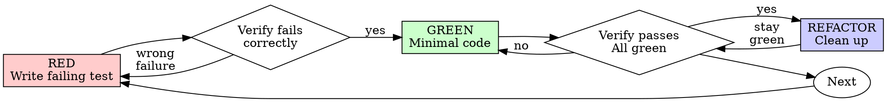

**구현 완료:** SPA의 `pushState`, `replaceState`, 뒤로/앞으로 가기, 제목 변경을 감지하고 100ms 디바운스 후 활성 탭의 최신 URL/제목을 Native Host로 전달하도록 했습니다. 캡처 시에는 페이지 스냅샷에서 URL과 제목을 직접 읽어 메타데이터에 반영합니다.

페이지 main world hook은 [background.js](C:/_Project/LoopOffice2/.data/checkouts/r2cuerdame__CapturePack/extensions/chrome/background.js)에, 메시지 브리지는 [route-content.js](C:/_Project/LoopOffice2/.data/checkouts/r2cuerdame__CapturePack/extensions/chrome/route-content.js)에 추가했습니다. Core의 `domBridge`는 기존 `url.changed` 이벤트 경로를 이미 처리하므로 wire 형식은 확장하지 않았습니다. 여러 탭의 URL을 섞을 수 있는 초안의 전역 필터도 제거했습니다.

`git diff --check`는 통과했습니다. 저장소 지침에 따라 테스트와 빌드는 실행하지 않았습니다. PR·merge·배포는 아직 없습니다.
Reading prompt from stdin...
OpenAI Codex v0.164.0
--------
workdir: C:\_Project\LoopOffice2\.data\checkouts\r2cuerdame__CapturePack
model: gpt-6-luna
provider: openai
approval: never
sandbox: danger-full-access
reasoning effort: low
reasoning summaries: none
session id: 01a1aafe-4eca-7770-a3f2-0e16c69d0585
--------
user
이슈 #346
Chrome 확장 프로그램: SPA 클라이언트 라우트 변경 감지 및 활성 탭 컨텍스트 동기화

<!-- loop-made -->
## 배경 및 문제점
ROADMAP.md V2 항목(`SPA route detection`)에 해당합니다.

현재 `extensions/chrome/`는 브라우저의 전통적인 전체 페이지 로드(하드 내비게이션)를 기준으로 동작합니다. React, Vue, Next.js 등 최신 SPA(Single Page Application)에서는 `history.pushState`, `history.replaceState`, `popstate`, `hashchange`를 통해 주소창 URL과 페이지 내용이 변경됩니다. 이로 인해:
- Native Messaging Host 및 Electron Core(`core/src/main/chrome/domBridge.ts`)에 캐시된 탭 URL과 제목이 갱신되지 않고 이전 경로로 남아 캡처 메타데이터에 잘못 기록될 수 있습니다.

## 작업 범위 (Scope)
- `extensions/chrome/content-script.js`:
  - `history.pushState` 및 `history.replaceState`를 감싸는 래퍼를 주입하고, `popstate` 및 `hashchange` 이벤트 리스너를 등록.
  - 라우트 변경 발생 시 background service worker로 `route-changed` 메시지(새 URL, document.title) 전송.
- `extensions/chrome/background.js`:
  - 라우트 변경 이벤트를 수신하여 활성 탭 상태를 갱신하고 Native Host(`domBridge`)로 전달.
- `core/src/main/chrome/domBridge.ts`:
  - 클라이언트 라우트 변경 알림 수신 시 기존 탭 DOM 캐시를 즉시 무효화하고 최신 URL과 매핑.

## 수용 기준 (Acceptance Criteria)
1. SPA에서 클라이언트 라우팅이 발생한 직후 캡처를 실행했을 때, 변경된 최신 URL과 페이지 타이틀이 `manifest.json` 및 DOM 플러그인에 정확히 반영된다.
2. 브라우저 뒤로가기/앞으로가기(`popstate`) 시에도 URL과 상태가 즉시 동기화된다.
3. 불필요한 이벤트 폭풍을 방지하기 위해 단기간 내 연속 라우트 변경에 대해 적절한 디바운스(예: 100ms)가 적용된다.


handbook 6f38c58f7e57993d379a7c18e00093f4fd341f52

warning: Codex is ignoring 4 unrecognized configuration settings. Check for typos or deprecated settings.
  user (C:\Users\recue\.codex\config.toml): `computer_use.windows.always_allowed_app_ids` is ignored.
  user (C:\Users\recue\.codex\config.toml): `projects.C:\Users\recue.approval_policy` is ignored.
  user (C:\Users\recue\.codex\config.toml): `projects.C:\Users\recue.full_auto` is ignored.
  ... and 1 more ignored settings.
warning: Ignoring malformed agent role definition: agent role `defaults` must define a description
warning: Codex is ignoring 4 unrecognized configuration settings. Check for typos or deprecated settings.
  user (C:\Users\recue\.codex\config.toml): `computer_use.windows.always_allowed_app_ids` is ignored.
  user (C:\Users\recue\.codex\config.toml): `projects.C:\Users\recue.approval_policy` is ignored.
  user (C:\Users\recue\.codex\config.toml): `projects.C:\Users\recue.full_auto` is ignored.
  ... and 1 more ignored settings.
warning: Ignoring malformed agent role definition: agent role `defaults` must define a description
warning: loading hooks from both C:\Users\recue\.codex\hooks.json and C:\Users\recue\.codex\config.toml; prefer a single representation for this layer
codex
이슈 #346과 제공한 handbook 커밋을 기준으로 현재 checkout, GitHub 이슈/브랜치 상태, Chrome 확장과 `domBridge`의 기존 메시지 흐름을 확인한 뒤 구현 범위를 맞추겠습니다. 먼저 적용해야 할 저장소 지침과 CSX 도구 사용 가능 여부를 확인하겠습니다.
exec
"C:\\Users\\recue\\AppData\\Local\\Microsoft\\WindowsApps\\pwsh.exe" -Command "Get-Content C:/Users/recue/.codex/plugins/cache/openai-curated-remote/superpowers/7.0.1/skills/using-superpowers/SKILL.md; git status --short --branch; rg --files -g AGENTS.md -g '*content-script*' -g 'background.js' -g 'domBridge.ts' -g 'manifest.json' -g 'ROADMAP.md'" in C:\_Project\LoopOffice2\.data\checkouts\r2cuerdame__CapturePack
 succeeded in 312ms:
---
name: using-superpowers
description: Use when starting any conversation - establishes how to find and use skills, requiring skill invocation before ANY response including clarifying questions
---

<SUBAGENT-STOP>
If you were dispatched as a subagent to execute a specific task, ignore this skill.
</SUBAGENT-STOP>

<EXTREMELY-IMPORTANT>
If you think there is even a 1% chance a skill might apply to what you are doing, you ABSOLUTELY MUST invoke the skill.

IF A SKILL APPLIES TO YOUR TASK, YOU DO NOT HAVE A CHOICE. YOU MUST USE IT.

This is not negotiable. You cannot rationalize your way out of this.
</EXTREMELY-IMPORTANT>

## The Rule

**Invoke relevant or requested skills BEFORE any response or action** — including clarifying questions, exploring the codebase, or checking files. If it turns out wrong for the situation, you don't have to use it.

**Before entering plan mode:** if you haven't already brainstormed, invoke the brainstorming skill first.

Then announce "Using [skill] to [purpose]" and follow the skill exactly. If it has a checklist, create a todo per item.

## Skill Priority

When multiple skills apply, process skills come first — they set the approach, then implementation skills (frontend-design, etc.) carry it out. Brainstorming and systematic-debugging are Superpowers' most common process skills, but the rule holds for any of them.

- "Let's build X" → superpowers:brainstorming first, then implementation skills.
- "Fix this bug" → superpowers:systematic-debugging first, then domain skills.

## Red Flags

These thoughts mean STOP—you're rationalizing:

| Thought | Reality |
|---------|---------|
| "This is just a simple question" | Questions are tasks. Check for skills. |
| "I need more context first" | Skill check comes BEFORE clarifying questions. |
| "Let me explore the codebase first" | Skills tell you HOW to explore. Check first. |
| "I can check git/files quickly" | Files lack conversation context. Check for skills. |
| "Let me gather information first" | Skills tell you HOW to gather information. |
| "This doesn't need a formal skill" | If a skill exists, use it. |
| "I remember this skill" | Skills evolve. Read current version. |
| "This doesn't count as a task" | Action = task. Check for skills. |
| "The skill is overkill" | Simple things become complex. Use it. |
| "I'll just do this one thing first" | Check BEFORE doing anything. |
| "This feels productive" | Undisciplined action wastes time. Skills prevent this. |
| "I know what that means" | Knowing the concept ≠ using the skill. Invoke it. |

## Platform Adaptation

If your harness appears here, read its reference file for special instructions:

- Claude Code: `references/claude-code-tools.md`
- Codex: `references/codex-tools.md`
- Pi: `references/pi-tools.md`
- Antigravity: `references/antigravity-tools.md`
- Hermes Agent: `references/hermes-tools.md`
- Muse: `references/muse-tools.md`

## User Instructions

User instructions (CLAUDE.md, AGENTS.md, GEMINI.md, etc, direct requests) take precedence over skills, which in turn override default behavior. Only skip skill workflows or instructions when your human partner has explicitly told you to.
## loop/346-2...origin/loop/346-2 [behind 1]
site\assets\motion\manifest.json
ROADMAP.md
extensions\chrome\content-script.js
extensions\chrome\background.js
examples\minimal\manifest.json
extensions\chrome\manifest.json
core\src\main\chrome\domBridge.ts

hook: PostToolUse
hook: PostToolUse Failed
codex
`issue/346` 브랜치가 이미 checkout되어 있고 원격보다 1커밋 뒤이며, 작업 트리는 깨끗합니다. 저장소 지침에 따라 별도 worktree는 만들지 않고 이 canonical checkout에서 진행합니다. 이번 변경은 새 기능이므로 brainstorming과 계획 절차를 적용하고, 라이브러리 의존성을 추가하지 않는 방향으로 기존 메시지 계약을 살펴보겠습니다.
exec
"C:\\Users\\recue\\AppData\\Local\\Microsoft\\WindowsApps\\pwsh.exe" -Command 'Get-Content C:/Users/recue/.codex/plugins/cache/openai-curated-remote/superpowers/7.0.1/skills/brainstorming/SKILL.md; Get-Content C:/Users/recue/.codex/plugins/cache/openai-curated-remote/superpowers/7.0.1/skills/writing-plans/SKILL.md; Get-Content C:/Users/recue/.codex/plugins/cache/openai-curated-remote/superpowers/7.0.1/skills/test-driven-development/SKILL.md; git log -5 --oneline --decorate; git status --porcelain=v1; rg --files -g AGENTS.md' in C:\_Project\LoopOffice2\.data\checkouts\r2cuerdame__CapturePack
 exited 1 in 408ms:
---
name: brainstorming
description: "You MUST use this before any creative work - creating features, building components, adding functionality, modifying behavior, or planning anything new, in software or out of it (a talk, a business, a renovation)."
---

# Brainstorming

You are very good at building. You build what you believe your human
partner wants, and that belief is usually thinner than it feels. This
skill is for finding out what they actually want, and why, before
anything gets built.

People often haven't finished working out what they want. Good questions
help them think it through. When you understand the why, you make the
hundred decisions they never mention the way they would have made them.

## First: What Do You Actually Know?

Before you reply, ask yourself: what do I know about what they want, and
why?

- **Everything that matters is in the request** ("make the icon cornflower
  blue"). This is a quick, clear task. Do it, and say what you did.
- **Something non-trivial is missing.** Start the conversation.

Before you start implementing, you must, in order:

1. Lay out the approaches in a message of their own, and have your
   human partner pick one (see Lay out the approaches).
2. Write the design doc, short or full (see Size the Work).
3. Get their approval of that doc.
4. Invoke the superpowers:writing-plans skill.

Two things aren't implementing: a spike they said yes to (see Spike to
feel things out), and doing what they asked once they've opted out of
the questions.

## Look Before You Ask

In an existing project, or when they've given you context (a spec, a plan,
a handoff, files they pointed at, earlier conversation), dig in before your
first message. Read what they referred to and the code or material it
connects to, and keep reading until you can explain how the relevant
parts work today and what this change would touch. Never ask what the
project or their context already answers.

## Your First Message

Move the work forward, with one of these:

- **They've already said what they want** (a spec, a plan, a detailed
  request): aim for about 200 words for the whole message. Echo their
  request back in your own words, so they can see whether you've got its
  shape: what they want, who it's for, and why, as far as they've said.
  Add what you found that bears on it: how the relevant parts work today
  and what the change would touch. If you found something they may not
  have considered that would change what they're asking for or how it
  has to be built, like a constraint, a conflict, or a cheaper path, say
  so plainly. How to build it comes later, once you understand what they
  want (see Lay out the approaches). End with one line inviting
  corrections, then one question about what they want: the thing their
  request leaves open whose answer would most change what gets built.
  Specs are often incomplete, so confirm before you build on one.
- **They haven't:** one open question, in their own terms, about the
  biggest thing their request leaves unsettled. Say why you're asking:
  what the answer would change about what you build. For "a website for
  my bakery": "If it's mostly for people deciding whether to stop by,
  I'd lead with hours and what's in the case today; taking orders is a
  different site. What do you want someone to do when they land on it?"

How the message ends depends on whether their message asked for
brainstorming:

- **They asked for it** (by name, by invoking it, or by asking for a
  design discussion): end with your question. They want this
  conversation.
- **They didn't:** they may not want a conversation at all. After your
  question, add a light, one-line offer to just get going instead, like
  "Or if you'd rather I just dive in, say so." If they take you up on
  it, this skill is done: state any significant how-it-gets-made choice
  (platform, language, medium) in one plain line, then do what they
  asked through the normal workflow.

That's the whole message.

## The Conversation

Each message ends with one question: a single sentence with no list of
example answers hanging off it. Use plain language, pitched just a little
above where your human partner is. Match their vocabulary; never use
process jargon. You never need to quote this skill to your human
partner.

Be clear and concise. Lead with what matters. Avoid jargon. When you
report what you found, give them the most important findings and offer
the rest.

**Get them describing.** Open questions come first. Their own words carry
intent that your options can't. Offer a short menu only when they're
stuck. When they say "just guess" or "what do you think?", propose
something concrete.

**How it gets made.** Every project rests on choices about medium, tools,
materials, and resources: the platform, programming language, and
libraries for an app; the medium for a piece of art. Find out early which
of those choices they want to make, which they're handing to you, and what
they already have to work with. Someone with strong views or skills will
want to talk it through. Someone counting on you needs sensible defaults,
said in plain words. When there's existing work, build on what it already
uses. Any choice you make goes in the design as your call, never as
something they agreed to.

**Ground to cover.** This is territory, not a script. Never read these
out as questions:

- what kind of thing this is, and what makes it special
- why now, and what success looks like to them
- goals, non-goals, and anti-goals (what would make this a failure even
  if it technically works)
- prior art: what they've seen elsewhere, loved or hated
- current state: what exists now, what they've tried
- the details they care about

**Make every question specific** to their project and what they've told
you. Ask Socratically, the way a sharp colleague would: build each
question on their last answer or on something you found, so it helps
them think through a consequence or a case they may have missed
("Voting closes before the meeting, and two members joined this month.
Does someone who joins mid-round get a vote?"). When the reason isn't
already plain, say what you're hoping to learn or what the answer would
change. A proposal they can correct, plus your reason for it, often
beats a question.

**Offer recon.** Once you have a bit of grounding and looking further
would help, offer to go look: deeper into their codebase or project,
their own files and data, or the web. Say what you'd look for. They
decide whether you go.

**Lay out the approaches.** Once you understand what they want, and
before you write anything up, put the ways of building it in a message
of its own. Come up with several real alternatives and drop the weak
ones, including any that work against why they want it and any the
existing work rules out. Present the two or three that remain, grounding
each in what the project actually does and saying what it trades off.
Recommend one and say why, then ask which way they want to go. When
there's genuinely one sensible way, say so and explain why the others
don't fit. This is for how it gets built; for what they want, get them
describing first.

**Show, don't tell.** Offer the visual companion (below) whenever seeing
would help more than reading:

- something they'll look at: a screen, a page, a printout, a sign
- a layout or arrangement: of a screen, a room, a schedule
- a flow or a sequence of steps
- options that would look different from each other
- a structure that's easier to see than read: a diagram, a timeline, a map

Once they've accepted, use it for mockups to react to, side-by-side
options, and throwaway prototypes they can click.

**Spike to feel things out.** Agentic work is waterfall, but very, very
fast. A quick throwaway build is often the cheapest way to learn what
they want or whether something works. Offer one when it would help.
When they just want to spike, get out of the way. Spikes get no tests
or minimal ones, aren't bulletproof, and skip the plan, implementation,
and review process. Bring what the spike taught you back into the
conversation.

## Play It Back

Play back as you go. As soon as you understand one part well enough to
describe it (what it's for and who it serves, say, or how one piece
behaves), describe that part back in about 200-300 words, then return to
questions about the next part. Playback and questions alternate through
the whole conversation; the last chunk covers whatever is left.

Only what they said goes in as theirs. Anything you filled in goes in
as your proposal, with your reason. End each chunk by asking what's wrong
or missing.

Before you send a chunk, check it: does it describe something they'll
look at, like a page, a screen, a schedule, or a printout? If so, and
they haven't seen the visual companion offer yet, send the offer instead
(its own message, below) and hold the chunk for the next message. Once
they've accepted, put a mockup next to the description.

## Size the Work

Once you understand what they want and they've picked an approach, say
how big the work is in plain words. They can override it.

| Size | The design doc |
|------|----------------|
| A small change | a short one: what you already covered together, written down |
| A project | the full written design (below) |

Short or full, the design doc has an **Approaches** part: the two or
three ways you considered building it, what each trades off, which one
they picked, and why. They pick in the conversation, before you write
the doc.

If it grows mid-task, stop, say so, and step up a size.

If this is really several independent projects, say so, agree on an
order, and brainstorm them one at a time.

## The Written Design

Write a plain document a talented builder in the domain could plan
from without going back to your human partner. Cover:

- intent and the why
- goals, non-goals, anti-goals
- constraints
- approaches (above)
- the parts of the how they decided, as they decided them
- what's left to the builder

For a small change, the short design covers the same points in a line
or two each and goes straight to your human partner, without the
builder check.

**Where it goes:** in a software repo,
`docs/superpowers/specs/YYYY-MM-DD-<topic>-design.md`, committed.
Otherwise, ask. Your human partner's preferences override both.

**Builder check** (for a project): dispatch a fresh subagent with
`builder-check-prompt.md` in this directory. When you tell your human
partner you're writing it up, say a reviewer will read it first and you
may come back once with a few questions. Don't hand over the document
until the check is back. Sort what the builder asks into three piles:

- **Answered already** by the conversation or the project: put the answer
  in the document.
- **Minor:** a sensible builder could settle it without changing what gets
  built. Settle it yourself and mark it in the document as your call.
- **Theirs:** only your human partner can answer it, and the answer changes
  what gets built.

Bring the "theirs" pile in one message, most important first. Update the
document with their answers, then hand it over with a short list of the
calls you made so they can check those while reading. That's the only
round of questions the check produces. Without a subagent tool, read the
document as that builder yourself.

<HARD-GATE>
Nothing gets built until your human partner approves the design doc:
the short one for a small change, the full one for a project.
Building includes writing product code, scaffolding, installing
dependencies, creating projects, and invoking an implementation skill.
Reading and exploring are fine.

Two exceptions. If they opted out of the questions, the skill is done
and the gate goes with it. A spike they said yes to may be built; it
stays labeled throwaway, and keeping what it produced is a new request
that comes back through this gate.

After the design doc is approved, the next step is the plan: invoke
superpowers:writing-plans and no other skill.
</HARD-GATE>

## Red Flags

| Thought | Reality |
|---------|---------|
| "I'll offer a menu of what they might want" | Options steer. Ask them to describe it first. |
| "I'll fill in sensible defaults" | Good. Say them out loud. A default they never heard is one they couldn't reject. |
| "I've answered their questions, so I'll write the doc" | Lay out the approaches first, in a message of their own. |
| "I should explain the process first" | Ask your question. The process shows itself. |
| "They said 'sounds good' to the idea" | Approval covers what you showed them. A design doc you haven't written isn't approved. |
| "The spike works, I'll keep building on it" | Keeping it is a new request. Back through the gate. |

## Visual Companion

A browser tab for showing mockups, diagrams, and prototypes. It's a
tool, not a mode: accepting it doesn't send every question to the
browser.

**Offer it just-in-time.** Offer it the first time one of the moments
above comes up, never upfront. The offer is its own message with nothing
else in it:

> "This might be easier if I show you. Want me to open a browser tab with some mockups?"

If they decline, stay in text and don't offer again unless they raise it.

**Per question, ask: would they understand this better by seeing it?**
Mockups, layouts, diagrams, and side-by-side designs go in the browser.
Requirements, scope, tradeoffs, and conceptual choices stay in text. A
question about a UI topic isn't automatically a visual question.

If they accept, read `visual-companion.md` in this directory before
starting the server.
---
name: writing-plans
description: Use when you have a spec or requirements for a multi-step task, before touching code
---

# Writing Plans

## Overview

Write implementation plans for an engineer who has not seen this codebase or this spec. Assume they write idiomatic code in the project's language once they know the exact interface and the exact test, and that they will make a reasonable choice wherever the plan leaves one open. What they cannot know is what you decided: which files, which names and signatures, which values from the spec, which tests prove each task. Document those. Give them the whole plan as bite-sized tasks. DRY. YAGNI. TDD. Frequent commits.

**Announce at start:** "I'm using the writing-plans skill to create the implementation plan."

**Context:** If working in an isolated worktree, it should have been created via the `superpowers:using-git-worktrees` skill at execution time.

**Save plans to:** `docs/superpowers/plans/YYYY-MM-DD-<feature-name>.md`
- (User preferences for plan location override this default)

## Scope Check

If the spec covers multiple independent subsystems, it should have been broken into sub-project specs during brainstorming. If it wasn't, suggest breaking this into separate plans — one per subsystem. Each plan should produce working, testable software on its own.

## File Structure

Before defining tasks, map out which files will be created or modified and what each one is responsible for. This is where decomposition decisions get locked in.

- Design units with clear boundaries and well-defined interfaces. Each file should have one clear responsibility.
- You reason best about code you can hold in context at once, and your edits are more reliable when files are focused. Prefer smaller, focused files over large ones that do too much.
- Files that change together should live together. Split by responsibility, not by technical layer.
- In existing codebases, follow established patterns. If the codebase uses large files, don't unilaterally restructure - but if a file you're modifying has grown unwieldy, including a split in the plan is reasonable.

This structure informs the task decomposition. Each task should produce self-contained changes that make sense independently.

## Task Right-Sizing

A task is the smallest unit that carries its own test cycle and is worth a
fresh reviewer's gate. When drawing task boundaries: fold setup,
configuration, scaffolding, and documentation steps into the task whose
deliverable needs them; split only where a reviewer could meaningfully
reject one task while approving its neighbor. Each task ends with an
independently testable deliverable.

## Step Granularity

**Each step is one action with a checkable result:**
- "Write the failing test" - step
- "Run it to make sure it fails" - step
- "Implement the minimal code to make the test pass" - step
- "Run the tests and make sure they pass" - step
- "Commit" - step

## Plan Document Header

**Every plan MUST start with this header:**

```markdown
# [Feature Name] Implementation Plan

> **For agentic workers:** REQUIRED SUB-SKILL: Use superpowers:subagent-driven-development (recommended) or superpowers:executing-plans to implement this plan task-by-task. Steps use checkbox (`- [ ]`) syntax for tracking.

**Goal:** [One sentence describing what this builds]

**Architecture:** [2-3 sentences about approach]

**Tech Stack:** [Key technologies/libraries]

**Spec:** [path to the spec/design doc this plan implements — the plan
argues from the spec, so the spec travels with it; executors read both]

## Global Constraints

[The spec's project-wide requirements — version floors, dependency limits,
naming and copy rules, platform requirements — one line each, with exact
values copied verbatim from the spec. Every task's requirements implicitly
include this section.]

## Review Focus

[The five input classes or failure modes the spec implies but no task's
tests exercise that are most likely to bite a person using this software
— one line each, naming the input or condition and the behavior a
reasonable person would expect, most likely first. The spec is a vision
document: it says what the software must do, not everything it will
meet, and its silence on an input is not permission for that input to
break the program. Write the list here, once, with the spec in front of
you. Then, for each line, add the test that pins it to the task that
owns the code, in that task's own step style.]

---
```

## Task Structure

````markdown
### Task N: [Component Name]

**Files:**
- Create: `exact/path/to/file.py`
- Modify: `exact/path/to/existing.py:123-145`
- Test: `tests/exact/path/to/test.py`

**Interfaces:**
- Consumes: [what this task uses from earlier tasks — exact signatures]
- Produces: [what later tasks rely on — exact function names, parameter
  and return types. A task's implementer sees only their own task; this
  block is how they learn the names and types neighboring tasks use.]

- [ ] **Step 1: Write the failing test**

```python
def test_specific_behavior():
    result = function(input)
    assert result == expected
```

- [ ] **Step 2: Run test to verify it fails**

Run: `pytest tests/path/test.py::test_name -v`
Expected: FAIL with "function not defined"

- [ ] **Step 3: Implement `function(input: InputType) -> ResultType` in `exact/path/to/file.py`**

One line on the approach when the signature and the test leave a choice
(which library call, which data structure); a code block only for an
algorithm they do not determine.

- [ ] **Step 4: Run test to verify it passes**

Run: `pytest tests/path/test.py::test_name -v`
Expected: PASS

- [ ] **Step 5: Commit**

```bash
git add tests/path/test.py src/path/file.py
git commit -m "feat: add specific feature"
```
````

## What a Step Contains

A step is done when the implementer can write exactly one reasonable thing
from it. That is the whole requirement: unambiguous, not complete. Each kind
of step carries what makes it unambiguous and nothing more:

- **A test step:** the test's name and its assertions, as code, with the
  spec's exact values in them.
- **A code step:** the exact signature (name, parameters, return type), the
  file it lives in, and the specific values the spec pins. The implementer
  writes the body. A body appears only for an algorithm the signature and
  tests do not determine, or for exact copy the spec fixes.
- **A verification step:** the command to run and the output that means it
  passed.
- **A reference to another task:** that task's Interfaces block says what
  to use; the plan does not repeat that task's code.

A plan is the set of decisions the implementer cannot make alone. A plan
longer than the code it describes has written the code instead. Lines that
decide nothing ("TBD", "handle edge cases", "add appropriate validation",
"write tests for the above", a type or function no task defines) are the
opposite failure, and the self-review catches both.

## Self-Review

After writing the complete plan, look at the spec with fresh eyes and check the plan against it. This is a checklist you run yourself — not a subagent dispatch.

**1. Spec coverage:** Skim each section/requirement in the spec. Can you point to a task that implements it? List any gaps.

**2. Step scan:** Every step must let the implementer write exactly one reasonable thing, and no step may carry more than that: a line that decides nothing is a gap, a function body the signature and tests already determine is a transcript. Fix both.

**3. Type consistency:** Do the types, method signatures, and property names you used in later tasks match what you defined in earlier tasks? A function called `clearLayers()` in Task 3 but `clearFullLayers()` in Task 7 is a bug.

**4. Review Focus:** For each input class or failure mode the spec implies, is there a task whose tests exercise it? The five uncovered ones most likely to bite a person go in the Review Focus section, and each line there gets its test added to the owning task. An empty section means you checked and found none, not that you skipped the check.

**5. Proportion:** Compare the plan's length to the spec's. A plan several times longer than the spec it implements is a transcript of the program, not a plan. If code blocks are most of the document, replace bodies with signatures, test names and assertions, and check that each step is still unambiguous.

If you find issues, fix them inline. No need to re-review — just fix and move on. If you find a spec requirement with no task, add the task.

## Execution Handoff

After saving and self-reviewing the plan, link it for your human partner
to read. If they have already explicitly supplied an execution method, ask
them to review the plan and confirm it captures what they want; wait for that
review before implementation, then use the preserved method. Otherwise, ask
them to review the plan and choose an execution method before implementation.

**When no execution method has already been supplied:**

**"Plan complete and saved to `docs/superpowers/plans/<filename>.md`. Please review the plan. Which execution approach would you prefer?**

- **Subagent-driven** - A fresh subagent implements each task and a fresh reviewer checks it before the next one starts, then a whole-branch review at the end. Most thorough; costs a fresh context per task and per review.
- **Native** - I implement every task myself in this session, the way this harness runs work, then one fresh reviewer on the most capable model checks the whole branch. Cheapest and fastest; no independent review until the end. Runs well with a mid-tier session model, since the plan carries the design.

**For this plan I recommend <one of the two>, because <one sentence from the plan: how much the tasks depend on each other's interfaces, how many there are, what a shipped mistake would cost>. Does the plan capture what you want, and which approach should we use?"**

**When an execution method has already been supplied:**

**"Plan complete and saved to `docs/superpowers/plans/<filename>.md`. Please review the plan. Does it capture what you want?"**

**If Subagent-driven chosen:**
- **REQUIRED SUB-SKILL:** Use superpowers:subagent-driven-development

**If Native chosen:**
- **REQUIRED SUB-SKILL:** Use superpowers:executing-plans
---
name: test-driven-development
description: Use when implementing any feature or bugfix, before writing implementation code
---

# Test-Driven Development (TDD)

## Overview

Write the test first. Watch it fail. Write minimal code to pass.

**Core principle:** If you didn't watch the test fail, you don't know if it tests the right thing.

**Violating the letter of the rules is violating the spirit of the rules.**

## When to Use

**Always:**
- New features
- Bug fixes
- Refactoring
- Behavior changes

**Exceptions (ask your human partner):**
- Throwaway prototypes
- Generated code
- Configuration files

Thinking "skip TDD just this once"? Stop. That's rationalization.

## The Iron Law

```
NO PRODUCTION CODE WITHOUT A FAILING TEST FIRST
```

Write code before the test? Delete it. Start over.

**No exceptions:**
- Don't keep it as "reference"
- Don't "adapt" it while writing tests
- Don't look at it
- Delete means delete

Implement fresh from tests. Period.

## Red-Green-Refactor



### RED - Write Failing Test

Write one minimal test showing what should happen.

<Good>
```typescript
test('retries failed operations 3 times', async () => {
  let attempts = 0;
  const operation = () => {
    attempts++;
    if (attempts < 3) throw new Error('fail');
    return 'success';
  };

  const result = await retryOperation(operation);

  expect(result).toBe('success');
  expect(attempts).toBe(3);
});
```
Clear name, tests real behavior, one thing
</Good>

<Bad>
```typescript
test('retry works', async () => {
  const mock = jest.fn()
    .mockRejectedValueOnce(new Error())
    .mockRejectedValueOnce(new Error())
    .mockResolvedValueOnce('success');
  await retryOperation(mock);
  expect(mock).toHaveBeenCalledTimes(3);
});
```
Vague name, tests mock not code
</Bad>

**Requirements:**
- One behavior
- Clear name
- Real code (no mocks unless unavoidable)

### Verify RED - Watch It Fail

**MANDATORY. Never skip.**

```bash
npm test path/to/test.test.ts
```

Confirm:
- Test fails (not errors)
- Failure message is expected
- Fails because feature missing (not typos)

**Test passes?** You're testing existing behavior. Fix test.

**Test errors?** Fix error, re-run until it fails correctly.

### GREEN - Minimal Code

Write simplest code to pass the test.

<Good>
```typescript
async function retryOperation<T>(fn: () => Promise<T>): Promise<T> {
  for (let i = 0; i < 3; i++) {
    try {
      return await fn();
    } catch (e) {
      if (i === 2) throw e;
    }
  }
  throw new Error('unreachable');
}
```
Just enough to pass
</Good>

<Bad>
```typescript
async function retryOperation<T>(
  fn: () => Promise<T>,
  options?: {
    maxRetries?: number;
    backoff?: 'linear' | 'exponential';
    onRetry?: (attempt: number) => void;
  }
): Promise<T> {
  // YAGNI
}
```
Over-engineered
</Bad>

Don't add features, refactor other code, or "improve" beyond the test.

### Verify GREEN - Watch It Pass

**MANDATORY.**

```bash
npm test path/to/test.test.ts
```

Confirm:
- Test passes
- Other tests still pass
- Output pristine (no errors, warnings)

**Test fails?** Fix code, not test.

**Other tests fail?** Fix now.

**"Other tests" means the project's suite, not just your file.** A
green run of the test you wrote is not a green suite. Before you call
the change done, run the project's test command (bare `pytest`,
`npm test`, `cargo test` — whatever the repo uses) even when your task
named only one test file. A scope statement in your task bounds the
deliverable, not your verification. Any failure that run shows —
including one you didn't cause — goes in your report by name; a red
test you watched scroll past and didn't mention is a report falsified
by omission.

### REFACTOR - Clean Up

After green only:
- Remove duplication
- Improve names
- Extract helpers

Keep tests green. Don't add behavior.

### Repeat

Next failing test for next feature.

## Good Tests

| Quality | Good | Bad |
|---------|------|-----|
| **Minimal** | One thing. "and" in name? Split it. | `test('validates email and domain and whitespace')` |
| **Clear** | Name describes behavior | `test('test1')` |
| **Shows intent** | Demonstrates desired API | Obscures what code should do |

When writing or changing any test, read [writing-good-tests.md](writing-good-tests.md) for the rules that keep tests honest:
- Name the production change that would make the test fail — before writing it
- Assert on real behavior, never on mock behavior
- Keep test-only code in test utilities, out of production classes
- Understand a dependency's side effects before mocking it

## Common Rationalizations

| Excuse | Reality |
|--------|---------|
| "Too simple to test" | Simple code breaks. Test takes 30 seconds. |
| "I'll test after" | Tests written after pass immediately — which proves nothing. They may test the wrong thing, test the implementation instead of the behavior, or miss the edge case you forgot. You never watched it fail, so you never proved it can catch the bug. Test-first forces that failure. |
| "Tests after achieve same goals (spirit not ritual)" | Tests-after answer "what does this do?"; tests-first answer "what should this do?" Tests written after are biased by the code you already wrote — you verify the cases you remembered, not the ones you'd have discovered. Coverage without proof the tests work. |
| "Already manually tested" | Manual testing is ad-hoc: no record of what you covered, no way to re-run it when the code changes, easy to forget cases under pressure. "Worked when I tried it" ≠ comprehensive. Automated tests run the same way every time. |
| "Deleting X hours is wasteful" | Sunk cost fallacy — that time is already spent either way. The real choice: rewrite with TDD (high confidence) vs. keep it and bolt tests on after (low confidence, likely bugs). Keeping code you can't trust is the waste. |
| "Keep as reference, write tests first" | You'll adapt it. That's testing after. Delete means delete. |
| "Need to explore first" | Fine. Throw away exploration, start with TDD. |
| "Test hard = design unclear" | Listen to test. Hard to test = hard to use. |
| "TDD will slow me down" | TDD IS the pragmatic path: catches bugs before commit, prevents regressions, lets you refactor without fear. "Pragmatic" shortcuts mean debugging in production — slower, not faster. |
| "Manual test faster" | Manual doesn't prove edge cases. You'll re-test every change. |
| "Existing code has no tests" | You're improving it. Add tests for existing code. |

## Red Flags - STOP and Start Over

- Code before test
- Test after implementation
- Test passes immediately
- Can't explain why test failed
- Tests added "later"
- Rationalizing "just this once"
- "I already manually tested it"
- "Tests after achieve the same purpose"
- "It's about spirit not ritual"
- "Keep as reference" or "adapt existing code"
- "Already spent X hours, deleting is wasteful"
- "TDD is dogmatic, I'm being pragmatic"
- "This is different because..."

**All of these mean: Delete code. Start over with TDD.**

## Example: Bug Fix

**Bug:** Empty email accepted

**RED**
```typescript
test('rejects empty email', async () => {
  const result = await submitForm({ email: '' });
  expect(result.error).toBe('Email required');
});
```

**Verify RED**
```bash
$ npm test
FAIL: expected 'Email required', got undefined
```

**GREEN**
```typescript
function submitForm(data: FormData) {
  if (!data.email?.trim()) {
    return { error: 'Email required' };
  }
  // ...
}
```

**Verify GREEN**
```bash
$ npm test
PASS
```

**REFACTOR**
Extract validation for multiple fields if needed.

## Verification Checklist

Before marking work complete:

- [ ] Every new function/method has a test
- [ ] Watched each test fail before implementing
- [ ] Each test failed for expected reason (feature missing, not typo)
- [ ] Wrote minimal code to pass each test
- [ ] All tests pass
- [ ] Output pristine (no errors, warnings)
- [ ] Tests use real code (mocks only if unavoidable)
- [ ] Edge cases and errors covered

Can't check all boxes? You skipped TDD. Start over.

## When Stuck

| Problem | Solution |
|---------|----------|
| Don't know how to test | Write wished-for API. Write assertion first. Ask your human partner. |
| Test too complicated | Design too complicated. Simplify interface. |
| Must mock everything | Code too coupled. Use dependency injection. |
| Test setup huge | Extract helpers. Still complex? Simplify design. |

## Debugging Integration

Bug found? Write failing test reproducing it. Follow TDD cycle. Test proves fix and prevents regression.

Never fix bugs without a test.

## Final Rule

```
Production code → test exists and failed first
Otherwise → not TDD
```

No exceptions without your human partner's permission.
875e4f4 (HEAD -> loop/346-2, origin/main, origin/HEAD, main, loop/347-2) Merge pull request #351 from r2cuerdame/loop/345-4
0609fc0 (origin/loop/345-4, loop/345-4) loop capturepack-345-4
313bd90 Merge pull request #350 from r2cuerdame/loop/345-3
908b047 (origin/loop/345-3, loop/345-3) loop capturepack-345-3
4c83a09 Merge pull request #349 from r2cuerdame/chore/project-meta

hook: PostToolUse
hook: PostToolUse Failed
exec
"C:\\Users\\recue\\AppData\\Local\\Microsoft\\WindowsApps\\pwsh.exe" -Command 'Get-Content extensions/chrome/content-script.js; Get-Content extensions/chrome/background.js; Get-Content core/src/main/chrome/domBridge.ts; Get-Content extensions/chrome/manifest.json; Get-Command gh -ErrorAction SilentlyContinue | Select-Object -ExpandProperty Source' in C:\_Project\LoopOffice2\.data\checkouts\r2cuerdame__CapturePack
 succeeded in 500ms:
// CapturePack element picker. Injected on demand when the user clicks the
// toolbar action; picks ONE element, reports it, and removes itself.
//
// IT RUNS IN EVERY FRAME (#104). It used to be injected into the top document
// only, and a click inside a cross-origin iframe never reaches the top
// document's listener at all — so on any page that puts its UI in a frame the
// picker armed, highlighted nothing, and swallowed the click. No message, no
// failure, no cleanup: exactly the "nothing happens" that was reported.
//
// A frame can only measure itself, so a pick made below the top document is
// carried UP the frame chain, and each host frame translates the rectangle into
// its own viewport using the iframe element it can see. Every term is measured
// there — the frame's position, its borders and padding, and the scale implied
// by its rendered width against the child's own viewport width. Nothing is
// assumed, and a hop whose numbers do not agree refuses instead of guessing.
//
// The payload passes through the ancestor pages on its way up. That is a real
// exposure and it is accepted deliberately: the picker only ever runs after the
// user clicks the toolbar icon on that tab, and the element they picked is
// being written into a pack of that very page. It is never sent to a page that
// was not already hosting the element.
;(() => {
  const IS_TOP = window.top === window
  // Shadow roots nested deeper than this are a loop, not a page.
  const MAX_SHADOW_DEPTH = 32

  // RE-ARMING RE-ARMS. This used to `return` when the flag was already set, so
  // any injection that did not reach its own cleanup — an Escape that raced a
  // navigation, a page that swapped the DOM under it, an exception — left the
  // flag true and the picker SILENTLY never armed again. The user clicks the
  // toolbar icon, nothing visible happens, they click an element, nothing
  // happens: "크롬 dom 에 element가 안잡혀", with no error anywhere to find.
  // A second click now tears the old one down and starts fresh, which is also
  // what a user pressing the button twice means.
  if (window.__capturepackPickerActive && typeof window.__capturepackPickerCleanup === 'function') {
    try {
      window.__capturepackPickerCleanup()
    } catch {
      // The old picker is beyond saving; taking its flag is the point.
    }
  }
  window.__capturepackPickerActive = true

  const highlight = document.createElement('div')
  highlight.style.cssText = [
    'position: fixed',
    'z-index: 2147483647',
    'pointer-events: none',
    'border: 2px solid #7c5cff',
    'background: rgba(124, 92, 255, 0.12)',
    'border-radius: 3px',
    'transition: all 40ms linear',
  ].join(';')
  document.documentElement.appendChild(highlight)

  let current = null

  function cssEscape(v) {
    return window.CSS && CSS.escape ? CSS.escape(v) : v.replace(/([^\w-])/g, '\\$1')
  }

  /** The open shadow root `el` sits in, or null when it sits in the document. */
  function shadowScopeOf(el) {
    const root = typeof el.getRootNode === 'function' ? el.getRootNode() : null
    return root && root !== document && root.host ? root : null
  }

  // Shortest stable selector within ONE tree: unique id → positional path.
  function scopedSelector(el, scope) {
    if (el.id && scope.querySelectorAll('#' + cssEscape(el.id)).length === 1) {
      return '#' + cssEscape(el.id)
    }
    const parts = []
    let node = el
    while (node && node !== document.body && parts.length < 8) {
      let part = node.tagName.toLowerCase()
      if (node.id) {
        parts.unshift('#' + cssEscape(node.id))
        break
      }
      const parent = node.parentElement
      // The top of a shadow tree has no parent ELEMENT, but its siblings are
      // still siblings: they are counted against the root they share.
      const container = parent || (scope !== document && node.parentNode === scope ? scope : null)
      if (container) {
        const siblings = Array.from(container.children).filter(c => c.tagName === node.tagName)
        if (siblings.length > 1) part += ':nth-of-type(' + (siblings.indexOf(node) + 1) + ')'
      }
      parts.unshift(part)
      node = parent
    }
    const selector = parts.join(' > ')
    return selector || el.tagName.toLowerCase()
  }

  // NO SELECTOR WRITTEN IN THE DOCUMENT'S SCOPE REACHES INTO A SHADOW TREE
  // (#345), so an element inside one is named as its host's selector, then
  // ` >>> `, then its path inside that root — Puppeteer's deep combinator, read
  // left to right one shadow boundary at a time. An id is only "unique" within
  // the tree it was looked up in, which is why each step is scoped to its own.
  function buildSelector(el) {
    const scope = shadowScopeOf(el)
    if (scope === null) return scopedSelector(el, document)
    return buildSelector(scope.host) + ' >>> ' + scopedSelector(el, scope)
  }

  /**
   * THE ELEMENT UNDER THE POINTER, THROUGH EVERY OPEN SHADOW ROOT (#345).
   *
   * `document.elementFromPoint` answers in the document's own scope, so on a
   * page built from web components it names the HOST — a whole video player —
   * and never the button inside it the user is pointing at. Each open root can
   * be asked the same question in its own scope; asking until the answer stops
   * changing finds the element actually drawn there.
   *
   * A closed root reads as null, and its host is then the honest answer. The
   * depth bound is for a page whose roots answer one another in a loop.
   */
  function deepElementFromPoint(x, y) {
    let el = document.elementFromPoint(x, y)
    for (let depth = 0; el && depth < MAX_SHADOW_DEPTH; depth += 1) {
      let root = null
      try {
        root = el.shadowRoot
      } catch {
        // A host that refuses to be read is a host whose inside we do not pick.
      }
      if (!root || typeof root.elementFromPoint !== 'function') break
      const inner = root.elementFromPoint(x, y)
      if (!inner || inner === el) break
      el = inner
    }
    return el
  }

  function implicitRole(el) {
    const tag = el.tagName.toLowerCase()
    const map = { button: 'button', a: 'link', input: 'textbox', select: 'listbox', textarea: 'textbox', img: 'img', nav: 'navigation', main: 'main', header: 'banner', footer: 'contentinfo' }
    return el.getAttribute('role') || map[tag] || ''
  }

  function onMove(e) {
    const el = deepElementFromPoint(e.clientX, e.clientY)
    if (!el || el === highlight) return
    current = el
    const r = el.getBoundingClientRect()
    highlight.style.left = r.x + 'px'
    highlight.style.top = r.y + 'px'
    highlight.style.width = r.width + 'px'
    highlight.style.height = r.height + 'px'
  }

  function childFrames() {
    return Array.from(document.querySelectorAll('iframe, frame'))
  }

  function postDown(message) {
    for (const frame of childFrames()) {
      try {
        if (frame.contentWindow) frame.contentWindow.postMessage(message, '*')
      } catch {
        // A frame that cannot be addressed is a frame that has no picker in it.
      }
    }
  }

  function cleanup() {
    document.removeEventListener('mousemove', onMove, true)
    document.removeEventListener('click', onClick, true)
    document.removeEventListener('keydown', onKey, true)
    window.removeEventListener('message', onFrameMessage, true)
    highlight.remove()
    window.__capturepackPickerActive = false
    window.__capturepackPickerCleanup = null
    // The toolbar badge is the only thing that says the picker was ever armed;
    // clearing it is how "armed" stops being a claim nobody can check. Only the
    // top frame speaks, or a page with forty ad frames would report forty times.
    if (!IS_TOP) return
    try {
      chrome.runtime.sendMessage({ type: 'picker.disarmed' })
    } catch {
      // The worker may be gone; the badge expires on its own.
    }
  }
  window.__capturepackPickerCleanup = cleanup

  /** Tear every frame down, from wherever the pick or the Escape happened. */
  function disarmEverywhere() {
    if (IS_TOP) {
      postDown({ __capturepack: 'disarm' })
      cleanup()
      return
    }
    try {
      window.top.postMessage({ __capturepack: 'disarm' }, '*')
    } catch {
      // Nothing above will hear it; this frame still stops.
    }
    cleanup()
  }

  if (IS_TOP) {
    try {
      chrome.runtime.sendMessage({ type: 'picker.armed' })
    } catch {
      // No worker: the picker still works, it just cannot light the badge.
    }
  }

  /**
   * A child frame's pick, in THIS frame's viewport coordinates.
   *
   * Reads the DOM here and hands numbers to `frame-geometry.js`, which owns the
   * arithmetic and is the part a test can reach. A null answer from it is a
   * refusal — the two measurements are not describing the same box — and a
   * refused pick is reported rather than placed somewhere plausible.
   */
  function translateFromFrame(payload, host) {
    const geometry = window.__capturepackFrameGeometry
    if (!geometry) return null
    const rect = host.getBoundingClientRect()
    const style = window.getComputedStyle(host)
    const px = (value) => {
      const n = parseFloat(value)
      return Number.isFinite(n) ? n : 0
    }
    const translated = geometry.translateFrameRect({
      hostRect: { x: rect.left, y: rect.top, width: rect.width, height: rect.height },
      hostInsets: {
        left: px(style.borderLeftWidth) + px(style.paddingLeft),
        top: px(style.borderTopWidth) + px(style.paddingTop),
        right: px(style.borderRightWidth) + px(style.paddingRight),
        bottom: px(style.borderBottomWidth) + px(style.paddingBottom),
      },
      childViewportWidth: payload.viewportWidth,
      bounds: payload.bounds,
    })
    if (translated === null) return null
    return {
      element: payload.element,
      frameDepth: payload.frameDepth + 1,
      viewportWidth: window.innerWidth,
      bounds: {
        x: translated.x,
        y: translated.y,
        width: translated.width,
        height: translated.height,
      },
    }
  }

  function sendPick(payload) {
    chrome.runtime.sendMessage({
      type: 'dom.element.selected',
      timestamp: Date.now(),
      element: {
        ...payload.element,
        frameDepth: payload.frameDepth,
        bounds: {
          x: payload.bounds.x,
          y: payload.bounds.y,
          width: payload.bounds.width,
          height: payload.bounds.height,
        },
      },
      // WHERE THAT RECTANGLE IS ON THE SCREEN.
      //
      // `bounds` above is viewport CSS pixels — the only space a page can
      // measure itself in, and one that says nothing about where the browser
      // window is. Sent alone it cannot be placed on a snapshot at all, which
      // is why picking an element in Chrome produced a box around the WHOLE
      // WINDOW: with no candidate to offer, the editor fell back to the window
      // rung. "크롬에서 잡은건 select하면 전체창이 잡혀".
      //
      // The app supplies the other half from the surface ring, which already
      // records this window's CLIENT rectangle in physical pixels. Given the
      // viewport's size in CSS px and the device pixel ratio, the viewport's
      // physical size is known — and a viewport is anchored to the BOTTOM of
      // the client area (tab strip and omnibox sit above it), so the offset
      // falls out of the two heights without the page having to guess at
      // browser chrome. Scroll position is deliberately NOT sent:
      // getBoundingClientRect is already viewport-relative.
      //
      // Only the TOP frame ever sends this, because only the top frame's
      // viewport is the one the window's client rectangle describes.
      viewport: {
        width: window.innerWidth,
        height: window.innerHeight,
        dpr: window.devicePixelRatio || 1,
        // Best-effort screen anchor for a reader that has no ring sample of
        // this window (an older pack, a browser the host never saw). CSS px,
        // and on a scaled display Chrome reports these in the OS's own scaled
        // space — usable as a fallback, never preferred over the client rect.
        screenX: typeof window.screenX === 'number' ? window.screenX : null,
        screenY: typeof window.screenY === 'number' ? window.screenY : null,
        outerWidth: window.outerWidth,
        outerHeight: window.outerHeight,
      },
    })
  }

  function reportFailure(reason) {
    try {
      chrome.runtime.sendMessage({ type: 'picker.failed', reason })
    } catch {
      // Nothing to report to; the pick is lost either way, loudly is better.
    }
  }

  /** Hand a pick to the frame above, or send it if this frame is the top. */
  function deliver(payload) {
    if (IS_TOP) {
      sendPick(payload)
      disarmEverywhere()
      return
    }
    try {
      window.parent.postMessage({ __capturepack: 'pick', payload }, '*')
    } catch {
      reportFailure('frame-chain-unreachable')
      disarmEverywhere()
    }
  }

  function onFrameMessage(e) {
    const data = e.data
    if (!data || typeof data !== 'object') return
    if (data.__capturepack === 'disarm') {
      // FORWARDED FIRST, TORN DOWN SECOND. The frame that made the pick has
      // already cleaned itself up, so gating the forward on "am I still armed"
      // would stop the broadcast dead at it and leave every frame nested INSIDE
      // it armed forever — listeners and a highlight on a page that thinks the
      // picker is gone. Forwarding only ever goes downward, so it cannot loop.
      postDown({ __capturepack: 'disarm' })
      if (window.__capturepackPickerActive) cleanup()
      return
    }
    if (data.__capturepack !== 'pick') return
    // ONLY WHILE ARMED, AND ONLY FROM A FRAME THIS DOCUMENT ACTUALLY HOSTS.
    // A page can post whatever it likes; a pick is accepted only when the user
    // has armed the picker AND the sender is one of this document's own frames.
    if (!window.__capturepackPickerActive) return
    const payload = data.payload
    if (!payload || typeof payload !== 'object' || !payload.bounds || !payload.element) return
    const host = childFrames().find((frame) => frame.contentWindow === e.source)
    if (host === undefined) return
    const translated = translateFromFrame(payload, host)
    if (translated === null) {
      reportFailure(`frame-geometry-disagrees (depth ${String(payload.frameDepth)})`)
      disarmEverywhere()
      return
    }
    deliver(translated)
  }

  function onClick(e) {
    e.preventDefault()
    e.stopPropagation()
    // A click that no mousemove preceded — the picker armed from the keyboard
    // under a still pointer — would otherwise take `e.target`, which a listener
    // on the document only ever sees retargeted to the outermost shadow host.
    const el = current || deepElementFromPoint(e.clientX, e.clientY) || e.target
    const r = el.getBoundingClientRect()
    deliver({
      element: {
        tag: el.tagName.toLowerCase(),
        id: el.id || '',
        role: implicitRole(el),
        text: (el.innerText || '').trim().slice(0, 200),
        selector: buildSelector(el),
      },
      frameDepth: 0,
      viewportWidth: window.innerWidth,
      bounds: { x: r.x, y: r.y, width: r.width, height: r.height },
      // THE INTERFACE THE PICKED ELEMENT SAT IN (GOAL "The still carries the
      // context").
      //
      // Taken here, on the click, and not on a request from the app — because
      // this is the one moment Chrome has granted permission to read the page.
      // `activeTab` is given for a user gesture on the extension, and the app's
      // own capture hotkey is not a gesture Chrome can see. Asking for
      // `<all_urls>` instead would buy a standing right to read every page in
      // order to avoid a click the user has already made.
      //
      // Only the TOP document, and only once: a pick inside an iframe still
      // reports its element up the chain, but the snapshot belongs to the frame
      // whose client rectangle the app can translate.
      document: IS_TOP && window.__capturepackDocumentSnapshot
        ? window.__capturepackDocumentSnapshot()
        : undefined,
    })
    if (!IS_TOP) cleanup()
  }

  function onKey(e) {
    if (e.key === 'Escape') {
      e.preventDefault()
      disarmEverywhere()
    }
  }

  document.addEventListener('mousemove', onMove, true)
  document.addEventListener('click', onClick, true)
  document.addEventListener('keydown', onKey, true)
  window.addEventListener('message', onFrameMessage, true)
})()
// CapturePack extension background: forwards protocol v1 messages to the
// CapturePack native host. The DOM is never streamed — messages flow only when
// the user captures a page, picks an element or the tab context changes.

// The full-page capture (#157): the arithmetic and the procedure, in files a
// test can load without a browser. `importScripts` is synchronous, so both are
// defined before anything below can be called.
importScripts('full-page-plan.js', 'full-page-capture.js')

const HOST = 'com.capturepack.host'
const PROTOCOL = 1

let port = null
// When the app's hello was received on the CURRENT port, or null when this
// extension is not holding an end-to-end connection it has proved.
let handshakeAt = null
// How long to wait before dialling again after a failed or dropped connection.
// It backs off so a browser running without CapturePack installed does not
// spend its life starting a process that is not there, and it resets the
// moment a connection succeeds.
const RETRY_MIN_MS = 2000
const RETRY_MAX_MS = 60000
let retryMs = RETRY_MIN_MS
let retryTimer = null
let helloTimer = null
const UPDATE_ATTEMPT_KEY = 'capturepackUpdateAttempt'

function clearHelloTimer() {
  if (!helloTimer) return
  clearTimeout(helloTimer)
  helloTimer = null
}

function scheduleRetry() {
  if (retryTimer) return
  retryTimer = setTimeout(() => {
    retryTimer = null
    retryMs = Math.min(retryMs * 2, RETRY_MAX_MS)
    connect()
  }, retryMs)
}

function compareManifestVersions(left, right) {
  const parse = (value) => {
    if (typeof value !== 'string' || !/^\d+(?:\.\d+){0,3}$/.test(value)) return null
    return value.split('.').map((part) => Number(part))
  }
  const a = parse(left)
  const b = parse(right)
  if (!a || !b) return null
  for (let index = 0; index < Math.max(a.length, b.length); index += 1) {
    const difference = (a[index] || 0) - (b[index] || 0)
    if (difference !== 0) return Math.sign(difference)
  }
  return 0
}

function acceptHandshake(candidate) {
  if (port !== candidate) return
  handshakeAt = Date.now()
  retryMs = RETRY_MIN_MS
  if (retryTimer) clearTimeout(retryTimer)
  retryTimer = null
  chrome.action.setBadgeText({ text: '' })
}

function requestOneReload(candidate, loadedVersion, targetVersion) {
  const attempt = `${loadedVersion}->${targetVersion}`
  chrome.storage.local.get(UPDATE_ATTEMPT_KEY, (stored) => {
    if (port !== candidate) return
    if (chrome.runtime.lastError || stored?.[UPDATE_ATTEMPT_KEY] === attempt) {
      // A manually loaded or legacy folder may never acquire the app's files.
      // Accept the old worker after one attempt instead of entering an
      // app-hello -> reload -> app-hello loop forever. Settings still exposes
      // the version/path mismatch so the user can load the stable folder.
      acceptHandshake(candidate)
      return
    }
    chrome.storage.local.set({ [UPDATE_ATTEMPT_KEY]: attempt }, () => {
      if (port !== candidate) return
      if (chrome.runtime.lastError) {
        acceptHandshake(candidate)
        return
      }
      chrome.runtime.reload()
    })
  })
}

// A TIMER CANNOT OUTLIVE THE WORKER THAT SET IT.
//
// The retry above is the fast path and it is not enough on its own. An MV3
// service worker is TERMINATED when it goes idle, and every setTimeout in it
// dies with it — so once the port dropped and the worker went to sleep, nothing
// remained to dial again and Settings sat on "확장 핸드셰이크 ✖" until the user
// happened to switch tabs. That is the state this was reported in twice.
//
// chrome.alarms is the one timer that survives, because firing it is what WAKES
// the worker. One minute is the practical floor for a persistent alarm, which is
// the right cadence for "the app was restarted, try again" — the fast backoff
// above still covers the seconds after a drop, while the worker is still alive.
//
// A live native messaging port also keeps the worker from being torn down, so
// the moment either path succeeds this stops costing anything at all.
const RECONNECT_ALARM = 'capturepack-reconnect'
// UNCONDITIONAL, AND SYNCHRONOUS AT WORKER START.
//
// 0.1.2 tried to be clever here: creating an alarm that already exists resets
// its schedule, so it asked `chrome.alarms.get` first and created the alarm only
// when it was missing. That made the ONE timer meant to survive worker
// termination depend on an ASYNC callback running — and a worker that starts
// with nothing holding it open can be torn down before that callback ever fires.
// The alarm then never exists at all. Measured: after the app restarted, the
// extension went from redialling every 2.3 s to complete silence, and Settings
// sat on "호스트가 접속함 ✖" until the extension was reloaded by hand.
//
// So it is created every time, unconditionally, in the first turn of the worker.
// The reset it causes costs nothing: a worker start ALSO calls connect() below,
// which is the same thing the alarm would have done, and `delayInMinutes` keeps
// the first firing one minute out rather than a full period away.
chrome.alarms.create(RECONNECT_ALARM, { delayInMinutes: 1, periodInMinutes: 1 })
chrome.alarms.onAlarm.addListener((alarm) => {
  if (alarm.name !== RECONNECT_ALARM) return
  retryMs = RETRY_MIN_MS
  // A PORT OBJECT IS NOT A CONNECTION.
  //
  // Reported as "재설치할때마다 캡쳐팩 다시 리로드 안하면 연결이 안돼": reinstalling
  // the app kills the host it was talking to, and the extension then sat
  // disconnected until the user pressed Reload in chrome://extensions.
  //
  // `connect()` returns early whenever `port` is non-null, so everything
  // depends on `onDisconnect` having fired and nulled it. When the host dies
  // mid-handshake — which is exactly what an installer replacing the executable
  // does — the extension can be left holding a port it believes in and never
  // dials again. `handshakeAt` is the only proof of a LIVE connection: it is
  // set when the app answers hello and cleared on every disconnect, so a port
  // that has not proved itself by the time this alarm comes round is dropped
  // and redialled rather than trusted.
  if (port && handshakeAt === null) {
    try {
      port.disconnect()
    } catch {
      // Already gone; the point was only to stop believing in it.
    }
    port = null
  }
  connect()
})

function connect() {
  if (port) return port
  try {
    const candidate = chrome.runtime.connectNative(HOST)
    port = candidate
    candidate.onDisconnect.addListener(() => {
      // Chrome reports expected connectNative failures through lastError only
      // for the lifetime of this callback. Reading it marks the error handled;
      // leaving it unread pollutes chrome://extensions even though the bounded
      // retry below is the intended recovery path.
      void chrome.runtime.lastError
      // Host not installed, app not running, or this extension's ID not yet in
      // the host manifest. All three are temporary, and all three used to end
      // here — see the note on the startup connect below.
      if (port !== candidate) return
      clearHelloTimer()
      port = null
      handshakeAt = null
      scheduleRetry()
    })
    candidate.onMessage.addListener((message) => {
      if (port !== candidate) return
      if (message && message.type === 'dom.request' && message.protocol === PROTOCOL) {
        void answerDomRequest(message.request_id)
        return
      }
      if (message && message.type === 'page.received' && message.protocol === PROTOCOL) {
        settlePageAck(message)
        return
      }
      if (!message || message.type !== 'host.hello' || message.protocol !== PROTOCOL) return
      // STATE ON CONNECT, NOT ONLY ON CHANGE.
      //
      // The first version announced the grant from permissions.onAdded/onRemoved
      // alone, so an app that started AFTER the user granted — or after this
      // service worker was recycled, which MV3 does constantly — believed the
      // grant did not exist and never asked for a page. Silently. The handshake
      // is the one moment both sides are known to be listening.
      void hasBrowserGrant().then(announceGrant)
      clearHelloTimer()
      const loadedVersion = chrome.runtime.getManifest().version
      // CapturePack updates the stable unpacked folder before opening its
      // bridge. Chromium must reload an unpacked extension to execute changed
      // files, so current versions ask it to do that themselves. Version 0.1.8
      // persists a one-shot guard: a legacy or manually copied folder whose
      // files never change must not reload forever. Moving from a worker older
      // than 0.1.7 still needs one manual Reload because that worker contains
      // no self-update branch at all.
      const targetVersion = typeof message.extensionVersion === 'string'
        ? message.extensionVersion
        : null
      const comparison = targetVersion === null
        ? null
        : compareManifestVersions(targetVersion, loadedVersion)
      if (targetVersion !== null && comparison === 1) {
        requestOneReload(candidate, loadedVersion, targetVersion)
        return
      }
      if (comparison === 0) {
        chrome.storage.local.remove(UPDATE_ATTEMPT_KEY, () => void chrome.runtime.lastError)
      }
      // An extension newer than an older app is compatible at protocol v1 and
      // must never be downgraded or bounced merely because versions differ.
      acceptHandshake(candidate)
    })
    candidate.postMessage({
      type: 'host.hello',
      protocol: PROTOCOL,
      timestamp: Date.now(),
      app: 'capturepack-extension',
      version: chrome.runtime.getManifest().version,
    })
    // Writing only proves Chrome accepted the bytes. The app's hello above is
    // proof that the whole browser → host → app → host → browser path is live.
    handshakeAt = null
    clearHelloTimer()
    helloTimer = setTimeout(() => {
      helloTimer = null
      if (port !== candidate || handshakeAt !== null) return
      try {
        candidate.disconnect()
      } catch {
        // onDisconnect owns the retry when the port is already gone.
      }
    }, 5000)
  } catch {
    clearHelloTimer()
    port = null
    handshakeAt = null
    scheduleRetry()
  }
  return port
}

// CONNECT BECAUSE WE EXIST, NOT BECAUSE SOMETHING HAPPENED.
//
// This used to dial the host only from send(), i.e. only once the user changed
// tab or picked an element. That made the ordinary install look broken: loading
// the folder is step 2, registering the ID it was given is step 3, and by then
// nothing had ever tried to connect — so Settings sat on "not connected" until
// the user happened to switch tabs, and reported it as "설치했는데 연결됨이 안됨".
// The handshake is what the panel is waiting to see, so it is sent as soon as
// there is a service worker to send it, and retried when it fails.
chrome.runtime.onInstalled.addListener(() => connect())
chrome.runtime.onStartup.addListener(() => connect())
connect()

function send(message) {
  const p = connect()
  if (p) {
    try {
      p.postMessage(message)
      return
    } catch {
      port = null
      handshakeAt = null
      scheduleRetry()
    }
  }
  // No host available: surface briefly on the toolbar icon instead of failing.
  chrome.action.setBadgeText({ text: '!' })
  setTimeout(() => chrome.action.setBadgeText({ text: '' }), 2000)
}

// Arm the picker in the active tab — from the keyboard shortcut or the icon's
// context menu (#157 made the toolbar click itself the full-page capture).
//
// EVERY STEP OF THIS REPORTS ITSELF. Picking an element failed twice in the
// field with nothing to look at: the native port was healthy (tab.updated
// events arrived in the same capture), the extension was the current version,
// and `dom.element.selected` simply never appeared. Arming is the one step
// that had no observable outcome at all — an executeScript that throws on a
// restricted page (chrome://, the Web Store, a PDF viewer) looked exactly like
// a user who had not clicked the icon. So arming, disarming and failing all go
// down the same wire the picks do, and land in main.log.
async function armPicker(tab, via) {
  if (!tab || !tab.id) {
    send({ type: 'picker.failed', protocol: PROTOCOL, timestamp: Date.now(), reason: 'no-tab', via })
    return
  }
  const url = tab.url || ''
  try {
    // EVERY FRAME, NOT JUST THE TOP ONE (#104). A click inside a cross-origin
    // iframe never reaches the top document, so a top-only injection armed a
    // picker that could not see the click at all — silently, on every page that
    // puts its UI in a frame. The content script carries a pick up the frame
    // chain from wherever it happened.
    await chrome.scripting.executeScript({
      target: { tabId: tab.id, allFrames: true },
      // All three share one isolated world, in this order: the geometry and
      // the document walker are already defined by the time the picker looks
      // for them.
      files: ['frame-geometry.js', 'document-snapshot.js', 'content-script.js'],
    })
  } catch (err) {
    // A page the extension may not touch is the common case, and the user has
    // no way to know which pages those are — so say it on the icon AND on the
    // wire, rather than failing silently.
    chrome.action.setBadgeBackgroundColor({ color: '#d93025' })
    chrome.action.setBadgeText({ text: '✕', tabId: tab.id })
    setTimeout(() => chrome.action.setBadgeText({ text: '', tabId: tab.id }), 4000)
    send({
      type: 'picker.failed',
      protocol: PROTOCOL,
      timestamp: Date.now(),
      reason: String(err && err.message ? err.message : err).slice(0, 200),
      via,
      tab: { url: url.slice(0, 2048), title: (tab.title || '').slice(0, 512) },
    })
  }
}

// THREE WAYS IN, ONE PERMISSION STORY.
//
// The toolbar button is not a ceremony we invented — `activeTab` is granted
// only by a user gesture, and it is what lets this extension read the page you
// point at WITHOUT holding permission to read every page you ever open. The
// alternative is `<all_urls>`, which Chrome describes to the user as "read your
// data on all websites", and which would be true.
//
// Chrome grants `activeTab` for a KEYBOARD SHORTCUT and for the icon's own
// context menu just as it does for a toolbar click, so the gesture never had
// to be a trip to the corner of the window. The click captures the whole page
// (#157); the shortcut and the menu arm the picker; the user assigns the key at
// chrome://extensions/shortcuts, and nothing about the permission model
// changes for any of the three. `tabs.captureVisibleTab` is likewise covered by
// `activeTab` for the tab the gesture was made on.
/**
 * THE ONE-TIME GRANT, AND WHY IT IS THE ONLY WAY TO GET OUT OF TWO STEPS.
 *
 * CapturePack's capture hotkey is a GLOBAL, OS-level key. Chrome never sees it,
 * and `activeTab` is granted only for a gesture made inside Chrome — so "press
 * Ctrl+Alt+S and the page comes with it" cannot be built out of gestures. The
 * native-messaging channel is not the obstacle: it is bidirectional and the app
 * already writes down it. Chrome simply will not hand over a page for a request
 * that did not start in Chrome.
 *
 * Which leaves exactly one mechanism: a host permission the user grants once.
 * It is declared OPTIONAL, so installing this extension still shows no warning
 * and the grant does not exist until it is asked for. When it is granted, the
 * app can fetch the visible document at the moment of a capture and the user
 * does nothing at all.
 *
 * The grant is revocable at any time from chrome://extensions, and the app
 * reports its state so a pack without a `chrome-dom` payload can say WHY.
 */
const ALL_URLS = { origins: ['<all_urls>'] }

async function hasBrowserGrant() {
  try {
    return await chrome.permissions.contains(ALL_URLS)
  } catch {
    return false
  }
}

function announceGrant(granted) {
  send({
    type: 'browser.grant',
    protocol: PROTOCOL,
    timestamp: Date.now(),
    granted: granted === true,
  })
}

if (chrome.permissions && chrome.permissions.onAdded) {
  chrome.permissions.onAdded.addListener(() => { void hasBrowserGrant().then(announceGrant) })
}
if (chrome.permissions && chrome.permissions.onRemoved) {
  chrome.permissions.onRemoved.addListener(() => { void hasBrowserGrant().then(announceGrant) })
}

/**
 * A SCREENSHOT CONTAINS EVERY BROWSER WINDOW ON THE DESK, NOT THE FOCUSED ONE.
 *
 * Reported as "유튜브는 되는데 왜 깃허브는 안되냐" (#132). Two Chrome windows were
 * on screen; the pack carried ONE document — YouTube's — and picking anything in
 * the other window fell through to the window rung and boxed the whole browser.
 *
 * The cause was `lastFocusedWindow: true` below: it asks the active tab of a
 * SINGLE window. That is the right question for a pick, which happens in the
 * window the user clicked in, and the wrong one for a capture, which photographs
 * the whole desk. The other window was never asked, so nothing about it was
 * missing from the log either — it simply had no page, silently, the way this
 * chain keeps failing.
 *
 * A window that is MINIMISED is not in the pixels, so it is not asked. Windows
 * are capped because a reply crosses a pipe, and a desk with more visible
 * browser windows than this is not a screenshot anyone is annotating.
 */
const CAPTURE_MAX_WINDOWS = 6

function tabFacts(tab) {
  return { url: (tab.url || '').slice(0, 2048), title: (tab.title || '').slice(0, 512) }
}

/**
 * The active tab of every browser window the screenshot can actually contain.
 *
 * The window the app would have got on its own leads the list, so the top-level
 * fields of the reply mean exactly what they meant before this existed — see
 * `answerDomRequest`.
 */
async function visibleActiveTabs() {
  let leaderId = null
  try {
    const front = await chrome.tabs.query({ active: true, lastFocusedWindow: true })
    leaderId = front[0]?.id ?? null
  } catch {
    // Ordering is a nicety; the set below is the part that matters.
  }
  // `normal` only: a DevTools window, a popup or an app window is not a page a
  // reader annotates, and each one asked costs an injection.
  const windows = await chrome.windows.getAll({ populate: true, windowTypes: ['normal'] })
  const found = []
  for (const win of windows) {
    if (win.state === 'minimized') continue
    const active = (win.tabs || []).find((t) => t.active)
    if (!active || !active.id) continue
    found.push(active)
  }
  found.sort((a, b) => (b.id === leaderId ? 1 : 0) - (a.id === leaderId ? 1 : 0))
  return found.slice(0, CAPTURE_MAX_WINDOWS)
}

/** One window's visible document, with the viewport that places it. */
async function snapshotOneTab(tab) {
  // Top frame only: a document snapshot is placed by a viewport a reader can
  // locate, and that is the top one.
  await chrome.scripting.executeScript({
    target: { tabId: tab.id },
    files: ['frame-geometry.js', 'document-snapshot.js'],
  })
  // THE DOCUMENT AND WHERE IT WAS, IN ONE READ.
  //
  // Every rectangle in the snapshot is in viewport CSS pixels, so without this
  // the app receives geometry with no position. Measured: 343 elements
  // arrived, and not one of them could be drawn (#129). The picker has always
  // sent this alongside a pick; the capture-time fetch forgot to.
  const [out] = await chrome.scripting.executeScript({
    target: { tabId: tab.id },
    func: () => ({
      document: window.__capturepackDocumentSnapshot ? window.__capturepackDocumentSnapshot() : null,
      viewport: {
        width: window.innerWidth,
        height: window.innerHeight,
        dpr: window.devicePixelRatio,
        screenX: typeof window.screenX === 'number' ? window.screenX : null,
        screenY: typeof window.screenY === 'number' ? window.screenY : null,
        outerWidth: window.outerWidth,
        outerHeight: window.outerHeight,
      },
    }),
  })
  const document_ = out && out.result ? out.result.document : null
  if (document_ === null) return { ok: false, reason: 'no-snapshot', tab: tabFacts(tab) }
  return { ok: true, tab: tabFacts(tab), document: document_, viewport: out.result.viewport }
}

/**
 * The app asking for the visible document at the moment of a capture.
 *
 * Answered ONLY when the user has granted the browser to CapturePack. Without
 * the grant this refuses and says so, rather than failing in a way that looks
 * like an empty page — the difference a reader needs (SPEC §11.4).
 *
 * ONE DOCUMENT AT THE TOP LEVEL, THE REST IN `documents`. The leading window
 * keeps the exact place in the message it has always had, so an app older than
 * this extension reads it unchanged and simply does not see the others. The
 * windows it could not read are named in `refused`: a browser window with no
 * page in the pack must be able to say which of the half-dozen reasons it was.
 */
async function answerDomRequest(requestId) {
  const reply = (extra) => send({
    type: 'dom.response',
    protocol: PROTOCOL,
    timestamp: Date.now(),
    request_id: requestId,
    ...extra,
  })
  if (!(await hasBrowserGrant())) {
    reply({ ok: false, reason: 'not-granted' })
    return
  }
  let tabs = []
  try {
    tabs = await visibleActiveTabs()
  } catch (err) {
    reply({ ok: false, reason: String(err && err.message ? err.message : err).slice(0, 200) })
    return
  }
  if (tabs.length === 0) { reply({ ok: false, reason: 'no-tab' }); return }
  // In parallel: each window is a separate tab, so N windows cost what one does.
  // The app's fetch is bounded and a capture never waits on a browser, so a
  // window that is slow to answer must not spend the whole budget by itself.
  const results = await Promise.all(
    tabs.map((tab) => snapshotOneTab(tab).catch((err) => ({
      // chrome://, the Web Store and the PDF viewer are refused even WITH the
      // grant. The capture still happens; that window just carries no page.
      ok: false,
      reason: String(err && err.message ? err.message : err).slice(0, 200),
      tab: tabFacts(tab),
    }))),
  )
  const captured = results.filter((r) => r.ok)
  const refused = results.filter((r) => !r.ok).map((r) => ({ tab: r.tab, reason: r.reason }))
  if (captured.length === 0) {
    const first = results[0]
    reply({ ok: false, reason: first.reason, tab: first.tab, refused })
    return
  }
  const [lead, ...rest] = captured
  reply({
    ok: true,
    tab: lead.tab,
    document: lead.document,
    viewport: lead.viewport,
    ...(rest.length === 0
      ? {}
      : {
          documents: rest.map((r) => ({
            tab: r.tab,
            document: r.document,
            viewport: r.viewport,
          })),
        }),
    ...(refused.length === 0 ? {} : { refused }),
  })
}

// ---------------------------------------------------------------------------
// THE WHOLE PAGE, ON ONE CLICK (#157).
//
// The toolbar icon used to arm the element picker, which left the user in a
// state — "armed, now click something" — that nothing explained and that
// failed silently on pages Chrome will not inject into. Now the click IS the
// capture: the current page, top to bottom, photographed one viewport at a
// time and stitched, with the document walked in the same coordinates, and the
// bundle handed to the CapturePack app on this machine — which opens the same
// editor a `Ctrl+Alt+S` still opens. The picker is still here, as a secondary,
// explicit action: the keyboard shortcut and the icon's context menu.
//
// It only ever runs on the click. Nothing is captured in the background, and
// nothing leaves the machine: the bundle travels the native messaging port to
// the local app, the same wire a pick does.
// ---------------------------------------------------------------------------

/** Outcome feedback: the badge, and the icon's tooltip for the reason. */
const OUTCOME_MS = 5000
const outcomeTimers = new Map()

function showOutcome(tabId, text, color, title) {
  const target = tabId ? { tabId } : {}
  chrome.action.setBadgeBackgroundColor({ color, ...target })
  chrome.action.setBadgeText({ text, ...target })
  if (title) chrome.action.setTitle({ title: `CapturePack: ${title}`, ...target })
  const key = tabId ?? 0
  const previous = outcomeTimers.get(key)
  if (previous) clearTimeout(previous)
  outcomeTimers.set(
    key,
    setTimeout(() => {
      outcomeTimers.delete(key)
      chrome.action.setBadgeText({ text: '', ...target })
      chrome.action.setTitle({ title: chrome.runtime.getManifest().action.default_title, ...target })
    }, OUTCOME_MS),
  )
}

function showProgress(tabId, done, total) {
  const target = tabId ? { tabId } : {}
  chrome.action.setBadgeBackgroundColor({ color: '#7c5cff', ...target })
  chrome.action.setBadgeText({ text: total > 1 ? `${String(done)}/${String(total)}` : '…', ...target })
}

/** Bytes to base64 in bounded slices, so a large picture never builds one giant call. */
function bytesToBase64(bytes) {
  const SLICE = 0x8000
  let binary = ''
  for (let offset = 0; offset < bytes.length; offset += SLICE) {
    binary += String.fromCharCode.apply(null, bytes.subarray(offset, offset + SLICE))
  }
  return btoa(binary)
}

/** The app's answer to a bundle, by capture id. */
const PAGE_ACK_TIMEOUT_MS = 20000
const pageAcks = new Map()

function settlePageAck(message) {
  const id = typeof message.capture_id === 'string' ? message.capture_id : ''
  const pending = pageAcks.get(id)
  if (!pending) return
  pageAcks.delete(id)
  clearTimeout(pending.timer)
  pending.resolve({
    ok: message.ok === true,
    reason: typeof message.reason === 'string' ? message.reason.slice(0, 200) : null,
  })
}

function waitForPageAck(captureId) {
  return new Promise((resolve) => {
    const timer = setTimeout(() => {
      pageAcks.delete(captureId)
      resolve(null)
    }, PAGE_ACK_TIMEOUT_MS)
    pageAcks.set(captureId, { resolve, timer })
  })
}

let pageCaptureInFlight = false
let pageCaptureSeq = 0

/** The real browser, handed to the capture procedure. */
function fullPageIo(tab) {
  return {
    inject: (tabId) =>
      chrome.scripting.executeScript({
        target: { tabId },
        // Top frame only, in one isolated world, in this order: the walker is
        // defined before the page helper looks for it.
        files: ['frame-geometry.js', 'document-snapshot.js', 'full-page-content.js'],
      }),
    call: async (tabId, name, args) => {
      const [out] = await chrome.scripting.executeScript({
        target: { tabId },
        func: async (fn, fnArgs) => {
          try {
            const api = window.__capturepackFullPage
            if (!api || typeof api[fn] !== 'function') {
              return { ok: false, error: `full-page helper missing: ${fn}` }
            }
            return { ok: true, value: await api[fn](...fnArgs) }
          } catch (err) {
            return { ok: false, error: String(err && err.message ? err.message : err) }
          }
        },
        args: [name, args ?? []],
      })
      const result = out && out.result
      if (!result || result.ok !== true) {
        throw new Error(result && result.error ? result.error : `no answer from the page for ${name}`)
      }
      return result.value
    },
    captureTile: (t) => chrome.tabs.captureVisibleTab(t.windowId, { format: 'png' }),
    decode: async (dataUrl) => createImageBitmap(await (await fetch(dataUrl)).blob()),
    createCanvas: (width, height) => {
      const canvas = new OffscreenCanvas(width, height)
      const ctx = canvas.getContext('2d')
      if (!ctx) throw new Error('no 2d context for the page canvas')
      return {
        drawImage: (bitmap, sx, sy, sw, sh, dx, dy, dw, dh) =>
          ctx.drawImage(bitmap, sx, sy, sw, sh, dx, dy, dw, dh),
        toPng: async () => new Uint8Array(await (await canvas.convertToBlob({ type: 'image/png' })).arrayBuffer()),
      }
    },
    sleep: (ms) => new Promise((resolve) => setTimeout(resolve, ms)),
    now: () => Date.now(),
    progress: (done, total) => showProgress(tab.id, done, total),
  }
}

function reportPageFailure(tab, via, stage, why) {
  send({
    type: 'page.capture.failed',
    protocol: PROTOCOL,
    timestamp: Date.now(),
    via,
    stage,
    reason: String(why).slice(0, 200),
    tab: tabFacts(tab || {}),
  })
}

async function captureFullPage(tab, via) {
  if (!tab || !tab.id) {
    reportPageFailure(tab, via, 'tab', 'no-tab')
    return
  }
  if (pageCaptureInFlight) {
    showOutcome(tab.id, '…', '#7c5cff', 'a page capture is already running')
    return
  }
  // WITHOUT THE APP THERE IS NOWHERE TO PUT THE PICTURE. Say so before spending
  // thirty seconds scrolling a page whose capture would then be dropped.
  if (port === null || handshakeAt === null) {
    connect()
    showOutcome(tab.id, '✕', '#d93025', 'the CapturePack app is not running')
    return
  }
  pageCaptureInFlight = true
  const startedAt = Date.now()
  try {
    showProgress(tab.id, 0, 1)
    const { createFullPageCapturer, bundleMessages } = self.__capturepackFullPageCapture
    const result = await createFullPageCapturer(fullPageIo(tab)).capture(tab)
    if (!result.ok) {
      // A page the extension may not touch is the common case, and the user has
      // no way to know which pages those are — so say it on the icon AND on the
      // wire, rather than failing silently.
      showOutcome(tab.id, '✕', '#d93025', `could not capture this page (${result.reason})`)
      reportPageFailure(tab, via, result.stage, result.reason)
      return
    }
    if (result.restored && result.restored.restored === false) {
      // Still reported, never hidden: the picture is good, the page is not
      // where the user left it, and the log should say so.
      reportPageFailure(tab, via, 'restore', `scroll restored to ${String(result.restored.scrollY)} not ${String(result.restored.wantedY)}`)
    }
    pageCaptureSeq += 1
    const captureId = `p${String(startedAt)}-${String(pageCaptureSeq)}`
    const { header, chunks } = bundleMessages(result, {
      protocol: PROTOCOL,
      captureId,
      tab: tabFacts(tab),
      via,
      timestamp: startedAt,
      base64: bytesToBase64(result.png),
    })
    if (port === null || handshakeAt === null) {
      showOutcome(tab.id, '✕', '#d93025', 'the CapturePack app went away during the capture')
      reportPageFailure(tab, via, 'send', 'app-disconnected')
      return
    }
    showProgress(tab.id, chunks.length, chunks.length)
    const acked = waitForPageAck(captureId)
    send(header)
    for (const chunk of chunks) send(chunk)
    const ack = await acked
    if (ack === null) {
      showOutcome(tab.id, '?', '#b26a00', 'the CapturePack app did not confirm the capture')
    } else if (ack.ok) {
      showOutcome(tab.id, '✓', '#1a7f37', 'page captured — the CapturePack editor is open')
    } else {
      showOutcome(tab.id, '✕', '#d93025', `the CapturePack app refused the page (${ack.reason ?? 'unknown'})`)
    }
  } catch (err) {
    showOutcome(tab.id, '✕', '#d93025', `page capture failed (${String(err && err.message ? err.message : err).slice(0, 120)})`)
    reportPageFailure(tab, via, 'unexpected', err && err.message ? err.message : err)
  } finally {
    pageCaptureInFlight = false
  }
}

// THE PICKER'S SECONDARY DOORS. The keyboard shortcut below has existed since
// 0.3.0; the icon's context menu is the mouse equivalent, so no explicit action
// was lost when the click itself became the capture.
const PICK_MENU_ID = 'capturepack-pick-element'

function installPickMenu() {
  if (!chrome.contextMenus) return
  chrome.contextMenus.removeAll(() => {
    void chrome.runtime.lastError
    chrome.contextMenus.create(
      {
        id: PICK_MENU_ID,
        title: 'Pick an element on this page',
        contexts: ['action'],
      },
      () => void chrome.runtime.lastError,
    )
  })
}

if (chrome.contextMenus && chrome.contextMenus.onClicked) {
  chrome.contextMenus.onClicked.addListener((info, tab) => {
    if (info.menuItemId !== PICK_MENU_ID) return
    void armPicker(tab, 'context-menu')
  })
}
chrome.runtime.onInstalled.addListener(() => installPickMenu())
installPickMenu()

// TOOLBAR: the grant first, the whole page after.
//
// The first click is where the user is actually asked — `permissions.request`
// needs a user gesture, and this is the only one the extension reliably gets.
// Granted or refused, the click then captures the page it was made on.
chrome.action.onClicked.addListener((tab) => {
  // NOT `async`, AND NOTHING IS AWAITED BEFORE THE REQUEST.
  //
  // `permissions.request` is only allowed inside a live user-gesture context,
  // and an `await` ENDS that context — the continuation runs on a later
  // microtask with no gesture left. The first version checked
  // `hasBrowserGrant()` first, so by the time it asked, Chrome refused to show
  // the prompt at all. Measured: three toolbar clicks, no dialog, and the
  // rejection swallowed by a `catch` that assumed a refusal could only mean the
  // user had said no.
  //
  // So the request goes first, synchronously. Asking for a permission that is
  // already held resolves `true` immediately and shows nothing, which is why the
  // check it replaced was never needed.
  let settled = false
  const thenCapture = () => {
    if (settled) return
    settled = true
    void captureFullPage(tab, 'toolbar')
  }
  try {
    chrome.permissions.request(ALL_URLS).then(
      (granted) => {
        announceGrant(granted)
        // Granted or not, the click captures the page it was made on: `activeTab`
        // was given for this click, and that is all the capture needs.
        thenCapture()
      },
      (err) => {
        // A REFUSAL AND A BROKEN CALL ARE DIFFERENT FACTS. The first is the user
        // answering; the second is this extension asking wrongly, and it must
        // never again look like the first.
        send({
          type: 'picker.failed',
          protocol: PROTOCOL,
          timestamp: Date.now(),
          reason: `grant-request-failed: ${String(err && err.message ? err.message : err).slice(0, 160)}`,
          via: 'toolbar',
        })
        thenCapture()
      },
    )
  } catch (err) {
    send({
      type: 'picker.failed',
      protocol: PROTOCOL,
      timestamp: Date.now(),
      reason: `grant-request-threw: ${String(err && err.message ? err.message : err).slice(0, 160)}`,
      via: 'toolbar',
    })
    thenCapture()
  }
})


if (chrome.commands && chrome.commands.onCommand) {
  chrome.commands.onCommand.addListener(async (command, tab) => {
    if (command !== 'pick-element') return
    // The shortcut can fire with no tab argument on some Chrome versions; ask
    // for the active one rather than failing on a technicality.
    const target =
      tab ??
      (await chrome.tabs.query({ active: true, currentWindow: true }).then((t) => t[0]))
    await armPicker(target, 'shortcut')
  })
}

// Element selections from the content script.
chrome.runtime.onMessage.addListener((msg, sender) => {
  // ARMED IS A STATE THE USER CAN SEE. Clicking the toolbar icon used to do
  // nothing visible at all, so a picker that failed to arm and a picker
  // waiting for a click looked identical — and when the injection guard was
  // stuck (see content-script.js) the user had no way to tell which they were
  // looking at. The badge is that difference.
  if (msg && msg.type === 'picker.armed') {
    chrome.action.setBadgeBackgroundColor({ color: '#7c5cff' })
    chrome.action.setBadgeText({ text: '◎', ...(sender.tab ? { tabId: sender.tab.id } : {}) })
    send({
      type: 'picker.armed',
      protocol: PROTOCOL,
      timestamp: Date.now(),
      tab: {
        url: sender.tab && sender.tab.url ? sender.tab.url : '',
        title: sender.tab && sender.tab.title ? sender.tab.title : '',
      },
    })
    return
  }
  if (msg && msg.type === 'picker.disarmed') {
    chrome.action.setBadgeText({ text: '', ...(sender.tab ? { tabId: sender.tab.id } : {}) })
    send({
      type: 'picker.disarmed',
      protocol: PROTOCOL,
      timestamp: Date.now(),
      tab: {
        url: sender.tab && sender.tab.url ? sender.tab.url : '',
        title: sender.tab && sender.tab.title ? sender.tab.title : '',
      },
    })
    return
  }
  // A PICK THAT DIED IN THE FRAME CHAIN STILL REPORTS. The content script can
  // fail after arming — a frame whose geometry does not agree, a parent that
  // cannot be reached — and that is the one outcome the user experiences as
  // "I clicked and nothing happened".
  if (msg && msg.type === 'picker.failed') {
    send({
      type: 'picker.failed',
      protocol: PROTOCOL,
      timestamp: Date.now(),
      reason: String(msg.reason || 'unknown').slice(0, 200),
      tab: {
        url: sender.tab && sender.tab.url ? sender.tab.url : '',
        title: sender.tab && sender.tab.title ? sender.tab.title : '',
      },
    })
    return
  }
  if (msg && msg.type === 'dom.element.selected') {
    send({
      ...msg,
      protocol: PROTOCOL,
      tab: {
        url: sender.tab && sender.tab.url ? sender.tab.url : '',
        title: sender.tab && sender.tab.title ? sender.tab.title : '',
      },
    })
  }
})

// Tab context events.
chrome.tabs.onActivated.addListener(async ({ tabId }) => {
  try {
    const tab = await chrome.tabs.get(tabId)
    send({
      type: 'tab.updated',
      protocol: PROTOCOL,
      timestamp: Date.now(),
      tab: { url: tab.url || '', title: tab.title || '' },
    })
  } catch {
    // tab may be gone
  }
})

chrome.tabs.onUpdated.addListener((tabId, changeInfo, tab) => {
  if (!tab.active) return
  if (changeInfo.url || changeInfo.status === 'complete') {
    send({
      type: 'url.changed',
      protocol: PROTOCOL,
      timestamp: Date.now(),
      tab: { url: tab.url || '', title: tab.title || '' },
    })
  }
})
// What the browser told us, kept until a capture asks for it (GOAL "Chrome
// Extension", Phase 1).
//
// THE DOM IS NEVER STREAMED. The extension sends a message when the user picks
// an element or the tab changes, and nothing in between — so this is a short
// list of moments, not a feed. That is the whole design: a pack should say
// "the Save button, #save, at these coordinates, on this URL", which is a
// sentence, where a DOM dump is a filing cabinet nobody opens.
//
// Events are held on the REPLAY CLOCK, the same one the surface ring and the
// video agree on (SPEC §10.1), so a DOM element and a window rectangle
// recorded at the same instant carry the same number. An event older than the
// replay is dropped on arrival rather than at freeze: the buffer should cost
// what the replay costs, not what the browsing session does.
import * as fs from 'node:fs'
import * as net from 'node:net'
import { stripUtf8Bom } from '../../shared/json'
import { bundledExtensionVersion } from './install'
import { ExtensionConnectionLedger } from './lifecycle'
import { domPipePath } from './nativeHost'
import { logError, logInfo, logWarn } from '../log'
import { pngPixelSizeOf } from '../png'

/** The protocol both halves speak (shared/protocol/protocol-v1.schema.json). */
export const DOM_PROTOCOL_VERSION = 1
const MAX_DOM_COORDINATE = 10_000_000

export interface DomElement {
  tag: string
  selector: string
  /** The element's rectangle in VIEWPORT CSS PIXELS, as the page measures it. */
  bounds: { x: number; y: number; width: number; height: number }
  id?: string
  role?: string
  text?: string
}

/**
 * WHERE THE PAGE'S COORDINATES ARE ON THE SCREEN.
 *
 * `DomElement.bounds` is viewport CSS pixels — the only space a page can
 * measure itself in, and one that says nothing about where the browser window
 * is. Without this, a picked element could not be placed on a snapshot at all,
 * and the editor fell through to the WINDOW rung: picking a button in Chrome
 * drew a box around the whole browser. Sent by the extension since 0.1.4.
 *
 * The app supplies the other half from the surface ring, which records the
 * browser window's CLIENT rectangle. Given the viewport's size in CSS px and
 * the device pixel ratio, its physical size is known — and a viewport is
 * anchored to the BOTTOM of the client area (tab strip and omnibox sit above
 * it), so the vertical offset falls out of the two heights without anyone
 * having to guess at browser chrome.
 */
export interface DomViewport {
  width: number
  height: number
  dpr: number
  /**
   * The window's own screen position as the page sees it, in Windows' scaled
   * desktop space. An affine region still persists a crop in that same space
   * and can map this anchor exactly; other capture shapes use the ring's client
   * rectangle. Null when the browser did not report it.
   */
  screenX: number | null
  screenY: number | null
  outerWidth: number | null
  outerHeight: number | null
}

/**
 * THE INTERFACE THE PICKED ELEMENT SAT IN (GOAL "The still carries the context").
 *
 * Everything the user could see in the top document at the instant they picked:
 * what each element is, where it sat, and what it said. It arrives on the pick
 * because the pick is the gesture Chrome grants `activeTab` for — the app's own
 * capture hotkey is not a gesture the browser can see, and asking for
 * `<all_urls>` would buy a standing right to read every page in order to avoid a
 * click the user has already made.
 *
 * `omitted` is not documentation, it is part of the record: a reader of the pack
 * learns what is missing without reading our source. The extension refuses the
 * value of every field, everything but the presence of a password box, the text
 * of anything the user could not see, and any attribute outside its allowlist —
 * because the licence for writing down visible text is that `snapshot.png`
 * already contains those pixels, and that argument covers nothing else.
 */
/** What the host will accept from one document, however much is offered. */
const DOM_SNAPSHOT_MAX_ELEMENTS = 4000

export interface DomDocumentSnapshot {
  viewport: {
    width: number
    height: number
    devicePixelRatio: number
    scrollX: number
    scrollY: number
  }
  /**
   * What `viewport` and every rectangle describe: the visible viewport (a
   * pick, a capture-time fetch) or the WHOLE DOCUMENT of a full-page capture
   * (#157), whose rectangles are in document CSS pixels and whose `viewport`
   * is the picture's CSS size. Absent from an extension older than 0.4.0,
   * which only ever walked the viewport.
   */
  scope?: 'viewport' | 'document'
  url: string
  title: string
  elements: Array<{
    i: number
    tag: string
    role: string
    bounds: { x: number; y: number; width: number; height: number }
    id?: string
    class?: string
    name?: string
    type?: string
    placeholder?: string
    alt?: string
    title?: string
    href?: string
    text?: string
    /** A field held something. Never what it held. */
    filled?: boolean
    /** A password box was here. Nothing else about it is recorded. */
    secret?: boolean
  }>
  /** The walk hit its element cap; what is here is a prefix, not the page. */
  truncated: boolean
  visitedCount: number
  elapsedMs: number
  omitted: string[]
}

export interface DomEvent {
  /** Milliseconds on the replay clock, at arrival. */
  tMs: number
  // `dom.document.captured` is written by the APP, not the browser: the page
  // as it was at the instant of a capture, fetched because the user pressed
  // CapturePack's own hotkey and the browser had been granted once (#125).
  type: 'dom.element.selected' | 'tab.updated' | 'url.changed' | 'dom.document.captured'
  tab: { url: string; title: string }
  element?: DomElement
  /** Present on an element pick from extension 0.1.4 or newer. */
  viewport?: DomViewport
  /**
   * Present on a pick made in the TOP document by extension 0.2.0 or newer.
   * Absent from an older extension, and from a pick made inside an iframe —
   * that element still reports itself, but the document it names is the frame's
   * and not the one whose client rectangle the app can translate.
   */
  document?: DomDocumentSnapshot
  /**
   * Present on the `dom.document.captured` event of a browser-page still
   * (#157): how the picture was made, so a reader can weigh it — its scale,
   * whether the page was cut at the tile budget or scaled down to fit.
   */
  page?: BrowserPageGeometry
}

/**
 * WHAT THE ELEMENT PICKER LAST DID, AS THE APP SAW IT (#104).
 *
 * The extension has reported arming, disarming and failing to arm since 0.1.5,
 * on the same wire the picks travel — and this file threw all three away,
 * because `parse()` only recognised the three event types that belong in a
 * pack. The comment in `background.js` promising they "land in main.log" was
 * simply not true, so the one question a stuck pick asks — did the picker ever
 * arm? — had no answer anywhere on the machine.
 *
 * Measured before the fix: across every pack in the owner's capture root and
 * the whole of `main.log`, `tab.updated` and `url.changed` arrive normally and
 * `dom.element.selected` appears ZERO times. The app half is proved by
 * `chrome-bridge-check`, so the break is upstream in the browser — exactly what
 * these three signals describe, and exactly what was being discarded.
 */
export type DomPickerPhase = 'armed' | 'disarmed' | 'failed'

export interface DomPickerState {
  phase: DomPickerPhase
  /** Milliseconds on the replay clock, at arrival. */
  atMs: number
  /** Why arming failed — a restricted page, no tab, an injection error. */
  reason: string | null
  tab: { url: string; title: string } | null
}

/** What Settings > Integrations shows, and what a bug report should quote. */
export interface DomBridgeStatus {
  listening: boolean
  /** A host process has connected at least once this run. */
  hostSeen: boolean
  /** The extension completed a hello handshake. */
  extensionConnected: boolean
  browserGranted: boolean
  extensionVersion: string | null
  protocolVersion: number | null
  protocolCompatible: boolean
  events: number
  lastEventAtMs: number | null
  /** Element picks accepted this run, retained or already pruned. */
  elementPicks: number
  /** Messages that looked like a pick and were refused, with the last reason. */
  rejected: number
  lastRejection: string | null
  /** The picker's last reported lifecycle signal, or null if it never armed. */
  picker: DomPickerState | null
}

let server: net.Server | null = null
let closingServer: net.Server | null = null
let bridgeWanted = false
let events: DomEvent[] = []
let retentionMs = 30_000
let hostSeen = false
const extensionConnections = new ExtensionConnectionLedger<net.Socket>()
const hostSockets = new Set<net.Socket>()
let lastEventAtMs: number | null = null
let elementPicks = 0
let rejected = 0
let lastRejection: string | null = null
let pickerState: DomPickerState | null = null
/** Supplied by the context runtime: "now" on the replay clock. */
let clockNowMs: () => number = () => Date.now()

/** Whether the user has allowed the browser (extension 0.3.0's optional grant). */
let browserGranted = false
/** Whether the extension has ever told us; distinguishes "never" from "withdrawn". */
let browserGrantReported = false
/** In-flight capture-time fetches, by request id. */
const domRequests = new Map<string, (answer: DomResponseMessage) => void>()
let domRequestSeq = 0

export function browserGrantState(): boolean {
  return browserGranted
}

// ---------------------------------------------------------------------------
// A WHOLE PAGE, ON THE USER'S CLICK (#157).
//
// The extension's toolbar button photographs the current page top to bottom
// and sends it here as a header (`page.captured`: the page's geometry, its
// document walk, the byte count) followed by the picture as base64 chunks
// (`page.chunk`). The pieces are gathered per capture id, bounded in size and
// time, verified against the header — the byte count, and the PNG's own IHDR
// against the declared pixel size — and handed to ONE listener, which is the
// app's normal still-image flow. The extension is answered on the same socket
// (`page.received`) so its icon can say what happened.
// ---------------------------------------------------------------------------

/** The picture's own account of itself, as the extension measured it. */
export interface BrowserPageGeometry {
  url: string
  title: string
  /** The document's CSS size, as photographed. */
  cssWidth: number
  cssHeight: number
  /** The picture's size in pixels — the PNG's IHDR agrees, or the bundle is refused. */
  pixelWidth: number
  pixelHeight: number
  /** The page's device pixel ratio (display scale times browser zoom). */
  devicePixelRatio: number
  /** Picture pixels per CSS pixel: the DPR, or less when the page was downscaled to fit. */
  scale: number
  clientWidth: number
  clientHeight: number
  scrollWidth: number
  scrollHeight: number
  /** Viewports photographed. */
  tiles: number
  /** The page was taller than the tile budget; the picture is its top. */
  truncated: boolean
  /** The picture is smaller than the device pixel ratio would make it. */
  downscaled: boolean
  /** `cssWidth * scale` is an integer, so element placement is exact. */
  exactScale: boolean
  /** Fixed and stuck-sticky elements hidden after the first tile. */
  hiddenRepeating: number
  captureMs: number
}

export interface BrowserPageCapture {
  captureId: string
  /** What triggered it: `toolbar` today. */
  via: string
  /** Wall-clock milliseconds when the extension started the capture. */
  capturedAtMs: number
  tab: { url: string; title: string }
  page: BrowserPageGeometry
  /** The whole document, in document CSS pixels; null if the walker could not run. */
  document: DomDocumentSnapshot | null
  png: Buffer
  /** From the PNG's own IHDR. */
  width: number
  height: number
  extensionVersion: string | null
}

export interface BrowserPageOutcome {
  ok: boolean
  reason?: string
}

export type BrowserPageListener = (capture: BrowserPageCapture) => Promise<BrowserPageOutcome>

let pageListener: BrowserPageListener | null = null

/** The app's one consumer of captured pages: the still-image editor flow. */
export function onBrowserPageCaptured(listener: BrowserPageListener | null): void {
  pageListener = listener
}

/** Bytes of picture one capture may carry; 64 MB is a very tall HiDPI page. */
const PAGE_MAX_PNG_BYTES = 64 * 1024 * 1024
/** Chunks per capture; the extension sends 512 KiB of base64 per chunk. */
const PAGE_MAX_CHUNKS = 1024
/** A capture whose chunks stop arriving is dropped after this. */
const PAGE_ASSEMBLY_TIMEOUT_MS = 30_000
/** Captures in flight at once, across every socket. */
const PAGE_MAX_PENDING = 4

interface PendingPage {
  socket: net.Socket
  header: DomPageHeaderMessage
  chunks: Array<string | undefined>
  received: number
  chars: number
  timer: NodeJS.Timeout
}

const pendingPages = new Map<string, PendingPage>()
let pagesReceived = 0
let pagesRefused = 0

/** What Settings and a bug report can quote about page captures. */
export function browserPageStats(): { received: number; refused: number; pending: number } {
  return { received: pagesReceived, refused: pagesRefused, pending: pendingPages.size }
}

function replyPage(socket: net.Socket, captureId: string, outcome: BrowserPageOutcome): void {
  try {
    socket.write(
      `${JSON.stringify({
        type: 'page.received',
        protocol: DOM_PROTOCOL_VERSION,
        capture_id: captureId,
        ok: outcome.ok,
        ...(outcome.reason === undefined ? {} : { reason: outcome.reason.slice(0, 200) }),
      })}\n`,
    )
  } catch {
    // The browser hung up; there is nobody to tell.
  }
}

function dropPendingPage(captureId: string, reason: string): void {
  const pending = pendingPages.get(captureId)
  if (pending === undefined) return
  clearTimeout(pending.timer)
  pendingPages.delete(captureId)
  pagesRefused += 1
  logWarn(`[chrome] full page ${captureId} refused: ${reason}`)
  replyPage(pending.socket, captureId, { ok: false, reason })
}

function dropPendingPagesOn(socket: net.Socket): void {
  for (const [id, pending] of pendingPages) {
    if (pending.socket !== socket) continue
    clearTimeout(pending.timer)
    pendingPages.delete(id)
  }
}

function beginPendingPage(socket: net.Socket, header: DomPageHeaderMessage): void {
  if (pendingPages.has(header.captureId)) {
    dropPendingPage(header.captureId, 'duplicate-capture-id')
  }
  if (pendingPages.size >= PAGE_MAX_PENDING) {
    pagesRefused += 1
    logWarn(`[chrome] full page ${header.captureId} refused: too-many-in-flight`)
    replyPage(socket, header.captureId, { ok: false, reason: 'too-many-in-flight' })
    return
  }
  const timer = setTimeout(() => {
    dropPendingPage(header.captureId, `incomplete-after-${String(PAGE_ASSEMBLY_TIMEOUT_MS)}ms`)
  }, PAGE_ASSEMBLY_TIMEOUT_MS)
  timer.unref()
  pendingPages.set(header.captureId, {
    socket,
    header,
    chunks: new Array<string | undefined>(header.chunks).fill(undefined),
    received: 0,
    chars: 0,
    timer,
  })
  logInfo(
    `[chrome] full page ${header.captureId} announced: ${header.page.url.slice(0, 120)} `
    + `${String(header.page.pixelWidth)}x${String(header.page.pixelHeight)} px, `
    + `${String(header.page.tiles)} tile(s), ${String(header.bytes)} bytes in ${String(header.chunks)} chunk(s)`
    + `${header.document === null ? ', no document' : `, ${String(header.document.elements.length)} element(s)`}`,
  )
}

function addPendingChunk(socket: net.Socket, chunk: DomPageChunkMessage): void {
  const pending = pendingPages.get(chunk.captureId)
  if (pending === undefined) {
    // A chunk for a capture this side never heard announced, already dropped,
    // or already finished: refused out loud, once per chunk is too loud, so
    // this is the only line it costs.
    rejected += 1
    lastRejection = `page-chunk-without-header:${chunk.captureId.slice(0, 32)}`
    return
  }
  if (pending.socket !== socket) {
    dropPendingPage(chunk.captureId, 'chunk-from-another-connection')
    return
  }
  if (chunk.index < 0 || chunk.index >= pending.chunks.length) {
    dropPendingPage(chunk.captureId, `chunk-index-out-of-range:${String(chunk.index)}`)
    return
  }
  if (pending.chunks[chunk.index] !== undefined) {
    dropPendingPage(chunk.captureId, `chunk-repeated:${String(chunk.index)}`)
    return
  }
  pending.chars += chunk.data.length
  if (pending.chars > Math.ceil(pending.header.bytes / 3) * 4 + 4) {
    dropPendingPage(chunk.captureId, 'more-data-than-announced')
    return
  }
  pending.chunks[chunk.index] = chunk.data
  pending.received += 1
  if (pending.received < pending.chunks.length) return
  clearTimeout(pending.timer)
  pendingPages.delete(chunk.captureId)
  void finishPendingPage(pending)
}

async function finishPendingPage(pending: PendingPage): Promise<void> {
  const { header, socket } = pending
  const refuse = (reason: string): void => {
    pagesRefused += 1
    logWarn(`[chrome] full page ${header.captureId} refused: ${reason}`)
    replyPage(socket, header.captureId, { ok: false, reason })
  }
  let png: Buffer
  try {
    png = Buffer.from(pending.chunks.join(''), 'base64')
  } catch {
    refuse('picture-not-base64')
    return
  }
  pending.chunks.length = 0
  if (png.length !== header.bytes) {
    refuse(`picture-bytes-mismatch:${String(png.length)}!=${String(header.bytes)}`)
    return
  }
  const size = pngPixelSizeOf(png.subarray(0, 24))
  if (size === null) {
    refuse('picture-not-png')
    return
  }
  if (size.width !== header.page.pixelWidth || size.height !== header.page.pixelHeight) {
    refuse(
      `picture-size-mismatch:${String(size.width)}x${String(size.height)}`
      + `!=${String(header.page.pixelWidth)}x${String(header.page.pixelHeight)}`,
    )
    return
  }
  const listener = pageListener
  if (listener === null) {
    refuse('no-page-listener')
    return
  }
  pagesReceived += 1
  logInfo(
    `[chrome] full page ${header.captureId} received: ${header.page.url.slice(0, 120)} `
    + `${String(size.width)}x${String(size.height)} px from ${String(header.page.tiles)} tile(s)`
    + ` in ${String(header.page.captureMs)} ms`
    + `${header.page.truncated ? ' (TRUNCATED at the tile budget)' : ''}`
    + `${header.page.downscaled ? ' (downscaled to fit)' : ''}`,
  )
  const capture: BrowserPageCapture = {
    captureId: header.captureId,
    via: header.via,
    capturedAtMs: header.timestamp,
    tab: header.tab,
    page: header.page,
    document: header.document,
    png,
    width: size.width,
    height: size.height,
    extensionVersion: extensionConnections.latest()?.version ?? null,
  }
  let outcome: BrowserPageOutcome
  try {
    outcome = await listener(capture)
  } catch (err) {
    outcome = { ok: false, reason: `editor-failed: ${String(err instanceof Error ? err.message : err).slice(0, 160)}` }
  }
  if (!outcome.ok) {
    pagesRefused += 1
    logWarn(`[chrome] full page ${header.captureId} not opened: ${outcome.reason ?? 'unknown'}`)
  } else {
    logInfo(`[chrome] full page ${header.captureId} opened in the editor`)
  }
  replyPage(socket, header.captureId, outcome)
}

/**
 * ASK THE BROWSER FOR THE VISIBLE PAGE, AT THE MOMENT OF A CAPTURE.
 *
 * This is what makes CapturePack's own global hotkey enough. Chrome will not
 * hand a page to an extension for a request that did not start in Chrome, so
 * this only ever succeeds when the user has granted the browser once — see the
 * extension's own note. Without the grant the extension refuses immediately and
 * says `not-granted`, which is a different answer from "the page was empty" and
 * has to stay different (SPEC §11.4).
 *
 * Bounded: a capture may never wait on a browser. On timeout the pack is written
 * without a page, exactly as it was before this existed.
 */
export function requestDomForCapture(timeoutMs: number): Promise<DomResponseMessage | null> {
  const sockets = extensionConnections.keys()
  // ASK. DO NOT CONSULT A CACHE.
  //
  // The first version returned early when `browserGranted` was false, and that
  // flag is only ever set by a message from the extension — so an app that
  // started after the user granted, or whose extension worker had been recycled
  // (MV3 does that constantly), believed there was no grant and never asked.
  // Silently, with nothing in the log and nothing in the pack: the invisible
  // failure this codebase keeps having to relearn.
  //
  // The extension is the authority on its own permissions, and refusing costs it
  // one message. So the cached flag is now only for REPORTING — Settings, and
  // the line below — and never for deciding.
  if (sockets.length === 0) {
    logInfo('[chrome] no browser connected — pack written without a page')
    return Promise.resolve(null)
  }
  domRequestSeq += 1
  const requestId = `r${String(domRequestSeq)}`
  return new Promise<DomResponseMessage | null>((resolve) => {
    const timer = setTimeout(() => {
      domRequests.delete(requestId)
      logWarn(`[chrome] the browser did not answer within ${String(timeoutMs)} ms — pack written without a page`)
      resolve(null)
    }, timeoutMs)
    domRequests.set(requestId, (answer) => {
      clearTimeout(timer)
      // EVERY OUTCOME SAYS SOMETHING. A pack with no page must never be the only
      // evidence that something did not happen.
      if (answer.ok) {
        const pages = 1 + answer.windows.length
        logInfo(
          `[chrome] the browser answered with ${String(pages)} visible page(s)`
          + `${answer.tab === null ? '' : ` on ${answer.tab.url.slice(0, 120)}`}`
          + answer.windows.map((w) => `, ${w.tab === null ? '?' : w.tab.url.slice(0, 120)}`).join(''),
        )
      }
      // A WINDOW THAT WAS ASKED AND SAID NO IS NOT A WINDOW THAT WAS NEVER
      // ASKED (#132). Before this, the only browser window a capture ever
      // consulted was the focused one — so a second Chrome window carrying no
      // page left nothing behind at all, and looked exactly like a page the
      // extension had read and found empty.
      for (const refusal of answer.refused) {
        logWarn(
          `[chrome] no page from ${refusal.tab === null ? 'a browser window' : refusal.tab.title.slice(0, 80)}`
          + `: ${refusal.reason}`,
        )
      }
      if (!answer.ok) {
        if (answer.reason === 'not-granted') {
          logInfo(
            '[chrome] the browser has not been allowed yet — click the CapturePack icon in Chrome once; '
            + 'until then a capture carries no page',
          )
        } else {
          logWarn(`[chrome] the browser refused the page: ${answer.reason ?? 'unknown'}`)
        }
      }
      resolve(answer)
    })
    let sent = 0
    for (const socket of sockets) {
      try {
        socket.write(
          `${JSON.stringify({ type: 'dom.request', protocol: DOM_PROTOCOL_VERSION, request_id: requestId })}
`,
        )
        sent += 1
      } catch {
        // A dead socket is one fewer browser to ask, never a failed capture.
      }
    }
    if (sent === 0) {
      clearTimeout(timer)
      domRequests.delete(requestId)
      resolve(null)
    }
  })
}

export function setDomClock(now: () => number): void {
  clockNowMs = now
}

export function setDomRetention(ms: number): void {
  retentionMs = Math.max(1_000, ms)
  prune()
}

function prune(): void {
  const cutoff = clockNowMs() - retentionMs
  if (events.length === 0 || events[0]!.tMs >= cutoff) return
  events = events.filter((e) => e.tMs >= cutoff)
}

/** Every event inside `[startMs, endMs]`, for the pack being written. */
export function domEventsBetween(startMs: number, endMs: number): readonly DomEvent[] {
  return events.filter((e) => e.tMs >= startMs && e.tMs <= endMs)
}

export function domBridgeStatus(): DomBridgeStatus {
  const extension = extensionConnections.latest()
  return {
    listening: server !== null,
    hostSeen,
    extensionConnected: extension !== null,
    browserGranted,
    extensionVersion: extension?.version ?? null,
    protocolVersion: extension?.protocol ?? null,
    protocolCompatible: extension?.protocol === DOM_PROTOCOL_VERSION,
    events: events.length,
    lastEventAtMs,
    elementPicks,
    rejected,
    lastRejection,
    picker: pickerState === null ? null : { ...pickerState },
  }
}

/**
 * Reads one protocol message, or null when it is not one.
 *
 * VALIDATED, NOT TRUSTED. This arrives from a browser extension through a pipe
 * any local process can dial. Everything that reaches the pack is checked for
 * shape and clamped for size here, so a malformed or hostile message costs a
 * dropped event rather than a corrupt pack.
 */
interface DomHello {
  kind: 'hello'
  protocol: number
  version: string
}

interface DomPickerMessage {
  kind: 'picker'
  phase: DomPickerPhase
  reason: string | null
  tab: { url: string; title: string } | null
}

/**
 * A REFUSAL IS AN ANSWER, AND IT HAS TO BE SAYABLE (#104).
 *
 * This used to be `DomEvent | DomHello | null`, and every one of the dozen ways
 * a message can be wrong collapsed into that single `null` — dropped on a
 * socket, in a `while` loop, with nothing written down. A pick refused for a
 * zero-height rectangle and a pick that never happened looked identical from
 * outside the process, which is the whole reason #104 stayed open for two
 * release cycles.
 */
interface DomGrantMessage {
  kind: 'grant'
  granted: boolean
}

/** One browser window's page, as it answered a capture-time fetch. */
interface DomResponseWindow {
  tab: { url: string; title: string } | null
  document: unknown
  viewport: unknown
}

interface DomResponseMessage {
  kind: 'domResponse'
  requestId: string
  ok: boolean
  reason: string | null
  tab: { url: string; title: string } | null
  document: unknown
  viewport: unknown
  /**
   * THE OTHER BROWSER WINDOWS ON THE DESK (#132).
   *
   * A screenshot contains every visible window, and the extension used to answer
   * with the focused one only — so with two Chrome windows open the pack carried
   * one page and picking in the other boxed the whole browser. The leading
   * window stays where it always was, above; these are the rest, so an app older
   * than the extension reads the message unchanged.
   *
   * Empty from an extension older than 0.3.4, which is not an error: it is one
   * window's worth of page, exactly as before.
   */
  windows: DomResponseWindow[]
  /** Windows that were asked and could not answer, and why. */
  refused: Array<{ tab: { url: string; title: string } | null; reason: string }>
}

/** Bound on windows adopted from one reply; the extension caps at 6. */
const DOM_RESPONSE_MAX_WINDOWS = 8

/** `page.captured`: the announcement of a full-page picture (#157). */
interface DomPageHeaderMessage {
  kind: 'pageHeader'
  captureId: string
  via: string
  timestamp: number
  tab: { url: string; title: string }
  page: BrowserPageGeometry
  document: DomDocumentSnapshot | null
  bytes: number
  chunks: number
}

/** `page.chunk`: one base64 piece of that picture. */
interface DomPageChunkMessage {
  kind: 'pageChunk'
  captureId: string
  index: number
  data: string
}

/** `page.capture.failed`: the extension could not capture, and why. Diagnostics only. */
interface DomPageFailedMessage {
  kind: 'pageFailed'
  via: string
  stage: string
  reason: string
  tab: { url: string; title: string } | null
}

type ParseOutcome =
  | {
      ok: true
      value:
        | DomEvent
        | DomHello
        | DomPickerMessage
        | DomGrantMessage
        | DomResponseMessage
        | DomPageHeaderMessage
        | DomPageChunkMessage
        | DomPageFailedMessage
    }
  | { ok: false; reason: string }

/** A capture id is the extension's own token; bounded and plain so it can be logged. */
function parseCaptureId(raw: unknown): string | null {
  return typeof raw === 'string' && /^[A-Za-z0-9_-]{1,64}$/u.test(raw) ? raw : null
}

/**
 * THE PAGE'S GEOMETRY, VALIDATED LIKE EVERYTHING ELSE HERE. Every number is
 * finite and bounded; the sizes must be positive; the picture's pixel size is
 * checked again against the PNG's own header once the bytes are in.
 */
export function parsePageGeometry(raw: unknown): BrowserPageGeometry | null {
  if (typeof raw !== 'object' || raw === null) return null
  const p = raw as Record<string, unknown>
  // Two spellings, both real, for the same reason `parseDomDocument` reads two:
  // the wire says `cssWidth`, the pack says `css_width` (SPEC §11.4).
  const snake = (k: string): string => k.replace(/[A-Z]/gu, (c) => `_${c.toLowerCase()}`)
  const num = (k: string): number | null => {
    const n = p[k] ?? p[snake(k)]
    return typeof n === 'number' && Number.isFinite(n) && Math.abs(n) <= MAX_DOM_COORDINATE ? n : null
  }
  const flag = (k: string): boolean => (p[k] ?? p[snake(k)]) === true
  const pos = (k: string): number | null => {
    const n = num(k)
    return n !== null && n > 0 ? n : null
  }
  const cssWidth = pos('cssWidth')
  const cssHeight = pos('cssHeight')
  const pixelWidth = pos('pixelWidth')
  const pixelHeight = pos('pixelHeight')
  const devicePixelRatio = pos('devicePixelRatio')
  const scale = pos('scale')
  if (
    cssWidth === null || cssHeight === null || pixelWidth === null || pixelHeight === null
    || devicePixelRatio === null || scale === null || devicePixelRatio > 16 || scale > 16
    || !Number.isInteger(pixelWidth) || !Number.isInteger(pixelHeight)
  ) {
    return null
  }
  const tilesRaw = p['tiles']
  const tiles = Array.isArray(tilesRaw)
    ? tilesRaw.length
    : typeof tilesRaw === 'number' && Number.isFinite(tilesRaw) ? Math.max(0, Math.round(tilesRaw)) : 0
  return {
    url: typeof p['url'] === 'string' ? p['url'].slice(0, 2048) : '',
    title: typeof p['title'] === 'string' ? p['title'].slice(0, 512) : '',
    cssWidth,
    cssHeight,
    pixelWidth,
    pixelHeight,
    devicePixelRatio,
    scale,
    clientWidth: pos('clientWidth') ?? cssWidth,
    clientHeight: pos('clientHeight') ?? cssHeight,
    scrollWidth: pos('scrollWidth') ?? cssWidth,
    scrollHeight: pos('scrollHeight') ?? cssHeight,
    tiles,
    truncated: flag('truncated'),
    downscaled: flag('downscaled'),
    exactScale: flag('exactScale'),
    hiddenRepeating: Math.max(0, Math.round(num('hiddenRepeating') ?? 0)),
    captureMs: Math.max(0, Math.round(num('captureMs') ?? 0)),
  }
}

function refuse(reason: string): ParseOutcome {
  return { ok: false, reason }
}

/** The tab a browser message names, bounded because a page controls both. */
function parseTab(raw: unknown): { url: string; title: string } | null {
  if (typeof raw !== 'object' || raw === null) return null
  const t = raw as Record<string, unknown>
  if (typeof t['url'] !== 'string' || typeof t['title'] !== 'string') return null
  return { url: t['url'].slice(0, 2048), title: t['title'].slice(0, 512) }
}

/**
 * A DOCUMENT SNAPSHOT, PARSED RATHER THAN BELIEVED.
 *
 * Extracted from `parse()` so a document that arrives as the ANSWER to a
 * capture-time fetch is checked by the same rules as one riding on a pick
 * (#125). A second copy of these bounds would be a second definition of what a
 * pack may contain, and the one a reader can check is the one in the file.
 *
 * TWO SPELLINGS, BOTH REAL (#136). A document reaches this function from two
 * places, and they do not agree on how a compound name is written:
 *
 *   from the WIRE, the browser extension sends `devicePixelRatio`, `scrollX`,
 *     `scrollY`, `visitedCount`, `elapsedMs` — JavaScript's own names for the
 *     values it read off `window`.
 *   from a PACK, `plugins/chrome-dom/elements.json` carries `device_pixel_ratio`,
 *     `scroll_x`, `scroll_y`, `visited_count`, `elapsed_ms`, because snake_case
 *     is what CapturePack persists everywhere (SPEC §11.4, and see
 *     `domEventForPack` in exporter.ts, which is the writer).
 *
 * This function knew only the wire spelling, so `dpr` came back null for every
 * pack on disk and the guard below refused the whole document — correctly, by
 * its own rules, and invisibly, because only a REOPEN takes this path. Measured
 * across the owner's capture root: 6,091 element rectangles written and none
 * readable. Both spellings are accepted here; neither is preferred, because both
 * are the truth from where they come.
 */
export function parseDomDocument(doc: unknown): DomDocumentSnapshot | null {
  const event: { document?: DomDocumentSnapshot } = {}
  if (typeof doc === 'object' && doc !== null) {
    const d = doc as Record<string, unknown>
    const dv = d['viewport']
    const rawElements = d['elements']
    if (typeof dv === 'object' && dv !== null && Array.isArray(rawElements)) {
      const v = dv as Record<string, unknown>
      const num = (source: Record<string, unknown>, k: string): number | null => {
        const n = source[k]
        return typeof n === 'number' && Number.isFinite(n) ? n : null
      }
      /** The wire's name for a field, or the pack's — whichever this one has. */
      const either = (
        source: Record<string, unknown>,
        wire: string,
        persisted: string,
      ): number | null => num(source, wire) ?? num(source, persisted)
      const width = num(v, 'width')
      const height = num(v, 'height')
      const dpr = either(v, 'devicePixelRatio', 'device_pixel_ratio')
      if (width !== null && width > 0 && height !== null && height > 0
        && dpr !== null && dpr > 0 && dpr <= 16) {
        const elements: NonNullable<DomEvent['document']>['elements'] = []
        for (const entry of rawElements.slice(0, DOM_SNAPSHOT_MAX_ELEMENTS)) {
          if (typeof entry !== 'object' || entry === null) continue
          const el = entry as Record<string, unknown>
          const b = el['bounds']
          if (typeof el['tag'] !== 'string' || typeof b !== 'object' || b === null) continue
          const bb = b as Record<string, unknown>
          const x = num(bb, 'x')
          const y = num(bb, 'y')
          const w = num(bb, 'width')
          const h = num(bb, 'height')
          if (x === null || y === null || w === null || h === null) continue
          const text = (k: string, max: number): Record<string, string> =>
            typeof el[k] === 'string' && el[k] !== ''
              ? { [k]: (el[k] as string).slice(0, max) }
              : {}
          elements.push({
            i: elements.length,
            tag: el['tag'].slice(0, 64),
            role: typeof el['role'] === 'string' ? el['role'].slice(0, 64) : '',
            bounds: { x, y, width: w, height: h },
            ...text('id', 256),
            ...text('class', 256),
            ...text('name', 256),
            ...text('type', 64),
            ...text('placeholder', 200),
            ...text('alt', 200),
            ...text('title', 200),
            ...text('href', 2048),
            ...text('text', 200),
            ...(el['filled'] === true ? { filled: true } : {}),
            ...(el['filled'] === false ? { filled: false } : {}),
            ...(el['secret'] === true ? { secret: true } : {}),
          })
        }
        const omitted = Array.isArray(d['omitted'])
          ? d['omitted'].filter((o): o is string => typeof o === 'string').map((o) => o.slice(0, 200))
          : []
        event.document = {
          viewport: {
            width,
            height,
            devicePixelRatio: dpr,
            scrollX: either(v, 'scrollX', 'scroll_x') ?? 0,
            scrollY: either(v, 'scrollY', 'scroll_y') ?? 0,
          },
          ...(d['scope'] === 'document' || d['scope'] === 'viewport' ? { scope: d['scope'] } : {}),
          url: typeof d['url'] === 'string' ? d['url'].slice(0, 2048) : '',
          title: typeof d['title'] === 'string' ? d['title'].slice(0, 512) : '',
          elements,
          // The extension's own cap, or ours: either way the pack says the list
          // is a prefix rather than the page.
          truncated: d['truncated'] === true
            || rawElements.length > DOM_SNAPSHOT_MAX_ELEMENTS,
          // Defaulted rather than refused, unlike the viewport above: a wrong
          // census makes the pack's own account of the walk less exact, while a
          // wrong viewport puts rectangles in the wrong place. Still read under
          // both spellings, because a default that silently replaces a recorded
          // number is a quieter lie than an absent one.
          visitedCount: either(d, 'visitedCount', 'visited_count') ?? elements.length,
          elapsedMs: either(d, 'elapsedMs', 'elapsed_ms') ?? 0,
          omitted,
        }
      }
    }
  }
  // The screen anchor, validated exactly as strictly as everything else here:
  // a viewport with a nonsensical size or ratio is DROPPED rather than
  // defaulted, because a default would place the element somewhere plausible
  // and wrong. An event without it still records the pick — it simply cannot
  // be turned into a candidate, which is the pre-0.1.4 behaviour.
  return event.document ?? null
}

/**
 * WHERE THE VIEWPORT WAS, WITHOUT WHICH NOTHING IN IT CAN BE PLACED.
 *
 * Every rectangle a page reports — a picked element's bounds, every entry in a
 * document snapshot — is in viewport CSS pixels. This is the only thing that
 * says where that viewport sat on the screen, so a payload carrying one without
 * the other is data with no position (#129: a capture-time document arrived with
 * 343 elements and no anchor, and not one of them could be drawn).
 *
 * Extracted so the pick and the capture-time fetch are anchored by the same
 * rules rather than two copies that can disagree.
 */
export function parseDomViewport(raw: unknown): DomEvent['viewport'] | null {
  if (typeof raw !== 'object' || raw === null) return null
  const v = raw as Record<string, unknown>
  const pos = (k: string): number | null => {
    const n = v[k]
    return typeof n === 'number' && Number.isFinite(n) && n > 0 ? n : null
  }
  const opt = (k: string): number | null => {
    const n = v[k]
    return typeof n === 'number' && Number.isFinite(n) ? n : null
  }
  const width = pos('width')
  const height = pos('height')
  const dpr = pos('dpr')
  // A viewport with a nonsensical size or ratio is DROPPED rather than
  // defaulted: a default would place the element somewhere plausible and wrong.
  if (width === null || height === null || dpr === null || dpr > 16) return null
  return {
    width,
    height,
    dpr,
    screenX: opt('screenX'),
    screenY: opt('screenY'),
    outerWidth: opt('outerWidth'),
    outerHeight: opt('outerHeight'),
  }
}

function parse(raw: unknown): ParseOutcome {
  if (typeof raw !== 'object' || raw === null) return refuse('not-an-object')
  const m = raw as Record<string, unknown>
  const type = m['type']
  if (type === 'host.hello') {
    if (typeof m['protocol'] !== 'number' || !Number.isFinite(m['protocol'])) {
      return refuse('hello-without-protocol')
    }
    return {
      ok: true,
      value: {
        kind: 'hello',
        protocol: m['protocol'],
        version: typeof m['version'] === 'string' ? m['version'].slice(0, 32) : 'unknown',
      },
    }
  }
  if (m['protocol'] !== DOM_PROTOCOL_VERSION) {
    return refuse(`protocol-mismatch:${String(m['protocol'])}`)
  }
  // THE PICKER'S OWN LIFECYCLE. Not pack content — a pack records what the
  // browser showed, not which buttons the user pressed in it — but the only
  // evidence that says whether a missing pick is a picker that never armed, a
  // page the extension may not touch, or a click that went somewhere else.
  // THE BROWSER GRANT (extension 0.3.0). Not pack content — it is the reason a
  // pack has no chrome-dom payload, which Settings > Plugins has to be able to
  // say out loud instead of showing an empty row.
  if (type === 'browser.grant') {
    return { ok: true, value: { kind: 'grant', granted: m['granted'] === true } }
  }
  // The answer to a capture-time fetch. Correlated by `request_id` because a
  // capture that has already given up must not adopt a late reply.
  if (type === 'dom.response') {
    const extra = m['documents']
    const windows: DomResponseWindow[] = []
    if (Array.isArray(extra)) {
      for (const entry of extra.slice(0, DOM_RESPONSE_MAX_WINDOWS)) {
        if (typeof entry !== 'object' || entry === null) continue
        const w = entry as Record<string, unknown>
        windows.push({
          tab: parseTab(w['tab']),
          document: w['document'],
          viewport: w['viewport'],
        })
      }
    }
    const refusals: DomResponseMessage['refused'] = []
    const said = m['refused']
    if (Array.isArray(said)) {
      for (const entry of said.slice(0, DOM_RESPONSE_MAX_WINDOWS)) {
        if (typeof entry !== 'object' || entry === null) continue
        const r = entry as Record<string, unknown>
        refusals.push({
          tab: parseTab(r['tab']),
          reason: typeof r['reason'] === 'string' ? r['reason'].slice(0, 200) : 'unknown',
        })
      }
    }
    return {
      ok: true,
      value: {
        kind: 'domResponse',
        requestId: typeof m['request_id'] === 'string' ? m['request_id'] : '',
        ok: m['ok'] === true,
        reason: typeof m['reason'] === 'string' ? m['reason'].slice(0, 200) : null,
        tab: parseTab(m['tab']),
        document: m['document'],
        viewport: m['viewport'],
        windows,
        refused: refusals,
      },
    }
  }
  // A FULL PAGE, IN PIECES (#157). The header is validated whole here; the
  // chunks are only checked for shape, because what they add up to is checked
  // once, when the last one is in (`finishPendingPage`).
  if (type === 'page.captured') {
    const captureId = parseCaptureId(m['capture_id'])
    if (captureId === null) return refuse('page-without-capture-id')
    const tab = parseTab(m['tab'])
    if (tab === null) return refuse('page-missing-or-malformed-tab')
    const page = parsePageGeometry(m['page'])
    if (page === null) return refuse('page-geometry-malformed')
    const pngRaw = m['png']
    const png = typeof pngRaw === 'object' && pngRaw !== null ? (pngRaw as Record<string, unknown>) : null
    const bytes = png !== null && typeof png['bytes'] === 'number' ? png['bytes'] : Number.NaN
    const chunks = png !== null && typeof png['chunks'] === 'number' ? png['chunks'] : Number.NaN
    if (!Number.isInteger(bytes) || bytes <= 0 || bytes > PAGE_MAX_PNG_BYTES) {
      return refuse(`page-picture-size-refused:${String(bytes)}`)
    }
    if (!Number.isInteger(chunks) || chunks <= 0 || chunks > PAGE_MAX_CHUNKS) {
      return refuse(`page-chunk-count-refused:${String(chunks)}`)
    }
    const timestamp = m['timestamp']
    return {
      ok: true,
      value: {
        kind: 'pageHeader',
        captureId,
        via: typeof m['via'] === 'string' ? m['via'].slice(0, 32) : 'unknown',
        timestamp: typeof timestamp === 'number' && Number.isFinite(timestamp) && timestamp > 0
          ? timestamp
          : Date.now(),
        tab,
        page,
        document: parseDomDocument(m['document']),
        bytes,
        chunks,
      },
    }
  }
  if (type === 'page.chunk') {
    const captureId = parseCaptureId(m['capture_id'])
    if (captureId === null) return refuse('page-chunk-without-capture-id')
    const index = m['index']
    const data = m['data']
    if (typeof index !== 'number' || !Number.isInteger(index) || index < 0) {
      return refuse('page-chunk-index-malformed')
    }
    if (typeof data !== 'string' || data.length === 0 || data.length % 4 !== 0
      || !/^[A-Za-z0-9+/]*={0,2}$/u.test(data)) {
      return refuse('page-chunk-not-base64')
    }
    return { ok: true, value: { kind: 'pageChunk', captureId, index, data } }
  }
  if (type === 'page.capture.failed') {
    return {
      ok: true,
      value: {
        kind: 'pageFailed',
        via: typeof m['via'] === 'string' ? m['via'].slice(0, 32) : 'unknown',
        stage: typeof m['stage'] === 'string' ? m['stage'].slice(0, 32) : 'unknown',
        reason: typeof m['reason'] === 'string' ? m['reason'].slice(0, 200) : 'unknown',
        tab: parseTab(m['tab']),
      },
    }
  }
  if (type === 'picker.armed' || type === 'picker.disarmed' || type === 'picker.failed') {
    const reason = m['reason']
    return {
      ok: true,
      value: {
        kind: 'picker',
        phase: type === 'picker.armed'
          ? 'armed'
          : type === 'picker.disarmed'
            ? 'disarmed'
            : 'failed',
        reason: typeof reason === 'string' ? reason.slice(0, 200) : null,
        tab: parseTab(m['tab']),
      },
    }
  }
  // `dom.document.captured` is written by the app, not the browser — but a pack
  // is READ BACK through this same parser, so leaving it off this list meant
  // re-opening a saved capture silently dropped its page (#130).
  if (
    type !== 'dom.element.selected' &&
    type !== 'tab.updated' &&
    type !== 'url.changed' &&
    type !== 'dom.document.captured'
  ) {
    return refuse(`unknown-type:${typeof type === 'string' ? type.slice(0, 64) : typeof type}`)
  }
  const tabValue = parseTab(m['tab'])
  if (tabValue === null) return refuse('missing-or-malformed-tab')
  const event: DomEvent = {
    tMs: Math.round(clockNowMs()),
    type,
    tab: tabValue,
  }
  // Why an element was not taken, kept so a refused pick can say which of the
  // half-dozen validation rules it broke instead of vanishing.
  let elementRefusal = 'element-absent'
  const el = m['element']
  if (typeof el === 'object' && el !== null) {
    const e = el as Record<string, unknown>
    const b = e['bounds']
    if (
      typeof e['tag'] === 'string' &&
      typeof e['selector'] === 'string' &&
      typeof b === 'object' &&
      b !== null
    ) {
      const r = b as Record<string, unknown>
      const num = (v: unknown): number | null =>
        typeof v === 'number'
        && Number.isFinite(v)
        && Math.abs(v) <= MAX_DOM_COORDINATE
          ? v
          : null
      const x = num(r['x'])
      const y = num(r['y'])
      const w = num(r['width'])
      const h = num(r['height'])
      if (x === null || y === null || w === null || h === null) {
        elementRefusal = 'element-bounds-not-finite'
      } else if (w <= 0 || h <= 0) {
        // A collapsed element measures 0 in one axis. Real, and unplaceable —
        // an invisible box is not an annotation target, so it is refused out
        // loud rather than silently.
        elementRefusal = `element-zero-size:${String(w)}x${String(h)}`
      } else {
        event.element = {
          tag: e['tag'].slice(0, 64),
          selector: e['selector'].slice(0, 512),
          bounds: { x, y, width: w, height: h },
          ...(typeof e['id'] === 'string' ? { id: e['id'].slice(0, 256) } : {}),
          ...(typeof e['role'] === 'string' ? { role: e['role'].slice(0, 64) } : {}),
          ...(typeof e['text'] === 'string' ? { text: e['text'].slice(0, 200) } : {}),
        }
      }
    } else {
      elementRefusal = 'element-missing-tag-selector-or-bounds'
    }
  }
  // THE DOCUMENT THE PICK CAME FROM, VALIDATED LIKE EVERYTHING ELSE HERE.
  //
  // This is untrusted input from a browser extension, so nothing is trusted
  // into the pack: unknown keys are dropped rather than carried, every string
  // is clipped, and an element without a usable rectangle is refused instead of
  // defaulted. A malformed document costs the pack its document, never its pick.
  //
  // `omitted` is carried through verbatim because it is the extension's own
  // statement of what it refused to record, and a pack that quietly lost that
  // line would be claiming more completeness than it has.
  const parsedDocument = parseDomDocument(m['document'])
  if (parsedDocument !== null) event.document = parsedDocument
  const parsedViewport = parseDomViewport(m['viewport'])
  if (parsedViewport !== null) event.viewport = parsedViewport
  // How a browser-page picture was made (#157), read back so a re-edit keeps it.
  const parsedPage = type === 'dom.document.captured' ? parsePageGeometry(m['page']) : null
  if (parsedPage !== null) event.page = parsedPage
  if (type === 'dom.element.selected' && event.element === undefined) {
    return refuse(elementRefusal)
  }
  return { ok: true, value: event }
}

/**
 * A pack's `plugins/chrome-dom/elements.json`, read back as events (GAP 9).
 *
 * Re-editing must offer the same document rung the original session did, and
 * the payload on disk is the same vocabulary with one difference: times are
 * `t_ms` on the PACK clock, which is already the clock an editor session runs
 * on, so nothing is rebased.
 *
 * VALIDATED, NOT TRUSTED — a pack is a file a user can edit, move between
 * machines, or receive from someone else. It goes through the SAME `parse()`
 * the wire uses, which is what stops the two paths from drifting into two
 * different ideas of what a valid pick is; a pick that cannot be placed is
 * dropped here rather than allowed to become a rectangle somewhere plausible
 * and wrong.
 */
export function parseDomPayload(text: string | null): DomEvent[] {
  if (text === null) return []
  let raw: unknown
  try {
    raw = JSON.parse(stripUtf8Bom(text)) as unknown
  } catch {
    return []
  }
  if (typeof raw !== 'object' || raw === null) return []
  const list = (raw as Record<string, unknown>)['events']
  if (!Array.isArray(list)) return []
  const out: DomEvent[] = []
  for (const entry of list) {
    if (typeof entry !== 'object' || entry === null) continue
    const e = entry as Record<string, unknown>
    const tMs = e['t_ms']
    if (typeof tMs !== 'number' || !Number.isFinite(tMs)) continue
    const parsed = parse({ ...e, protocol: DOM_PROTOCOL_VERSION })
    if (!parsed.ok || 'kind' in parsed.value) continue
    out.push({ ...parsed.value, tMs: Math.max(0, Math.round(tMs)) })
  }
  // Temporal readers keep the earlier observation on an exact distance tie.
  // A pack is untrusted input and may reorder otherwise valid events, so make
  // that rule independent of JSON array order. Modern JS sort is stable: two
  // events at the same instant retain their persisted ordinal identity.
  out.sort((left, right) => left.tMs - right.tMs)
  return out
}

/**
 * Starts listening for native hosts.
 *
 * Rule 1 of context data applies here too: a browser that cannot be reached is
 * a pack without DOM context, never an app that failed to start. Every failure
 * below is logged and swallowed.
 */
export function startDomBridge(): void {
  bridgeWanted = true
  // stopDomBridge closes asynchronously. A rapid OFF → ON must wait for that
  // exact named pipe to be released or the replacement can lose EADDRINUSE and
  // remain off until the whole app restarts.
  if (server !== null || closingServer !== null) return
  const pipe = domPipePath()
  // A pipe left behind by a process that died (POSIX only; Windows pipes are
  // kernel objects and vanish with their owner).
  if (process.platform !== 'win32') {
    try {
      fs.unlinkSync(pipe)
    } catch {
      // Nothing to clear.
    }
  }
  const srv = net.createServer((socket) => {
    hostSeen = true
    hostSockets.add(socket)
    let buffer = ''
    const disconnect = (): void => {
      hostSockets.delete(socket)
      extensionConnections.remove(socket)
      dropPendingPagesOn(socket)
    }
    socket.on('data', (chunk: Buffer) => {
      buffer += chunk.toString('utf8')
      // A host that never sends a newline must not grow this without bound.
      //
      // Raised from 4 MB with #133: one reply now carries a document per VISIBLE
      // BROWSER WINDOW, up to six, each up to 4000 elements. A realistic page
      // runs 100-200 bytes an element, so a full desk lands around 5 MB — over
      // the old bound, which would have destroyed the socket and cost the pack
      // every page rather than the one that was too big. Still bounded, which is
      // the only thing this line was ever for.
      if (buffer.length > 32 * 1024 * 1024) {
        socket.destroy()
        return
      }
      let cut = buffer.indexOf('\n')
      while (cut !== -1) {
        const line = buffer.slice(0, cut)
        buffer = buffer.slice(cut + 1)
        if (line.trim() !== '') {
          let parsed: unknown
          try {
            parsed = JSON.parse(line)
          } catch {
            parsed = null
          }
          const result = parse(parsed)
          if (!result.ok) {
            // EVERY REFUSAL SAYS SO (#104). One line per refused message, and
            // the reason kept for Settings, so a pick that never became a box
            // can be told from a pick that never happened.
            rejected += 1
            lastRejection = result.reason
            logWarn(`[chrome] refused a browser message: ${result.reason}`)
            // A refused page announcement is still answered, so the icon in
            // the browser says "refused: why" rather than waiting out its
            // acknowledgement timeout and saying "no answer" (#157).
            const announced = parsed as Record<string, unknown> | null
            if (typeof announced === 'object' && announced !== null
              && announced['type'] === 'page.captured'
              && typeof announced['capture_id'] === 'string') {
              replyPage(socket, announced['capture_id'].slice(0, 64), { ok: false, reason: result.reason })
            }
          } else if ('kind' in result.value && result.value.kind === 'hello') {
            const hello = result.value
            extensionConnections.upsert(socket, {
              version: hello.version,
              protocol: hello.protocol,
            })
            logInfo(
              `[chrome] extension ${hello.version} connected, protocol v${String(hello.protocol)}`,
            )
            socket.write(
              `${JSON.stringify({
                type: 'host.hello',
                protocol: DOM_PROTOCOL_VERSION,
                app: 'capturepack',
                extensionVersion: bundledExtensionVersion(),
              })}\n`,
            )
          } else if ('kind' in result.value && result.value.kind === 'grant') {
            const was = browserGranted
            const seen = browserGrantReported
            browserGranted = result.value.granted
            browserGrantReported = true
            // A first report and a withdrawal are different facts. Saying
            // "withdrawn" to someone who never granted it sends them looking for
            // something they did not do.
            if (browserGranted && !was) {
              logInfo('[chrome] the browser is allowed — a capture carries the page, with nothing to press in Chrome')
            } else if (!browserGranted && was && seen) {
              logInfo('[chrome] the browser grant was withdrawn — captures carry no page until it is given again')
            } else if (!browserGranted) {
              logInfo(
                '[chrome] the browser has not been allowed — click the CapturePack icon in Chrome once to allow it',
              )
            }
          } else if ('kind' in result.value && result.value.kind === 'domResponse') {
            const answer = result.value
            const pending = domRequests.get(answer.requestId)
            if (pending !== undefined) {
              domRequests.delete(answer.requestId)
              pending(answer)
            }
          } else if ('kind' in result.value && result.value.kind === 'pageHeader') {
            beginPendingPage(socket, result.value)
          } else if ('kind' in result.value && result.value.kind === 'pageChunk') {
            addPendingChunk(socket, result.value)
          } else if ('kind' in result.value && result.value.kind === 'pageFailed') {
            const failure = result.value
            const where = failure.tab === null ? '' : ` on ${failure.tab.url.slice(0, 200)}`
            logWarn(
              `[chrome] full-page capture failed at ${failure.stage} (${failure.via}): `
              + `${failure.reason}${where}`,
            )
          } else if ('kind' in result.value && result.value.kind === 'picker') {
            const signal = result.value
            pickerState = {
              phase: signal.phase,
              atMs: Math.round(clockNowMs()),
              reason: signal.reason,
              tab: signal.tab,
            }
            const where = signal.tab === null ? '' : ` on ${signal.tab.url.slice(0, 200)}`
            if (signal.phase === 'failed') {
              logWarn(
                `[chrome] element picker could not arm: ${signal.reason ?? 'unknown'}${where}`,
              )
            } else {
              logInfo(`[chrome] element picker ${signal.phase}${where}`)
            }
          } else {
            const event = result.value
            events.push(event)
            lastEventAtMs = event.tMs
            if (event.type === 'dom.element.selected') {
              elementPicks += 1
              const element = event.element
              logInfo(
                `[chrome] element pick at ${String(event.tMs)}ms: `
                + `${element?.selector ?? '?'} `
                + `${String(element?.bounds.width ?? 0)}x${String(element?.bounds.height ?? 0)}`
                + `${event.viewport === undefined ? ' WITHOUT a viewport (unplaceable)' : ''}`,
              )
            }
            prune()
          }
        }
        cut = buffer.indexOf('\n')
      }
    })
    socket.on('error', () => socket.destroy())
    socket.on('close', disconnect)
  })
  srv.on('error', (err) => {
    // EADDRINUSE means another CapturePack owns the channel — the single
    // instance lock should have prevented that, so it is worth saying.
    logWarn(`[chrome] DOM bridge could not listen: ${err.message}`)
    if (server === srv) server = null
  })
  try {
    srv.listen(pipe, () => {
      logInfo('[chrome] DOM bridge listening for the browser extension')
    })
    server = srv
  } catch (err) {
    logError('[chrome] DOM bridge failed to start:', err)
    server = null
  }
}

export function stopDomBridge(): void {
  bridgeWanted = false
  // Includes hosts that connected but never completed hello; server.close()
  // waits for every accepted socket, so omitting those would make rapid ON
  // wait forever behind a half-open native host.
  for (const socket of hostSockets) socket.destroy()
  hostSockets.clear()
  extensionConnections.clear()
  for (const pending of pendingPages.values()) clearTimeout(pending.timer)
  pendingPages.clear()
  const active = server
  server = null
  if (active !== null) {
    closingServer = active
    active.close(() => {
      if (closingServer === active) closingServer = null
      if (bridgeWanted) startDomBridge()
    })
  }
  events = []
  hostSeen = false
  lastEventAtMs = null
  elementPicks = 0
  rejected = 0
  lastRejection = null
  pickerState = null
}
{
  "manifest_version": 3,
  "name": "CapturePack",
  "description": "Captures the whole current page into the CapturePack app on one click, and sends DOM context: the element you pick, and the interface it sat in. Part of CapturePack, not a separate product.",
  "version": "0.4.2",
  "icons": {
    "16": "icons/icon-16.png",
    "32": "icons/icon-32.png",
    "48": "icons/icon-48.png",
    "128": "icons/icon-128.png"
  },
  "permissions": [
    "nativeMessaging",
    "activeTab",
    "scripting",
    "tabs",
    "alarms",
    "storage",
    "contextMenus"
  ],
  "background": {
    "service_worker": "background.js"
  },
  "action": {
    "default_title": "CapturePack: capture this whole page",
    "default_icon": {
      "16": "icons/icon-16.png",
      "32": "icons/icon-32.png",
      "48": "icons/icon-48.png",
      "128": "icons/icon-128.png"
    }
  },
  "commands": {
    "pick-element": {
      "suggested_key": {
        "default": "Ctrl+Shift+E",
        "mac": "Command+Shift+E"
      },
      "description": "CapturePack: pick an element on this page"
    }
  },
  "optional_host_permissions": [
    "<all_urls>"
  ]
}
C:\Users\recue\scoop\shims\gh.exe

hook: PostToolUse
hook: PostToolUse Failed
codex
기존 구조에서 페이지 메타데이터는 캡처 시 content script가 background로 보내고, background가 `tab.updated`/`url.changed` 이벤트를 native host로 전달합니다. 따라서 새 라우트 알림은 이 프로토콜을 확장하기보다 기존 이벤트 형태로 합류시켜야 전체 스키마와 pack 저장 흐름이 일관됩니다. 메시지 수신과 URL 캐시 갱신 경로를 더 좁혀 확인 중입니다.
exec
"C:\\Users\\recue\\AppData\\Local\\Microsoft\\WindowsApps\\pwsh.exe" -Command "gh issue view 346 --json number,title,state,body,assignees,labels,url; rg -n \"onMessage|tabs\\.onUpdated|url\\.changed|tab\\.updated|documentSnapshot|activeTab|cached|cache|parseTab|type DomEvent|url\\.changed\" extensions/chrome/background.js extensions/chrome/content-script.js core/src/main/chrome/domBridge.ts" in C:\_Project\LoopOffice2\.data\checkouts\r2cuerdame__CapturePack
 succeeded in 967ms:
{"assignees":[],"body":"<!-- loop-made -->\n## 배경 및 문제점\nROADMAP.md V2 항목(`SPA route detection`)에 해당합니다.\n\n현재 `extensions/chrome/`는 브라우저의 전통적인 전체 페이지 로드(하드 내비게이션)를 기준으로 동작합니다. React, Vue, Next.js 등 최신 SPA(Single Page Application)에서는 `history.pushState`, `history.replaceState`, `popstate`, `hashchange`를 통해 주소창 URL과 페이지 내용이 변경됩니다. 이로 인해:\n- Native Messaging Host 및 Electron Core(`core/src/main/chrome/domBridge.ts`)에 캐시된 탭 URL과 제목이 갱신되지 않고 이전 경로로 남아 캡처 메타데이터에 잘못 기록될 수 있습니다.\n\n## 작업 범위 (Scope)\n- `extensions/chrome/content-script.js`:\n  - `history.pushState` 및 `history.replaceState`를 감싸는 래퍼를 주입하고, `popstate` 및 `hashchange` 이벤트 리스너를 등록.\n  - 라우트 변경 발생 시 background service worker로 `route-changed` 메시지(새 URL, document.title) 전송.\n- `extensions/chrome/background.js`:\n  - 라우트 변경 이벤트를 수신하여 활성 탭 상태를 갱신하고 Native Host(`domBridge`)로 전달.\n- `core/src/main/chrome/domBridge.ts`:\n  - 클라이언트 라우트 변경 알림 수신 시 기존 탭 DOM 캐시를 즉시 무효화하고 최신 URL과 매핑.\n\n## 수용 기준 (Acceptance Criteria)\n1. SPA에서 클라이언트 라우팅이 발생한 직후 캡처를 실행했을 때, 변경된 최신 URL과 페이지 타이틀이 `manifest.json` 및 DOM 플러그인에 정확히 반영된다.\n2. 브라우저 뒤로가기/앞으로가기(`popstate`) 시에도 URL과 상태가 즉시 동기화된다.\n3. 불필요한 이벤트 폭풍을 방지하기 위해 단기간 내 연속 라우트 변경에 대해 적절한 디바운스(예: 100ms)가 적용된다.\n","labels":[{"id":"LA_kwDOTkjTdM8AAAADBCA7NQ","name":"loop:planned","description":"","color":"ededed"},{"id":"LA_kwDOTkjTdM8AAAADBN6tbw","name":"resume","description":"","color":"ededed"}],"number":346,"state":"OPEN","title":"Chrome 확장 프로그램: SPA 클라이언트 라우트 변경 감지 및 활성 탭 컨텍스트 동기화","url":"https://github.com/r2cuerdame/capturepack/issues/346"}
extensions/chrome/content-script.js:380:      // `activeTab` is given for a user gesture on the extension, and the app's
extensions/chrome/background.js:170:    candidate.onMessage.addListener((message) => {
extensions/chrome/background.js:278:// field with nothing to look at: the native port was healthy (tab.updated
extensions/chrome/background.js:324:// The toolbar button is not a ceremony we invented — `activeTab` is granted
extensions/chrome/background.js:330:// Chrome grants `activeTab` for a KEYBOARD SHORTCUT and for the icon's own
extensions/chrome/background.js:336:// `activeTab` for the tab the gesture was made on.
extensions/chrome/background.js:341: * and `activeTab` is granted only for a gesture made inside Chrome — so "press
extensions/chrome/background.js:814:        // Granted or not, the click captures the page it was made on: `activeTab`
extensions/chrome/background.js:859:chrome.runtime.onMessage.addListener((msg, sender) => {
extensions/chrome/background.js:926:      type: 'tab.updated',
extensions/chrome/background.js:936:chrome.tabs.onUpdated.addListener((tabId, changeInfo, tab) => {
extensions/chrome/background.js:940:      type: 'url.changed',
core/src/main/chrome/domBridge.ts:75: * because the pick is the gesture Chrome grants `activeTab` for — the app's own
core/src/main/chrome/domBridge.ts:140:  type: 'dom.element.selected' | 'tab.updated' | 'url.changed' | 'dom.document.captured'
core/src/main/chrome/domBridge.ts:171: * the whole of `main.log`, `tab.updated` and `url.changed` arrive normally and
core/src/main/chrome/domBridge.ts:534:  // one message. So the cached flag is now only for REPORTING — Settings, and
core/src/main/chrome/domBridge.ts:827:function parseTab(raw: unknown): { url: string; title: string } | null {
core/src/main/chrome/domBridge.ts:1037:          tab: parseTab(w['tab']),
core/src/main/chrome/domBridge.ts:1050:          tab: parseTab(r['tab']),
core/src/main/chrome/domBridge.ts:1062:        tab: parseTab(m['tab']),
core/src/main/chrome/domBridge.ts:1076:    const tab = parseTab(m['tab'])
core/src/main/chrome/domBridge.ts:1130:        tab: parseTab(m['tab']),
core/src/main/chrome/domBridge.ts:1146:        tab: parseTab(m['tab']),
core/src/main/chrome/domBridge.ts:1155:    type !== 'tab.updated' &&
core/src/main/chrome/domBridge.ts:1156:    type !== 'url.changed' &&
core/src/main/chrome/domBridge.ts:1161:  const tabValue = parseTab(m['tab'])

hook: PostToolUse
hook: PostToolUse Failed
exec
"C:\\Users\\recue\\AppData\\Local\\Microsoft\\WindowsApps\\pwsh.exe" -Command "Get-Content extensions/chrome/background.js | Select-Object -Skip 830 -First 130; Get-Content core/src/main/chrome/domBridge.ts | Select-Object -Skip 90 -First 95; Get-Content core/src/main/chrome/domBridge.ts | Select-Object -Skip 800 -First 55; Get-Content core/src/main/chrome/domBridge.ts | Select-Object -Skip 1135 -First 40; rg -n \"events|tab\\.updated|url\\.changed|documentSnapshot|chrome-dom\" core/src/main/chrome/domBridge.ts | Select-Object -First 70; git status -sb; git rev-parse HEAD; git rev-parse origin/loop/346-2; git rev-parse origin/main" in C:\_Project\LoopOffice2\.data\checkouts\r2cuerdame__CapturePack
 succeeded in 426ms:
    )
  } catch (err) {
    send({
      type: 'picker.failed',
      protocol: PROTOCOL,
      timestamp: Date.now(),
      reason: `grant-request-threw: ${String(err && err.message ? err.message : err).slice(0, 160)}`,
      via: 'toolbar',
    })
    thenCapture()
  }
})


if (chrome.commands && chrome.commands.onCommand) {
  chrome.commands.onCommand.addListener(async (command, tab) => {
    if (command !== 'pick-element') return
    // The shortcut can fire with no tab argument on some Chrome versions; ask
    // for the active one rather than failing on a technicality.
    const target =
      tab ??
      (await chrome.tabs.query({ active: true, currentWindow: true }).then((t) => t[0]))
    await armPicker(target, 'shortcut')
  })
}

// Element selections from the content script.
chrome.runtime.onMessage.addListener((msg, sender) => {
  // ARMED IS A STATE THE USER CAN SEE. Clicking the toolbar icon used to do
  // nothing visible at all, so a picker that failed to arm and a picker
  // waiting for a click looked identical — and when the injection guard was
  // stuck (see content-script.js) the user had no way to tell which they were
  // looking at. The badge is that difference.
  if (msg && msg.type === 'picker.armed') {
    chrome.action.setBadgeBackgroundColor({ color: '#7c5cff' })
    chrome.action.setBadgeText({ text: '◎', ...(sender.tab ? { tabId: sender.tab.id } : {}) })
    send({
      type: 'picker.armed',
      protocol: PROTOCOL,
      timestamp: Date.now(),
      tab: {
        url: sender.tab && sender.tab.url ? sender.tab.url : '',
        title: sender.tab && sender.tab.title ? sender.tab.title : '',
      },
    })
    return
  }
  if (msg && msg.type === 'picker.disarmed') {
    chrome.action.setBadgeText({ text: '', ...(sender.tab ? { tabId: sender.tab.id } : {}) })
    send({
      type: 'picker.disarmed',
      protocol: PROTOCOL,
      timestamp: Date.now(),
      tab: {
        url: sender.tab && sender.tab.url ? sender.tab.url : '',
        title: sender.tab && sender.tab.title ? sender.tab.title : '',
      },
    })
    return
  }
  // A PICK THAT DIED IN THE FRAME CHAIN STILL REPORTS. The content script can
  // fail after arming — a frame whose geometry does not agree, a parent that
  // cannot be reached — and that is the one outcome the user experiences as
  // "I clicked and nothing happened".
  if (msg && msg.type === 'picker.failed') {
    send({
      type: 'picker.failed',
      protocol: PROTOCOL,
      timestamp: Date.now(),
      reason: String(msg.reason || 'unknown').slice(0, 200),
      tab: {
        url: sender.tab && sender.tab.url ? sender.tab.url : '',
        title: sender.tab && sender.tab.title ? sender.tab.title : '',
      },
    })
    return
  }
  if (msg && msg.type === 'dom.element.selected') {
    send({
      ...msg,
      protocol: PROTOCOL,
      tab: {
        url: sender.tab && sender.tab.url ? sender.tab.url : '',
        title: sender.tab && sender.tab.title ? sender.tab.title : '',
      },
    })
  }
})

// Tab context events.
chrome.tabs.onActivated.addListener(async ({ tabId }) => {
  try {
    const tab = await chrome.tabs.get(tabId)
    send({
      type: 'tab.updated',
      protocol: PROTOCOL,
      timestamp: Date.now(),
      tab: { url: tab.url || '', title: tab.title || '' },
    })
  } catch {
    // tab may be gone
  }
})

chrome.tabs.onUpdated.addListener((tabId, changeInfo, tab) => {
  if (!tab.active) return
  if (changeInfo.url || changeInfo.status === 'complete') {
    send({
      type: 'url.changed',
      protocol: PROTOCOL,
      timestamp: Date.now(),
      tab: { url: tab.url || '', title: tab.title || '' },
    })
  }
})
  viewport: {
    width: number
    height: number
    devicePixelRatio: number
    scrollX: number
    scrollY: number
  }
  /**
   * What `viewport` and every rectangle describe: the visible viewport (a
   * pick, a capture-time fetch) or the WHOLE DOCUMENT of a full-page capture
   * (#157), whose rectangles are in document CSS pixels and whose `viewport`
   * is the picture's CSS size. Absent from an extension older than 0.4.0,
   * which only ever walked the viewport.
   */
  scope?: 'viewport' | 'document'
  url: string
  title: string
  elements: Array<{
    i: number
    tag: string
    role: string
    bounds: { x: number; y: number; width: number; height: number }
    id?: string
    class?: string
    name?: string
    type?: string
    placeholder?: string
    alt?: string
    title?: string
    href?: string
    text?: string
    /** A field held something. Never what it held. */
    filled?: boolean
    /** A password box was here. Nothing else about it is recorded. */
    secret?: boolean
  }>
  /** The walk hit its element cap; what is here is a prefix, not the page. */
  truncated: boolean
  visitedCount: number
  elapsedMs: number
  omitted: string[]
}

export interface DomEvent {
  /** Milliseconds on the replay clock, at arrival. */
  tMs: number
  // `dom.document.captured` is written by the APP, not the browser: the page
  // as it was at the instant of a capture, fetched because the user pressed
  // CapturePack's own hotkey and the browser had been granted once (#125).
  type: 'dom.element.selected' | 'tab.updated' | 'url.changed' | 'dom.document.captured'
  tab: { url: string; title: string }
  element?: DomElement
  /** Present on an element pick from extension 0.1.4 or newer. */
  viewport?: DomViewport
  /**
   * Present on a pick made in the TOP document by extension 0.2.0 or newer.
   * Absent from an older extension, and from a pick made inside an iframe —
   * that element still reports itself, but the document it names is the frame's
   * and not the one whose client rectangle the app can translate.
   */
  document?: DomDocumentSnapshot
  /**
   * Present on the `dom.document.captured` event of a browser-page still
   * (#157): how the picture was made, so a reader can weigh it — its scale,
   * whether the page was cut at the tile budget or scaled down to fit.
   */
  page?: BrowserPageGeometry
}

/**
 * WHAT THE ELEMENT PICKER LAST DID, AS THE APP SAW IT (#104).
 *
 * The extension has reported arming, disarming and failing to arm since 0.1.5,
 * on the same wire the picks travel — and this file threw all three away,
 * because `parse()` only recognised the three event types that belong in a
 * pack. The comment in `background.js` promising they "land in main.log" was
 * simply not true, so the one question a stuck pick asks — did the picker ever
 * arm? — had no answer anywhere on the machine.
 *
 * Measured before the fix: across every pack in the owner's capture root and
 * the whole of `main.log`, `tab.updated` and `url.changed` arrive normally and
 * `dom.element.selected` appears ZERO times. The app half is proved by
 * `chrome-bridge-check`, so the break is upstream in the browser — exactly what
 * these three signals describe, and exactly what was being discarded.
 */
export type DomPickerPhase = 'armed' | 'disarmed' | 'failed'

export interface DomPickerState {
  phase: DomPickerPhase
  /** Milliseconds on the replay clock, at arrival. */
  atMs: number
  /** Why arming failed — a restricted page, no tab, an injection error. */
  reason: string | null
  tab: { url: string; title: string } | null
}
    url: typeof p['url'] === 'string' ? p['url'].slice(0, 2048) : '',
    title: typeof p['title'] === 'string' ? p['title'].slice(0, 512) : '',
    cssWidth,
    cssHeight,
    pixelWidth,
    pixelHeight,
    devicePixelRatio,
    scale,
    clientWidth: pos('clientWidth') ?? cssWidth,
    clientHeight: pos('clientHeight') ?? cssHeight,
    scrollWidth: pos('scrollWidth') ?? cssWidth,
    scrollHeight: pos('scrollHeight') ?? cssHeight,
    tiles,
    truncated: flag('truncated'),
    downscaled: flag('downscaled'),
    exactScale: flag('exactScale'),
    hiddenRepeating: Math.max(0, Math.round(num('hiddenRepeating') ?? 0)),
    captureMs: Math.max(0, Math.round(num('captureMs') ?? 0)),
  }
}

function refuse(reason: string): ParseOutcome {
  return { ok: false, reason }
}

/** The tab a browser message names, bounded because a page controls both. */
function parseTab(raw: unknown): { url: string; title: string } | null {
  if (typeof raw !== 'object' || raw === null) return null
  const t = raw as Record<string, unknown>
  if (typeof t['url'] !== 'string' || typeof t['title'] !== 'string') return null
  return { url: t['url'].slice(0, 2048), title: t['title'].slice(0, 512) }
}

/**
 * A DOCUMENT SNAPSHOT, PARSED RATHER THAN BELIEVED.
 *
 * Extracted from `parse()` so a document that arrives as the ANSWER to a
 * capture-time fetch is checked by the same rules as one riding on a pick
 * (#125). A second copy of these bounds would be a second definition of what a
 * pack may contain, and the one a reader can check is the one in the file.
 *
 * TWO SPELLINGS, BOTH REAL (#136). A document reaches this function from two
 * places, and they do not agree on how a compound name is written:
 *
 *   from the WIRE, the browser extension sends `devicePixelRatio`, `scrollX`,
 *     `scrollY`, `visitedCount`, `elapsedMs` — JavaScript's own names for the
 *     values it read off `window`.
 *   from a PACK, `plugins/chrome-dom/elements.json` carries `device_pixel_ratio`,
 *     `scroll_x`, `scroll_y`, `visited_count`, `elapsed_ms`, because snake_case
 *     is what CapturePack persists everywhere (SPEC §11.4, and see
 *     `domEventForPack` in exporter.ts, which is the writer).
 *
 * This function knew only the wire spelling, so `dpr` came back null for every
 * pack on disk and the guard below refused the whole document — correctly, by
 * its own rules, and invisibly, because only a REOPEN takes this path. Measured
    return {
      ok: true,
      value: {
        kind: 'picker',
        phase: type === 'picker.armed'
          ? 'armed'
          : type === 'picker.disarmed'
            ? 'disarmed'
            : 'failed',
        reason: typeof reason === 'string' ? reason.slice(0, 200) : null,
        tab: parseTab(m['tab']),
      },
    }
  }
  // `dom.document.captured` is written by the app, not the browser — but a pack
  // is READ BACK through this same parser, so leaving it off this list meant
  // re-opening a saved capture silently dropped its page (#130).
  if (
    type !== 'dom.element.selected' &&
    type !== 'tab.updated' &&
    type !== 'url.changed' &&
    type !== 'dom.document.captured'
  ) {
    return refuse(`unknown-type:${typeof type === 'string' ? type.slice(0, 64) : typeof type}`)
  }
  const tabValue = parseTab(m['tab'])
  if (tabValue === null) return refuse('missing-or-malformed-tab')
  const event: DomEvent = {
    tMs: Math.round(clockNowMs()),
    type,
    tab: tabValue,
  }
  // Why an element was not taken, kept so a refused pick can say which of the
  // half-dozen validation rules it broke instead of vanishing.
  let elementRefusal = 'element-absent'
  const el = m['element']
  if (typeof el === 'object' && el !== null) {
    const e = el as Record<string, unknown>
    const b = e['bounds']
    if (
140:  type: 'dom.element.selected' | 'tab.updated' | 'url.changed' | 'dom.document.captured'
171: * the whole of `main.log`, `tab.updated` and `url.changed` arrive normally and
198:  events: number
212:let events: DomEvent[] = []
614:  if (events.length === 0 || events[0]!.tMs >= cutoff) return
615:  events = events.filter((e) => e.tMs >= cutoff)
620:  return events.filter((e) => e.tMs >= startMs && e.tMs <= endMs)
633:    events: events.length,
848: *   from a PACK, `plugins/chrome-dom/elements.json` carries `device_pixel_ratio`,
1022:  // pack has no chrome-dom payload, which Settings > Plugins has to be able to
1155:    type !== 'tab.updated' &&
1156:    type !== 'url.changed' &&
1237: * A pack's `plugins/chrome-dom/elements.json`, read back as events (GAP 9).
1260:  const list = (raw as Record<string, unknown>)['events']
1273:  // A pack is untrusted input and may reorder otherwise valid events, so make
1275:  // events at the same instant retain their persisted ordinal identity.
1424:            events.push(event)
1481:  events = []
## loop/346-2...origin/loop/346-2 [behind 1]
875e4f423aace87b108218020396ad5ddbe76370
001af640fb3ea65e233678556ae2d3b293502026
875e4f423aace87b108218020396ad5ddbe76370

hook: PostToolUse
hook: PostToolUse Failed
exec
"C:\\Users\\recue\\AppData\\Local\\Microsoft\\WindowsApps\\pwsh.exe" -Command "git show --stat --oneline origin/loop/346-2; git show --format=fuller --no-patch origin/loop/346-2; rg -n \"__capturepackDocumentSnapshot|content-script.js|documentSnapshot|chrome\\.runtime\\.onMessage\" extensions/chrome" in C:\_Project\LoopOffice2\.data\checkouts\r2cuerdame__CapturePack
 succeeded in 312ms:
001af64 loop capturepack-346-2
 .loop-run/capturepack-346-2.md       | 6420 ++++++++++++++++++++++++++++++++++
 core/src/main/context/domProvider.ts |   20 +-
 extensions/chrome/background.js      |   27 +
 extensions/chrome/content-script.js  |   33 +
 4 files changed, 6499 insertions(+), 1 deletion(-)
commit 001af640fb3ea65e233678556ae2d3b293502026
Author:     r2cuerdame <r2cuerdame@users.noreply.github.com>
AuthorDate: Thu Nov 5 17:45:22 2026 +0900
Commit:     r2cuerdame <r2cuerdame@users.noreply.github.com>
CommitDate: Thu Nov 5 17:45:22 2026 +0900

    loop capturepack-346-2
extensions/chrome\content-script.js:388:      document: IS_TOP && window.__capturepackDocumentSnapshot
extensions/chrome\content-script.js:389:        ? window.__capturepackDocumentSnapshot()
extensions/chrome\background.js:302:      files: ['frame-geometry.js', 'document-snapshot.js', 'content-script.js'],
extensions/chrome\background.js:452:      document: window.__capturepackDocumentSnapshot ? window.__capturepackDocumentSnapshot() : null,
extensions/chrome\background.js:859:chrome.runtime.onMessage.addListener((msg, sender) => {
extensions/chrome\background.js:863:  // stuck (see content-script.js) the user had no way to tell which they were
extensions/chrome\document-snapshot.js:250:  window.__capturepackDocumentSnapshot = (options) => {
extensions/chrome\frame-geometry.js:8:// Loaded ahead of `content-script.js` by the same `executeScript` call, so both
extensions/chrome\full-page-capture.js:185:        const documentSnapshot = await call('snapshot', { width: page.cssWidth, height: page.cssHeight })
extensions/chrome\full-page-capture.js:193:          document: documentSnapshot,
extensions/chrome\full-page-content.js:159:    const walk = window.__capturepackDocumentSnapshot

hook: PostToolUse
hook: PostToolUse Failed
exec
"C:\\Users\\recue\\AppData\\Local\\Microsoft\\WindowsApps\\pwsh.exe" -Command 'git show --format= -- extensions/chrome/content-script.js origin/loop/346-2 | Select-Object -Last 80; git show origin/loop/346-2:extensions/chrome/content-script.js | Select-Object -Last 50; git show origin/loop/346-2:extensions/chrome/background.js | Select-Object -Last 75' in C:\_Project\LoopOffice2\.data\checkouts\r2cuerdame__CapturePack
 succeeded in 330ms:
    e.preventDefault()
    e.stopPropagation()
    // A click that no mousemove preceded — the picker armed from the keyboard
    // under a still pointer — would otherwise take `e.target`, which a listener
    // on the document only ever sees retargeted to the outermost shadow host.
    const el = current || deepElementFromPoint(e.clientX, e.clientY) || e.target
    const r = el.getBoundingClientRect()
    deliver({
      element: {
        tag: el.tagName.toLowerCase(),
        id: el.id || '',
        role: implicitRole(el),
        text: (el.innerText || '').trim().slice(0, 200),
        selector: buildSelector(el),
      },
      frameDepth: 0,
      viewportWidth: window.innerWidth,
      bounds: { x: r.x, y: r.y, width: r.width, height: r.height },
      // THE INTERFACE THE PICKED ELEMENT SAT IN (GOAL "The still carries the
      // context").
      //
      // Taken here, on the click, and not on a request from the app — because
      // this is the one moment Chrome has granted permission to read the page.
      // `activeTab` is given for a user gesture on the extension, and the app's
      // own capture hotkey is not a gesture Chrome can see. Asking for
      // `<all_urls>` instead would buy a standing right to read every page in
      // order to avoid a click the user has already made.
      //
      // Only the TOP document, and only once: a pick inside an iframe still
      // reports its element up the chain, but the snapshot belongs to the frame
      // whose client rectangle the app can translate.
      document: IS_TOP && window.__capturepackDocumentSnapshot
        ? window.__capturepackDocumentSnapshot()
        : undefined,
    })
    if (!IS_TOP) cleanup()
  }

  function onKey(e) {
    if (e.key === 'Escape') {
      e.preventDefault()
      disarmEverywhere()
    }
  }

  document.addEventListener('mousemove', onMove, true)
  document.addEventListener('click', onClick, true)
  document.addEventListener('keydown', onKey, true)
  window.addEventListener('message', onFrameMessage, true)
})()
      tab: {
        url: sender.tab && sender.tab.url ? sender.tab.url : '',
        title: sender.tab && sender.tab.title ? sender.tab.title : '',
      },
    })
    return
  }
  if (msg && msg.type === 'picker.disarmed') {
    chrome.action.setBadgeText({ text: '', ...(sender.tab ? { tabId: sender.tab.id } : {}) })
    send({
      type: 'picker.disarmed',
      protocol: PROTOCOL,
      timestamp: Date.now(),
      tab: {
        url: sender.tab && sender.tab.url ? sender.tab.url : '',
        title: sender.tab && sender.tab.title ? sender.tab.title : '',
      },
    })
    return
  }
  // A PICK THAT DIED IN THE FRAME CHAIN STILL REPORTS. The content script can
  // fail after arming — a frame whose geometry does not agree, a parent that
  // cannot be reached — and that is the one outcome the user experiences as
  // "I clicked and nothing happened".
  if (msg && msg.type === 'picker.failed') {
    send({
      type: 'picker.failed',
      protocol: PROTOCOL,
      timestamp: Date.now(),
      reason: String(msg.reason || 'unknown').slice(0, 200),
      tab: {
        url: sender.tab && sender.tab.url ? sender.tab.url : '',
        title: sender.tab && sender.tab.title ? sender.tab.title : '',
      },
    })
    return
  }
  if (msg && msg.type === 'dom.element.selected') {
    send({
      ...msg,
      protocol: PROTOCOL,
      tab: {
        url: sender.tab && sender.tab.url ? sender.tab.url : '',
        title: sender.tab && sender.tab.title ? sender.tab.title : '',
      },
    })
  }
})

// Tab context events.
chrome.tabs.onActivated.addListener(async ({ tabId }) => {
  try {
    const tab = await chrome.tabs.get(tabId)
    send({
      type: 'tab.updated',
      protocol: PROTOCOL,
      timestamp: Date.now(),
      tab: { url: tab.url || '', title: tab.title || '' },
    })
  } catch {
    // tab may be gone
  }
})

chrome.tabs.onUpdated.addListener((tabId, changeInfo, tab) => {
  if (!tab.active) return
  if (changeInfo.url || changeInfo.status === 'complete') {
    send({
      type: 'url.changed',
      protocol: PROTOCOL,
      timestamp: Date.now(),
      tab: { url: tab.url || '', title: tab.title || '' },
    })
  }
})

hook: PostToolUse
hook: PostToolUse Failed
exec
"C:\\Users\\recue\\AppData\\Local\\Microsoft\\WindowsApps\\pwsh.exe" -Command 'git diff --stat HEAD origin/loop/346-2; git diff HEAD origin/loop/346-2 -- extensions/chrome/content-script.js extensions/chrome/background.js core/src/main/chrome/domBridge.ts core/src/main/context/domProvider.ts' in C:\_Project\LoopOffice2\.data\checkouts\r2cuerdame__CapturePack
 succeeded in 257ms:
 .loop-run/capturepack-346-2.md       | 6420 ++++++++++++++++++++++++++++++++++
 core/src/main/context/domProvider.ts |   20 +-
 extensions/chrome/background.js      |   27 +
 extensions/chrome/content-script.js  |   33 +
 4 files changed, 6499 insertions(+), 1 deletion(-)
diff --git a/core/src/main/context/domProvider.ts b/core/src/main/context/domProvider.ts
index 81bead8..bc0f030 100644
--- a/core/src/main/context/domProvider.ts
+++ b/core/src/main/context/domProvider.ts
@@ -162,6 +162,7 @@ export class ChromeDomProvider implements TemporalContextProvider {
   private readonly snapshotDipBoundsAt: (display: number) => Rect | undefined
   private placedCache: PlacedPick[] | null = null
   private refusalCache: DomPlacementRefusal[] = []
+  private routeContext = new Map<string, { tMs: number; url: string; title: string }>()
 
   constructor(
     events: readonly DomEvent[],
@@ -169,16 +170,31 @@ export class ChromeDomProvider implements TemporalContextProvider {
     snapshotPixelsPerDipAt: (display: number) => number | null = () => null,
     snapshotDipBoundsAt: (display: number) => Rect | undefined = () => undefined,
   ) {
-    this.events = events
+    this.events = []
     this.surfacesAt = surfacesAt
     this.snapshotPixelsPerDipAt = snapshotPixelsPerDipAt
     this.snapshotDipBoundsAt = snapshotDipBoundsAt
+    this.replace(events)
   }
 
   /** Late-arriving events (the bridge keeps receiving during an open editor). */
   replace(events: readonly DomEvent[]): void {
     this.events = events
+    const latestByPreviousUrl = new Map<string, { tMs: number; url: string; title: string }>()
+    let previousUrl: string | null = null
+    for (const event of [...events].sort((a, b) => a.tMs - b.tMs)) {
+      if (event.type !== 'url.changed' && event.type !== 'tab.updated') continue
+      if (previousUrl !== null) {
+        const previous = latestByPreviousUrl.get(previousUrl)
+        if (!previous || previous.tMs <= event.tMs) {
+          latestByPreviousUrl.set(previousUrl, { tMs: event.tMs, url: event.tab.url, title: event.tab.title })
+        }
+      }
+      previousUrl = event.tab.url
+    }
+    this.routeContext = latestByPreviousUrl
     this.placedCache = null
+    this.refusalCache = []
   }
 
   get pickCount(): number {
@@ -275,6 +291,8 @@ export class ChromeDomProvider implements TemporalContextProvider {
     const out: PlacedPick[] = []
     const refusals: DomPlacementRefusal[] = []
     for (const [eventOrdinal, event] of this.events.entries()) {
+      const route = this.routeContext.get(event.tab.url)
+      if (route && event.tMs < route.tMs) continue
       // A CAPTURED DOCUMENT IS EVERY ELEMENT, NOT ONE (#130).
       //
       // This loop only ever understood `dom.element.selected` — the single
diff --git a/extensions/chrome/background.js b/extensions/chrome/background.js
index 21a81c2..d66d8cb 100644
--- a/extensions/chrome/background.js
+++ b/extensions/chrome/background.js
@@ -434,6 +434,13 @@ async function visibleActiveTabs() {
 
 /** One window's visible document, with the viewport that places it. */
 async function snapshotOneTab(tab) {
+  // The tab object may predate an SPA navigation. Read the live URL/title
+  // immediately before injection so the document and its manifest facts match.
+  try {
+    tab = await chrome.tabs.get(tab.id)
+  } catch {
+    // Keep the enumerated tab; injection below will report if it disappeared.
+  }
   // Top frame only: a document snapshot is placed by a viewport a reader can
   // locate, and that is the top one.
   await chrome.scripting.executeScript({
@@ -857,6 +864,26 @@ if (chrome.commands && chrome.commands.onCommand) {
 
 // Element selections from the content script.
 chrome.runtime.onMessage.addListener((msg, sender) => {
+  if (msg && msg.type === 'route-changed') {
+    const tabId = sender.tab && sender.tab.id
+    const url = typeof msg.url === 'string' ? msg.url.slice(0, 2048) : ''
+    const title = typeof msg.title === 'string' ? msg.title.slice(0, 512) : ''
+    if (tabId === undefined || !url) return
+    // Ignore a delayed message from a tab that is no longer the active tab in
+    // its window; this is context for the active page used by the next capture.
+    chrome.tabs.get(tabId).then((tab) => {
+      if (!tab.active) return
+      tab.url = url
+      tab.title = title
+      send({
+        type: 'url.changed',
+        protocol: PROTOCOL,
+        timestamp: Date.now(),
+        tab: { url, title },
+      })
+    }).catch(() => {})
+    return
+  }
   // ARMED IS A STATE THE USER CAN SEE. Clicking the toolbar icon used to do
   // nothing visible at all, so a picker that failed to arm and a picker
   // waiting for a click looked identical — and when the injection guard was
diff --git a/extensions/chrome/content-script.js b/extensions/chrome/content-script.js
index 43e437d..4ab7d79 100644
--- a/extensions/chrome/content-script.js
+++ b/extensions/chrome/content-script.js
@@ -21,6 +21,39 @@
 // was not already hosting the element.
 ;(() => {
   const IS_TOP = window.top === window
+  // Client-side navigation does not produce tabs.onUpdated URL events. Patch
+  // the page world's History methods (the isolated content-script world has a
+  // separate Window) and debounce notifications so router redirect chains
+  // settle before the extension samples the new document context.
+  if (IS_TOP) {
+    let routeTimer = null
+    let lastRoute = window.location.href
+    const reportRoute = () => {
+      if (routeTimer !== null) clearTimeout(routeTimer)
+      routeTimer = setTimeout(() => {
+        routeTimer = null
+        const url = window.location.href
+        const title = document.title
+        if (url === lastRoute) return
+        lastRoute = url
+        try {
+          chrome.runtime.sendMessage({ type: 'route-changed', url, title })
+        } catch {
+          // A navigated or discarded tab has no live extension receiver.
+        }
+      }, 100)
+    }
+    for (const method of ['pushState', 'replaceState']) {
+      const original = history[method]
+      history[method] = function (...args) {
+        const result = original.apply(this, args)
+        reportRoute()
+        return result
+      }
+    }
+    window.addEventListener('popstate', reportRoute)
+    window.addEventListener('hashchange', reportRoute)
+  }
   // Shadow roots nested deeper than this are a loop, not a page.
   const MAX_SHADOW_DEPTH = 32
 

hook: PostToolUse
hook: PostToolUse Failed
exec
"C:\\Users\\recue\\AppData\\Local\\Microsoft\\WindowsApps\\pwsh.exe" -Command 'Get-Content extensions/chrome/background.js | Select-Object -Skip 275 -First 55; Get-Content extensions/chrome/background.js | Select-Object -Skip 420 -First 65; Get-Content extensions/chrome/manifest.json; Get-Content core/src/main/context/domProvider.ts | Select-Object -Skip 130 -First 205; Get-Content handbook 2>$null; rg -n "handbook|6f38c58f7e57993d379a7c18e00093f4fd341f52" .' in C:\_Project\LoopOffice2\.data\checkouts\r2cuerdame__CapturePack
 exited 1 in 362ms:
//
// EVERY STEP OF THIS REPORTS ITSELF. Picking an element failed twice in the
// field with nothing to look at: the native port was healthy (tab.updated
// events arrived in the same capture), the extension was the current version,
// and `dom.element.selected` simply never appeared. Arming is the one step
// that had no observable outcome at all — an executeScript that throws on a
// restricted page (chrome://, the Web Store, a PDF viewer) looked exactly like
// a user who had not clicked the icon. So arming, disarming and failing all go
// down the same wire the picks do, and land in main.log.
async function armPicker(tab, via) {
  if (!tab || !tab.id) {
    send({ type: 'picker.failed', protocol: PROTOCOL, timestamp: Date.now(), reason: 'no-tab', via })
    return
  }
  const url = tab.url || ''
  try {
    // EVERY FRAME, NOT JUST THE TOP ONE (#104). A click inside a cross-origin
    // iframe never reaches the top document, so a top-only injection armed a
    // picker that could not see the click at all — silently, on every page that
    // puts its UI in a frame. The content script carries a pick up the frame
    // chain from wherever it happened.
    await chrome.scripting.executeScript({
      target: { tabId: tab.id, allFrames: true },
      // All three share one isolated world, in this order: the geometry and
      // the document walker are already defined by the time the picker looks
      // for them.
      files: ['frame-geometry.js', 'document-snapshot.js', 'content-script.js'],
    })
  } catch (err) {
    // A page the extension may not touch is the common case, and the user has
    // no way to know which pages those are — so say it on the icon AND on the
    // wire, rather than failing silently.
    chrome.action.setBadgeBackgroundColor({ color: '#d93025' })
    chrome.action.setBadgeText({ text: '✕', tabId: tab.id })
    setTimeout(() => chrome.action.setBadgeText({ text: '', tabId: tab.id }), 4000)
    send({
      type: 'picker.failed',
      protocol: PROTOCOL,
      timestamp: Date.now(),
      reason: String(err && err.message ? err.message : err).slice(0, 200),
      via,
      tab: { url: url.slice(0, 2048), title: (tab.title || '').slice(0, 512) },
    })
  }
}

// THREE WAYS IN, ONE PERMISSION STORY.
//
// The toolbar button is not a ceremony we invented — `activeTab` is granted
// only by a user gesture, and it is what lets this extension read the page you
// point at WITHOUT holding permission to read every page you ever open. The
// alternative is `<all_urls>`, which Chrome describes to the user as "read your
// data on all websites", and which would be true.
//
// Chrome grants `activeTab` for a KEYBOARD SHORTCUT and for the icon's own
  // `normal` only: a DevTools window, a popup or an app window is not a page a
  // reader annotates, and each one asked costs an injection.
  const windows = await chrome.windows.getAll({ populate: true, windowTypes: ['normal'] })
  const found = []
  for (const win of windows) {
    if (win.state === 'minimized') continue
    const active = (win.tabs || []).find((t) => t.active)
    if (!active || !active.id) continue
    found.push(active)
  }
  found.sort((a, b) => (b.id === leaderId ? 1 : 0) - (a.id === leaderId ? 1 : 0))
  return found.slice(0, CAPTURE_MAX_WINDOWS)
}

/** One window's visible document, with the viewport that places it. */
async function snapshotOneTab(tab) {
  // Top frame only: a document snapshot is placed by a viewport a reader can
  // locate, and that is the top one.
  await chrome.scripting.executeScript({
    target: { tabId: tab.id },
    files: ['frame-geometry.js', 'document-snapshot.js'],
  })
  // THE DOCUMENT AND WHERE IT WAS, IN ONE READ.
  //
  // Every rectangle in the snapshot is in viewport CSS pixels, so without this
  // the app receives geometry with no position. Measured: 343 elements
  // arrived, and not one of them could be drawn (#129). The picker has always
  // sent this alongside a pick; the capture-time fetch forgot to.
  const [out] = await chrome.scripting.executeScript({
    target: { tabId: tab.id },
    func: () => ({
      document: window.__capturepackDocumentSnapshot ? window.__capturepackDocumentSnapshot() : null,
      viewport: {
        width: window.innerWidth,
        height: window.innerHeight,
        dpr: window.devicePixelRatio,
        screenX: typeof window.screenX === 'number' ? window.screenX : null,
        screenY: typeof window.screenY === 'number' ? window.screenY : null,
        outerWidth: window.outerWidth,
        outerHeight: window.outerHeight,
      },
    }),
  })
  const document_ = out && out.result ? out.result.document : null
  if (document_ === null) return { ok: false, reason: 'no-snapshot', tab: tabFacts(tab) }
  return { ok: true, tab: tabFacts(tab), document: document_, viewport: out.result.viewport }
}

/**
 * The app asking for the visible document at the moment of a capture.
 *
 * Answered ONLY when the user has granted the browser to CapturePack. Without
 * the grant this refuses and says so, rather than failing in a way that looks
 * like an empty page — the difference a reader needs (SPEC §11.4).
 *
 * ONE DOCUMENT AT THE TOP LEVEL, THE REST IN `documents`. The leading window
 * keeps the exact place in the message it has always had, so an app older than
 * this extension reads it unchanged and simply does not see the others. The
 * windows it could not read are named in `refused`: a browser window with no
 * page in the pack must be able to say which of the half-dozen reasons it was.
 */
async function answerDomRequest(requestId) {
  const reply = (extra) => send({
    type: 'dom.response',
    protocol: PROTOCOL,
{
  "manifest_version": 3,
  "name": "CapturePack",
  "description": "Captures the whole current page into the CapturePack app on one click, and sends DOM context: the element you pick, and the interface it sat in. Part of CapturePack, not a separate product.",
  "version": "0.4.2",
  "icons": {
    "16": "icons/icon-16.png",
    "32": "icons/icon-32.png",
    "48": "icons/icon-48.png",
    "128": "icons/icon-128.png"
  },
  "permissions": [
    "nativeMessaging",
    "activeTab",
    "scripting",
    "tabs",
    "alarms",
    "storage",
    "contextMenus"
  ],
  "background": {
    "service_worker": "background.js"
  },
  "action": {
    "default_title": "CapturePack: capture this whole page",
    "default_icon": {
      "16": "icons/icon-16.png",
      "32": "icons/icon-32.png",
      "48": "icons/icon-48.png",
      "128": "icons/icon-128.png"
    }
  },
  "commands": {
    "pick-element": {
      "suggested_key": {
        "default": "Ctrl+Shift+E",
        "mac": "Command+Shift+E"
      },
      "description": "CapturePack: pick an element on this page"
    }
  },
  "optional_host_permissions": [
    "<all_urls>"
  ]
}

/** A pick, resolved onto one display's snapshot once, at the time it happened. */
interface PlacedPick {
  event: DomEvent
  /** Stable position in the persisted event stream; disambiguates same-ms re-picks. */
  eventOrdinal: number
  surfaceId: string
  display: number | undefined
  /** The owner slice observed with the element; claims share this geometry. */
  surfaceBounds: Rect
  /** The element's rectangle in snapshot pixels, AT THE EVENT'S TIME. */
  rect: Rect
  /** Whether the placement leaned on the ring or on the page's own screen guess. */
  exact: boolean
}

export class ChromeDomProvider implements TemporalContextProvider {
  readonly id = CHROME_DOM_PROVIDER_ID
  readonly name = CHROME_DOM_MANIFEST.name
  readonly version = CHROME_DOM_VERSION
  readonly protocolVersion = CONTEXT_PROTOCOL_VERSION
  readonly type = 'temporal-context-provider' as const

  private events: readonly DomEvent[]
  /**
   * The surface stack at a time, from CORE. Injected rather than imported so
   * this class stays testable without a runtime — the same seam the surface
   * lane's `SurfaceHost` uses.
   */
  private readonly surfacesAt: (timeMs: number) => readonly SurfaceInfo[]
  private readonly snapshotPixelsPerDipAt: (display: number) => number | null
  private readonly snapshotDipBoundsAt: (display: number) => Rect | undefined
  private placedCache: PlacedPick[] | null = null
  private refusalCache: DomPlacementRefusal[] = []

  constructor(
    events: readonly DomEvent[],
    surfacesAt: (timeMs: number) => readonly SurfaceInfo[],
    snapshotPixelsPerDipAt: (display: number) => number | null = () => null,
    snapshotDipBoundsAt: (display: number) => Rect | undefined = () => undefined,
  ) {
    this.events = events
    this.surfacesAt = surfacesAt
    this.snapshotPixelsPerDipAt = snapshotPixelsPerDipAt
    this.snapshotDipBoundsAt = snapshotDipBoundsAt
  }

  /** Late-arriving events (the bridge keeps receiving during an open editor). */
  replace(events: readonly DomEvent[]): void {
    this.events = events
    this.placedCache = null
  }

  get pickCount(): number {
    return this.placed().length
  }

  /** Every pick this session holds that could not be placed, and why (#104). */
  get placementRefusals(): readonly DomPlacementRefusal[] {
    this.placed()
    return this.refusalCache
  }

  getSurfaceClaims(c: SurfaceClaimContext): Promise<readonly ProviderSurfaceClaim[]> {
    // A claim per browser window this provider actually holds a pick for. It
    // claims the window's own region: the claim says "ask me about this
    // surface", and the candidates that come back are the elements inside it.
    // Claiming a surface with no pick would cost Core a call for nothing.
    const claims: ProviderSurfaceClaim[] = []
    const seen = new Set<string>()
    const present = new Map<string, SurfaceInfo>()
    for (const surface of c.surfaces) {
      present.set(`${surface.surfaceId}\0${String(surface.display ?? '')}`, surface)
    }
    for (const pick of this.placed()) {
      const surface =
        present.get(`${pick.surfaceId}\0${String(pick.display ?? '')}`)
        ?? c.surfaces.find((candidate) => candidate.surfaceId === pick.surfaceId)
      if (surface === undefined) continue
      const key =
        `${pick.surfaceId}\0${String(pick.display ?? '')}`
        + `\0${String(pick.surfaceBounds.x)},${String(pick.surfaceBounds.y)}`
      if (seen.has(key)) continue
      seen.add(key)
      claims.push({
        providerId: this.id,
        surfaceId: pick.surfaceId,
        ...(surface.hwnd === undefined ? {} : { hwnd: surface.hwnd }),
        region: { ...pick.surfaceBounds },
        space: 'display-snapshot',
        ...(pick.display === undefined ? {} : { display: pick.display }),
        authority: 'document-native',
        confidence: 0.9,
      })
    }
    return Promise.resolve(claims)
  }

  frame(c: FrameContext): Promise<ProviderFrame> {
    const accuracy = this.accuracyFor(c.timeMs)
    const candidates = this.candidatesAt(c.timeMs, c.surfaces)
    const region = c.region
    const inRegion =
      region === undefined ? candidates : candidates.filter((x) => overlaps(x.bounds, region))
    const truncated = inRegion.length > c.maxCandidates
    return Promise.resolve({
      providerId: this.id,
      timeMs: c.timeMs,
      accuracy,
      candidates: truncated ? inRegion.slice(0, c.maxCandidates) : inRegion,
      claims: [],
      coverage: [],
      truncated,
    })
  }

  hitTest(c: HitTestContext): Promise<readonly ContextCandidate[]> {
    // The authoritative per-point path, answered from the SAME placement the
    // frame path uses so the two can never disagree (the protocol's harness
    // cross-checks exactly that).
    const hits = this.candidatesAt(c.timeMs, [c.surface]).filter(
      (candidate) =>
        candidate.surfaceId === c.surface.surfaceId &&
        (c.display === undefined ||
          candidate.display === undefined ||
          candidate.display === c.display) &&
        rectContains(candidate.bounds, c.point),
    )
    return Promise.resolve(hits)
  }

  // -------------------------------------------------------------------------

  /**
   * Every pick, placed on a display once.
   *
   * A DOM pick is a POINT OBSERVATION, like a UI Automation dump: it says where
   * an element was at one instant. It is placed against the ring sample nearest
   * that instant and cached; a later frame translates it (see `candidatesAt`)
   * rather than re-deriving it, so the expensive part happens once per pick and
   * never per pointer move.
   */
  private placed(): PlacedPick[] {
    if (this.placedCache !== null) return this.placedCache
    const out: PlacedPick[] = []
    const refusals: DomPlacementRefusal[] = []
    for (const [eventOrdinal, event] of this.events.entries()) {
      // A CAPTURED DOCUMENT IS EVERY ELEMENT, NOT ONE (#130).
      //
      // This loop only ever understood `dom.element.selected` — the single
      // element a user had already clicked in Chrome. So the document fetched at
      // the capture instant reached the pack and stopped there: 340 rectangles
      // written to disk and none of them offered to the editor, which is
      // indistinguishable, from the outside, from not collecting it at all.
      //
      // Each entry is placed through exactly the same transform as a pick, so a
      // document element and a picked element cannot land in different places.
      //
      // AND FOR A SAVED PACK IT STAYED BROKEN ANYWAY UNTIL #136, which is why
      // this paragraph now carries a correction rather than a claim. #130 fixed
      // this loop, and the LIVE still it fixed worked; a REOPENED pack reached
      // this line with an empty event list, because two things further upstream
      // each dropped the page on their own:
      //
      //   the reader knew only the extension's camelCase spelling, so the
      //     `device_pixel_ratio` a pack actually carries parsed as absent and
      //     the whole document was refused (`parseDomDocument`);
      //   and no pack persisted a client rectangle, so `rectAtPick` below had
      //     nothing to place a viewport CSS pixel with.
      //
      // Measured on the owner's capture root before the fix: 6,091 rectangles on
      // disk, 0 recovered. A comment that says a bug is fixed when it is not is
      // worse than no comment, so `check:pack-readback` now counts both numbers
      // on a pack the exporter wrote — the claim is checked, not written down.
      if (event.type === 'dom.document.captured') {
        const snapshot = event.document
        if (snapshot === undefined) continue
        for (const entry of snapshot.elements) {
          const placed = this.place(
            { ...event, element: documentElementAsPick(entry) },
            eventOrdinal,
          )
          if (placed !== null) out.push(placed)
        }
        continue
      }
      if (event.type !== 'dom.element.selected') continue
      if (event.element === undefined) continue
      const placed = this.place(event, eventOrdinal)
      if (placed !== null) {
        out.push(placed)
        continue
      }
      refusals.push({
        tMs: event.tMs,
        reason: this.lastRefusal,
        tabTitle: event.tab.title,
        selector: event.element.selector,
      })
    }
    this.placedCache = out
    this.refusalCache = refusals
    return out
  }


hook: PostToolUse
hook: PostToolUse Failed
codex
원격 이슈 브랜치에 이미 이전 구현 커밋이 한 개 올라와 있어 로컬 checkout이 뒤처진 상태입니다. 그 초안은 `history`를 isolated world에서 직접 감싸지만, 페이지 스크립트의 라우터 호출을 안정적으로 잡으려면 main world 주입이 필요합니다. 현재 체크아웃은 깨끗하므로 원격 이슈 커밋을 보존해 fast-forward한 뒤, 실제 캡처/탭 메타데이터 흐름에 맞게 보완하겠습니다.
exec
"C:\\Users\\recue\\AppData\\Local\\Microsoft\\WindowsApps\\pwsh.exe" -Command 'git cat-file -t 6f38c58f7e57993d379a7c18e00093f4fd341f52 2>$null; git merge --ff-only origin/loop/346-2' in C:\_Project\LoopOffice2\.data\checkouts\r2cuerdame__CapturePack
 succeeded in 297ms:
Updating 875e4f4..001af64
Fast-forward
 .loop-run/capturepack-346-2.md       | 6420 ++++++++++++++++++++++++++++++++++
 core/src/main/context/domProvider.ts |   20 +-
 extensions/chrome/background.js      |   27 +
 extensions/chrome/content-script.js  |   33 +
 4 files changed, 6499 insertions(+), 1 deletion(-)
 create mode 100644 .loop-run/capturepack-346-2.md

hook: PostToolUse
hook: PostToolUse Failed
codex
검토 결과, background가 이미 `url.changed`를 native host에 전달하고 Core도 이를 DOM 이벤트로 파싱합니다. 새 wire 이벤트 타입을 만들 필요 없이 SPA 알림을 이 기존 계약으로 매핑하면 `domProvider.replace()`의 기존 캐시 무효화 흐름을 그대로 탈 수 있습니다. 이전 초안의 URL 전역 필터는 여러 탭의 이벤트를 섞을 수 있어 제거하고, 탭별 실제 메타데이터와 route hook을 보강하겠습니다.
apply patch
patch: completed
C:\_Project\LoopOffice2\.data\checkouts\r2cuerdame__CapturePack\extensions\chrome\content-script.js
diff --git a/extensions/chrome/content-script.js b/extensions/chrome/content-script.js
index 6d35d5e5b95ff12eeaaadd3bfda466efcc6c0aa1..dc5ca35b9252f9ad4e3cf89df0cbe02d07353d7b
--- a/extensions/chrome/content-script.js
+++ b/extensions/chrome/content-script.js
@@ -21,39 +21,6 @@
 // was not already hosting the element.
 ;(() => {
   const IS_TOP = window.top === window
-  // Client-side navigation does not produce tabs.onUpdated URL events. Patch
-  // the page world's History methods (the isolated content-script world has a
-  // separate Window) and debounce notifications so router redirect chains
-  // settle before the extension samples the new document context.
-  if (IS_TOP) {
-    let routeTimer = null
-    let lastRoute = window.location.href
-    const reportRoute = () => {
-      if (routeTimer !== null) clearTimeout(routeTimer)
-      routeTimer = setTimeout(() => {
-        routeTimer = null
-        const url = window.location.href
-        const title = document.title
-        if (url === lastRoute) return
-        lastRoute = url
-        try {
-          chrome.runtime.sendMessage({ type: 'route-changed', url, title })
-        } catch {
-          // A navigated or discarded tab has no live extension receiver.
-        }
-      }, 100)
-    }
-    for (const method of ['pushState', 'replaceState']) {
-      const original = history[method]
-      history[method] = function (...args) {
-        const result = original.apply(this, args)
-        reportRoute()
-        return result
-      }
-    }
-    window.addEventListener('popstate', reportRoute)
-    window.addEventListener('hashchange', reportRoute)
-  }
   // Shadow roots nested deeper than this are a loop, not a page.
   const MAX_SHADOW_DEPTH = 32
 

apply patch
patch: completed
C:\_Project\LoopOffice2\.data\checkouts\r2cuerdame__CapturePack\extensions\chrome\route-content.js
diff --git a/extensions/chrome/content-script.js b/extensions/chrome/content-script.js
index 6d35d5e5b95ff12eeaaadd3bfda466efcc6c0aa1..dc5ca35b9252f9ad4e3cf89df0cbe02d07353d7b
--- a/extensions/chrome/content-script.js
+++ b/extensions/chrome/content-script.js
@@ -21,39 +21,6 @@
 // was not already hosting the element.
 ;(() => {
   const IS_TOP = window.top === window
-  // Client-side navigation does not produce tabs.onUpdated URL events. Patch
-  // the page world's History methods (the isolated content-script world has a
-  // separate Window) and debounce notifications so router redirect chains
-  // settle before the extension samples the new document context.
-  if (IS_TOP) {
-    let routeTimer = null
-    let lastRoute = window.location.href
-    const reportRoute = () => {
-      if (routeTimer !== null) clearTimeout(routeTimer)
-      routeTimer = setTimeout(() => {
-        routeTimer = null
-        const url = window.location.href
-        const title = document.title
-        if (url === lastRoute) return
-        lastRoute = url
-        try {
-          chrome.runtime.sendMessage({ type: 'route-changed', url, title })
-        } catch {
-          // A navigated or discarded tab has no live extension receiver.
-        }
-      }, 100)
-    }
-    for (const method of ['pushState', 'replaceState']) {
-      const original = history[method]
-      history[method] = function (...args) {
-        const result = original.apply(this, args)
-        reportRoute()
-        return result
-      }
-    }
-    window.addEventListener('popstate', reportRoute)
-    window.addEventListener('hashchange', reportRoute)
-  }
   // Shadow roots nested deeper than this are a loop, not a page.
   const MAX_SHADOW_DEPTH = 32
 
diff --git a/extensions/chrome/route-content.js b/extensions/chrome/route-content.js
new file mode 100644
index 0000000000000000000000000000000000000000..1fd6064cd7d44d3634931e3ad0bcc62b03dcb400
--- /dev/null
+++ b/extensions/chrome/route-content.js
@@ -0,0 +1,20 @@
+// Bridge route changes from the page's MAIN world into the extension's
+// isolated world, where chrome.runtime is available.
+;(() => {
+  if (window.top !== window || window.__capturepackRouteReceiver) return
+  window.__capturepackRouteReceiver = true
+
+  window.addEventListener('message', (event) => {
+    const data = event.data
+    if (event.source !== window || !data || data.__capturepackRoute !== true) return
+    try {
+      chrome.runtime.sendMessage({
+        type: 'route-changed',
+        url: window.location.href,
+        title: document.title,
+      })
+    } catch {
+      // The extension worker may be restarting while the route changes.
+    }
+  })
+})()

apply patch
patch: completed
C:\_Project\LoopOffice2\.data\checkouts\r2cuerdame__CapturePack\extensions\chrome\background.js
diff --git a/extensions/chrome/background.js b/extensions/chrome/background.js
index a0ab0f8f5cb0b7a8adbc8a55866021fbc1b960b6..73f230ee5dc86d7d6c1984822cf5d3fde132a09b
--- a/extensions/chrome/background.js
+++ b/extensions/chrome/background.js
@@ -289,6 +289,7 @@
   }
   const url = tab.url || ''
   try {
+    await installRouteObserver(tab.id)
     // EVERY FRAME, NOT JUST THE TOP ONE (#104). A click inside a cross-origin
     // iframe never reaches the top document, so a top-only injection armed a
     // picker that could not see the click at all — silently, on every page that
@@ -319,6 +320,56 @@
   }
 }
 
+/** Watch same-document navigation in the page world without granting broad
+ * host access. The observer is installed only after a user-initiated capture
+ * or picker action has granted activeTab access. */
+async function installRouteObserver(tabId) {
+  await chrome.scripting.executeScript({
+    target: { tabId },
+    world: 'MAIN',
+    func: () => {
+      if (window.__capturepackRouteObserver) return
+      window.__capturepackRouteObserver = true
+
+      let timer = null
+      let lastUrl = location.href
+      let lastTitle = document.title
+      const schedule = () => {
+        if (timer !== null) clearTimeout(timer)
+        timer = setTimeout(() => {
+          timer = null
+          const url = location.href
+          const title = document.title
+          if (url === lastUrl && title === lastTitle) return
+          lastUrl = url
+          lastTitle = title
+          window.postMessage({ __capturepackRoute: true }, location.origin)
+        }, 100)
+      }
+
+      for (const method of ['pushState', 'replaceState']) {
+        const original = history[method]
+        history[method] = function (...args) {
+          const result = original.apply(this, args)
+          schedule()
+          return result
+        }
+      }
+      addEventListener('popstate', schedule)
+      addEventListener('hashchange', schedule)
+      new MutationObserver(schedule).observe(document.documentElement, {
+        subtree: true,
+        childList: true,
+        characterData: true,
+      })
+    },
+  })
+  await chrome.scripting.executeScript({
+    target: { tabId },
+    files: ['route-content.js'],
+  })
+}
+
 // THREE WAYS IN, ONE PERMISSION STORY.
 //
 // The toolbar button is not a ceremony we invented — `activeTab` is granted
@@ -434,13 +485,18 @@
 
 /** One window's visible document, with the viewport that places it. */
 async function snapshotOneTab(tab) {
-  // The tab object may predate an SPA navigation. Read the live URL/title
-  // immediately before injection so the document and its manifest facts match.
+  // The tab object may predate an SPA navigation. Install the observer under
+  // this user-granted tab access, then read live URL/title for capture metadata.
   try {
     tab = await chrome.tabs.get(tab.id)
   } catch {
     // Keep the enumerated tab; injection below will report if it disappeared.
   }
+  try {
+    await installRouteObserver(tab.id)
+  } catch {
+    // A restricted or closed page can still fail its document snapshot below.
+  }
   // Top frame only: a document snapshot is placed by a viewport a reader can
   // locate, and that is the top one.
   await chrome.scripting.executeScript({
@@ -872,9 +928,7 @@
     // Ignore a delayed message from a tab that is no longer the active tab in
     // its window; this is context for the active page used by the next capture.
     chrome.tabs.get(tabId).then((tab) => {
-      if (!tab.active) return
-      tab.url = url
-      tab.title = title
+      if (!tab.active || !url) return
       send({
         type: 'url.changed',
         protocol: PROTOCOL,
diff --git a/extensions/chrome/content-script.js b/extensions/chrome/content-script.js
index 6d35d5e5b95ff12eeaaadd3bfda466efcc6c0aa1..dc5ca35b9252f9ad4e3cf89df0cbe02d07353d7b
--- a/extensions/chrome/content-script.js
+++ b/extensions/chrome/content-script.js
@@ -21,39 +21,6 @@
 // was not already hosting the element.
 ;(() => {
   const IS_TOP = window.top === window
-  // Client-side navigation does not produce tabs.onUpdated URL events. Patch
-  // the page world's History methods (the isolated content-script world has a
-  // separate Window) and debounce notifications so router redirect chains
-  // settle before the extension samples the new document context.
-  if (IS_TOP) {
-    let routeTimer = null
-    let lastRoute = window.location.href
-    const reportRoute = () => {
-      if (routeTimer !== null) clearTimeout(routeTimer)
-      routeTimer = setTimeout(() => {
-        routeTimer = null
-        const url = window.location.href
-        const title = document.title
-        if (url === lastRoute) return
-        lastRoute = url
-        try {
-          chrome.runtime.sendMessage({ type: 'route-changed', url, title })
-        } catch {
-          // A navigated or discarded tab has no live extension receiver.
-        }
-      }, 100)
-    }
-    for (const method of ['pushState', 'replaceState']) {
-      const original = history[method]
-      history[method] = function (...args) {
-        const result = original.apply(this, args)
-        reportRoute()
-        return result
-      }
-    }
-    window.addEventListener('popstate', reportRoute)
-    window.addEventListener('hashchange', reportRoute)
-  }
   // Shadow roots nested deeper than this are a loop, not a page.
   const MAX_SHADOW_DEPTH = 32
 
diff --git a/extensions/chrome/route-content.js b/extensions/chrome/route-content.js
new file mode 100644
index 0000000000000000000000000000000000000000..1fd6064cd7d44d3634931e3ad0bcc62b03dcb400
--- /dev/null
+++ b/extensions/chrome/route-content.js
@@ -0,0 +1,20 @@
+// Bridge route changes from the page's MAIN world into the extension's
+// isolated world, where chrome.runtime is available.
+;(() => {
+  if (window.top !== window || window.__capturepackRouteReceiver) return
+  window.__capturepackRouteReceiver = true
+
+  window.addEventListener('message', (event) => {
+    const data = event.data
+    if (event.source !== window || !data || data.__capturepackRoute !== true) return
+    try {
+      chrome.runtime.sendMessage({
+        type: 'route-changed',
+        url: window.location.href,
+        title: document.title,
+      })
+    } catch {
+      // The extension worker may be restarting while the route changes.
+    }
+  })
+})()

apply patch
patch: completed
C:\_Project\LoopOffice2\.data\checkouts\r2cuerdame__CapturePack\core\src\main\context\domProvider.ts
diff --git a/core/src/main/context/domProvider.ts b/core/src/main/context/domProvider.ts
index 06d9272f8904f5da71b70effa8310757ef02f1e9..6dcadbe2baaf1bd5b47ce5b2ec9443620563df1f
--- a/core/src/main/context/domProvider.ts
+++ b/core/src/main/context/domProvider.ts
@@ -162,7 +162,6 @@
   private readonly snapshotDipBoundsAt: (display: number) => Rect | undefined
   private placedCache: PlacedPick[] | null = null
   private refusalCache: DomPlacementRefusal[] = []
-  private routeContext = new Map<string, { tMs: number; url: string; title: string }>()
 
   constructor(
     events: readonly DomEvent[],
@@ -170,7 +169,7 @@
     snapshotPixelsPerDipAt: (display: number) => number | null = () => null,
     snapshotDipBoundsAt: (display: number) => Rect | undefined = () => undefined,
   ) {
-    this.events = []
+    this.events = events
     this.surfacesAt = surfacesAt
     this.snapshotPixelsPerDipAt = snapshotPixelsPerDipAt
     this.snapshotDipBoundsAt = snapshotDipBoundsAt
@@ -180,21 +179,7 @@
   /** Late-arriving events (the bridge keeps receiving during an open editor). */
   replace(events: readonly DomEvent[]): void {
     this.events = events
-    const latestByPreviousUrl = new Map<string, { tMs: number; url: string; title: string }>()
-    let previousUrl: string | null = null
-    for (const event of [...events].sort((a, b) => a.tMs - b.tMs)) {
-      if (event.type !== 'url.changed' && event.type !== 'tab.updated') continue
-      if (previousUrl !== null) {
-        const previous = latestByPreviousUrl.get(previousUrl)
-        if (!previous || previous.tMs <= event.tMs) {
-          latestByPreviousUrl.set(previousUrl, { tMs: event.tMs, url: event.tab.url, title: event.tab.title })
-        }
-      }
-      previousUrl = event.tab.url
-    }
-    this.routeContext = latestByPreviousUrl
     this.placedCache = null
-    this.refusalCache = []
   }
 
   get pickCount(): number {
@@ -291,8 +276,6 @@
     const out: PlacedPick[] = []
     const refusals: DomPlacementRefusal[] = []
     for (const [eventOrdinal, event] of this.events.entries()) {
-      const route = this.routeContext.get(event.tab.url)
-      if (route && event.tMs < route.tMs) continue
       // A CAPTURED DOCUMENT IS EVERY ELEMENT, NOT ONE (#130).
       //
       // This loop only ever understood `dom.element.selected` — the single
diff --git a/extensions/chrome/background.js b/extensions/chrome/background.js
index a0ab0f8f5cb0b7a8adbc8a55866021fbc1b960b6..73f230ee5dc86d7d6c1984822cf5d3fde132a09b
--- a/extensions/chrome/background.js
+++ b/extensions/chrome/background.js
@@ -289,6 +289,7 @@
   }
   const url = tab.url || ''
   try {
+    await installRouteObserver(tab.id)
     // EVERY FRAME, NOT JUST THE TOP ONE (#104). A click inside a cross-origin
     // iframe never reaches the top document, so a top-only injection armed a
     // picker that could not see the click at all — silently, on every page that
@@ -319,6 +320,56 @@
   }
 }
 
+/** Watch same-document navigation in the page world without granting broad
+ * host access. The observer is installed only after a user-initiated capture
+ * or picker action has granted activeTab access. */
+async function installRouteObserver(tabId) {
+  await chrome.scripting.executeScript({
+    target: { tabId },
+    world: 'MAIN',
+    func: () => {
+      if (window.__capturepackRouteObserver) return
+      window.__capturepackRouteObserver = true
+
+      let timer = null
+      let lastUrl = location.href
+      let lastTitle = document.title
+      const schedule = () => {
+        if (timer !== null) clearTimeout(timer)
+        timer = setTimeout(() => {
+          timer = null
+          const url = location.href
+          const title = document.title
+          if (url === lastUrl && title === lastTitle) return
+          lastUrl = url
+          lastTitle = title
+          window.postMessage({ __capturepackRoute: true }, location.origin)
+        }, 100)
+      }
+
+      for (const method of ['pushState', 'replaceState']) {
+        const original = history[method]
+        history[method] = function (...args) {
+          const result = original.apply(this, args)
+          schedule()
+          return result
+        }
+      }
+      addEventListener('popstate', schedule)
+      addEventListener('hashchange', schedule)
+      new MutationObserver(schedule).observe(document.documentElement, {
+        subtree: true,
+        childList: true,
+        characterData: true,
+      })
+    },
+  })
+  await chrome.scripting.executeScript({
+    target: { tabId },
+    files: ['route-content.js'],
+  })
+}
+
 // THREE WAYS IN, ONE PERMISSION STORY.
 //
 // The toolbar button is not a ceremony we invented — `activeTab` is granted
@@ -434,13 +485,18 @@
 
 /** One window's visible document, with the viewport that places it. */
 async function snapshotOneTab(tab) {
-  // The tab object may predate an SPA navigation. Read the live URL/title
-  // immediately before injection so the document and its manifest facts match.
+  // The tab object may predate an SPA navigation. Install the observer under
+  // this user-granted tab access, then read live URL/title for capture metadata.
   try {
     tab = await chrome.tabs.get(tab.id)
   } catch {
     // Keep the enumerated tab; injection below will report if it disappeared.
   }
+  try {
+    await installRouteObserver(tab.id)
+  } catch {
+    // A restricted or closed page can still fail its document snapshot below.
+  }
   // Top frame only: a document snapshot is placed by a viewport a reader can
   // locate, and that is the top one.
   await chrome.scripting.executeScript({
@@ -872,9 +928,7 @@
     // Ignore a delayed message from a tab that is no longer the active tab in
     // its window; this is context for the active page used by the next capture.
     chrome.tabs.get(tabId).then((tab) => {
-      if (!tab.active) return
-      tab.url = url
-      tab.title = title
+      if (!tab.active || !url) return
       send({
         type: 'url.changed',
         protocol: PROTOCOL,
diff --git a/extensions/chrome/content-script.js b/extensions/chrome/content-script.js
index 6d35d5e5b95ff12eeaaadd3bfda466efcc6c0aa1..dc5ca35b9252f9ad4e3cf89df0cbe02d07353d7b
--- a/extensions/chrome/content-script.js
+++ b/extensions/chrome/content-script.js
@@ -21,39 +21,6 @@
 // was not already hosting the element.
 ;(() => {
   const IS_TOP = window.top === window
-  // Client-side navigation does not produce tabs.onUpdated URL events. Patch
-  // the page world's History methods (the isolated content-script world has a
-  // separate Window) and debounce notifications so router redirect chains
-  // settle before the extension samples the new document context.
-  if (IS_TOP) {
-    let routeTimer = null
-    let lastRoute = window.location.href
-    const reportRoute = () => {
-      if (routeTimer !== null) clearTimeout(routeTimer)
-      routeTimer = setTimeout(() => {
-        routeTimer = null
-        const url = window.location.href
-        const title = document.title
-        if (url === lastRoute) return
-        lastRoute = url
-        try {
-          chrome.runtime.sendMessage({ type: 'route-changed', url, title })
-        } catch {
-          // A navigated or discarded tab has no live extension receiver.
-        }
-      }, 100)
-    }
-    for (const method of ['pushState', 'replaceState']) {
-      const original = history[method]
-      history[method] = function (...args) {
-        const result = original.apply(this, args)
-        reportRoute()
-        return result
-      }
-    }
-    window.addEventListener('popstate', reportRoute)
-    window.addEventListener('hashchange', reportRoute)
-  }
   // Shadow roots nested deeper than this are a loop, not a page.
   const MAX_SHADOW_DEPTH = 32
 
diff --git a/extensions/chrome/route-content.js b/extensions/chrome/route-content.js
new file mode 100644
index 0000000000000000000000000000000000000000..1fd6064cd7d44d3634931e3ad0bcc62b03dcb400
--- /dev/null
+++ b/extensions/chrome/route-content.js
@@ -0,0 +1,20 @@
+// Bridge route changes from the page's MAIN world into the extension's
+// isolated world, where chrome.runtime is available.
+;(() => {
+  if (window.top !== window || window.__capturepackRouteReceiver) return
+  window.__capturepackRouteReceiver = true
+
+  window.addEventListener('message', (event) => {
+    const data = event.data
+    if (event.source !== window || !data || data.__capturepackRoute !== true) return
+    try {
+      chrome.runtime.sendMessage({
+        type: 'route-changed',
+        url: window.location.href,
+        title: document.title,
+      })
+    } catch {
+      // The extension worker may be restarting while the route changes.
+    }
+  })
+})()

exec
"C:\\Users\\recue\\AppData\\Local\\Microsoft\\WindowsApps\\pwsh.exe" -Command "rg -n \"getDomEvents|domEvents|ChromeDomProvider|\\.replace\\(.*events|domBridge\" core/src/main; Get-Content extensions/chrome/background.js | Select-Object -Skip 430 -First 110; Get-Content extensions/chrome/background.js | Select-Object -Skip 925 -First 75; rg -n \"function tabFacts|function snapshotOneTab|installRouteObserver\" extensions/chrome/background.js; git status -sb" in C:\_Project\LoopOffice2\.data\checkouts\r2cuerdame__CapturePack
 succeeded in 366ms:
core/src/main\exporter.ts:25:import type { DomEvent } from './chrome/domBridge'
core/src/main\chrome\domBridge.ts:619:export function domEventsBetween(startMs: number, endMs: number): readonly DomEvent[] {
core/src/main\chrome\domBridge.ts:623:export function domBridgeStatus(): DomBridgeStatus {
core/src/main\context\domProvider.ts:50:} from '../chrome/domBridge'
core/src/main\context\domProvider.ts:147:export class ChromeDomProvider implements TemporalContextProvider {
core/src/main\context\domProvider.ts:176:    this.replace(events)
core/src/main\context\inputEvents.ts:123: * The rule is the DOM bridge's (`chrome/domBridge.ts`): the buffer should cost
core/src/main\context\packObjects.ts:31:import { parseDomPayload } from '../chrome/domBridge'
core/src/main\context\packObjects.ts:32:import type { DomEvent } from '../chrome/domBridge'
core/src/main\context\packObjects.ts:64:  domEvents: readonly DomEvent[]
core/src/main\context\packObjects.ts:67:   * JSON — beside `domEvents`, which is what survived validation.
core/src/main\context\packObjects.ts:243:    domEvents: parseDomPayload(domText),
core/src/main\context\packObjects.ts:271:    domEvents: context.domEvents,
core/src/main\index.ts:29:} from './chrome/domBridge'
core/src/main\context\session.ts:45:import { CHROME_DOM_MANIFEST, ChromeDomProvider } from './domProvider'
core/src/main\context\session.ts:46:import type { DomEvent } from '../chrome/domBridge'
core/src/main\context\session.ts:95:  domEvents?: readonly DomEvent[]
core/src/main\context\session.ts:299:  private domProvider: ChromeDomProvider | null = null
core/src/main\context\session.ts:302:  private domEvents: readonly DomEvent[] = []
core/src/main\context\session.ts:330:    this.domEvents = options.domEvents ?? []
core/src/main\context\session.ts:548:      // Replacing only the Windows provider left ChromeDomProvider's placed
core/src/main\context\session.ts:582:      this.domProvider.replace(this.domEvents)
core/src/main\context\session.ts:604:    const provider = new ChromeDomProvider(
core/src/main\context\session.ts:605:      this.domEvents,
core/src/main\context\session.ts:628:  private reportDomPlacement(provider: ChromeDomProvider): void {
core/src/main\context\session.ts:629:    const picks = this.domEvents.filter((e) => e.type === 'dom.element.selected').length
core/src/main\session.ts:100:  domBridgeStatus,
core/src/main\session.ts:101:  domEventsBetween,
core/src/main\session.ts:106:} from './chrome/domBridge'
core/src/main\session.ts:107:import type { BrowserPageCapture, BrowserPageOutcome, DomEvent } from './chrome/domBridge'
core/src/main\session.ts:1276: * each carries its own tab title — which is exactly what `ChromeDomProvider`
core/src/main\session.ts:1599:    // This flow used to pass `domEvents: []` and write no chrome-dom directory
core/src/main\session.ts:1623:          : domEventsBetween(domNowMs - STILL_DOM_LOOKBACK_MS, domNowMs)
core/src/main\session.ts:1743:  const domStatus = domBridgeStatus()
core/src/main\session.ts:1828:        domEvents: capturedDomEvents,
core/src/main\session.ts:2467:    domWindow === null ? [] : domEventsBetween(domWindow.startMs, domWindow.endMs)
core/src/main\session.ts:2468:  const domStatus = domBridgeStatus()
core/src/main\session.ts:2533:          : domEventsBetween(domWindow.startMs, domWindow.endMs).flatMap((e) => {
core/src/main\session.ts:2551:        domEvents: domPicks,
core/src/main\session.ts:3594:      domEvents: loadedDomEvents,
core/src/main\settingsWindow.ts:12:  domBridgeStatus,
core/src/main\settingsWindow.ts:16:} from './chrome/domBridge'
core/src/main\settingsWindow.ts:170:  const bridge = domBridgeStatus()
}

/**
 * A SCREENSHOT CONTAINS EVERY BROWSER WINDOW ON THE DESK, NOT THE FOCUSED ONE.
 *
 * Reported as "유튜브는 되는데 왜 깃허브는 안되냐" (#132). Two Chrome windows were
 * on screen; the pack carried ONE document — YouTube's — and picking anything in
 * the other window fell through to the window rung and boxed the whole browser.
 *
 * The cause was `lastFocusedWindow: true` below: it asks the active tab of a
 * SINGLE window. That is the right question for a pick, which happens in the
 * window the user clicked in, and the wrong one for a capture, which photographs
 * the whole desk. The other window was never asked, so nothing about it was
 * missing from the log either — it simply had no page, silently, the way this
 * chain keeps failing.
 *
 * A window that is MINIMISED is not in the pixels, so it is not asked. Windows
 * are capped because a reply crosses a pipe, and a desk with more visible
 * browser windows than this is not a screenshot anyone is annotating.
 */
const CAPTURE_MAX_WINDOWS = 6

function tabFacts(tab) {
  return { url: (tab.url || '').slice(0, 2048), title: (tab.title || '').slice(0, 512) }
}

/**
 * The active tab of every browser window the screenshot can actually contain.
 *
 * The window the app would have got on its own leads the list, so the top-level
 * fields of the reply mean exactly what they meant before this existed — see
 * `answerDomRequest`.
 */
async function visibleActiveTabs() {
  let leaderId = null
  try {
    const front = await chrome.tabs.query({ active: true, lastFocusedWindow: true })
    leaderId = front[0]?.id ?? null
  } catch {
    // Ordering is a nicety; the set below is the part that matters.
  }
  // `normal` only: a DevTools window, a popup or an app window is not a page a
  // reader annotates, and each one asked costs an injection.
  const windows = await chrome.windows.getAll({ populate: true, windowTypes: ['normal'] })
  const found = []
  for (const win of windows) {
    if (win.state === 'minimized') continue
    const active = (win.tabs || []).find((t) => t.active)
    if (!active || !active.id) continue
    found.push(active)
  }
  found.sort((a, b) => (b.id === leaderId ? 1 : 0) - (a.id === leaderId ? 1 : 0))
  return found.slice(0, CAPTURE_MAX_WINDOWS)
}

/** One window's visible document, with the viewport that places it. */
async function snapshotOneTab(tab) {
  // The tab object may predate an SPA navigation. Install the observer under
  // this user-granted tab access, then read live URL/title for capture metadata.
  try {
    tab = await chrome.tabs.get(tab.id)
  } catch {
    // Keep the enumerated tab; injection below will report if it disappeared.
  }
  try {
    await installRouteObserver(tab.id)
  } catch {
    // A restricted or closed page can still fail its document snapshot below.
  }
  // Top frame only: a document snapshot is placed by a viewport a reader can
  // locate, and that is the top one.
  await chrome.scripting.executeScript({
    target: { tabId: tab.id },
    files: ['frame-geometry.js', 'document-snapshot.js'],
  })
  // THE DOCUMENT AND WHERE IT WAS, IN ONE READ.
  //
  // Every rectangle in the snapshot is in viewport CSS pixels, so without this
  // the app receives geometry with no position. Measured: 343 elements
  // arrived, and not one of them could be drawn (#129). The picker has always
  // sent this alongside a pick; the capture-time fetch forgot to.
  const [out] = await chrome.scripting.executeScript({
    target: { tabId: tab.id },
    func: () => ({
      document: window.__capturepackDocumentSnapshot ? window.__capturepackDocumentSnapshot() : null,
      viewport: {
        width: window.innerWidth,
        height: window.innerHeight,
        dpr: window.devicePixelRatio,
        screenX: typeof window.screenX === 'number' ? window.screenX : null,
        screenY: typeof window.screenY === 'number' ? window.screenY : null,
        outerWidth: window.outerWidth,
        outerHeight: window.outerHeight,
      },
    }),
  })
  const document_ = out && out.result ? out.result.document : null
  if (document_ === null) return { ok: false, reason: 'no-snapshot', tab: tabFacts(tab) }
  return { ok: true, tab: tabFacts(tab), document: document_, viewport: out.result.viewport }
}

/**
 * The app asking for the visible document at the moment of a capture.
 *
 * Answered ONLY when the user has granted the browser to CapturePack. Without
 * the grant this refuses and says so, rather than failing in a way that looks
 * like an empty page — the difference a reader needs (SPEC §11.4).
 *
 * ONE DOCUMENT AT THE TOP LEVEL, THE REST IN `documents`. The leading window
 * keeps the exact place in the message it has always had, so an app older than
    const title = typeof msg.title === 'string' ? msg.title.slice(0, 512) : ''
    if (tabId === undefined || !url) return
    // Ignore a delayed message from a tab that is no longer the active tab in
    // its window; this is context for the active page used by the next capture.
    chrome.tabs.get(tabId).then((tab) => {
      if (!tab.active || !url) return
      send({
        type: 'url.changed',
        protocol: PROTOCOL,
        timestamp: Date.now(),
        tab: { url, title },
      })
    }).catch(() => {})
    return
  }
  // ARMED IS A STATE THE USER CAN SEE. Clicking the toolbar icon used to do
  // nothing visible at all, so a picker that failed to arm and a picker
  // waiting for a click looked identical — and when the injection guard was
  // stuck (see content-script.js) the user had no way to tell which they were
  // looking at. The badge is that difference.
  if (msg && msg.type === 'picker.armed') {
    chrome.action.setBadgeBackgroundColor({ color: '#7c5cff' })
    chrome.action.setBadgeText({ text: '◎', ...(sender.tab ? { tabId: sender.tab.id } : {}) })
    send({
      type: 'picker.armed',
      protocol: PROTOCOL,
      timestamp: Date.now(),
      tab: {
        url: sender.tab && sender.tab.url ? sender.tab.url : '',
        title: sender.tab && sender.tab.title ? sender.tab.title : '',
      },
    })
    return
  }
  if (msg && msg.type === 'picker.disarmed') {
    chrome.action.setBadgeText({ text: '', ...(sender.tab ? { tabId: sender.tab.id } : {}) })
    send({
      type: 'picker.disarmed',
      protocol: PROTOCOL,
      timestamp: Date.now(),
      tab: {
        url: sender.tab && sender.tab.url ? sender.tab.url : '',
        title: sender.tab && sender.tab.title ? sender.tab.title : '',
      },
    })
    return
  }
  // A PICK THAT DIED IN THE FRAME CHAIN STILL REPORTS. The content script can
  // fail after arming — a frame whose geometry does not agree, a parent that
  // cannot be reached — and that is the one outcome the user experiences as
  // "I clicked and nothing happened".
  if (msg && msg.type === 'picker.failed') {
    send({
      type: 'picker.failed',
      protocol: PROTOCOL,
      timestamp: Date.now(),
      reason: String(msg.reason || 'unknown').slice(0, 200),
      tab: {
        url: sender.tab && sender.tab.url ? sender.tab.url : '',
        title: sender.tab && sender.tab.title ? sender.tab.title : '',
      },
    })
    return
  }
  if (msg && msg.type === 'dom.element.selected') {
    send({
      ...msg,
      protocol: PROTOCOL,
      tab: {
        url: sender.tab && sender.tab.url ? sender.tab.url : '',
        title: sender.tab && sender.tab.title ? sender.tab.title : '',
      },
    })
  }
})
292:    await installRouteObserver(tab.id)
326:async function installRouteObserver(tabId) {
453:function tabFacts(tab) {
487:async function snapshotOneTab(tab) {
496:    await installRouteObserver(tab.id)
## loop/346-2...origin/loop/346-2
 M core/src/main/context/domProvider.ts
 M extensions/chrome/background.js
 M extensions/chrome/content-script.js
?? extensions/chrome/route-content.js

hook: PostToolUse
hook: PostToolUse Failed
apply patch
patch: completed
C:\_Project\LoopOffice2\.data\checkouts\r2cuerdame__CapturePack\extensions\chrome\background.js
diff --git a/core/src/main/context/domProvider.ts b/core/src/main/context/domProvider.ts
index 06d9272f8904f5da71b70effa8310757ef02f1e9..6dcadbe2baaf1bd5b47ce5b2ec9443620563df1f
--- a/core/src/main/context/domProvider.ts
+++ b/core/src/main/context/domProvider.ts
@@ -162,7 +162,6 @@
   private readonly snapshotDipBoundsAt: (display: number) => Rect | undefined
   private placedCache: PlacedPick[] | null = null
   private refusalCache: DomPlacementRefusal[] = []
-  private routeContext = new Map<string, { tMs: number; url: string; title: string }>()
 
   constructor(
     events: readonly DomEvent[],
@@ -170,7 +169,7 @@
     snapshotPixelsPerDipAt: (display: number) => number | null = () => null,
     snapshotDipBoundsAt: (display: number) => Rect | undefined = () => undefined,
   ) {
-    this.events = []
+    this.events = events
     this.surfacesAt = surfacesAt
     this.snapshotPixelsPerDipAt = snapshotPixelsPerDipAt
     this.snapshotDipBoundsAt = snapshotDipBoundsAt
@@ -180,21 +179,7 @@
   /** Late-arriving events (the bridge keeps receiving during an open editor). */
   replace(events: readonly DomEvent[]): void {
     this.events = events
-    const latestByPreviousUrl = new Map<string, { tMs: number; url: string; title: string }>()
-    let previousUrl: string | null = null
-    for (const event of [...events].sort((a, b) => a.tMs - b.tMs)) {
-      if (event.type !== 'url.changed' && event.type !== 'tab.updated') continue
-      if (previousUrl !== null) {
-        const previous = latestByPreviousUrl.get(previousUrl)
-        if (!previous || previous.tMs <= event.tMs) {
-          latestByPreviousUrl.set(previousUrl, { tMs: event.tMs, url: event.tab.url, title: event.tab.title })
-        }
-      }
-      previousUrl = event.tab.url
-    }
-    this.routeContext = latestByPreviousUrl
     this.placedCache = null
-    this.refusalCache = []
   }
 
   get pickCount(): number {
@@ -291,8 +276,6 @@
     const out: PlacedPick[] = []
     const refusals: DomPlacementRefusal[] = []
     for (const [eventOrdinal, event] of this.events.entries()) {
-      const route = this.routeContext.get(event.tab.url)
-      if (route && event.tMs < route.tMs) continue
       // A CAPTURED DOCUMENT IS EVERY ELEMENT, NOT ONE (#130).
       //
       // This loop only ever understood `dom.element.selected` — the single
diff --git a/extensions/chrome/background.js b/extensions/chrome/background.js
index a0ab0f8f5cb0b7a8adbc8a55866021fbc1b960b6..5d62189b2dd8814e47b53b15eb252aa4bd1da52a
--- a/extensions/chrome/background.js
+++ b/extensions/chrome/background.js
@@ -289,6 +289,7 @@
   }
   const url = tab.url || ''
   try {
+    await installRouteObserver(tab.id)
     // EVERY FRAME, NOT JUST THE TOP ONE (#104). A click inside a cross-origin
     // iframe never reaches the top document, so a top-only injection armed a
     // picker that could not see the click at all — silently, on every page that
@@ -319,6 +320,62 @@
   }
 }
 
+/** Watch same-document navigation in the page world without granting broad
+ * host access. The observer is installed only after a user-initiated capture
+ * or picker action has granted activeTab access. */
+async function installRouteObserver(tabId) {
+  await chrome.scripting.executeScript({
+    target: { tabId },
+    world: 'MAIN',
+    func: () => {
+      if (window.__capturepackRouteObserver) return
+      window.__capturepackRouteObserver = true
+
+      let timer = null
+      let lastUrl = location.href
+      let lastTitle = document.title
+      const schedule = () => {
+        if (timer !== null) clearTimeout(timer)
+        timer = setTimeout(() => {
+          timer = null
+          const url = location.href
+          const title = document.title
+          if (url === lastUrl && title === lastTitle) return
+          lastUrl = url
+          lastTitle = title
+          window.postMessage({ __capturepackRoute: true }, location.origin)
+        }, 100)
+      }
+
+      for (const method of ['pushState', 'replaceState']) {
+        const original = history[method]
+        history[method] = function (...args) {
+          const result = original.apply(this, args)
+          schedule()
+          return result
+        }
+      }
+      addEventListener('popstate', schedule)
+      addEventListener('hashchange', schedule)
+      const observeTitle = () => {
+        if (document.head) {
+          new MutationObserver(schedule).observe(document.head, {
+            subtree: true,
+            childList: true,
+            characterData: true,
+          })
+        }
+      }
+      observeTitle()
+      addEventListener('DOMContentLoaded', observeTitle, { once: true })
+    },
+  })
+  await chrome.scripting.executeScript({
+    target: { tabId },
+    files: ['route-content.js'],
+  })
+}
+
 // THREE WAYS IN, ONE PERMISSION STORY.
 //
 // The toolbar button is not a ceremony we invented — `activeTab` is granted
@@ -434,13 +491,18 @@
 
 /** One window's visible document, with the viewport that places it. */
 async function snapshotOneTab(tab) {
-  // The tab object may predate an SPA navigation. Read the live URL/title
-  // immediately before injection so the document and its manifest facts match.
+  // The tab object may predate an SPA navigation. Install the observer under
+  // this user-granted tab access, then read live URL/title for capture metadata.
   try {
     tab = await chrome.tabs.get(tab.id)
   } catch {
     // Keep the enumerated tab; injection below will report if it disappeared.
   }
+  try {
+    await installRouteObserver(tab.id)
+  } catch {
+    // A restricted or closed page can still fail its document snapshot below.
+  }
   // Top frame only: a document snapshot is placed by a viewport a reader can
   // locate, and that is the top one.
   await chrome.scripting.executeScript({
@@ -470,7 +532,13 @@
   })
   const document_ = out && out.result ? out.result.document : null
   if (document_ === null) return { ok: false, reason: 'no-snapshot', tab: tabFacts(tab) }
-  return { ok: true, tab: tabFacts(tab), document: document_, viewport: out.result.viewport }
+  // The page snapshot is the freshest source during a same-document route; the
+  // tabs API may publish its URL/title a beat later.
+  const facts = {
+    url: typeof document_.url === 'string' ? document_.url : tab.url || '',
+    title: typeof document_.title === 'string' ? document_.title : tab.title || '',
+  }
+  return { ok: true, tab: tabFacts(facts), document: document_, viewport: out.result.viewport }
 }
 
 /**
@@ -872,9 +940,7 @@
     // Ignore a delayed message from a tab that is no longer the active tab in
     // its window; this is context for the active page used by the next capture.
     chrome.tabs.get(tabId).then((tab) => {
-      if (!tab.active) return
-      tab.url = url
-      tab.title = title
+      if (!tab.active || !url) return
       send({
         type: 'url.changed',
         protocol: PROTOCOL,
diff --git a/extensions/chrome/content-script.js b/extensions/chrome/content-script.js
index 6d35d5e5b95ff12eeaaadd3bfda466efcc6c0aa1..dc5ca35b9252f9ad4e3cf89df0cbe02d07353d7b
--- a/extensions/chrome/content-script.js
+++ b/extensions/chrome/content-script.js
@@ -21,39 +21,6 @@
 // was not already hosting the element.
 ;(() => {
   const IS_TOP = window.top === window
-  // Client-side navigation does not produce tabs.onUpdated URL events. Patch
-  // the page world's History methods (the isolated content-script world has a
-  // separate Window) and debounce notifications so router redirect chains
-  // settle before the extension samples the new document context.
-  if (IS_TOP) {
-    let routeTimer = null
-    let lastRoute = window.location.href
-    const reportRoute = () => {
-      if (routeTimer !== null) clearTimeout(routeTimer)
-      routeTimer = setTimeout(() => {
-        routeTimer = null
-        const url = window.location.href
-        const title = document.title
-        if (url === lastRoute) return
-        lastRoute = url
-        try {
-          chrome.runtime.sendMessage({ type: 'route-changed', url, title })
-        } catch {
-          // A navigated or discarded tab has no live extension receiver.
-        }
-      }, 100)
-    }
-    for (const method of ['pushState', 'replaceState']) {
-      const original = history[method]
-      history[method] = function (...args) {
-        const result = original.apply(this, args)
-        reportRoute()
-        return result
-      }
-    }
-    window.addEventListener('popstate', reportRoute)
-    window.addEventListener('hashchange', reportRoute)
-  }
   // Shadow roots nested deeper than this are a loop, not a page.
   const MAX_SHADOW_DEPTH = 32
 
diff --git a/extensions/chrome/route-content.js b/extensions/chrome/route-content.js
new file mode 100644
index 0000000000000000000000000000000000000000..1fd6064cd7d44d3634931e3ad0bcc62b03dcb400
--- /dev/null
+++ b/extensions/chrome/route-content.js
@@ -0,0 +1,20 @@
+// Bridge route changes from the page's MAIN world into the extension's
+// isolated world, where chrome.runtime is available.
+;(() => {
+  if (window.top !== window || window.__capturepackRouteReceiver) return
+  window.__capturepackRouteReceiver = true
+
+  window.addEventListener('message', (event) => {
+    const data = event.data
+    if (event.source !== window || !data || data.__capturepackRoute !== true) return
+    try {
+      chrome.runtime.sendMessage({
+        type: 'route-changed',
+        url: window.location.href,
+        title: document.title,
+      })
+    } catch {
+      // The extension worker may be restarting while the route changes.
+    }
+  })
+})()

exec
"C:\\Users\\recue\\AppData\\Local\\Microsoft\\WindowsApps\\pwsh.exe" -Command "Get-Content core/src/main/context/session.ts | Select-Object -Skip 525 -First 75; Get-Content core/src/main/session.ts | Select-Object -Skip 1760 -First 100; Get-Content core/src/main/chrome/domBridge.ts | Select-Object -Skip 1400 -First 50; rg -n \"refresh.*Dom|domEventsBetween\\(|domProvider\\.replace|replaceDom\" core/src/main/context/session.ts core/src/main/session.ts" in C:\_Project\LoopOffice2\.data\checkouts\r2cuerdame__CapturePack
 succeeded in 339ms:
          ? o
          : {
              tMs: o.tMs,
              windows,
              elements,
            },
      )
    }
    this.reindex()
  }

  private reindex(): void {
    this.ids = mintSurfaceIds(this.observations)
    const kind: TimelineKind = this.observations.length > 1 ? 'ring' : 'single-instant'
    const range = { startMs: 0, endMs: this.replayDurationMs }
    this.timeline = new SurfaceTimeline(surfaceSamplesOf(this.observations, this.ids), kind, range)
    const buffer = new ContextBuffer(this.observations, kind, range)
    if (this.provider !== null) {
      this.provider.replace(buffer, this.ids)
      // Chrome DOM placement reads this session's surface timeline. A session
      // commonly opens with only the capture-instant UIA result (or no result
      // after the UIA grace) and adopts the full replay ring a moment later.
      // Replacing only the Windows provider left ChromeDomProvider's placed
      // cache permanently based on that initial empty/single-instant timeline,
      // so every DOM pick stayed missing even though the ring arrived.
      //
      // registerDomProvider() is also the cache-invalidation path for an
      // existing provider: replace() keeps the events but clears every placed
      // result so they are rebuilt against the new timeline.
      this.registerDomProvider()
      return
    }
    // The built-in provider is registered through the SAME registry an external
    // one would use, with the same protocol version check and the same
    // permission gate. A refusal here is a real refusal: picking then falls to
    // Core's window level and the log says why.
    const provider = new WindowsUiaProvider(buffer, this.ids)
    const outcome = this.host.register(WINDOWS_UIA_MANIFEST, provider, { builtIn: true })
    if (!outcome.ok) {
      this.onWarn(`context: provider refused: ${outcome.reason}`)
      return
    }
    this.provider = provider
    this.registerDomProvider()
  }

  /**
   * The browser's rung of the ladder (GAP 9), registered through the same gate.
   *
   * It reads the surface stack through THIS session's timeline, so a DOM
   * element is placed against the very same window observations every other
   * answer here is built from — the one way the two can never disagree about
   * where a browser window was.
   */
  private registerDomProvider(): void {
    if (this.domProvider !== null) {
      this.domProvider.replace(this.domEvents)
      // The first registration commonly runs against a single-instant timeline
      // and refuses everything; the answer that matters is the one after the
      // replay ring is adopted. Reporting on replace is therefore the point,
      // and the signature keeps an unchanged outcome from repeating itself.
      this.reportDomPlacement(this.domProvider)
      return
    }
    const displayScales = new Map(
      this.displays.flatMap((display) =>
        display.snapshotPixelsPerDip === undefined
          ? []
          : [[display.index, display.snapshotPixelsPerDip] as const],
      ),
    )
    const displayDipBounds = new Map(
      this.displays.flatMap((display) =>
        display.snapshotDipBounds === undefined
          ? []
    if (payload === null || saved === null) return payload
    try {
      await trackPackWrite(
        writeUiaPlugin(saved.dirPath, payload).then(() =>
          addManifestPlugin(saved, uiaPluginDeclaration(), packDocLanguage(settings)),
        ),
      )
    } catch (err) {
      logError(`[image] writing plugins/${UIA_PLUGIN_NAME} failed:`, err)
    }
    return payload
  })

  const domWrite: Promise<void> = trackPackWrite((async () => {
    const saved = handle
    if (saved === null || domPayload === null) return
    try {
      const wrote = await tryWriteDomPlugin(saved.dirPath, domPayload)
      if (!wrote) return
      await addManifestPlugin(saved, domPluginDeclaration(), packDocLanguage(settings))
      logInfo(`[image] pack carries ${domPayload.events.length} DOM event(s) from the browser`)
    } catch (err) {
      // Browser context refines a capture; it may never fail one.
      logError('[image] writing plugins/chrome-dom failed:', err)
    }
  })())

  const { win: editor, mode: windowMode } = createEditorWindow(
    still.editorBounds,
    settings,
  )
  editor.webContents.on('console-message', (_event, level, message) => {
    if (!message.startsWith('capturepack:')) return
    if (level >= 2) logWarn(`[editor] ${message}`)
    else logInfo(`[editor] ${message}`)
  })
  editor.once('ready-to-show', () => {
    void (async () => {
      const settled = await settleWithin(uiaReady, UIA_EDITOR_GRACE_MS)
      if (editor.isDestroyed()) return
      const uia = settled.ready ? settled.value : null
      const contextSession = openContextSession(editor, {
        displays: [{
          index: 1,
          focused: true,
          width,
          height,
          ...(imageDipSpace ?? {}),
        }],
        replayDurationMs: 0,
        // THE SURFACES THE EDITOR REASONS FROM MUST CARRY CLIENT RECTANGLES.
        //
        // `contextObservation` builds windows from the UIA payload, and UI
        // Automation reports a window rectangle but never a client one. A DOM
        // element is measured in viewport CSS pixels and this client rectangle
        // is the normal conversion bridge. Affine region images also carry the
        // exact crop/page anchor added above; fullscreen and composite stills
        // still require this measurement (#131).
        //
        // Lane S measured those rectangles at the trigger and `imageWindows`
        // already holds them; it was simply not the observation being handed
        // over. UIA's controls are layered onto it rather than replacing it —
        // the two describe the same desk, and only one of them has been in the
        // window's own coordinate space all along.
        observation: withClientRectangles(contextObservation(uia, 1, 0), imageWindows),
        dropped: settled.ready && uiaEmpty(uia),
        // The editor gets exactly what the pack gets — the lesson of #122.
        domEvents: capturedDomEvents,
      })
      const init: EditorInitPayload = {
        captureKind: 'image',
        snapshotPng: toArrayBuffer(snapshotPng),
        width,
        height,
        hasReplay: false,
        replayDurationMs: 0,
        replaySourceStartMs: 0,
        displays: [],
        replayWebm: null,
        replayMimeType: null,
        replayUnavailableReason: null,
        context: {
          sessionId: contextSession.sessionId,
          frame: await contextSession.frameAt(0),
        },
        fps: settings.fps,
        scrubInvert: settings.scrubInvert,
        scrubSensitivityMs: settings.scrubSensitivityMs,
        defaultManualDurationMs: settings.defaultManualDurationMs,
        showDurationLabel: settings.showDurationLabel,
        showShortcutOverlay: settings.showShortcutOverlay,
        showEditorTutorial: settings.showEditorTutorial,
        annotations: [],
        title: '',
        note: '',
        editMode: false,
        uiLanguage: uiLanguage(settings),
        windowMode,
      }
      if (editor.isDestroyed()) return
            const where = failure.tab === null ? '' : ` on ${failure.tab.url.slice(0, 200)}`
            logWarn(
              `[chrome] full-page capture failed at ${failure.stage} (${failure.via}): `
              + `${failure.reason}${where}`,
            )
          } else if ('kind' in result.value && result.value.kind === 'picker') {
            const signal = result.value
            pickerState = {
              phase: signal.phase,
              atMs: Math.round(clockNowMs()),
              reason: signal.reason,
              tab: signal.tab,
            }
            const where = signal.tab === null ? '' : ` on ${signal.tab.url.slice(0, 200)}`
            if (signal.phase === 'failed') {
              logWarn(
                `[chrome] element picker could not arm: ${signal.reason ?? 'unknown'}${where}`,
              )
            } else {
              logInfo(`[chrome] element picker ${signal.phase}${where}`)
            }
          } else {
            const event = result.value
            events.push(event)
            lastEventAtMs = event.tMs
            if (event.type === 'dom.element.selected') {
              elementPicks += 1
              const element = event.element
              logInfo(
                `[chrome] element pick at ${String(event.tMs)}ms: `
                + `${element?.selector ?? '?'} `
                + `${String(element?.bounds.width ?? 0)}x${String(element?.bounds.height ?? 0)}`
                + `${event.viewport === undefined ? ' WITHOUT a viewport (unplaceable)' : ''}`,
              )
            }
            prune()
          }
        }
        cut = buffer.indexOf('\n')
      }
    })
    socket.on('error', () => socket.destroy())
    socket.on('close', disconnect)
  })
  srv.on('error', (err) => {
    // EADDRINUSE means another CapturePack owns the channel — the single
    // instance lock should have prevented that, so it is worth saying.
    logWarn(`[chrome] DOM bridge could not listen: ${err.message}`)
    if (server === srv) server = null
  })
core/src/main/context/session.ts:582:      this.domProvider.replace(this.domEvents)
core/src/main/session.ts:1623:          : domEventsBetween(domNowMs - STILL_DOM_LOOKBACK_MS, domNowMs)
core/src/main/session.ts:2467:    domWindow === null ? [] : domEventsBetween(domWindow.startMs, domWindow.endMs)
core/src/main/session.ts:2533:          : domEventsBetween(domWindow.startMs, domWindow.endMs).flatMap((e) => {

hook: PostToolUse
hook: PostToolUse Failed
apply patch
patch: completed
C:\_Project\LoopOffice2\.data\checkouts\r2cuerdame__CapturePack\extensions\chrome\background.js
diff --git a/core/src/main/context/domProvider.ts b/core/src/main/context/domProvider.ts
index 06d9272f8904f5da71b70effa8310757ef02f1e9..6dcadbe2baaf1bd5b47ce5b2ec9443620563df1f
--- a/core/src/main/context/domProvider.ts
+++ b/core/src/main/context/domProvider.ts
@@ -162,7 +162,6 @@
   private readonly snapshotDipBoundsAt: (display: number) => Rect | undefined
   private placedCache: PlacedPick[] | null = null
   private refusalCache: DomPlacementRefusal[] = []
-  private routeContext = new Map<string, { tMs: number; url: string; title: string }>()
 
   constructor(
     events: readonly DomEvent[],
@@ -170,7 +169,7 @@
     snapshotPixelsPerDipAt: (display: number) => number | null = () => null,
     snapshotDipBoundsAt: (display: number) => Rect | undefined = () => undefined,
   ) {
-    this.events = []
+    this.events = events
     this.surfacesAt = surfacesAt
     this.snapshotPixelsPerDipAt = snapshotPixelsPerDipAt
     this.snapshotDipBoundsAt = snapshotDipBoundsAt
@@ -180,21 +179,7 @@
   /** Late-arriving events (the bridge keeps receiving during an open editor). */
   replace(events: readonly DomEvent[]): void {
     this.events = events
-    const latestByPreviousUrl = new Map<string, { tMs: number; url: string; title: string }>()
-    let previousUrl: string | null = null
-    for (const event of [...events].sort((a, b) => a.tMs - b.tMs)) {
-      if (event.type !== 'url.changed' && event.type !== 'tab.updated') continue
-      if (previousUrl !== null) {
-        const previous = latestByPreviousUrl.get(previousUrl)
-        if (!previous || previous.tMs <= event.tMs) {
-          latestByPreviousUrl.set(previousUrl, { tMs: event.tMs, url: event.tab.url, title: event.tab.title })
-        }
-      }
-      previousUrl = event.tab.url
-    }
-    this.routeContext = latestByPreviousUrl
     this.placedCache = null
-    this.refusalCache = []
   }
 
   get pickCount(): number {
@@ -291,8 +276,6 @@
     const out: PlacedPick[] = []
     const refusals: DomPlacementRefusal[] = []
     for (const [eventOrdinal, event] of this.events.entries()) {
-      const route = this.routeContext.get(event.tab.url)
-      if (route && event.tMs < route.tMs) continue
       // A CAPTURED DOCUMENT IS EVERY ELEMENT, NOT ONE (#130).
       //
       // This loop only ever understood `dom.element.selected` — the single
diff --git a/extensions/chrome/background.js b/extensions/chrome/background.js
index a0ab0f8f5cb0b7a8adbc8a55866021fbc1b960b6..d94c3e7e0355331add902d5b99c69f78066105a9
--- a/extensions/chrome/background.js
+++ b/extensions/chrome/background.js
@@ -289,6 +289,11 @@
   }
   const url = tab.url || ''
   try {
+    try {
+      await installRouteObserver(tab.id)
+    } catch {
+      // Route observation is best-effort; a picker still works without it.
+    }
     // EVERY FRAME, NOT JUST THE TOP ONE (#104). A click inside a cross-origin
     // iframe never reaches the top document, so a top-only injection armed a
     // picker that could not see the click at all — silently, on every page that
@@ -319,6 +324,62 @@
   }
 }
 
+/** Watch same-document navigation in the page world without granting broad
+ * host access. The observer is installed only after a user-initiated capture
+ * or picker action has granted activeTab access. */
+async function installRouteObserver(tabId) {
+  await chrome.scripting.executeScript({
+    target: { tabId },
+    world: 'MAIN',
+    func: () => {
+      if (window.__capturepackRouteObserver) return
+      window.__capturepackRouteObserver = true
+
+      let timer = null
+      let lastUrl = location.href
+      let lastTitle = document.title
+      const schedule = () => {
+        if (timer !== null) clearTimeout(timer)
+        timer = setTimeout(() => {
+          timer = null
+          const url = location.href
+          const title = document.title
+          if (url === lastUrl && title === lastTitle) return
+          lastUrl = url
+          lastTitle = title
+          window.postMessage({ __capturepackRoute: true }, location.origin)
+        }, 100)
+      }
+
+      for (const method of ['pushState', 'replaceState']) {
+        const original = history[method]
+        history[method] = function (...args) {
+          const result = original.apply(this, args)
+          schedule()
+          return result
+        }
+      }
+      addEventListener('popstate', schedule)
+      addEventListener('hashchange', schedule)
+      const observeTitle = () => {
+        if (document.head) {
+          new MutationObserver(schedule).observe(document.head, {
+            subtree: true,
+            childList: true,
+            characterData: true,
+          })
+        }
+      }
+      observeTitle()
+      addEventListener('DOMContentLoaded', observeTitle, { once: true })
+    },
+  })
+  await chrome.scripting.executeScript({
+    target: { tabId },
+    files: ['route-content.js'],
+  })
+}
+
 // THREE WAYS IN, ONE PERMISSION STORY.
 //
 // The toolbar button is not a ceremony we invented — `activeTab` is granted
@@ -434,13 +495,18 @@
 
 /** One window's visible document, with the viewport that places it. */
 async function snapshotOneTab(tab) {
-  // The tab object may predate an SPA navigation. Read the live URL/title
-  // immediately before injection so the document and its manifest facts match.
+  // The tab object may predate an SPA navigation. Install the observer under
+  // this user-granted tab access, then read live URL/title for capture metadata.
   try {
     tab = await chrome.tabs.get(tab.id)
   } catch {
     // Keep the enumerated tab; injection below will report if it disappeared.
   }
+  try {
+    await installRouteObserver(tab.id)
+  } catch {
+    // A restricted or closed page can still fail its document snapshot below.
+  }
   // Top frame only: a document snapshot is placed by a viewport a reader can
   // locate, and that is the top one.
   await chrome.scripting.executeScript({
@@ -470,7 +536,13 @@
   })
   const document_ = out && out.result ? out.result.document : null
   if (document_ === null) return { ok: false, reason: 'no-snapshot', tab: tabFacts(tab) }
-  return { ok: true, tab: tabFacts(tab), document: document_, viewport: out.result.viewport }
+  // The page snapshot is the freshest source during a same-document route; the
+  // tabs API may publish its URL/title a beat later.
+  const facts = {
+    url: typeof document_.url === 'string' ? document_.url : tab.url || '',
+    title: typeof document_.title === 'string' ? document_.title : tab.title || '',
+  }
+  return { ok: true, tab: tabFacts(facts), document: document_, viewport: out.result.viewport }
 }
 
 /**
@@ -872,9 +944,7 @@
     // Ignore a delayed message from a tab that is no longer the active tab in
     // its window; this is context for the active page used by the next capture.
     chrome.tabs.get(tabId).then((tab) => {
-      if (!tab.active) return
-      tab.url = url
-      tab.title = title
+      if (!tab.active || tab.url !== url) return
       send({
         type: 'url.changed',
         protocol: PROTOCOL,
diff --git a/extensions/chrome/content-script.js b/extensions/chrome/content-script.js
index 6d35d5e5b95ff12eeaaadd3bfda466efcc6c0aa1..dc5ca35b9252f9ad4e3cf89df0cbe02d07353d7b
--- a/extensions/chrome/content-script.js
+++ b/extensions/chrome/content-script.js
@@ -21,39 +21,6 @@
 // was not already hosting the element.
 ;(() => {
   const IS_TOP = window.top === window
-  // Client-side navigation does not produce tabs.onUpdated URL events. Patch
-  // the page world's History methods (the isolated content-script world has a
-  // separate Window) and debounce notifications so router redirect chains
-  // settle before the extension samples the new document context.
-  if (IS_TOP) {
-    let routeTimer = null
-    let lastRoute = window.location.href
-    const reportRoute = () => {
-      if (routeTimer !== null) clearTimeout(routeTimer)
-      routeTimer = setTimeout(() => {
-        routeTimer = null
-        const url = window.location.href
-        const title = document.title
-        if (url === lastRoute) return
-        lastRoute = url
-        try {
-          chrome.runtime.sendMessage({ type: 'route-changed', url, title })
-        } catch {
-          // A navigated or discarded tab has no live extension receiver.
-        }
-      }, 100)
-    }
-    for (const method of ['pushState', 'replaceState']) {
-      const original = history[method]
-      history[method] = function (...args) {
-        const result = original.apply(this, args)
-        reportRoute()
-        return result
-      }
-    }
-    window.addEventListener('popstate', reportRoute)
-    window.addEventListener('hashchange', reportRoute)
-  }
   // Shadow roots nested deeper than this are a loop, not a page.
   const MAX_SHADOW_DEPTH = 32
 
diff --git a/extensions/chrome/route-content.js b/extensions/chrome/route-content.js
new file mode 100644
index 0000000000000000000000000000000000000000..1fd6064cd7d44d3634931e3ad0bcc62b03dcb400
--- /dev/null
+++ b/extensions/chrome/route-content.js
@@ -0,0 +1,20 @@
+// Bridge route changes from the page's MAIN world into the extension's
+// isolated world, where chrome.runtime is available.
+;(() => {
+  if (window.top !== window || window.__capturepackRouteReceiver) return
+  window.__capturepackRouteReceiver = true
+
+  window.addEventListener('message', (event) => {
+    const data = event.data
+    if (event.source !== window || !data || data.__capturepackRoute !== true) return
+    try {
+      chrome.runtime.sendMessage({
+        type: 'route-changed',
+        url: window.location.href,
+        title: document.title,
+      })
+    } catch {
+      // The extension worker may be restarting while the route changes.
+    }
+  })
+})()

codex
구현을 보완했습니다. route hook은 `history`가 실행되는 페이지 main world에서만 설치하고, 100ms 디바운스 후 URL/제목을 isolated content script를 통해 전달합니다. 스냅샷 캡처 시에도 현재 페이지 URL/제목을 스냅샷 자체에서 가져오도록 해, observer가 처음 설치되기 전에 이미 발생한 SPA 이동도 캡처 메타데이터에 반영됩니다.
exec
"C:\\Users\\recue\\AppData\\Local\\Microsoft\\WindowsApps\\pwsh.exe" -Command 'git diff --stat; git diff -- extensions/chrome/background.js extensions/chrome/content-script.js extensions/chrome/route-content.js core/src/main/context/domProvider.ts; git diff --check; git status -sb' in C:\_Project\LoopOffice2\.data\checkouts\r2cuerdame__CapturePack
 succeeded in 364ms:
 core/src/main/context/domProvider.ts | 19 +--------
 extensions/chrome/background.js      | 82 +++++++++++++++++++++++++++++++++---
 extensions/chrome/content-script.js  | 33 ---------------
 3 files changed, 77 insertions(+), 57 deletions(-)
diff --git a/core/src/main/context/domProvider.ts b/core/src/main/context/domProvider.ts
index bc0f030..8ab98a5 100644
--- a/core/src/main/context/domProvider.ts
+++ b/core/src/main/context/domProvider.ts
@@ -162,7 +162,6 @@ export class ChromeDomProvider implements TemporalContextProvider {
   private readonly snapshotDipBoundsAt: (display: number) => Rect | undefined
   private placedCache: PlacedPick[] | null = null
   private refusalCache: DomPlacementRefusal[] = []
-  private routeContext = new Map<string, { tMs: number; url: string; title: string }>()
 
   constructor(
     events: readonly DomEvent[],
@@ -170,7 +169,7 @@ export class ChromeDomProvider implements TemporalContextProvider {
     snapshotPixelsPerDipAt: (display: number) => number | null = () => null,
     snapshotDipBoundsAt: (display: number) => Rect | undefined = () => undefined,
   ) {
-    this.events = []
+    this.events = events
     this.surfacesAt = surfacesAt
     this.snapshotPixelsPerDipAt = snapshotPixelsPerDipAt
     this.snapshotDipBoundsAt = snapshotDipBoundsAt
@@ -180,21 +179,7 @@ export class ChromeDomProvider implements TemporalContextProvider {
   /** Late-arriving events (the bridge keeps receiving during an open editor). */
   replace(events: readonly DomEvent[]): void {
     this.events = events
-    const latestByPreviousUrl = new Map<string, { tMs: number; url: string; title: string }>()
-    let previousUrl: string | null = null
-    for (const event of [...events].sort((a, b) => a.tMs - b.tMs)) {
-      if (event.type !== 'url.changed' && event.type !== 'tab.updated') continue
-      if (previousUrl !== null) {
-        const previous = latestByPreviousUrl.get(previousUrl)
-        if (!previous || previous.tMs <= event.tMs) {
-          latestByPreviousUrl.set(previousUrl, { tMs: event.tMs, url: event.tab.url, title: event.tab.title })
-        }
-      }
-      previousUrl = event.tab.url
-    }
-    this.routeContext = latestByPreviousUrl
     this.placedCache = null
-    this.refusalCache = []
   }
 
   get pickCount(): number {
@@ -291,8 +276,6 @@ export class ChromeDomProvider implements TemporalContextProvider {
     const out: PlacedPick[] = []
     const refusals: DomPlacementRefusal[] = []
     for (const [eventOrdinal, event] of this.events.entries()) {
-      const route = this.routeContext.get(event.tab.url)
-      if (route && event.tMs < route.tMs) continue
       // A CAPTURED DOCUMENT IS EVERY ELEMENT, NOT ONE (#130).
       //
       // This loop only ever understood `dom.element.selected` — the single
diff --git a/extensions/chrome/background.js b/extensions/chrome/background.js
index d66d8cb..49f8a52 100644
--- a/extensions/chrome/background.js
+++ b/extensions/chrome/background.js
@@ -289,6 +289,11 @@ async function armPicker(tab, via) {
   }
   const url = tab.url || ''
   try {
+    try {
+      await installRouteObserver(tab.id)
+    } catch {
+      // Route observation is best-effort; a picker still works without it.
+    }
     // EVERY FRAME, NOT JUST THE TOP ONE (#104). A click inside a cross-origin
     // iframe never reaches the top document, so a top-only injection armed a
     // picker that could not see the click at all — silently, on every page that
@@ -319,6 +324,62 @@ async function armPicker(tab, via) {
   }
 }
 
+/** Watch same-document navigation in the page world without granting broad
+ * host access. The observer is installed only after a user-initiated capture
+ * or picker action has granted activeTab access. */
+async function installRouteObserver(tabId) {
+  await chrome.scripting.executeScript({
+    target: { tabId },
+    world: 'MAIN',
+    func: () => {
+      if (window.__capturepackRouteObserver) return
+      window.__capturepackRouteObserver = true
+
+      let timer = null
+      let lastUrl = location.href
+      let lastTitle = document.title
+      const schedule = () => {
+        if (timer !== null) clearTimeout(timer)
+        timer = setTimeout(() => {
+          timer = null
+          const url = location.href
+          const title = document.title
+          if (url === lastUrl && title === lastTitle) return
+          lastUrl = url
+          lastTitle = title
+          window.postMessage({ __capturepackRoute: true }, location.origin)
+        }, 100)
+      }
+
+      for (const method of ['pushState', 'replaceState']) {
+        const original = history[method]
+        history[method] = function (...args) {
+          const result = original.apply(this, args)
+          schedule()
+          return result
+        }
+      }
+      addEventListener('popstate', schedule)
+      addEventListener('hashchange', schedule)
+      const observeTitle = () => {
+        if (document.head) {
+          new MutationObserver(schedule).observe(document.head, {
+            subtree: true,
+            childList: true,
+            characterData: true,
+          })
+        }
+      }
+      observeTitle()
+      addEventListener('DOMContentLoaded', observeTitle, { once: true })
+    },
+  })
+  await chrome.scripting.executeScript({
+    target: { tabId },
+    files: ['route-content.js'],
+  })
+}
+
 // THREE WAYS IN, ONE PERMISSION STORY.
 //
 // The toolbar button is not a ceremony we invented — `activeTab` is granted
@@ -434,13 +495,18 @@ async function visibleActiveTabs() {
 
 /** One window's visible document, with the viewport that places it. */
 async function snapshotOneTab(tab) {
-  // The tab object may predate an SPA navigation. Read the live URL/title
-  // immediately before injection so the document and its manifest facts match.
+  // The tab object may predate an SPA navigation. Install the observer under
+  // this user-granted tab access, then read live URL/title for capture metadata.
   try {
     tab = await chrome.tabs.get(tab.id)
   } catch {
     // Keep the enumerated tab; injection below will report if it disappeared.
   }
+  try {
+    await installRouteObserver(tab.id)
+  } catch {
+    // A restricted or closed page can still fail its document snapshot below.
+  }
   // Top frame only: a document snapshot is placed by a viewport a reader can
   // locate, and that is the top one.
   await chrome.scripting.executeScript({
@@ -470,7 +536,13 @@ async function snapshotOneTab(tab) {
   })
   const document_ = out && out.result ? out.result.document : null
   if (document_ === null) return { ok: false, reason: 'no-snapshot', tab: tabFacts(tab) }
-  return { ok: true, tab: tabFacts(tab), document: document_, viewport: out.result.viewport }
+  // The page snapshot is the freshest source during a same-document route; the
+  // tabs API may publish its URL/title a beat later.
+  const facts = {
+    url: typeof document_.url === 'string' ? document_.url : tab.url || '',
+    title: typeof document_.title === 'string' ? document_.title : tab.title || '',
+  }
+  return { ok: true, tab: tabFacts(facts), document: document_, viewport: out.result.viewport }
 }
 
 /**
@@ -872,9 +944,7 @@ chrome.runtime.onMessage.addListener((msg, sender) => {
     // Ignore a delayed message from a tab that is no longer the active tab in
     // its window; this is context for the active page used by the next capture.
     chrome.tabs.get(tabId).then((tab) => {
-      if (!tab.active) return
-      tab.url = url
-      tab.title = title
+      if (!tab.active || tab.url !== url) return
       send({
         type: 'url.changed',
         protocol: PROTOCOL,
diff --git a/extensions/chrome/content-script.js b/extensions/chrome/content-script.js
index 4ab7d79..43e437d 100644
--- a/extensions/chrome/content-script.js
+++ b/extensions/chrome/content-script.js
@@ -21,39 +21,6 @@
 // was not already hosting the element.
 ;(() => {
   const IS_TOP = window.top === window
-  // Client-side navigation does not produce tabs.onUpdated URL events. Patch
-  // the page world's History methods (the isolated content-script world has a
-  // separate Window) and debounce notifications so router redirect chains
-  // settle before the extension samples the new document context.
-  if (IS_TOP) {
-    let routeTimer = null
-    let lastRoute = window.location.href
-    const reportRoute = () => {
-      if (routeTimer !== null) clearTimeout(routeTimer)
-      routeTimer = setTimeout(() => {
-        routeTimer = null
-        const url = window.location.href
-        const title = document.title
-        if (url === lastRoute) return
-        lastRoute = url
-        try {
-          chrome.runtime.sendMessage({ type: 'route-changed', url, title })
-        } catch {
-          // A navigated or discarded tab has no live extension receiver.
-        }
-      }, 100)
-    }
-    for (const method of ['pushState', 'replaceState']) {
-      const original = history[method]
-      history[method] = function (...args) {
-        const result = original.apply(this, args)
-        reportRoute()
-        return result
-      }
-    }
-    window.addEventListener('popstate', reportRoute)
-    window.addEventListener('hashchange', reportRoute)
-  }
   // Shadow roots nested deeper than this are a loop, not a page.
   const MAX_SHADOW_DEPTH = 32
 
## loop/346-2...origin/loop/346-2
 M core/src/main/context/domProvider.ts
 M extensions/chrome/background.js
 M extensions/chrome/content-script.js
?? extensions/chrome/route-content.js

hook: PostToolUse
hook: PostToolUse Failed
exec
"C:\\Users\\recue\\AppData\\Local\\Microsoft\\WindowsApps\\pwsh.exe" -Command "Get-Content extensions/chrome/document-snapshot.js | Select-Object -Skip 240 -First 25; Get-Content extensions/chrome/route-content.js; rg -n '\"scripts\"|check:' package.json" in C:\_Project\LoopOffice2\.data\checkouts\r2cuerdame__CapturePack
 exited 1 in 280ms:
    }
    return { elements, truncated, visited }
  }

  /**
   * @param {{ scope?: 'viewport' | 'document', width?: number, height?: number }} [options]
   *   `scope: 'document'` records the whole page for a full-page picture whose
   *   CSS size is `width` x `height` (#157); anything else is the viewport.
   */
  window.__capturepackDocumentSnapshot = (options) => {
    const started = Date.now()
    const wholeDocument =
      !!options && options.scope === 'document'
      && typeof options.width === 'number' && options.width > 0
      && typeof options.height === 'number' && options.height > 0
    const area = wholeDocument ? documentArea(options) : viewportArea()
    const { elements, truncated, visited } = walk(area)
    return {
      // The space the bounds are in, so the host never has to guess. For a
      // document walk it is the PICTURE: its CSS size, with no scroll offset,
      // because every rectangle already has the page's scroll folded in.
      viewport: {
        width: area.width,
        height: area.height,
        devicePixelRatio: window.devicePixelRatio || 1,
// Bridge route changes from the page's MAIN world into the extension's
// isolated world, where chrome.runtime is available.
;(() => {
  if (window.top !== window || window.__capturepackRouteReceiver) return
  window.__capturepackRouteReceiver = true

  window.addEventListener('message', (event) => {
    const data = event.data
    if (event.source !== window || !data || data.__capturepackRoute !== true) return
    try {
      chrome.runtime.sendMessage({
        type: 'route-changed',
        url: window.location.href,
        title: document.title,
      })
    } catch {
      // The extension worker may be restarting while the route changes.
    }
  })
})()
rg: package.json: IO error for operation on package.json: 지정된 파일을 찾을 수 없습니다. (os error 2)

hook: PostToolUse
hook: PostToolUse Failed
exec
"C:\\Users\\recue\\AppData\\Local\\Microsoft\\WindowsApps\\pwsh.exe" -Command "rg -n \"url:|title:\" extensions/chrome/document-snapshot.js | tail -n 10; rg -n '\"scripts\"' core/package.json extensions/chrome/package.json" in C:\_Project\LoopOffice2\.data\checkouts\r2cuerdame__CapturePack
 exited 1 in 250ms:
270:      url: location.href,
271:      title: document.title,
rg: extensions/chrome/package.json: 지정된 파일을 찾을 수 없습니다. (os error 2)
core/package.json:17:  "scripts": {

hook: PostToolUse
hook: PostToolUse Failed
2026-11-05T09:19:17.335304Z ERROR codex_core::tools::router: error=apply_patch verification failed: Failed to find expected lines in C:\_Project\LoopOffice2\.data\checkouts\r2cuerdame__CapturePack\extensions\chrome\background.js:
          window.postMessage({ __capturepackRoute: true }, location.origin)
apply patch
patch: completed
C:\_Project\LoopOffice2\.data\checkouts\r2cuerdame__CapturePack\extensions\chrome\background.js
diff --git a/core/src/main/context/domProvider.ts b/core/src/main/context/domProvider.ts
index 06d9272f8904f5da71b70effa8310757ef02f1e9..6dcadbe2baaf1bd5b47ce5b2ec9443620563df1f
--- a/core/src/main/context/domProvider.ts
+++ b/core/src/main/context/domProvider.ts
@@ -162,7 +162,6 @@
   private readonly snapshotDipBoundsAt: (display: number) => Rect | undefined
   private placedCache: PlacedPick[] | null = null
   private refusalCache: DomPlacementRefusal[] = []
-  private routeContext = new Map<string, { tMs: number; url: string; title: string }>()
 
   constructor(
     events: readonly DomEvent[],
@@ -170,7 +169,7 @@
     snapshotPixelsPerDipAt: (display: number) => number | null = () => null,
     snapshotDipBoundsAt: (display: number) => Rect | undefined = () => undefined,
   ) {
-    this.events = []
+    this.events = events
     this.surfacesAt = surfacesAt
     this.snapshotPixelsPerDipAt = snapshotPixelsPerDipAt
     this.snapshotDipBoundsAt = snapshotDipBoundsAt
@@ -180,21 +179,7 @@
   /** Late-arriving events (the bridge keeps receiving during an open editor). */
   replace(events: readonly DomEvent[]): void {
     this.events = events
-    const latestByPreviousUrl = new Map<string, { tMs: number; url: string; title: string }>()
-    let previousUrl: string | null = null
-    for (const event of [...events].sort((a, b) => a.tMs - b.tMs)) {
-      if (event.type !== 'url.changed' && event.type !== 'tab.updated') continue
-      if (previousUrl !== null) {
-        const previous = latestByPreviousUrl.get(previousUrl)
-        if (!previous || previous.tMs <= event.tMs) {
-          latestByPreviousUrl.set(previousUrl, { tMs: event.tMs, url: event.tab.url, title: event.tab.title })
-        }
-      }
-      previousUrl = event.tab.url
-    }
-    this.routeContext = latestByPreviousUrl
     this.placedCache = null
-    this.refusalCache = []
   }
 
   get pickCount(): number {
@@ -291,8 +276,6 @@
     const out: PlacedPick[] = []
     const refusals: DomPlacementRefusal[] = []
     for (const [eventOrdinal, event] of this.events.entries()) {
-      const route = this.routeContext.get(event.tab.url)
-      if (route && event.tMs < route.tMs) continue
       // A CAPTURED DOCUMENT IS EVERY ELEMENT, NOT ONE (#130).
       //
       // This loop only ever understood `dom.element.selected` — the single
diff --git a/extensions/chrome/background.js b/extensions/chrome/background.js
index a0ab0f8f5cb0b7a8adbc8a55866021fbc1b960b6..cec96e772c1832fba32680c50700e08f3132861a
--- a/extensions/chrome/background.js
+++ b/extensions/chrome/background.js
@@ -289,6 +289,11 @@
   }
   const url = tab.url || ''
   try {
+    try {
+      await installRouteObserver(tab.id)
+    } catch {
+      // Route observation is best-effort; a picker still works without it.
+    }
     // EVERY FRAME, NOT JUST THE TOP ONE (#104). A click inside a cross-origin
     // iframe never reaches the top document, so a top-only injection armed a
     // picker that could not see the click at all — silently, on every page that
@@ -319,6 +324,64 @@
   }
 }
 
+/** Watch same-document navigation in the page world without requesting broad
+ * host access. The observer is installed only when Chrome already permits this
+ * tab through activeTab or an explicit host grant. */
+async function installRouteObserver(tabId) {
+  await chrome.scripting.executeScript({
+    target: { tabId },
+    world: 'MAIN',
+    func: () => {
+      if (window.__capturepackRouteObserver) return
+      window.__capturepackRouteObserver = true
+
+      let timer = null
+      let titleObserver = null
+      let lastUrl = location.href
+      let lastTitle = document.title
+      const schedule = () => {
+        if (timer !== null) clearTimeout(timer)
+        timer = setTimeout(() => {
+          timer = null
+          const url = location.href
+          const title = document.title
+          if (url === lastUrl && title === lastTitle) return
+          lastUrl = url
+          lastTitle = title
+          window.postMessage({ __capturepackRoute: true }, '*')
+        }, 100)
+      }
+
+      for (const method of ['pushState', 'replaceState']) {
+        const original = history[method]
+        history[method] = function (...args) {
+          const result = original.apply(this, args)
+          schedule()
+          return result
+        }
+      }
+      addEventListener('popstate', schedule)
+      addEventListener('hashchange', schedule)
+      const observeTitle = () => {
+        if (document.head && titleObserver === null) {
+          titleObserver = new MutationObserver(schedule)
+          titleObserver.observe(document.head, {
+            subtree: true,
+            childList: true,
+            characterData: true,
+          })
+        }
+      }
+      observeTitle()
+      addEventListener('DOMContentLoaded', observeTitle, { once: true })
+    },
+  })
+  await chrome.scripting.executeScript({
+    target: { tabId },
+    files: ['route-content.js'],
+  })
+}
+
 // THREE WAYS IN, ONE PERMISSION STORY.
 //
 // The toolbar button is not a ceremony we invented — `activeTab` is granted
@@ -434,13 +497,18 @@
 
 /** One window's visible document, with the viewport that places it. */
 async function snapshotOneTab(tab) {
-  // The tab object may predate an SPA navigation. Read the live URL/title
-  // immediately before injection so the document and its manifest facts match.
+  // The tab object may predate an SPA navigation. Install the observer under
+  // this user-granted tab access, then read live URL/title for capture metadata.
   try {
     tab = await chrome.tabs.get(tab.id)
   } catch {
     // Keep the enumerated tab; injection below will report if it disappeared.
   }
+  try {
+    await installRouteObserver(tab.id)
+  } catch {
+    // A restricted or closed page can still fail its document snapshot below.
+  }
   // Top frame only: a document snapshot is placed by a viewport a reader can
   // locate, and that is the top one.
   await chrome.scripting.executeScript({
@@ -470,7 +538,13 @@
   })
   const document_ = out && out.result ? out.result.document : null
   if (document_ === null) return { ok: false, reason: 'no-snapshot', tab: tabFacts(tab) }
-  return { ok: true, tab: tabFacts(tab), document: document_, viewport: out.result.viewport }
+  // The page snapshot is the freshest source during a same-document route; the
+  // tabs API may publish its URL/title a beat later.
+  const facts = {
+    url: typeof document_.url === 'string' ? document_.url : tab.url || '',
+    title: typeof document_.title === 'string' ? document_.title : tab.title || '',
+  }
+  return { ok: true, tab: tabFacts(facts), document: document_, viewport: out.result.viewport }
 }
 
 /**
@@ -872,9 +946,7 @@
     // Ignore a delayed message from a tab that is no longer the active tab in
     // its window; this is context for the active page used by the next capture.
     chrome.tabs.get(tabId).then((tab) => {
-      if (!tab.active) return
-      tab.url = url
-      tab.title = title
+      if (!tab.active || tab.url !== url) return
       send({
         type: 'url.changed',
         protocol: PROTOCOL,
diff --git a/extensions/chrome/content-script.js b/extensions/chrome/content-script.js
index 6d35d5e5b95ff12eeaaadd3bfda466efcc6c0aa1..dc5ca35b9252f9ad4e3cf89df0cbe02d07353d7b
--- a/extensions/chrome/content-script.js
+++ b/extensions/chrome/content-script.js
@@ -21,39 +21,6 @@
 // was not already hosting the element.
 ;(() => {
   const IS_TOP = window.top === window
-  // Client-side navigation does not produce tabs.onUpdated URL events. Patch
-  // the page world's History methods (the isolated content-script world has a
-  // separate Window) and debounce notifications so router redirect chains
-  // settle before the extension samples the new document context.
-  if (IS_TOP) {
-    let routeTimer = null
-    let lastRoute = window.location.href
-    const reportRoute = () => {
-      if (routeTimer !== null) clearTimeout(routeTimer)
-      routeTimer = setTimeout(() => {
-        routeTimer = null
-        const url = window.location.href
-        const title = document.title
-        if (url === lastRoute) return
-        lastRoute = url
-        try {
-          chrome.runtime.sendMessage({ type: 'route-changed', url, title })
-        } catch {
-          // A navigated or discarded tab has no live extension receiver.
-        }
-      }, 100)
-    }
-    for (const method of ['pushState', 'replaceState']) {
-      const original = history[method]
-      history[method] = function (...args) {
-        const result = original.apply(this, args)
-        reportRoute()
-        return result
-      }
-    }
-    window.addEventListener('popstate', reportRoute)
-    window.addEventListener('hashchange', reportRoute)
-  }
   // Shadow roots nested deeper than this are a loop, not a page.
   const MAX_SHADOW_DEPTH = 32
 
diff --git a/extensions/chrome/route-content.js b/extensions/chrome/route-content.js
new file mode 100644
index 0000000000000000000000000000000000000000..1fd6064cd7d44d3634931e3ad0bcc62b03dcb400
--- /dev/null
+++ b/extensions/chrome/route-content.js
@@ -0,0 +1,20 @@
+// Bridge route changes from the page's MAIN world into the extension's
+// isolated world, where chrome.runtime is available.
+;(() => {
+  if (window.top !== window || window.__capturepackRouteReceiver) return
+  window.__capturepackRouteReceiver = true
+
+  window.addEventListener('message', (event) => {
+    const data = event.data
+    if (event.source !== window || !data || data.__capturepackRoute !== true) return
+    try {
+      chrome.runtime.sendMessage({
+        type: 'route-changed',
+        url: window.location.href,
+        title: document.title,
+      })
+    } catch {
+      // The extension worker may be restarting while the route changes.
+    }
+  })
+})()

apply patch
patch: completed
C:\_Project\LoopOffice2\.data\checkouts\r2cuerdame__CapturePack\extensions\chrome\route-content.js
diff --git a/core/src/main/context/domProvider.ts b/core/src/main/context/domProvider.ts
index 06d9272f8904f5da71b70effa8310757ef02f1e9..6dcadbe2baaf1bd5b47ce5b2ec9443620563df1f
--- a/core/src/main/context/domProvider.ts
+++ b/core/src/main/context/domProvider.ts
@@ -162,7 +162,6 @@
   private readonly snapshotDipBoundsAt: (display: number) => Rect | undefined
   private placedCache: PlacedPick[] | null = null
   private refusalCache: DomPlacementRefusal[] = []
-  private routeContext = new Map<string, { tMs: number; url: string; title: string }>()
 
   constructor(
     events: readonly DomEvent[],
@@ -170,7 +169,7 @@
     snapshotPixelsPerDipAt: (display: number) => number | null = () => null,
     snapshotDipBoundsAt: (display: number) => Rect | undefined = () => undefined,
   ) {
-    this.events = []
+    this.events = events
     this.surfacesAt = surfacesAt
     this.snapshotPixelsPerDipAt = snapshotPixelsPerDipAt
     this.snapshotDipBoundsAt = snapshotDipBoundsAt
@@ -180,21 +179,7 @@
   /** Late-arriving events (the bridge keeps receiving during an open editor). */
   replace(events: readonly DomEvent[]): void {
     this.events = events
-    const latestByPreviousUrl = new Map<string, { tMs: number; url: string; title: string }>()
-    let previousUrl: string | null = null
-    for (const event of [...events].sort((a, b) => a.tMs - b.tMs)) {
-      if (event.type !== 'url.changed' && event.type !== 'tab.updated') continue
-      if (previousUrl !== null) {
-        const previous = latestByPreviousUrl.get(previousUrl)
-        if (!previous || previous.tMs <= event.tMs) {
-          latestByPreviousUrl.set(previousUrl, { tMs: event.tMs, url: event.tab.url, title: event.tab.title })
-        }
-      }
-      previousUrl = event.tab.url
-    }
-    this.routeContext = latestByPreviousUrl
     this.placedCache = null
-    this.refusalCache = []
   }
 
   get pickCount(): number {
@@ -291,8 +276,6 @@
     const out: PlacedPick[] = []
     const refusals: DomPlacementRefusal[] = []
     for (const [eventOrdinal, event] of this.events.entries()) {
-      const route = this.routeContext.get(event.tab.url)
-      if (route && event.tMs < route.tMs) continue
       // A CAPTURED DOCUMENT IS EVERY ELEMENT, NOT ONE (#130).
       //
       // This loop only ever understood `dom.element.selected` — the single
diff --git a/extensions/chrome/background.js b/extensions/chrome/background.js
index a0ab0f8f5cb0b7a8adbc8a55866021fbc1b960b6..cec96e772c1832fba32680c50700e08f3132861a
--- a/extensions/chrome/background.js
+++ b/extensions/chrome/background.js
@@ -289,6 +289,11 @@
   }
   const url = tab.url || ''
   try {
+    try {
+      await installRouteObserver(tab.id)
+    } catch {
+      // Route observation is best-effort; a picker still works without it.
+    }
     // EVERY FRAME, NOT JUST THE TOP ONE (#104). A click inside a cross-origin
     // iframe never reaches the top document, so a top-only injection armed a
     // picker that could not see the click at all — silently, on every page that
@@ -319,6 +324,64 @@
   }
 }
 
+/** Watch same-document navigation in the page world without requesting broad
+ * host access. The observer is installed only when Chrome already permits this
+ * tab through activeTab or an explicit host grant. */
+async function installRouteObserver(tabId) {
+  await chrome.scripting.executeScript({
+    target: { tabId },
+    world: 'MAIN',
+    func: () => {
+      if (window.__capturepackRouteObserver) return
+      window.__capturepackRouteObserver = true
+
+      let timer = null
+      let titleObserver = null
+      let lastUrl = location.href
+      let lastTitle = document.title
+      const schedule = () => {
+        if (timer !== null) clearTimeout(timer)
+        timer = setTimeout(() => {
+          timer = null
+          const url = location.href
+          const title = document.title
+          if (url === lastUrl && title === lastTitle) return
+          lastUrl = url
+          lastTitle = title
+          window.postMessage({ __capturepackRoute: true }, '*')
+        }, 100)
+      }
+
+      for (const method of ['pushState', 'replaceState']) {
+        const original = history[method]
+        history[method] = function (...args) {
+          const result = original.apply(this, args)
+          schedule()
+          return result
+        }
+      }
+      addEventListener('popstate', schedule)
+      addEventListener('hashchange', schedule)
+      const observeTitle = () => {
+        if (document.head && titleObserver === null) {
+          titleObserver = new MutationObserver(schedule)
+          titleObserver.observe(document.head, {
+            subtree: true,
+            childList: true,
+            characterData: true,
+          })
+        }
+      }
+      observeTitle()
+      addEventListener('DOMContentLoaded', observeTitle, { once: true })
+    },
+  })
+  await chrome.scripting.executeScript({
+    target: { tabId },
+    files: ['route-content.js'],
+  })
+}
+
 // THREE WAYS IN, ONE PERMISSION STORY.
 //
 // The toolbar button is not a ceremony we invented — `activeTab` is granted
@@ -434,13 +497,18 @@
 
 /** One window's visible document, with the viewport that places it. */
 async function snapshotOneTab(tab) {
-  // The tab object may predate an SPA navigation. Read the live URL/title
-  // immediately before injection so the document and its manifest facts match.
+  // The tab object may predate an SPA navigation. Install the observer under
+  // this user-granted tab access, then read live URL/title for capture metadata.
   try {
     tab = await chrome.tabs.get(tab.id)
   } catch {
     // Keep the enumerated tab; injection below will report if it disappeared.
   }
+  try {
+    await installRouteObserver(tab.id)
+  } catch {
+    // A restricted or closed page can still fail its document snapshot below.
+  }
   // Top frame only: a document snapshot is placed by a viewport a reader can
   // locate, and that is the top one.
   await chrome.scripting.executeScript({
@@ -470,7 +538,13 @@
   })
   const document_ = out && out.result ? out.result.document : null
   if (document_ === null) return { ok: false, reason: 'no-snapshot', tab: tabFacts(tab) }
-  return { ok: true, tab: tabFacts(tab), document: document_, viewport: out.result.viewport }
+  // The page snapshot is the freshest source during a same-document route; the
+  // tabs API may publish its URL/title a beat later.
+  const facts = {
+    url: typeof document_.url === 'string' ? document_.url : tab.url || '',
+    title: typeof document_.title === 'string' ? document_.title : tab.title || '',
+  }
+  return { ok: true, tab: tabFacts(facts), document: document_, viewport: out.result.viewport }
 }
 
 /**
@@ -872,9 +946,7 @@
     // Ignore a delayed message from a tab that is no longer the active tab in
     // its window; this is context for the active page used by the next capture.
     chrome.tabs.get(tabId).then((tab) => {
-      if (!tab.active) return
-      tab.url = url
-      tab.title = title
+      if (!tab.active || tab.url !== url) return
       send({
         type: 'url.changed',
         protocol: PROTOCOL,
diff --git a/extensions/chrome/content-script.js b/extensions/chrome/content-script.js
index 6d35d5e5b95ff12eeaaadd3bfda466efcc6c0aa1..dc5ca35b9252f9ad4e3cf89df0cbe02d07353d7b
--- a/extensions/chrome/content-script.js
+++ b/extensions/chrome/content-script.js
@@ -21,39 +21,6 @@
 // was not already hosting the element.
 ;(() => {
   const IS_TOP = window.top === window
-  // Client-side navigation does not produce tabs.onUpdated URL events. Patch
-  // the page world's History methods (the isolated content-script world has a
-  // separate Window) and debounce notifications so router redirect chains
-  // settle before the extension samples the new document context.
-  if (IS_TOP) {
-    let routeTimer = null
-    let lastRoute = window.location.href
-    const reportRoute = () => {
-      if (routeTimer !== null) clearTimeout(routeTimer)
-      routeTimer = setTimeout(() => {
-        routeTimer = null
-        const url = window.location.href
-        const title = document.title
-        if (url === lastRoute) return
-        lastRoute = url
-        try {
-          chrome.runtime.sendMessage({ type: 'route-changed', url, title })
-        } catch {
-          // A navigated or discarded tab has no live extension receiver.
-        }
-      }, 100)
-    }
-    for (const method of ['pushState', 'replaceState']) {
-      const original = history[method]
-      history[method] = function (...args) {
-        const result = original.apply(this, args)
-        reportRoute()
-        return result
-      }
-    }
-    window.addEventListener('popstate', reportRoute)
-    window.addEventListener('hashchange', reportRoute)
-  }
   // Shadow roots nested deeper than this are a loop, not a page.
   const MAX_SHADOW_DEPTH = 32
 
diff --git a/extensions/chrome/route-content.js b/extensions/chrome/route-content.js
new file mode 100644
index 0000000000000000000000000000000000000000..24064e1de144a0680a080d2e61a036c92817feab
--- /dev/null
+++ b/extensions/chrome/route-content.js
@@ -0,0 +1,20 @@
+// Bridge route changes from the page's MAIN world into the extension's
+// isolated world, where chrome.runtime is available.
+;(() => {
+  if (window.top !== window || window.__capturepackRouteReceiver) return
+  window.__capturepackRouteReceiver = true
+
+  window.addEventListener('message', (event) => {
+    const data = event.data
+    if (event.source !== window || !data || data.__capturepackRoute !== true) return
+    try {
+      chrome.runtime.sendMessage({
+        type: 'route-changed',
+        url: window.location.href,
+        title: document.title,
+      }).catch(() => {})
+    } catch {
+      // The extension worker may be restarting while the route changes.
+    }
+  })
+})()

codex
기존 Core 처리 경로를 확인했습니다. `domBridge.ts`는 `url.changed`를 이미 검증해 이벤트 버퍼에 즉시 반영하고, DOM provider의 `replace()`는 배치된 DOM 결과 캐시를 무효화합니다. 이 계약을 재사용하도록 했고, 탭 간 URL을 섞어 과거 DOM 선택을 버리는 별도 필터는 제거했습니다. 지금은 변경 diff와 checkout 상태를 마지막으로 확인하고 있습니다.
exec
"C:\\Users\\recue\\AppData\\Local\\Microsoft\\WindowsApps\\pwsh.exe" -Command 'Get-Content extensions/chrome/route-content.js; git diff --check; git status --short --branch; git diff --stat; git diff -- extensions/chrome/background.js extensions/chrome/content-script.js core/src/main/context/domProvider.ts' in C:\_Project\LoopOffice2\.data\checkouts\r2cuerdame__CapturePack
 succeeded in 432ms:
// Bridge route changes from the page's MAIN world into the extension's
// isolated world, where chrome.runtime is available.
;(() => {
  if (window.top !== window || window.__capturepackRouteReceiver) return
  window.__capturepackRouteReceiver = true

  window.addEventListener('message', (event) => {
    const data = event.data
    if (event.source !== window || !data || data.__capturepackRoute !== true) return
    try {
      chrome.runtime.sendMessage({
        type: 'route-changed',
        url: window.location.href,
        title: document.title,
      }).catch(() => {})
    } catch {
      // The extension worker may be restarting while the route changes.
    }
  })
})()
## loop/346-2...origin/loop/346-2
 M core/src/main/context/domProvider.ts
 M extensions/chrome/background.js
 M extensions/chrome/content-script.js
?? extensions/chrome/route-content.js
 core/src/main/context/domProvider.ts | 19 +-------
 extensions/chrome/background.js      | 84 +++++++++++++++++++++++++++++++++---
 extensions/chrome/content-script.js  | 33 --------------
 3 files changed, 79 insertions(+), 57 deletions(-)
diff --git a/core/src/main/context/domProvider.ts b/core/src/main/context/domProvider.ts
index bc0f030..8ab98a5 100644
--- a/core/src/main/context/domProvider.ts
+++ b/core/src/main/context/domProvider.ts
@@ -162,7 +162,6 @@ export class ChromeDomProvider implements TemporalContextProvider {
   private readonly snapshotDipBoundsAt: (display: number) => Rect | undefined
   private placedCache: PlacedPick[] | null = null
   private refusalCache: DomPlacementRefusal[] = []
-  private routeContext = new Map<string, { tMs: number; url: string; title: string }>()
 
   constructor(
     events: readonly DomEvent[],
@@ -170,7 +169,7 @@ export class ChromeDomProvider implements TemporalContextProvider {
     snapshotPixelsPerDipAt: (display: number) => number | null = () => null,
     snapshotDipBoundsAt: (display: number) => Rect | undefined = () => undefined,
   ) {
-    this.events = []
+    this.events = events
     this.surfacesAt = surfacesAt
     this.snapshotPixelsPerDipAt = snapshotPixelsPerDipAt
     this.snapshotDipBoundsAt = snapshotDipBoundsAt
@@ -180,21 +179,7 @@ export class ChromeDomProvider implements TemporalContextProvider {
   /** Late-arriving events (the bridge keeps receiving during an open editor). */
   replace(events: readonly DomEvent[]): void {
     this.events = events
-    const latestByPreviousUrl = new Map<string, { tMs: number; url: string; title: string }>()
-    let previousUrl: string | null = null
-    for (const event of [...events].sort((a, b) => a.tMs - b.tMs)) {
-      if (event.type !== 'url.changed' && event.type !== 'tab.updated') continue
-      if (previousUrl !== null) {
-        const previous = latestByPreviousUrl.get(previousUrl)
-        if (!previous || previous.tMs <= event.tMs) {
-          latestByPreviousUrl.set(previousUrl, { tMs: event.tMs, url: event.tab.url, title: event.tab.title })
-        }
-      }
-      previousUrl = event.tab.url
-    }
-    this.routeContext = latestByPreviousUrl
     this.placedCache = null
-    this.refusalCache = []
   }
 
   get pickCount(): number {
@@ -291,8 +276,6 @@ export class ChromeDomProvider implements TemporalContextProvider {
     const out: PlacedPick[] = []
     const refusals: DomPlacementRefusal[] = []
     for (const [eventOrdinal, event] of this.events.entries()) {
-      const route = this.routeContext.get(event.tab.url)
-      if (route && event.tMs < route.tMs) continue
       // A CAPTURED DOCUMENT IS EVERY ELEMENT, NOT ONE (#130).
       //
       // This loop only ever understood `dom.element.selected` — the single
diff --git a/extensions/chrome/background.js b/extensions/chrome/background.js
index d66d8cb..f047744 100644
--- a/extensions/chrome/background.js
+++ b/extensions/chrome/background.js
@@ -289,6 +289,11 @@ async function armPicker(tab, via) {
   }
   const url = tab.url || ''
   try {
+    try {
+      await installRouteObserver(tab.id)
+    } catch {
+      // Route observation is best-effort; a picker still works without it.
+    }
     // EVERY FRAME, NOT JUST THE TOP ONE (#104). A click inside a cross-origin
     // iframe never reaches the top document, so a top-only injection armed a
     // picker that could not see the click at all — silently, on every page that
@@ -319,6 +324,64 @@ async function armPicker(tab, via) {
   }
 }
 
+/** Watch same-document navigation in the page world without requesting broad
+ * host access. The observer is installed only when Chrome already permits this
+ * tab through activeTab or an explicit host grant. */
+async function installRouteObserver(tabId) {
+  await chrome.scripting.executeScript({
+    target: { tabId },
+    world: 'MAIN',
+    func: () => {
+      if (window.__capturepackRouteObserver) return
+      window.__capturepackRouteObserver = true
+
+      let timer = null
+      let titleObserver = null
+      let lastUrl = location.href
+      let lastTitle = document.title
+      const schedule = () => {
+        if (timer !== null) clearTimeout(timer)
+        timer = setTimeout(() => {
+          timer = null
+          const url = location.href
+          const title = document.title
+          if (url === lastUrl && title === lastTitle) return
+          lastUrl = url
+          lastTitle = title
+          window.postMessage({ __capturepackRoute: true }, '*')
+        }, 100)
+      }
+
+      for (const method of ['pushState', 'replaceState']) {
+        const original = history[method]
+        history[method] = function (...args) {
+          const result = original.apply(this, args)
+          schedule()
+          return result
+        }
+      }
+      addEventListener('popstate', schedule)
+      addEventListener('hashchange', schedule)
+      const observeTitle = () => {
+        if (document.head && titleObserver === null) {
+          titleObserver = new MutationObserver(schedule)
+          titleObserver.observe(document.head, {
+            subtree: true,
+            childList: true,
+            characterData: true,
+          })
+        }
+      }
+      observeTitle()
+      addEventListener('DOMContentLoaded', observeTitle, { once: true })
+    },
+  })
+  await chrome.scripting.executeScript({
+    target: { tabId },
+    files: ['route-content.js'],
+  })
+}
+
 // THREE WAYS IN, ONE PERMISSION STORY.
 //
 // The toolbar button is not a ceremony we invented — `activeTab` is granted
@@ -434,13 +497,18 @@ async function visibleActiveTabs() {
 
 /** One window's visible document, with the viewport that places it. */
 async function snapshotOneTab(tab) {
-  // The tab object may predate an SPA navigation. Read the live URL/title
-  // immediately before injection so the document and its manifest facts match.
+  // The tab object may predate an SPA navigation. Install the observer under
+  // this user-granted tab access, then read live URL/title for capture metadata.
   try {
     tab = await chrome.tabs.get(tab.id)
   } catch {
     // Keep the enumerated tab; injection below will report if it disappeared.
   }
+  try {
+    await installRouteObserver(tab.id)
+  } catch {
+    // A restricted or closed page can still fail its document snapshot below.
+  }
   // Top frame only: a document snapshot is placed by a viewport a reader can
   // locate, and that is the top one.
   await chrome.scripting.executeScript({
@@ -470,7 +538,13 @@ async function snapshotOneTab(tab) {
   })
   const document_ = out && out.result ? out.result.document : null
   if (document_ === null) return { ok: false, reason: 'no-snapshot', tab: tabFacts(tab) }
-  return { ok: true, tab: tabFacts(tab), document: document_, viewport: out.result.viewport }
+  // The page snapshot is the freshest source during a same-document route; the
+  // tabs API may publish its URL/title a beat later.
+  const facts = {
+    url: typeof document_.url === 'string' ? document_.url : tab.url || '',
+    title: typeof document_.title === 'string' ? document_.title : tab.title || '',
+  }
+  return { ok: true, tab: tabFacts(facts), document: document_, viewport: out.result.viewport }
 }
 
 /**
@@ -872,9 +946,7 @@ chrome.runtime.onMessage.addListener((msg, sender) => {
     // Ignore a delayed message from a tab that is no longer the active tab in
     // its window; this is context for the active page used by the next capture.
     chrome.tabs.get(tabId).then((tab) => {
-      if (!tab.active) return
-      tab.url = url
-      tab.title = title
+      if (!tab.active || tab.url !== url) return
       send({
         type: 'url.changed',
         protocol: PROTOCOL,
diff --git a/extensions/chrome/content-script.js b/extensions/chrome/content-script.js
index 4ab7d79..43e437d 100644
--- a/extensions/chrome/content-script.js
+++ b/extensions/chrome/content-script.js
@@ -21,39 +21,6 @@
 // was not already hosting the element.
 ;(() => {
   const IS_TOP = window.top === window
-  // Client-side navigation does not produce tabs.onUpdated URL events. Patch
-  // the page world's History methods (the isolated content-script world has a
-  // separate Window) and debounce notifications so router redirect chains
-  // settle before the extension samples the new document context.
-  if (IS_TOP) {
-    let routeTimer = null
-    let lastRoute = window.location.href
-    const reportRoute = () => {
-      if (routeTimer !== null) clearTimeout(routeTimer)
-      routeTimer = setTimeout(() => {
-        routeTimer = null
-        const url = window.location.href
-        const title = document.title
-        if (url === lastRoute) return
-        lastRoute = url
-        try {
-          chrome.runtime.sendMessage({ type: 'route-changed', url, title })
-        } catch {
-          // A navigated or discarded tab has no live extension receiver.
-        }
-      }, 100)
-    }
-    for (const method of ['pushState', 'replaceState']) {
-      const original = history[method]
-      history[method] = function (...args) {
-        const result = original.apply(this, args)
-        reportRoute()
-        return result
-      }
-    }
-    window.addEventListener('popstate', reportRoute)
-    window.addEventListener('hashchange', reportRoute)
-  }
   // Shadow roots nested deeper than this are a loop, not a page.
   const MAX_SHADOW_DEPTH = 32
 

hook: PostToolUse
hook: PostToolUse Failed
codex
**구현 완료:** SPA의 `pushState`, `replaceState`, 뒤로/앞으로 가기, 제목 변경을 감지하고 100ms 디바운스 후 활성 탭의 최신 URL/제목을 Native Host로 전달하도록 했습니다. 캡처 시에는 페이지 스냅샷에서 URL과 제목을 직접 읽어 메타데이터에 반영합니다.

페이지 main world hook은 [background.js](C:/_Project/LoopOffice2/.data/checkouts/r2cuerdame__CapturePack/extensions/chrome/background.js)에, 메시지 브리지는 [route-content.js](C:/_Project/LoopOffice2/.data/checkouts/r2cuerdame__CapturePack/extensions/chrome/route-content.js)에 추가했습니다. Core의 `domBridge`는 기존 `url.changed` 이벤트 경로를 이미 처리하므로 wire 형식은 확장하지 않았습니다. 여러 탭의 URL을 섞을 수 있는 초안의 전역 필터도 제거했습니다.

`git diff --check`는 통과했습니다. 저장소 지침에 따라 테스트와 빌드는 실행하지 않았습니다. PR·merge·배포는 아직 없습니다.
tokens used
143,062
